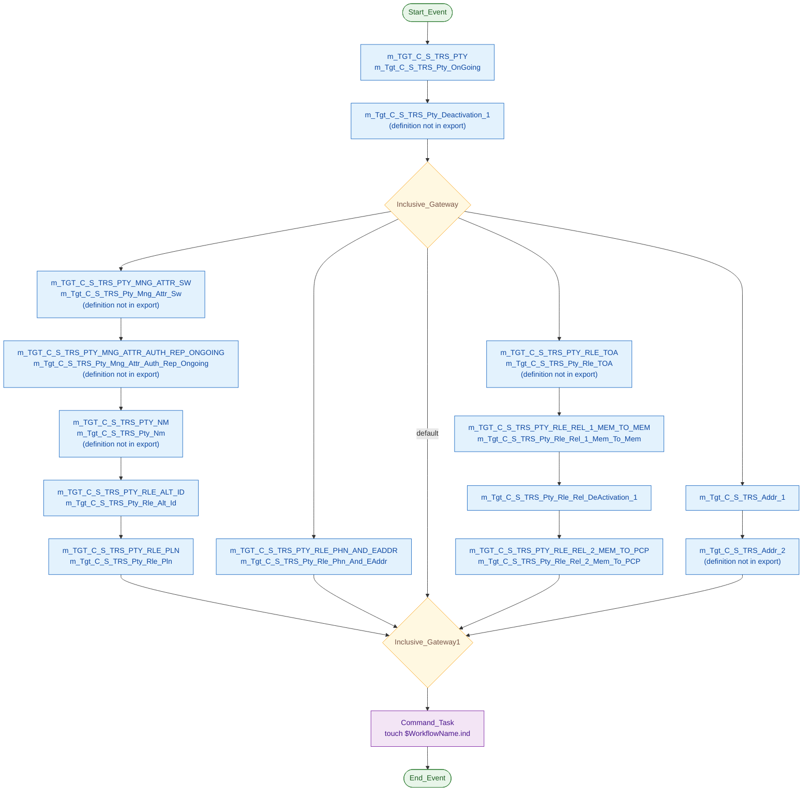

# TRS Informatica IDQ — Workflow & Mapping Analysis

**Subject:** Six Informatica Data Quality (IDQ) workflow exports for the TRS/TIERS → MDM load and deactivation process  
**Source system:** TIERS (referred to in the objects as TRS) · **Target:** Informatica MDM hub, via its staging tables  
**Project:** `HHSC_Enterprise_Development` (plus Informatica's `Informatica_DQ_Content` reference project in the ongoing-load export)  
**Export format:** Informatica IMX, serialization spec 14.0 (IDQ Developer / Model Repository Service export)  
**Files analysed:**

| File | Size | Workflow inside | Mapping definitions included in the file |
|---|---:|---|---:|
| `wf_TRS_Deactivation_Complete.xml` | 102 KB | `wf_TRS_Deactivation_Complete` | 1 |
| `wf_TRS_Deactivation_Initial.xml` | 50 KB | `wf_TRS_Deactivation_Initial` | 0 |
| `wf_TRS_Pty_Rle_Rel_DeActivation_History.xml` | 95 KB | `wf_TRS_Pty_Rle_Rel_DeActivation_History` | 0 |
| `wf_TRS_Relationship_Deactivation.xml` | 55 KB | `wf_TRS_Relationship_Deactivation` | 0 |
| `wf_TRS_Stage_Load_1_Ongoing.xml` | 4305 KB | `wf_TRS_Stage_Load_1_Ongoing` | 25 |
| `wf_TRS_Stage_Load_TOA.xml` | 105 KB | `wf_TRS_Stage_Load_TOA` | 1 |

## How this document was produced, and an important completeness note

Every statement below was taken from the XML exports themselves: workflow and mapping designer annotations (quoted or paraphrased and marked as designer notes), task sequence flows and gateway conditions, workflow variables, mapping instance wiring, transformation settings, custom SQL, source filters, lookup conditions, router/aggregator/expression logic, pre/post-SQL, and the physical table definitions embedded in the exports. Business interpretations are labelled as interpretations where the export does not state the purpose outright.

> **Completeness note — read this first.** Four of the six exports contain the workflow only. The mappings those workflows call are present as *references* (name + ID) but their definitions were not exported, so their internal transformation logic cannot be documented from these files. Where that is the case it is stated explicitly, the mapping's purpose is given from the workflow annotation / referenced tables (and labelled as inferred where appropriate), and the tables it touches are listed. To complete those sections, re-export those workflows from Developer with *dependent objects / referenced mappings included*, or export the mappings listed in §3 individually. The two large exports (`wf_TRS_Stage_Load_1_Ongoing.xml` and `wf_TRS_Stage_Load_TOA.xml`, plus the one mapping in `wf_TRS_Deactivation_Complete.xml`) do contain full mapping definitions, and those are documented transformation-by-transformation.

**Conventions.** `C_S_*` tables are MDM staging tables in the ORS (connection `HHS_MDM_ORS`, Oracle). `STG_TRS_*` tables are HIP staging tables (connection `STAGING`, Oracle). `EXC_*` tables hold DQ exception/bad records. Table and object names are reproduced exactly as spelled in the database — including `STG_TRS_DEACTIVED_MEMBERS`, which is spelled that way in the source system.

## 1. Executive summary

The six workflows form one pipeline that keeps the MDM hub in sync with TIERS for people ("parties"), their roles, contact points, plans, relationships — and, critically, for people and relationships that have been *deactivated* in TIERS and must disappear from the hub without losing their audit history:

1. **`wf_TRS_Stage_Load_1_Ongoing`** is the main load. It builds the validated party record, captures deactivated members/relationships into a deactivation log, and loads all party child objects into the MDM staging tables. Bad records are diverted to an exception table with an exception code and description, rather than failing the load.
2. **`wf_TRS_Stage_Load_TOA`** is a small standalone reference-data load that keeps the MDM's Type of Assistance lookup table in sync.
3. **`wf_TRS_Deactivation_Initial`** and **`wf_TRS_Relationship_Deactivation`** action the deactivation log for parties and for relationships respectively: copy the keys, unmerge them in the MDM, and stage soft-delete (hub_state_ind = -1) records for MDM batch processing.
4. **`wf_TRS_Pty_Rle_Rel_DeActivation_History`** does the same capture for relationship *history/audit* records.
5. **`wf_TRS_Deactivation_Complete`** closes the loop by flagging the processed deactivation log rows so they are never actioned twice.

Design-wise this is a mature, heavily data-quality-driven estate: source codes are translated through a central code crosswalk (`LOOKUP_CODE_VALUE` / `V_LOOKUP_CODE_VALUE`), persons are validated by a library of reusable DQ rules and mapplets (name, gender, race, ethnicity, birth/death dates, SSN, Medicaid/member ID, email, phone and certified address validation), duplicate child records are consolidated before load, and most MDM staging targets are truncate-loaded inside `Utility.Table_Pre_Load_Maint` / `Table_Post_Load_Maint` calls. §6 lists the specific findings and risks spotted in the exports, including two that are worth checking promptly (a hard-coded single-person source filter in two mappings, and a row cap on the phone/email source).

## 2. System landscape

```text
TIERS (TRS)  ──►  HIP staging (STAGING, Oracle)                MDM ORS (HHS_MDM_ORS, Oracle)
                  STG_TRS_D_*  delta extracts                  C_S_TRS_*  staging tables ──► MDM batch
                  STG_TRS_H_*  history extracts                     (stage / load / match / merge)
                  STG_TRS_DEACTIVATED_*  deactivation logs     C_S_LU_TOA  TOA lookup staging
                  EXC_STG_BAD_REC_MEMB  DQ exceptions          ZZ_UTL_*  unmerge / soft-delete utilities
                  LOOKUP_CODE_VALUE  code crosswalk            C_B_*  MDM base-object cross-references
```

**Connections present in the exports:**

- `HHS_MDM_ORS` — ORACLE
- `INFA_STAGE` — ORACLE
- `STAGING` — ORACLE
- `Snowflake_PEI` — ODBC

**End-to-end deactivation lifecycle (how the six workflows fit together):**

```text
Ongoing load detects a member/relationship gone from TIERS
        │  (deactivation capture mappings inside wf_TRS_Stage_Load_1_Ongoing)
        ▼
Deactivation log in HIP staging, PROCESSED_YN = 'N', member removed from valid list
        │
        ├──► wf_TRS_Deactivation_Initial ......... party keys: copy → unmerge → soft-delete staged
        ├──► wf_TRS_Relationship_Deactivation .... relationship keys: copy → unmerge → soft-delete staged
        └──► wf_TRS_Pty_Rle_Rel_DeActivation_History  history/audit relationships captured the same way
        │  (MDM batch applies the staged hub_state_ind = -1 records)
        ▼
wf_TRS_Deactivation_Complete — log rows for the keys actually unmerged are set to PROCESSED_YN = 'Y'
```

## 3. Cross-workflow inventory

| Workflow | Mapping tasks | Command tasks | Gateways | Mapping definitions in export | Indicator file at end? |
|---|---:|---:|---:|---:|---|
| `wf_TRS_Deactivation_Complete` | 2 | 1 | 0 | 1 | Yes |
| `wf_TRS_Deactivation_Initial` | 1 | 2 | 2 | 0 | Yes |
| `wf_TRS_Pty_Rle_Rel_DeActivation_History` | 1 | 0 | 0 | 0 | No |
| `wf_TRS_Relationship_Deactivation` | 1 | 2 | 2 | 0 | Yes |
| `wf_TRS_Stage_Load_1_Ongoing` | 14 | 1 | 2 | 25 | Yes |
| `wf_TRS_Stage_Load_TOA` | 1 | 0 | 0 | 1 | No |

**Mappings called by a workflow but NOT defined in the supplied exports** (re-export with dependencies to document their internals):

- `wf_TRS_Deactivation_Complete`: `m_Tgt_C_S_TRS_Pty_Rle_Rel_Deactivation_4_Mark_Processed`
- `wf_TRS_Deactivation_Initial`: `m_Tgt_C_S_TRS_Pty_Deactivation_2_CopyList`
- `wf_TRS_Pty_Rle_Rel_DeActivation_History`: `m_Tgt_C_S_TRS_Pty_Rle_Rel_DeActivation_History_Audit`
- `wf_TRS_Relationship_Deactivation`: `m_Tgt_C_S_TRS_Pty_Rle_Rel_DeActivation_2_CopyList`
- `wf_TRS_Stage_Load_1_Ongoing`: `m_Tgt_C_S_TRS_Pty_Mng_Attr_Auth_Rep_Ongoing`, `m_Tgt_C_S_TRS_Pty_Nm`, `m_Tgt_C_S_TRS_Pty_Mng_Attr_Sw`, `m_Tgt_C_S_TRS_Pty_Rle_TOA`, `m_Tgt_C_S_TRS_Pty_Deactivation_1`, `m_Tgt_C_S_TRS_Addr_2`

**Reusable components (mapplets/rules) called from inside mappings but defined outside these exports** include: `mplt_Name_Standardization_Indv_Member`, `mplt_BirthDate_Validation`, `mplt_DST_Correction`, `rule_Phone_Std`, `rule_USA_SSN_Validation_post_June2011`, and the IDQ content sets in the `Informatica_DQ_Content` project.

## 4. Common design patterns across the estate

1. **MDM staging load pattern.** Almost every `C_S_*` target is truncate-loaded and wrapped in `call Utility.Table_Pre_Load_Maint('<table>');` / `call Utility.Table_Post_Load_Maint('<table>');`. Exception targets (`EXC_STG_BAD_REC_MEMB`) are *not* truncated — exceptions accumulate for review.
2. **Central code crosswalk.** Source codes are translated with lookups on `LOOKUP_CODE_VALUE` / `V_LOOKUP_CODE_VALUE`, filtered by `CODE_TYPE` (e.g. `TOA`, `MEMBER_PRG`, `PTY_REL`, `PLAN_CD`, `ETHNICITY`, `RACE`, `STATE`, `ALT_ID_TP`, `PHN_USG_TP`), matching on the source code + `SRC_SYS` and returning the master reference code. Unmatched codes raise a DQ exception instead of loading.
3. **Exception-code pattern.** Validation mapplets look the failure up in `EXC_LOOKUP_CODE_VALUE` and return a standard exception code + description, which the calling mapping writes to `EXC_STG_BAD_REC_MEMB`. Routers commonly split on `ISNULL(DQ_Exception_Code)` — clean records load, exception records are diverted.
4. **Consolidation before load.** Phones, emails and relationships pass through consolidation mapplets (sort → filter → rank within source key → aggregate) so the MDM receives one consolidated record per key/timeline.
5. **Valid-member spine.** The Party mapping rebuilds `STG_TRS_VALID_MEMBERS` (merging the delta with previously valid members, in its source SQL) and downstream relationship mappings pick one source key per individual from it — `MIN(pty_pk)`, prioritising the MCI record (see the `min_pk` CTE in the relationship source SQL).
6. **Success-gated sequencing + indicator files.** Workflow branches proceed only when `$var:MappingTaskSuccessful = TRUE` (or the deactivation workflows' `TgtRows` / command-exit checks pass), and most workflows finish by touching `<WorkflowName>.ind` in `/opt/apps/informatica/SrcFiles/Indicators` to signal the scheduler / MDM batch that the load is complete.
7. **Soft delete, never hard delete.** Deactivation is implemented as unmerge + staged records with `hub_state_ind = -1`, applied by the normal MDM batch — preserving history and reversibility.

## 5. Findings, risks and points to verify

These are observations from the exports as supplied. Items 1–3 should be checked against the live repository / runtime configuration before acting — an export can preserve a developer's local test settings.

1. **Hard-coded single-person filter in two party mappings.** The source in both `m_Tgt_C_S_TRS_Pty_OnGoing` and `m_Tgt_C_S_TRS_Pty_Rle_Alt_Id` carries the source filter `INDV_ID=504937068`. If that filter is active at runtime it restricts the party/alt-ID load to one individual; it reads as a developer test filter left in the object. *Verify in the live mapping / runtime and remove if unintended.*
2. **Row cap on the phone/email source.** `m_Tgt_C_S_TRS_Pty_Rle_Phn_And_EAddr` reads its staging delta with filter `rownum < 100000`. Above ~100k delta rows, contact records would be silently dropped from that run. *Confirm this is a deliberate batch-size guard with a compensating process, or raise/remove it.*
3. **Suspect table name in a pre-SQL call.** The phone target's pre-SQL is `call Utility.Table_Pre_Load_Maint('_C_S_TRS_PTY_RLE_PHN');` — note the leading underscore, where the matching post-SQL and every other target in the estate use the plain table name. *Verify the utility procedure's behaviour for a non-existent table name; if it no-ops, the phone staging table is loading without its pre-load maintenance.*
4. **Four exports are workflow-only.** See the completeness note at the top: the CopyList, party-deactivation capture, name, managed-attribute, TOA-role and second address mappings cannot be audited from these files. This is also a change-control gap — a workflow export without its mappings is not a recoverable backup.
5. **Key deactivation logic lives outside IDQ.** `unmerge_soft_delete_party.sh` / `unmerge_soft_delete_relationship.sh` (MDM batch-group unmerge + an Oracle soft-delete procedure) do the actual hub work for two workflows and are not versioned with these exports. Review/backup those scripts with the same rigour.
6. **Documented re-run behaviour.** Per the workflows' own annotations, re-running the Initial / Relationship deactivation workflows re-populates the MDM staging tables and fails on duplicate keys if soft-delete rows already exist. The Mark Processed step is re-runnable by design. Operational runbooks should sequence a failed deactivation run as *Complete/clean-up first*, not a blind restart.
7. **Truncate-load exposure.** Because `C_S_*` targets are truncated at the start of their mapping, a mapping that fails mid-load leaves that MDM staging table empty or partial until a successful re-run; there is no cross-mapping transaction. The success-gated workflow design mitigates downstream impact, but the MDM batch must never be started off an indicator file from a partially-failed cycle.
8. **Shared workflow variable across parallel branches (ongoing load).** All parallel branches in `wf_TRS_Stage_Load_1_Ongoing` set and test the same `$var:MappingTaskSuccessful`. With concurrent branches this can mask which branch actually failed (the last writer wins). Per-branch variables or per-branch gateways would make failure isolation auditable.
9. **`returnAny` on code lookups.** Code-crosswalk lookups use multiple-match handling = return any. Duplicate rows in `LOOKUP_CODE_VALUE` for the same code type + source code would therefore produce non-deterministic master codes. A uniqueness check on the crosswalk is the control here.
10. **Performance note (from the designer's own annotation).** Address validation is the bottleneck of the ongoing load; the two-step Addr_1/Addr_2 design (validate unique addresses once, then distribute) is the mitigation already in place — preserve it in any redesign.

## 6. Workflow-by-workflow write-up

### 6.1 `wf_TRS_Stage_Load_1_Ongoing`

*Export file: `wf_TRS_Stage_Load_1_Ongoing.xml` (4305 KB) · Project: Informatica_DQ_Content, HHSC_Enterprise_Development · Connections: STAGING, HHS_MDM_ORS, INFA_STAGE, Snowflake_PEI*

#### Business view

This is the main ongoing TIERS (TRS) load into the MDM. It builds the party (person) record first, captures any members who have been deactivated in TIERS so they are removed from the valid-member list, and then loads every party child/role object in parallel branches: names, alternate IDs, plans, type-of-assistance (TOA), phones and email addresses, addresses, managed-care attributes, and the two relationship loads (member-to-member and member-to-PCP/provider). Validated, standardised records are written to the MDM staging tables (C_S_TRS_* in the HHS_MDM_ORS) ready for the MDM batch (stage/load/match/merge) process; records that fail data-quality validation are written instead to the exception table EXC_STG_BAD_REC_MEMB in HIP staging for investigation and correction.

> **Designer description on the workflow:** Process TIERS Loads.  Note that ALL jobs after PTY can run concurrently except the 2 MNG_ATTR which must follow each other due to bulk loading the same target table.  ADDR Is the bottleneck (Longest job).

[ML 10/7/2020] - Removed Coverage mapping per Sunil and Thomas Colvin
[ML 10/15/2020] - Added deactivaton mapping immediately after the party mapping.   
This is needed to remove deactivated members from Valid Stage so they are not included in all the child extracts. 
The deactivation mapplett captures deactivated in TIERS in an deactivation log table in HIP staging. New data in the deactivation log is flagged as unprocessed

#### Technical view — workflow control flow

| Step | Task | Type | Mapping / command | Flows to (condition) |
|---:|---|---|---|---|
| 1 | `Start_Event` | Start |  | m_TGT_C_S_TRS_PTY |
| 2 | `m_TGT_C_S_TRS_PTY` | Mapping task | `m_Tgt_C_S_TRS_Pty_OnGoing` | m_Tgt_C_S_TRS_Pty_Deactivation_1 [$var:MappingTaskSuccessful=TRUE] |
| 3 | `m_Tgt_C_S_TRS_Pty_Deactivation_1` | Mapping task | `m_Tgt_C_S_TRS_Pty_Deactivation_1` *(definition not in this export)* | Inclusive_Gateway [$var:MappingTaskSuccessful=TRUE] |
| 4 | `Inclusive_Gateway` | Parallel (inclusive) gateway |  | m_TGT_C_S_TRS_PTY_RLE_TOA [$var:MappingTaskSuccessful=TRUE]; m_TGT_C_S_TRS_PTY_RLE_PHN_AND_EADDR [$var:MappingTaskSuccessful=TRUE]; m_TGT_C_S_TRS_PTY_MNG_ATTR_SW [$var:MappingTaskSuccessful=TRUE]; Inclusive_Gateway1 [default]; m_Tgt_C_S_TRS_Addr_1 |
| 5 | `m_TGT_C_S_TRS_PTY_RLE_TOA` | Mapping task | `m_Tgt_C_S_TRS_Pty_Rle_TOA` *(definition not in this export)* | m_TGT_C_S_TRS_PTY_RLE_REL_1_MEM_TO_MEM [$var:MappingTaskSuccessful=TRUE] |
| 6 | `m_TGT_C_S_TRS_PTY_RLE_REL_1_MEM_TO_MEM` | Mapping task | `m_Tgt_C_S_TRS_Pty_Rle_Rel_1_Mem_To_Mem` | m_Tgt_C_S_TRS_Pty_Rle_Rel_DeActivation_1 |
| 7 | `m_Tgt_C_S_TRS_Pty_Rle_Rel_DeActivation_1` | Mapping task | `m_Tgt_C_S_TRS_Pty_Rle_Rel_DeActivation_1` | m_TGT_C_S_TRS_PTY_RLE_REL_2_MEM_TO_PCP |
| 8 | `m_TGT_C_S_TRS_PTY_RLE_REL_2_MEM_TO_PCP` | Mapping task | `m_Tgt_C_S_TRS_Pty_Rle_Rel_2_Mem_To_PCP` | Inclusive_Gateway1 [$var:MappingTaskSuccessful=TRUE] |
| 9 | `Inclusive_Gateway1` | Parallel (inclusive) gateway |  | Command_Task [$var:MappingTaskSuccessful=TRUE] |
| 10 | `Command_Task` | Command task | `touch ${var:sys.WorkflowName}.ind` — working dir `/opt/apps/informatica/SrcFiles/Indicators` | End_Event |
| 11 | `End_Event` | End |  |  |
| 12 | `m_TGT_C_S_TRS_PTY_RLE_PHN_AND_EADDR` | Mapping task | `m_Tgt_C_S_TRS_Pty_Rle_Phn_And_EAddr` | Inclusive_Gateway1 [$var:MappingTaskSuccessful=TRUE] |
| 13 | `m_TGT_C_S_TRS_PTY_MNG_ATTR_SW` | Mapping task | `m_Tgt_C_S_TRS_Pty_Mng_Attr_Sw` *(definition not in this export)* | m_TGT_C_S_TRS_PTY_MNG_ATTR_AUTH_REP_ONGOING [$var:MappingTaskSuccessful=TRUE] |
| 14 | `m_TGT_C_S_TRS_PTY_MNG_ATTR_AUTH_REP_ONGOING` | Mapping task | `m_Tgt_C_S_TRS_Pty_Mng_Attr_Auth_Rep_Ongoing` *(definition not in this export)* | m_TGT_C_S_TRS_PTY_NM [$var:MappingTaskSuccessful=TRUE] |
| 15 | `m_TGT_C_S_TRS_PTY_NM` | Mapping task | `m_Tgt_C_S_TRS_Pty_Nm` *(definition not in this export)* | m_TGT_C_S_TRS_PTY_RLE_ALT_ID [$var:MappingTaskSuccessful=TRUE] |
| 16 | `m_TGT_C_S_TRS_PTY_RLE_ALT_ID` | Mapping task | `m_Tgt_C_S_TRS_Pty_Rle_Alt_Id` | m_TGT_C_S_TRS_PTY_RLE_PLN [$var:MappingTaskSuccessful=TRUE] |
| 17 | `m_TGT_C_S_TRS_PTY_RLE_PLN` | Mapping task | `m_Tgt_C_S_TRS_Pty_Rle_Pln` | Inclusive_Gateway1 [$var:MappingTaskSuccessful=TRUE] |
| 18 | `m_Tgt_C_S_TRS_Addr_1` | Mapping task | `m_Tgt_C_S_TRS_Addr_1` | m_Tgt_C_S_TRS_Addr_2 [$var:MappingTaskSuccessful=TRUE] |
| 19 | `m_Tgt_C_S_TRS_Addr_2` | Mapping task | `m_Tgt_C_S_TRS_Addr_2` *(definition not in this export)* | Inclusive_Gateway1 [$var:MappingTaskSuccessful=TRUE] |

**Workflow variables:**
- `MappingTaskSuccessful` — initial value: `true`

**Notes:**
- Documented in the workflow itself: all jobs after the Party (PTY) mapping can run concurrently, except the two MNG_ATTR mappings, which must run one after the other because they bulk-load the same target table. The Address (ADDR) load is called out as the bottleneck / longest job.
- Change history in the annotation: Coverage mapping removed 2020-10-07 (per Sunil / Thomas Colvin); deactivation mapping added immediately after Party on 2020-10-15 so deactivated members are excluded from all child extracts.
- Every sequence flow out of a mapping task is gated on $var:MappingTaskSuccessful = TRUE, so a failed mapping stops its branch rather than letting downstream loads run on partial data.
- On success the workflow drops an indicator file (touch ${var:sys.WorkflowName}.ind) in /opt/apps/informatica/SrcFiles/Indicators — the downstream MDM batch / scheduler signal that this load finished.


**Workflow diagram (Mermaid)** — control flow of `wf_TRS_Stage_Load_1_Ongoing`. Every sequence flow out of a mapping task is gated on `$var:MappingTaskSuccessful = TRUE` unless marked *default*. The parallel gateway fans the child loads out; all branches re-join at `Inclusive_Gateway1` before the indicator file is written.



#### Mappings in this workflow

##### m_Tgt_C_S_TRS_Pty_OnGoing

- **Kind:** Target mapping (executable load) · **Transformations / instances:** 42
- **Reads:** `STG_TRS_D_DC_INDV`
- **Writes:** `STG_TRS_VALID_MEMBERS`, `EXC_STG_BAD_REC_MEMB` (×6 instances), `C_S_TRS_PTY`, `C_S_TRS_PTY_RLE`
- **Lookups against:** `STG_TRS_VALID_MEMBERS`, `EXC_LOOKUP_CODE_VALUE` (×2 instances)

**Purpose.** Core party load. Merges the TIERS individual delta (STG_TRS_D_DC_INDV / STG_TRS_H_DC_INDV) with the previously-valid member list to rebuild STG_TRS_VALID_MEMBERS, validates and standardises each person (name standardisation, gender, race, ethnicity, birth-date and death-date checks), and truncate-loads the valid party and party-role records to C_S_TRS_PTY and C_S_TRS_PTY_RLE. Each class of bad record is written to a dedicated EXC_STG_BAD_REC_MEMB target (invalid name, gender, birth date, death date, race, ethnicity).

> **Designer note on this mapping:** [ML 10/28/2020] Corrected the run date port on gender and death date exceptions
[ML 01/22/2021] Source SQL Additions to account for re-runs and re-activations
[NG 12/15/2021] Fix Future DOB
[RS 07/11/2023] Source SQL Additions to account Race_Cd & Ethnicity Cd & respective Exceptions from Source Data

**Mapping parameters:**
- `PTY_BO_CLASS_CD_Member` — type string, precision 10
- `DC_INDV_TBL_SRC` — type string, precision 1000
- `MCI_TBL_SRC` — type string, precision 1000
- `MNG_ATTR_TP_AR` — type string, precision 1000
- `RLE_BO_CLASS_CD_Member` — type string, precision 1000
- `DC_ABS_PAR_SRC` — type string, precision 100

**Data-flow diagram (Mermaid)** — `m_Tgt_C_S_TRS_Pty_OnGoing`, the core party mapping (42 transformations). Grouped by stage: read/interface → DQ validation → exception routing → de-duplication/consolidation → valid-member spine → party & party-role loads. Orange targets are the six `EXC_STG_BAD_REC_MEMB` exception outputs; blue targets are the valid loads. Every arrow is an instance-to-instance link as wired in the export.

```mermaid
flowchart LR
    subgraph G1["1 · Read & interface"]
        N1["Read_STG_TRS_D_DC_INDV<br/>[Source]"]
        N2["exp_Tiers_Data_Load<br/>[Expression]"]
        N13["exp_interface<br/>[Expression]"]
    end
    subgraph G2["2 · DQ validation (reusable mapplets / rules + exception consolidation)"]
        N17["mplt_Gender_Validation<br/>[Mapplet/Rule]"]
        N31["mplt_BirthDate_Validation<br/>[Mapplet/Rule]"]
        N20["mplt_Name_Standardization_Indv_Member<br/>[Mapplet/Rule]"]
        N15["exp_Validate_Death_Dt<br/>[Expression]"]
        N16["lkp_Exc_Death_Dt<br/>[Lookup]"]
        N19["exp_Exception_Consolidation<br/>[Expression]"]
    end
    subgraph G3["3 · Exception routing & invalid-party outputs"]
        N14["rtr_Invalid_Party<br/>[Router]"]
        N30["exp_Invalid_Party_Name<br/>[Expression]"]
        N42["Lookup_EXC_LOOKUP_CODE_VALUE<br/>[Lookup]"]
        N33["exp_AttributeValue<br/>[Expression]"]
        N18["Write_Invalid_Party_Name<br/>[Target]"]
        N21["Write_Invalid_Party_Gender<br/>[Target]"]
        N22["Write_Invalid_Party_DeathDate<br/>[Target]"]
        N32["Write_Invalid_Party_BirthDate<br/>[Target]"]
        N40["Fil_Race_Exceptions<br/>[Filter]"]
        N41["Fil_Ethnicity_Exceptions<br/>[Filter]"]
        N38["Exp_Race_Exceptions<br/>[Expression]"]
        N39["Exp_Ethnicity_Exceptions<br/>[Expression]"]
        N37["Write_Invalid_Party_Race<br/>[Target]"]
        N36["Write_Invalid_Party_Ethnicity<br/>[Target]"]
    end
    subgraph G4["4 · De-duplication & consolidation"]
        N6["srtr_Dedup_Rec<br/>[Sorter]"]
        N35["mplt_Race_Validation<br/>[Mapplet/Rule]"]
        N34["mplt_Ethnicity_Validation<br/>[Mapplet/Rule]"]
        N5["exp_Party_Consolidation<br/>[Expression]"]
        N7["fltr_Dups<br/>[Filter]"]
    end
    subgraph G5["5 · Valid-member spine (STG_TRS_VALID_MEMBERS)"]
        N8["fltr_New_Valid_Members<br/>[Filter]"]
        N11["lkp_Stg_TRS_Valid_Members<br/>[Lookup]"]
        N25["srtr_Pkey<br/>[Sorter]"]
        N12["agg_Valid_Members<br/>[Aggregator]"]
        N10["exp_Stg_Valid_Members<br/>[Expression]"]
        N9["Write_Stg_TRS_Valid_Members<br/>[Target]"]
    end
    subgraph G6["6 · Party & party-role loads (MDM staging)"]
        N3["exp_TRS_Party_Load<br/>[Expression]"]
        N29["Sorter1<br/>[Sorter]"]
        N28["Aggregator1<br/>[Aggregator]"]
        N23["Write_C_S_TRS_PTY<br/>[Target]"]
        N4["exp_TRS_Pty_Rle_Load<br/>[Expression]"]
        N27["Sorter<br/>[Sorter]"]
        N26["Aggregator<br/>[Aggregator]"]
        N24["Write_C_S_TRS_PTY_RLE<br/>[Target]"]
    end
    N1 --> N2
    N2 --> N13
    N3 --> N29
    N4 --> N27
    N5 --> N7
    N6 --> N5
    N6 --> N35
    N6 --> N34
    N7 --> N3
    N7 --> N4
    N7 --> N11
    N7 --> N8
    N7 --> N40
    N7 --> N41
    N8 --> N25
    N10 --> N9
    N11 --> N8
    N12 --> N10
    N13 --> N17
    N13 --> N15
    N13 --> N19
    N13 --> N20
    N13 --> N31
    N14 --> N21
    N14 --> N22
    N14 --> N6
    N14 --> N30
    N14 --> N32
    N14 --> N33
    N15 --> N16
    N16 --> N19
    N17 --> N19
    N19 --> N14
    N20 --> N19
    N25 --> N12
    N26 --> N24
    N27 --> N26
    N28 --> N23
    N29 --> N28
    N30 --> N18
    N30 --> N42
    N31 --> N19
    N33 --> N32
    N34 --> N5
    N35 --> N5
    N38 --> N37
    N39 --> N36
    N40 --> N38
    N41 --> N39
    N42 --> N18
    classDef source fill:#e8f5e9,stroke:#2e7d32,color:#1b5e20;
    classDef goodtarget fill:#e3f2fd,stroke:#1565c0,color:#0d47a1;
    classDef exctarget fill:#fbe9e7,stroke:#d84315,color:#bf360c;
    classDef mapplet fill:#f3e5f5,stroke:#7b1fa2,color:#4a148c;
    class N1 source;
    class N9,N23,N24 goodtarget;
    class N18,N21,N22,N32,N36,N37 exctarget;
    class N17,N20,N31,N34,N35 mapplet;
```



**Data flow (instance to instance, as wired in the export):**
- `Read_STG_TRS_D_DC_INDV` → `exp_Tiers_Data_Load`
- `exp_Tiers_Data_Load` → `exp_interface`
- `exp_TRS_Party_Load` → `Sorter1`
- `exp_TRS_Pty_Rle_Load` → `Sorter`
- `exp_Party_Consolidation` → `fltr_Dups`
- `srtr_Dedup_Rec` → `exp_Party_Consolidation`
- `srtr_Dedup_Rec` → `mplt_Race_Validation`
- `srtr_Dedup_Rec` → `mplt_Ethnicity_Validation`
- `fltr_Dups` → `exp_TRS_Party_Load`
- `fltr_Dups` → `exp_TRS_Pty_Rle_Load`
- `fltr_Dups` → `lkp_Stg_TRS_Valid_Members`
- `fltr_Dups` → `fltr_New_Valid_Members`
- `fltr_Dups` → `Fil_Race_Exceptions`
- `fltr_Dups` → `Fil_Ethnicity_Exceptions`
- `fltr_New_Valid_Members` → `srtr_Pkey`
- `exp_Stg_Valid_Members` → `Write_Stg_TRS_Valid_Members`
- `lkp_Stg_TRS_Valid_Members` → `fltr_New_Valid_Members`
- `agg_Valid_Members` → `exp_Stg_Valid_Members`
- `exp_interface` → `mplt_Gender_Validation`
- `exp_interface` → `exp_Validate_Death_Dt`
- `exp_interface` → `exp_Exception_Consolidation`
- `exp_interface` → `mplt_Name_Standardization_Indv_Member`
- `exp_interface` → `mplt_BirthDate_Validation`
- `rtr_Invalid_Party` → `Write_Invalid_Party_Gender`
- `rtr_Invalid_Party` → `Write_Invalid_Party_DeathDate`
- `rtr_Invalid_Party` → `srtr_Dedup_Rec`
- `rtr_Invalid_Party` → `exp_Invalid_Party_Name`
- `rtr_Invalid_Party` → `Write_Invalid_Party_BirthDate`
- `rtr_Invalid_Party` → `exp_AttributeValue`
- `exp_Validate_Death_Dt` → `lkp_Exc_Death_Dt`
- `lkp_Exc_Death_Dt` → `exp_Exception_Consolidation`
- `mplt_Gender_Validation` → `exp_Exception_Consolidation`
- `exp_Exception_Consolidation` → `rtr_Invalid_Party`
- `mplt_Name_Standardization_Indv_Member` → `exp_Exception_Consolidation`
- `srtr_Pkey` → `agg_Valid_Members`
- `Aggregator` → `Write_C_S_TRS_PTY_RLE`
- `Sorter` → `Aggregator`
- `Aggregator1` → `Write_C_S_TRS_PTY`
- `Sorter1` → `Aggregator1`
- `exp_Invalid_Party_Name` → `Write_Invalid_Party_Name`
- `exp_Invalid_Party_Name` → `Lookup_EXC_LOOKUP_CODE_VALUE`
- `mplt_BirthDate_Validation` → `exp_Exception_Consolidation`
- `exp_AttributeValue` → `Write_Invalid_Party_BirthDate`
- `mplt_Ethnicity_Validation` → `exp_Party_Consolidation`
- `mplt_Race_Validation` → `exp_Party_Consolidation`
- `Exp_Race_Exceptions` → `Write_Invalid_Party_Race`
- `Exp_Ethnicity_Exceptions` → `Write_Invalid_Party_Ethnicity`
- `Fil_Race_Exceptions` → `Exp_Race_Exceptions`
- `Fil_Ethnicity_Exceptions` → `Exp_Ethnicity_Exceptions`
- `Lookup_EXC_LOOKUP_CODE_VALUE` → `Write_Invalid_Party_Name`

**Transformations in this mapping:**

| # | Instance | Type | What it does / notes from the export |
|---|---|---|---|
| 1 | `Read_STG_TRS_D_DC_INDV` | Source (read) |  |
| 2 | `exp_Tiers_Data_Load` | Expression |  |
| 3 | `exp_TRS_Party_Load` | Expression |  |
| 4 | `exp_TRS_Pty_Rle_Load` | Expression |  |
| 5 | `exp_Party_Consolidation` | Expression |  |
| 6 | `srtr_Dedup_Rec` | Sorter |  |
| 7 | `fltr_Dups` | Filter |  |
| 8 | `fltr_New_Valid_Members` | Filter |  |
| 9 | `Write_Stg_TRS_Valid_Members` | Target (write) |  |
| 10 | `exp_Stg_Valid_Members` | Expression |  |
| 11 | `lkp_Stg_TRS_Valid_Members` | Lookup |  |
| 12 | `agg_Valid_Members` | Aggregator |  |
| 13 | `exp_interface` | Expression | Indv id is mapped to member id |
| 14 | `rtr_Invalid_Party` | Router |  |
| 15 | `exp_Validate_Death_Dt` | Expression | Checks if Death Date is valid (less than current date) |
| 16 | `lkp_Exc_Death_Dt` | Lookup | Lookup to EXC_LOOKUP_CODE_VALUE to return exception details for invalid DEATH_DT |
| 17 | `mplt_Gender_Validation` | Mapplet / Rule call | Calls mplt_Gender_Validation. |
| 18 | `Write_Invalid_Party_Name` | Target (write) |  |
| 19 | `exp_Exception_Consolidation` | Expression |  |
| 20 | `mplt_Name_Standardization_Indv_Member` | Mapplet / Rule call | Calls mplt_Name_Standardization_Indv_Member. |
| 21 | `Write_Invalid_Party_Gender` | Target (write) |  |
| 22 | `Write_Invalid_Party_DeathDate` | Target (write) |  |
| 23 | `Write_C_S_TRS_PTY` | Target (write) |  |
| 24 | `Write_C_S_TRS_PTY_RLE` | Target (write) |  |
| 25 | `srtr_Pkey` | Sorter |  |
| 26 | `Aggregator` | Aggregator |  |
| 27 | `Sorter` | Sorter |  |
| 28 | `Aggregator1` | Aggregator |  |
| 29 | `Sorter1` | Sorter |  |
| 30 | `exp_Invalid_Party_Name` | Expression |  |
| 31 | `mplt_BirthDate_Validation` | Mapplet / Rule call | Calls mplt_BirthDate_Validation. |
| 32 | `Write_Invalid_Party_BirthDate` | Target (write) |  |
| 33 | `exp_AttributeValue` | Expression |  |
| 34 | `mplt_Ethnicity_Validation` | Mapplet / Rule call | Calls mplt_Ethnicity_Validation. |
| 35 | `mplt_Race_Validation` | Mapplet / Rule call | Calls mplt_Race_Validation. |
| 36 | `Write_Invalid_Party_Ethnicity` | Target (write) |  |
| 37 | `Write_Invalid_Party_Race` | Target (write) |  |
| 38 | `Exp_Race_Exceptions` | Expression |  |
| 39 | `Exp_Ethnicity_Exceptions` | Expression |  |
| 40 | `Fil_Race_Exceptions` | Filter |  |
| 41 | `Fil_Ethnicity_Exceptions` | Filter |  |
| 42 | `Lookup_EXC_LOOKUP_CODE_VALUE` | Lookup |  |

**Transformation logic in detail:**

- **Read_STG_TRS_D_DC_INDV** (Source (read))
  - Table(s): `STG_TRS_D_DC_INDV`
  - Source/lookup filter: `INDV_ID=504937068`
  - Custom SQL:

    ```sql
    with New_Valid_indvs as  		-- "Merge" new records from delta with prior valid data to from a master list
    (
    select /*+ parallel (8) */
    	distinct indv_id
    from STG_TRS_D_CV_MCI_EDG_INDV_TOA
    where conversion_ind = 'C'
    
    union
    
    select /*+ parallel (8) */
    	distinct indv_id
    from STG_TRS_D_DC_INDV
    where FILE_CLEARANCE_SW = 'Y'
    and Inactive_ind = 'N'
    and delete_sw = 'N'
    
    UNION
    
    select /*+ parallel (8) */
    	distinct indv_id
    from STG_TRS_D_CV_DC_MCI_INDV
    where  Inactive_ind = 'N'
    
    UNION
    
    select /*+ parallel (8) */
    	distinct indv_id
    from STG_TRS_VALID_MEMBERS
    
    minus                           -- *** Remove any records that will be inactivated today
    
    select /*+ parallel (8) */
    	distinct indv_id
    from STG_TRS_D_DC_INDV
    where Inactive_ind = 'Y'
    or delete_sw = 'Y'
    
    minus
    
    select /*+ parallel (8) */
    	distinct indv_id
    from STG_TRS_D_CV_DC_MCI_INDV
    where  Inactive_ind = 'Y'
    
    -- [ML 01/22/2021] Additions to account for re-runs and re-activations
    Minus
    
    Select indv_id
    from STG_TRS_DEACTIVED_MEMBERS
    )
    -- [ML 10/22/2020]  Removed 1/2 cleared relations based on guidance from TC that
    --			1. He wants to suppress relation exception on invalid / deactivcated members
    --          2. That if an active member deactivates, we deactivate all their relations
    --,rel as  -- Find relation records only 1/2 cleared that were reported today
    --(
    --select /*+ parallel (8) */ distinct
    --    case when c1.indv_id is null then rel.indv_id else rel.ref_indv_id end indv_id
    --	 --count(*), count(distinct rel.indv_id)
    --from STG_TRS_D_DC_RELATIONSHIPS rel
    --left join New_Valid_indvs c1
    --	on  rel.indv_id = c1.indv_id
    --left join New_Valid_indvs c2
    --	on  rel.ref_indv_id = c2.indv_id
    --where
    --	(
    --		c1.indv_id is null and c2.indv_id is not null
    --	or
    --		c2.indv_id is null and c1.indv_id is not null
    --	)
    --)
    --,filter as    -- merge new relation records to form a master list
    --(
    --select /*+ parallel (8) */ indv_id from rel
    --union
    --select /*+ parallel (8) */ indv_id from New_Valid_indvs
    --)
    
    
    
    , ALL_INDV as  --
    (
    SELECT
    	INDV_ID,
    	FIRST_NAME,
    	MID_NAME,
    	LAST_NAME,
    	SUFX_NAME,
    	PREFIX_NAME,
    	GENDER_CD,
    	RACE_CD,
    	ETHNICITY_CD,
    	NULL as SSA_VAL_SW,
    	NULL as FILE_CL_SW,
    	DOB_DT,
    	NULL AS DEATH_DT,
    	CREATE_DT,
    	'$MCI_TBL_SRC' as SRC_TBL
    FROM STG_TRS_D_CV_DC_MCI_INDV MCI_INDV
    	UNION ALL
    
    SELECT
    	INDV_ID,
    	FIRST_NAME,
    	MID_NAME,
    	LAST_NAME,
    	SUFX_NAME,
    	PREFIX_NAME,
    	GENDER_CD,
    	RACE_CD,
    	ETHNICITY_CD,
    	SSA_VALIDATION_SW as SSA_VAL_SW,
    	FILE_CLEARANCE_SW as FILE_CL_SW,
    	DOB_DT,
    	DEATH_DT,
    	CREATE_DT,
    	'$DC_INDV_TBL_SRC' as SRC_TBL
    FROM STG_TRS_D_DC_INDV INDV
    )
    SELECT  /*+ parallel (8) */
    	DISTINCT all_indv.INDV_ID as INDV_ID,
    	RTRIM(LTRIM(FIRST_NAME)) AS FIRST_NAME,
    	RTRIM(LTRIM(MID_NAME)) AS MID_NAME,
    	RTRIM(LTRIM(LAST_NAME)) AS LAST_NAME,
        RTRIM(SUFX_NAME) AS SUFX_NAME,
    	RTRIM(PREFIX_NAME) AS PREFIX_NAME,
    	GENDER_CD AS GENDER_CD,
    	RACE_CD,
    	ETHNICITY_CD,
    	SSA_VAL_SW,
    	FILE_CL_SW,
    	DOB_DT AS DOB_DT,
    	CREATE_DT as CREATE_DT ,
    	SRC_TBL,
    	DEATH_DT as DEATH_DT
    FROM ALL_INDV
    inner join New_Valid_indvs filter
    	on filter.indv_id = all_indv.indv_id
    order by all_indv.INDV_ID, src_tbl -- [ML 10/19/2020] needed for agg step
    ```

- **exp_Tiers_Data_Load** (Expression)
  - Derived / assigned fields (14):
    - `Indv_Id` = `Indv_Id`
    - `First_Name` = `First_Name`
    - `Mid_Name` = `Mid_Name`
    - `Last_Name` = `Last_Name`
    - `Sufx_Name` = `Sufx_Name`
    - `Prefix_Name` = `Prefix_Name`
    - `Gender_Cd` = `Gender_Cd`
    - `Dob_Dt` = `Dob_Dt`
    - `Update_Dt` = `Update_Dt`
    - `Src_System` = `'TRS'`
    - `Object_Name` = `'C_S_TRS_PTY'`
    - `Pkey_Src_Object_Pty` = `Decode(True,
SRC_TBL=$DC_INDV_TBL_SRC,
to_CHAR(INDV_ID) || '|' || $DC_INDV_TBL_SRC,
TO_CHAR(INDV_ID))


--IIF(SRC_TBL=$DC_INDV_TBL_SRC, to_CHAR(INDV_ID) || '|' --|| $DC_INDV_TBL_SRC,
-- IIF(SRC_TBL= $DC_ABS_PAR_SRC, --$DC_ABS_PAR_SRC || '|' || --TO_CHAR(ABSENT_PAR_SQ_NM), to_CHAR(INDV_ID)))`
    - `Race_Cd` = `Race_Cd`
    - `Ethnicity_Cd` = `Ethnicity_Cd`

- **exp_TRS_Party_Load** (Expression)
  - Derived / assigned fields (32):
    - `INDV_ID` = `INDV_ID`
    - `PKEY_SRC_OBJECT` = `PKEY_SRC_OBJECT`
    - `ROWID_OBJECT` = `ROWID_OBJECT`
    - `DELETED_IND` = `DELETED_IND`
    - `DELETED_DATE` = `DELETED_DATE`
    - `DELETED_BY` = `DELETED_BY`
    - `GNDR_CD` = `GNDR_CD`
    - `SFX_NM` = `SFX_NM`
    - `PTY_BO_CLASS_CD` = `$PTY_BO_CLASS_CD_Member`
    - `FRST_NM` = `FRST_NM`
    - `PRFX_NM` = `PRFX_NM`
    - `LST_NM` = `LST_NM`
    - `MDL_NM` = `MDL_NM`
    - `FULL_NM` = `FULL_NM`
    - `BIRTH_DT` = `BIRTH_DT`
    - `v_Rank` = `IIF(PKEY_SRC_OBJECT<>v_LAST_PKEY,1, v_RANK+1)`
    - `Rank` = `v_RANK`
    - `VERSION_SEQ` = `VERSION_SEQ`
    - `PERIOD_REFERENCE_TIME` = `PERIOD_REFERENCE_TIME`
    - `TIMELINE_ACTION` = `TIMELINE_ACTION`
    - `min_PERIOD_START_DATE` = `min_PERIOD_START_DATE`
    - `PERIOD_END_DATE` = `PERIOD_END_DATE`
    - `LAST_UPDATE_DATE` = `SYSTIMESTAMP()`
    - `UPDATED_BY` = `UPDATED_BY`
    - `CREATE_DATE` = `CREATE_DATE`
    - `CREATOR` = `CREATOR`
    - `SRC_ROWID` = `SRC_ROWID`
    - `HUB_STATE_IND` = `HUB_STATE_IND`
    - `FLAG_SRC` = `FLAG_SRC`
    - `Facility_Number` = `Facility_Number`
    - `SRC_FULL_NM` = `SRC_FULL_NM`
    - `v_LAST_PKEY` = `PKEY_SRC_OBJECT`

- **exp_TRS_Pty_Rle_Load** (Expression)
  - Derived / assigned fields (17):
    - `PKEY_SRC_OBJECT_PTY` = `PKEY_SRC_OBJECT_PTY`
    - `PKEY_SRC_OBJECT_PTY_RLE` = `PKEY_SRC_OBJECT_PTY || '|' || $RLE_BO_CLASS_CD_Member`
    - `RowId_Object` = `RowId_Object`
    - `Deleted_Ind` = `Deleted_Ind`
    - `Deleted_Date` = `Deleted_Date`
    - `Deleted_By` = `Deleted_By`
    - `RLE_BO_CLASS_CD` = `$RLE_BO_CLASS_CD_Member`
    - `VERSION_SEQ` = `VERSION_SEQ`
    - `min_PERIOD_START_DATE` = `min_PERIOD_START_DATE`
    - `Period_End_Date` = `Period_End_Date`
    - `Period_Reference_Time` = `Period_Reference_Time`
    - `Timeline_Action` = `Timeline_Action`
    - `Last_Update_Date` = `$sys.MappingRunStartTime`
    - `Updated_By` = `Updated_By`
    - `Create_Date` = `Create_Date`
    - `Creator` = `Creator`
    - `Hub_State_Ind` = `Hub_State_Ind`

- **exp_Party_Consolidation** (Expression)
  - Derived / assigned fields (31):
    - `INDV_ID` = `INDV_ID`
    - `out_Pkey_Src_Object` = `LTRIM(RTRIM(PKEY_SRC_OBJECT))`
    - `v_CUR_PKEY_SRC_OBJECT` = `PKEY_SRC_OBJECT`
    - `GNDR_CD` = `GNDR_CD`
    - `SFX_NM` = `SFX_NM`
    - `FRST_NM` = `FRST_NM`
    - `PRFX_NM` = `PRFX_NM`
    - `LST_NM` = `LST_NM`
    - `MDL_NM` = `MDL_NM`
    - `v_MD5` = `MD5(TO_CHAR(GNDR_CD) || '|' ||
SFX_NM|| '|' ||
FRST_NM || '|' ||
PRFX_NM || '|' ||
LST_NM || '|' ||
MDL_NM || '|' ||
FULL_NM || '|' ||
TO_CHAR(BIRTH_DT, 'YYYYDDMM') )`
    - `v_VERS_SEQ_NUM` = `--IIF(v_CUR_PKEY_SRC_OBJECT <> v_LST_PKEY_SRC_OBJECT, 1, IIF(v_MD5 = v_LAST_MD5, v_VERS_SEQ_NUM, v_VERS_SEQ_NUM + 1))
1`
    - `v_DUP_RANK` = `IIF(v_CUR_PKEY_SRC_OBJECT<> v_LST_PKEY_SRC_OBJECT, 1, IIF(v_VERS_SEQ_NUM>v_LST_VERS_SEQ_NUM, 1, v_DUP_RANK+1))`
    - `DUP_RANK` = `v_DUP_RANK`
    - `VERSION_SEQ_NUM` = `v_VERS_SEQ_NUM`
    - `min_UPDATE_DT` = `min_UPDATE_DT`
    - `v_LAST_MD5` = `v_MD5`
    - `v_UPDATE_DT_LAST` = `min_UPDATE_DT`
    - `v_LST_PKEY_SRC_OBJECT` = `v_CUR_PKEY_SRC_OBJECT`
    - `v_LST_VERS_SEQ_NUM` = `v_VERS_SEQ_NUM`
    - `Src_Race_Cd` = `Src_Race_Cd`
    - `MDM_Race_Cd` = `MDM_Race_Cd`
    - `Attribute_Name_Race` = `'Race_Cd'`
    - `Race_Exception_Code` = `Race_Exception_Code`
    - `Race_Exception_Desc` = `Race_Exception_Desc`
    - `Race_Exception_Type` = `Race_Exception_Type`
    - `Src_Ethnicity_Cd` = `Src_Ethnicity_Cd`
    - `MDM_Ethnicity_Cd` = `MDM_Ethnicity_Cd`
    - `Attribute_Name_Ethnicity` = `'Ethnicity_Cd'`
    - `Ethnicity_Exception_Code` = `Ethnicity_Exception_Code`
    - `Ethnicity_Exception_Desc` = `Ethnicity_Exception_Desc`
    - `Ethnicity_Exception_Type` = `Ethnicity_Exception_Type`

- **srtr_Dedup_Rec** (Sorter)
  - Sort/group fields seen on ports: `PKEY_SRC_OBJECT_PTY`, `UPDATE_DT`, `INDV_ID`, `SRC_TBL`, `GNDR_CD`, `SFX_NM`, `FRST_NM`, `PRFX_NM`, `LST_NM`, `MDL_NM`, `BIRTH_DT`, `FULL_NM`
  - Settings: cacheSize = 2147483648, caseSensitive = true, distinct = true, nullHighest = true, scope = allInput

- **fltr_Dups** (Filter)
  - Filter condition: `VERSION_SEQ_NUM=1`

- **fltr_New_Valid_Members** (Filter)
  - Filter condition: `ISNULL(PTY_PK_EXISTS)`

- **Write_Stg_TRS_Valid_Members** (Target (write))
  - Table(s): `STG_TRS_VALID_MEMBERS`
  - Load type: Normal
  - Post-SQL:

    ```sql
    BEGIN
    DBMS_STATS.gather_table_stats( ownname => 'STAGING', tabname => 'STG_TRS_VALID_MEMBERS', CASCADE => TRUE, method_opt => 'FOR ALL INDEXED COLUMNS SIZE 1' );
    END;
    ```

- **exp_Stg_Valid_Members** (Expression)
  - Derived / assigned fields (1):
    - `CREATE_DT` = `$sys.MappingRunStartTime`

- **lkp_Stg_TRS_Valid_Members** (Lookup)
  - Table(s): `STG_TRS_VALID_MEMBERS`
  - Lookup condition: `PTY_PK = PTY_PK_IN` · multiple matches: returnAny

- **agg_Valid_Members** (Aggregator)
  - Settings: scope = allInput, sortedInput = true

- **exp_interface** (Expression)
  - Derived / assigned fields (30):
    - `Src_System_Id` = `Src_System_Id`
    - `Party_Type` = `'Indv'`
    - `Period_Start_Date` = `Period_Start_Date`
    - `Member_Id` = `Member_Id`
    - `SSN` = `SSN`
    - `MEDICAID_ID` = `MEDICAID_ID`
    - `Birth_Dt` = `Birth_Dt`
    - `Gender_Code` = `Gender_Code`
    - `Prfx_Nm` = `Prfx_Nm`
    - `Frst_Nm` = `Frst_Nm`
    - `Mdl_Nm` = `Mdl_Nm`
    - `Lst_Nm` = `Lst_Nm`
    - `Sfx_Nm` = `Sfx_Nm`
    - `Src_System` = `Src_System`
    - `Object_Name` = `Object_Name`
    - `Last_Update_Date` = `Last_Update_Date`
    - `v_Full_Nm` = `LTRIM(RTRIM(
FRST_NM|| IIF(NOT ISNULL(MDL_NM ) ,
' ' || LTRIM(RTRIM(MDL_NM)), '') || ' ' ||  LTRIM(LST_NM)) )`
    - `Full_Nm` = `v_Full_Nm`
    - `Pkey_Src_Object` = `IIF(Src_Tbl=$DC_INDV_TBL_SRC, to_CHAR(Member_Id) || '|' || $DC_INDV_TBL_SRC, to_CHAR(Member_Id))`
    - `Missing_First_Name_Fl` = `IIF(LENGTH(RTRIM(FRST_NM))=0 , 'Y', 'N')`
    - `Src_Tbl` = `Src_Tbl`
    - `Phone_Number` = `Phone_Number`
    - `Rec_Ind` = `Rec_Ind`
    - `Death_Dt` = `Death_Dt`
    - `Missing_Last_Name_Fl` = `IIF(LENGTH(RTRIM(LST_NM))=0 , 'Y', 'N')`
    - `Version_Seq_Num` = `Version_Seq_Num`
    - `Src_Full_Nm` = `v_Full_Nm`
    - `B_Test` = `'XXX'`
    - `Race_Cd` = `Race_Cd`
    - `Ethnicity_Cd` = `Ethnicity_Cd`

- **rtr_Invalid_Party** (Router)
  - Router group `Invalid_Party_Name`: `Length(Rtrim(Frst_Nm))=0 
OR 
Length(Rtrim(Lst_Nm))=0 
OR 
IsNULL(Frst_Nm) 
OR 
IsNULL(Lst_Nm)`
  - Router group `Invalid_Gender_Code`: `NOT ISNULL(Gender_Exception_Description)`
  - Router group `Invalid_Death_Date`: `NOT ISNULL(Exception_Desc_Death_Date)`
  - Router group `Invalid_BirthDate`: `NOT ISNULL(BirthDate_Exception_Code)`
  - Router group `Valid_Party`: `--Gender Code and Death Date exceptions are not considered for rejecting the Party. Those records will be still processed and also route to Exceptions for future corrections
LENGTH(RTRIM(FRST_NM)) !=0 OR LENGTH(RTRIM(LST_NM))!=0 OR 
NOT ISNULL(FRST_NM) OR 
NOT ISNULL(LST_NM)`
  - Router group `Default` (default group)

- **exp_Validate_Death_Dt** (Expression)
  - Derived / assigned fields (2):
    - `Death_Dt` = `Death_Dt`
    - `Exception_Code_Death_Dt` = `IIF(DEATH_DT > Sysdate,'Invalid_Death_Date',null)`

- **lkp_Exc_Death_Dt** (Lookup)
  - Table(s): `EXC_LOOKUP_CODE_VALUE`
  - Lookup condition: `EXCEPTION_CODE = Exception_Code_Death_Dt` · multiple matches: returnAny

- **Write_Invalid_Party_Name** (Target (write))
  - Table(s): `EXC_STG_BAD_REC_MEMB`
  - Load type: Normal

- **exp_Exception_Consolidation** (Expression)
  - Derived / assigned fields (39):
    - `Src_System_Id` = `Src_System_Id`
    - `Mapping_Name` = `Substr($sys.MappingName, INSTR($sys.MappingName,'/',0)+1)`
    - `Party_Type` = `Party_Type`
    - `Period_Start_Date` = `Period_Start_Date`
    - `Member_Id` = `Member_Id`
    - `Gender_Code` = `Gender_Code`
    - `Prfx_Nm` = `Prfx_Nm`
    - `Frst_Nm` = `Frst_Nm`
    - `Mdl_Nm` = `Mdl_Nm`
    - `Lst_Nm` = `Lst_Nm`
    - `Sfx_Nm` = `Sfx_Nm`
    - `Src_System` = `Src_System`
    - `Object_Name` = `Object_Name`
    - `Last_Update_Date` = `Last_Update_Date`
    - `Full_Nm` = `Full_Nm`
    - `Pkey_Src_Object` = `Pkey_Src_Object`
    - `Missing_First_Name_Fl` = `Missing_First_Name_Fl`
    - `Src_Tbl` = `Src_Tbl`
    - `Death_Dt` = `Death_Dt`
    - `Missing_Last_Name_Fl` = `Missing_Last_Name_Fl`
    - `Gender_Exception_Code` = `Gender_Exception_Code`
    - `Gender_Exception_Description` = `Gender_Exception_Description`
    - `Gender_Exception_Type` = `Gender_Exception_Type`
    - `MDM_Gender_Code` = `MDM_Gender_Code`
    - `Exception_Desc_Name` = `Decode(True,
Missing_First_Name_Fl = 'Y' ,'Missing First Name',
Missing_Last_Name_Fl ='Y','Missing Last Name',NULL)`
    - `Exception_Type_Name` = `Decode(True,
Missing_First_Name_Fl = 'Y' ,'Exception Value',
Missing_Last_Name_Fl ='Y','Exception Value',NULL)`
    - `Attribute_Name_Name` = `'Name'`
    - `Attribute_Name_Gender` = `'Gender'`
    - `Attribute_Name_DeathDt` = `'Death Date'`
    - `Attribute_Name_BirthDate` = `Attribute_Name_BirthDate`
    - `Src_Full_Nm` = `Src_Full_Nm`
    - `Run_Date` = `$sys.MappingRunStartTime`
    - `BirthDate_Exception_Code` = `BirthDate_Exception_Code`
    - `BirthDate_Exception_Description` = `BirthDate_Exception_Description`
    - `BirthDate_Exception_Type` = `BirthDate_Exception_Type`
    - `Birth_Dt` = `Birth_Dt`
    - `Src_Birth_Dt` = `Src_Birth_Dt`
    - `Race_Cd` = `Race_Cd`
    - `Ethnicity_Cd` = `Ethnicity_Cd`

- **Write_Invalid_Party_Gender** (Target (write))
  - Table(s): `EXC_STG_BAD_REC_MEMB`
  - Load type: Normal

- **Write_Invalid_Party_DeathDate** (Target (write))
  - Table(s): `EXC_STG_BAD_REC_MEMB`
  - Load type: Normal

- **Write_C_S_TRS_PTY** (Target (write))
  - Table(s): `C_S_TRS_PTY`
  - Truncates the target table before load.
  - Load type: Normal
  - Pre-SQL:

    ```sql
    call Utility.Table_Pre_Load_Maint('C_S_TRS_PTY');
    ```
  - Post-SQL:

    ```sql
    call Utility.Table_Post_Load_Maint('C_S_TRS_PTY');
    ```

- **Write_C_S_TRS_PTY_RLE** (Target (write))
  - Table(s): `C_S_TRS_PTY_RLE`
  - Truncates the target table before load.
  - Load type: Normal
  - Pre-SQL:

    ```sql
    call Utility.Table_Pre_Load_Maint('C_S_TRS_PTY_RLE');
    ```
  - Post-SQL:

    ```sql
    call Utility.Table_Post_Load_Maint('C_S_TRS_PTY_RLE');
    ```

- **srtr_Pkey** (Sorter)
  - Sort/group fields seen on ports: `PTY_PK_EXISTS`, `INDV_ID1`, `PTY_PK`, `SRC_TBL`
  - Settings: caseSensitive = true, nullHighest = true, scope = allInput

- **Aggregator** (Aggregator)
  - Aggregate: `PKEY_SRC_OBJECT_PTY` = `PKEY_SRC_OBJECT_PTY`
  - Aggregate: `PKEY_SRC_OBJECT_PTY_RLE` = `PKEY_SRC_OBJECT_PTY_RLE`
  - Aggregate: `RowId_Object` = `RowId_Object`
  - Aggregate: `Deleted_Ind` = `Deleted_Ind`
  - Aggregate: `Deleted_Date` = `Deleted_Date`
  - Aggregate: `Deleted_By` = `Deleted_By`
  - Aggregate: `RLE_BO_CLASS_CD` = `RLE_BO_CLASS_CD`
  - Aggregate: `VERSION_SEQ` = `VERSION_SEQ`
  - Aggregate: `min_PERIOD_START_DATE` = `min_PERIOD_START_DATE`
  - Aggregate: `Period_End_Date` = `Period_End_Date`
  - Aggregate: `out_Period_End_Date` = `MAX(Period_End_Date)`
  - Aggregate: `Period_Reference_Time` = `Period_Reference_Time`
  - Aggregate: `Timeline_Action` = `Timeline_Action`
  - Aggregate: `Last_Update_Date` = `Last_Update_Date`
  - Aggregate: `Updated_By` = `Updated_By`
  - Aggregate: `Create_Date` = `Create_Date`
  - Aggregate: `Creator` = `Creator`
  - Aggregate: `Hub_State_Ind` = `Hub_State_Ind`
  - Settings: scope = allInput, sortedInput = true

- **Sorter** (Sorter)
  - Sort/group fields seen on ports: `PKEY_SRC_OBJECT_PTY`, `PKEY_SRC_OBJECT_PTY_RLE`, `RowId_Object`, `Deleted_Ind`, `Deleted_Date`, `Deleted_By`, `RLE_BO_CLASS_CD`, `VERSION_SEQ`, `min_PERIOD_START_DATE`, `Period_End_Date`, `Period_Reference_Time`, `Timeline_Action`
  - Settings: caseSensitive = true, nullHighest = true, scope = allInput

- **Aggregator1** (Aggregator)
  - Aggregate: `PERIOD_END_DATE` = `PERIOD_END_DATE`
  - Aggregate: `out_Period_End_Date` = `MAX(PERIOD_END_DATE)`
  - Settings: scope = allInput, sortedInput = true

- **Sorter1** (Sorter)
  - Sort/group fields seen on ports: `SRC_TBL`, `INDV_ID`, `PKEY_SRC_OBJECT`, `ROWID_OBJECT`, `DELETED_IND`, `DELETED_DATE`, `DELETED_BY`, `GNDR_CD`, `SFX_NM`, `PTY_BO_CLASS_CD`, `FRST_NM`, `PRFX_NM`
  - Settings: caseSensitive = true, nullHighest = true, scope = allInput

- **exp_Invalid_Party_Name** (Expression)
  - Derived / assigned fields (28):
    - `Src_System_Id` = `Src_System_Id`
    - `Period_Start_Date` = `Period_Start_Date`
    - `Member_Id` = `Member_Id`
    - `Birth_Dt` = `Birth_Dt`
    - `Gender_Code` = `Gender_Code`
    - `Prfx_Nm` = `Prfx_Nm`
    - `Frst_Nm` = `Frst_Nm`
    - `Md_Nm` = `Md_Nm`
    - `Lst_Nm` = `Lst_Nm`
    - `Sfx_Nm` = `Sfx_Nm`
    - `Src_Sys` = `Src_Sys`
    - `Object_Name` = `Object_Name`
    - `Last_Update_Date` = `Last_Update_Date`
    - `Full_Nm` = `Full_Nm`
    - `Pkey_Src_Object` = `Pkey_Src_Object`
    - `Src_Tbl` = `Src_Tbl`
    - `Death_Dt` = `Death_Dt`
    - `MDM_Gender_Code` = `MDM_Gender_Code`
    - `Exception_Desc_Name` = `Decode(True,
Length(Rtrim(Frst_Nm))=0 
OR 
IsNULL(Frst_Nm) ,'Missing First Name',
Length(Rtrim(Lst_Nm))=0 
OR 
IsNULL(Lst_Nm),'Missing Last Name')`
    - `Exception_Type_Name` = `Exception_Type_Name`
    - `Mapping_Name` = `'m_Tgt_C_S_TRS_Pty_OnGoing'`
    - `Attribute_Name_Name` = `Decode(True,
Length(Rtrim(Frst_Nm))=0 
OR 
IsNULL(Frst_Nm) ,'First Name',
Length(Rtrim(Lst_Nm))=0 
OR 
IsNULL(Lst_Nm),'Last Name')`
    - `Attribute_Value` = `Decode(True,
Length(Rtrim(Frst_Nm))=0 
OR 
IsNULL(Frst_Nm) ,Frst_Nm,
Length(Rtrim(Lst_Nm))=0 
OR 
IsNULL(Lst_Nm),Lst_Nm)`
    - `Src_Full_Nm` = `Src_Full_Nm`
    - `Run_Date` = `SYSTIMESTAMP()`
    - `Exception_Code_Name` = `Decode(True,
Length(Rtrim(Frst_Nm))=0 
OR 
IsNULL(Frst_Nm) ,'Missing_First_Name',
Length(Rtrim(Lst_Nm))=0 
OR 
IsNULL(Lst_Nm),'Missing_Last_Name')`
    - `Race_Cd` = `Race_Cd`
    - `Ethnicity_Cd` = `Ethnicity_Cd`

- **Write_Invalid_Party_BirthDate** (Target (write))
  - Table(s): `EXC_STG_BAD_REC_MEMB`
  - Load type: Normal

- **exp_AttributeValue** (Expression)
  - Derived / assigned fields (2):
    - `BirthDate` = `TO_CHAR(Birth_Dt,'MM/DD/YYYY')`
    - `Pkey_Src_Object` = `Pkey_Src_Object`

- **Write_Invalid_Party_Ethnicity** (Target (write))
  - Table(s): `EXC_STG_BAD_REC_MEMB`
  - Load type: Normal

- **Write_Invalid_Party_Race** (Target (write))
  - Table(s): `EXC_STG_BAD_REC_MEMB`
  - Load type: Normal

- **Exp_Race_Exceptions** (Expression)
  - Derived / assigned fields (1):
    - `Mapping_Name` = `Substr($sys.MappingName, INSTR($sys.MappingName,'/',0)+1)`

- **Exp_Ethnicity_Exceptions** (Expression)
  - Derived / assigned fields (1):
    - `Mapping_Name` = `Substr($sys.MappingName, INSTR($sys.MappingName,'/',0)+1)`

- **Fil_Race_Exceptions** (Filter)
  - Filter condition: `NOT ISNULL(Race_Exception_Code)`

- **Fil_Ethnicity_Exceptions** (Filter)
  - Filter condition: `NOT ISNULL(Ethnicity_Exception_Code)`

- **Lookup_EXC_LOOKUP_CODE_VALUE** (Lookup)
  - Table(s): `EXC_LOOKUP_CODE_VALUE`
  - Lookup condition: `EXCEPTION_CODE = Exception_Code_Name` · multiple matches: returnAny


##### `m_Tgt_C_S_TRS_Pty_Deactivation_1` — *definition not included in the supplied exports*

Party equivalent of the relationship deactivation capture: during the ongoing load it captures members deactivated in TIERS into the deactivation log in HIP staging and removes them from the valid-member list; new log data is flagged unprocessed. (Per the workflow annotation.)

Tables referenced in this export file: `C_S_TRS_PTY_RLE_PHN`, `C_S_TRS_PTY_RLE`, `DQM_ADDRESS`, `C_S_TRS_PTY_RLE_EADDR`, `REF_JUNK_NAME_LIST`, `EXC_LOOKUP_CODE_VALUE`, `STG_TRS_VALID_MEMBERS`, `STG_TRS_D_DC_INDV`, `STG_TRS_CD_REF`, `REF_DYLGHT_SVNGS_TM`, `ref_MatchCode_Desc`, `STG_TRS_D_DC_LTSS_ELIG_PER`, `C_B_PTY_RLE_ALT_ID`, `STG_TRS_D_UNQ_ADDR`, `STG_TRS_D_DC_CASES`, `C_S_TRS_PTY_RLE_REL_PROV`, `C_S_TRS_PTY_MNG_ATTR`, `C_S_TRS_PTY_NM`.

##### `m_Tgt_C_S_TRS_Pty_Rle_TOA` — *definition not included in the supplied exports*

Loads party-role Type of Assistance records to C_S_TRS_PTY_RLE_TOA. (Inferred from the name and the referenced target table in the Stage Load TOA / ongoing exports.)

Tables referenced in this export file: `C_S_TRS_PTY_RLE_PHN`, `C_S_TRS_PTY_RLE`, `DQM_ADDRESS`, `C_S_TRS_PTY_RLE_EADDR`, `REF_JUNK_NAME_LIST`, `EXC_LOOKUP_CODE_VALUE`, `STG_TRS_VALID_MEMBERS`, `STG_TRS_D_DC_INDV`, `STG_TRS_CD_REF`, `REF_DYLGHT_SVNGS_TM`, `ref_MatchCode_Desc`, `STG_TRS_D_DC_LTSS_ELIG_PER`, `C_B_PTY_RLE_ALT_ID`, `STG_TRS_D_UNQ_ADDR`, `STG_TRS_D_DC_CASES`, `C_S_TRS_PTY_RLE_REL_PROV`, `C_S_TRS_PTY_MNG_ATTR`, `C_S_TRS_PTY_NM`.

##### m_Tgt_C_S_TRS_Pty_Rle_Rel_1_Mem_To_Mem

- **Kind:** Target mapping (executable load) · **Transformations / instances:** 21
- **Reads:** `STG_TRS_D_DC_RELATIONSHIPS`
- **Writes:** `EXC_STG_BAD_REC_MEMB` (×4 instances), `C_S_TRS_PTY_RLE_REL`
- **Lookups against:** `V_LOOKUP_CODE_VALUE`, `EXC_LOOKUP_CODE_VALUE` (×4 instances)

**Purpose.** Loads member-to-member relationships from STG_TRS_D_DC_RELATIONSHIPS. For each individual it picks a single source key (prioritising the MCI record), validates the relationship type against the PTY_REL code crosswalk and the relationship timeline, consolidates duplicates, and truncate-loads C_S_TRS_PTY_RLE_REL. Failures at each validation stage go to separate EXC_STG_BAD_REC_MEMB targets.

> **Designer note on this mapping:** Populate a stage table with relationship data between members.  

[ML 8/17/2020] Modify foreign keys relationships to be based on source keys rather than MDM Rowids.
[ML 10/6/2020] Per TC, Do not generate exceptions for Relations to non-valid members.  Forced join in source SQL to include on valid members on both sides of the relation.
[TF 11/3/2020] Added write to exception table for Period Start Date > Period End Date.
[ML 3/7/2022] Correct exception logging (update attribute names)
[KK 6/10/2026] Corrected EXC_CODE_LKP Precision value.

**Mapping parameters:**
- `ABSENT_PAR_SQ_ALT_ID_TP` — type string, precision 3
- `INDV_ID_ALT_ID_TP` — type string, precision 3

**Data-flow diagram (Mermaid)** — `m_Tgt_C_S_TRS_Pty_Rle_Rel_1_Mem_To_Mem` (Member-to-Member Relationships, 21 transformations, 25 links). The router is the heart of the mapping: records with both party-role keys resolved and a valid relationship type take the *Default* path through consolidation and timeline validation into `C_S_TRS_PTY_RLE_REL`; each failure class (main key missing, referred key missing, relationship type not in the `PTY_REL` crosswalk, start date after end date) is routed to its own exception expression, enriched with the standard exception code from `EXC_LOOKUP_CODE_VALUE`, and written to `EXC_STG_BAD_REC_MEMB` (orange). Router edge labels are the group conditions from the Router transformation in the export.

```mermaid
flowchart LR
    subgraph G1["1 · Read relationships & build keys"]
        R2["Read_STG_TRS_D_DC_RELATIONSHIPS<br/>[Source]"]
        R3["Exp_safe_STG_TRS_D_DC_RELATIONSHIPS<br/>[Expression]"]
        R11["Lookup_V_LOOKUP_CODE_VALUE<br/>[Lookup]"]
        R4["exp_Build_FK<br/>[Expression]"]
    end
    subgraph G2["2 · Validation router (rtr_AltId_Exp groups)"]
        R8["rtr_AltId_Exp<br/>[Router]"]
    end
    subgraph G3["3 · Valid path — consolidate, timeline-check, load"]
        R5["MPLT_Member_PTY_RLE_REL_Consolidation<br/>[Mapplet/Rule]"]
        R1["Exp_safe_C_S_TRS_PTY_RLE_REL<br/>[Expression]"]
        R15["mplt_Pty_Rle_Rel_Timeline_Validation<br/>[Mapplet/Rule]"]
        R14["Write_C_S_TRS_PTY_RLE_REL<br/>[Target]"]
    end
    subgraph G4["4 · Exception paths — enrich with exception code, write to EXC_STG_BAD_REC_MEMB"]
        R7["EXC_STG_BAD_REC_REL_TP_lookup<br/>[Expression]"]
        R10["Exp_safe_EXC_STG_BAD_REC_MEMB_main_alt_id<br/>[Expression]"]
        R13["Exp_safe_EXC_STG_BAD_REC_MEMB_ref_alt_id<br/>[Expression]"]
        R17["EXC_STG_BAD_REC_REL_TP_Start_Date_End_Date<br/>[Expression]"]
        R18["Lookup_EXC_LOOKUP_CODE_VALUE<br/>[Lookup]"]
        R19["Lookup_EXC_LOOKUP_CODE_VALUE1<br/>[Lookup]"]
        R20["Lookup_EXC_LOOKUP_CODE_VALUE2<br/>[Lookup]"]
        R21["Lookup_EXC_LOOKUP_CODE_VALUE3<br/>[Lookup]"]
        R6["Write_EXC_STG_BAD_REC_MEMB_lookup<br/>[Target]"]
        R9["Write_EXC_STG_BAD_REC_MEMB_main_alt_id<br/>[Target]"]
        R12["Write_EXC_STG_BAD_REC_MEMB_ref_alt_id<br/>[Target]"]
        R16["Write_EXC_STG_BAD_REC_MEMB_Start_Date_End_Date<br/>[Target]"]
    end
    R1 --> R15
    R2 --> R3
    R3 --> R4
    R3 --> R11
    R4 --> R8
    R5 --> R1
    R7 --> R6
    R7 --> R18
    R8 -->|"Invalid_Lookup: REL_TYPE_CODE is null"| R7
    R8 -->|"Default (valid)"| R5
    R8 -->|"Invalid_Main_Alt_Id: PTY_RLE_FK_1 is null"| R10
    R8 -->|"Invalid_Ref_Alt_Id: PTY_RLE_FK_2 is null"| R13
    R8 -->|"Start > End date"| R17
    R10 --> R9
    R10 --> R19
    R11 --> R4
    R13 --> R12
    R13 --> R20
    R15 --> R14
    R17 --> R16
    R17 --> R21
    R18 --> R6
    R19 --> R9
    R20 --> R12
    R21 --> R16
    classDef source fill:#e8f5e9,stroke:#2e7d32,color:#1b5e20;
    classDef goodtarget fill:#e3f2fd,stroke:#1565c0,color:#0d47a1;
    classDef exctarget fill:#fbe9e7,stroke:#d84315,color:#bf360c;
    classDef mapplet fill:#f3e5f5,stroke:#7b1fa2,color:#4a148c;
    classDef router fill:#fff8e1,stroke:#f9a825,color:#795548;
    class R2 source;
    class R14 goodtarget;
    class R6,R9,R12,R16 exctarget;
    class R5,R15 mapplet;
    class R8 router;
```



**Data flow (instance to instance, as wired in the export):**
- `Exp_safe_C_S_TRS_PTY_RLE_REL` → `mplt_Pty_Rle_Rel_Timeline_Validation`
- `Read_STG_TRS_D_DC_RELATIONSHIPS` → `Exp_safe_STG_TRS_D_DC_RELATIONSHIPS`
- `Exp_safe_STG_TRS_D_DC_RELATIONSHIPS` → `exp_Build_FK`
- `Exp_safe_STG_TRS_D_DC_RELATIONSHIPS` → `Lookup_V_LOOKUP_CODE_VALUE`
- `exp_Build_FK` → `rtr_AltId_Exp`
- `MPLT_Member_PTY_RLE_REL_Consolidation` → `Exp_safe_C_S_TRS_PTY_RLE_REL`
- `EXC_STG_BAD_REC_REL_TP_lookup` → `Write_EXC_STG_BAD_REC_MEMB_lookup`
- `EXC_STG_BAD_REC_REL_TP_lookup` → `Lookup_EXC_LOOKUP_CODE_VALUE`
- `rtr_AltId_Exp` → `EXC_STG_BAD_REC_REL_TP_lookup`
- `rtr_AltId_Exp` → `MPLT_Member_PTY_RLE_REL_Consolidation`
- `rtr_AltId_Exp` → `Exp_safe_EXC_STG_BAD_REC_MEMB_main_alt_id`
- `rtr_AltId_Exp` → `Exp_safe_EXC_STG_BAD_REC_MEMB_ref_alt_id`
- `rtr_AltId_Exp` → `EXC_STG_BAD_REC_REL_TP_Start_Date_End_Date`
- `Exp_safe_EXC_STG_BAD_REC_MEMB_main_alt_id` → `Write_EXC_STG_BAD_REC_MEMB_main_alt_id`
- `Exp_safe_EXC_STG_BAD_REC_MEMB_main_alt_id` → `Lookup_EXC_LOOKUP_CODE_VALUE1`
- `Lookup_V_LOOKUP_CODE_VALUE` → `exp_Build_FK`
- `Exp_safe_EXC_STG_BAD_REC_MEMB_ref_alt_id` → `Write_EXC_STG_BAD_REC_MEMB_ref_alt_id`
- `Exp_safe_EXC_STG_BAD_REC_MEMB_ref_alt_id` → `Lookup_EXC_LOOKUP_CODE_VALUE2`
- `mplt_Pty_Rle_Rel_Timeline_Validation` → `Write_C_S_TRS_PTY_RLE_REL`
- `EXC_STG_BAD_REC_REL_TP_Start_Date_End_Date` → `Write_EXC_STG_BAD_REC_MEMB_Start_Date_End_Date`
- `EXC_STG_BAD_REC_REL_TP_Start_Date_End_Date` → `Lookup_EXC_LOOKUP_CODE_VALUE3`
- `Lookup_EXC_LOOKUP_CODE_VALUE` → `Write_EXC_STG_BAD_REC_MEMB_lookup`
- `Lookup_EXC_LOOKUP_CODE_VALUE1` → `Write_EXC_STG_BAD_REC_MEMB_main_alt_id`
- `Lookup_EXC_LOOKUP_CODE_VALUE2` → `Write_EXC_STG_BAD_REC_MEMB_ref_alt_id`
- `Lookup_EXC_LOOKUP_CODE_VALUE3` → `Write_EXC_STG_BAD_REC_MEMB_Start_Date_End_Date`

**Transformations in this mapping:**

| # | Instance | Type | What it does / notes from the export |
|---|---|---|---|
| 1 | `Exp_safe_C_S_TRS_PTY_RLE_REL` | Expression |  |
| 2 | `Read_STG_TRS_D_DC_RELATIONSHIPS` | Source (read) |  |
| 3 | `Exp_safe_STG_TRS_D_DC_RELATIONSHIPS` | Expression |  |
| 4 | `exp_Build_FK` | Expression |  |
| 5 | `MPLT_Member_PTY_RLE_REL_Consolidation` | Mapplet / Rule call | Calls mplt_Member_Pty_Rle_Rel_Consolidation. |
| 6 | `Write_EXC_STG_BAD_REC_MEMB_lookup` | Target (write) |  |
| 7 | `EXC_STG_BAD_REC_REL_TP_lookup` | Expression |  |
| 8 | `rtr_AltId_Exp` | Router |  |
| 9 | `Write_EXC_STG_BAD_REC_MEMB_main_alt_id` | Target (write) |  |
| 10 | `Exp_safe_EXC_STG_BAD_REC_MEMB_main_alt_id` | Expression |  |
| 11 | `Lookup_V_LOOKUP_CODE_VALUE` | Lookup |  |
| 12 | `Write_EXC_STG_BAD_REC_MEMB_ref_alt_id` | Target (write) |  |
| 13 | `Exp_safe_EXC_STG_BAD_REC_MEMB_ref_alt_id` | Expression |  |
| 14 | `Write_C_S_TRS_PTY_RLE_REL` | Target (write) |  |
| 15 | `mplt_Pty_Rle_Rel_Timeline_Validation` | Mapplet / Rule call | Calls mplt_Pty_Rle_Rel_Timeline_Validation. |
| 16 | `Write_EXC_STG_BAD_REC_MEMB_Start_Date_End_Date` | Target (write) | Write records to exception table where PERIOD_START_DATE > PERIOD_END_DATE. |
| 17 | `EXC_STG_BAD_REC_REL_TP_Start_Date_End_Date` | Expression |  |
| 18 | `Lookup_EXC_LOOKUP_CODE_VALUE` | Lookup |  |
| 19 | `Lookup_EXC_LOOKUP_CODE_VALUE1` | Lookup |  |
| 20 | `Lookup_EXC_LOOKUP_CODE_VALUE2` | Lookup |  |
| 21 | `Lookup_EXC_LOOKUP_CODE_VALUE3` | Lookup |  |

**Transformation logic in detail:**

- **Exp_safe_C_S_TRS_PTY_RLE_REL** (Expression)
  - Derived / assigned fields (5):
    - `PERIOD_REFERENCE_TIME` = `IIF(NOT ISNULL(PERIOD_END_DATE),$sys.MappingRunStartTime,NULL)


`
    - `TIMELINE_ACTION` = `IIF(NOT ISNULL(PERIOD_END_DATE),'2',NULL)
`
    - `UPDATE_DT` = `UPDATE_DT`
    - `REL_TYPE_CODE` = `'Member Relationship'`
    - `SRC_LAST_UPDATE_DATE` = `IIF(not isnull(CREATE_DATE) and not isnull(UPDATE_DT),

DECODE(true,
DATE_COMPARE(CREATE_DATE,UPDATE_DT)<0,UPDATE_DT,
DATE_COMPARE(CREATE_DATE,UPDATE_DT)>0,CREATE_DATE,
UPDATE_DT),

DECODE(true,
not isnull(CREATE_DATE),CREATE_DATE,
not isnull(UPDATE_DT),UPDATE_DT
))`

- **Read_STG_TRS_D_DC_RELATIONSHIPS** (Source (read))
  - Table(s): `STG_TRS_D_DC_RELATIONSHIPS`
  - Custom SQL:

    ```sql
    WITH min_pk as  -- find 1 source key per indiv, prioritze the mci record
    (
    SELECT 	 indv_id
    		,MIN(pty_pk) pty_pk
    FROM stg_trs_valid_members
    GROUP BY indv_id
    )
    SELECT /*+ parallel (4) */ 
        rel.indv_id,
        ref_indv_id,
        eff_begin_dt,
        eff_end_dt,
        hist_nav_ind,
        relationship_type_cd,
        pk1.pty_pk 				as pty_pkey,
        pk2.pty_pk 				as ref_pty_pkey,
        '$INDV_ID_ALT_ID_TP' 	as pty_alt_id_tp,
        create_dt,
        update_dt
    FROM stg_trs_d_dc_relationships rel
    JOIN min_pk pk1
    	ON rel.indv_id = pk1.indv_id
    JOIN min_pk pk2
    	ON rel.ref_indv_id = pk2.indv_id
    -- WHERE ora_hash(sub.indv_id,999) = 1 -- 1/1000th sample for testing
    ORDER BY indv_id, eff_end_dt
    ```

- **Exp_safe_STG_TRS_D_DC_RELATIONSHIPS** (Expression)
  - Derived / assigned fields (1):
    - `SRC_SYS` = `'TRS'`

- **exp_Build_FK** (Expression)
  - Derived / assigned fields (11):
    - `in_INDV_ID` = `in_INDV_ID`
    - `in_REF_INDV_ID` = `in_REF_INDV_ID`
    - `in_RELATIONSHIP_TYPE_CD` = `in_RELATIONSHIP_TYPE_CD`
    - `in_RELATIONSHIP_TYPE_MSTR_CD` = `in_RELATIONSHIP_TYPE_MSTR_CD`
    - `v_PTY_RLE_FK_REF_INDV` = `IIF( ISNULL(in_PTY_FK_REF_INDV)
	,NULL
	,LTRIM(RTRIM(in_PTY_FK_REF_INDV)) || '|Member'
	)

`
    - `v_PTY_RLE_FK_INDV` = `IIF( ISNULL(in_PTY_FK_INDV)
	,NULL
	,LTRIM(RTRIM(in_PTY_FK_INDV)) || '|Member'
	)
`
    - `PERIOD_START_DATE` = `PERIOD_START_DATE`
    - `PERIOD_END_DATE` = `PERIOD_END_DATE`
    - `PTY_RLE_FK_1` = `v_PTY_RLE_FK_INDV`
    - `PTY_RLE_FK_2` = `v_PTY_RLE_FK_REF_INDV`
    - `PKEY_SRC_OBJECT` = `v_PTY_RLE_FK_INDV || '|' || 
v_PTY_RLE_FK_REF_INDV || '|' ||
in_RELATIONSHIP_TYPE_MSTR_CD`

- **Write_EXC_STG_BAD_REC_MEMB_lookup** (Target (write))
  - Table(s): `EXC_STG_BAD_REC_MEMB`
  - Load type: Normal

- **EXC_STG_BAD_REC_REL_TP_lookup** (Expression)
  - Derived / assigned fields (11):
    - `REL_TYPE_CODE` = `REL_TYPE_CODE`
    - `SRC_SYS` = `'TRS'`
    - `OBJECT_NAME` = `'C_S_TRS_PTY_RLE_REL'`
    - `REL_TP_SRC` = `REL_TP_SRC`
    - `EXCEPTION_DESC` = `'Invalid lookup value REL_TYPE_CODE ' || REL_TYPE_CODE`
    - `RUN_DATE` = `systimestamp()`
    - `MAPPING_NAME` = `Substr($sys.MappingName, INSTR($sys.MappingName,'/',0)+1)`
    - `EXC_CODE_LKP` = `'Invalid_Rel_Type'`
    - `ATTR_NM` = `'Relationship Type'`
    - `PERIOD_START_DATE` = `PERIOD_START_DATE`
    - `PERIOD_END_DATE` = `PERIOD_END_DATE`

- **rtr_AltId_Exp** (Router)
  - Router group `Invalid_Main_Alt_Id`: `ISNULL(PTY_RLE_FK_1) = true`
  - Router group `Invalid_Ref_Alt_Id`: `ISNULL(PTY_RLE_FK_2) = true`
  - Router group `Invalid_Lookup`: `ISNULL(REL_TYPE_CODE) = true`
  - Router group `Period_Start_Dt_GT_Period_End_Date`: `PERIOD_START_DATE > PERIOD_END_DATE`
  - Router group `Default` (default group)

- **Write_EXC_STG_BAD_REC_MEMB_main_alt_id** (Target (write))
  - Table(s): `EXC_STG_BAD_REC_MEMB`
  - Load type: Normal

- **Exp_safe_EXC_STG_BAD_REC_MEMB_main_alt_id** (Expression)
  - Derived / assigned fields (11):
    - `in_INDV_ID` = `in_INDV_ID`
    - `in_REF_INDV_ID` = `in_REF_INDV_ID`
    - `REL_TYPE_CODE` = `REL_TYPE_CODE`
    - `SRC_SYS` = `'TRS'`
    - `OBJECT_NAME` = `'C_S_TRS_PTY_RLE_REL'`
    - `EXCEPTION_DESC` = `'Invalid lookup value for main member (' || in_INDV_ID || ') to ref member (' || in_REF_INDV_ID || ') with relationship (' || REL_TYPE_CODE || ')'`
    - `RUN_DATE` = `systimestamp()`
    - `MAPPING_NAME` = `Substr($sys.MappingName, INSTR($sys.MappingName,'/',0)+1)`
    - `PERIOD_START_DATE` = `PERIOD_START_DATE`
    - `PERIOD_END_DATE` = `PERIOD_END_DATE`
    - `EXC_CODE_MEMB` = `'Invalid_Member'`

- **Lookup_V_LOOKUP_CODE_VALUE** (Lookup)
  - Table(s): `V_LOOKUP_CODE_VALUE`
  - Source/lookup filter: `"V_LOOKUP_CODE_VALUE"."CODE_TYPE"='PTY_REL'`
  - Lookup condition: `SRC_CODE_VALUE = RELATIONSHIP_TYPE_CD AND SRC_SYS = SRC_SYS_IN` · multiple matches: returnAny

- **Write_EXC_STG_BAD_REC_MEMB_ref_alt_id** (Target (write))
  - Table(s): `EXC_STG_BAD_REC_MEMB`
  - Load type: Normal

- **Exp_safe_EXC_STG_BAD_REC_MEMB_ref_alt_id** (Expression)
  - Derived / assigned fields (11):
    - `in_INDV_ID` = `in_INDV_ID`
    - `in_REF_INDV_ID` = `in_REF_INDV_ID`
    - `REL_TYPE_CODE` = `REL_TYPE_CODE`
    - `SRC_SYS` = `'TRS'`
    - `OBJECT_NAME` = `'C_S_TRS_PTY_RLE_REL'`
    - `EXCEPTION_DESC` = `'Invalid lookup value for ref member (' || in_REF_INDV_ID || ') to main member (' || in_INDV_ID || ') with relationship (' || REL_TYPE_CODE || ')'`
    - `RUN_DATE` = `systimestamp()`
    - `PERIOD_START_DATE` = `PERIOD_START_DATE`
    - `PERIOD_END_DATE` = `PERIOD_END_DATE`
    - `MAPPING_NAME` = `Substr($sys.MappingName, INSTR($sys.MappingName,'/',0)+1)`
    - `EXC_CODE_MEMB` = `'Invalid_Ref_Member'`

- **Write_C_S_TRS_PTY_RLE_REL** (Target (write))
  - Table(s): `C_S_TRS_PTY_RLE_REL`
  - Truncates the target table before load.
  - Load type: Normal
  - Pre-SQL:

    ```sql
    call Utility.Table_Pre_Load_Maint('C_S_TRS_PTY_RLE_REL');
    ```
  - Post-SQL:

    ```sql
    call Utility.Table_Post_Load_Maint('C_S_TRS_PTY_RLE_REL');
    ```

- **Write_EXC_STG_BAD_REC_MEMB_Start_Date_End_Date** (Target (write))
  - Table(s): `EXC_STG_BAD_REC_MEMB`
  - Load type: Normal

- **EXC_STG_BAD_REC_REL_TP_Start_Date_End_Date** (Expression)
  - Derived / assigned fields (11):
    - `REL_TYPE_CODE` = `REL_TYPE_CODE`
    - `SRC_SYS` = `'TRS'`
    - `OBJECT_NAME` = `'C_S_TRS_PTY_RLE_REL'`
    - `REL_TP_SRC` = `REL_TP_SRC`
    - `EXCEPTION_DESC` = `'Invalid lookup value REL_TYPE_CODE ' || REL_TYPE_CODE`
    - `RUN_DATE` = `systimestamp()`
    - `MAPPING_NAME` = `Substr($sys.MappingName, INSTR($sys.MappingName,'/',0)+1)`
    - `EXC_CODE_LKP` = `'Period_Start_Date_>_Period_End_Date'`
    - `ATTR_NM` = `'Effective Date'`
    - `PERIOD_START_DATE` = `PERIOD_START_DATE`
    - `PERIOD_END_DATE` = `PERIOD_END_DATE`

- **Lookup_EXC_LOOKUP_CODE_VALUE** (Lookup)
  - Table(s): `EXC_LOOKUP_CODE_VALUE`
  - Lookup condition: `EXCEPTION_CODE = EXC_CODE_LKP` · multiple matches: returnAny

- **Lookup_EXC_LOOKUP_CODE_VALUE1** (Lookup)
  - Table(s): `EXC_LOOKUP_CODE_VALUE`
  - Lookup condition: `EXCEPTION_CODE = EXC_CODE_LKP` · multiple matches: returnAny

- **Lookup_EXC_LOOKUP_CODE_VALUE2** (Lookup)
  - Table(s): `EXC_LOOKUP_CODE_VALUE`
  - Lookup condition: `EXCEPTION_CODE = EXC_CODE_LKP` · multiple matches: returnAny

- **Lookup_EXC_LOOKUP_CODE_VALUE3** (Lookup)
  - Table(s): `EXC_LOOKUP_CODE_VALUE`
  - Lookup condition: `EXCEPTION_CODE = EXC_CODE_LKP` · multiple matches: returnAny


##### m_Tgt_C_S_TRS_Pty_Rle_Rel_DeActivation_1

- **Kind:** Target mapping (executable load) · **Transformations / instances:** 8
- **Reads:** `STG_TRS_D_DC_RELATIONSHIPS_A`
- **Writes:** `STG_TRS_DEACTIVATED_RELATIONSHIPS`
- **Lookups against:** `C_B_PTY_RLE_REL_XREF`, `V_LOOKUP_CODE_VALUE`, `STG_TRS_DEACTIVATED_RELATIONSHIPS`

**Purpose.** Captures deactivated relationships during the ongoing load. Reads the relationship delta (STG_TRS_D_DC_RELATIONSHIPS_A), checks the MDM cross-reference (C_B_PTY_RLE_REL_XREF) for source keys whose hub state is already -1 (deleted in the hub), filters out keys already logged, and writes the newly-deactivated relationships to the deactivation log STG_TRS_DEACTIVATED_RELATIONSHIPS for the deactivation workflows to process.

> **Designer note on this mapping:** This mapping processes deactivated relationships in TIERS and is part of the process to correpondingly soft delete them in the MDM

1) Find TIERS Relationships that have been deactivated or deleted 
2) Remove them from the valid relationship list
3) Write them to a deactivation log in staging as 'un processed'

A subsequent mapping writes unprocessed the source keys to an MDM table used SOAP UI calls & soft deleting.

[ML 2/6/2025] Added criteria to filter transformation to only keep records that are in the MDM.

**Mapping parameters:**
- `ABSENT_PAR_SQ_ALT_ID_TP` — type string, precision 3
- `INDV_ID_ALT_ID_TP` — type string, precision 3

**Data flow (instance to instance, as wired in the export):**
- `Read_STG_TRS_D_DC_RELATIONSHIPS_A` → `Exp_Gen_PKEY`
- `Read_STG_TRS_D_DC_RELATIONSHIPS_A` → `Lookup_V_LOOKUP_CODE_VALUE`
- `Exp_Gen_PKEY` → `Lkp_C_B_PTY_RLE_REL_XREF`
- `Exp_Gen_PKEY` → `Exp_TRS_PTY_RLE_REL_DeActivate`
- `Exp_TRS_PTY_RLE_REL_DeActivate` → `Fil_New_Deactivations`
- `Exp_TRS_PTY_RLE_REL_DeActivate` → `Lookup_STG_TRS_DEACTIVATED_RELATIONSHIPS`
- `Lkp_C_B_PTY_RLE_REL_XREF` → `Exp_TRS_PTY_RLE_REL_DeActivate`
- `Lookup_V_LOOKUP_CODE_VALUE` → `Exp_Gen_PKEY`
- `Fil_New_Deactivations` → `Write_STG_TRS_DEACTIVATED_RELATIONSHIPS`
- `Lookup_STG_TRS_DEACTIVATED_RELATIONSHIPS` → `Fil_New_Deactivations`

**Transformations in this mapping:**

| # | Instance | Type | What it does / notes from the export |
|---|---|---|---|
| 1 | `Read_STG_TRS_D_DC_RELATIONSHIPS_A` | Source (read) | The query Extracts relationship data from Table "STG_TRS_D_DC_RELATIONSHIPS_A", associating it with individual records from table "STG_TRS_VALID_MEMBERS", and organizing the output for further analysis or presentation. The CTE is used to prioritize certain records for each individual before joining with the main relationship data. |
| 2 | `Exp_Gen_PKEY` | Expression | Derive Primary Key for data originating from Staging to process and attach with Relationship Data Elements |
| 3 | `Exp_TRS_PTY_RLE_REL_DeActivate` | Expression |  |
| 4 | `Lkp_C_B_PTY_RLE_REL_XREF` | Lookup | Lookup against ROWID_XREF from Mastered Data elements in MDM and attach the Primary Keys from Source with MDM Data |
| 5 | `Lookup_V_LOOKUP_CODE_VALUE` | Lookup | Lookup against Code Value Table to Extract Master Relationship Type Code |
| 6 | `Fil_New_Deactivations` | Filter | Keep only new deactivations (improves re-runability of mapping) |
| 7 | `Write_STG_TRS_DEACTIVATED_RELATIONSHIPS` | Target (write) |  |
| 8 | `Lookup_STG_TRS_DEACTIVATED_RELATIONSHIPS` | Lookup |  |

**Transformation logic in detail:**

- **Read_STG_TRS_D_DC_RELATIONSHIPS_A** (Source (read))
  - Table(s): `STG_TRS_D_DC_RELATIONSHIPS_A`
  - Custom SQL:

    ```sql
    WITH min_pk as  -- find 1 source key per indiv, prioritze the mci record
    (
    SELECT 	 indv_id
    		,MIN(pty_pk) pty_pk
    FROM stg_trs_valid_members
    GROUP BY indv_id
    )
    SELECT /*+ parallel (4) */
        rel.indv_id,
        ref_indv_id,
        eff_begin_dt,
        eff_end_dt,
        relationship_type_cd,
        pk1.pty_pk 				as pty_pkey,
        pk2.pty_pk 				as ref_pty_pkey,
        'TRS' 						as src_sys
    FROM stg_trs_d_dc_relationships_a rel
    JOIN min_pk pk1
    	ON rel.indv_id = pk1.indv_id
    JOIN min_pk pk2
    	ON rel.ref_indv_id = pk2.indv_id
    ```

- **Exp_Gen_PKEY** (Expression)
  - Derived / assigned fields (6):
    - `SRC_SYS` = `SRC_SYS`
    - `v_PTY_RLE_FK_REF_INDV` = `IIF( ISNULL(in_REF_PTY_PKEY)
	,NULL
	,LTRIM(RTRIM(in_REF_PTY_PKEY)) || '|Member'
	)`
    - `v_PTY_RLE_FK_INDV` = `IIF( ISNULL(in_PTY_PKEY)
	,NULL
	,LTRIM(RTRIM(in_PTY_PKEY)) || '|Member'
	)`
    - `PTY_RLE_FK_1` = `v_PTY_RLE_FK_INDV`
    - `PTY_RLE_FK_2` = `v_PTY_RLE_FK_REF_INDV`
    - `PKEY_SRC_OBJECT` = `v_PTY_RLE_FK_INDV || '|' || 
v_PTY_RLE_FK_REF_INDV || '|' ||
in_RELATIONSHIP_TYPE_MSTR_CD`

- **Exp_TRS_PTY_RLE_REL_DeActivate** (Expression)
  - Derived / assigned fields (3):
    - `LAST_UPDATE_DATE` = `sysdate`
    - `o_MERGE_YN` = `RTRIM(LTRIM(MERGE_YN))`
    - `PROCESSED_YN` = `IIF(SOFT_DELETE_YN = 'Y' , 'Y','N') -- count records previously soft deleted as processed.`

- **Lkp_C_B_PTY_RLE_REL_XREF** (Lookup)
  - Table(s): `C_B_PTY_RLE_REL_XREF`
  - Lookup condition: `PKEY_SRC_OBJECT = in_PKEY_SRC_OBJECT`
  - Custom SQL:

    ```sql
    SELECT DISTINCT
     T.ROWID_OBJECT
    ,T.PKEY_SRC_OBJECT
    , T.ROWID_SYSTEM
    ,COUNT(DISTINCT PKEY_SRC_OBJECT) OVER (PARTITION BY ROWID_OBJECT)  SRC_PKEY_CT
    ,CASE WHEN COUNT(DISTINCT PKEY_SRC_OBJECT) OVER (PARTITION BY ROWID_OBJECT)  > 1 THEN 'Y' ELSE 'N' END MERGE_YN
    ,case when T.ROWID_OBJECT = T.ORIG_ROWID_OBJECT then 'Y' else 'N' end  MASTER_RECORD_YN
    ,case when max(HUB_STATE_IND) OVER (PARTITION BY ROWID_OBJECT) = -1  then 'Y' else 'N' end  SOFT_DELETE_YN
    ,min(rowid_xref) over (partition by PKEY_SRC_OBJECT) MIN_ROWID_XREF
    FROM C_B_PTY_RLE_REL_XREF T
    ```

- **Lookup_V_LOOKUP_CODE_VALUE** (Lookup)
  - Table(s): `V_LOOKUP_CODE_VALUE`
  - Source/lookup filter: `"V_LOOKUP_CODE_VALUE"."CODE_TYPE"='PTY_REL'`
  - Lookup condition: `SRC_CODE_VALUE = RELATIONSHIP_TYPE_CD AND SRC_SYS = SRC_SYS_IN` · multiple matches: returnAny

- **Fil_New_Deactivations** (Filter)
  - Filter condition: `ISNULL(Lkp_PKEY_SRC_OBJECT)
and not ISNULL(ROWID_XREF) -- [ML 2/6/2025] Only keep records that are in the MDM.`

- **Write_STG_TRS_DEACTIVATED_RELATIONSHIPS** (Target (write))
  - Table(s): `STG_TRS_DEACTIVATED_RELATIONSHIPS`
  - Load type: Normal

- **Lookup_STG_TRS_DEACTIVATED_RELATIONSHIPS** (Lookup)
  - Table(s): `STG_TRS_DEACTIVATED_RELATIONSHIPS`
  - Lookup condition: `PKEY_SRC_OBJECT = PKEY_SRC_OBJECT1` · multiple matches: returnAny
  - Custom SQL:

    ```sql
    SELECT /*+ Parallel (4) */
     INDV_ID
    ,REF_INDV_ID
    ,PTY_RLE_FK_1
    ,PTY_RLE_FK_2
    ,REL_TYPE_CODE
    ,ROWID_XREF
    ,PKEY_SRC_OBJECT
    ,ROWID_OBJECT
    ,ROWID_SYSTEM
    ,LOAD_DATE
    ,SRC_PKEY_CT
    ,MASTER_RECORD_YN
    ,MERGED_YN
    ,PROCESSED_YN 
    FROM STG_TRS_DEACTIVATED_RELATIONSHIPS
    where PROCESSED_YN = 'N'
    ```


##### m_Tgt_C_S_TRS_Pty_Rle_Rel_2_Mem_To_PCP

- **Kind:** Target mapping (executable load) · **Transformations / instances:** 18
- **Reads:** `STG_TRS_D_IN_MANAGED_CARE`
- **Writes:** `EXC_STG_BAD_REC_MEMB` (×2 instances), `C_S_TRS_PTY_RLE_REL_PROV`
- **Lookups against:** `C_B_PTY_RLE_ALT_ID`, `EXC_LOOKUP_CODE_VALUE` (×3 instances)

**Purpose.** Loads member-to-PCP/provider relationships from managed-care data (only rows with a provider number). Resolves the provider by looking the provider number up in the MDM alternate-ID cross-reference (C_B_PTY_RLE_ALT_ID), validates the timeline, consolidates, and truncate-loads C_S_TRS_PTY_RLE_REL_PROV. Members/providers that cannot be resolved, and bad date ranges, go to EXC_STG_BAD_REC_MEMB.

> **Designer note on this mapping:** Populate a stage table with relationship data between member and provider.  Provider relations are via TPI and are only checked against C21 (SOR for TPIs)

[ML 7/14/2020] Modify foreign keys relationships to be based on source keys rather than MDM Rowids.
[TF 11/3/2020] Add route for writing to exception table when Period Start Date > Period End Date
[ML 3/7/2022] Correct exception logging (include HISTORY_SEQ, update attribute names)

**Mapping parameters:**
- `PCP_REL_TP` — type string, precision 3

**Data-flow diagram (Mermaid)** — `m_Tgt_C_S_TRS_Pty_Rle_Rel_2_Mem_To_PCP` (Member-to-PCP / Provider Relationships, 18 transformations, 21 links), the matching pair to the Member-to-Member diagram. Managed-care rows are read from `STG_TRS_D_IN_MANAGED_CARE`, filtered to numeric provider numbers (`IS_NUMBER(PROVIDER_NUM)`), and the provider is resolved by looking the provider number up in the MDM alternate-ID cross-reference `C_B_PTY_RLE_ALT_ID`. The router `Rout_Valid_vs_Exceptions` sends valid records (both party-role keys resolved, period start <= end) through the shared consolidation and timeline-validation mapplets into `C_S_TRS_PTY_RLE_REL_PROV` (blue); unresolved keys take the Default path and bad date ranges take the Start > End group, each enriched with the standard exception code from `EXC_LOOKUP_CODE_VALUE` and written to `EXC_STG_BAD_REC_MEMB` (orange). Edge labels are the router group conditions and filter from the export.

```mermaid
flowchart LR
    subgraph G1["1 · Read managed-care rows, keep numeric provider numbers"]
        R1["Read_STG_TRS_D_IN_MANAGED_CARE<br/>[Source]"]
        R10["Filt_Numeric_Prov<br/>[Filter]"]
        R2["Exp_safe_STG_TRS_D_IN_MANAGED_CARE<br/>[Expression]"]
    end
    subgraph G2["2 · Resolve provider & build relationship keys"]
        R13["Lookup_C_B_PTY_RLE_ALT_ID<br/>[Lookup]"]
        R4["Exp_Build_FK<br/>[Expression]"]
    end
    subgraph G3["3 · Validation router (Rout_Valid_vs_Exceptions groups)"]
        R8["Rout_Valid_vs_Exceptions<br/>[Router]"]
    end
    subgraph G4["4 · Valid path — consolidate, timeline-check, load to C_S_TRS_PTY_RLE_REL_PROV"]
        R5["MPLT_Member_PTY_RLE_REL_Consolidation<br/>[Mapplet/Rule]"]
        R3["Exp_safe_C_S_TRS_PTY_RLE_REL<br/>[Expression]"]
        R12["mplt_Pty_Rle_Rel_Timeline_Validation<br/>[Mapplet/Rule]"]
        R11["Write_C_S_TRS_PTY_RLE_REL_PROV<br/>[Target]"]
    end
    subgraph G5["5 · Exception paths — enrich with exception code, write to EXC_STG_BAD_REC_MEMB"]
        R9["Expression<br/>[Expression]"]
        R7["Exp_safe_EXC_STG_BAD_REC_MEMB<br/>[Expression]"]
        R16["Lookup_EXC_LOOKUP_CODE_VALUE<br/>[Lookup]"]
        R17["Lookup_EXC_LOOKUP_CODE_VALUE1<br/>[Lookup]"]
        R15["EXC_STG_BAD_REC_REL_TP_Start_Date_End_Date<br/>[Expression]"]
        R18["Lookup_EXC_LOOKUP_CODE_VALUE2<br/>[Lookup]"]
        R6["Write_EXC_STG_BAD_REC_MEMB<br/>[Target]"]
        R14["Write_EXC_STG_BAD_REC_MEMB_Start_Date_End_Date<br/>[Target]"]
    end
    R1 -->|"IS_NUMBER(PROVIDER_NUM)"| R10
    R2 --> R4
    R2 -->|"provider number -> MDM alt-ID XREF"| R13
    R3 --> R12
    R4 --> R8
    R5 --> R3
    R7 --> R6
    R8 -->|"Valid Records: both keys resolved, start <= end"| R5
    R8 -->|"Default: unresolved keys"| R9
    R8 -->|"Start > End date"| R15
    R9 --> R7
    R9 --> R16
    R9 --> R17
    R10 --> R2
    R12 --> R11
    R13 --> R4
    R15 --> R14
    R15 --> R18
    R16 --> R7
    R17 --> R7
    R18 --> R14
    classDef source fill:#e8f5e9,stroke:#2e7d32,color:#1b5e20;
    classDef filter fill:#e0f2f1,stroke:#00695c,color:#004d40;
    classDef goodtarget fill:#e3f2fd,stroke:#1565c0,color:#0d47a1;
    classDef exctarget fill:#fbe9e7,stroke:#d84315,color:#bf360c;
    classDef mapplet fill:#f3e5f5,stroke:#7b1fa2,color:#4a148c;
    classDef router fill:#fff8e1,stroke:#f9a825,color:#795548;
    class R1 source;
    class R10 filter;
    class R11 goodtarget;
    class R6,R14 exctarget;
    class R5,R12 mapplet;
    class R8 router;
```



**Data flow (instance to instance, as wired in the export):**
- `Read_STG_TRS_D_IN_MANAGED_CARE` → `Filt_Numeric_Prov`
- `Exp_safe_STG_TRS_D_IN_MANAGED_CARE` → `Exp_Build_FK`
- `Exp_safe_STG_TRS_D_IN_MANAGED_CARE` → `Lookup_C_B_PTY_RLE_ALT_ID`
- `Exp_safe_C_S_TRS_PTY_RLE_REL` → `mplt_Pty_Rle_Rel_Timeline_Validation`
- `Exp_Build_FK` → `Rout_Valid_vs_Exceptions`
- `MPLT_Member_PTY_RLE_REL_Consolidation` → `Exp_safe_C_S_TRS_PTY_RLE_REL`
- `Exp_safe_EXC_STG_BAD_REC_MEMB` → `Write_EXC_STG_BAD_REC_MEMB`
- `Rout_Valid_vs_Exceptions` → `MPLT_Member_PTY_RLE_REL_Consolidation`
- `Rout_Valid_vs_Exceptions` → `Expression`
- `Rout_Valid_vs_Exceptions` → `EXC_STG_BAD_REC_REL_TP_Start_Date_End_Date`
- `Expression` → `Exp_safe_EXC_STG_BAD_REC_MEMB`
- `Expression` → `Lookup_EXC_LOOKUP_CODE_VALUE`
- `Expression` → `Lookup_EXC_LOOKUP_CODE_VALUE1`
- `Filt_Numeric_Prov` → `Exp_safe_STG_TRS_D_IN_MANAGED_CARE`
- `mplt_Pty_Rle_Rel_Timeline_Validation` → `Write_C_S_TRS_PTY_RLE_REL_PROV`
- `Lookup_C_B_PTY_RLE_ALT_ID` → `Exp_Build_FK`
- `EXC_STG_BAD_REC_REL_TP_Start_Date_End_Date` → `Write_EXC_STG_BAD_REC_MEMB_Start_Date_End_Date`
- `EXC_STG_BAD_REC_REL_TP_Start_Date_End_Date` → `Lookup_EXC_LOOKUP_CODE_VALUE2`
- `Lookup_EXC_LOOKUP_CODE_VALUE` → `Exp_safe_EXC_STG_BAD_REC_MEMB`
- `Lookup_EXC_LOOKUP_CODE_VALUE1` → `Exp_safe_EXC_STG_BAD_REC_MEMB`
- `Lookup_EXC_LOOKUP_CODE_VALUE2` → `Write_EXC_STG_BAD_REC_MEMB_Start_Date_End_Date`

**Transformations in this mapping:**

| # | Instance | Type | What it does / notes from the export |
|---|---|---|---|
| 1 | `Read_STG_TRS_D_IN_MANAGED_CARE` | Source (read) |  |
| 2 | `Exp_safe_STG_TRS_D_IN_MANAGED_CARE` | Expression |  |
| 3 | `Exp_safe_C_S_TRS_PTY_RLE_REL` | Expression |  |
| 4 | `Exp_Build_FK` | Expression | Parse the Member and provider stings to construct the foreign keys and source keys of the respective parties. |
| 5 | `MPLT_Member_PTY_RLE_REL_Consolidation` | Mapplet / Rule call | Calls mplt_Member_Pty_Rle_Rel_Consolidation. |
| 6 | `Write_EXC_STG_BAD_REC_MEMB` | Target (write) |  |
| 7 | `Exp_safe_EXC_STG_BAD_REC_MEMB` | Expression |  |
| 8 | `Rout_Valid_vs_Exceptions` | Router | The group "Valid Records" requires that a check that the first group (Period Start Date > Period End Date) records are not included.  The other mappings populate staging tables using default which automatically excludes all user defined groups. |
| 9 | `Expression` | Expression |  |
| 10 | `Filt_Numeric_Prov` | Filter | Keep only numeric provider numbers |
| 11 | `Write_C_S_TRS_PTY_RLE_REL_PROV` | Target (write) |  |
| 12 | `mplt_Pty_Rle_Rel_Timeline_Validation` | Mapplet / Rule call | Calls mplt_Pty_Rle_Rel_Timeline_Validation. |
| 13 | `Lookup_C_B_PTY_RLE_ALT_ID` | Lookup | Find the C21 alt id source key of the TPI repored in TIERS.  (The C21 Source key contains the Party Rle source key which is parsed in the next step.) |
| 14 | `Write_EXC_STG_BAD_REC_MEMB_Start_Date_End_Date` | Target (write) | Write records to exception table where PERIOD_START_DATE > PERIOD_END_DATE. |
| 15 | `EXC_STG_BAD_REC_REL_TP_Start_Date_End_Date` | Expression |  |
| 16 | `Lookup_EXC_LOOKUP_CODE_VALUE` | Lookup |  |
| 17 | `Lookup_EXC_LOOKUP_CODE_VALUE1` | Lookup |  |
| 18 | `Lookup_EXC_LOOKUP_CODE_VALUE2` | Lookup |  |

**Transformation logic in detail:**

- **Read_STG_TRS_D_IN_MANAGED_CARE** (Source (read))
  - Table(s): `STG_TRS_D_IN_MANAGED_CARE`
  - Source/lookup filter: `PROVIDER_NUM is not null`
  - Custom SQL:

    ```sql
    WITH min_pk as  -- find 1 source key per indv, prioritze the mci record
    (
    SELECT 	 indv_id
    		,MIN(pty_pk) pty_pk
    FROM stg_trs_valid_members
    GROUP BY indv_id
    )
    SELECT
    	mc.indv_id,
    	mc.history_seq,
    	mc.mc_prog_code,
    	mc.begin_dt,
    	mc.create_dt,
    	mc.provider_num,
    	mc.end_dt,
    	vm.pty_pk
    
    FROM stg_trs_d_in_managed_care mc
    JOIN min_pk vm
    on mc.indv_id = vm.indv_id
    WHERE  provider_num is not null
    --and  ora_hash(STG_TRS_D_IN_MANAGED_CARE.INDV_ID,999) = 1  -- 1/1000TH Sample for testing only
    ORDER BY mc.indv_id, mc.end_dt
    
    --[JC 08/12/2020 modified to include create adn update dates for use in logic for src_last_update_date
    --SELECT distinct STG_TRS_D_IN_MANAGED_CARE.INDV_ID,
    --STG_TRS_D_IN_MANAGED_CARE.MC_PROG_CODE,STG_TRS_D_IN_MANAGED_CARE.BEGIN_DT,
    --STG_TRS_D_IN_MANAGED_CARE.CREATE_DT,STG_TRS_D_IN_MANAGED_CARE.PROVIDER_NUM,
    --STG_TRS_D_IN_MANAGED_CARE.END_DT
    --FROM STG_TRS_D_IN_MANAGED_CARE
    --JOIN
    --STG_TRS_VALID_MEMBERS VM
    --on STG_TRS_D_IN_MANAGED_CARE .INDV_ID = VM.INDV_ID
    --WHERE  PROVIDER_NUM is not null
    ----and ROWNUM < 10000
    --ORDER BY STG_TRS_D_IN_MANAGED_CARE.INDV_ID, STG_TRS_D_IN_MANAGED_CARE.END_DT
    ```

- **Exp_safe_C_S_TRS_PTY_RLE_REL** (Expression)
  - Derived / assigned fields (14):
    - `ROWID_OBJECT` = `ROWID_OBJECT`
    - `DELETED_IND` = `DELETED_IND`
    - `DELETED_DATE` = `DELETED_DATE`
    - `DELETED_BY` = `DELETED_BY`
    - `UPDATED_BY` = `UPDATED_BY`
    - `CREATE_DATE` = `CREATE_DATE`
    - `CREATOR` = `CREATOR`
    - `HUB_STATE_IND` = `HUB_STATE_IND`
    - `REL_TYPE_CODE` = `REL_TYPE_CODE`
    - `REL_TP` = `$PCP_REL_TP`
    - `PERIOD_REFERENCE_TIME` = `IIF(NOT ISNULL(PERIOD_END_DATE),$sys.MappingRunStartTime,NULL)
`
    - `TIMELINE_ACTION` = `IIF(NOT ISNULL(PERIOD_END_DATE),'2',NULL)`
    - `SRC_LAST_UPD_DT` = `SRC_LAST_UPD_DT`
    - `ATTRIBUTE_VALUE` = `ATTRIBUTE_VALUE`

- **Exp_Build_FK** (Expression)
  - Derived / assigned fields (9):
    - `PERIOD_START_DATE` = `PERIOD_START_DATE`
    - `PERIOD_END_DATE` = `PERIOD_END_DATE`
    - `v_PTY_RLE_FK_1` = `IIF( ISNULL(in_PTY_RLE_FK_MEMBER)
	,NULL
	,LTRIM(RTRIM(in_PTY_RLE_FK_MEMBER)) || '|Member'
	)`
    - `v_PTY_RLE_FK_2_Trim` = `LTRIM(RTRIM(in_PTY_RLE_FK_PROVIDER))`
    - `v_PTY_RLE_FK_2_Parse` = `SUBSTR(v_PTY_RLE_FK_2_Trim, 1, INSTR(v_PTY_RLE_FK_2_Trim,'|',1,2) -1)
-- Keep characters before the 2nd pipe (RLE Src Key)
`
    - `PTY_RLE_FK_1` = `v_PTY_RLE_FK_1`
    - `PTY_RLE_FK_2` = `v_PTY_RLE_FK_2_Parse`
    - `REL_TYPE_CODE` = `IIF(INSTR(v_PTY_RLE_FK_2_Trim,'|HCO',1,1) > 0
	,'Member PCO'
	,'Member PCP'
	)
-- Rle key ending in HCO are PCO `
    - `PKEY_SRC_OBJECT` = `v_PTY_RLE_FK_1 || '|' ||  v_PTY_RLE_FK_2_Parse || '|' || $PCP_REL_TP`

- **Write_EXC_STG_BAD_REC_MEMB** (Target (write))
  - Table(s): `EXC_STG_BAD_REC_MEMB`
  - Load type: Normal

- **Exp_safe_EXC_STG_BAD_REC_MEMB** (Expression)
  - Derived / assigned fields (15):
    - `SRC_SYS` = `'TRS'`
    - `OBJECT_NAME` = `'C_S_TRS_PTY_RLE_REL'`
    - `PTY_RLE_FK_1` = `PTY_RLE_FK_1`
    - `PTY_RLE_FK_2` = `PTY_RLE_FK_2`
    - `EXCEPTION_DESC_PCP` = `EXCEPTION_DESC_PCP`
    - `PKEY_SRC_OBJECT` = `PKEY_SRC_OBJECT`
    - `RUN_DATE` = `systimestamp()`
    - `EXC_CODE_ALL` = `DECODE(true
, ISNULL(PTY_RLE_FK_1)
, EXCEPTION_CODE_MEMB
, ISNULL(PTY_RLE_FK_2)
, EXCEPTION_CODE_PCP
, NULL
)

--old code updated by TLF 8/25/2023
--IIF(ISNULL(PTY_RLE_FK_1), EXCEPTION_CODE_MEMB || '|' , NULL) ||
--IIF(ISNULL(PTY_RLE_FK_2), EXCEPTION_CODE_PCP, NULL)`
    - `EXC_DESC_ALL` = `DECODE(true
, ISNULL(PTY_RLE_FK_1)
, EXCEPTION_DESC_MEMB
, ISNULL(PTY_RLE_FK_2)
, EXCEPTION_DESC_PCP
, NULL
)

--old code updated by TLF 8/25/2023
--IIF(ISNULL(PTY_RLE_FK_1), EXCEPTION_DESC_MEMB || '|' , NULL) || 
--IIF(ISNULL(PTY_RLE_FK_2), EXCEPTION_DESC_PCP, NULL)`
    - `REL_TYPE_CODE` = `REL_TYPE_CODE`
    - `ERROR_TYPE_ALL` = `DECODE(true
, ISNULL(PTY_RLE_FK_1)
, EXCEPTION_TYPE_MEMB
, ISNULL(PTY_RLE_FK_2)
, EXCEPTION_TYPE_PCP
, NULL
)

--old code updated by TLF 8/25/2023
--IIF(ISNULL(PTY_RLE_FK_1), EXCEPTION_TYPE_MEMB || '|' , NULL) ||
--IIF(ISNULL(PTY_RLE_FK_2), EXCEPTION_TYPE_PCP, NULL)`
    - `MAPPING_NAME` = `Substr($sys.MappingName, INSTR($sys.MappingName,'/',0)+1)`
    - `PERIOD_START_DATE` = `PERIOD_START_DATE`
    - `PERIOD_END_DATE` = `PERIOD_END_DATE`
    - `ATTRIBUTE_NAME` = `'Provider'`

- **Rout_Valid_vs_Exceptions** (Router)
  - Router group `Period_Start_Date_GT_Period_End_Date`: `PERIOD_START_DATE > PERIOD_END_DATE`
  - Router group `Valid_Records`: `NOT ISNULL(PTY_RLE_FK_1) AND NOT ISNULL(PTY_RLE_FK_2) AND (PERIOD_START_DATE <= PERIOD_END_DATE OR ISNULL(PERIOD_END_DATE) )`
  - Router group `Default` (default group)

- **Expression** (Expression)
  - Derived / assigned fields (10):
    - `in_INDV_ID` = `in_INDV_ID`
    - `in_PROVIDER_NUM` = `in_PROVIDER_NUM`
    - `PKEY_SRC_OBJECT` = `PKEY_SRC_OBJECT`
    - `PERIOD_START_DATE` = `PERIOD_START_DATE`
    - `PERIOD_END_DATE` = `PERIOD_END_DATE`
    - `PTY_RLE_FK_1` = `PTY_RLE_FK_1`
    - `PTY_RLE_FK_2` = `PTY_RLE_FK_2`
    - `REL_TYPE_CODE` = `REL_TYPE_CODE`
    - `EXC_CODE_INV_PCP` = `'Invalid_PCP'`
    - `EXC_CODE_INV_MEMB` = `'Invalid_Member'`

- **Filt_Numeric_Prov** (Filter)
  - Filter condition: `IS_NUMBER(PROVIDER_NUM)`

- **Write_C_S_TRS_PTY_RLE_REL_PROV** (Target (write))
  - Table(s): `C_S_TRS_PTY_RLE_REL_PROV`
  - Truncates the target table before load.
  - Load type: Normal
  - Pre-SQL:

    ```sql
    call Utility.Table_Pre_Load_Maint('C_S_TRS_PTY_RLE_REL_PROV');
    ```
  - Post-SQL:

    ```sql
    call Utility.Table_Post_Load_Maint('C_S_TRS_PTY_RLE_REL_PROV');
    ```

- **Lookup_C_B_PTY_RLE_ALT_ID** (Lookup)
  - Table(s): `C_B_PTY_RLE_ALT_ID`
  - Lookup condition: `ALT_ID_VAL = PROVIDER_NUM` · multiple matches: returnAny
  - Custom SQL:

    ```sql
    with tpi_src_key as
    (
    select
    	bo.alt_id_val
    	,xr.pkey_src_object
    	-- In the event the record has been re-classed use the source key with the latest system update date via row number
    	,row_number() over (partition by bo.alt_id_val order by xr.src_last_upd_dt desc) src_key_rn
    from c_b_pty_rle_alt_id bo
    inner join c_b_pty_rle_alt_id_xref xr
    	on bo.rowid_object = xr.rowid_object
    where bo.alt_id_tp = '006'
    	and xr.rowid_system = 'C21'
    	and xr.hub_state_ind = 1
    )
    select
    	alt_id_val
    	,pkey_src_object
    from tpi_src_key
    where  src_key_rn = 1
    ```

- **Write_EXC_STG_BAD_REC_MEMB_Start_Date_End_Date** (Target (write))
  - Table(s): `EXC_STG_BAD_REC_MEMB`
  - Load type: Normal

- **EXC_STG_BAD_REC_REL_TP_Start_Date_End_Date** (Expression)
  - Derived / assigned fields (9):
    - `REL_TYPE_CODE` = `REL_TYPE_CODE`
    - `SRC_SYS` = `'TRS'`
    - `OBJECT_NAME` = `'C_S_TRS_PTY_RLE_REL_PROV'`
    - `RUN_DATE` = `systimestamp()`
    - `MAPPING_NAME` = `Substr($sys.MappingName, INSTR($sys.MappingName,'/',0)+1)`
    - `EXC_CODE_LKP` = `'Period_Start_Date_>_Period_End_Date'`
    - `ATTR_NM` = `'Effective Date'`
    - `PERIOD_START_DATE` = `PERIOD_START_DATE`
    - `PERIOD_END_DATE` = `PERIOD_END_DATE`

- **Lookup_EXC_LOOKUP_CODE_VALUE** (Lookup)
  - Table(s): `EXC_LOOKUP_CODE_VALUE`
  - Lookup condition: `EXCEPTION_CODE = EXC_ID_INV_PCP` · multiple matches: returnAny

- **Lookup_EXC_LOOKUP_CODE_VALUE1** (Lookup)
  - Table(s): `EXC_LOOKUP_CODE_VALUE`
  - Lookup condition: `EXCEPTION_CODE = EXC_ID_INV_MEMB` · multiple matches: returnAny

- **Lookup_EXC_LOOKUP_CODE_VALUE2** (Lookup)
  - Table(s): `EXC_LOOKUP_CODE_VALUE`
  - Lookup condition: `EXCEPTION_CODE = EXC_CODE_LKP` · multiple matches: returnAny


##### m_Tgt_C_S_TRS_Pty_Rle_Phn_And_EAddr

- **Kind:** Target mapping (executable load) · **Transformations / instances:** 23
- **Reads:** `STG_TRS_D_DC_CASES`
- **Writes:** `EXC_STG_BAD_REC_MEMB` (×2 instances), `C_S_TRS_PTY_RLE_PHN`, `C_S_TRS_PTY_RLE_EADDR`

**Purpose.** Loads party-role contact points. Reads case/individual delta data (phones, emails, office numbers) from HIP staging, normalises phones (area code / usage type), validates email addresses with the email-validation rule, consolidates duplicate phones and email addresses, routes only DQ-clean records onward, and truncate-loads C_S_TRS_PTY_RLE_PHN and C_S_TRS_PTY_RLE_EADDR. Phones and emails that fail validation go to EXC_STG_BAD_REC_MEMB.

> **Designer note on this mapping:** Pre-MDM Staging to MDM Staging mapping for TIERS Phone and Electronic Address

[ML 3/7/2022] Correct exception logging (log CASE_NUM at SRC_SYS_ID_2,
ML 3/12/2025] Upgrade to ehanced email validation routine

**Data flow (instance to instance, as wired in the export):**
- `read_Staging_Delta_Tables` → `exp_Stage_Source_Attributes`
- `exp_Stage_Source_Attributes` → `fltr_Hold`
- `exp_Stage_Target_Phone_Attributes` → `srtr_Pty_Rle_Phone`
- `mplt_Phone_Normalization` → `rtr_Valid_Phone_Records`
- `rtr_Valid_Phone_Records` → `mplt_Phone_Consolidation`
- `rtr_Valid_Phone_Records` → `exp_Stage_Phone_Exceptions`
- `mplt_Phone_Consolidation` → `exp_Stage_Target_Phone_Attributes`
- `exp_Stage_Phone_Exceptions` → `write_Phone_EXC_STG_BAD_REC_MEMB`
- `exp_Stage_Target_EAddr_Attributes` → `srtr_Pty_Rle_Eaddr`
- `mplt_EAddr_Consolidation` → `exp_Stage_Target_EAddr_Attributes`
- `exp_Setup_Attributes` → `rtr_Valid_EAddr_Records`
- `rtr_Valid_EAddr_Records` → `mplt_EAddr_Consolidation`
- `rtr_Valid_EAddr_Records` → `exp_Stage_Email_Exceptions`
- `exp_Stage_Email_Exceptions` → `write_Email_EXC_STG_BAD_REC_MEMB`
- `fltr_Hold` → `mplt_Phone_Normalization`
- `fltr_Hold` → `fltr_Null_Emails`
- `fltr_Null_Emails` → `exp_Setup_Attributes`
- `fltr_Null_Emails` → `rule_email_validation_v01`
- `srtr_Pty_Rle_Eaddr` → `agg_Pty_Rle_Eaddr`
- `agg_Pty_Rle_Eaddr` → `Write_C_S_TRS_PTY_RLE_EADDR`
- `srtr_Pty_Rle_Phone` → `agg_Pty_Rle_Phone`
- `agg_Pty_Rle_Phone` → `Write_C_S_TRS_PTY_RLE_PHN`
- `rule_email_validation_v01` → `exp_Setup_Attributes`

**Transformations in this mapping:**

| # | Instance | Type | What it does / notes from the export |
|---|---|---|---|
| 1 | `read_Staging_Delta_Tables` | Source (read) | Read staging delta tables (STG_TRS_D_DC_CASES and STG_TRS_D_DC_ABS_PAR_ADDR) |
| 2 | `exp_Stage_Source_Attributes` | Expression | Stage source attributes to be mapped |
| 3 | `exp_Stage_Target_Phone_Attributes` | Expression | Stage target attributes to be mapped |
| 4 | `mplt_Phone_Normalization` | Mapplet / Rule call | Calls mplt_Member_Pty_Rle_Phn_Normalization. |
| 5 | `rtr_Valid_Phone_Records` | Router | Routes records into two groups: Valid Records and Default (exceptions) |
| 6 | `mplt_Phone_Consolidation` | Mapplet / Rule call | Calls mplt_Member_Pty_Rle_Phn_Consolidation. |
| 7 | `write_Phone_EXC_STG_BAD_REC_MEMB` | Target (write) | Write exceptions to target table (EXC_STG_BAD_REC_MEMB) |
| 8 | `exp_Stage_Phone_Exceptions` | Expression | Stage exception records to be mapped to exception table |
| 9 | `exp_Stage_Target_EAddr_Attributes` | Expression | Stage target attributes to be mapped |
| 10 | `mplt_EAddr_Consolidation` | Mapplet / Rule call | Calls mplt_Member_Pty_Rle_EAddr_Consolidation. |
| 11 | `exp_Setup_Attributes` | Expression | Setup attributes to be mapped |
| 12 | `rtr_Valid_EAddr_Records` | Router |  |
| 13 | `write_Email_EXC_STG_BAD_REC_MEMB` | Target (write) | Write exceptions to target table (EXC_STG_BAD_REC_MEMB) |
| 14 | `exp_Stage_Email_Exceptions` | Expression | Stage exception records to be mapped to exception table |
| 15 | `fltr_Hold` | Filter |  |
| 16 | `fltr_Null_Emails` | Filter | Filters out records where email is not provided |
| 17 | `Write_C_S_TRS_PTY_RLE_PHN` | Target (write) |  |
| 18 | `Write_C_S_TRS_PTY_RLE_EADDR` | Target (write) |  |
| 19 | `srtr_Pty_Rle_Eaddr` | Sorter |  |
| 20 | `agg_Pty_Rle_Eaddr` | Aggregator |  |
| 21 | `srtr_Pty_Rle_Phone` | Sorter |  |
| 22 | `agg_Pty_Rle_Phone` | Aggregator |  |
| 23 | `rule_email_validation_v01` | Mapplet / Rule call | Calls rule_email_validation_v01. |

**Transformation logic in detail:**

- **read_Staging_Delta_Tables** (Source (read))
  - Table(s): `STG_TRS_D_DC_CASES`
  - Source/lookup filter: `rownum < 100000`
  - Custom SQL:

    ```sql
    SELECT DISTINCT I.INDV_ID
    ,C.CASE_NUM
    ,C.CREATE_DT
    ,C.WORK_PH_NUM
    ,C.OTHER_PH_NUM
    ,C.EMAIL
    ,C.PH_NUM
    ,C.OFFICE_NUM
    ,C.WORK_PH_NUM_EXT
    ,TO_CHAR(I.INDV_ID) as PTY_PK
    FROM STG_TRS_D_DC_CASES C
    JOIN STG_TRS_DC_CASE_INDV I
    	ON C.CASE_NUM = I.CASE_NUM
    JOIN STG_TRS_VALID_MEMBERS VM
    	ON TO_CHAR(I.INDV_ID) = VM.PTY_PK
    ```

- **exp_Stage_Source_Attributes** (Expression)
  - Derived / assigned fields (17):
    - `INDV_ID` = `INDV_ID`
    - `CASE_NUM` = `CASE_NUM`
    - `PTY_FK` = `PTY_FK`
    - `out_PERIOD_START_DATE` = `CREATE_DT`
    - `out_USG_TP_Primary` = `'001'`
    - `out_PHN_TP_Primary` = `'Telephone'`
    - `out_PHN_NUM_Primary` = `PH_NUM`
    - `out_USG_TP_Secondary` = `'002'`
    - `out_PHN_TP_Secondary` = `'Telephone'`
    - `out_PHN_NUM_Secondary` = `IIF(ISNULL(WORK_PH_NUM), NULL, RTRIM( WORK_PH_NUM || ' ' || WORK_PH_NUM_EXT))`
    - `out_USG_TP_Tertiary` = `'003'`
    - `out_PHN_TP_Tertiary` = `'Telephone'`
    - `out_PHN_NUM_Tertiary` = `OTHER_PH_NUM`
    - `out_PKEY_SRC_OBJECT_EADDR` = `INDV_ID || '|Member|' || v_EMAIL_ADDR_TP || '|' || EMAIL`
    - `out_ELEC_ADDR` = `EMAIL`
    - `out_SRC_SYS` = `'TRS'`
    - `v_EMAIL_ADDR_TP` = `'001'`

- **exp_Stage_Target_Phone_Attributes** (Expression)
  - Derived / assigned fields (2):
    - `USG_TP` = `USG_TP`
    - `PHN_TP` = `PHN_TP`

- **rtr_Valid_Phone_Records** (Router)
  - Router group `Valid_Records`: `ISNULL(DQ_Exception_Code)`
  - Router group `Default` (default group)

- **write_Phone_EXC_STG_BAD_REC_MEMB** (Target (write))
  - Table(s): `EXC_STG_BAD_REC_MEMB`
  - Load type: Normal

- **exp_Stage_Phone_Exceptions** (Expression)
  - Derived / assigned fields (17):
    - `SRC_SYS` = `'TRS'`
    - `OBJECT_NAME` = `'C_S_TRS_PTY_RLE_PHN'`
    - `EXC_Type` = `'Bad Value'`
    - `PTY_RLE_FK` = `PTY_RLE_FK`
    - `PHN_TP` = `PHN_TP`
    - `RUN_DATE` = `systimestamp()`
    - `PERIOD_START_DATE` = `PERIOD_START_DATE`
    - `PTY_FK` = `PTY_FK`
    - `USG_TP` = `USG_TP`
    - `ATTRIBUTE_OUT` = `DECODE(true,
USG_TP='001', 'Main Phone',
USG_TP='002', 'Work Phone',
USG_TP='003', 'Other Phone'
)`
    - `PREF_LVL` = `PREF_LVL`
    - `PHN_NUM` = `PHN_NUM`
    - `PRIMARY_PHONE` = `iif(PREF_LVL='Primary', PHN_NUM, null)`
    - `WORK_PHONE` = `iif(USG_TP='Work', PHN_NUM, null)`
    - `SECONDARY_PHONE` = `iif(PREF_LVL='Secondary', PHN_NUM, null)`
    - `MAPPING_NAME` = `--Substr($sys.MappingName, --INSTR($sys.MappingName,'/',0)+1)
'm_Tgt_C_S_TRS_Pty_Rle_Phn_And_EAddr'`
    - `CaseNumber` = `CaseNumber`

- **exp_Setup_Attributes** (Expression)
  - Derived / assigned fields (9):
    - `PTY_FK` = `PTY_FK`
    - `PTY_RLE_FK` = `PTY_FK || '|Member'`
    - `PKEY_SRC_OBJECT_EADDR` = `PKEY_SRC_OBJECT_EADDR`
    - `PERIOD_START_DATE` = `PERIOD_START_DATE`
    - `ELEC_ADDR` = `ELEC_ADDR`
    - `DQ_Exception` = `DQ_Exception`
    - `DQ_Exception_Code` = `DQ_Exception_Code`
    - `Email_Exception_Type` = `Email_Exception_Type`
    - `src_Email` = `src_Email`

- **rtr_Valid_EAddr_Records** (Router)
  - Router group `Valid_Records`: `ISNULL(DQ_Exception_Code)`
  - Router group `Default` (default group)

- **write_Email_EXC_STG_BAD_REC_MEMB** (Target (write))
  - Table(s): `EXC_STG_BAD_REC_MEMB`
  - Load type: Normal

- **exp_Stage_Email_Exceptions** (Expression)
  - Derived / assigned fields (8):
    - `SRC_SYS` = `'TRS'`
    - `OBJECT_NAME` = `'C_S_TRS_PTY_RLE_EADDR'`
    - `PERIOD_START_DATE` = `PERIOD_START_DATE`
    - `RUN_DATE` = `systimestamp()`
    - `Email_Exception_Type` = `Email_Exception_Type`
    - `MAPPING_NAME` = `--Substr($sys.MappingName, --INSTR($sys.MappingName,'/',0)+1)
'm_Tgt_C_S_TRS_Pty_Rle_Phn_And_EAddr'`
    - `Attribute_Name` = `'Email'`
    - `CASE_NUM` = `CASE_NUM`

- **fltr_Hold** (Filter)
  - Filter condition: `TRUE`

- **fltr_Null_Emails** (Filter)
  - Filter condition: `not isnull(rtrim(ltrim(ELEC_ADDR)))`

- **Write_C_S_TRS_PTY_RLE_PHN** (Target (write))
  - Table(s): `C_S_TRS_PTY_RLE_PHN`
  - Truncates the target table before load.
  - Load type: Normal
  - Pre-SQL:

    ```sql
    call Utility.Table_Pre_Load_Maint('_C_S_TRS_PTY_RLE_PHN');
    ```
  - Post-SQL:

    ```sql
    call Utility.Table_Post_Load_Maint('_C_S_TRS_PTY_RLE_PHN');
    ```

- **Write_C_S_TRS_PTY_RLE_EADDR** (Target (write))
  - Table(s): `C_S_TRS_PTY_RLE_EADDR`
  - Truncates the target table before load.
  - Load type: Normal
  - Pre-SQL:

    ```sql
    call Utility.Table_Pre_Load_Maint('C_S_TRS_PTY_RLE_EADDR');
    ```
  - Post-SQL:

    ```sql
    call Utility.Table_Post_Load_Maint('C_S_TRS_PTY_RLE_EADDR');
    ```

- **srtr_Pty_Rle_Eaddr** (Sorter)
  - Sort/group fields seen on ports: `PKEY_SRC_OBJECT`, `ROWID_OBJECT`, `DELETED_IND`, `DELETED_DATE`, `DELETED_BY`, `PERIOD_START_DATE`, `PERIOD_END_DATE`, `VERSION_SEQ`, `PERIOD_REFERENCE_TIME`, `TIMELINE_ACTION`, `LAST_UPDATE_DATE`, `UPDATED_BY`
  - Settings: caseSensitive = true, nullHighest = true, scope = allInput

- **agg_Pty_Rle_Eaddr** (Aggregator)
  - Aggregate: `out_Period_End_Date` = `MAX(PERIOD_END_DATE)`
  - Settings: scope = allInput

- **srtr_Pty_Rle_Phone** (Sorter)
  - Sort/group fields seen on ports: `PKEY_SRC_OBJECT`, `ROWID_OBJECT`, `DELETED_IND`, `DELETED_DATE`, `DELETED_BY`, `PERIOD_START_DATE`, `PERIOD_END_DATE`, `VERSION_SEQ`, `PERIOD_REFERENCE_TIME`, `TIMELINE_ACTION`, `LAST_UPDATE_DATE`, `UPDATED_BY`
  - Settings: caseSensitive = true, nullHighest = true, scope = allInput

- **agg_Pty_Rle_Phone** (Aggregator)
  - Aggregate: `out_Period_End_Date` = `MAX(PERIOD_END_DATE)`
  - Settings: scope = allInput


##### `m_Tgt_C_S_TRS_Pty_Mng_Attr_Sw` — *definition not included in the supplied exports*

Loads one set of party managed attributes to C_S_TRS_PTY_MNG_ATTR; must run before the Auth Rep managed-attribute load because both bulk-load the same target. (Per the workflow annotation and referenced tables.)

Tables referenced in this export file: `C_S_TRS_PTY_RLE_PHN`, `C_S_TRS_PTY_RLE`, `DQM_ADDRESS`, `C_S_TRS_PTY_RLE_EADDR`, `REF_JUNK_NAME_LIST`, `EXC_LOOKUP_CODE_VALUE`, `STG_TRS_VALID_MEMBERS`, `STG_TRS_D_DC_INDV`, `STG_TRS_CD_REF`, `REF_DYLGHT_SVNGS_TM`, `ref_MatchCode_Desc`, `STG_TRS_D_DC_LTSS_ELIG_PER`, `C_B_PTY_RLE_ALT_ID`, `STG_TRS_D_UNQ_ADDR`, `STG_TRS_D_DC_CASES`, `C_S_TRS_PTY_RLE_REL_PROV`, `C_S_TRS_PTY_MNG_ATTR`, `C_S_TRS_PTY_NM`.

##### `m_Tgt_C_S_TRS_Pty_Mng_Attr_Auth_Rep_Ongoing` — *definition not included in the supplied exports*

Loads authorised-representative managed attributes to C_S_TRS_PTY_MNG_ATTR, sequenced after the SW managed-attribute load. (Per the workflow annotation and referenced tables.)

Tables referenced in this export file: `C_S_TRS_PTY_RLE_PHN`, `C_S_TRS_PTY_RLE`, `DQM_ADDRESS`, `C_S_TRS_PTY_RLE_EADDR`, `REF_JUNK_NAME_LIST`, `EXC_LOOKUP_CODE_VALUE`, `STG_TRS_VALID_MEMBERS`, `STG_TRS_D_DC_INDV`, `STG_TRS_CD_REF`, `REF_DYLGHT_SVNGS_TM`, `ref_MatchCode_Desc`, `STG_TRS_D_DC_LTSS_ELIG_PER`, `C_B_PTY_RLE_ALT_ID`, `STG_TRS_D_UNQ_ADDR`, `STG_TRS_D_DC_CASES`, `C_S_TRS_PTY_RLE_REL_PROV`, `C_S_TRS_PTY_MNG_ATTR`, `C_S_TRS_PTY_NM`.

##### `m_Tgt_C_S_TRS_Pty_Nm` — *definition not included in the supplied exports*

Loads party names to the MDM staging table C_S_TRS_PTY_NM. (Inferred from the name and the referenced target table.)

Tables referenced in this export file: `C_S_TRS_PTY_RLE_PHN`, `C_S_TRS_PTY_RLE`, `DQM_ADDRESS`, `C_S_TRS_PTY_RLE_EADDR`, `REF_JUNK_NAME_LIST`, `EXC_LOOKUP_CODE_VALUE`, `STG_TRS_VALID_MEMBERS`, `STG_TRS_D_DC_INDV`, `STG_TRS_CD_REF`, `REF_DYLGHT_SVNGS_TM`, `ref_MatchCode_Desc`, `STG_TRS_D_DC_LTSS_ELIG_PER`, `C_B_PTY_RLE_ALT_ID`, `STG_TRS_D_UNQ_ADDR`, `STG_TRS_D_DC_CASES`, `C_S_TRS_PTY_RLE_REL_PROV`, `C_S_TRS_PTY_MNG_ATTR`, `C_S_TRS_PTY_NM`.

##### m_Tgt_C_S_TRS_Pty_Rle_Alt_Id

- **Kind:** Target mapping (executable load) · **Transformations / instances:** 9
- **Reads:** `STG_TRS_D_DC_INDV`
- **Writes:** `C_S_TRS_PTY_RLE_ALT_ID`
- **Lookups against:** `STG_TRS_H_DC_INDV`

**Purpose.** Loads party-role alternate IDs (e.g. SSN / Medicaid / member IDs). Takes the individual delta, runs it through the Alt ID Normalization mapplet which pivots the ID columns into rows and standardises each ID type, and truncate-loads the result to C_S_TRS_PTY_RLE_ALT_ID, checking SSNs against the valid-SSN lookup.

> **Designer note on this mapping:** [ML 10/24/2020]  Added de-duplication logic to the source SQL

[ML 01/20/2025] Updated to poplulate Medicaid ID in preparation for adding Medicaid ID match rule (i.e. Memeber ID creates two ALT ID rows)

**Mapping parameters:**
- `DC_INDV_TBL_SRC` — type string, precision 1000
- `MCI_TBL_SRC` — type string, precision 1000

**Data flow (instance to instance, as wired in the export):**
- `exp_Safe_C_S_TRS_Pty_Rle_Alt_Id` → `Write_C_S_TRS_PTY_RLE_ALT_ID`
- `Read_STG_TRS_D_DC_INDV` → `exp_TRS_Pty_Rle_Alt_Id`
- `srtr_Pkey` → `exp_Rank`
- `exp_Rank` → `fltr_Rank`
- `fltr_Rank` → `exp_Safe_C_S_TRS_Pty_Rle_Alt_Id`
- `exp_TRS_Pty_Rle_Alt_Id` → `mplt_TRS_Pty_Rle_Alt_Id_Normalization`
- `exp_TRS_Pty_Rle_Alt_Id` → `lkp_Valid_SSN`
- `mplt_TRS_Pty_Rle_Alt_Id_Normalization` → `srtr_Pkey`
- `lkp_Valid_SSN` → `mplt_TRS_Pty_Rle_Alt_Id_Normalization`

**Transformations in this mapping:**

| # | Instance | Type | What it does / notes from the export |
|---|---|---|---|
| 1 | `exp_Safe_C_S_TRS_Pty_Rle_Alt_Id` | Expression |  |
| 2 | `Read_STG_TRS_D_DC_INDV` | Source (read) |  |
| 3 | `srtr_Pkey` | Sorter |  |
| 4 | `exp_Rank` | Expression |  |
| 5 | `fltr_Rank` | Filter |  |
| 6 | `exp_TRS_Pty_Rle_Alt_Id` | Expression |  |
| 7 | `mplt_TRS_Pty_Rle_Alt_Id_Normalization` | Mapplet / Rule call | Calls mplt_TRS_Pty_Rle_Alt_Id_Normalization. |
| 8 | `lkp_Valid_SSN` | Lookup | Only return SSNs that have been validated in TIERS for the Individual.  Those not validated will return null. |
| 9 | `Write_C_S_TRS_PTY_RLE_ALT_ID` | Target (write) |  |

**Transformation logic in detail:**

- **exp_Safe_C_S_TRS_Pty_Rle_Alt_Id** (Expression)
  - Derived / assigned fields (13):
    - `ROWID_OBJECT` = `ROWID_OBJECT`
    - `DELETED_IND` = `DELETED_IND`
    - `DELETED_DATE` = `DELETED_DATE`
    - `DELETED_BY` = `DELETED_BY`
    - `PERIOD_END_DATE` = `PERIOD_END_DATE`
    - `PERIOD_REFERENCE_TIME` = `PERIOD_REFERENCE_TIME`
    - `TIMELINE_ACTION` = `TIMELINE_ACTION`
    - `LAST_UPDATE_DATE` = `$sys.MappingRunStartTime`
    - `UPDATED_BY` = `UPDATED_BY`
    - `CREATE_DATE` = `CREATE_DATE`
    - `CREATOR` = `CREATOR`
    - `HUB_STATE_IND` = `HUB_STATE_IND`
    - `STS_CD` = `'Issued'`

- **Read_STG_TRS_D_DC_INDV** (Source (read))
  - Table(s): `STG_TRS_D_DC_INDV`
  - Source/lookup filter: `INDV_ID=504937068`
  - Custom SQL:

    ```sql
    WITH all_indv AS
    (
    SELECT  DISTINCT
    	to_char(indv_id) as pty_pkey,
    	mci_indv.indv_id as member_id,
    	mci_indv.create_dt,
    	ssn,
    	'1' cv_ind
    FROM stg_trs_d_cv_dc_mci_indv mci_indv
    
    	UNION ALL
    
    SELECT DISTINCT
    	to_char(indv_id) || '|DC_INDV'  as pty_pkey,
    	indv_id as member_id,
    	create_dt,
    	ssn,
    	null cv_ind
    FROM stg_trs_d_dc_indv indv
    
        UNION ALL
    
    SELECT DISTINCT
    	to_char(old_indv_id) as pty_pkey,
    	mrg.indv_id as member_id,
    	mrg.create_dt,
    	null as ssn,
    	null as cv_ind
    FROM
    	stg_trs_d_cv_dc_mrg_sprt_indv mrg
    WHERE type_cd = 'ME'  -- merge records
    )
    ,de_dup_indv as
    (
    	SELECT
    		pty_pkey,
    		to_char(member_id) as member_id,
    		create_dt start_dt,
    		ssn,
    		cv_ind,
    		row_number() over (partition by pty_pkey
    							order by length(ssn) desc
    									, create_dt desc) key_rn  -- prioritize longer, more recent ssns when there are dups
    	FROM all_indv
    	JOIN stg_trs_valid_members vm
    		ON all_indv.pty_pkey = vm.pty_pk
    )
    SELECT /*+ PARALLEL (4) */
    	pty_pkey,
    	member_id,
    	start_dt,
    	ssn,
    	cv_ind
    FROM de_dup_indv
    WHERE key_rn =  1 -- [ML 10/24/2020] when > 1 SSN per Pty_Key, keep the longest and latest only
    ```

- **srtr_Pkey** (Sorter)
  - Sort/group fields seen on ports: `PKEY_SRC_OBJECT`, `PTY_RLE_FK`, `PERIOD_START_DATE`, `ALT_ID_VAL`, `ALT_ID_TYP`, `PERIOD_END_DATE`, `SRC_SYS`, `REC_IND`, `CV_IND`
  - Settings: cacheSize = 2147483648, nullHighest = true, scope = allInput

- **exp_Rank** (Expression)
  - Derived / assigned fields (5):
    - `v_CUR_PKEY_SRC_OBJECT` = `PKEY_SRC_OBJECT`
    - `v_CUR_RANK` = `IIF(v_CUR_PKEY_SRC_OBJECT <> v_LST_PKEY_SRC_OBJECT, 1, v_CUR_RANK+1)`
    - `VERSION_SEQ` = `--v_CUR_RANK
1`
    - `v_LST_PKEY_SRC_OBJECT` = `v_CUR_PKEY_SRC_OBJECT`
    - `v_LST_RANK` = `v_CUR_RANK`

- **fltr_Rank** (Filter)
  - Filter condition: `VERSION_SEQ = 1`

- **exp_TRS_Pty_Rle_Alt_Id** (Expression)
  - Derived / assigned fields (3):
    - `v_Member_Id` = `TO_DECIMAL(MEMBER_ID,0)`
    - `out_Member_Id` = `v_Member_Id`
    - `SRC_SYS` = `'TRS'`

- **lkp_Valid_SSN** (Lookup)
  - Table(s): `STG_TRS_H_DC_INDV`
  - Lookup condition: `INDV_ID = MEMBER_ID AND SSN = SSN1` · multiple matches: returnAny
  - Custom SQL:

    ```sql
    select /*+ parallel (4) */ distinct INDV_ID as INDV_ID, SSN as SSN
    from STG_TRS_H_DC_INDV
    where SSA_VALIDATION_SW = 'Y'
    and SSN > 0
    ```

- **Write_C_S_TRS_PTY_RLE_ALT_ID** (Target (write))
  - Table(s): `C_S_TRS_PTY_RLE_ALT_ID`
  - Truncates the target table before load.
  - Load type: Normal
  - Pre-SQL:

    ```sql
    call Utility.Table_Pre_Load_Maint('C_S_TRS_PTY_RLE_ALT_ID');
    ```
  - Post-SQL:

    ```sql
    call Utility.Table_Post_Load_Maint('C_S_TRS_PTY_RLE_ALT_ID');
    ```


##### m_Tgt_C_S_TRS_Pty_Rle_Pln

- **Kind:** Target mapping (executable load) · **Transformations / instances:** 14
- **Reads:** `STG_TRS_D_IN_MANAGED_CARE`
- **Writes:** `EXC_STG_BAD_REC_MEMB`, `C_S_TRS_PTY_RLE_PLN`
- **Lookups against:** `V_LOOKUP_CODE_VALUE`, `EXC_LOOKUP_CODE_VALUE`

**Purpose.** Loads party-role plan (managed-care plan) records from STG_TRS_D_IN_MANAGED_CARE (only rows with a plan code), translates the source plan code to the master code via the PLAN_CD crosswalk, and truncate-loads C_S_TRS_PTY_RLE_PLN. Rows with an untranslatable plan code are written to EXC_STG_BAD_REC_MEMB.

> **Designer note on this mapping:** Extract TIERS plan data.

[ML 3/7/2022]  Correct exception logging (write Hist_Seq to source_sys_id2, change attribute name to "Plan")
[TLF 5/26/2022] Updated to log BEGIN_DT to PERIOD_START_DATE and SRC_SYS_ID_2 in the exception table.

**Data flow (instance to instance, as wired in the export):**
- `Read_Stg_TRS_D_IN_Managed_Care` → `exp_Pty_Rle_Fk`
- `exp_Safe_C_S_TRS_PTY_RLE_PLN` → `Write_C_S_TRS_PTY_RLE_PLN`
- `exp_Pty_Rle_Fk` → `exp_Pty_Rle_Plan`
- `exp_Pty_Rle_Fk` → `lkp_Plan_Cd`
- `lkp_Plan_Cd` → `exp_Pty_Rle_Plan`
- `exp_Pty_Rle_Plan` → `rtr_Invalid_Plan_Cd`
- `srtr_Pkey` → `agg_Dedup_Rec`
- `rtr_Invalid_Plan_Cd` → `srtr_Pkey`
- `rtr_Invalid_Plan_Cd` → `exp_Rank`
- `exp_Rank` → `fltr_Rank`
- `exp_Plan_Cd_Exc` → `Write_EXC_STG_BAD_REC_MEMB`
- `fltr_Rank` → `exp_Plan_Cd_Exc`
- `fltr_Rank` → `Lookup_EXC_LOOKUP_CODE_VALUE`
- `agg_Dedup_Rec` → `exp_Safe_C_S_TRS_PTY_RLE_PLN`
- `Lookup_EXC_LOOKUP_CODE_VALUE` → `exp_Plan_Cd_Exc`

**Transformations in this mapping:**

| # | Instance | Type | What it does / notes from the export |
|---|---|---|---|
| 1 | `Read_Stg_TRS_D_IN_Managed_Care` | Source (read) |  |
| 2 | `exp_Safe_C_S_TRS_PTY_RLE_PLN` | Expression |  |
| 3 | `exp_Pty_Rle_Fk` | Expression |  |
| 4 | `lkp_Plan_Cd` | Lookup |  |
| 5 | `exp_Pty_Rle_Plan` | Expression |  |
| 6 | `srtr_Pkey` | Sorter |  |
| 7 | `rtr_Invalid_Plan_Cd` | Router |  |
| 8 | `exp_Rank` | Expression |  |
| 9 | `exp_Plan_Cd_Exc` | Expression |  |
| 10 | `fltr_Rank` | Filter |  |
| 11 | `Write_EXC_STG_BAD_REC_MEMB` | Target (write) |  |
| 12 | `Write_C_S_TRS_PTY_RLE_PLN` | Target (write) |  |
| 13 | `agg_Dedup_Rec` | Aggregator |  |
| 14 | `Lookup_EXC_LOOKUP_CODE_VALUE` | Lookup |  |

**Transformation logic in detail:**

- **Read_Stg_TRS_D_IN_Managed_Care** (Source (read))
  - Table(s): `STG_TRS_D_IN_MANAGED_CARE`
  - Source/lookup filter: `MC_PLAN IS NOT NULL`
  - Custom SQL:

    ```sql
    SELECT DISTINCT 
    M.INDV_ID as INDV_ID,
    M.BEGIN_DT,
    M.MC_PLAN,
    M.HISTORY_SEQ,
    M.END_DT,
    M.CREATE_DT
    FROM "STG_TRS_D_IN_MANAGED_CARE" M 
    JOIN 
    STG_TRS_VALID_MEMBERS VM
    on  M.INDV_ID = VM.INDV_ID
    and VM.SRC_TBL='MCI'
    WHERE MC_PLAN IS NOT NULL
    AND (M.BEGIN_DT < M.END_DT OR M.END_DT IS NULL)
     ORDER BY M."INDV_ID" ASC,
     M."MC_PLAN" ASC,
    M."BEGIN_DT" ASC,
    M."END_DT" ASC
    ```

- **exp_Safe_C_S_TRS_PTY_RLE_PLN** (Expression)
  - Derived / assigned fields (15):
    - `ROWID_OBJECT` = `ROWID_OBJECT`
    - `DELETED_IND` = `DELETED_IND`
    - `DELETED_DATE` = `DELETED_DATE`
    - `DELETED_BY` = `DELETED_BY`
    - `v_VERS_SEQ_NUM` = `--IIF(PKEY_SRC_OBJECT<>V_LAST_PKEY, 1, --v_VERS_SEQ_NUM+1)

1`
    - `VERSION_SEQ` = `v_VERS_SEQ_NUM`
    - `LAST_UPDATE_DATE` = `$sys.MappingRunStartTime`
    - `UPDATED_BY` = `UPDATED_BY`
    - `CREATE_DATE` = `CREATE_DATE`
    - `CREATOR` = `CREATOR`
    - `SRC_ROWID` = `SRC_ROWID`
    - `HUB_STATE_IND` = `HUB_STATE_IND`
    - `V_LAST_PKEY` = `PKEY_SRC_OBJECT`
    - `PERIOD_REFERENCE_TIME` = `IIF(NOT ISNULL(PERIOD_END_DATE),$sys.MappingRunStartTime,NULL)`
    - `TIMELINE_ACTION` = `--IIF(NOT ISNULL(PERIOD_END_DATE),'2',NULL)
NULL`

- **exp_Pty_Rle_Fk** (Expression)
  - Derived / assigned fields (6):
    - `in_INDV_ID` = `in_INDV_ID`
    - `in_MC_PLAN` = `in_MC_PLAN`
    - `PERIOD_START_DATE` = `in_BEGIN_DT`
    - `PERIOD_END_DATE` = `in_END_DT`
    - `PTY_RLE_FK` = `in_INDV_ID || '|Member'`
    - `SRC_SYS` = `'TRS'`

- **lkp_Plan_Cd** (Lookup)
  - Table(s): `V_LOOKUP_CODE_VALUE`
  - Source/lookup filter: `"V_LOOKUP_CODE_VALUE"."CODE_TYPE"='PLAN_CD'
AND "V_LOOKUP_CODE_VALUE"."SRC_SYS"='MAX'`
  - Lookup condition: `SRC_CODE_VALUE = in_MC_PLAN` · multiple matches: returnAny

- **exp_Pty_Rle_Plan** (Expression)
  - Derived / assigned fields (7):
    - `PTY_RLE_FK` = `PTY_RLE_FK`
    - `PKEY_PRTY_RL_PLAN` = `PTY_RLE_FK || '|' || PLN_MSTR_CD`
    - `PERIOD_START_DATE` = `PERIOD_START_DATE`
    - `PERIOD_END_DATE` = `PERIOD_END_DATE`
    - `SRC_SYS` = `SRC_SYS`
    - `in_INDV_ID` = `in_INDV_ID`
    - `SRC_SYS_PLAN_CD` = `SRC_SYS_PLAN_CD`

- **srtr_Pkey** (Sorter)
  - Sort/group fields seen on ports: `PKEY_PRTY_RL_PLAN`, `PERIOD_START_DATE`, `PERIOD_END_DATE`, `PLN_FK`, `PTY_RLE_FK`, `CREATE_DT`
  - Settings: caseSensitive = true, nullHighest = true, scope = allInput

- **rtr_Invalid_Plan_Cd** (Router)
  - Router group `VALID`: `NOT ISNULL(PLN_MSTR_CD)`
  - Router group `Default` (default group)

- **exp_Rank** (Expression)
  - Derived / assigned fields (13):
    - `in_INDV_ID` = `in_INDV_ID`
    - `PTY_RLE_FK` = `PTY_RLE_FK`
    - `v_RANK` = `IIF(in_INDV_ID<>LAST_INDV_ID,1,v_RANK+1)`
    - `RANK` = `v_RANK`
    - `PLN_MSTR_CD` = `PLN_MSTR_CD`
    - `PKEY_PRTY_RL_PLAN` = `PKEY_PRTY_RL_PLAN`
    - `PERIOD_START_DATE` = `PERIOD_START_DATE`
    - `PERIOD_END_DATE` = `PERIOD_END_DATE`
    - `SRC_SYS_PLAN_CD` = `SRC_SYS_PLAN_CD`
    - `SRC_SYS` = `SRC_SYS`
    - `EXC_CODE_INV_PLN_CD` = `'Invalid_Plan'`
    - `LAST_INDV_ID` = `in_INDV_ID`
    - `HISTORY_SEQ` = `HISTORY_SEQ`

- **exp_Plan_Cd_Exc** (Expression)
  - Derived / assigned fields (5):
    - `PTY_RLE_FK` = `PTY_RLE_FK`
    - `ATTR_NM` = `'Plan'`
    - `MAPPING_NM` = `Substr($sys.MappingName, INSTR($sys.MappingName,'/',0)+1)`
    - `RUN_DATE` = `$sys.MappingRunStartTime`
    - `out_PERIOD_START_DATE` = `TO_CHAR(PERIOD_START_DATE,'YYYY-MM-DD')`

- **fltr_Rank** (Filter)
  - Filter condition: `RANK=1`

- **Write_EXC_STG_BAD_REC_MEMB** (Target (write))
  - Table(s): `EXC_STG_BAD_REC_MEMB`
  - Load type: Normal

- **Write_C_S_TRS_PTY_RLE_PLN** (Target (write))
  - Table(s): `C_S_TRS_PTY_RLE_PLN`
  - Truncates the target table before load.
  - Load type: Normal
  - Pre-SQL:

    ```sql
    call Utility.Table_Pre_Load_Maint('C_S_TRS_PTY_RLE_PLN');
    ```
  - Post-SQL:

    ```sql
    call Utility.Table_Post_Load_Maint('C_S_TRS_PTY_RLE_PLN');
    ```

- **agg_Dedup_Rec** (Aggregator)
  - Aggregate: `out_Pkey_Prty_Rl_Plan` = `MAX(PKEY_PRTY_RL_PLAN)`
  - Settings: scope = allInput

- **Lookup_EXC_LOOKUP_CODE_VALUE** (Lookup)
  - Table(s): `EXC_LOOKUP_CODE_VALUE`
  - Lookup condition: `EXCEPTION_CODE = EXC_CODE_INV_PLN_CD` · multiple matches: returnAny


##### m_Tgt_C_S_TRS_Addr_1

- **Kind:** Target mapping (executable load) · **Transformations / instances:** 6
- **Reads:** `STG_TRS_D_INDV_ADDR`
- **Writes:** `STG_TRS_D_UNQ_ADDR`
- **Lookups against:** `STG_TRS_CD_REF`

**Purpose.** First address step. Extracts the distinct address combinations from STG_TRS_D_INDV_ADDR, looks up the street-type code, runs each unique address through the Global Address Validation mapplet (AddressDoctor), and truncate-loads the unique, validated address set to STG_TRS_D_UNQ_ADDR. De-duplicating first means the expensive address validation runs once per unique address, not once per member. The second step (m_Tgt_C_S_TRS_Addr_2, not in this export) then distributes the validated addresses to the party-role address staging table.

> **Designer note on this mapping:** Find all unique address in the daily extract.  Run only unique address through address doctor (appox 1/10th are unique).  Write write all results (good and bad) to an intermediate table used by the next step (which will score the addresses).
NOTE since address doctors is slow, processing 1/10th of the volume will speed the load cycle.   

[ML 10/28/2020] Relocated the lookup of state code (conversion to mastered value) to the address validation maplett.

**Mapping parameters:**
- `Member_Role_Type` — type string, precision 30
- `Member_Hierarchy_Code` — type string, precision 100
- `Member_HM_REL_TP_CD` — type string, precision 1000
- `Min_Valid_Mailability_Score` — type integer, precision 10
- `Default_TX_State_CD` — type string, precision 2
- `County_CD_NonTX` — type string, precision 1000
- `CountyCD_DefaultAll` — type string, precision 1000
- `Default_NonUS_State_CD` — type string, precision 2
- `Default_NonUS_Country_CD` — type string, precision 2

**Data flow (instance to instance, as wired in the export):**
- `read_Staging_Delta_Tables` → `exp_TRS_Addr_Derivation`
- `read_Staging_Delta_Tables` → `lkp_Addr_Street_Type`
- `exp_TRS_Addr_Derivation` → `mplt_Global_Addr_Validation`
- `exp_TRS_Addr_Derivation` → `Expression`
- `lkp_Addr_Street_Type` → `exp_TRS_Addr_Derivation`
- `mplt_Global_Addr_Validation` → `Expression`
- `Expression` → `Write_STG_TRS_D_UNQ_ADDR`

**Transformations in this mapping:**

| # | Instance | Type | What it does / notes from the export |
|---|---|---|---|
| 1 | `read_Staging_Delta_Tables` | Source (read) | Read staging delta tables (STG_TRS_D_INDV_ADDR and STG_TRS_D_DC_ABSENT_PARENTS_ADDR) |
| 2 | `exp_TRS_Addr_Derivation` | Expression | Stage source attributes to be mapped |
| 3 | `lkp_Addr_Street_Type` | Lookup | Lookup address street type code |
| 4 | `mplt_Global_Addr_Validation` | Mapplet / Rule call | Calls mplt_Global_Addr_Validation. |
| 5 | `Expression` | Expression |  |
| 6 | `Write_STG_TRS_D_UNQ_ADDR` | Target (write) |  |

**Transformation logic in detail:**

- **read_Staging_Delta_Tables** (Source (read))
  - Table(s): `STG_TRS_D_INDV_ADDR`
  - Custom SQL:

    ```sql
    SELECT distinct
    	 a.addr_st_num ||'|'||a.addr_st_num_frac ||'|'||a.addr_st_nm||'|'|| addr_st_dir_cd ||'|'|| addr_st_type_cd ||'|'||
    			addr_dwelling_type_cd ||'|'|| a.addr_apt_num ||'|'||a.addr_line||'|'||a.addr_city||'|'||
    			a.addr_state_cd||'|'||a.addr_zip5||'|'||a.addr_zip4    as addr_id
    	,addr_st_num
    	,addr_st_num_frac
    	,addr_st_nm
    
    	,addr_apt_num
    	,addr_line
    	,addr_city
    	,addr_state_cd
    	,addr_zip5
    	,addr_zip4
    	,addr_dwelling_type_cd
    	,addr_st_type_cd
    	,addr_st_dir_cd
    
    
    
    --	,addr_type_cd
    --
    
    
    FROM STG_TRS_D_INDV_ADDR a
    ```

- **exp_TRS_Addr_Derivation** (Expression)
  - Derived / assigned fields (8):
    - `ADDR_ZIP5` = `ADDR_ZIP5`
    - `ADDR_ZIP4` = `ADDR_ZIP4`
    - `v_ADDR_ST_DIR_DESC` = `iif(in(ADDR_ST_DIR_CD, 'EA', 'NO', 'SO', 'WE', 0), substr(ADDR_ST_DIR_CD, 0, 1), ADDR_ST_DIR_CD)
--make Tiers street directions more standard as expected by USPS. Main 4 cardinal directions should be abbreviated with first letter only, the ones in between (SE, SW,etc.) can be left as is.`
    - `ADDR_LINE_1` = `ltrim(rtrim(ADDR_ST_NUM || ' ' ||ADDR_ST_NUM_FRAC || ' ' || v_ADDR_ST_DIR_DESC || ' ' ||  ADDR_ST_NM || ' ' || STREET_TYPE_DESC ))`
    - `ADDR_LINE_2` = `rtrim(ltrim(ADDR_DWELLING_TYPE_CD || ' ' || ADDR_APT_NUM  || ' ' || ADDR_LINE))`
    - `ZIP_CODE_OUT` = `ADDR_ZIP5 || '-' || ADDR_ZIP4`
    - `SRC_SYS` = `'TRS'`
    - `COUNTRY_DEFAULT` = `'US'`

- **lkp_Addr_Street_Type** (Lookup)
  - Table(s): `STG_TRS_CD_REF`
  - Lookup condition: `CODE = ADDR_ST_TYPE_CD` · multiple matches: returnAny

- **Write_STG_TRS_D_UNQ_ADDR** (Target (write))
  - Table(s): `STG_TRS_D_UNQ_ADDR`
  - Truncates the target table before load.
  - Load type: Normal


##### `m_Tgt_C_S_TRS_Addr_2` — *definition not included in the supplied exports*

Second address step: distributes the unique validated addresses built by m_Tgt_C_S_TRS_Addr_1 (STG_TRS_D_UNQ_ADDR) to the party-role address staging table C_S_TRS_PTY_RLE_ADDR. (Inferred from the name, sequence and referenced tables.)

Tables referenced in this export file: `C_S_TRS_PTY_RLE_PHN`, `C_S_TRS_PTY_RLE`, `DQM_ADDRESS`, `C_S_TRS_PTY_RLE_EADDR`, `REF_JUNK_NAME_LIST`, `EXC_LOOKUP_CODE_VALUE`, `STG_TRS_VALID_MEMBERS`, `STG_TRS_D_DC_INDV`, `STG_TRS_CD_REF`, `REF_DYLGHT_SVNGS_TM`, `ref_MatchCode_Desc`, `STG_TRS_D_DC_LTSS_ELIG_PER`, `C_B_PTY_RLE_ALT_ID`, `STG_TRS_D_UNQ_ADDR`, `STG_TRS_D_DC_CASES`, `C_S_TRS_PTY_RLE_REL_PROV`, `C_S_TRS_PTY_MNG_ATTR`, `C_S_TRS_PTY_NM`.

### 6.2 `wf_TRS_Stage_Load_TOA`

*Export file: `wf_TRS_Stage_Load_TOA.xml` (105 KB) · Project: HHSC_Enterprise_Development · Connections: STAGING, HHS_MDM_ORS*

#### Business view

Loads Type of Assistance (TOA) reference/lookup data. It reads the delta staging table STG_TRS_D_LU_TOA (one row per program/TOA code change from TIERS), cross-references each TOA code and program code against the master code crosswalk LOOKUP_CODE_VALUE, builds the MDM landing record (including the MDM source key PKEY_SRC_OBJECT and hub state), and truncate-loads the result into the MDM staging table C_S_LU_TOA. In business terms it keeps the MDM's TOA / member-programme code list in sync with TIERS.

#### Technical view — workflow control flow

| Step | Task | Type | Mapping / command | Flows to (condition) |
|---:|---|---|---|---|
| 1 | `Start_Event` | Start |  | m_Tgt_C_S_TRS_Stg_TOA |
| 2 | `m_Tgt_C_S_TRS_Stg_TOA` | Mapping task | `m_Tgt_C_S_TRS_Stg_TOA` | End_Event |
| 3 | `End_Event` | End |  |  |

**Notes:**
- This is the simplest workflow in the set: Start -> one mapping -> End. It has no workflow variables, no gateway and — unlike the other loads — no indicator (.ind) command task.
- The workflow carries no description annotation in the export; the purpose above is taken from the mapping name, its source/target tables and its instance annotations.
- The target C_S_LU_TOA is truncated before load and wrapped with Utility.Table_Pre_Load_Maint / Table_Post_Load_Maint calls, i.e. a full-refresh load of the TOA staging table on every run.

#### Mappings in this workflow

##### m_Tgt_C_S_TRS_Stg_TOA

- **Kind:** Target mapping (executable load) · **Transformations / instances:** 6
- **Reads:** `STG_TRS_D_LU_TOA`
- **Writes:** `C_S_LU_TOA`
- **Lookups against:** `LOOKUP_CODE_VALUE` (×2 instances)

**Purpose.** Loads the TOA (Type of Assistance) lookup into the MDM. Reads the delta table STG_TRS_D_LU_TOA, cross-references the TOA code (CODE_TYPE = 'TOA') and the program code (CODE_TYPE = 'MEMBER_PRG') against LOOKUP_CODE_VALUE, builds the MDM staging record (PKEY_SRC_OBJECT, hub state 1, version 1) and truncate-loads C_S_LU_TOA.

**Data flow (instance to instance, as wired in the export):**
- `Read_STG_TRS_D_LU_TOA` → `Exp_Src_TRS_Input`
- `Exp_Src_TRS_Input` → `Exp_TOA_Load`
- `Exp_Src_TRS_Input` → `Lkp_LOOKUP_CODE_VALUE_TOA`
- `Exp_Src_TRS_Input` → `Lkp_LOOKUP_CODE_VALUE_MBR_PGM`
- `Exp_TOA_Load` → `Write_C_S_LU_TOA`
- `Lkp_LOOKUP_CODE_VALUE_TOA` → `Exp_TOA_Load`
- `Lkp_LOOKUP_CODE_VALUE_MBR_PGM` → `Exp_TOA_Load`

**Transformations in this mapping:**

| # | Instance | Type | What it does / notes from the export |
|---|---|---|---|
| 1 | `Read_STG_TRS_D_LU_TOA` | Source (read) | Read delta staging table for TOA Changes (STG_TRS_D_LU_TOA) |
| 2 | `Exp_Src_TRS_Input` | Expression | Stage source attributes to be mapped |
| 3 | `Write_C_S_LU_TOA` | Target (write) |  |
| 4 | `Exp_TOA_Load` | Expression | Create and setup new ports to determine PKEY_SRC_OBJECT befor loading Stage Table in MDM |
| 5 | `Lkp_LOOKUP_CODE_VALUE_TOA` | Lookup |  |
| 6 | `Lkp_LOOKUP_CODE_VALUE_MBR_PGM` | Lookup |  |

**Transformation logic in detail:**

- **Read_STG_TRS_D_LU_TOA** (Source (read))
  - Table(s): `STG_TRS_D_LU_TOA`

- **Exp_Src_TRS_Input** (Expression)
  - Derived / assigned fields (2):
    - `o_UPDATE_DT` = `$sys.MappingRunStartTime`
    - `SRC_SYS` = `'TRS'`

- **Write_C_S_LU_TOA** (Target (write))
  - Table(s): `C_S_LU_TOA`
  - Truncates the target table before load.
  - Load type: Normal
  - Settings: orderInsensitive = false
  - Pre-SQL:

    ```sql
    call Utility.Table_Pre_Load_Maint('C_S_LU_TOA');
    ```
  - Post-SQL:

    ```sql
    call Utility.Table_Post_Load_Maint('C_S_LU_TOA');
    ```

- **Exp_TOA_Load** (Expression)
  - Derived / assigned fields (18):
    - `PROGRAM_CODE` = `PROGRAM_CODE`
    - `TOA_CODE` = `TOA_CODE`
    - `TOA_DESC` = `TOA_DESC`
    - `EFF_BEGIN_DT` = `EFF_BEGIN_DT`
    - `EFF_END_DT` = `EFF_END_DT`
    - `CREATE_USER_ID` = `CREATE_USER_ID`
    - `CREATE_DT` = `CREATE_DT`
    - `UPDATE_USER_ID` = `UPDATE_USER_ID`
    - `UPDATE_DT` = `UPDATE_DT`
    - `ARCHIVE_DT` = `ARCHIVE_DT`
    - `LOAD_DATE` = `LOAD_DATE`
    - `SRC_SYS` = `SRC_SYS`
    - `CODE_TYPE` = `'TOA'`
    - `PKEY_SRC_OBJECT` = `PKEY_SRC_OBJECT`
    - `ROWID_OBJECT` = `LTRIM(LTRIM(RTRIM(PKEY_SRC_OBJECT)),0) `
    - `HUB_STATE_IND` = `'1'`
    - `CREATOR` = `'admin'`
    - `VERSION_SEQ` = `'1'`

- **Lkp_LOOKUP_CODE_VALUE_TOA** (Lookup)
  - Table(s): `LOOKUP_CODE_VALUE`
  - Lookup condition: `MSTR_REF_LABEL = TOA_CODE` · multiple matches: returnAny
  - Custom SQL:

    ```sql
    SELECT 
     Lkp.CREATED_BY
    ,Lkp.CREATE_DATE
    ,Lkp.UPDATED_BY
    ,Lkp.LAST_UPDATE_DATE
    ,Lkp.CODE_TYPE
    ,Lkp.MSTR_REF_CODE
    ,Lkp.MSTR_REF_LABEL
    ,Lkp.MSTR_REF_DESC
    ,Lkp.SRC_CODE_VALUE
    ,Lkp.SRC_SYS
    ,Lkp.SRC_CODE_DESC
    FROM LOOKUP_CODE_VALUE Lkp
    WHERE Lkp.CODE_TYPE = 'TOA'
    ```

- **Lkp_LOOKUP_CODE_VALUE_MBR_PGM** (Lookup)
  - Table(s): `LOOKUP_CODE_VALUE`
  - Lookup condition: `MSTR_REF_LABEL = PROGRAM_CODE` · multiple matches: returnAny
  - Custom SQL:

    ```sql
    SELECT 
     Lkp.CREATED_BY
    ,Lkp.CREATE_DATE
    ,Lkp.UPDATED_BY
    ,Lkp.LAST_UPDATE_DATE
    ,Lkp.CODE_TYPE
    ,Lkp.MSTR_REF_CODE
    ,Lkp.MSTR_REF_LABEL
    ,Lkp.MSTR_REF_DESC
    ,Lkp.SRC_CODE_VALUE
    ,Lkp.SRC_SYS
    ,Lkp.SRC_CODE_DESC
    FROM LOOKUP_CODE_VALUE Lkp
    WHERE Lkp.CODE_TYPE = 'MEMBER_PRG'
    ```


### 6.3 `wf_TRS_Deactivation_Initial`

*Export file: `wf_TRS_Deactivation_Initial.xml` (50 KB) · Project: HHSC_Enterprise_Development · Connections: STAGING, HHS_MDM_ORS*

#### Business view

Handles members who have been deactivated in TIERS and must be correspondingly removed from the MDM. Upstream (in the ongoing load) those members are captured in a deactivation log in HIP staging and removed from the valid-member list; new log rows are flagged as unprocessed. This workflow (1) copies the deactivated source keys from HIP staging into an MDM utility table, then (2) — only if any keys were copied — runs a command that unmerges those source keys from the MDM base object and stages soft-delete records (hub_state_ind = -1) for the party and all of its child tables in the MDM staging tables. Those soft-delete rows are then picked up by normal MDM batch processing, so the party disappears from the hub without a physical delete and with its history/audit trail retained.

> **Designer description on the workflow:** Process TIERS members that have been desctivated in TIER by correspondingly soft deleting them from the MDM.  
Prior to this mapping (in ongoing mapping) Capture deactivated in TIERS in an deactivation log table in HIP staging and also removing them from the valid member list.  New data in the deactivation log is flagged as unprocessed 

Work flow mapping step are as follows	 
	1) Copy all deactivated source keys from HIP staging to an MDM table 
	2) Using the MDM table above, 1st unmerge the source keys from the BO, then create soft delete records (hib_state_ind = -1) in the MDM staging tables for all parties and their child tables.  
		These records will be ADDED to the MDM statging table and will be processed as part of normal batch processing
NOTE this job is re-runable but will attempt to re-populate the MDM staging tables if re-run.  If soft delete records already exist it will fail with a duplicate key error.

[ML 2/1/2021]  Skip 2nd mapping when 1st step finds no data to process.
[MLayne 9/2/2025] Changed unmerge and soft delete from web service to command call.

#### Technical view — workflow control flow

| Step | Task | Type | Mapping / command | Flows to (condition) |
|---:|---|---|---|---|
| 1 | `Start_Event` | Start |  | m_Tgt_C_S_TRS_Pty_Deactivation_2_CopyList |
| 2 | `m_Tgt_C_S_TRS_Pty_Deactivation_2_CopyList` | Mapping task | `m_Tgt_C_S_TRS_Pty_Deactivation_2_CopyList` *(definition not in this export)* | Exclusive_Gateway_skip_when_no_data |
| 3 | `Exclusive_Gateway_skip_when_no_data` | Exclusive gateway |  | Exclusive_Gateway1 [default]; Cmd_Unmerge_Soft_Delete [$var:TgtRows > 0] |

> **Note on `Exclusive_Gateway_skip_when_no_data`:** Run the next step only if the 1st step finds data to be processed (since the next step generates an error when there is no data).
| 4 | `Exclusive_Gateway1` | Exclusive gateway |  | Command_Task [IIF($var:TgtRows = 0 or ($var:CmdTaskSuccessful = true and $var:CmdExitCode = 0), true, false)] |
| 5 | `Command_Task` | Command task | `touch ${var:sys.WorkflowName}.ind` — working dir `/opt/apps/informatica/SrcFiles/Indicators` | End_Event |
| 6 | `End_Event` | End |  |  |
| 7 | `Cmd_Unmerge_Soft_Delete` | Command task | `./unmerge_soft_delete_party.sh` — working dir `/u01/apps/informatica/mdm_exec_batch/scripts` | Exclusive_Gateway1 |

> **Note on `Cmd_Unmerge_Soft_Delete`:** Unmerge identified keys for the party and all associated child tables via an MDM batch group call then call an Oracle procedure to stage a soft delete (hub state -1) row for the corresponding records.

**Workflow variables:**
- `MappingIsSuccessful` — initial value: `true`
- `TgtRows` — Taget Rows Written
- `CmdExitCode` — initial value: `-1` — The exit code of a command task
- `CmdTaskSuccessful` — Command tasks success code

**Notes:**
- Re-runnable, with a documented caveat in the workflow: a re-run re-populates the MDM staging tables, and if soft-delete records already exist it will fail with a duplicate-key error.
- The 'skip when no data' gateway was added 2021-02-01: if the copy step writes 0 target rows the unmerge/soft-delete command is skipped, because that step errors when there is nothing to process.
- Change on 2025-09-02 (MLayne): the unmerge + soft delete, previously done via a web-service call, is now done by the command task Cmd_Unmerge_Soft_Delete running ./unmerge_soft_delete_party.sh from /u01/apps/informatica/mdm_exec_batch/scripts. The script itself (MDM batch-group call + Oracle procedure) is outside this export.
- Completion is signalled with the standard indicator file in /opt/apps/informatica/SrcFiles/Indicators, but only when there was no data or the command succeeded (taskStatus = true and exit code = 0).

#### Mappings in this workflow

##### `m_Tgt_C_S_TRS_Pty_Deactivation_2_CopyList` — *definition not included in the supplied exports*

Copies all deactivated party source keys from HIP staging (STG_TRS_DEACTIVED_MEMBERS) to the MDM utility table ZZ_UTL_UNMERGE_TREE_SRC_KEY, which the unmerge/soft-delete command then works from. (Per the workflow annotation.)

Tables referenced in this export file: `STG_TRS_DEACTIVED_MEMBERS`, `ZZ_UTL_UNMERGE_TREE_SRC_KEY`.

### 6.4 `wf_TRS_Relationship_Deactivation`

*Export file: `wf_TRS_Relationship_Deactivation.xml` (55 KB) · Project: HHSC_Enterprise_Development · Connections: STAGING, HHS_MDM_ORS*

#### Business view

The relationship counterpart of wf_TRS_Deactivation_Initial. It processes TIERS relationships that have been deactivated in TIERS so they are correspondingly soft-deleted from the MDM: (1) copy the deactivated relationship source keys from HIP staging into MDM utility tables, then (2) — only if any keys were copied — unmerge those keys and stage soft-delete records (hub_state_ind = -1) for the relationships, to be applied by normal MDM batch processing.

> **Designer description on the workflow:** Process TIERS Relationships that have been desctivated in TIER by correspondingly soft deleting them from the MDM.  
Prior to this mapping (in ongoing mapping) Capture deactivated Relationships in TIERS in an deactivation log table in HIP staging and also removing them from the valid member list.  New data in the deactivation log is flagged as unprocessed 

Work flow mapping step are as follows	 
	1) Copy all deactivated source keys from HIP staging to an MDM table 
	2) Using the MDM table above, 1st unmerge the source keys from the BO, then create soft delete records (hib_state_ind = -1) in the MDM staging tables for all relationships.  
		These records will be ADDED to the MDM statging table and will be processed as part of normal batch processing
NOTE this job is re-runable but will attempt to re-populate the MDM staging tables if re-run.  If soft delete records already exist it will fail with a duplicate key error.

[MLayne 9/2/2025] Changed unmerge and soft delete from web service to command call.

#### Technical view — workflow control flow

| Step | Task | Type | Mapping / command | Flows to (condition) |
|---:|---|---|---|---|
| 1 | `Start_Event` | Start |  | m_Tgt_C_S_TRS_Pty_Rle_Rel_DeActivation_2_CopyList |
| 2 | `m_Tgt_C_S_TRS_Pty_Rle_Rel_DeActivation_2_CopyList` | Mapping task | `m_Tgt_C_S_TRS_Pty_Rle_Rel_DeActivation_2_CopyList` *(definition not in this export)* | Exclusive_Gateway_skip_when_no_data |
| 3 | `Exclusive_Gateway_skip_when_no_data` | Exclusive gateway |  | Exclusive_Gateway [default]; Cmd_Unmerge_Soft_Delete [$var:TgtRows > 0] |

> **Note on `Exclusive_Gateway_skip_when_no_data`:** Run the next step only if the 1st step finds data to be processed (since the next step generates an error when there is no data).
| 4 | `Exclusive_Gateway` | Exclusive gateway |  | Command_Task [IIF($var:TgtRows = 0 or ($var:CmdTaskSuccessful = true and $var:CmdExitCode = 0), true, false)] |
| 5 | `Command_Task` | Command task | `touch ${var:sys.WorkflowName}.ind` — working dir `/opt/apps/informatica/SrcFiles/Indicators` | End_Event |
| 6 | `End_Event` | End |  |  |
| 7 | `Cmd_Unmerge_Soft_Delete` | Command task | `./unmerge_soft_delete_relationship.sh` — working dir `/u01/apps/informatica/mdm_exec_batch/scripts` | Exclusive_Gateway |

> **Note on `Cmd_Unmerge_Soft_Delete`:** Unmerge identified keys for the party and all associated child tables via an MDM batch group call then call an Oracle procedure to stage a soft delete (hub state -1) row for the corresponding records.

**Workflow variables:**
- `MappingIsSuccessful` — initial value: `true`
- `TgtRows` — Taget Rows Written
- `CmdExitCode` — initial value: `-1` — The exit code of a command task
- `CmdTaskSuccessful` — Command tasks success code

**Notes:**
- Same control pattern as the party deactivation: TgtRows > 0 gateway, Cmd_Unmerge_Soft_Delete running ./unmerge_soft_delete_relationship.sh from /u01/apps/informatica/mdm_exec_batch/scripts, and the same indicator-file completion step.
- Same documented re-run caveat: re-running re-populates the MDM staging tables and can fail with a duplicate-key error if the soft-delete records already exist.
- Change on 2025-09-02 (MLayne): unmerge and soft delete changed from a web-service call to the command call, as in the party workflow.
- The MDM utility tables referenced by this export are ZZ_UTL_SOFTDEL_PTY_REL_SRC_KEY and ZZ_UTL_UNMERGE_PTY_REL_ROWID_XREF (the copy mapping's own definition is not in this export — see the completeness note).

#### Mappings in this workflow

##### `m_Tgt_C_S_TRS_Pty_Rle_Rel_DeActivation_2_CopyList` — *definition not included in the supplied exports*

Relationship equivalent: copies deactivated relationship source keys from HIP staging (STG_TRS_DEACTIVATED_RELATIONSHIPS) to the MDM utility tables ZZ_UTL_SOFTDEL_PTY_REL_SRC_KEY / ZZ_UTL_UNMERGE_PTY_REL_ROWID_XREF. (Per the workflow annotation and the tables referenced in the export.)

Tables referenced in this export file: `STG_TRS_DEACTIVATED_RELATIONSHIPS`, `ZZ_UTL_SOFTDEL_PTY_REL_SRC_KEY`, `ZZ_UTL_UNMERGE_PTY_REL_ROWID_XREF`.

### 6.5 `wf_TRS_Pty_Rle_Rel_DeActivation_History`

*Export file: `wf_TRS_Pty_Rle_Rel_DeActivation_History.xml` (95 KB) · Project: HHSC_Enterprise_Development · Connections: STAGING, HHS_MDM_ORS*

#### Business view

The history/audit variant of relationship deactivation. Where the main relationship deactivation works on current relationship data, this workflow works on the history extract (STG_TRS_H_DC_RELATIONSHIPS_A): it captures relationships that have been deactivated in TIERS into the deactivation log in HIP staging (STG_TRS_DEACTIVATED_RELATIONSHIPS), removing them from the valid list, with new log data flagged as unprocessed — so historical/audit relationship records are deactivated in step with the current records.

> **Designer description on the workflow:** Process TIERS Relationships (History Audit) that have been deactivated in TIER by correspondingly soft deleting them from the MDM. This Workflow Captures deactivated Relationships in TIERS in an deactivation log table in HIP staging and also removing them from the valid member list.  New data in the deactivation log is flagged as unprocessed

#### Technical view — workflow control flow

| Step | Task | Type | Mapping / command | Flows to (condition) |
|---:|---|---|---|---|
| 1 | `Start_Event` | Start |  | m_Tgt_C_S_TRS_Pty_Rle_Rel_DeActivation_History_Audit |
| 2 | `m_Tgt_C_S_TRS_Pty_Rle_Rel_DeActivation_History_Audit` | Mapping task | `m_Tgt_C_S_TRS_Pty_Rle_Rel_DeActivation_History_Audit` *(definition not in this export)* | End_Event |
| 3 | `End_Event` | End |  |  |

**Notes:**
- Simplest deactivation workflow: Start -> single mapping task -> End. No gateway, no command task, no indicator file and no workflow variables in the export.
- The single mapping (m_Tgt_C_S_TRS_Pty_Rle_Rel_DeActivation_History_Audit) is referenced but its definition is not included in this export; the tables it touches are visible as references: STG_TRS_H_DC_RELATIONSHIPS_A (history source), STG_TRS_DEACTIVATED_RELATIONSHIPS (deactivation log), C_B_PTY_RLE_REL_XREF (MDM cross-reference, used to check hub state) and V_LOOKUP_CODE_VALUE (code crosswalk).

#### Mappings in this workflow

##### `m_Tgt_C_S_TRS_Pty_Rle_Rel_DeActivation_History_Audit` — *definition not included in the supplied exports*

History/audit capture of deactivated relationships from STG_TRS_H_DC_RELATIONSHIPS_A into STG_TRS_DEACTIVATED_RELATIONSHIPS, checking hub state in C_B_PTY_RLE_REL_XREF and codes in V_LOOKUP_CODE_VALUE. (Per the workflow annotation and referenced tables.)

Tables referenced in this export file: `V_LOOKUP_CODE_VALUE`, `STG_TRS_DEACTIVATED_RELATIONSHIPS`, `STG_TRS_H_DC_RELATIONSHIPS_A`, `C_B_PTY_RLE_REL_XREF`.

### 6.6 `wf_TRS_Deactivation_Complete`

*Export file: `wf_TRS_Deactivation_Complete.xml` (102 KB) · Project: HHSC_Enterprise_Development · Connections: STAGING, HHS_MDM_ORS*

#### Business view

The closing step of the deactivation process. After deactivated TIERS records have been unmerged and soft-deleted in the MDM (by the Initial / Relationship deactivation workflows), this workflow marks the corresponding source keys in the HIP staging deactivation logs as processed ('Y') so they are not run through deactivation processing again on the next cycle. It does this for both logs: party deactivations (STG_TRS_DEACTIVED_MEMBERS — note the table name is spelled DEACTIVED in the database) and relationship deactivations (STG_TRS_DEACTIVATED_RELATIONSHIPS).

> **Designer description on the workflow:** This job examines all source keys in the MDM and marks the equivalent source key in the the deactivation log in staging as "processed" so it will not run through deactivation processing again.

#### Technical view — workflow control flow

| Step | Task | Type | Mapping / command | Flows to (condition) |
|---:|---|---|---|---|
| 1 | `Start_Event` | Start |  | m_Tgt_C_S_TRS_Pty_Deactivation_4_Mark_Processed |
| 2 | `m_Tgt_C_S_TRS_Pty_Deactivation_4_Mark_Processed` | Mapping task | `m_Tgt_C_S_TRS_Pty_Deactivation_4_Mark_Processed` | m_Tgt_C_S_TRS_Pty_Rle_Rel_Deactivation_4_Mark_Processed |
| 3 | `m_Tgt_C_S_TRS_Pty_Rle_Rel_Deactivation_4_Mark_Processed` | Mapping task | `m_Tgt_C_S_TRS_Pty_Rle_Rel_Deactivation_4_Mark_Processed` *(definition not in this export)* | Command_Task |
| 4 | `Command_Task` | Command task | `touch ${var:sys.WorkflowName}.ind` — working dir `/opt/apps/informatica/SrcFiles/Indicators` | End_Event |
| 5 | `End_Event` | End |  |  |

**Workflow variables:**
- `MappingIsSuccessful` — initial value: `true`

**Notes:**
- No gateways or conditions: the two 'mark processed' mapping tasks run in sequence, then the standard indicator-file command task runs and the workflow ends.
- Change on 2025-05-21 (RS): the party mapping's source was changed to ZZ_UTL_UNMERGE_TREE_SRC_KEY — i.e. it is driven by the keys that were actually unmerged, not by the original deactivation list.
- The party mapping is idempotent by design (its filter keeps only keys that match a still-unprocessed log row, expressly to simplify a re-run). The relationship mapping's definition is not included in this export.

#### Mappings in this workflow

##### m_Tgt_C_S_TRS_Pty_Deactivation_4_Mark_Processed

- **Kind:** Target mapping (executable load) · **Transformations / instances:** 6
- **Reads:** `ZZ_UTL_UNMERGE_TREE_SRC_KEY`
- **Writes:** `STG_TRS_DEACTIVED_MEMBERS`
- **Lookups against:** `STG_TRS_DEACTIVED_MEMBERS`

**Purpose.** Marks party deactivations as processed. Driven by the keys actually unmerged (ZZ_UTL_UNMERGE_TREE_SRC_KEY), it looks each key up in STG_TRS_DEACTIVED_MEMBERS, keeps only rows still flagged PROCESSED_YN = 'N', sets the flag to 'Y' and applies it with a DD_UPDATE update strategy — so a completed deactivation is never processed twice, and the mapping itself is safe to re-run.

> **Designer note on this mapping:** This mapping runs after deactivated records in TIERS have been unmerged and soft deleted in the MDM.  
After the successful conclusion of those activities, this mapping will udpate the processed flag in the deactivation table to 'Y' so the data will not get re-processed in the next excution.
[RS:05/21/2025] Update the Source table to ZZ_UTL_UNMERGE_TREE_SRC_KEY

**Data flow (instance to instance, as wired in the export):**
- `Upd_Processed_Deactivations` → `Write_STG_TRS_DEACTIVED_MEMBERS`
- `Lookup_Unprocessed_Deactivations` → `Filt_Keep_Unprocessed`
- `Filt_Keep_Unprocessed` → `Exp_Set_to_Processed`
- `Read_ZZ_UTL_UNMERGE_TREE_SRC_KEY` → `Lookup_Unprocessed_Deactivations`
- `Read_ZZ_UTL_UNMERGE_TREE_SRC_KEY` → `Filt_Keep_Unprocessed`
- `Exp_Set_to_Processed` → `Upd_Processed_Deactivations`

**Transformations in this mapping:**

| # | Instance | Type | What it does / notes from the export |
|---|---|---|---|
| 1 | `Write_STG_TRS_DEACTIVED_MEMBERS` | Target (write) |  |
| 2 | `Upd_Processed_Deactivations` | Update Strategy | Update processed to 'Y'. |
| 3 | `Lookup_Unprocessed_Deactivations` | Lookup | Find corresponding record that are flagged as unprocessed. |
| 4 | `Filt_Keep_Unprocessed` | Filter | Keep only records that have not been written to the deactivation table before.  (Simplifies re-run of this mapping if necessary). |
| 5 | `Read_ZZ_UTL_UNMERGE_TREE_SRC_KEY` | Source (read) |  |
| 6 | `Exp_Set_to_Processed` | Expression |  |

**Transformation logic in detail:**

- **Write_STG_TRS_DEACTIVED_MEMBERS** (Target (write))
  - Table(s): `STG_TRS_DEACTIVED_MEMBERS`
  - Load type: Normal

- **Upd_Processed_Deactivations** (Update Strategy)
  - Update strategy: `DD_UPDATE`

- **Lookup_Unprocessed_Deactivations** (Lookup)
  - Table(s): `STG_TRS_DEACTIVED_MEMBERS`
  - Source/lookup filter: `"STG_TRS_DEACTIVED_MEMBERS"."PROCESSED_YN" = 'N'`
  - Lookup condition: `PTY_PK = PTY_PK1` · multiple matches: returnAny

- **Filt_Keep_Unprocessed** (Filter)
  - Filter condition: `NOT ISNULL(PTY_PK1)`

- **Read_ZZ_UTL_UNMERGE_TREE_SRC_KEY** (Source (read))
  - Table(s): `ZZ_UTL_UNMERGE_TREE_SRC_KEY`

- **Exp_Set_to_Processed** (Expression)
  - Derived / assigned fields (1):
    - `Processed_Y` = `'Y'`


##### `m_Tgt_C_S_TRS_Pty_Rle_Rel_Deactivation_4_Mark_Processed` — *definition not included in the supplied exports*

Relationship equivalent of the Mark Processed mapping: sets the processed flag on STG_TRS_DEACTIVATED_RELATIONSHIPS for the relationship keys that were unmerged/soft-deleted (it references C_B_PTY_RLE_REL_XREF). (Inferred from its name, position in the workflow and referenced tables.)

Tables referenced in this export file: `STG_TRS_DEACTIVED_MEMBERS`, `STG_TRS_DEACTIVATED_RELATIONSHIPS`, `C_B_PTY_RLE_REL_XREF`, `ZZ_UTL_UNMERGE_TREE_SRC_KEY`.

## 7. Reusable mapplets & DQ rules — full detail

These objects were exported inside `wf_TRS_Stage_Load_1_Ongoing.xml` (project `Informatica_DQ_Content` / `HHSC_Enterprise_Development`). They are the shared DQ library the target mappings above call. Target mappings defined in that same file are documented in §6.1; everything else defined in the exports is detailed here.

### mplt_Member_Pty_Rle_Rel_Consolidation

- **Kind:** Mapplet (reusable) · **Transformations / instances:** 6

**Purpose.** Reusable consolidation for relationships: sorts by source key and period dates, drops rows with no relationship type, ranks records within each source key and aggregates to a single consolidated record (earliest period start) per key/timeline.

**Data flow (instance to instance, as wired in the export):**
- `Sorter` → `Aggregator`
- `input` → `Filter`
- `Filter` → `Sorter`
- `Expression` → `output`
- `Aggregator` → `Expression`

**Transformations in this mapping:**

| # | Instance | Type | What it does / notes from the export |
|---|---|---|---|
| 1 | `Sorter` | Sorter |  |
| 2 | `input` | Mapplet Input |  |
| 3 | `output` | Mapplet Output |  |
| 4 | `Filter` | Filter |  |
| 5 | `Expression` | Expression |  |
| 6 | `Aggregator` | Aggregator |  |

**Transformation logic in detail:**

- **Sorter** (Sorter)
  - Sort/group fields seen on ports: `PKEY_SRC_OBJECT`, `PERIOD_START_DATE`, `PERIOD_END_DATE`, `PTY_RLE_FK_1`, `PTY_RLE_FK_2`, `REL_TP`, `CREATE_DT`, `UPDATE_DT`
  - Settings: cacheSize = 2147483648, caseSensitive = true, distinct = true, nullHighest = true, scope = allInput

- **Filter** (Filter)
  - Filter condition: `NOT ISNULL(REL_TP)`

- **Expression** (Expression)
  - Derived / assigned fields (8):
    - `v_CUR_PKEY_SRC_OBJECT` = `PKEY_SRC_OBJECT`
    - `v_CUR_RANK` = `IIF(v_CUR_PKEY_SRC_OBJECT <> v_LST_PKEY_SRC_OBJECT, 1, v_LST_RANK + 1)`
    - `VERSION_SEQ` = `v_CUR_RANK`
    - `v_LST_PKEY_SRC_OBJECT` = `v_CUR_PKEY_SRC_OBJECT`
    - `v_LST_RANK` = `v_CUR_RANK`
    - `LAST_UPDATE_DATE` = `SYSTIMESTAMP()`
    - `SRC_ROWID` = `PKEY_SRC_OBJECT`
    - `HIERARCHY_CODE` = `'Member'`

- **Aggregator** (Aggregator)
  - Aggregate: `PERIOD_START_DT_OUT` = `MIN(PERIOD_START_DATE)`
  - Settings: scope = allInput, sortedInput = true


### mplt_Global_Addr_Validation

- **Kind:** Mapplet (reusable) · **Transformations / instances:** 16
- **Lookups against:** `V_LOOKUP_CODE_VALUE`, `lkp_ref_MatchCode_Desc`

**Purpose.** Reusable AddressDoctor address validation. Pre-scrubs address lines, then validates in CERTIFIED mode (US, hybrid input strategy, mixed casing), standardises city/state (including a state-code lookup), post-scrubs the result and returns the validated address plus its match/status information (explained via the ref_MatchCode_Desc reference table).

> **Designer note on this mapping:** This mapplet generate standardized address from Address Doctor

[ML 10/28/2020] Added logic to default state for all systems when address Dr returns null.

**Data flow (instance to instance, as wired in the export):**
- `input` → `exp_Prepare_For_Address_Validation`
- `dq_Global_AddressValidation_Hybrid` → `output`
- `dq_Global_AddressValidation_Hybrid` → `exp_County_Non_Texas`
- `dq_Global_AddressValidation_Hybrid` → `exp_Latt_Lngtd_Dec_Conv`
- `dq_Global_AddressValidation_Hybrid` → `exp_Parse_Zip`
- `dq_Global_AddressValidation_Hybrid` → `exp_Prepare_Addr_Lines`
- `dq_Global_AddressValidation_Hybrid` → `Exp_State_Value`
- `dq_Global_AddressValidation_Hybrid` → `lkp_ref_MatchCode_Desc`
- `exp_County_Non_Texas` → `output`
- `exp_Latt_Lngtd_Dec_Conv` → `output`
- `exp_Parse_Zip` → `output`
- `exp_Parse_Zip` → `Exp_State_Value`
- `stdr_City_Name` → `stdr_Name_Correction`
- `stdr_Name_Correction` → `Exp_Pick_CIty`
- `exp_Prepare_Addr_Lines` → `rule_Addr_Line_Post_Scrub1`
- `exp_Prepare_For_Address_Validation` → `stdr_City_Name`
- `exp_Prepare_For_Address_Validation` → `dq_Global_AddressValidation_Hybrid`
- `exp_Prepare_For_Address_Validation` → `rule_Addr_Line_Pre_Scrub1`
- `exp_Prepare_For_Address_Validation` → `lkp_State_Cd`
- `exp_Prepare_For_Address_Validation` → `Exp_Pick_CIty`
- `Exp_State_Value` → `output`
- `rule_Addr_Line_Pre_Scrub1` → `dq_Global_AddressValidation_Hybrid`
- `rule_Addr_Line_Post_Scrub1` → `output`
- `lkp_State_Cd` → `Exp_State_Value`
- `Exp_Pick_CIty` → `dq_Global_AddressValidation_Hybrid`
- `lkp_ref_MatchCode_Desc` → `output`

**Transformations in this mapping:**

| # | Instance | Type | What it does / notes from the export |
|---|---|---|---|
| 1 | `input` | Mapplet Input |  |
| 2 | `dq_Global_AddressValidation_Hybrid` | Address Validator (AddressDoctor) |  |
| 3 | `output` | Mapplet Output |  |
| 4 | `exp_County_Non_Texas` | Expression | For Non Texas states, County code will be defaulted to 996 |
| 5 | `exp_Latt_Lngtd_Dec_Conv` | Expression |  |
| 6 | `exp_Parse_Zip` | Expression |  |
| 7 | `stdr_City_Name` | Token Standardiser |  |
| 8 | `stdr_Name_Correction` | Token Standardiser |  |
| 9 | `exp_Prepare_Addr_Lines` | Expression |  |
| 10 | `exp_Prepare_For_Address_Validation` | Expression |  |
| 11 | `Exp_State_Value` | Expression | If Address Doctor returns a null value for state code then use the mastered version of the in value.   (NOTE address doctor has a bug that occassionally returns a null state on a valid, mailable address). |
| 12 | `rule_Addr_Line_Pre_Scrub1` | Mapplet / Rule call | Calls rule_Addr_Line_Pre_Scrub1. |
| 13 | `rule_Addr_Line_Post_Scrub1` | Mapplet / Rule call | Calls rule_Addr_Line_Post_Scrub. |
| 14 | `lkp_State_Cd` | Lookup | Lookup state code in crosswalk table to get the mastered version |
| 15 | `Exp_Pick_CIty` | Expression |  |
| 16 | `lkp_ref_MatchCode_Desc` | Lookup |  |

**Transformation logic in detail:**

- **dq_Global_AddressValidation_Hybrid** (Address Validator (AddressDoctor))
  - Settings: activeInputStrategy = Hybrid, casingStyle = MIXED, countryOfOriginISO3 = USA, defaultCountry = USA, forceCountry = USA, inputFormatType = ADDRESS_ONLY, mode = CERTIFIED, outputFormatType = ADDRESS_ONLY

- **exp_County_Non_Texas** (Expression)
  - Derived / assigned fields (2):
    - `State` = `State`
    - `out_County` = `Decode(True,
State = '48',County,
ISNULL(County),
--Unknown State
'999',
--996 is out of State
'996')`

- **exp_Latt_Lngtd_Dec_Conv** (Expression)
  - Derived / assigned fields (2):
    - `Lattd` = `Decode(TRUE,
NOT ISNULL(GeoCodingLatitude) AND RTRIM(GeoCodingLatitude) <> '', TO_DECIMAL(LTRIM(RTRIM(GeoCodingLatitude))), 
ISNULL(GeoCodingLatitude) or GeoCodingLatitude='',0,
TO_DECIMAL(LTRIM(RTRIM(GeoCodingLatitude))))`
    - `Lngtd` = `Decode(TRUE,
NOT ISNULL(GeoCodingLongitude) AND RTRIM(GeoCodingLongitude) <> '', TO_DECIMAL(LTRIM(RTRIM(GeoCodingLongitude))), 

ISNULL(GeoCodingLatitude) or GeoCodingLatitude='',0,
TO_DECIMAL(LTRIM(RTRIM(GeoCodingLatitude))))`

- **exp_Parse_Zip** (Expression)
  - Derived / assigned fields (3):
    - `PostcodeComplete` = `PostcodeComplete`
    - `Zip_cd_5` = `SUBSTR(PostcodeComplete,1,5)`
    - `Zip_cd_4_extn` = `SUBSTR(PostcodeComplete,7,4)`

- **exp_Prepare_Addr_Lines** (Expression)
  - Derived / assigned fields (14):
    - `BuildingComplete1` = `BuildingComplete1`
    - `BuildingComplete2` = `BuildingComplete2`
    - `Sub_buildingComplete1` = `Sub_buildingComplete1`
    - `Sub_buildingComplete2` = `Sub_buildingComplete2`
    - `StreetCompleteWithNumber1` = `StreetCompleteWithNumber1`
    - `StreetCompleteWithNumber2` = `StreetCompleteWithNumber2`
    - `GeoCodingLatitude` = `GeoCodingLatitude`
    - `GeoCodingLongitude` = `GeoCodingLongitude`
    - `DeliveryAddressLine1` = `DeliveryAddressLine1`
    - `AddressElementsPostalPhraseComplete1` = `AddressElementsPostalPhraseComplete1`
    - `Out_Address_1` = `--Modified by Max 5/01/2016 - changed to po box field having len > 0
RTRIM(LTRIM( 
IIF( LENGTH(RTRIM(AddressElementsPostalPhraseComplete1)) >0 
and LENGTH(RTRIM(StreetCompleteWithNumber1)) =0 , AddressElementsPostalPhraseComplete1, 
IIF(
LENGTH(RTRIM(AddressElementsPostalPhraseComplete1))>0 
AND  LENGTH(RTRIM(Sub_buildingComplete1))>0 
,RTRIM(StreetCompleteWithNumber1) ||' '||Sub_buildingComplete1,
StreetCompleteWithNumber1 
)
)
))

--ORIGINAL CODE
--RTRIM(LTRIM( IIF( LENGTH(RTRIM(LTRIM(AddressElementsPostalPhraseComplete1))) >
--0 and ISNULL(StreetCompleteWithNumber1) OR LENGTH(RTRIM(StreetCompleteWithNumber1)) =0 , AddressElementsPostalPhraseComplete1, StreetCompleteWithNumber1 )))
`
    - `Out_Address_2` = `IIF(LENGTH(RTRIM(AddressElementsPostalPhraseComplete1)) > 0 and LENGTH(RTRIM(StreetCompleteWithNumber1))>0 , AddressElementsPostalPhraseComplete1,
REPLACESTR(1,
RTRIM(LTRIM(
BuildingComplete1||' '||
BuildingComplete2||' '||
Sub_buildingComplete1||' '||
Sub_buildingComplete2
	)),
	'  ',' '))`
    - `USSupplementaryCountyFederalInformationProcessingStandardCode` = `USSupplementaryCountyFederalInformationProcessingStandardCode`
    - `USSupplementaryStateFederalInformationProcessingStandardCode` = `USSupplementaryStateFederalInformationProcessingStandardCode`

- **exp_Prepare_For_Address_Validation** (Expression)
  - Derived / assigned fields (9):
    - `Address_1` = `DECODE(TRUE,
  (INSTR(UPPER(LTRIM(RTRIM(in_Address_1))), 'STE #') = LENGTH(UPPER(LTRIM(RTRIM(in_Address_1)))) - 4),
  SUBSTR(LTRIM(RTRIM(in_Address_1)), 1, INSTR(UPPER(in_Address_1), 'STE #') - 1),

  (INSTR(UPPER(LTRIM(RTRIM(in_Address_1))), 'SUITE') = LENGTH(UPPER(LTRIM(RTRIM(in_Address_1)))) - 4),
  SUBSTR(LTRIM(RTRIM(in_Address_1)), 1, INSTR(UPPER(in_Address_1), 'SUITE') - 1),

  (INSTR(UPPER(LTRIM(RTRIM(in_Address_1))), 'STE.') = LENGTH(UPPER(LTRIM(RTRIM(in_Address_1)))) - 3),
  SUBSTR(LTRIM(RTRIM(in_Address_1)), 1, INSTR(UPPER(in_Address_1), 'STE.') - 1),

  (INSTR(UPPER(LTRIM(RTRIM(in_Address_1))), 'STE') = LENGTH(UPPER(LTRIM(RTRIM(in_Address_1)))) - 2),
  SUBSTR(LTRIM(RTRIM(in_Address_1)), 1, INSTR(UPPER(in_Address_1), 'STE') - 1),

  in_Address_1
)`
    - `Address_2` = `DECODE(TRUE,
  REG_MATCH(in_Address_2, '.*(?i)STE #$'),
  SUBSTR(LTRIM(RTRIM(in_Address_2)), 1, INSTR(UPPER(in_Address_2), 'STE #') - 1),

  REG_MATCH(in_Address_2, '.*(?i)SUITE$'),
  SUBSTR(LTRIM(RTRIM(in_Address_2)), 1, INSTR(UPPER(in_Address_2), 'SUITE') - 1),

  REG_MATCH(in_Address_2, '.*(?i)STE\.$'),
  SUBSTR(LTRIM(RTRIM(in_Address_2)), 1, INSTR(UPPER(in_Address_2), 'STE.') - 1),

  REG_MATCH(in_Address_2, '.*(?i)STE$'),
  SUBSTR(LTRIM(RTRIM(in_Address_2)), 1, INSTR(UPPER(in_Address_2), 'STE') - 1),

  in_Address_2
)
`
    - `City` = `City`
    - `State` = `State`
    - `Postal_Code` = `Postal_Code`
    - `Country` = `Country`
    - `Src_sys` = `Src_sys`
    - `Src_Sys_Out` = `IIF(ISNULL(Src_sys),'TRS',SRC_SYS) -- Use TIERS State conversion is a conversion table is not specified`
    - `State_Out` = `UPPER(LTRIM(RTRIM(State)))`

- **Exp_State_Value** (Expression)
  - Derived / assigned fields (4):
    - `in_State_code` = `in_State_code`
    - `Address_Doctor_State_code` = `Address_Doctor_State_code`
    - `out_State_code` = `DECODE(TRUE,
-- Use Addr Dr State if valued
NOT (ISNULL(Address_Doctor_State_code) or Address_Doctor_State_code ='' or IS_SPACES(Address_Doctor_State_code))
 , Address_Doctor_State_code
-- Else Use source sytems state
,NOT (ISNULL(in_State_code) or in_State_code ='' or IS_SPACES(in_State_code)), in_State_code
-- Else default Texas based on zip code
,Zip_cd_5 = '73301' OR (Zip_cd_5 >= '75001' and Zip_cd_5 <=  '79999' AND Zip_cd_5 <> '75502') OR (Zip_cd_5 >= '88510' AND Zip_cd_5 <= '88589')
,'48'
-- else null
,NULL)
--LTRIM(RTRIM(in_State_code)),
--Address_Doctor_State_code)`
    - `Zip_cd_5` = `Zip_cd_5`

- **lkp_State_Cd** (Lookup)
  - Table(s): `V_LOOKUP_CODE_VALUE`
  - Source/lookup filter: `"V_LOOKUP_CODE_VALUE"."CODE_TYPE"='STATE'`
  - Lookup condition: `SRC_CODE_VALUE = in_ADDR_STATE_CD AND SRC_SYS = in_SRC_SYS` · multiple matches: returnAny

- **Exp_Pick_CIty** (Expression)
  - Derived / assigned fields (1):
    - `City_Out` = `IIF(Substr(Src_sys,1,1) = 'P' and length(City_Orig) = 12
	,City_Stdz -- Pfiles frequently have cities truncated at 12 bytes, use corrected version
	,City_Orig)`

- **lkp_ref_MatchCode_Desc** (Lookup)
  - Lookup condition: `Match_Code = StatusInfoMatchCode` · multiple matches: returnAny


### rule_Addr_Line_Pre_Scrub1

- **Kind:** Reusable DQ rule (mapplet) · **Transformations / instances:** 5

**Purpose.** Rule: pre-scrub of address lines before validation — token standardisation of the address tokens plus case conversion, so the validator sees clean, consistently-cased input.

> **Designer note on this mapping:** Cast upper case, remove Junk characters, replace backslash with forward, replace multiple # with one only  
(Rules applied before sending to address Dr)

[ML 10/28/2020] Removed UNIT conversion to #

**Data flow (instance to instance, as wired in the export):**
- `std_Remove_Junk_Characters` → `std_Replace_Hash_and_Slash`
- `std_Replace_Hash_and_Slash` → `output`
- `input` → `Case_Converter`
- `Case_Converter` → `std_Remove_Junk_Characters`

**Transformations in this mapping:**

| # | Instance | Type | What it does / notes from the export |
|---|---|---|---|
| 1 | `std_Remove_Junk_Characters` | Token Standardiser |  |
| 2 | `std_Replace_Hash_and_Slash` | Token Standardiser |  |
| 3 | `input` | Mapplet Input |  |
| 4 | `output` | Mapplet Output |  |
| 5 | `Case_Converter` | Case Converter |  |


### mplt_Ethnicity_Validation

- **Kind:** Mapplet (reusable) · **Transformations / instances:** 5
- **Lookups against:** `EXC_LOOKUP_CODE_VALUE`, `V_LOOKUP_CODE_VALUE`

**Purpose.** Validation mapplet: checks an ethnicity code against the ETHNICITY entries in V_LOOKUP_CODE_VALUE; returns the master code for valid values and the matching exception code/description from EXC_LOOKUP_CODE_VALUE for invalid ones.

> **Designer note on this mapping:** Verify that the Ethnicity Code code is found in master data set

**Data flow (instance to instance, as wired in the export):**
- `input` → `Lookup_V_LOOKUP_CODE_VALUE`
- `input` → `Exp_Ethnicity_Validation`
- `Lookup_EXC_LOOKUP_CODE_VALUE` → `output`
- `Lookup_V_LOOKUP_CODE_VALUE` → `Exp_Ethnicity_Validation`
- `Exp_Ethnicity_Validation` → `Lookup_EXC_LOOKUP_CODE_VALUE`
- `Exp_Ethnicity_Validation` → `output`

**Transformations in this mapping:**

| # | Instance | Type | What it does / notes from the export |
|---|---|---|---|
| 1 | `input` | Mapplet Input |  |
| 2 | `output` | Mapplet Output |  |
| 3 | `Lookup_EXC_LOOKUP_CODE_VALUE` | Lookup | Lookup existing EXCEPTION_CODE to pick up standardized EXCEPTION_DESC and EXCEPTION_TYPE. |
| 4 | `Lookup_V_LOOKUP_CODE_VALUE` | Lookup |  |
| 5 | `Exp_Ethnicity_Validation` | Expression | Validate whether ethnicity code is part of the MDM reference set. |

**Transformation logic in detail:**

- **Lookup_EXC_LOOKUP_CODE_VALUE** (Lookup)
  - Table(s): `EXC_LOOKUP_CODE_VALUE`
  - Lookup condition: `EXCEPTION_CODE = EXCEPTION_CODE1` · multiple matches: returnAny

- **Lookup_V_LOOKUP_CODE_VALUE** (Lookup)
  - Table(s): `V_LOOKUP_CODE_VALUE`
  - Source/lookup filter: `"V_LOOKUP_CODE_VALUE"."CODE_TYPE"='ETHNICITY'`
  - Lookup condition: `SRC_SYS = Src_Sys1 AND SRC_CODE_VALUE = Ethnicity_Cd` · multiple matches: returnAny

- **Exp_Ethnicity_Validation** (Expression)
  - Derived / assigned fields (3):
    - `Src_Sys` = `Src_Sys`
    - `Ethnicity_Cd` = `Ethnicity_Cd`
    - `out_Exception_Code` = `Decode(True
,ISNULL(MSTR_CODE_VALUE)
,'Invalid_Ethnicity'
)
`


### mplt_TRS_Pty_Rle_Alt_Id_Normalization

- **Kind:** Mapplet (reusable) · **Transformations / instances:** 16
- **Writes:** `EXC_STG_BAD_REC_MEMB`
- **Lookups against:** `LOOKUP_CODE_VALUE`, `EXC_LOOKUP_CODE_VALUE`

**Purpose.** Mapplet that turns the wide alternate-ID columns on the individual record into rows (Normalizer), standardises each ID type with its rule (SSN validation, Medicaid ID standardisation, Member ID standardisation), validates the ID-type label against LOOKUP_CODE_VALUE (CODE_TYPE = 'ALT_ID_TP'), and routes valid IDs onward while invalid IDs go to EXC_STG_BAD_REC_MEMB.

**Data flow (instance to instance, as wired in the export):**
- `EXP_prepare_Normalizer` → `NRM_ALT_ID`
- `EXP_safe_tgt` → `output`
- `NRM_ALT_ID` → `LKP_ALT_ID_LBL`
- `NRM_ALT_ID` → `FLTR_Remove_Null_Alt_IDs`
- `EXP_safe_src` → `EXP_prepare_Normalizer`
- `EXP_safe_src` → `rule_MEMBER_ID_Std`
- `EXP_safe_src` → `rule_MEDICAID_ID_Std`
- `EXP_safe_src` → `rule_USA_SSN_Validation_post_June2011`
- `EXP_safe_src` → `exp_validate_ssn`
- `FLTR_Remove_Null_Alt_IDs` → `RTR_Invalid_Alt_Ids`
- `input` → `EXP_safe_src`
- `rule_MEDICAID_ID_Std` → `EXP_prepare_Normalizer`
- `rule_MEMBER_ID_Std` → `EXP_prepare_Normalizer`
- `RTR_Invalid_Alt_Ids` → `EXP_safe_tgt`
- `RTR_Invalid_Alt_Ids` → `Expression`
- `Expression` → `Write_EXC_STG_BAD_REC_MEMB`
- `LKP_ALT_ID_LBL` → `FLTR_Remove_Null_Alt_IDs`
- `rule_USA_SSN_Validation_post_June2011` → `exp_validate_ssn`
- `exp_validate_ssn` → `LU_SSN_Exc_Code`
- `exp_validate_ssn` → `EXP_prepare_Normalizer`
- `LU_SSN_Exc_Code` → `EXP_prepare_Normalizer`

**Transformations in this mapping:**

| # | Instance | Type | What it does / notes from the export |
|---|---|---|---|
| 1 | `EXP_prepare_Normalizer` | Expression |  |
| 2 | `EXP_safe_tgt` | Expression |  |
| 3 | `NRM_ALT_ID` | Normalizer |  |
| 4 | `EXP_safe_src` | Expression |  |
| 5 | `FLTR_Remove_Null_Alt_IDs` | Filter |  |
| 6 | `input` | Mapplet Input |  |
| 7 | `output` | Mapplet Output |  |
| 8 | `rule_MEDICAID_ID_Std` | Mapplet / Rule call | Calls rule_MEDICAID_ID_Std. |
| 9 | `rule_MEMBER_ID_Std` | Mapplet / Rule call | Calls rule_Member_Id_Std. |
| 10 | `Write_EXC_STG_BAD_REC_MEMB` | Target (write) |  |
| 11 | `RTR_Invalid_Alt_Ids` | Router |  |
| 12 | `Expression` | Expression |  |
| 13 | `LKP_ALT_ID_LBL` | Lookup |  |
| 14 | `rule_USA_SSN_Validation_post_June2011` | Mapplet / Rule call | Use Informatica Accellerator rule to validate SSN Calls rule_USA_SSN_Validation_post_June2011. |
| 15 | `exp_validate_ssn` | Expression | Keep only valid SSNs per Informatica SSN rule.  Change Informatica error code to HIP error code. |
| 16 | `LU_SSN_Exc_Code` | Lookup | Retrive the SSN error code and matching description |

**Transformation logic in detail:**

- **EXP_prepare_Normalizer** (Expression)
  - Derived / assigned fields (25):
    - `PKEY_SRC_OBJECT_PTY` = `PKEY_SRC_OBJECT_PTY`
    - `PERIOD_START_DATE` = `PERIOD_START_DATE`
    - `ALT_ID_VAL_MEDICAID_ID` = `ALT_ID_VAL_MEDICAID_ID`
    - `ALT_ID_TYP_MEDICAID_ID` = `ALT_ID_TYP_MEDICAID_ID`
    - `DQ_EXCP_MEDICAID_ID` = `'Valid Medicaid ID'`
    - `ALT_ID_VAL_SSN` = `ALT_ID_VAL_SSN`
    - `ALT_ID_TYP_SSN` = `ALT_ID_TYP_SSN`
    - `ALT_ID_VAL_MEMBER_ID` = `ALT_ID_VAL_MEMBER_ID`
    - `ALT_ID_TYP_MEMBER_ID` = `ALT_ID_TYP_MEMBER_ID`
    - `DQ_EXCP_MEMBER_ID` = `'Valid Member ID'`
    - `DQ_Exception_Code_SSN` = `DQ_Exception_Code_SSN`
    - `DQ_Exception_SSN` = `DQ_Exception_SSN`
    - `ORIGINAL_SSN` = `ORIGINAL_SSN`
    - `SRC_SYS` = `SRC_SYS`
    - `ALT_ID_VAL_NS_CLIENT_ID` = `ALT_ID_VAL_NS_CLIENT_ID`
    - `ALIT_ID_TYP_NIS_CLIENT_ID` = `ALIT_ID_TYP_NIS_CLIENT_ID`
    - `Member_Id` = `Member_Id`
    - `Member_Id_Exception_Type` = `Member_Id_Exception_Type`
    - `Member_Id_Exception_Code` = `Member_Id_Exception_Code`
    - `Member_Id_Exception_Desc` = `Member_Id_Exception_Desc`
    - `Medicaid_Id` = `Medicaid_Id`
    - `Medicaid_Id_Exception_Type` = `Medicaid_Id_Exception_Type`
    - `Medicaid_Id_Exception_Code` = `Medicaid_Id_Exception_Code`
    - `Medicaid_Id_Exception_Desc` = `Medicaid_Id_Exception_Desc`
    - `CV_IND` = `CV_IND`

- **EXP_safe_tgt** (Expression)
  - Derived / assigned fields (7):
    - `PERIOD_START_DATE` = `PERIOD_START_DATE`
    - `PKEY_SRC_OBJECT_PTY` = `PKEY_SRC_OBJECT_PTY`
    - `ALT_ID_VAL` = `ALT_ID_VAL`
    - `ALT_ID_TP_CD_MSTR` = `ALT_ID_TP_CD_MSTR`
    - `PKEY_SRC_OBJECT` = `PKEY_SRC_OBJECT_PTY || '|Member|' || ALT_ID_TP_CD_MSTR || '|' || ALT_ID_VAL`
    - `PKEY_SRC_OBJECT_PTYRLE` = `PKEY_SRC_OBJECT_PTY || '|' || 'Member'`
    - `CV_IND` = `CV_IND`

- **NRM_ALT_ID** (Normalizer)
  - Settings: autogenerateOutputGroups = false

- **EXP_safe_src** (Expression)
  - Derived / assigned fields (13):
    - `PKEY_SRC_OBJECT_PTY` = `PKEY_SRC_OBJECT_PTY`
    - `PERIOD_START_DATE` = `PERIOD_START_DATE`
    - `ALT_ID_VAL_MEDICAID_ID` = `ALT_ID_VAL_MEDICAID_ID`
    - `ALT_ID_TYP_MEDICAID_ID` = `'002'`
    - `ALT_ID_VAL_SSN_NUM` = `ALT_ID_VAL_SSN_NUM`
    - `ALT_ID_VAL_SSN_TXT` = `LPAD(ALT_ID_VAL_SSN_NUM,9,'0')`
    - `ALT_ID_TYP_SSN` = `'004'`
    - `ALT_ID_VAL_MEMBER_ID` = `ALT_ID_VAL_MEMBER_ID`
    - `ALT_ID_TYP_MEMBER_ID` = `'007'`
    - `ALT_ID_VAL_NS_CLIENT_ID` = `ALT_ID_VAL_NS_CLIENT_ID`
    - `ALIT_ID_TYP_NIS_CLIENT_ID` = `'009'`
    - `SRC_SYS` = `SRC_SYS`
    - `CV_IND` = `CV_IND`

- **FLTR_Remove_Null_Alt_IDs** (Filter)
  - Filter condition: `NOT ISNULL(ALT_ID_VAL) AND  RTRIM(ALT_ID_VAL) <> ''`

- **Write_EXC_STG_BAD_REC_MEMB** (Target (write))
  - Table(s): `EXC_STG_BAD_REC_MEMB`
  - Load type: Normal

- **RTR_Invalid_Alt_Ids** (Router)
  - Router group `Valid_Alt_ID`: `ISNULL(DQ_EXCP_CD) OR LENGTH(RTRIM(DQ_EXCP_CD))=0`
  - Router group `Default` (default group)

- **Expression** (Expression)
  - Derived / assigned fields (11):
    - `PERIOD_START_DATE` = `PERIOD_START_DATE`
    - `PKEY_SRC_OBJECT_PTY` = `PKEY_SRC_OBJECT_PTY`
    - `ORIGINAL_SSN` = `ORIGINAL_SSN`
    - `ALT_ID_VAL` = `ALT_ID_VAL`
    - `ALT_ID_TYP` = `ALT_ID_TYP`
    - `DQ_EXCP` = `DQ_EXCP`
    - `DQ_EXCP_CD` = `DQ_EXCP_CD`
    - `EXC_TP` = `'Bad Value'`
    - `SRC_SYS` = `SRC_SYS`
    - `RUN_DATE` = `$sys.MappingRunStartTime`
    - `MAPPING_NAME` = `$sys.MappingName`

- **LKP_ALT_ID_LBL** (Lookup)
  - Table(s): `LOOKUP_CODE_VALUE`
  - Source/lookup filter: `"LOOKUP_CODE_VALUE"."CODE_TYPE"='ALT_ID_TP'`
  - Lookup condition: `MSTR_REF_CODE = ALT_ID_TYP AND SRC_SYS = SRC_SYS1` · multiple matches: returnAny

- **exp_validate_ssn** (Expression)
  - Derived / assigned fields (3):
    - `std_SSN_out` = `IIF( SSN_Status = 'Invalid'
	,Null
	,std_SSN_in
)`
    - `EXCEPTION_CODE1` = `IIF( SSN_Status = 'Invalid'
	,'Invalid_SSN'
	,Null
)`
    - `SSN_Status` = `SSN_Status`

- **LU_SSN_Exc_Code** (Lookup)
  - Table(s): `EXC_LOOKUP_CODE_VALUE`
  - Lookup condition: `EXCEPTION_CODE = EXCEPTION_CODE1` · multiple matches: returnAny


### rule_email_LocalPart_validation_V1

- **Kind:** Reusable DQ rule (mapplet) · **Transformations / instances:** 4

**Purpose.** Rule: validates the local part of an email address (the part before the @) — characters/format checks implemented as expressions.

**Data flow (instance to instance, as wired in the export):**
- `input` → `Exp_Trim_Lower`
- `Exp_Trim_Lower` → `Exp_LocalPart_Validation`
- `Exp_LocalPart_Validation` → `output`

**Transformations in this mapping:**

| # | Instance | Type | What it does / notes from the export |
|---|---|---|---|
| 1 | `input` | Mapplet Input |  |
| 2 | `output` | Mapplet Output |  |
| 3 | `Exp_Trim_Lower` | Expression |  |
| 4 | `Exp_LocalPart_Validation` | Expression |  |

**Transformation logic in detail:**

- **Exp_Trim_Lower** (Expression)
  - Derived / assigned fields (1):
    - `Email` = `LOWER(LTRIM(RTRIM(I_Email)))`

- **Exp_LocalPart_Validation** (Expression)
  - Derived / assigned fields (2):
    - `Email` = `Email`
    - `Email_LocalPart_Validation` = `Email`


### rule_MEDICAID_ID_Std

- **Kind:** Reusable DQ rule (mapplet) · **Transformations / instances:** 5
- **Lookups against:** `EXC_LOOKUP_CODE_VALUE`

**Purpose.** Rule: standardises a Medicaid ID (token standardisation) and flags the configured exception when the result is not a valid Medicaid ID format.

> **Designer note on this mapping:** This mapplet validates the Phone Number to a length of 10.  
Returns "Valid" or "Invalid".

**Data flow (instance to instance, as wired in the export):**
- `input` → `STD_remove_special_char`
- `STD_remove_special_char` → `exp_validate_MEDICAID_ID`
- `exp_validate_MEDICAID_ID` → `output`
- `exp_validate_MEDICAID_ID` → `Lookup_EXC_LOOKUP_CODE_VALUE1`
- `Lookup_EXC_LOOKUP_CODE_VALUE1` → `output`

**Transformations in this mapping:**

| # | Instance | Type | What it does / notes from the export |
|---|---|---|---|
| 1 | `input` | Mapplet Input |  |
| 2 | `STD_remove_special_char` | Token Standardiser |  |
| 3 | `exp_validate_MEDICAID_ID` | Expression |  |
| 4 | `output` | Mapplet Output |  |
| 5 | `Lookup_EXC_LOOKUP_CODE_VALUE1` | Lookup |  |

**Transformation logic in detail:**

- **exp_validate_MEDICAID_ID** (Expression)
  - Derived / assigned fields (2):
    - `MEDICAID_ID` = `MEDICAID_ID`
    - `EXCEPTION_CODE` = `IIF(
	LENGTH(MEDICAID_ID) <> 9, 
	'Invalid_Medicaid_Id',
	null)`

- **Lookup_EXC_LOOKUP_CODE_VALUE1** (Lookup)
  - Table(s): `EXC_LOOKUP_CODE_VALUE`
  - Lookup condition: `EXCEPTION_CODE = EXCEPTION_CODE1` · multiple matches: returnAny


### rule_email_Domain_Subdomain_validation__V1

- **Kind:** Reusable DQ rule (mapplet) · **Transformations / instances:** 6

**Purpose.** Rule: validates the domain and sub-domain part of an email address (the part after the @) — structure/format checks implemented as expressions.

**Data flow (instance to instance, as wired in the export):**
- `input` → `Exp_Trim_Lower`
- `Exp_Trim_Lower` → `Exp_Domain_SubDomain`
- `Exp_Domain_SubDomain` → `Exp_Domain_Validation`
- `Exp_Domain_Validation` → `Exp_Domain_SD_Result`
- `Exp_Domain_SD_Result` → `output`

**Transformations in this mapping:**

| # | Instance | Type | What it does / notes from the export |
|---|---|---|---|
| 1 | `input` | Mapplet Input |  |
| 2 | `output` | Mapplet Output |  |
| 3 | `Exp_Trim_Lower` | Expression |  |
| 4 | `Exp_Domain_SubDomain` | Expression |  |
| 5 | `Exp_Domain_Validation` | Expression |  |
| 6 | `Exp_Domain_SD_Result` | Expression |  |

**Transformation logic in detail:**

- **Exp_Trim_Lower** (Expression)
  - Derived / assigned fields (1):
    - `Email` = `LOWER(LTRIM(RTRIM(I_Email)))`

- **Exp_Domain_SubDomain** (Expression)
  - Derived / assigned fields (7):
    - `Email` = `Email`
    - `V_RootDomain` = `LTRIM(RTRIM(LOWER(SUBSTR(Email, INSTR( Email, '@', 1, 1)+1,255))))`
    - `O_RootDomain` = `V_RootDomain`
    - `V_TLD` = `IIF( INSTR(V_RootDomain,'.',1,1)<1,'',SUBSTR(V_RootDomain,INSTR( V_RootDomain, '.', -1, 1)+1,99))
--`
    - `V_Domain_SubDomain` = `SUBSTR(V_RootDomain, 1,INSTR( V_RootDomain, '.', -1, 1)-1)
----IIF( INSTR(V_RootDomain,'.',1,2)<1,'',) -- DOMAIN `
    - `TLD` = `V_TLD`
    - `Domain_SubDomain` = `V_Domain_SubDomain`

- **Exp_Domain_Validation** (Expression)
  - Derived / assigned fields (10):
    - `Email` = `Email`
    - `TLD` = `TLD`
    - `Domain_SubDomain` = `Domain_SubDomain`
    - `length_TLD` = `length(TLD)`
    - `Domain_First_Last_Validation` = `IIF ((INSTR(Domain_SubDomain,'_', 1, 1)>1 OR IN(SUBSTR(Domain_SubDomain,1,1),'.','-' ) OR  IN(SUBSTR(Domain_SubDomain,-1,1),'-')),'Invalid','Valid' )

`
    - `Domain_Validation` = `IIF (reg_match(Domain_SubDomain,'[a-z0-9.-]+'),'Valid','Invalid' )

`
    - `Domain_Consecutivedot_Validation` = `IIF (INSTR(Domain_SubDomain,'..', 1, 1)>1,'Invalid','Valid' )

`
    - `TLD_Validation` = `IIF(reg_match(TLD,'[a-z0-9]+'),'Valid','Invalid' )

`
    - `TLD_Length_Validataion` = `IIF (length_TLD>=2 and length_TLD <=11,'Valid', 'Invalid' )
`
    - `RootDomain_Validation` = `IIF (INSTR(O_RootDomain,'..', 1, 1)>1,'Invalid','Valid' )
`

- **Exp_Domain_SD_Result** (Expression)
  - Derived / assigned fields (6):
    - `Email` = `Email`
    - `TLD` = `TLD`
    - `Domain_SubDomain` = `Domain_SubDomain`
    - `RootDomain_Validation` = `RootDomain_Validation`
    - `Domain_Subdomain_Result` = `IIF( (Domain_First_Last_Validation='Invalid' OR Domain_Validation='Invalid'  OR  Domain_Consecutivedot_Validation='Invalid' OR
RootDomain_Validation='Invalid') , 'Invalid','Valid')`
    - `TLD_Result` = `IIF( (TLD_Validation='Invalid' OR TLD_Length_Validataion='Invalid'), 'Invalid','Valid')`


### mplt_Member_Pty_Rle_Phn_Consolidation

- **Kind:** Mapplet (reusable) · **Transformations / instances:** 5

**Purpose.** Reusable consolidation for phones: sorts by source key, filters, ranks and aggregates duplicate phone records for the same party role into one consolidated record.

**Data flow (instance to instance, as wired in the export):**
- `srtr_Pkey_Src_Object` → `exp_Rank`
- `input` → `fltr_Null_Phone`
- `fltr_Null_Phone` → `srtr_Pkey_Src_Object`
- `exp_Rank` → `output`

**Transformations in this mapping:**

| # | Instance | Type | What it does / notes from the export |
|---|---|---|---|
| 1 | `srtr_Pkey_Src_Object` | Sorter |  |
| 2 | `input` | Mapplet Input |  |
| 3 | `output` | Mapplet Output |  |
| 4 | `fltr_Null_Phone` | Filter |  |
| 5 | `exp_Rank` | Expression |  |

**Transformation logic in detail:**

- **srtr_Pkey_Src_Object** (Sorter)
  - Sort/group fields seen on ports: `PKEY_SRC_OBJECT`, `PTY_RLE_FK`, `PERIOD_START_DATE`, `USG_TP`, `PHN_TP`, `PHN_NUM`, `PREF_LVL`, `FILE_DATE`
  - Settings: caseSensitive = true, distinct = true, nullHighest = true, scope = allInput

- **fltr_Null_Phone** (Filter)
  - Filter condition: `ISNULL(PHN_NUM) = 0`

- **exp_Rank** (Expression)
  - Derived / assigned fields (7):
    - `v_CUR_PKEY_SRC_OBJECT` = `PKEY_SRC_OBJECT`
    - `v_CUR_RANK` = `IIF(v_CUR_PKEY_SRC_OBJECT <> v_LST_PKEY_SRC_OBJECT, 1, v_LST_RANK + 1)`
    - `VERSION_SEQ` = `v_CUR_RANK`
    - `v_LST_PKEY_SRC_OBJECT` = `v_CUR_PKEY_SRC_OBJECT`
    - `v_LST_RANK` = `v_CUR_RANK`
    - `LAST_UPDATE_DATE` = `SYSTIMESTAMP()`
    - `SRC_ROWID` = `PKEY_SRC_OBJECT`


### mplt_Gender_Validation

- **Kind:** Mapplet (reusable) · **Transformations / instances:** 4
- **Lookups against:** `EXC_LOOKUP_CODE_VALUE`

**Purpose.** Validation mapplet: checks a gender code and returns either the validated value or the configured exception code/description from EXC_LOOKUP_CODE_VALUE.

> **Designer note on this mapping:** This mapplet vallidates Gender Code from each source system

[ML 12/29/2024]  Added WIC to the system list.

**Data flow (instance to instance, as wired in the export):**
- `input` → `exp_Gender_Code_Validation`
- `input` → `output`
- `exp_Gender_Code_Validation` → `output`
- `exp_Gender_Code_Validation` → `Lookup_EXC_LOOKUP_CODE_VALUE`
- `Lookup_EXC_LOOKUP_CODE_VALUE` → `output`

**Transformations in this mapping:**

| # | Instance | Type | What it does / notes from the export |
|---|---|---|---|
| 1 | `input` | Mapplet Input |  |
| 2 | `exp_Gender_Code_Validation` | Expression | RS-05262026: Update the Exception validation logic to include Missing Source Systems to Parse Input data |
| 3 | `output` | Mapplet Output |  |
| 4 | `Lookup_EXC_LOOKUP_CODE_VALUE` | Lookup | Lookup existing EXCEPTION_CODE to pick up standardized EXCEPTION_DESC and EXCEPTION_TYPE. |

**Transformation logic in detail:**

- **exp_Gender_Code_Validation** (Expression)
  - Derived / assigned fields (6):
    - `v_Gender_First_Digit` = `in_Gender_Code`
    - `v_Gender_Code` = `Decode(True,
IN(Party_Type,'I','Indv','INDV','HCP')
AND
IN(v_Gender_First_Digit,'B','U'),
NULL,
IN(Party_Type,'I','Indv','INDV','HCP')
AND
v_Gender_First_Digit= 'M',
'1',
IN(Party_Type,'I','Indv','INDV','HCP')
AND
v_Gender_First_Digit = 'F',
'2',
IN(Party_Type,'O','Org','ORG'),
NULL
)`
    - `Gender_Code` = `v_Gender_Code`
    - `Exception_Code` = `Decode(TRUE,
			IN(LTRIM(RTRIM(Src_Sys)),'P23','C21','P88','MAX','P84','PMR','TRS','CRE','ECI','WIC','FSS','TTF') AND
			IN(Party_Type,'HCP','Indv','INDV','I') AND
			ISNULL(v_Gender_First_Digit), 'Invalid_Gender',

			IN(LTRIM(RTRIM(Src_Sys)),'P23','C21','P88','MAX','P84','PMR','TRS','CRE','ECI','WIC','FSS','TTF') AND
			IN(Party_Type,'HCP','Indv','INDV','I') AND
			IS_NUMBER(v_Gender_First_Digit),'Invalid_Gender',

			IN(LTRIM(RTRIM(Src_Sys)),'P23','C21','P88','MAX','P84','PMR','TRS','CRE','ECI','WIC','FSS','TTF') AND
			IN(Party_Type,'HCP','Indv','INDV','I') AND
			NOT IN(v_Gender_First_Digit,'M','F','U','B'),'Invalid_Gender', NULL)`
    - `Exception_Description` = `Decode(TRUE,
ISNULL(v_Gender_First_Digit), 'Missing Gender',
IS_NUMBER(v_Gender_First_Digit),'Gender Code is Numeric',
NOT IN(v_Gender_First_Digit,'M','F','U','B'),'Invalid Gender', NULL)


--NOT IN(Gender,'M','F','U','B'),'Invalid Gender Code Value' --> Changed per agreement on Exception Handling of Gender Data DT:08/11/2023`
    - `Exception_Type` = `Decode(TRUE,
ISNULL(v_Gender_First_Digit), 'Bad Value',
IS_NUMBER(v_Gender_First_Digit),'Bad Value',
NOT IN(v_Gender_First_Digit,'M','F','U','B'),'Bad Value', NULL)`

- **Lookup_EXC_LOOKUP_CODE_VALUE** (Lookup)
  - Table(s): `EXC_LOOKUP_CODE_VALUE`
  - Lookup condition: `EXCEPTION_CODE = In_Exception_Code` · multiple matches: returnAny


### rule_email_validation_v01

- **Kind:** Reusable DQ rule (mapplet) · **Transformations / instances:** 6
- **Lookups against:** `EXC_LOOKUP_CODE_VALUE`

**Purpose.** Rule: full email validation — combines the local-part rule and the domain/sub-domain rule and attaches the configured exception code/description for addresses that fail either part.

> **Designer note on this mapping:** [ML 12/31/2024] changed the email to improve consistency for matching

**Data flow (instance to instance, as wired in the export):**
- `rule_email_Domain_Subdomain_validation__V1` → `Expression`
- `rule_email_LocalPart_validation_V1` → `Expression`
- `input` → `rule_email_Domain_Subdomain_validation__V1`
- `input` → `rule_email_LocalPart_validation_V1`
- `input` → `Expression`
- `Expression` → `lkp_EXC_LOOKUP_CODE_VALUE`
- `Expression` → `output`
- `lkp_EXC_LOOKUP_CODE_VALUE` → `output`

**Transformations in this mapping:**

| # | Instance | Type | What it does / notes from the export |
|---|---|---|---|
| 1 | `rule_email_Domain_Subdomain_validation__V1` | Mapplet / Rule call | Calls rule_email_Domain_Subdomain_validation__V1. |
| 2 | `rule_email_LocalPart_validation_V1` | Mapplet / Rule call | Calls rule_email_LocalPart_validation_V1. |
| 3 | `input` | Mapplet Input |  |
| 4 | `Expression` | Expression |  |
| 5 | `output` | Mapplet Output |  |
| 6 | `lkp_EXC_LOOKUP_CODE_VALUE` | Lookup | Lookup exception code values |

**Transformation logic in detail:**

- **Expression** (Expression)
  - Derived / assigned fields (4):
    - `O_EMAIL_ADDRESS` = `LOWER(LTRIM(RTRIM(EMAIL_ADDRESS)))`
    - `V_EMAIL_ADDRESS` = `IIF(REG_MATCH(LTRIM(RTRIM(EMAIL_ADDRESS)), '.*[\s]+.*'),'Invalid','Valid')`
    - `EmailFormat` = `IIF( 
  (INSTR(EMAIL_ADDRESS, '.', INSTR(EMAIL_ADDRESS, '@')) = 0 OR INSTR(EMAIL_ADDRESS, '@') = 0), 
  'Invalid', 
  'Valid'
)`
    - `Email_Validation_Result` = `IIF ( (V_EMAIL_ADDRESS='Invalid' OR Email_LocalPart_Validation='Invalid' OR  Domain_Subdomain_Result='Invalid'  OR TLD_Result='Invalid'    OR EmailFormat='Invalid'),'Invalid_Email',null)`

- **lkp_EXC_LOOKUP_CODE_VALUE** (Lookup)
  - Table(s): `EXC_LOOKUP_CODE_VALUE`
  - Lookup condition: `EXCEPTION_CODE = in_ExceptionCode` · multiple matches: returnAny


### mplt_Pty_Rle_Rel_Timeline_Validation

- **Kind:** Mapplet (reusable) · **Transformations / instances:** 8

**Purpose.** Validation mapplet for relationship timelines: splits out end-dated records, applies the (external) daylight-saving correction mapplet mplt_DST_Correction to period dates, and unions the corrected record streams back together with the timeline validation result.

> **Designer note on this mapping:** Mapplet validates and calculates PERIOD_START_DATE, PERIOD_END_DATE, VERSION_SEQ, PERIOD_REFERENCE_TIME, TIMELINE_ACTION, and LAST_UPDATE_DATE for PTY_RLE_REL

**Data flow (instance to instance, as wired in the export):**
- `input` → `MPLT_DST_Correction`
- `input` → `rtr_Active_Records`
- `rtr_Active_Records` → `union_All_Records`
- `union_All_Records` → `SRT_PKEY_FOR_RANK`
- `exp_Stage_Output_Attributes` → `output`
- `SRT_PKEY_FOR_RANK` → `exp_RANK`
- `exp_RANK` → `exp_Stage_Output_Attributes`
- `MPLT_DST_Correction` → `rtr_Active_Records`

**Transformations in this mapping:**

| # | Instance | Type | What it does / notes from the export |
|---|---|---|---|
| 1 | `input` | Mapplet Input |  |
| 2 | `rtr_Active_Records` | Router | Route active records and end dated records. |
| 3 | `union_All_Records` | Union | Union all active records, end dated records, and new active records |
| 4 | `output` | Mapplet Output |  |
| 5 | `exp_Stage_Output_Attributes` | Expression | Stage attributes to be outputted |
| 6 | `SRT_PKEY_FOR_RANK` | Sorter |  |
| 7 | `exp_RANK` | Expression |  |
| 8 | `MPLT_DST_Correction` | Mapplet / Rule call | Calls mplt_DST_Correction. |

**Transformation logic in detail:**

- **rtr_Active_Records** (Router)
  - Router group `End_Dated_Records`: `not isnull(PERIOD_END_DATE)`
  - Router group `Default` (default group)

- **exp_Stage_Output_Attributes** (Expression)
  - Derived / assigned fields (25):
    - `PKEY_SRC_OBJECT` = `PKEY_SRC_OBJECT`
    - `ROWID_OBJECT` = `ROWID_OBJECT`
    - `DELETED_IND` = `DELETED_IND`
    - `DELETED_DATE` = `DELETED_DATE`
    - `DELETED_BY` = `DELETED_BY`
    - `PERIOD_START_DATE` = `PERIOD_START_DATE`
    - `PERIOD_END_DATE` = `PERIOD_END_DATE`
    - `VERSION_SEQ` = `VERSION_SEQ`
    - `PERIOD_REFERENCE_TIME` = `PERIOD_REFERENCE_TIME`
    - `TIMELINE_ACTION` = `TIMELINE_ACTION`
    - `LAST_UPDATE_DATE` = `LAST_UPDATE_DATE`
    - `UPDATED_BY` = `UPDATED_BY`
    - `CREATE_DATE` = `CREATE_DATE`
    - `CREATOR` = `CREATOR`
    - `SRC_ROWID` = `SRC_ROWID`
    - `HUB_STATE_IND` = `HUB_STATE_IND`
    - `PTY_RLE_FK_1` = `PTY_RLE_FK_1`
    - `PTY_RLE_FK_2` = `PTY_RLE_FK_2`
    - `REL_TYPE_CODE` = `REL_TYPE_CODE`
    - `HIERARCHY_CODE` = `HIERARCHY_CODE`
    - `REL_TP` = `REL_TP`
    - `out_PERIOD_REFERENCE_TIME` = `iif(not isnull(PERIOD_END_DATE), PERIOD_END_DATE, null)`
    - `out_TIMELINE_ACTION` = `iif(not isnull(PERIOD_END_DATE), 2, null)`
    - `out_LAST_UPDATE_DATE` = `$sys.MappingRunStartTime`
    - `out_HUB_STATE_IND` = `iif(isnull(PERIOD_END_DATE) and isnull (HUB_STATE_IND) and VERSION_SEQ = 1, 1, HUB_STATE_IND)
-- For un terminated records ("Open" records) force the hub state to active.  
-- This addresses a bug where informatica will raise a PRT error if all xrefs are soft deleted before end dating`

- **SRT_PKEY_FOR_RANK** (Sorter)
  - Sort/group fields seen on ports: `PKEY_SRC_OBJECT`, `ROWID_OBJECT`, `DELETED_IND`, `DELETED_DATE`, `DELETED_BY`, `PERIOD_START_DATE`, `PERIOD_END_DATE`, `VERSION_SEQ`, `PERIOD_REFERENCE_TIME`, `TIMELINE_ACTION`, `LAST_UPDATE_DATE`, `UPDATED_BY`
  - Settings: caseSensitive = true, nullHighest = true, scope = allInput

- **exp_RANK** (Expression)
  - Derived / assigned fields (4):
    - `v_CUR_PKEY_SRC_OBJECT` = `PKEY_SRC_OBJECT`
    - `v_CUR_RANK` = `IIF(v_CUR_PKEY_SRC_OBJECT<>v_LST_PKEY_SRC_OBJECT,1,v_CUR_RANK+1)`
    - `o_VERSION_SEQ` = `v_CUR_RANK`
    - `v_LST_PKEY_SRC_OBJECT` = `v_CUR_PKEY_SRC_OBJECT`


### mplt_Member_Pty_Rle_EAddr_Consolidation

- **Kind:** Mapplet (reusable) · **Transformations / instances:** 5

**Purpose.** Reusable consolidation for email addresses: same sort / filter / rank / aggregate pattern as the phone consolidation, applied to email records.

**Data flow (instance to instance, as wired in the export):**
- `srtr_Pkey_Src_Object` → `exp_Version_Seq`
- `input` → `fltr_Null_Email`
- `fltr_Null_Email` → `srtr_Pkey_Src_Object`
- `exp_Version_Seq` → `output`

**Transformations in this mapping:**

| # | Instance | Type | What it does / notes from the export |
|---|---|---|---|
| 1 | `srtr_Pkey_Src_Object` | Sorter |  |
| 2 | `input` | Mapplet Input |  |
| 3 | `output` | Mapplet Output |  |
| 4 | `fltr_Null_Email` | Filter |  |
| 5 | `exp_Version_Seq` | Expression |  |

**Transformation logic in detail:**

- **srtr_Pkey_Src_Object** (Sorter)
  - Sort/group fields seen on ports: `PKEY_SRC_OBJECT`, `PTY_RLE_FK`, `PERIOD_START_DATE`, `ELEC_ADDR`, `FILE_DATE`, `SRC_LAST_UPDATE_DATE`
  - Settings: caseSensitive = true, distinct = true, nullHighest = true, scope = allInput

- **fltr_Null_Email** (Filter)
  - Filter condition: `ISNULL(ELEC_ADDR) = 0`

- **exp_Version_Seq** (Expression)
  - Derived / assigned fields (10):
    - `v_CUR_PKEY_SRC_OBJECT` = `PKEY_SRC_OBJECT`
    - `v_CUR_RANK` = `IIF(v_CUR_PKEY_SRC_OBJECT <> v_LST_PKEY_SRC_OBJECT, 1, v_LST_RANK + 1)`
    - `VERSION_SEQ` = `v_CUR_RANK`
    - `v_LST_PKEY_SRC_OBJECT` = `v_CUR_PKEY_SRC_OBJECT`
    - `v_LST_RANK` = `v_CUR_RANK`
    - `LAST_UPDATE_DATE` = `SYSTIMESTAMP()`
    - `SRC_ROWID` = `PKEY_SRC_OBJECT`
    - `STS_CD` = `'Active'`
    - `ADDR_TP` = `'001'`
    - `IS_VLD` = `'Y'`


### rule_Addr_Line_Post_Scrub

- **Kind:** Reusable DQ rule (mapplet) · **Transformations / instances:** 3

**Purpose.** Rule: post-scrub of validated address lines — a final token-standardisation pass on the validator's output.

> **Designer note on this mapping:** Change care of (C/O) from upper to lower case. remove any trailing secondary designators (Apt, Ste, Unit, # etc.)

**Data flow (instance to instance, as wired in the export):**
- `std_Bad_Data` → `output`
- `input` → `std_Bad_Data`

**Transformations in this mapping:**

| # | Instance | Type | What it does / notes from the export |
|---|---|---|---|
| 1 | `std_Bad_Data` | Token Standardiser | Change care of (C/O) from upper to lower case. remove any trailing 2ndary designators (Apt, Ste, Unit, # etc.) |
| 2 | `input` | Mapplet Input |  |
| 3 | `output` | Mapplet Output |  |


### mplt_Member_Pty_Rle_Phn_Normalization

- **Kind:** Mapplet (reusable) · **Transformations / instances:** 10
- **Lookups against:** `LOOKUP_CODE_VALUE`

**Purpose.** Mapplet that turns the wide phone columns on a case/individual record into rows (Normalizer), standardises each phone with rule_Phone_Std (applied separately to the primary, secondary and tertiary numbers), and translates the usage type via LOOKUP_CODE_VALUE (CODE_TYPE = 'PHN_USG_TP').

**Mapping parameters:**
- `SRC_SYS` — type string, precision 1000
- `OBJECT_NAME` — type string, precision 1000

**Data flow (instance to instance, as wired in the export):**
- `input` → `exp_Phone_Input`
- `Filter_Null_Phone_Nums` → `Exp_NEWOUTPUT`
- `Filter_Null_Phone_Nums` → `Lookup_LOOKUP_CODE_VALUE`
- `Exp_NEWOUTPUT` → `output`
- `Normalizer` → `Filter_Null_Phone_Nums`
- `rule_Phone_Primary` → `Normalizer`
- `rule_Phone_Secondary` → `Normalizer`
- `rule_Phone_Tertiary` → `Normalizer`
- `exp_Phone_Input` → `rule_Phone_Primary`
- `exp_Phone_Input` → `rule_Phone_Secondary`
- `exp_Phone_Input` → `Normalizer`
- `exp_Phone_Input` → `rule_Phone_Tertiary`
- `Lookup_LOOKUP_CODE_VALUE` → `Exp_NEWOUTPUT`

**Transformations in this mapping:**

| # | Instance | Type | What it does / notes from the export |
|---|---|---|---|
| 1 | `input` | Mapplet Input |  |
| 2 | `Filter_Null_Phone_Nums` | Filter |  |
| 3 | `Exp_NEWOUTPUT` | Expression |  |
| 4 | `output` | Mapplet Output |  |
| 5 | `Normalizer` | Normalizer |  |
| 6 | `rule_Phone_Primary` | Mapplet / Rule call | Calls rule_Phone_Std. |
| 7 | `rule_Phone_Secondary` | Mapplet / Rule call | Calls rule_Phone_Std. |
| 8 | `rule_Phone_Tertiary` | Mapplet / Rule call | Calls rule_Phone_Std. |
| 9 | `exp_Phone_Input` | Expression |  |
| 10 | `Lookup_LOOKUP_CODE_VALUE` | Lookup |  |

**Transformation logic in detail:**

- **Filter_Null_Phone_Nums** (Filter)
  - Filter condition: `ISNULL(PHN_NUM) = false`

- **Exp_NEWOUTPUT** (Expression)
  - Derived / assigned fields (3):
    - `PTY_RLE_FK_v` = `PTY_FK || '|Member'`
    - `PTY_RLE_FK` = `PTY_RLE_FK_v`
    - `PKEY_SRC_OBJECT` = `PTY_RLE_FK_v || '|' || PHN_TP || '|' || MSTR_REF_CODE || '|' || PHN_NUM
--[JC 08/12/2020] PTY_RLE_FK_v || '|' || PHN_TP || '|' || MSTR_REF_LABEL || '|' || PHN_NUM`

- **Normalizer** (Normalizer)
  - Settings: autogenerateOutputGroups = false

- **exp_Phone_Input** (Expression)
  - Derived / assigned fields (16):
    - `PERIOD_START_DATE` = `PERIOD_START_DATE`
    - `PTY_FK` = `PTY_FK`
    - `PREF_LVL_Primary` = `'Primary'`
    - `USG_TP_Primary` = `USG_TP_Primary`
    - `PHN_TP_Primary` = `PHN_TP_Primary`
    - `PHN_NUM_Primary` = `PHN_NUM_Primary`
    - `PREF_LVL_Secondary` = `'Secondary'`
    - `USG_TP_Secondary` = `USG_TP_Secondary`
    - `PHN_TP_Secondary` = `PHN_TP_Secondary`
    - `PHN_NUM_Secondary` = `PHN_NUM_Secondary`
    - `PREF_LVL_Tertiary` = `'Tertiary'`
    - `USG_TP_Tertiary` = `USG_TP_Tertiary`
    - `PHN_TP_Tertiary` = `PHN_TP_Tertiary`
    - `PHN_NUM_Tertiary` = `PHN_NUM_Tertiary`
    - `SRC_SYS` = `SRC_SYS`
    - `CaseNumber` = `CaseNumber`

- **Lookup_LOOKUP_CODE_VALUE** (Lookup)
  - Table(s): `LOOKUP_CODE_VALUE`
  - Source/lookup filter: `"LOOKUP_CODE_VALUE"."CODE_TYPE" = 'PHN_USG_TP'`
  - Lookup condition: `MSTR_REF_CODE = USG_TP AND SRC_SYS = SRC_SYS1` · multiple matches: returnAny


### mplt_Race_Validation

- **Kind:** Mapplet (reusable) · **Transformations / instances:** 5
- **Lookups against:** `EXC_LOOKUP_CODE_VALUE`, `V_LOOKUP_CODE_VALUE`

**Purpose.** Validation mapplet: checks a race code against the RACE entries in V_LOOKUP_CODE_VALUE; invalid codes get the matching exception code/description from EXC_LOOKUP_CODE_VALUE.

> **Designer note on this mapping:** Verify that the Race Code code is found in master data set

**Data flow (instance to instance, as wired in the export):**
- `input` → `Lookup_V_LOOKUP_CODE_VALUE`
- `input` → `Exp_Race_Validation`
- `Lookup_EXC_LOOKUP_CODE_VALUE` → `output`
- `Lookup_V_LOOKUP_CODE_VALUE` → `Exp_Race_Validation`
- `Exp_Race_Validation` → `Lookup_EXC_LOOKUP_CODE_VALUE`
- `Exp_Race_Validation` → `output`

**Transformations in this mapping:**

| # | Instance | Type | What it does / notes from the export |
|---|---|---|---|
| 1 | `input` | Mapplet Input |  |
| 2 | `output` | Mapplet Output |  |
| 3 | `Lookup_EXC_LOOKUP_CODE_VALUE` | Lookup | Lookup existing EXCEPTION_CODE to pick up standardized EXCEPTION_DESC and EXCEPTION_TYPE. |
| 4 | `Lookup_V_LOOKUP_CODE_VALUE` | Lookup |  |
| 5 | `Exp_Race_Validation` | Expression | Validate whether race code is part of the MDM reference set. |

**Transformation logic in detail:**

- **Lookup_EXC_LOOKUP_CODE_VALUE** (Lookup)
  - Table(s): `EXC_LOOKUP_CODE_VALUE`
  - Lookup condition: `EXCEPTION_CODE = in_Exception_Code` · multiple matches: returnAny

- **Lookup_V_LOOKUP_CODE_VALUE** (Lookup)
  - Table(s): `V_LOOKUP_CODE_VALUE`
  - Source/lookup filter: `"V_LOOKUP_CODE_VALUE"."CODE_TYPE"='RACE'`
  - Lookup condition: `SRC_SYS = Src_Sys1 AND SRC_CODE_VALUE = Race_Cd` · multiple matches: returnAny

- **Exp_Race_Validation** (Expression)
  - Derived / assigned fields (3):
    - `Src_Sys` = `Src_Sys`
    - `Race_Cd` = `Race_Cd`
    - `out_Exception_Code` = `Decode(True
,ISNULL(MSTR_CODE_VALUE)
,'Invalid_Race'
)
`


### rule_Member_Id_Std

- **Kind:** Reusable DQ rule (mapplet) · **Transformations / instances:** 5
- **Lookups against:** `EXC_LOOKUP_CODE_VALUE`

**Purpose.** Rule: standardises a Member ID (token standardisation) and flags the configured exception when the result is not a valid Member ID format.

> **Designer note on this mapping:** This mapplet validates the Phone Number to a length of 10.  
Returns "Valid" or "Invalid".

**Data flow (instance to instance, as wired in the export):**
- `input` → `STD_remove_special_char`
- `STD_remove_special_char` → `exp_validate_MEMBER_ID`
- `exp_validate_MEMBER_ID` → `output`
- `exp_validate_MEMBER_ID` → `Lookup_EXC_LOOKUP_CODE_VALUE`
- `Lookup_EXC_LOOKUP_CODE_VALUE` → `output`

**Transformations in this mapping:**

| # | Instance | Type | What it does / notes from the export |
|---|---|---|---|
| 1 | `input` | Mapplet Input |  |
| 2 | `STD_remove_special_char` | Token Standardiser |  |
| 3 | `exp_validate_MEMBER_ID` | Expression |  |
| 4 | `output` | Mapplet Output |  |
| 5 | `Lookup_EXC_LOOKUP_CODE_VALUE` | Lookup |  |

**Transformation logic in detail:**

- **exp_validate_MEMBER_ID** (Expression)
  - Derived / assigned fields (2):
    - `MEMBER_ID` = `MEMBER_ID`
    - `Exception_Code` = `IIF(
	LENGTH(MEMBER_ID) <> 9 and 
	LENGTH(MEMBER_ID) <> 10,
	'Invalid_Member_Id',
	null)`

- **Lookup_EXC_LOOKUP_CODE_VALUE** (Lookup)
  - Table(s): `EXC_LOOKUP_CODE_VALUE`
  - Lookup condition: `EXCEPTION_CODE = EXCEPTION_CODE1` · multiple matches: returnAny


## 8. Appendix — physical tables defined in the exports

Column lists are reproduced from the table definitions embedded in the exports. Types are the Oracle/ODBC types from the export; precision in brackets; `NN` = not nullable in the definition.

### Tables in `wf_TRS_Stage_Load_1_Ongoing.xml`

#### `STG_TRS_D_DC_PRIMARY_PAYEE` — connection `STAGING`

| # | Column | Type | Nullable |
|---:|---|---|---|
| 1 | `CASE_NUM` | datarecord:Column(15) | Yes |
| 2 | `EDG_NUM` | datarecord:Column(15) | Yes |
| 3 | `HISTORY_SEQ` | datarecord:Column(15) | Yes |
| 4 | `CREATE_USER_ID` | datarecord:Column(20) | Yes |
| 5 | `CREATE_DT` | datarecord:Column(19) | Yes |
| 6 | `UNIQUE_TRANS_ID` | datarecord:Column(15) | Yes |
| 7 | `TYPE_OF_ASSISTANCE_CD` | datarecord:Column(8) | Yes |
| 8 | `ISSUANCE_METHOD_CD` | datarecord:Column(2) | Yes |
| 9 | `ADDR_DIFF_FROM_CASE_SW` | datarecord:Column(1) | Yes |
| 10 | `ADDR_ST_NUM` | datarecord:Column(6) | Yes |
| 11 | `ADDR_ST_NUM_FRAC` | datarecord:Column(3) | Yes |
| 12 | `ADDR_ST_NM` | datarecord:Column(30) | Yes |
| 13 | `ADDR_APT_NUM` | datarecord:Column(8) | Yes |
| 14 | `ADDR_LINE` | datarecord:Column(50) | Yes |
| 15 | `ADDR_CITY` | datarecord:Column(25) | Yes |
| 16 | `ADDR_ZIP5` | datarecord:Column(5) | Yes |
| 17 | `ADDR_ZIP4` | datarecord:Column(4) | Yes |
| 18 | `ADDR_DWELLING_TYPE_CD` | datarecord:Column(4) | Yes |
| 19 | `PAYEE_BEGIN_DT` | datarecord:Column(19) | Yes |
| 20 | `PAYEE_END_DT` | datarecord:Column(19) | Yes |
| 21 | `ARCHIVE_DT` | datarecord:Column(19) | Yes |
| 22 | `INDV_ID` | datarecord:Column(15) | Yes |
| 23 | `ALT_PAYEE_EXISTS_SW` | datarecord:Column(1) | Yes |
| 24 | `ADDR_ST_DIR_CD` | datarecord:Column(2) | Yes |
| 25 | `ADDR_ST_TYPE_CD` | datarecord:Column(4) | Yes |
| 26 | `ADDR_COUNTY_CD` | datarecord:Column(3) | Yes |
| 27 | `ADDR_STATE_CD` | datarecord:Column(2) | Yes |
| 28 | `EBT_SW` | datarecord:Column(1) | Yes |
| 29 | `FREEZE_ADDRESS_UPDATE_SW` | datarecord:Column(1) | Yes |
| 30 | `COLLECT_PHYSICAL_ADDR_SW` | datarecord:Column(1) | Yes |
| 31 | `SEQUENCE_NUM` | datarecord:Column(15) | Yes |
| 32 | `ADDR_TYPE_CD` | datarecord:Column(4) | Yes |
| 33 | `LOAD_DATE` | datarecord:Column(19) | Yes |

#### `EXC_STG_BAD_REC_MEMB` — connection `STAGING`

| # | Column | Type | Nullable |
|---:|---|---|---|
| 1 | `SRC_SYS` | datarecord:Column(50) | Yes |
| 2 | `SRC_SYS_ID_1` | datarecord:Column(255) | Yes |
| 3 | `SRC_SYS_ID_2` | datarecord:Column(255) | Yes |
| 4 | `SRC_SYS_ID_3` | datarecord:Column(255) | Yes |
| 5 | `EXCEPTION_TYPE` | datarecord:Column(50) | Yes |
| 6 | `EXCEPTION_CODE` | datarecord:Column(255) | Yes |
| 7 | `EXCEPTION_DESC` | datarecord:Column(255) | Yes |
| 8 | `RUN_DATE` | datarecord:Column(26,6) | Yes |
| 9 | `PREFIX` | datarecord:Column(10) | Yes |
| 10 | `FIRST_NAME` | datarecord:Column(50) | Yes |
| 11 | `MIDDLE_NAME` | datarecord:Column(50) | Yes |
| 12 | `LAST_NAME` | datarecord:Column(50) | Yes |
| 13 | `SUFFIX` | datarecord:Column(10) | Yes |
| 14 | `ALIAS_PREFIX` | datarecord:Column(10) | Yes |
| 15 | `ALIAS_FIRST_NAME` | datarecord:Column(50) | Yes |
| 16 | `ALIAS_MIDDLE_NAME` | datarecord:Column(50) | Yes |
| 17 | `ALIAS_LAST_NAME` | datarecord:Column(50) | Yes |
| 18 | `ALIAS_SUFFIX` | datarecord:Column(10) | Yes |
| 19 | `BIRTH_DATE` | datarecord:Column(19) | Yes |
| 20 | `GENDER` | datarecord:Column(20) | Yes |
| 21 | `ADDRESS_TYPE` | datarecord:Column(20) | Yes |
| 22 | `ADDRESS_LINE_1` | datarecord:Column(200) | Yes |
| 23 | `ADDRESS_LINE_2` | datarecord:Column(100) | Yes |
| 24 | `ADDRESS_CITY` | datarecord:Column(50) | Yes |
| 25 | `ADDRESS_COUNTY` | datarecord:Column(50) | Yes |
| 26 | `ADDRESS_STATE` | datarecord:Column(50) | Yes |
| 27 | `ADDRESS_ZIP` | datarecord:Column(10) | Yes |
| 28 | `ADDRESS_ZIP_EXT` | datarecord:Column(10) | Yes |
| 29 | `ADDRESS_COUNTRY` | datarecord:Column(50) | Yes |
| 30 | `ADDRESS_DR_ERROR_CODE` | datarecord:Column(255) | Yes |
| 31 | `ADDRESS_DR_ERROR_DESC` | datarecord:Column(255) | Yes |
| 32 | `ADDRESS_DR_MAILABILITY_SCORE` | datarecord:Column(1) | Yes |
| 33 | `PRIMARY_PHONE` | datarecord:Column(20) | Yes |
| 34 | `WORK_PHONE` | datarecord:Column(20) | Yes |
| 35 | `SECONDARY_PHONE` | datarecord:Column(20) | Yes |
| 36 | `EMAIL` | datarecord:Column(200) | Yes |
| 37 | `ATTRIBUTE_NAME` | datarecord:Column(50) | Yes |
| 38 | `ATTRIBUTE_VALUE` | datarecord:Column(255) | Yes |
| 39 | `MAPPING_NAME` | datarecord:Column(255) | Yes |
| 40 | `PERIOD_START_DATE` | datarecord:Column(19) | Yes |
| 41 | `PERIOD_END_DATE` | datarecord:Column(19) | Yes |
| 42 | `DEATH_DT` | datarecord:Column(19) | Yes |

#### `REF_PHN_AREA_CD` — connection `Snowflake_PEI`, owner `RDM`

| # | Column | Type | Nullable |
|---:|---|---|---|
| 1 | `NPA_ID` | datarecord:Column(250) | Yes |
| 2 | `TYPE_OF_CODE` | datarecord:Column(250) | Yes |
| 3 | `ASSIGNABLE` | datarecord:Column(250) | Yes |
| 4 | `EXPLANATION` | datarecord:Column(250) | Yes |
| 5 | `RESERVED` | datarecord:Column(250) | Yes |
| 6 | `ASSIGNED` | datarecord:Column(250) | Yes |
| 7 | `ASSIGNMENT_DT` | datarecord:Column(10) | Yes |
| 8 | `USE` | datarecord:Column(250) | Yes |
| 9 | `LOCATION` | datarecord:Column(250) | Yes |
| 10 | `COUNTRY` | datarecord:Column(250) | Yes |
| 11 | `IN_SERVICE` | datarecord:Column(250) | Yes |
| 12 | `IN_SERVICE_DT` | datarecord:Column(10) | Yes |
| 13 | `STATUS` | datarecord:Column(250) | Yes |
| 14 | `PLANNING_LETTERS` | datarecord:Column(250) | Yes |
| 15 | `NOTES` | datarecord:Column(250) | Yes |
| 16 | `OVERLAY` | datarecord:Column(250) | Yes |
| 17 | `OVERLAY_COMPLEX` | datarecord:Column(250) | Yes |
| 18 | `PARENT_NPA_ID` | datarecord:Column(250) | Yes |
| 19 | `SERVICE` | datarecord:Column(250) | Yes |
| 20 | `TIME_ZONE` | datarecord:Column(250) | Yes |
| 21 | `AREA_SERVED` | datarecord:Column(250) | Yes |
| 22 | `MAP` | datarecord:Column(250) | Yes |
| 23 | `IN_JEOPARDY` | datarecord:Column(250) | Yes |
| 24 | `RELIEF_PLANNING_IN_PROGRESS` | datarecord:Column(250) | Yes |
| 25 | `HOME_NPA_LOCAL_CALLS` | datarecord:Column(250) | Yes |
| 26 | `HOME_NPA_TOLL_CALLS` | datarecord:Column(250) | Yes |
| 27 | `FOREIGN_NPA_LOCAL_CALLS` | datarecord:Column(250) | Yes |
| 28 | `FOREIGN_NPA_TOLL_CALLS` | datarecord:Column(250) | Yes |
| 29 | `PERM_HNPA_LOCAL_CALLS` | datarecord:Column(250) | Yes |
| 30 | `PERM_HNPA_TOLL_CALLS` | datarecord:Column(250) | Yes |
| 31 | `PERM_HNPA_FOREIGN_LOCAL_CALLS` | datarecord:Column(250) | Yes |
| 32 | `DIALING_PLAN_NOTES` | datarecord:Column(1000) | Yes |

#### `STG_TRS_D_CV_DC_MCI_ALIAS` — connection `STAGING`

| # | Column | Type | Nullable |
|---:|---|---|---|
| 1 | `INDV_ID` | datarecord:Column(15) | Yes |
| 2 | `SEQUENCE_NUM` | datarecord:Column(15) | Yes |
| 3 | `HISTORY_SEQ` | datarecord:Column(15) | Yes |
| 4 | `FIRST_NAME` | datarecord:Column(30) | Yes |
| 5 | `MID_NAME` | datarecord:Column(30) | Yes |
| 6 | `LAST_NAME` | datarecord:Column(30) | Yes |
| 7 | `SUFX_NAME` | datarecord:Column(4) | Yes |
| 8 | `PREFIX_NAME` | datarecord:Column(4) | Yes |
| 9 | `CREATE_USER_ID` | datarecord:Column(20) | Yes |
| 10 | `CREATE_DT` | datarecord:Column(19) | Yes |
| 11 | `UNIQUE_TRANS_ID` | datarecord:Column(15) | Yes |
| 12 | `ARCHIVE_DT` | datarecord:Column(19) | Yes |
| 13 | `SAVERR_MESSAGE_ID` | datarecord:Column(80) | Yes |

#### `C_S_TRS_PTY_RLE_ADDR` — connection `HHS_MDM_ORS`

| # | Column | Type | Nullable |
|---:|---|---|---|
| 1 | `PKEY_SRC_OBJECT` | datarecord:Column(255) | Yes |
| 2 | `ROWID_OBJECT` | datarecord:Column(14) | Yes |
| 3 | `DELETED_IND` | datarecord:Column(38) | Yes |
| 4 | `DELETED_DATE` | datarecord:Column(26,6) | Yes |
| 5 | `DELETED_BY` | datarecord:Column(50) | Yes |
| 6 | `PERIOD_START_DATE` | datarecord:Column(26,6) | Yes |
| 7 | `PERIOD_END_DATE` | datarecord:Column(26,6) | Yes |
| 8 | `VERSION_SEQ` | datarecord:Column(38) | Yes |
| 9 | `PERIOD_REFERENCE_TIME` | datarecord:Column(26,6) | Yes |
| 10 | `TIMELINE_ACTION` | datarecord:Column(38) | Yes |
| 11 | `LAST_UPDATE_DATE` | datarecord:Column(26,6) | Yes |
| 12 | `UPDATED_BY` | datarecord:Column(50) | Yes |
| 13 | `CREATE_DATE` | datarecord:Column(26,6) | Yes |
| 14 | `CREATOR` | datarecord:Column(50) | Yes |
| 15 | `SRC_ROWID` | datarecord:Column(30) | Yes |
| 16 | `HUB_STATE_IND` | datarecord:Column(38) | Yes |
| 17 | `PTY_RLE_FK` | datarecord:Column(255) | Yes |
| 18 | `ADDR_TP` | datarecord:Column(50) | Yes |
| 19 | `USG_TP` | datarecord:Column(50) | Yes |
| 20 | `PREF_LVL` | datarecord:Column(20) | Yes |
| 21 | `HIERARCHY_CODE` | datarecord:Column(255) | Yes |
| 22 | `HM_REL_TP_CD` | datarecord:Column(255) | Yes |
| 23 | `LOC_IDN` | datarecord:Column(25) | Yes |
| 24 | `SRC_LAST_UPD_DT` | datarecord:Column(19) | Yes |
| 25 | `ADDR_LN_1` | datarecord:Column(200) | Yes |
| 26 | `ADDR_LN_2` | datarecord:Column(100) | Yes |
| 27 | `ADDR_LN_3` | datarecord:Column(50) | Yes |
| 28 | `ADDR_LN_4` | datarecord:Column(50) | Yes |
| 29 | `ADDR_LN_5` | datarecord:Column(50) | Yes |
| 30 | `BLDNG_NM` | datarecord:Column(50) | Yes |
| 31 | `FLR_NUM` | datarecord:Column(10) | Yes |
| 32 | `CITY` | datarecord:Column(50) | Yes |
| 33 | `COUNTY` | datarecord:Column(10) | Yes |
| 34 | `STATE` | datarecord:Column(50) | Yes |
| 35 | `CNTRY_CD` | datarecord:Column(2) | Yes |
| 36 | `PSTL_CD` | datarecord:Column(10) | Yes |
| 37 | `PSTL_CD_EXT` | datarecord:Column(10) | Yes |
| 38 | `CRDNT_SYS` | datarecord:Column(50) | Yes |
| 39 | `LCTN_CRDNT_DESC` | datarecord:Column(50) | Yes |
| 40 | `LATTD` | datarecord:Column(20,6) | Yes |
| 41 | `LNGTD` | datarecord:Column(20,6) | Yes |
| 42 | `PSTL_BRCD` | datarecord:Column(20) | Yes |
| 43 | `VLDTN_MSG` | datarecord:Column(50) | Yes |
| 44 | `RGN_CD` | datarecord:Column(20) | Yes |
| 45 | `MLBLTY_SCR` | datarecord:Column(1) | Yes |
| 46 | `ADDR_TP_CD` | datarecord:Column(5) | Yes |
| 47 | `ORG_DESC` | datarecord:Column(50) | Yes |
| 48 | `ORG_NM` | datarecord:Column(50) | Yes |
| 49 | `BLDG_NMBR` | datarecord:Column(20) | Yes |
| 50 | `SUB_BLDG_NM` | datarecord:Column(128) | Yes |
| 51 | `SUB_BLDG_DESC` | datarecord:Column(20) | Yes |
| 52 | `GEOCD_STS_CD` | datarecord:Column(10) | Yes |
| 53 | `RSDNTL_DLVRY_IND` | datarecord:Column(1) | Yes |
| 54 | `SRC_ADDR_LN_1` | datarecord:Column(200) | Yes |
| 55 | `SRC_ADDR_LN_2` | datarecord:Column(100) | Yes |
| 56 | `SRC_CITY` | datarecord:Column(50) | Yes |
| 57 | `SRC_COUNTY` | datarecord:Column(100) | Yes |
| 58 | `SRC_STATE` | datarecord:Column(50) | Yes |
| 59 | `SRC_CNTRY` | datarecord:Column(50) | Yes |
| 60 | `SRC_PSTL_CD` | datarecord:Column(10) | Yes |
| 61 | `SRC_PSTL_CD_EXT` | datarecord:Column(10) | Yes |
| 62 | `EFF_STRT_DT` | datarecord:Column(19) | Yes |
| 63 | `EFF_END_DT` | datarecord:Column(19) | Yes |

#### `STG_TRS_DEACTIVED_MEMBERS` — connection `STAGING`

| # | Column | Type | Nullable |
|---:|---|---|---|
| 1 | `INDV_ID` | datarecord:Column(15) | Yes |
| 2 | `PTY_PK` | datarecord:Column(255) | Yes |
| 3 | `SRC_TBL` | datarecord:Column(20) | Yes |
| 4 | `CREATE_DATE` | datarecord:Column(19) | Yes |
| 5 | `SRC_DEACTIVATION_DATE` | datarecord:Column(19) | Yes |
| 6 | `LOAD_DATE` | datarecord:Column(19) | Yes |
| 7 | `INACTIVE_IND` | datarecord:Column(1) | Yes |
| 8 | `DELETE_SW` | datarecord:Column(1) | Yes |
| 9 | `PROCESSED_YN` | datarecord:Column(1) | Yes |

#### `LOOKUP_CODE_VALUE` — connection `STAGING`

| # | Column | Type | Nullable |
|---:|---|---|---|
| 1 | `CREATED_BY` | datarecord:Column(50) | Yes |
| 2 | `CREATE_DATE` | datarecord:Column(19) | Yes |
| 3 | `UPDATED_BY` | datarecord:Column(50) | Yes |
| 4 | `LAST_UPDATE_DATE` | datarecord:Column(19) | Yes |
| 5 | `CODE_TYPE` | datarecord:Column(50) | Yes |
| 6 | `MSTR_REF_CODE` | datarecord:Column(20) | Yes |
| 7 | `MSTR_REF_LABEL` | datarecord:Column(255) | Yes |
| 8 | `MSTR_REF_DESC` | datarecord:Column(255) | Yes |
| 9 | `SRC_CODE_VALUE` | datarecord:Column(255) | Yes |
| 10 | `SRC_SYS` | datarecord:Column(10) | Yes |
| 11 | `SRC_CODE_DESC` | datarecord:Column(255) | Yes |

#### `C_S_TRS_PTY_RLE_ALT_ID` — connection `HHS_MDM_ORS`

| # | Column | Type | Nullable |
|---:|---|---|---|
| 1 | `PKEY_SRC_OBJECT` | datarecord:Column(255) | Yes |
| 2 | `ROWID_OBJECT` | datarecord:Column(14) | Yes |
| 3 | `DELETED_IND` | datarecord:Column(38) | Yes |
| 4 | `DELETED_DATE` | datarecord:Column(26,6) | Yes |
| 5 | `DELETED_BY` | datarecord:Column(50) | Yes |
| 6 | `PERIOD_START_DATE` | datarecord:Column(26,6) | Yes |
| 7 | `PERIOD_END_DATE` | datarecord:Column(26,6) | Yes |
| 8 | `VERSION_SEQ` | datarecord:Column(38) | Yes |
| 9 | `PERIOD_REFERENCE_TIME` | datarecord:Column(26,6) | Yes |
| 10 | `TIMELINE_ACTION` | datarecord:Column(38) | Yes |
| 11 | `LAST_UPDATE_DATE` | datarecord:Column(26,6) | Yes |
| 12 | `UPDATED_BY` | datarecord:Column(50) | Yes |
| 13 | `CREATE_DATE` | datarecord:Column(26,6) | Yes |
| 14 | `CREATOR` | datarecord:Column(50) | Yes |
| 15 | `SRC_ROWID` | datarecord:Column(30) | Yes |
| 16 | `HUB_STATE_IND` | datarecord:Column(38) | Yes |
| 17 | `PTY_RLE_FK` | datarecord:Column(255) | Yes |
| 18 | `ALT_ID_TP` | datarecord:Column(20) | Yes |
| 19 | `ALT_ID_VAL` | datarecord:Column(50) | Yes |
| 20 | `STS_CD` | datarecord:Column(20) | Yes |
| 21 | `ALT_ID_TP_FLTR` | datarecord:Column(20) | Yes |
| 22 | `CV_IND` | datarecord:Column(1) | Yes |
| 23 | `SRC_LAST_UPD_DT` | datarecord:Column(19) | Yes |

#### `C_S_TRS_PTY_RLE_TOA` — connection `HHS_MDM_ORS`

| # | Column | Type | Nullable |
|---:|---|---|---|
| 1 | `PKEY_SRC_OBJECT` | datarecord:Column(255) | Yes |
| 2 | `ROWID_OBJECT` | datarecord:Column(14) | Yes |
| 3 | `DELETED_IND` | datarecord:Column(38) | Yes |
| 4 | `DELETED_DATE` | datarecord:Column(26,6) | Yes |
| 5 | `DELETED_BY` | datarecord:Column(50) | Yes |
| 6 | `PERIOD_START_DATE` | datarecord:Column(26,6) | Yes |
| 7 | `PERIOD_END_DATE` | datarecord:Column(26,6) | Yes |
| 8 | `VERSION_SEQ` | datarecord:Column(38) | Yes |
| 9 | `PERIOD_REFERENCE_TIME` | datarecord:Column(26,6) | Yes |
| 10 | `TIMELINE_ACTION` | datarecord:Column(38) | Yes |
| 11 | `LAST_UPDATE_DATE` | datarecord:Column(26,6) | Yes |
| 12 | `UPDATED_BY` | datarecord:Column(50) | Yes |
| 13 | `CREATE_DATE` | datarecord:Column(26,6) | Yes |
| 14 | `CREATOR` | datarecord:Column(50) | Yes |
| 15 | `SRC_ROWID` | datarecord:Column(30) | Yes |
| 16 | `HUB_STATE_IND` | datarecord:Column(38) | Yes |
| 17 | `TOA_SOURCE` | datarecord:Column(100) | Yes |
| 18 | `TOA_FK` | datarecord:Column(100) | Yes |
| 19 | `EFF_STRT_DT` | datarecord:Column(19) | Yes |
| 20 | `EFF_END_DT` | datarecord:Column(19) | Yes |
| 21 | `PTY_RLE_FK` | datarecord:Column(255) | Yes |
| 22 | `PRTCPNT_STS_CD` | datarecord:Column(2) | Yes |
| 23 | `INDV_ID` | datarecord:Column(50) | Yes |
| 24 | `CASE_NUM` | datarecord:Column(50) | Yes |
| 25 | `EDG_NUM` | datarecord:Column(50) | Yes |
| 26 | `SRC_LAST_UPD_DT` | datarecord:Column(19) | Yes |
| 27 | `SGMNT_KEY` | datarecord:Column(80) | Yes |
| 28 | `CNVRT_SYS_CD` | datarecord:Column(3) | Yes |
| 29 | `CNVRT_DT` | datarecord:Column(19) | Yes |

#### `STG_TRS_D_DC_RELATIONSHIPS` — connection `STAGING`

| # | Column | Type | Nullable |
|---:|---|---|---|
| 1 | `INDV_ID` | datarecord:Column(15) | Yes |
| 2 | `REF_INDV_ID` | datarecord:Column(15) | Yes |
| 3 | `HISTORY_SEQ` | datarecord:Column(15) | Yes |
| 4 | `CREATE_USER_ID` | datarecord:Column(20) | Yes |
| 5 | `UPDATE_USER_ID` | datarecord:Column(20) | Yes |
| 6 | `CREATE_DT` | datarecord:Column(19) | Yes |
| 7 | `UPDATE_DT` | datarecord:Column(19) | Yes |
| 8 | `UNIQUE_TRANS_ID` | datarecord:Column(15) | Yes |
| 9 | `EFF_BEGIN_DT` | datarecord:Column(19) | Yes |
| 10 | `EFF_END_DT` | datarecord:Column(19) | Yes |
| 11 | `HIST_NAV_IND` | datarecord:Column(1) | Yes |
| 12 | `RELATIONSHIP_TYPE_CD` | datarecord:Column(8) | Yes |
| 13 | `PREPARES_AND_PURCHASES_SW` | datarecord:Column(1) | Yes |
| 14 | `FILLS_PARENTAL_ROLE_SW` | datarecord:Column(1) | Yes |
| 15 | `TAX_DEPENDENT_SW` | datarecord:Column(1) | Yes |
| 16 | `RELATIONSHIP_VRF_CD` | datarecord:Column(2) | Yes |
| 17 | `PROVIDES_CARE_FOR_SW` | datarecord:Column(1) | Yes |
| 18 | `PHYS_ABLE_TO_PURCH_PREP_SW` | datarecord:Column(1) | Yes |
| 19 | `REPORT_DT` | datarecord:Column(19) | Yes |
| 20 | `DISCOVERY_DT` | datarecord:Column(19) | Yes |
| 21 | `TIMELY_SW` | datarecord:Column(1) | Yes |
| 22 | `ARCHIVE_DT` | datarecord:Column(19) | Yes |
| 23 | `PROVIDES_SUPPORT_FOR_SW` | datarecord:Column(1) | Yes |
| 24 | `MARRIAGE_DT` | datarecord:Column(19) | Yes |
| 25 | `VERF_RECEIVED_DT` | datarecord:Column(19) | Yes |
| 26 | `IS_COMPLETE_SW` | datarecord:Column(1) | Yes |
| 27 | `LIVING_TOGETHER_SW` | datarecord:Column(1) | Yes |

#### `C_S_TRS_PTY_RLE_REL` — connection `HHS_MDM_ORS`

| # | Column | Type | Nullable |
|---:|---|---|---|
| 1 | `PKEY_SRC_OBJECT` | datarecord:Column(255) | Yes |
| 2 | `ROWID_OBJECT` | datarecord:Column(14) | Yes |
| 3 | `DELETED_IND` | datarecord:Column(38) | Yes |
| 4 | `DELETED_DATE` | datarecord:Column(26,6) | Yes |
| 5 | `DELETED_BY` | datarecord:Column(50) | Yes |
| 6 | `PERIOD_START_DATE` | datarecord:Column(26,6) | Yes |
| 7 | `PERIOD_END_DATE` | datarecord:Column(26,6) | Yes |
| 8 | `VERSION_SEQ` | datarecord:Column(38) | Yes |
| 9 | `PERIOD_REFERENCE_TIME` | datarecord:Column(26,6) | Yes |
| 10 | `TIMELINE_ACTION` | datarecord:Column(38) | Yes |
| 11 | `LAST_UPDATE_DATE` | datarecord:Column(26,6) | Yes |
| 12 | `UPDATED_BY` | datarecord:Column(50) | Yes |
| 13 | `CREATE_DATE` | datarecord:Column(26,6) | Yes |
| 14 | `CREATOR` | datarecord:Column(50) | Yes |
| 15 | `SRC_ROWID` | datarecord:Column(30) | Yes |
| 16 | `HUB_STATE_IND` | datarecord:Column(38) | Yes |
| 17 | `PTY_RLE_FK_1` | datarecord:Column(255) | Yes |
| 18 | `PTY_RLE_FK_2` | datarecord:Column(255) | Yes |
| 19 | `REL_TYPE_CODE` | datarecord:Column(255) | Yes |
| 20 | `HIERARCHY_CODE` | datarecord:Column(255) | Yes |
| 21 | `REL_TP` | datarecord:Column(255) | Yes |
| 22 | `SRC_LAST_UPD_DT` | datarecord:Column(19) | Yes |

#### `C_S_TRS_PTY_RLE_PLN` — connection `HHS_MDM_ORS`

| # | Column | Type | Nullable |
|---:|---|---|---|
| 1 | `PKEY_SRC_OBJECT` | datarecord:Column(255) | Yes |
| 2 | `ROWID_OBJECT` | datarecord:Column(14) | Yes |
| 3 | `DELETED_IND` | datarecord:Column(38) | Yes |
| 4 | `DELETED_DATE` | datarecord:Column(26,6) | Yes |
| 5 | `DELETED_BY` | datarecord:Column(50) | Yes |
| 6 | `PERIOD_START_DATE` | datarecord:Column(26,6) | Yes |
| 7 | `PERIOD_END_DATE` | datarecord:Column(26,6) | Yes |
| 8 | `VERSION_SEQ` | datarecord:Column(38) | Yes |
| 9 | `PERIOD_REFERENCE_TIME` | datarecord:Column(26,6) | Yes |
| 10 | `TIMELINE_ACTION` | datarecord:Column(38) | Yes |
| 11 | `LAST_UPDATE_DATE` | datarecord:Column(26,6) | Yes |
| 12 | `UPDATED_BY` | datarecord:Column(50) | Yes |
| 13 | `CREATE_DATE` | datarecord:Column(26,6) | Yes |
| 14 | `CREATOR` | datarecord:Column(50) | Yes |
| 15 | `SRC_ROWID` | datarecord:Column(30) | Yes |
| 16 | `HUB_STATE_IND` | datarecord:Column(38) | Yes |
| 17 | `PTY_RLE_FK` | datarecord:Column(255) | Yes |
| 18 | `PLN_FK` | datarecord:Column(255) | Yes |
| 19 | `SRC_LAST_UPD_DT` | datarecord:Column(19) | Yes |

#### `V_LOOKUP_CODE_VALUE` — connection `STAGING`

| # | Column | Type | Nullable |
|---:|---|---|---|
| 1 | `MSTR_CODE_VALUE` | datarecord:Column(255) | Yes |
| 2 | `SRC_CODE_VALUE` | datarecord:Column(255) | Yes |
| 3 | `SRC_SYS` | datarecord:Column(10) | Yes |
| 4 | `CODE_TYPE` | datarecord:Column(50) | Yes |

#### `STG_TRS_D_INDV_ADDR` — connection `STAGING`

| # | Column | Type | Nullable |
|---:|---|---|---|
| 1 | `UPDATE_DATE` | datarecord:Column(19) | Yes |
| 2 | `INDV_ID` | datarecord:Column(15) | Yes |
| 3 | `ADDR_ST_NUM` | datarecord:Column(6) | Yes |
| 4 | `ADDR_ST_NUM_FRAC` | datarecord:Column(3) | Yes |
| 5 | `ADDR_ST_NM` | datarecord:Column(30) | Yes |
| 6 | `ADDR_APT_NUM` | datarecord:Column(8) | Yes |
| 7 | `ADDR_LINE` | datarecord:Column(50) | Yes |
| 8 | `ADDR_CITY` | datarecord:Column(25) | Yes |
| 9 | `ADDR_COUNTY_CD` | datarecord:Column(3) | Yes |
| 10 | `ADDR_STATE_CD` | datarecord:Column(2) | Yes |
| 11 | `ADDR_ZIP5` | datarecord:Column(5) | Yes |
| 12 | `ADDR_ZIP4` | datarecord:Column(4) | Yes |
| 13 | `CASE_NUM` | datarecord:Column(15) | Yes |
| 14 | `ADDR_DWELLING_TYPE_CD` | datarecord:Column(4) | Yes |
| 15 | `ADDR_ST_TYPE_CD` | datarecord:Column(4) | Yes |
| 16 | `EFF_BEGIN_DT` | datarecord:Column(19) | Yes |
| 17 | `EFF_END_DT` | datarecord:Column(19) | Yes |
| 18 | `EDG_NUM` | datarecord:Column(15) | Yes |
| 19 | `ETL_MAPPING_NAME` | datarecord:Column(50) | Yes |
| 20 | `ADDR_TYPE_CD` | datarecord:Column(2) | Yes |
| 21 | `LOAD_DATE` | datarecord:Column(19) | Yes |

#### `C_B_PTY_RLE_REL_XREF` — connection `HHS_MDM_ORS`

| # | Column | Type | Nullable |
|---:|---|---|---|
| 1 | `ROWID_XREF` | datarecord:Column(38) | Yes |
| 2 | `PKEY_SRC_OBJECT` | datarecord:Column(255) | Yes |
| 3 | `ROWID_OBJECT` | datarecord:Column(14) | Yes |
| 4 | `ROWID_SYSTEM` | datarecord:Column(14) | Yes |
| 5 | `SRC_LUD` | datarecord:Column(26,6) | Yes |
| 6 | `PUT_UPDATE_MERGE_IND` | datarecord:Column(38) | Yes |
| 7 | `INTERACTION_ID` | datarecord:Column(38) | Yes |
| 8 | `HUB_STATE_IND` | datarecord:Column(38) | Yes |
| 9 | `PROMOTE_IND` | datarecord:Column(38) | Yes |
| 10 | `NULL_INDICATOR_BITMAP` | datarecord:Column(1000) | Yes |
| 11 | `PERIOD_START_DATE` | datarecord:Column(26,6) | Yes |
| 12 | `PERIOD_END_DATE` | datarecord:Column(26,6) | Yes |
| 13 | `CREATOR` | datarecord:Column(50) | Yes |
| 14 | `CREATE_DATE` | datarecord:Column(26,6) | Yes |
| 15 | `UPDATED_BY` | datarecord:Column(50) | Yes |
| 16 | `LAST_UPDATE_DATE` | datarecord:Column(26,6) | Yes |
| 17 | `DELETED_IND` | datarecord:Column(38) | Yes |
| 18 | `DELETED_BY` | datarecord:Column(50) | Yes |
| 19 | `DELETED_DATE` | datarecord:Column(26,6) | Yes |
| 20 | `ORIG_ROWID_OBJECT` | datarecord:Column(14) | Yes |
| 21 | `STG_ROWID_TABLE` | datarecord:Column(14) | Yes |
| 22 | `PTY_RLE_FK_1` | datarecord:Column(38) | Yes |
| 23 | `PTY_RLE_FK_2` | datarecord:Column(38) | Yes |
| 24 | `REL_TYPE_CODE` | datarecord:Column(255) | Yes |
| 25 | `HIERARCHY_CODE` | datarecord:Column(255) | Yes |
| 26 | `REL_TP` | datarecord:Column(255) | Yes |
| 27 | `S_PTY_RLE_FK_1` | datarecord:Column(255) | Yes |
| 28 | `S_REL_TYPE_CODE` | datarecord:Column(255) | Yes |
| 29 | `S_PTY_RLE_FK_2` | datarecord:Column(255) | Yes |
| 30 | `S_HIERARCHY_CODE` | datarecord:Column(255) | Yes |
| 31 | `S_REL_TP` | datarecord:Column(255) | Yes |
| 32 | `SRC_LAST_UPD_DT` | datarecord:Column(19) | Yes |

#### `STG_TRS_D_IN_MANAGED_CARE` — connection `STAGING`

| # | Column | Type | Nullable |
|---:|---|---|---|
| 1 | `INDV_ID` | datarecord:Column(15) | Yes |
| 2 | `MC_PROG_CODE` | datarecord:Column(1) | Yes |
| 3 | `BEGIN_DT` | datarecord:Column(19) | Yes |
| 4 | `HISTORY_SEQ` | datarecord:Column(15) | Yes |
| 5 | `MC_ELIG_CODE` | datarecord:Column(1) | Yes |
| 6 | `MC_CANDIDATE_FLAG` | datarecord:Column(1) | Yes |
| 7 | `MC_PLAN` | datarecord:Column(2) | Yes |
| 8 | `MC_STATUS_CD` | datarecord:Column(2) | Yes |
| 9 | `MC_EVENT_CD` | datarecord:Column(1) | Yes |
| 10 | `MC_EVENT_DT` | datarecord:Column(19) | Yes |
| 11 | `UNIQUE_TRANS_ID` | datarecord:Column(15) | Yes |
| 12 | `CREATE_USER_ID` | datarecord:Column(20) | Yes |
| 13 | `CREATE_DT` | datarecord:Column(19) | Yes |
| 14 | `PROVIDER_NUM` | datarecord:Column(9) | Yes |
| 15 | `END_DT` | datarecord:Column(19) | Yes |
| 16 | `ARCHIVE_DT` | datarecord:Column(19) | Yes |
| 17 | `MC_COUNTY_CD` | datarecord:Column(3) | Yes |
| 18 | `ESTIMATED_ELIG_END_DT` | datarecord:Column(19) | Yes |
| 19 | `VOLUNTARY_SW` | datarecord:Column(1) | Yes |
| 20 | `MERGE_SEPARATE_IND` | datarecord:Column(1) | Yes |
| 21 | `REAL_INDV_ID` | datarecord:Column(15) | Yes |
| 22 | `WAIVER_SW` | datarecord:Column(1) | Yes |
| 23 | `MMP_CANDIDATE_FLAG` | datarecord:Column(1) | Yes |
| 24 | `LOAD_DATE` | datarecord:Column(19) | Yes |

#### `STG_TRS_D_DC_RELATIONSHIPS_A` — connection `STAGING`

| # | Column | Type | Nullable |
|---:|---|---|---|
| 1 | `INDV_ID` | datarecord:Column(15) | Yes |
| 2 | `REF_INDV_ID` | datarecord:Column(15) | Yes |
| 3 | `HISTORY_SEQ` | datarecord:Column(15) | Yes |
| 4 | `CREATE_USER_ID` | datarecord:Column(60) | Yes |
| 5 | `UPDATE_USER_ID` | datarecord:Column(60) | Yes |
| 6 | `CREATE_DT` | datarecord:Column(19) | Yes |
| 7 | `UPDATE_DT` | datarecord:Column(19) | Yes |
| 8 | `UNIQUE_TRANS_ID` | datarecord:Column(15) | Yes |
| 9 | `EFF_BEGIN_DT` | datarecord:Column(19) | Yes |
| 10 | `EFF_END_DT` | datarecord:Column(19) | Yes |
| 11 | `HIST_NAV_IND` | datarecord:Column(3) | Yes |
| 12 | `RELATIONSHIP_TYPE_CD` | datarecord:Column(24) | Yes |
| 13 | `PREPARES_AND_PURCHASES_SW` | datarecord:Column(3) | Yes |
| 14 | `FILLS_PARENTAL_ROLE_SW` | datarecord:Column(3) | Yes |
| 15 | `TAX_DEPENDENT_SW` | datarecord:Column(3) | Yes |
| 16 | `RELATIONSHIP_VRF_CD` | datarecord:Column(6) | Yes |
| 17 | `PROVIDES_CARE_FOR_SW` | datarecord:Column(3) | Yes |
| 18 | `PHYS_ABLE_TO_PURCH_PREP_SW` | datarecord:Column(3) | Yes |
| 19 | `REPORT_DT` | datarecord:Column(19) | Yes |
| 20 | `DISCOVERY_DT` | datarecord:Column(19) | Yes |
| 21 | `TIMELY_SW` | datarecord:Column(3) | Yes |
| 22 | `ARCHIVE_DT` | datarecord:Column(19) | Yes |
| 23 | `PROVIDES_SUPPORT_FOR_SW` | datarecord:Column(3) | Yes |
| 24 | `MARRIAGE_DT` | datarecord:Column(19) | Yes |
| 25 | `VERF_RECEIVED_DT` | datarecord:Column(19) | Yes |
| 26 | `AUDIT_USER_ID` | datarecord:Column(60) | Yes |
| 27 | `AUDIT_DT` | datarecord:Column(19) | Yes |
| 28 | `IS_COMPLETE_SW` | datarecord:Column(3) | Yes |
| 29 | `LIVING_TOGETHER_SW` | datarecord:Column(3) | Yes |

#### `STG_TRS_H_DC_INDV` — connection `STAGING`

| # | Column | Type | Nullable |
|---:|---|---|---|
| 1 | `INDV_ID` | datarecord:Column(15) | Yes |
| 2 | `HISTORY_SEQ` | datarecord:Column(15) | Yes |
| 3 | `CREATE_USER_ID` | datarecord:Column(20) | Yes |
| 4 | `CREATE_DT` | datarecord:Column(19) | Yes |
| 5 | `UNIQUE_TRANS_ID` | datarecord:Column(15) | Yes |
| 6 | `SSN` | datarecord:Column(15) | Yes |
| 7 | `DOB_DT` | datarecord:Column(19) | Yes |
| 8 | `LAST_NAME` | datarecord:Column(30) | Yes |
| 9 | `FIRST_NAME` | datarecord:Column(30) | Yes |
| 10 | `SUFX_NAME` | datarecord:Column(4) | Yes |
| 11 | `PREFIX_NAME` | datarecord:Column(4) | Yes |
| 12 | `MID_NAME` | datarecord:Column(30) | Yes |
| 13 | `DOB_VRF_CD` | datarecord:Column(8) | Yes |
| 14 | `RACE_CD` | datarecord:Column(8) | Yes |
| 15 | `SSA_VALIDATION_SW` | datarecord:Column(1) | Yes |
| 16 | `SSN_VRF_CD` | datarecord:Column(8) | Yes |
| 17 | `ETHNICITY_CD` | datarecord:Column(8) | Yes |
| 18 | `GENDER_CD` | datarecord:Column(1) | Yes |
| 19 | `INACTIVE_IND` | datarecord:Column(1) | Yes |
| 20 | `EMP_ID` | datarecord:Column(15) | Yes |
| 21 | `FILE_CLEARANCE_SW` | datarecord:Column(1) | Yes |
| 22 | `CHIP_SEQ_NUM` | datarecord:Column(15) | Yes |
| 23 | `MERGE_SEPARATE_IND` | datarecord:Column(8) | Yes |
| 24 | `DEATH_DT` | datarecord:Column(19) | Yes |
| 25 | `DECEASED_DT_VRF_CD` | datarecord:Column(8) | Yes |
| 26 | `HIGHNEED_PROFILE_SW` | datarecord:Column(1) | Yes |
| 27 | `HIGHNEED_CRITERIA_CD` | datarecord:Column(4) | Yes |
| 28 | `MHMR_CASE_NUM` | datarecord:Column(19) | Yes |
| 29 | `ARCHIVE_DT` | datarecord:Column(19) | Yes |
| 30 | `DELETE_SW` | datarecord:Column(1) | Yes |
| 31 | `FED_RCGNZD_INDIAN_TRIBE_SW` | datarecord:Column(1) | Yes |
| 32 | `SPL_HEALTH_CARE_ENROLLED_SW` | datarecord:Column(1) | Yes |
| 33 | `IN_FC_ON_18TH_BIRTHDAY_SW` | datarecord:Column(1) | Yes |
| 34 | `IN_FC_ON_18TH_BRTHDAT_VRF_CD` | datarecord:Column(4) | Yes |
| 35 | `STATE_CD` | datarecord:Column(2) | Yes |
| 36 | `DFPS_PERSON_ID` | datarecord:Column(15) | Yes |
| 37 | `MAIDEN_NAME` | datarecord:Column(30) | Yes |
| 38 | `MOTHERS_MAIDEN_NAME` | datarecord:Column(30) | Yes |
| 39 | `IS_COMPLETE_SW` | datarecord:Column(1) | Yes |
| 40 | `OTHER_RACE` | datarecord:Column(255) | Yes |
| 41 | `INACTIVATE_TYPE_CD` | datarecord:Column(2) | Yes |
| 42 | `POTENTIAL_DUPLICATE_SW` | datarecord:Column(1) | Yes |
| 43 | `POTENTIAL_DUPLICATE_TYPE_CD` | datarecord:Column(2) | Yes |
| 44 | `INACTIVATED_DT` | datarecord:Column(19) | Yes |
| 45 | `INACTIVATED_BY_USER_ID` | datarecord:Column(20) | Yes |
| 46 | `POTENTIAL_DUPLICATE_DT` | datarecord:Column(19) | Yes |
| 47 | `POTENTIAL_DUPLICATE_USER_ID` | datarecord:Column(20) | Yes |
| 48 | `POTENTIAL_DUP_PRIMARY_ID` | datarecord:Column(15) | Yes |
| 49 | `MERGE_REQUEST_SEQ_NUM` | datarecord:Column(15) | Yes |
| 50 | `MERGE_UNIQUE_TRANS_ID` | datarecord:Column(15) | Yes |
| 51 | `IND_TRB_VRF_CD` | datarecord:Column(2) | Yes |
| 52 | `WTPY_RES_DUE_DT` | datarecord:Column(19) | Yes |
| 53 | `WTPY_RES_END_DT` | datarecord:Column(19) | Yes |
| 54 | `TYPE_OF_CONSERVATORSHIP_CD` | datarecord:Column(4) | Yes |
| 55 | `TRIBE_NAME` | datarecord:Column(30) | Yes |
| 56 | `LOAD_DATE` | datarecord:Column(19) | Yes |

#### `C_S_TRS_PTY` — connection `HHS_MDM_ORS`

| # | Column | Type | Nullable |
|---:|---|---|---|
| 1 | `PKEY_SRC_OBJECT` | datarecord:Column(255) | Yes |
| 2 | `ROWID_OBJECT` | datarecord:Column(14) | Yes |
| 3 | `DELETED_IND` | datarecord:Column(38) | Yes |
| 4 | `DELETED_DATE` | datarecord:Column(26,6) | Yes |
| 5 | `DELETED_BY` | datarecord:Column(50) | Yes |
| 6 | `PERIOD_START_DATE` | datarecord:Column(26,6) | Yes |
| 7 | `PERIOD_END_DATE` | datarecord:Column(26,6) | Yes |
| 8 | `VERSION_SEQ` | datarecord:Column(38) | Yes |
| 9 | `PERIOD_REFERENCE_TIME` | datarecord:Column(26,6) | Yes |
| 10 | `TIMELINE_ACTION` | datarecord:Column(38) | Yes |
| 11 | `LAST_UPDATE_DATE` | datarecord:Column(26,6) | Yes |
| 12 | `UPDATED_BY` | datarecord:Column(50) | Yes |
| 13 | `CREATE_DATE` | datarecord:Column(26,6) | Yes |
| 14 | `CREATOR` | datarecord:Column(50) | Yes |
| 15 | `SRC_ROWID` | datarecord:Column(30) | Yes |
| 16 | `HUB_STATE_IND` | datarecord:Column(38) | Yes |
| 17 | `PTY_BO_CLASS_CD` | datarecord:Column(255) | Yes |
| 18 | `PRFX_NM` | datarecord:Column(10) | Yes |
| 19 | `FRST_NM` | datarecord:Column(50) | Yes |
| 20 | `MDL_NM` | datarecord:Column(50) | Yes |
| 21 | `LST_NM` | datarecord:Column(50) | Yes |
| 22 | `SFX_NM` | datarecord:Column(10) | Yes |
| 23 | `FULL_NM` | datarecord:Column(100) | Yes |
| 24 | `GNDR_CD` | datarecord:Column(1) | Yes |
| 25 | `BIRTH_DT` | datarecord:Column(19) | Yes |
| 26 | `DEATH_DT` | datarecord:Column(19) | Yes |
| 27 | `FLAG_SRC` | datarecord:Column(10) | Yes |
| 28 | `SRC_FULL_NM` | datarecord:Column(255) | Yes |
| 29 | `SRC_LAST_UPD_DT` | datarecord:Column(19) | Yes |
| 30 | `ETHNCTY` | datarecord:Column(20) | Yes |
| 31 | `RACE_CD` | datarecord:Column(20) | Yes |
| 32 | `SRC_ETHNCTY` | datarecord:Column(20) | Yes |
| 33 | `SRC_RACE_CD` | datarecord:Column(20) | Yes |

#### `STG_TRS_DEACTIVATED_RELATIONSHIPS` — connection `STAGING`

| # | Column | Type | Nullable |
|---:|---|---|---|
| 1 | `INDV_ID` | datarecord:Column(15) | Yes |
| 2 | `REF_INDV_ID` | datarecord:Column(15) | Yes |
| 3 | `PTY_RLE_FK_1` | datarecord:Column(255) | Yes |
| 4 | `PTY_RLE_FK_2` | datarecord:Column(255) | Yes |
| 5 | `REL_TYPE_CODE` | datarecord:Column(255) | Yes |
| 6 | `ROWID_XREF` | datarecord:Column(38) | Yes |
| 7 | `PKEY_SRC_OBJECT` | datarecord:Column(255) | Yes |
| 8 | `ROWID_OBJECT` | datarecord:Column(14) | Yes |
| 9 | `ROWID_SYSTEM` | datarecord:Column(14) | Yes |
| 10 | `LOAD_DATE` | datarecord:Column(19) | Yes |
| 11 | `SRC_PKEY_CT` | datarecord:Column(38) | Yes |
| 12 | `MASTER_RECORD_YN` | datarecord:Column(1) | Yes |
| 13 | `MERGED_YN` | datarecord:Column(1) | Yes |
| 14 | `PROCESSED_YN` | datarecord:Column(1) | Yes |

Reference tables (IDQ reference data) in this file: `ref_special_char_list`, `ref_Valid_City`.

### Tables in `wf_TRS_Stage_Load_TOA.xml`

#### `LOOKUP_CODE_VALUE` — connection `STAGING`

| # | Column | Type | Nullable |
|---:|---|---|---|
| 1 | `CREATED_BY` | datarecord:Column(50) | Yes |
| 2 | `CREATE_DATE` | datarecord:Column(19) | Yes |
| 3 | `UPDATED_BY` | datarecord:Column(50) | Yes |
| 4 | `LAST_UPDATE_DATE` | datarecord:Column(19) | Yes |
| 5 | `CODE_TYPE` | datarecord:Column(50) | Yes |
| 6 | `MSTR_REF_CODE` | datarecord:Column(20) | Yes |
| 7 | `MSTR_REF_LABEL` | datarecord:Column(255) | Yes |
| 8 | `MSTR_REF_DESC` | datarecord:Column(255) | Yes |
| 9 | `SRC_CODE_VALUE` | datarecord:Column(255) | Yes |
| 10 | `SRC_SYS` | datarecord:Column(10) | Yes |
| 11 | `SRC_CODE_DESC` | datarecord:Column(255) | Yes |

#### `STG_TRS_D_LU_TOA` — connection `STAGING`

| # | Column | Type | Nullable |
|---:|---|---|---|
| 1 | `PROGRAM_CODE` | datarecord:Column(9) | Yes |
| 2 | `TOA_CODE` | datarecord:Column(12) | Yes |
| 3 | `TOA_DESC` | datarecord:Column(300) | Yes |
| 4 | `DISPLAY_ORDER_NUM` | datarecord:Column(15) | Yes |
| 5 | `EFF_BEGIN_DT` | datarecord:Column(19) | Yes |
| 6 | `EFF_END_DT` | datarecord:Column(19) | Yes |
| 7 | `HISTORY_SEQ` | datarecord:Column(15) | Yes |
| 8 | `UNIQUE_TRANS_ID` | datarecord:Column(15) | Yes |
| 9 | `HIST_NAV_IND` | datarecord:Column(3) | Yes |
| 10 | `CREATE_USER_ID` | datarecord:Column(60) | Yes |
| 11 | `CREATE_DT` | datarecord:Column(19) | Yes |
| 12 | `UPDATE_USER_ID` | datarecord:Column(60) | Yes |
| 13 | `UPDATE_DT` | datarecord:Column(19) | Yes |
| 14 | `ARCHIVE_DT` | datarecord:Column(19) | Yes |
| 15 | `LOAD_DATE` | datarecord:Column(19) | Yes |

---

*End of analysis. Generated from the six IMX exports listed at the top; object names, SQL, conditions and expressions are reproduced from those files. Statements marked as inferred are interpretations from object names, annotations and referenced tables where a definition was not part of the supplied exports.*
