# m_Tgt_C_S_CRE_CARE_Clients

IDQ mapping &rarr; CDI **Mapping** `m_Tgt_C_S_CRE_CARE_Clients`.

## Summary

| IDQ transformation | CDI transformation | Count |
|---|---|---|
| ExpressionTx | Expression | 28 |
| FilterTx | Filter | 8 |
| LookupTx | Lookup | 15 |
| MappletTx | Mapplet | 9 |
| NormalizerTx | Normalizer | 1 |
| RouterTx | Router | 8 |
| SorterTx | Sorter | 2 |
| SourceTx | Source | 1 |
| TargetTx | Target | 15 |
| UnionTx | Union | 3 |

Sources:

| Instance | Object | Connection |
|---|---|---|
| Read_Stg_CRE_D_CARE_Clients | `STG_CRE_D_CARE_CLIENTS` | STAGING |

Targets:

| Instance | Object | Connection |
|---|---|---|
| Write_EXC_STG_BAD_REC_MEMB_FName | `EXC_STG_BAD_REC_MEMB` | STAGING |
| Write_EXC_STG_BAD_REC_MEMB_PHONE | `EXC_STG_BAD_REC_MEMB` | STAGING |
| Write_EXC_STG_BAD_REC_MEMB_ALT_ID | `EXC_STG_BAD_REC_MEMB` | STAGING |
| Write_EXC_STG_BAD_REC_MEMB_ADDR | `EXC_STG_BAD_REC_MEMB` | STAGING |
| Write_CRE_SRC_MRG | `CRE_SRC_MRG` | SRCMRG |
| Write_C_S_CRE_PTY_RLE_ALT_ID | `C_S_CRE_PTY_RLE_ALT_ID` | HHS_MDM_ORS |
| Write_C_S_CRE_PTY_RLE_PHN | `C_S_CRE_PTY_RLE_PHN` | HHS_MDM_ORS |
| Write_C_S_CRE_PTY_RLE | `C_S_CRE_PTY_RLE` | HHS_MDM_ORS |
| Write_C_S_CRE_PTY | `C_S_CRE_PTY` | HHS_MDM_ORS |
| Write_C_S_CRE_PTY_RLE_ADDR | `C_S_CRE_PTY_RLE_ADDR` | HHS_MDM_ORS |
| Write_EXC_STG_BAD_REC_MEMB_Gender_Cd | `EXC_STG_BAD_REC_MEMB` | STAGING |
| Write_EXC_STG_BAD_REC_MEMB_LName | `EXC_STG_BAD_REC_MEMB` | STAGING |
| Write_EXC_STG_BAD_REC_MEMB_Suffix | `EXC_STG_BAD_REC_MEMB` | STAGING |
| Write_EXC_STG_BAD_REC_MEMB_Race_Cd | `EXC_STG_BAD_REC_MEMB` | STAGING |
| Write_EXC_STG_BAD_REC_MEMB_Ethnicity_Cd | `EXC_STG_BAD_REC_MEMB` | STAGING |

## Parameters

Create as CDI input parameters (`$$Name`); defaults go in the parameter file.

| Parameter | Type | Precision | Default | Used in this mapping |
|---|---|---|---|---|
| Min_Valid_Mailability_Score | integer | 10 | 3 | no (declared only) |
| PHYSICAL_ADDR_TYPE_CD | string | 50 | 002 | yes |
| RLE_BO_CLASS_CD_Member | string | 1000 | Member | yes |
| Default_TX_State_CD | string | 2 | 48 | yes |
| County_CD_NonTX | string | 1000 | 996 | yes |
| CountyCD_DefaultAll | string | 1000 | 998 | yes |
| Default_NonUS_State_CD | string | 2 | 99 | yes |

`$sys.MappingName` is translated to the input parameter `$$MappingName` (default: the mapping name).

## Flow

```mermaid
flowchart LR
  n0["Read_Stg_CRE_D_CARE_Clients<br/><i>Source</i>"]
  n1["exp_Hold_Src_Rec<br/><i>Expression</i>"]
  n2["RTR_MERGES<br/><i>Router</i>"]
  n3["EXP_REGULAR_DELETES<br/><i>Expression</i>"]
  n4["LKP_XREF_SRC<br/><i>Lookup</i>"]
  n5["LKP_XREF_TGT<br/><i>Lookup</i>"]
  n6["LKP_HMRG_TGT1<br/><i>Lookup</i>"]
  n7["LKP_HMRG_SRC1<br/><i>Lookup</i>"]
  n8["LKP_HMRG_SRC2<br/><i>Lookup</i>"]
  n9["LKP_HMRG_TGT2<br/><i>Lookup</i>"]
  n10["EXP_SRC_TGT_MRG_RSLT<br/><i>Expression</i>"]
  n11["EXP_MRG_RSLT<br/><i>Expression</i>"]
  n12["Union<br/><i>Union</i>"]
  n13["FLTR_CRE_MRG<br/><i>Filter</i>"]
  n14["Write_CRE_SRC_MRG<br/><i>Target</i>"]
  n15["mplt_Name_Standardization_Indv_Member<br/><i>Mapplet</i>"]
  n16["rtr_Valid_Members<br/><i>Router</i>"]
  n17["EXP_INVALID_MEMBERS<br/><i>Expression</i>"]
  n18["EXP_VALID_MEMBERS<br/><i>Expression</i>"]
  n19["SRT_VALID_MEMBERS<br/><i>Sorter</i>"]
  n20["EXP_VALID_MEMBERS2<br/><i>Expression</i>"]
  n21["EXP_PTY_RLE_ALT_ID<br/><i>Expression</i>"]
  n22["rule_MEDICAID_ID_Std<br/><i>Mapplet</i>"]
  n23["rule_CARE_ID_Std<br/><i>Mapplet</i>"]
  n24["LKP_INVALID_FIRSTNM<br/><i>Lookup</i>"]
  n25["LKP_INVALID_LASTNM<br/><i>Lookup</i>"]
  n26["EXP_HOLD_INVALID_NAME<br/><i>Expression</i>"]
  n27["rtr_Invalid_First_Last_Name<br/><i>Router</i>"]
  n28["exp_Last_Name_Exception<br/><i>Expression</i>"]
  n29["Filt_DeDeup_Seq1<br/><i>Filter</i>"]
  n30["EXP_ADDRESSES<br/><i>Expression</i>"]
  n31["EXP_PTY_RLE_PHONE<br/><i>Expression</i>"]
  n32["FLTR_NULL_PHONE<br/><i>Filter</i>"]
  n33["rule_Phone_Std<br/><i>Mapplet</i>"]
  n34["RTR_VALID_PHONE<br/><i>Router</i>"]
  n35["EXP_PTY<br/><i>Expression</i>"]
  n36["EXP_PTY_RLE_PHN_EXC_HOLD<br/><i>Expression</i>"]
  n37["Write_EXC_STG_BAD_REC_MEMB_PHONE<br/><i>Target</i>"]
  n38["EXP_PTY_RLE_HOLD<br/><i>Expression</i>"]
  n39["LKP_STATE_CODE<br/><i>Lookup</i>"]
  n40["RTR_US_ADDRESSES<br/><i>Router</i>"]
  n41["EXP_NON_US_ADDRESSES<br/><i>Expression</i>"]
  n42["RTR_VALID_NON_US_ADDRESSES<br/><i>Router</i>"]
  n43["Write_C_S_CRE_PTY_RLE<br/><i>Target</i>"]
  n44["mplt_Gender_Validation<br/><i>Mapplet</i>"]
  n45["EXP_PTY_HOLD<br/><i>Expression</i>"]
  n46["SRT_MRG_RECORDS<br/><i>Sorter</i>"]
  n47["fltr_Gender_Exc<br/><i>Filter</i>"]
  n48["mplt_Global_Addr_Validation<br/><i>Mapplet</i>"]
  n49["RTR_VALID_ADDRESS<br/><i>Router</i>"]
  n50["EXP_ADDRESS_EXC_METADATA<br/><i>Expression</i>"]
  n51["UNION_ADDRESSES<br/><i>Union</i>"]
  n52["EXP_PTY_RLE_ADDR_HOLD<br/><i>Expression</i>"]
  n53["UNION_INVALID_ADDRESSES<br/><i>Union</i>"]
  n54["Write_C_S_CRE_PTY_RLE_ADDR<br/><i>Target</i>"]
  n55["exp_Valid_Phone<br/><i>Expression</i>"]
  n56["EXP_PTY_RLE_PHN_HOLD<br/><i>Expression</i>"]
  n57["Write_C_S_CRE_PTY_RLE_PHN<br/><i>Target</i>"]
  n58["Exp_Write_Gender_Exc<br/><i>Expression</i>"]
  n59["Write_EXC_STG_BAD_REC_MEMB_Gender_Cd<br/><i>Target</i>"]
  n60["lkp_EXC_LU_CODE_VALUE_Suffix<br/><i>Lookup</i>"]
  n61["fltr_Suffix_exc<br/><i>Filter</i>"]
  n62["Exp_Write_Suffix_Exc<br/><i>Expression</i>"]
  n63["Write_EXC_STG_BAD_REC_MEMB_Suffix<br/><i>Target</i>"]
  n64["rule_USA_SSN_Validation_post_June2011<br/><i>Mapplet</i>"]
  n65["exp_validate_ssn<br/><i>Expression</i>"]
  n66["Lkp_EXC_LOOKUP_CODE_VALUE_SSN<br/><i>Lookup</i>"]
  n67["NRML_ALT_ID<br/><i>Normalizer</i>"]
  n68["lkp_ALT_ID_MSTR_REF_CODE<br/><i>Lookup</i>"]
  n69["FLTR_NULL_ALT_ID_SEQ1<br/><i>Filter</i>"]
  n70["RTR_VALID_ALT_ID<br/><i>Router</i>"]
  n71["EXP_ALT_ID_SET_PKEY<br/><i>Expression</i>"]
  n72["EXP_ALT_ID_EXC_HOLD<br/><i>Expression</i>"]
  n73["Write_EXC_STG_BAD_REC_MEMB_ALT_ID<br/><i>Target</i>"]
  n74["Write_C_S_CRE_PTY_RLE_ALT_ID<br/><i>Target</i>"]
  n75["mplt_Ethnicity_Validation<br/><i>Mapplet</i>"]
  n76["mplt_Race_Validation<br/><i>Mapplet</i>"]
  n77["Write_C_S_CRE_PTY<br/><i>Target</i>"]
  n78["exp_Ethnicity_Exceptions<br/><i>Expression</i>"]
  n79["Filt_Bad_Ethnicity_Cd<br/><i>Filter</i>"]
  n80["Write_EXC_STG_BAD_REC_MEMB_Ethnicity_Cd<br/><i>Target</i>"]
  n81["exp_Race_Exceptions<br/><i>Expression</i>"]
  n82["Filt_Bad_Race_Cd<br/><i>Filter</i>"]
  n83["Write_EXC_STG_BAD_REC_MEMB_Race_Cd<br/><i>Target</i>"]
  n84["Lkp_EXC_LOOKUP_CODE_VALUE<br/><i>Lookup</i>"]
  n85["Write_EXC_STG_BAD_REC_MEMB_ADDR<br/><i>Target</i>"]
  n86["Lookup_EXC_LOOKUP_CODE_VALUE<br/><i>Lookup</i>"]
  n87["Write_EXC_STG_BAD_REC_MEMB_FName<br/><i>Target</i>"]
  n88["Lookup_EXC_LOOKUP_CODE_VALUE1<br/><i>Lookup</i>"]
  n89["Write_EXC_STG_BAD_REC_MEMB_LName<br/><i>Target</i>"]
  n0 --> n1
  n1 --> n2
  n2 --> n3
  n2 --> n4
  n2 --> n5
  n2 --> n11
  n3 --> n12
  n4 --> n7
  n4 --> n8
  n4 --> n10
  n5 --> n6
  n5 --> n9
  n5 --> n10
  n6 --> n10
  n7 --> n10
  n8 --> n10
  n9 --> n10
  n10 --> n11
  n10 --> n13
  n11 --> n12
  n12 --> n15
  n12 --> n16
  n13 --> n14
  n15 --> n16
  n16 --> n17
  n16 --> n18
  n17 --> n24
  n17 --> n25
  n17 --> n26
  n18 --> n19
  n19 --> n20
  n20 --> n21
  n20 --> n29
  n21 --> n22
  n21 --> n23
  n21 --> n64
  n21 --> n65
  n21 --> n67
  n22 --> n67
  n23 --> n67
  n24 --> n26
  n25 --> n26
  n26 --> n27
  n27 --> n28
  n27 --> n86
  n27 --> n87
  n28 --> n88
  n28 --> n89
  n29 --> n30
  n29 --> n31
  n29 --> n35
  n30 --> n39
  n30 --> n40
  n31 --> n32
  n32 --> n33
  n32 --> n34
  n33 --> n34
  n34 --> n36
  n34 --> n55
  n35 --> n38
  n35 --> n44
  n35 --> n45
  n35 --> n47
  n35 --> n60
  n35 --> n61
  n36 --> n37
  n38 --> n43
  n39 --> n40
  n40 --> n41
  n40 --> n48
  n40 --> n49
  n41 --> n42
  n42 --> n51
  n42 --> n53
  n44 --> n45
  n44 --> n47
  n45 --> n46
  n46 --> n75
  n46 --> n76
  n46 --> n77
  n46 --> n78
  n46 --> n81
  n47 --> n58
  n48 --> n49
  n49 --> n50
  n49 --> n51
  n50 --> n53
  n51 --> n52
  n52 --> n54
  n53 --> n84
  n53 --> n85
  n55 --> n56
  n56 --> n57
  n58 --> n59
  n60 --> n61
  n61 --> n62
  n62 --> n63
  n64 --> n65
  n65 --> n66
  n66 --> n67
  n67 --> n68
  n67 --> n69
  n68 --> n69
  n69 --> n70
  n70 --> n71
  n70 --> n72
  n71 --> n74
  n72 --> n73
  n75 --> n77
  n75 --> n78
  n76 --> n77
  n76 --> n81
  n78 --> n79
  n79 --> n80
  n81 --> n82
  n82 --> n83
  n84 --> n85
  n86 --> n87
  n88 --> n89
```



## Filtered data

Every step that can stop, divert or collapse rows, and what happens to the rows that do not pass. A Filter keeps a row only when its condition is TRUE: FALSE **or NULL** drops the row silently (no target, no reject file). A Router writes a row to **every** group whose condition is TRUE; a row that matches no group goes to the default group and is discarded when that group is not linked. Comments (`--`, `//`) are removed from the conditions shown here. A `= ...` line reads a null check on a lookup return in plain terms; *no matching row* also covers a matching row whose returned field is NULL.

### Steps that filter rows

| Step | IDQ type | Rule | Rows that pass go to | Rows that do not pass |
|---|---|---|---|---|
| Read_Stg_CRE_D_CARE_Clients | SourceTx | custom SQL query (see the step): only the rows it returns | `CRE_SRC_MRG`, `EXC_STG_BAD_REC_MEMB`, `C_S_CRE_PTY_RLE`, `C_S_CRE_PTY_RLE_ADDR`, `C_S_CRE_PTY_RLE_PHN`, `C_S_CRE_PTY_RLE_ALT_ID`, `C_S_CRE_PTY` | never read |
| RTR_MERGES | RouterTx | group `DELETES`: `ISNULL(MAINT_FLAG) OR (MAINT_FLAG = 'D' AND REC = 'CASEDEL')` | `EXC_STG_BAD_REC_MEMB`, `C_S_CRE_PTY_RLE`, `C_S_CRE_PTY_RLE_ADDR`, `C_S_CRE_PTY_RLE_PHN`, `C_S_CRE_PTY_RLE_ALT_ID`, `C_S_CRE_PTY` |  |
| RTR_MERGES | RouterTx | default group `Default`: rows that match no other group | `CRE_SRC_MRG`, `EXC_STG_BAD_REC_MEMB`, `C_S_CRE_PTY_RLE`, `C_S_CRE_PTY_RLE_ADDR`, `C_S_CRE_PTY_RLE_PHN`, `C_S_CRE_PTY_RLE_ALT_ID`, `C_S_CRE_PTY` |  |
| FLTR_CRE_MRG | FilterTx | keep `ORIG_ROWID_OBJECT_DESC = 'N'` | `CRE_SRC_MRG` | **discarded** |
| rtr_Valid_Members | RouterTx | group `VALID_MEMBERS`: `LENGTH(RTRIM(LTRIM(FIRSTNM))) > 0 AND LENGTH(RTRIM(LTRIM(LASTNM))) > 0` | `EXC_STG_BAD_REC_MEMB`, `C_S_CRE_PTY_RLE`, `C_S_CRE_PTY_RLE_ADDR`, `C_S_CRE_PTY_RLE_PHN`, `C_S_CRE_PTY_RLE_ALT_ID`, `C_S_CRE_PTY` |  |
| rtr_Valid_Members | RouterTx | default group `Default`: rows that match no other group | `EXC_STG_BAD_REC_MEMB` |  |
| rtr_Invalid_First_Last_Name | RouterTx | group `FirstName_Issue`: `NOT ISNULL(EXCEPTION_TYPE_FIRSTNM) OR NOT ISNULL(EXCEPTION_CODE_FIRSTNM) OR NOT ISNULL(EXCEPTION_DESC_FIRSTNM)` | `EXC_STG_BAD_REC_MEMB` |  |
| rtr_Invalid_First_Last_Name | RouterTx | group `LastName_Issue`: `NOT ISNULL(EXCEPTION_TYPE_LASTNM) OR NOT ISNULL(EXCEPTION_CODE_LASTNM) OR NOT ISNULL(EXCEPTION_DESC_LASTNM)` | `EXC_STG_BAD_REC_MEMB` |  |
| rtr_Invalid_First_Last_Name | RouterTx | default group `Default`: rows that match no other group | nothing: group not linked, **discarded** |  |
| Filt_DeDeup_Seq1 | FilterTx | keep `VERSION_SEQ_NUM= 1` | `EXC_STG_BAD_REC_MEMB`, `C_S_CRE_PTY_RLE`, `C_S_CRE_PTY_RLE_ADDR`, `C_S_CRE_PTY_RLE_PHN`, `C_S_CRE_PTY` | **discarded** |
| FLTR_NULL_PHONE | FilterTx | keep `NOT ISNULL(LENGTH(LTRIM(RTRIM(PHONE))))` | `EXC_STG_BAD_REC_MEMB`, `C_S_CRE_PTY_RLE_PHN` | **discarded** |
| RTR_VALID_PHONE | RouterTx | group `VALID`: `ISNULL(Phone_EXCEPTION_CODE)` | `C_S_CRE_PTY_RLE_PHN` |  |
| RTR_VALID_PHONE | RouterTx | default group `Default`: rows that match no other group | `EXC_STG_BAD_REC_MEMB` |  |
| RTR_US_ADDRESSES | RouterTx | group `US_ADDRESSES`: `STD_STATE_CD <> '99' OR ISNULL(STD_STATE_CD)` | `C_S_CRE_PTY_RLE_ADDR`, `EXC_STG_BAD_REC_MEMB` |  |
| RTR_US_ADDRESSES | RouterTx | default group `Default`: rows that match no other group | `C_S_CRE_PTY_RLE_ADDR`, `EXC_STG_BAD_REC_MEMB` |  |
| RTR_VALID_NON_US_ADDRESSES | RouterTx | group `VALID_NON_US_ADDRESSES`: `NOT ISNULL(ltrim(rtrim(CITY))) AND NOT ISNULL(ltrim(rtrim(STREET)))` | `C_S_CRE_PTY_RLE_ADDR` |  |
| RTR_VALID_NON_US_ADDRESSES | RouterTx | default group `Default`: rows that match no other group | `EXC_STG_BAD_REC_MEMB` |  |
| fltr_Gender_Exc | FilterTx | keep `NOT ISNULL(Gender_Exception_Description)` | `EXC_STG_BAD_REC_MEMB` | **discarded** |
| RTR_VALID_ADDRESS | RouterTx | group `VALID_ADDRESSES`: `( TO_INTEGER(Out_MailabilityScore) >= 3 OR NOT IN(substr(Out_AV_Exception_Code,1,1),'I','N') ) AND NOT ISNULL(USSupplementaryStateFederalInformationProcessingStandardCode)` (comments removed) | `C_S_CRE_PTY_RLE_ADDR` |  |
| RTR_VALID_ADDRESS | RouterTx | default group `Default`: rows that match no other group | `EXC_STG_BAD_REC_MEMB` |  |
| fltr_Suffix_exc | FilterTx | keep `NOT ISNULL(EXCEPTION_CODE)` | `EXC_STG_BAD_REC_MEMB` | **discarded** |
| FLTR_NULL_ALT_ID_SEQ1 | FilterTx | keep `NOT ISNULL(ALT_ID_VAL_SRC) AND VERSION_SEQ_NUM = 1` | `EXC_STG_BAD_REC_MEMB`, `C_S_CRE_PTY_RLE_ALT_ID` | **discarded** |
| RTR_VALID_ALT_ID | RouterTx | group `VALID_ALT_ID`: `ISNULL(ALT_ID_EXCEPTION_CODE)` | `C_S_CRE_PTY_RLE_ALT_ID` |  |
| RTR_VALID_ALT_ID | RouterTx | default group `Default`: rows that match no other group | `EXC_STG_BAD_REC_MEMB` |  |
| Filt_Bad_Ethnicity_Cd | FilterTx | keep `NOT ISNULL(EXCEPTION_CODE)` | `EXC_STG_BAD_REC_MEMB` | **discarded** |
| Filt_Bad_Race_Cd | FilterTx | keep `NOT ISNULL(EXCEPTION_CODE)` | `EXC_STG_BAD_REC_MEMB` | **discarded** |

### Where the condition fields come from

| Step | Field | Origin |
|---|---|---|
| RTR_MERGES | `MAINT_FLAG` | source column `MAINT_FLAG` read by `Read_Stg_CRE_D_CARE_Clients` |
| RTR_MERGES | `REC` | source column `_NULL2` read by `Read_Stg_CRE_D_CARE_Clients` |
| FLTR_CRE_MRG | `ORIG_ROWID_OBJECT_DESC` | `EXP_SRC_TGT_MRG_RSLT.ORIG_ROWID_OBJECT_DESC` = `IIF(ISNULL(ORIG_ROWID_OBJECT_SRC1) AND ISNULL( ORIG_ROWID_OBJECT_SRC2) AND ISNULL( ORIG_ROWID_OBJECT_TGT1) AND ISNULL( ORIG_ROWID_OBJECT_TGT2), 'N', 'Y')` |
| rtr_Valid_Members | `FIRSTNM` | mapplet `mplt_Name_Standardization_Indv_Member`: mapplet `mplt_Name_Standardization_Trailing_Num_Removal`: `exp_Name_Cor_numbr.var_FName` = `RTRIM(LTRIM( Decode (True, SUBSTR(LTRIM(RTRIM(FName_lbl)),LENGTH(LTRIM(RTRIM(FName_lbl)))-2,2)!= '99' AND SUBSTR(LTRIM(RTRIM(in_FName)),LENGTH(LTRIM(RTRIM(in_FName))),1) = '0',in_FName, INSTR(FName_lbl,'9') >0, SUBSTR(in_FName,1, INSTR( FName_lbl, '9', 1, 1 )-1), in_FName) ))` |
| rtr_Valid_Members | `LASTNM` | mapplet `mplt_Name_Standardization_Indv_Member`: mapplet `mplt_Name_Standardization_Trailing_Num_Removal`: `exp_Name_Cor_numbr.var_LName` = `RTRIM(LTRIM( Decode (True, SUBSTR(LTRIM(RTRIM(LName_lbl)),LENGTH(LTRIM(RTRIM(LName_lbl)))-2,2)!= '99' AND SUBSTR(LTRIM(RTRIM(in_LName)),LENGTH(LTRIM(RTRIM(in_LName))),1) = '0',in_LName, INSTR(LName_lbl,'9') >0, SUBSTR(in_LName,1, INSTR( LName_lbl, '9', 1, 1 )-1),in_LName) ))` |
| rtr_Invalid_First_Last_Name | `EXCEPTION_TYPE_FIRSTNM` | `EXCEPTION_TYPE` returned by lookup `LKP_INVALID_FIRSTNM` on `EXC_LOOKUP_CODE_VALUE` where `EXCEPTION_CODE = FIRSTNM_EXCEPTION_CODE`; NULL when no row matches |
| rtr_Invalid_First_Last_Name | `EXCEPTION_CODE_FIRSTNM` | `EXCEPTION_CODE` returned by lookup `LKP_INVALID_FIRSTNM` on `EXC_LOOKUP_CODE_VALUE` where `EXCEPTION_CODE = FIRSTNM_EXCEPTION_CODE`; NULL when no row matches |
| rtr_Invalid_First_Last_Name | `EXCEPTION_DESC_FIRSTNM` | `EXCEPTION_DESC` returned by lookup `LKP_INVALID_FIRSTNM` on `EXC_LOOKUP_CODE_VALUE` where `EXCEPTION_CODE = FIRSTNM_EXCEPTION_CODE`; NULL when no row matches |
| rtr_Invalid_First_Last_Name | `EXCEPTION_TYPE_LASTNM` | `EXCEPTION_TYPE` returned by lookup `LKP_INVALID_LASTNM` on `EXC_LOOKUP_CODE_VALUE` where `EXCEPTION_CODE = LASTNM_EXCEPTION_CODE`; NULL when no row matches |
| rtr_Invalid_First_Last_Name | `EXCEPTION_CODE_LASTNM` | `EXCEPTION_CODE` returned by lookup `LKP_INVALID_LASTNM` on `EXC_LOOKUP_CODE_VALUE` where `EXCEPTION_CODE = LASTNM_EXCEPTION_CODE`; NULL when no row matches |
| rtr_Invalid_First_Last_Name | `EXCEPTION_DESC_LASTNM` | `EXCEPTION_DESC` returned by lookup `LKP_INVALID_LASTNM` on `EXC_LOOKUP_CODE_VALUE` where `EXCEPTION_CODE = LASTNM_EXCEPTION_CODE`; NULL when no row matches |
| Filt_DeDeup_Seq1 | `VERSION_SEQ_NUM` | `EXP_VALID_MEMBERS2.v_VERSION_SEQ_NUM` = `IIF(PKEY_SRC_OBJECT_PTY <> v_LAST_PKEY, 1, v_VERSION_SEQ_NUM+1)` |
| FLTR_NULL_PHONE | `PHONE` | source column `PHONE` read by `Read_Stg_CRE_D_CARE_Clients` |
| RTR_VALID_PHONE | `Phone_Exception_Code` | mapplet `rule_Phone_Std`: `in_Exception_Code` returned by lookup `Lookup_EXC_LOOKUP_CODE_VALUE` on `EXC_LOOKUP_CODE_VALUE` where `EXCEPTION_CODE = in_Exception_Code`; NULL when no row matches |
| RTR_US_ADDRESSES | `STD_STATE_CD` | `MSTR_CODE_VALUE` returned by lookup `LKP_STATE_CODE` on `V_LOOKUP_CODE_VALUE` where `SRC_CODE_VALUE = STATE AND SRC_SYS = SRC_SYS1`; NULL when no row matches |
| RTR_VALID_NON_US_ADDRESSES | `CITY` | `EXP_NON_US_ADDRESSES.out_CITY` = `INITCAP(CITY)` |
| RTR_VALID_NON_US_ADDRESSES | `STREET` | `EXP_NON_US_ADDRESSES.out_STREET` = `INITCAP(STREET)` |
| fltr_Gender_Exc | `Gender_Exception_Description` | mapplet `mplt_Gender_Validation`: `EXCEPTION_DESC` returned by lookup `Lookup_EXC_LOOKUP_CODE_VALUE` on `EXC_LOOKUP_CODE_VALUE` where `EXCEPTION_CODE = In_Exception_Code`; NULL when no row matches |
| RTR_VALID_ADDRESS | `Out_MailabilityScore` | mapplet `mplt_Global_Addr_Validation`: `StatusInfoMailabilityScore` output of `dq_Global_AddressValidation_Hybrid` (CDI Verifier) |
| RTR_VALID_ADDRESS | `Out_AV_Exception_Code` | mapplet `mplt_Global_Addr_Validation`: `StatusInfoMatchCode` output of `dq_Global_AddressValidation_Hybrid` (CDI Verifier) |
| RTR_VALID_ADDRESS | `USSupplementaryStateFederalInformationProcessingStandardCode` | mapplet `mplt_Global_Addr_Validation`: `Exp_State_Value.out_State_code` = `DECODE(TRUE, NOT (ISNULL(Address_Doctor_State_code) or Address_Doctor_State_code ='' or IS_SPACES(Address_Doctor_State_code)) , Address_Doctor_State_code ,NOT (ISNULL(in_State_code) or in_State_code ='' or IS_SPACES(in_State_code)), in_State_code ,Zip_cd_5 = '73301' OR (Zip_cd_5 >= '75001' and Zip_c …` |
| fltr_Suffix_exc | `EXCEPTION_CODE` | mapplet `mplt_Name_Standardization_Indv_Member`: `exp_std_Suffix.Exception_Code` = `IIF( NOT ISNULL(Src_Suffix) and ltrim(rtrim(Src_Suffix))<>'' and ISNULL(std_Suffix) ,'Invalid_Suffix',null)` |
| FLTR_NULL_ALT_ID_SEQ1 | `ALT_ID_VAL_SRC` | `ALT_ID_VAL_SRC` returned by lookup `lkp_ALT_ID_MSTR_REF_CODE` on `LOOKUP_CODE_VALUE` where `SRC_CODE_VALUE = ALT_ID_TYP_SRC`; NULL when no row matches |
| FLTR_NULL_ALT_ID_SEQ1 | `VERSION_SEQ_NUM` | `VERSION_SEQ_NUM` output of `NRML_ALT_ID` (CDI Normalizer) |
| RTR_VALID_ALT_ID | `ALT_ID_EXCEPTION_CODE` | `ALT_ID_EXCEPTION_CODE` output of `NRML_ALT_ID` (CDI Normalizer) |
| Filt_Bad_Ethnicity_Cd | `EXCEPTION_CODE` | mapplet `mplt_Ethnicity_Validation`: `EXCEPTION_CODE` returned by lookup `Lookup_EXC_LOOKUP_CODE_VALUE` on `EXC_LOOKUP_CODE_VALUE` where `EXCEPTION_CODE = EXCEPTION_CODE1`; NULL when no row matches |
| Filt_Bad_Race_Cd | `EXCEPTION_CODE` | mapplet `mplt_Race_Validation`: `EXCEPTION_CODE` returned by lookup `Lookup_EXC_LOOKUP_CODE_VALUE` on `EXC_LOOKUP_CODE_VALUE` where `EXCEPTION_CODE = in_Exception_Code`; NULL when no row matches |

### Rows that do not reach `C_S_*` tables

**`C_S_CRE_PTY_RLE`** (`Write_C_S_CRE_PTY_RLE`): a source row is written only when it passes every step below on one of its 2 paths.

Path 1:

| Step | Must hold | Otherwise the row |
|---|---|---|
| `Read_Stg_CRE_D_CARE_Clients` | custom SQL query (see the step): only the rows it returns | never read |
| `RTR_MERGES` | group `DELETES`: `ISNULL(MAINT_FLAG) OR (MAINT_FLAG = 'D' AND REC = 'CASEDEL')` | if no group matches: default group `Default` &rarr; `CRE_SRC_MRG`, `EXC_STG_BAD_REC_MEMB`, `C_S_CRE_PTY_RLE`, `C_S_CRE_PTY_RLE_ADDR`, `C_S_CRE_PTY_RLE_PHN`, `C_S_CRE_PTY_RLE_ALT_ID`, `C_S_CRE_PTY` |
| `rtr_Valid_Members` | group `VALID_MEMBERS`: `LENGTH(RTRIM(LTRIM(FIRSTNM))) > 0 AND LENGTH(RTRIM(LTRIM(LASTNM))) > 0` | if no group matches: default group `Default` &rarr; `EXC_STG_BAD_REC_MEMB` |
| `Filt_DeDeup_Seq1` | `VERSION_SEQ_NUM= 1` | **discarded** (not written anywhere) |

Path 2:

| Step | Must hold | Otherwise the row |
|---|---|---|
| `Read_Stg_CRE_D_CARE_Clients` | custom SQL query (see the step): only the rows it returns | never read |
| `RTR_MERGES` | matches none of the other groups (default `Default`) | if `ISNULL(MAINT_FLAG) OR (MAINT_FLAG = 'D' AND REC = 'CASEDEL')`: group `DELETES` &rarr; `EXC_STG_BAD_REC_MEMB`, `C_S_CRE_PTY_RLE`, `C_S_CRE_PTY_RLE_ADDR`, `C_S_CRE_PTY_RLE_PHN`, `C_S_CRE_PTY_RLE_ALT_ID`, `C_S_CRE_PTY` |
| `rtr_Valid_Members` | group `VALID_MEMBERS`: `LENGTH(RTRIM(LTRIM(FIRSTNM))) > 0 AND LENGTH(RTRIM(LTRIM(LASTNM))) > 0` | if no group matches: default group `Default` &rarr; `EXC_STG_BAD_REC_MEMB` |
| `Filt_DeDeup_Seq1` | `VERSION_SEQ_NUM= 1` | **discarded** (not written anywhere) |

**`C_S_CRE_PTY_RLE_ADDR`** (`Write_C_S_CRE_PTY_RLE_ADDR`): a source row is written only when it passes every step below on one of its 4 paths.

Path 1:

| Step | Must hold | Otherwise the row |
|---|---|---|
| `Read_Stg_CRE_D_CARE_Clients` | custom SQL query (see the step): only the rows it returns | never read |
| `RTR_MERGES` | group `DELETES`: `ISNULL(MAINT_FLAG) OR (MAINT_FLAG = 'D' AND REC = 'CASEDEL')` | if no group matches: default group `Default` &rarr; `CRE_SRC_MRG`, `EXC_STG_BAD_REC_MEMB`, `C_S_CRE_PTY_RLE`, `C_S_CRE_PTY_RLE_ADDR`, `C_S_CRE_PTY_RLE_PHN`, `C_S_CRE_PTY_RLE_ALT_ID`, `C_S_CRE_PTY` |
| `rtr_Valid_Members` | group `VALID_MEMBERS`: `LENGTH(RTRIM(LTRIM(FIRSTNM))) > 0 AND LENGTH(RTRIM(LTRIM(LASTNM))) > 0` | if no group matches: default group `Default` &rarr; `EXC_STG_BAD_REC_MEMB` |
| `Filt_DeDeup_Seq1` | `VERSION_SEQ_NUM= 1` | **discarded** (not written anywhere) |
| `RTR_US_ADDRESSES` | matches none of the other groups (default `Default`) | if `STD_STATE_CD <> '99' OR ISNULL(STD_STATE_CD)`: group `US_ADDRESSES` &rarr; `C_S_CRE_PTY_RLE_ADDR`, `EXC_STG_BAD_REC_MEMB` |
| `RTR_VALID_NON_US_ADDRESSES` | group `VALID_NON_US_ADDRESSES`: `NOT ISNULL(ltrim(rtrim(CITY))) AND NOT ISNULL(ltrim(rtrim(STREET)))` | if no group matches: default group `Default` &rarr; `EXC_STG_BAD_REC_MEMB` |

Path 2:

| Step | Must hold | Otherwise the row |
|---|---|---|
| `Read_Stg_CRE_D_CARE_Clients` | custom SQL query (see the step): only the rows it returns | never read |
| `RTR_MERGES` | group `DELETES`: `ISNULL(MAINT_FLAG) OR (MAINT_FLAG = 'D' AND REC = 'CASEDEL')` | if no group matches: default group `Default` &rarr; `CRE_SRC_MRG`, `EXC_STG_BAD_REC_MEMB`, `C_S_CRE_PTY_RLE`, `C_S_CRE_PTY_RLE_ADDR`, `C_S_CRE_PTY_RLE_PHN`, `C_S_CRE_PTY_RLE_ALT_ID`, `C_S_CRE_PTY` |
| `rtr_Valid_Members` | group `VALID_MEMBERS`: `LENGTH(RTRIM(LTRIM(FIRSTNM))) > 0 AND LENGTH(RTRIM(LTRIM(LASTNM))) > 0` | if no group matches: default group `Default` &rarr; `EXC_STG_BAD_REC_MEMB` |
| `Filt_DeDeup_Seq1` | `VERSION_SEQ_NUM= 1` | **discarded** (not written anywhere) |
| `RTR_US_ADDRESSES` | group `US_ADDRESSES`: `STD_STATE_CD <> '99' OR ISNULL(STD_STATE_CD)` | if no group matches: default group `Default` &rarr; `C_S_CRE_PTY_RLE_ADDR`, `EXC_STG_BAD_REC_MEMB` |
| `RTR_VALID_ADDRESS` | group `VALID_ADDRESSES`: `( TO_INTEGER(Out_MailabilityScore) >= 3 OR NOT IN(substr(Out_AV_Exception_Code,1,1),'I','N') ) AND NOT ISNULL(USSupplementaryStateFederalInformationProcessingStandardCode)` | if no group matches: default group `Default` &rarr; `EXC_STG_BAD_REC_MEMB` |

Path 3:

| Step | Must hold | Otherwise the row |
|---|---|---|
| `Read_Stg_CRE_D_CARE_Clients` | custom SQL query (see the step): only the rows it returns | never read |
| `RTR_MERGES` | matches none of the other groups (default `Default`) | if `ISNULL(MAINT_FLAG) OR (MAINT_FLAG = 'D' AND REC = 'CASEDEL')`: group `DELETES` &rarr; `EXC_STG_BAD_REC_MEMB`, `C_S_CRE_PTY_RLE`, `C_S_CRE_PTY_RLE_ADDR`, `C_S_CRE_PTY_RLE_PHN`, `C_S_CRE_PTY_RLE_ALT_ID`, `C_S_CRE_PTY` |
| `rtr_Valid_Members` | group `VALID_MEMBERS`: `LENGTH(RTRIM(LTRIM(FIRSTNM))) > 0 AND LENGTH(RTRIM(LTRIM(LASTNM))) > 0` | if no group matches: default group `Default` &rarr; `EXC_STG_BAD_REC_MEMB` |
| `Filt_DeDeup_Seq1` | `VERSION_SEQ_NUM= 1` | **discarded** (not written anywhere) |
| `RTR_US_ADDRESSES` | matches none of the other groups (default `Default`) | if `STD_STATE_CD <> '99' OR ISNULL(STD_STATE_CD)`: group `US_ADDRESSES` &rarr; `C_S_CRE_PTY_RLE_ADDR`, `EXC_STG_BAD_REC_MEMB` |
| `RTR_VALID_NON_US_ADDRESSES` | group `VALID_NON_US_ADDRESSES`: `NOT ISNULL(ltrim(rtrim(CITY))) AND NOT ISNULL(ltrim(rtrim(STREET)))` | if no group matches: default group `Default` &rarr; `EXC_STG_BAD_REC_MEMB` |

Path 4:

| Step | Must hold | Otherwise the row |
|---|---|---|
| `Read_Stg_CRE_D_CARE_Clients` | custom SQL query (see the step): only the rows it returns | never read |
| `RTR_MERGES` | matches none of the other groups (default `Default`) | if `ISNULL(MAINT_FLAG) OR (MAINT_FLAG = 'D' AND REC = 'CASEDEL')`: group `DELETES` &rarr; `EXC_STG_BAD_REC_MEMB`, `C_S_CRE_PTY_RLE`, `C_S_CRE_PTY_RLE_ADDR`, `C_S_CRE_PTY_RLE_PHN`, `C_S_CRE_PTY_RLE_ALT_ID`, `C_S_CRE_PTY` |
| `rtr_Valid_Members` | group `VALID_MEMBERS`: `LENGTH(RTRIM(LTRIM(FIRSTNM))) > 0 AND LENGTH(RTRIM(LTRIM(LASTNM))) > 0` | if no group matches: default group `Default` &rarr; `EXC_STG_BAD_REC_MEMB` |
| `Filt_DeDeup_Seq1` | `VERSION_SEQ_NUM= 1` | **discarded** (not written anywhere) |
| `RTR_US_ADDRESSES` | group `US_ADDRESSES`: `STD_STATE_CD <> '99' OR ISNULL(STD_STATE_CD)` | if no group matches: default group `Default` &rarr; `C_S_CRE_PTY_RLE_ADDR`, `EXC_STG_BAD_REC_MEMB` |
| `RTR_VALID_ADDRESS` | group `VALID_ADDRESSES`: `( TO_INTEGER(Out_MailabilityScore) >= 3 OR NOT IN(substr(Out_AV_Exception_Code,1,1),'I','N') ) AND NOT ISNULL(USSupplementaryStateFederalInformationProcessingStandardCode)` | if no group matches: default group `Default` &rarr; `EXC_STG_BAD_REC_MEMB` |

**`C_S_CRE_PTY_RLE_PHN`** (`Write_C_S_CRE_PTY_RLE_PHN`): a source row is written only when it passes every step below on one of its 2 paths.

Path 1:

| Step | Must hold | Otherwise the row |
|---|---|---|
| `Read_Stg_CRE_D_CARE_Clients` | custom SQL query (see the step): only the rows it returns | never read |
| `RTR_MERGES` | group `DELETES`: `ISNULL(MAINT_FLAG) OR (MAINT_FLAG = 'D' AND REC = 'CASEDEL')` | if no group matches: default group `Default` &rarr; `CRE_SRC_MRG`, `EXC_STG_BAD_REC_MEMB`, `C_S_CRE_PTY_RLE`, `C_S_CRE_PTY_RLE_ADDR`, `C_S_CRE_PTY_RLE_PHN`, `C_S_CRE_PTY_RLE_ALT_ID`, `C_S_CRE_PTY` |
| `rtr_Valid_Members` | group `VALID_MEMBERS`: `LENGTH(RTRIM(LTRIM(FIRSTNM))) > 0 AND LENGTH(RTRIM(LTRIM(LASTNM))) > 0` | if no group matches: default group `Default` &rarr; `EXC_STG_BAD_REC_MEMB` |
| `Filt_DeDeup_Seq1` | `VERSION_SEQ_NUM= 1` | **discarded** (not written anywhere) |
| `FLTR_NULL_PHONE` | `NOT ISNULL(LENGTH(LTRIM(RTRIM(PHONE))))` | **discarded** (not written anywhere) |
| `RTR_VALID_PHONE` | group `VALID`: `ISNULL(Phone_EXCEPTION_CODE)` | if no group matches: default group `Default` &rarr; `EXC_STG_BAD_REC_MEMB` |

Path 2:

| Step | Must hold | Otherwise the row |
|---|---|---|
| `Read_Stg_CRE_D_CARE_Clients` | custom SQL query (see the step): only the rows it returns | never read |
| `RTR_MERGES` | matches none of the other groups (default `Default`) | if `ISNULL(MAINT_FLAG) OR (MAINT_FLAG = 'D' AND REC = 'CASEDEL')`: group `DELETES` &rarr; `EXC_STG_BAD_REC_MEMB`, `C_S_CRE_PTY_RLE`, `C_S_CRE_PTY_RLE_ADDR`, `C_S_CRE_PTY_RLE_PHN`, `C_S_CRE_PTY_RLE_ALT_ID`, `C_S_CRE_PTY` |
| `rtr_Valid_Members` | group `VALID_MEMBERS`: `LENGTH(RTRIM(LTRIM(FIRSTNM))) > 0 AND LENGTH(RTRIM(LTRIM(LASTNM))) > 0` | if no group matches: default group `Default` &rarr; `EXC_STG_BAD_REC_MEMB` |
| `Filt_DeDeup_Seq1` | `VERSION_SEQ_NUM= 1` | **discarded** (not written anywhere) |
| `FLTR_NULL_PHONE` | `NOT ISNULL(LENGTH(LTRIM(RTRIM(PHONE))))` | **discarded** (not written anywhere) |
| `RTR_VALID_PHONE` | group `VALID`: `ISNULL(Phone_EXCEPTION_CODE)` | if no group matches: default group `Default` &rarr; `EXC_STG_BAD_REC_MEMB` |

**`C_S_CRE_PTY_RLE_ALT_ID`** (`Write_C_S_CRE_PTY_RLE_ALT_ID`): a source row is written only when it passes every step below on one of its 2 paths.

Path 1:

| Step | Must hold | Otherwise the row |
|---|---|---|
| `Read_Stg_CRE_D_CARE_Clients` | custom SQL query (see the step): only the rows it returns | never read |
| `RTR_MERGES` | group `DELETES`: `ISNULL(MAINT_FLAG) OR (MAINT_FLAG = 'D' AND REC = 'CASEDEL')` | if no group matches: default group `Default` &rarr; `CRE_SRC_MRG`, `EXC_STG_BAD_REC_MEMB`, `C_S_CRE_PTY_RLE`, `C_S_CRE_PTY_RLE_ADDR`, `C_S_CRE_PTY_RLE_PHN`, `C_S_CRE_PTY_RLE_ALT_ID`, `C_S_CRE_PTY` |
| `rtr_Valid_Members` | group `VALID_MEMBERS`: `LENGTH(RTRIM(LTRIM(FIRSTNM))) > 0 AND LENGTH(RTRIM(LTRIM(LASTNM))) > 0` | if no group matches: default group `Default` &rarr; `EXC_STG_BAD_REC_MEMB` |
| `FLTR_NULL_ALT_ID_SEQ1` | `NOT ISNULL(ALT_ID_VAL_SRC) AND VERSION_SEQ_NUM = 1` | **discarded** (not written anywhere) |
| `RTR_VALID_ALT_ID` | group `VALID_ALT_ID`: `ISNULL(ALT_ID_EXCEPTION_CODE)` | if no group matches: default group `Default` &rarr; `EXC_STG_BAD_REC_MEMB` |

Path 2:

| Step | Must hold | Otherwise the row |
|---|---|---|
| `Read_Stg_CRE_D_CARE_Clients` | custom SQL query (see the step): only the rows it returns | never read |
| `RTR_MERGES` | matches none of the other groups (default `Default`) | if `ISNULL(MAINT_FLAG) OR (MAINT_FLAG = 'D' AND REC = 'CASEDEL')`: group `DELETES` &rarr; `EXC_STG_BAD_REC_MEMB`, `C_S_CRE_PTY_RLE`, `C_S_CRE_PTY_RLE_ADDR`, `C_S_CRE_PTY_RLE_PHN`, `C_S_CRE_PTY_RLE_ALT_ID`, `C_S_CRE_PTY` |
| `rtr_Valid_Members` | group `VALID_MEMBERS`: `LENGTH(RTRIM(LTRIM(FIRSTNM))) > 0 AND LENGTH(RTRIM(LTRIM(LASTNM))) > 0` | if no group matches: default group `Default` &rarr; `EXC_STG_BAD_REC_MEMB` |
| `FLTR_NULL_ALT_ID_SEQ1` | `NOT ISNULL(ALT_ID_VAL_SRC) AND VERSION_SEQ_NUM = 1` | **discarded** (not written anywhere) |
| `RTR_VALID_ALT_ID` | group `VALID_ALT_ID`: `ISNULL(ALT_ID_EXCEPTION_CODE)` | if no group matches: default group `Default` &rarr; `EXC_STG_BAD_REC_MEMB` |

**`C_S_CRE_PTY`** (`Write_C_S_CRE_PTY`): a source row is written only when it passes every step below on one of its 2 paths.

Path 1:

| Step | Must hold | Otherwise the row |
|---|---|---|
| `Read_Stg_CRE_D_CARE_Clients` | custom SQL query (see the step): only the rows it returns | never read |
| `RTR_MERGES` | group `DELETES`: `ISNULL(MAINT_FLAG) OR (MAINT_FLAG = 'D' AND REC = 'CASEDEL')` | if no group matches: default group `Default` &rarr; `CRE_SRC_MRG`, `EXC_STG_BAD_REC_MEMB`, `C_S_CRE_PTY_RLE`, `C_S_CRE_PTY_RLE_ADDR`, `C_S_CRE_PTY_RLE_PHN`, `C_S_CRE_PTY_RLE_ALT_ID`, `C_S_CRE_PTY` |
| `rtr_Valid_Members` | group `VALID_MEMBERS`: `LENGTH(RTRIM(LTRIM(FIRSTNM))) > 0 AND LENGTH(RTRIM(LTRIM(LASTNM))) > 0` | if no group matches: default group `Default` &rarr; `EXC_STG_BAD_REC_MEMB` |
| `Filt_DeDeup_Seq1` | `VERSION_SEQ_NUM= 1` | **discarded** (not written anywhere) |

Path 2:

| Step | Must hold | Otherwise the row |
|---|---|---|
| `Read_Stg_CRE_D_CARE_Clients` | custom SQL query (see the step): only the rows it returns | never read |
| `RTR_MERGES` | matches none of the other groups (default `Default`) | if `ISNULL(MAINT_FLAG) OR (MAINT_FLAG = 'D' AND REC = 'CASEDEL')`: group `DELETES` &rarr; `EXC_STG_BAD_REC_MEMB`, `C_S_CRE_PTY_RLE`, `C_S_CRE_PTY_RLE_ADDR`, `C_S_CRE_PTY_RLE_PHN`, `C_S_CRE_PTY_RLE_ALT_ID`, `C_S_CRE_PTY` |
| `rtr_Valid_Members` | group `VALID_MEMBERS`: `LENGTH(RTRIM(LTRIM(FIRSTNM))) > 0 AND LENGTH(RTRIM(LTRIM(LASTNM))) > 0` | if no group matches: default group `Default` &rarr; `EXC_STG_BAD_REC_MEMB` |
| `Filt_DeDeup_Seq1` | `VERSION_SEQ_NUM= 1` | **discarded** (not written anywhere) |

## Oracle stored procedure

Drop-in replacement in Oracle: [`sp_ors_main_m_Tgt_C_S_CRE_CARE_Clients`](../../../idq-to-oracle/wf_CRE_Stage_Load_Ongoing/sp_ors_main_m_Tgt_C_S_CRE_CARE_Clients.sql) (set-based SQL; one transaction that commits at the end and rolls back and re-raises on error). The IDQ mapplets and rules become the shared `fn_dq_*` functions; see [idq-to-oracle/README.md](../../../idq-to-oracle/README.md). Unlike the CDI spec above, the procedure **keeps the MDM timeline logic**; it is marked `TIMELINE` in the comments.

```text
Drop-in replacement of IDQ mapping m_Tgt_C_S_CRE_CARE_Clients (workflow wf_CRE_Stage_Load_Ongoing, its only
mapping; the workflow task is called m_TGT_C_S_CRE_CARE_CLIENTS).

CARE clients (custom SQL on STG_CRE_D_CARE_CLIENTS: new and changed clients REC_TYPE 'I'; deleted cases 'D' and
moved cases 'B' from the snapshot STG_CRE_SN_CARE_CLIENTS through STG_CRE_D_CARE_CASE_MAINT; the targets of the
moves 'A'):
  -> RTR_MERGES (a row goes to every matching group):
       DELETES (MAINT_FLAG NULL, or 'D' with REC 'CASEDEL') -> EXP_REGULAR_DELETES (ORIG_ROWID_OBJECT_DESC NULL)
       Default -> LKP_XREF_SRC / LKP_XREF_TGT (C_B_PTY_XREF of CRE, by SOURCE_ID / TARGET_ID)
               -> LKP_HMRG_SRC1/2, LKP_HMRG_TGT1/2 (C_B_PTY_HMRG by the original records)
               -> ORIG_ROWID_OBJECT_DESC 'N' (no merge history at all) or 'Y'
               -> FLTR_CRE_MRG ('N') -> CRE_SRC_MRG (source and target ROWID_OBJECT, run date)
  -> Union -> mplt_Name_Standardization_Indv_Member (first name, last name, suffix; no middle or full name)
  -> rtr_Valid_Members:
       Default (standardized first or last name blank) -> Missing_First_Name / Missing_Last_Name looked up in
         EXC_LOOKUP_CODE_VALUE -> rtr_Invalid_First_Last_Name -> EXC_STG_BAD_REC_MEMB (first, last or both)
       VALID_MEMBERS -> SRT_VALID_MEMBERS (CARE id, REC_TYPE descending) -> VERSION_SEQ_NUM per CARE id
         -> Filt_DeDeup_Seq1 / FLTR_NULL_ALT_ID_SEQ1 (VERSION_SEQ_NUM = 1: one row per CARE id, I > D > B > A)
            -> EXP_PTY -> gender, ethnicity, race -> C_S_CRE_PTY; EXP_PTY_RLE_HOLD -> C_S_CRE_PTY_RLE
               gender, suffix, ethnicity and race exceptions -> EXC_STG_BAD_REC_MEMB
            -> EXP_ADDRESSES -> LKP_STATE_CODE -> RTR_US_ADDRESSES:
                 US (state not '99') -> mplt_Global_Addr_Validation -> RTR_VALID_ADDRESS
                 non-US -> INITCAP street and city, state '99', country 'ZZ' -> RTR_VALID_NON_US_ADDRESSES
                 -> good: C_S_CRE_PTY_RLE_ADDR (one per member, type 002); bad: EXC_STG_BAD_REC_MEMB
            -> FLTR_NULL_PHONE -> rule_Phone_Std -> RTR_VALID_PHONE -> C_S_CRE_PTY_RLE_PHN or EXC_STG_BAD_REC_MEMB
            -> NRML_ALT_ID: CARE ID (rule_CARE_ID_Std of MRG_CARE_ID), Medicaid ID (rule_MEDICAID_ID_Std of
               RECIP_NO), SSN -> lkp_ALT_ID_MSTR_REF_CODE -> RTR_VALID_ALT_ID -> C_S_CRE_PTY_RLE_ALT_ID or
               EXC_STG_BAD_REC_MEMB
Every target is insert only, never truncated.

VALIDATION: name (fn_dq_std_name_indv_member; a member needs a standardized first AND last name), gender
  (fn_dq_valid_gender), ethnicity and race (fn_dq_valid_ethnicity / fn_dq_valid_race), suffix (from the name
  mapplet), address (RTR_VALID_ADDRESS: (TO_INTEGER(mailability score) >= 3 OR match code not starting I / N) AND
  a state FIPS; non-US: city and street present), phone (fn_dq_std_phone with only the number linked, so the
  CRE toll-free check never runs), Medicaid id (fn_dq_std_medicaid_id), SSN (fn_dq_valid_ssn). No birth-date rule.
  The name, phone, SSN and address routes test the code AS LOOKED UP in EXC_LOOKUP_CODE_VALUE: an unconfigured
  code means no name exception row, a loaded phone, a loaded SSN, and an address exception row with a NULL code.
  Gender, ethnicity and race exception rows are written only when configured; the suffix and Medicaid rows write
  the computed code.
BAD DATA: invalid members are logged and dropped; a bad address, phone or alternate id is logged instead of loaded
  (the member itself is loaded); SSN 'U' / 'N' is blanked and dropped; CARE and Medicaid ids lose their special
  characters; SRC_ROWID is cut to its 30 characters (IDQ truncates to the target precision); with no AddressDoctor
  score and no match code the RTR_VALID_ADDRESS condition is NULL, so such a US address is an exception.
TIMELINE: VERSION_SEQ = VERSION_SEQ_NUM (1 for every written row). 'B' (moved away) and 'D' (deleted) rows are
  end-dated: PERIOD_START_DATE = CARE_LASTUP_DT - 1 day, PERIOD_END_DATE = CARE_LASTUP_DT, TIMELINE_ACTION = 2,
  PERIOD_REFERENCE_TIME = PERIOD_START_DATE, LAST_UPDATE_DATE = run start - 1 hour (the role keeps the run start).
  'I' and 'A' rows: PERIOD_START_DATE = CARE_LASTUP_DT, the rest NULL. The role and the alternate ids do not link
  TIMELINE_ACTION / PERIOD_REFERENCE_TIME (NULL).

IDQ quirks kept:
  * A case move is written to CRE_SRC_MRG when NEITHER record has merge history - also when the CARE ids have no
    cross-reference at all (both ROWID_OBJECTs NULL) - and once more for the move target row ('A') when the
    snapshot gives it a MAINT_FLAG.
  * The CARE ID alternate id of an unmerged move ('N') is the TARGET id (MRG_CARE_ID), under the key of the
    source member; its exception rows carry the merged id as SRC_SYS_ID_1.
  * LKP_STATE_CODE has no code-type filter and "return last row"; fn_ors_helper03_common returns any row.
  * lkp_ALT_ID_MSTR_REF_CODE has no code-type filter either; when the type does not translate, ALT_ID_TP is NULL
    and the exception row has SRC_SYS NULL.
  * The address exception row takes code, description and type from Lkp_EXC_LOOKUP_CODE_VALUE; the hard-coded
    ones of EXP_ADDRESS_EXC_METADATA / EXP_NON_US_ADDRESSES (type and description swapped) are not written.
  * PKEY_SRC_OBJECT_ADDR (validated address text) is computed in IDQ but not linked.
  * Unfed ports written as NULL: ROWID_OBJECT, DELETED_*, UPDATED_BY, CREATOR, HUB_STATE_IND everywhere, LOC_IDN,
    MDL_NM, PRFX_NM, SRC_ADDR_LN_2, ADDR_LN_2 of non-US addresses, CREATE_DATE of the alternate ids.

Open risk (README, UQ_EXC_STG_BAD_REC_MEMB): a CARE id read twice with a missing name (delta and move target), or
the source and target of an unmerged move logging the same Medicaid / SSN exception under the target id, gives two
equal exception rows. IDQ rejects the second and carries on; this statement fails as a whole.
```

Parameters:

| Parameter | Type | Default | Replaces / meaning |
|---|---|---|---|
| `p_physical_addr_type_cd` | VARCHAR2 | `'002'` | $PHYSICAL_ADDR_TYPE_CD |
| `p_rle_bo_class_cd_member` | VARCHAR2 | `'Member'` | $RLE_BO_CLASS_CD_Member |
| `p_default_tx_state_cd` | VARCHAR2 | `'48'` | $Default_TX_State_CD |
| `p_county_cd_nontx` | VARCHAR2 | `'996'` | $County_CD_NonTX |
| `p_countycd_defaultall` | VARCHAR2 | `'998'` | $CountyCD_DefaultAll |
| `p_default_nonus_state_cd` | VARCHAR2 | `'99'` | $Default_NonUS_State_CD |

Tables written:

| Table | Operation |
|---|---|
| `CRE_SRC_MRG` | insert |
| `EXC_STG_BAD_REC_MEMB` | insert |
| `C_S_CRE_PTY` | insert |
| `C_S_CRE_PTY_RLE` | insert |
| `C_S_CRE_PTY_RLE_ADDR` | insert |
| `C_S_CRE_PTY_RLE_PHN` | insert |
| `C_S_CRE_PTY_RLE_ALT_ID` | insert |

Shared functions and procedures called:

| Object | Does |
|---|---|
| `fn_dq_std_care_id` | replaces `rule_CARE_ID_Std (CRE)`, returns `t_dq_ident` |
| `fn_dq_std_medicaid_id` | replaces `rule_MEDICAID_ID_Std`, returns `t_dq_ident` |
| `fn_dq_std_name_indv_member` | replaces `mplt_Name_Standardization_Indv_Member (+ TTF CopyOf)`, returns `t_dq_name_std` |
| `fn_dq_std_phone` | replaces `rule_Phone_Std`, returns `t_dq_phone` |
| `fn_dq_valid_ethnicity` | replaces `mplt_Ethnicity_Validation`, returns `t_dq_code_check` |
| `fn_dq_valid_gender` | replaces `mplt_Gender_Validation`, returns `t_dq_gender` |
| `fn_dq_valid_global_addr` | replaces `mplt_Global_Addr_Validation (+ rule_Addr_Line_*)`, returns `t_dq_address` |
| `fn_dq_valid_race` | replaces `mplt_Race_Validation`, returns `t_dq_code_check` |
| `fn_dq_valid_ssn` | replaces `rule_USA_SSN_Validation_post_June2011`, returns `t_dq_ssn` |
| `fn_ors_helper01_common` | IDQ IS_NUMBER(): 1 when the string is a number, else 0 |
| `fn_ors_helper03_common` | V_LOOKUP_CODE_VALUE lookup: source code -> MSTR_CODE_VALUE (any row) |
| `fn_ors_helper04_common` | EXC_LOOKUP_CODE_VALUE lookup: exception code -> EXCEPTION_DESC (any row) |
| `fn_ors_helper05_common` | EXC_LOOKUP_CODE_VALUE lookup: exception code -> EXCEPTION_TYPE (any row) |
| `fn_ors_helper08_common` | EXC_LOOKUP_CODE_VALUE lookup: exception code -> EXCEPTION_CODE (the code when it is configured, else NULL) |
| `sp_ors_helper02_common` | run log line: mapping, step, row count (DBMS_OUTPUT) |

## Transformations

In data-flow order.

### Read_Stg_CRE_D_CARE_Clients

IDQ `SourceTx` &rarr; CDI **Source**. Oracle connector source; carry the SQL override / filter below verbatim.

| Property | Value |
|---|---|
| Connection | STAGING |
| Object | STG_CRE_D_CARE_CLIENTS |
| queryMode | SEMI |

SQL override (CDI *SQL Override*; translated):

```sql
SELECT /*+ parallel (4) */ DISTINCT
CLIENTS.CARE_ID,CLIENTS.CARE_LASTUP_DT,CLIENTS.FIRSTNM,CLIENTS.LASTNM,CLIENTS.LAST_SUF,CLIENTS.BIRTH_DT
,CLIENTS.SEX,CLIENTS.STREET,CLIENTS.CITY,CLIENTS.CNTY,CLIENTS.STATE,CLIENTS.ZIP,CLIENTS.ZIPSUF,CLIENTS.PHONE
,CLIENTS.RECIP_NO,CLIENTS.MAINT_FLAG,CLIENTS.SSN,CLIENTS.INSERT_DATE, CLIENTS.FEDETH, CLIENTS.RACE
,NULL AS SOURCE_ID, NULL AS TARGET_ID, NULL AS REC,
'I' AS REC_TYPE
FROM STG_CRE_D_CARE_CLIENTS CLIENTS
WHERE CLIENTS.MAINT_FLAG IS NULL
--AND translate( CLIENTS.FIRSTNM, '012345267890','~') like '%~%'
-- and state is null and street is not null -- test scenario
 --and   ROWNUM < 1000
-- AND ORA_HASH(CLIENTS.CARE_ID, 99,0) = 0  -- ** Testing Filter **

UNION ALL

SELECT DISTINCT CLIENTS.CARE_ID,CLIENTS.CARE_LASTUP_DT,CLIENTS.FIRSTNM,CLIENTS.LASTNM,CLIENTS.LAST_SUF,CLIENTS.BIRTH_DT
,CLIENTS.SEX,CLIENTS.STREET,CLIENTS.CITY,CLIENTS.CNTY,CLIENTS.STATE,CLIENTS.ZIP,CLIENTS.ZIPSUF,CLIENTS.PHONE
,CLIENTS.RECIP_NO,DELTAS.MAINT_FLAG,CLIENTS.SSN,CLIENTS.INSERT_DATE, CLIENTS.FEDETH, CLIENTS.RACE
,MAINT.SOURCE_ID, MAINT.TARGET_ID, MAINT.REC,
DECODE(MAINT.REC, 'CASEMOV', 'B', 'D')
FROM STG_CRE_D_CARE_CLIENTS DELTAS
LEFT JOIN STG_CRE_SN_CARE_CLIENTS CLIENTS
	ON DELTAS.CARE_ID = CLIENTS.CARE_ID
JOIN STG_CRE_D_CARE_CASE_MAINT MAINT
	ON CLIENTS.CARE_ID = MAINT.SOURCE_ID
	AND DELTAS.MAINT_FLAG = 'D'
	AND MAINT.REC IN ('CASEMOV', 'CASEDEL')

UNION ALL

SELECT DISTINCT CLIENTS.CARE_ID,CLIENTS.CARE_LASTUP_DT,CLIENTS.FIRSTNM,CLIENTS.LASTNM,CLIENTS.LAST_SUF,CLIENTS.BIRTH_DT
,CLIENTS.SEX,CLIENTS.STREET,CLIENTS.CITY,CLIENTS.CNTY,CLIENTS.STATE,CLIENTS.ZIP,CLIENTS.ZIPSUF,CLIENTS.PHONE
,CLIENTS.RECIP_NO,CLIENTS.MAINT_FLAG,CLIENTS.SSN,CLIENTS.INSERT_DATE, CLIENTS.FEDETH, CLIENTS.RACE
,MAINT.SOURCE_ID, MAINT.TARGET_ID, MAINT.REC,
'A' AS REC_TYPE
FROM STG_CRE_SN_CARE_CLIENTS CLIENTS
JOIN STG_CRE_D_CARE_CASE_MAINT MAINT
	ON CLIENTS.CARE_ID = MAINT.TARGET_ID
	AND MAINT.REC = 'CASEMOV'
```

Columns: `None`, `None`, `None`, `None`, `None`, `None`, `None`, `None`, `None`, `None`, `None`, `None`, `None`, `None`, `None`, `None`, `None`, `None`, `None`, `None`, `None`, `None`, `None`, `None`

### exp_Hold_Src_Rec

IDQ `ExpressionTx` &rarr; CDI **Expression**. Same expression language; variable fields are supported.

| Field | Kind | Type | Expression (CDI) |
|---|---|---|---|
| CARE_ID | in/out | string(10) |  |
| CARE_LASTUP_DT | in/out | date/time |  |
| FIRSTNM | in/out | string(11) |  |
| LASTNM | in/out | string(16) |  |
| LAST_SUF | in/out | string(3) |  |
| BIRTH_DT | in/out | date/time |  |
| SEX | in/out | string(1) |  |
| STREET | in/out | string(25) |  |
| CITY | in/out | string(20) |  |
| CNTY | in/out | string(3) |  |
| STATE | in/out | string(2) |  |
| ZIP | in/out | string(5) |  |
| ZIPSUF | in/out | string(4) |  |
| PHONE | in/out | string(40) |  |
| RECIP_NO | in/out | string(9) |  |
| MAINT_FLAG | in/out | string(1) |  |
| SSN | in/out | string(9) |  |
| INSERT_DATE | in/out | date/time |  |
| FEDETH | in/out | string(1) |  |
| RACE | in/out | string(1) |  |
| SOURCE_ID | in/out | string(10) |  |
| TARGET_ID | in/out | string(10) |  |
| REC | in/out | string(13) |  |
| REC_TYPE | in/out | string(1) |  |

Links (target field &larr; upstream field):

| Field | From |
|---|---|
| CARE_ID | Read_Stg_CRE_D_CARE_Clients.CARE_ID |
| CARE_LASTUP_DT | Read_Stg_CRE_D_CARE_Clients.CARE_LASTUP_DT |
| FIRSTNM | Read_Stg_CRE_D_CARE_Clients.FIRSTNM |
| LASTNM | Read_Stg_CRE_D_CARE_Clients.LASTNM |
| LAST_SUF | Read_Stg_CRE_D_CARE_Clients.LAST_SUF |
| BIRTH_DT | Read_Stg_CRE_D_CARE_Clients.BIRTH_DT |
| SEX | Read_Stg_CRE_D_CARE_Clients.SEX |
| STREET | Read_Stg_CRE_D_CARE_Clients.STREET |
| CITY | Read_Stg_CRE_D_CARE_Clients.CITY |
| CNTY | Read_Stg_CRE_D_CARE_Clients.CNTY |
| STATE | Read_Stg_CRE_D_CARE_Clients.STATE |
| ZIP | Read_Stg_CRE_D_CARE_Clients.ZIP |
| ZIPSUF | Read_Stg_CRE_D_CARE_Clients.ZIPSUF |
| PHONE | Read_Stg_CRE_D_CARE_Clients.PHONE |
| RECIP_NO | Read_Stg_CRE_D_CARE_Clients.RECIP_NO |
| MAINT_FLAG | Read_Stg_CRE_D_CARE_Clients.MAINT_FLAG |
| SSN | Read_Stg_CRE_D_CARE_Clients.SSN |
| INSERT_DATE | Read_Stg_CRE_D_CARE_Clients.INSERT_DATE |
| SOURCE_ID | Read_Stg_CRE_D_CARE_Clients._NULL |
| TARGET_ID | Read_Stg_CRE_D_CARE_Clients._NULL1 |
| REC | Read_Stg_CRE_D_CARE_Clients._NULL2 |
| REC_TYPE | Read_Stg_CRE_D_CARE_Clients.REC_TYPE |
| FEDETH | Read_Stg_CRE_D_CARE_Clients.FEDETH |
| RACE | Read_Stg_CRE_D_CARE_Clients.RACE |

### RTR_MERGES

IDQ `RouterTx` &rarr; CDI **Router**. One output group per IDQ group; the default group is created automatically.

| Output group | Condition |
|---|---|
| DELETES | `ISNULL(MAINT_FLAG)<br>OR (MAINT_FLAG = 'D'<br>AND REC = 'CASEDEL')` |
| Default | (default group) |

Links (target field &larr; upstream field):

| Field | From |
|---|---|
| CARE_ID | exp_Hold_Src_Rec.CARE_ID |
| CARE_LASTUP_DT | exp_Hold_Src_Rec.CARE_LASTUP_DT |
| FIRSTNM | exp_Hold_Src_Rec.FIRSTNM |
| LASTNM | exp_Hold_Src_Rec.LASTNM |
| LAST_SUF | exp_Hold_Src_Rec.LAST_SUF |
| BIRTH_DT | exp_Hold_Src_Rec.BIRTH_DT |
| SEX | exp_Hold_Src_Rec.SEX |
| STREET | exp_Hold_Src_Rec.STREET |
| CITY | exp_Hold_Src_Rec.CITY |
| CNTY | exp_Hold_Src_Rec.CNTY |
| STATE | exp_Hold_Src_Rec.STATE |
| ZIP | exp_Hold_Src_Rec.ZIP |
| ZIPSUF | exp_Hold_Src_Rec.ZIPSUF |
| PHONE | exp_Hold_Src_Rec.PHONE |
| RECIP_NO | exp_Hold_Src_Rec.RECIP_NO |
| MAINT_FLAG | exp_Hold_Src_Rec.MAINT_FLAG |
| SSN | exp_Hold_Src_Rec.SSN |
| INSERT_DATE | exp_Hold_Src_Rec.INSERT_DATE |
| SOURCE_ID | exp_Hold_Src_Rec.SOURCE_ID |
| TARGET_ID | exp_Hold_Src_Rec.TARGET_ID |
| REC | exp_Hold_Src_Rec.REC |
| REC_TYPE | exp_Hold_Src_Rec.REC_TYPE |
| FEDETH | exp_Hold_Src_Rec.FEDETH |
| RACE | exp_Hold_Src_Rec.RACE |

### EXP_REGULAR_DELETES

IDQ `ExpressionTx` &rarr; CDI **Expression**. Same expression language; variable fields are supported.

| Field | Kind | Type | Expression (CDI) |
|---|---|---|---|
| CARE_ID | in/out | string(10) | `CARE_ID` |
| CARE_LASTUP_DT | in/out | date/time | `CARE_LASTUP_DT` |
| FIRSTNM | in/out | string(11) | `FIRSTNM` |
| LASTNM | in/out | string(16) | `LASTNM` |
| LAST_SUF | in/out | string(3) | `LAST_SUF` |
| BIRTH_DT | in/out | date/time | `BIRTH_DT` |
| SEX | in/out | string(1) | `SEX` |
| STREET | in/out | string(25) | `STREET` |
| CITY | in/out | string(20) | `CITY` |
| CNTY | in/out | string(3) | `CNTY` |
| STATE | in/out | string(2) | `STATE` |
| ZIP | in/out | string(5) | `ZIP` |
| ZIPSUF | in/out | string(4) | `ZIPSUF` |
| PHONE | in/out | string(40) | `PHONE` |
| RECIP_NO | in/out | string(9) | `RECIP_NO` |
| MAINT_FLAG | in/out | string(1) | `MAINT_FLAG` |
| SSN | in/out | string(9) | `SSN` |
| INSERT_DATE | in/out | date/time | `INSERT_DATE` |
| FEDETH | in/out | string(1) | `FEDETH` |
| RACE | in/out | string(1) | `RACE` |
| SOURCE_ID | in/out | string(10) | `SOURCE_ID` |
| TARGET_ID | in/out | string(10) | `TARGET_ID` |
| REC | in/out | string(13) | `REC` |
| ORIG_ROWID_OBJECT_DESC | out | string(10) | `NULL` |
| REC_TYPE | in/out | string(1) | `REC_TYPE` |
| Source_System | out | string(10) | `'CRE'` |

Links (target field &larr; upstream field):

| Field | From |
|---|---|
| CARE_ID | RTR_MERGES.DELETES.CARE_ID |
| CARE_LASTUP_DT | RTR_MERGES.DELETES.CARE_LASTUP_DT |
| FIRSTNM | RTR_MERGES.DELETES.FIRSTNM |
| LASTNM | RTR_MERGES.DELETES.LASTNM |
| LAST_SUF | RTR_MERGES.DELETES.LAST_SUF |
| BIRTH_DT | RTR_MERGES.DELETES.BIRTH_DT |
| SEX | RTR_MERGES.DELETES.SEX |
| STREET | RTR_MERGES.DELETES.STREET |
| CITY | RTR_MERGES.DELETES.CITY |
| CNTY | RTR_MERGES.DELETES.CNTY |
| STATE | RTR_MERGES.DELETES.STATE |
| ZIP | RTR_MERGES.DELETES.ZIP |
| ZIPSUF | RTR_MERGES.DELETES.ZIPSUF |
| PHONE | RTR_MERGES.DELETES.PHONE |
| RECIP_NO | RTR_MERGES.DELETES.RECIP_NO |
| MAINT_FLAG | RTR_MERGES.DELETES.MAINT_FLAG |
| SSN | RTR_MERGES.DELETES.SSN |
| INSERT_DATE | RTR_MERGES.DELETES.INSERT_DATE |
| SOURCE_ID | RTR_MERGES.DELETES.SOURCE_ID |
| TARGET_ID | RTR_MERGES.DELETES.TARGET_ID |
| REC | RTR_MERGES.DELETES.REC |
| REC_TYPE | RTR_MERGES.DELETES.REC_TYPE |
| FEDETH | RTR_MERGES.DELETES.FEDETH |
| RACE | RTR_MERGES.DELETES.RACE |

### LKP_XREF_SRC

IDQ `LookupTx` &rarr; CDI **Lookup**. Connected lookup unless a return port is set (then unconnected).

| Property | Value |
|---|---|
| Connection | HHS_MDM_ORS |
| Object | C_B_PTY_XREF |
| Lookup condition | PKEY_SRC_OBJECT = SOURCE_ID |
| Multiple matches | Return any row |
| Cache | static cache |

Filter (CDI source/lookup *Filter* property; translated):

```sql
"C_B_PTY_XREF"."ROWID_SYSTEM" = 'CRE           '
```

| Lookup input field | Type |
|---|---|
| CARE_ID | string(10) |
| CARE_LASTUP_DT | date/time |
| SOURCE_ID | string(10) |
| TARGET_ID | string(10) |
| REC | string(13) |

| Return / pass-through field | Feeds |
|---|---|
| TARGET_ID | EXP_SRC_TGT_MRG_RSLT.TARGET_ID |
| REC | EXP_SRC_TGT_MRG_RSLT.REC |
| CARE_ID | EXP_SRC_TGT_MRG_RSLT.CARE_ID |
| CARE_LASTUP_DT | EXP_SRC_TGT_MRG_RSLT.CARE_LASTUP_DT |
| SOURCE_ID | EXP_SRC_TGT_MRG_RSLT.SOURCE_ID |
| ORIG_ROWID_OBJECT | LKP_HMRG_SRC1.ORIG_ROWID_OBJECT_SRC1 |
| ORIG_ROWID_OBJECT | LKP_HMRG_SRC2.ORIG_ROWID_OBJECT_SRC2 |
| ROWID_OBJECT | EXP_SRC_TGT_MRG_RSLT.SRC_ROWID_OBJECT |

Links (target field &larr; upstream field):

| Field | From |
|---|---|
| TARGET_ID | RTR_MERGES.Default.TARGET_ID |
| REC | RTR_MERGES.Default.REC |
| CARE_ID | RTR_MERGES.Default.CARE_ID |
| CARE_LASTUP_DT | RTR_MERGES.Default.CARE_LASTUP_DT |
| SOURCE_ID | RTR_MERGES.Default.SOURCE_ID |

### LKP_XREF_TGT

IDQ `LookupTx` &rarr; CDI **Lookup**. Connected lookup unless a return port is set (then unconnected).

| Property | Value |
|---|---|
| Connection | HHS_MDM_ORS |
| Object | C_B_PTY_XREF |
| Lookup condition | PKEY_SRC_OBJECT = TARGET_ID |
| Multiple matches | Return any row |
| Cache | static cache |

Filter (CDI source/lookup *Filter* property; translated):

```sql
"C_B_PTY_XREF"."ROWID_SYSTEM" = 'CRE           '
```

| Lookup input field | Type |
|---|---|
| CARE_ID | string(10) |
| CARE_LASTUP_DT | date/time |
| SOURCE_ID | string(10) |
| TARGET_ID | string(10) |
| REC | string(13) |

| Return / pass-through field | Feeds |
|---|---|
| ORIG_ROWID_OBJECT | LKP_HMRG_TGT1.ORIG_ROWID_OBJECT_TGT1 |
| ORIG_ROWID_OBJECT | LKP_HMRG_TGT2.ORIG_ROWID_OBJECT_TGT2 |
| ROWID_OBJECT | EXP_SRC_TGT_MRG_RSLT.TGT_ROWID_OBJECT |

Links (target field &larr; upstream field):

| Field | From |
|---|---|
| SOURCE_ID | RTR_MERGES.Default.SOURCE_ID |
| TARGET_ID | RTR_MERGES.Default.TARGET_ID |
| REC | RTR_MERGES.Default.REC |
| CARE_ID | RTR_MERGES.Default.CARE_ID |
| CARE_LASTUP_DT | RTR_MERGES.Default.CARE_LASTUP_DT |

### LKP_HMRG_TGT1

IDQ `LookupTx` &rarr; CDI **Lookup**. Connected lookup unless a return port is set (then unconnected).

| Property | Value |
|---|---|
| Connection | HHS_MDM_ORS |
| Object | C_B_PTY_HMRG |
| Lookup condition | SRC_ROWID_OBJECT = ORIG_ROWID_OBJECT_TGT1 |
| Multiple matches | Return any row |
| Cache | static cache |

| Lookup input field | Type |
|---|---|
| ORIG_ROWID_OBJECT_TGT1 | string(14) |

| Return / pass-through field | Feeds |
|---|---|
| SRC_ROWID_OBJECT | EXP_SRC_TGT_MRG_RSLT.ORIG_ROWID_OBJECT_TGT1 |

Links (target field &larr; upstream field):

| Field | From |
|---|---|
| ORIG_ROWID_OBJECT_TGT1 | LKP_XREF_TGT.ORIG_ROWID_OBJECT |

### LKP_HMRG_SRC1

IDQ `LookupTx` &rarr; CDI **Lookup**. Connected lookup unless a return port is set (then unconnected).

| Property | Value |
|---|---|
| Connection | HHS_MDM_ORS |
| Object | C_B_PTY_HMRG |
| Lookup condition | SRC_ROWID_OBJECT = ORIG_ROWID_OBJECT_SRC1 |
| Multiple matches | Return any row |
| Cache | static cache |

| Lookup input field | Type |
|---|---|
| ORIG_ROWID_OBJECT_SRC1 | string(14) |

| Return / pass-through field | Feeds |
|---|---|
| SRC_ROWID_OBJECT | EXP_SRC_TGT_MRG_RSLT.ORIG_ROWID_OBJECT_SRC1 |

Links (target field &larr; upstream field):

| Field | From |
|---|---|
| ORIG_ROWID_OBJECT_SRC1 | LKP_XREF_SRC.ORIG_ROWID_OBJECT |

### LKP_HMRG_SRC2

IDQ `LookupTx` &rarr; CDI **Lookup**. Connected lookup unless a return port is set (then unconnected).

| Property | Value |
|---|---|
| Connection | HHS_MDM_ORS |
| Object | C_B_PTY_HMRG |
| Lookup condition | TGT_ROWID_OBJECT = ORIG_ROWID_OBJECT_SRC2 |
| Multiple matches | Return any row |
| Cache | static cache |

| Lookup input field | Type |
|---|---|
| ORIG_ROWID_OBJECT_SRC2 | string(14) |

| Return / pass-through field | Feeds |
|---|---|
| TGT_ROWID_OBJECT | EXP_SRC_TGT_MRG_RSLT.ORIG_ROWID_OBJECT_SRC2 |

Links (target field &larr; upstream field):

| Field | From |
|---|---|
| ORIG_ROWID_OBJECT_SRC2 | LKP_XREF_SRC.ORIG_ROWID_OBJECT |

### LKP_HMRG_TGT2

IDQ `LookupTx` &rarr; CDI **Lookup**. Connected lookup unless a return port is set (then unconnected).

| Property | Value |
|---|---|
| Connection | HHS_MDM_ORS |
| Object | C_B_PTY_HMRG |
| Lookup condition | TGT_ROWID_OBJECT = ORIG_ROWID_OBJECT_TGT2 |
| Multiple matches | Return any row |
| Cache | static cache |

| Lookup input field | Type |
|---|---|
| ORIG_ROWID_OBJECT_TGT2 | string(14) |

| Return / pass-through field | Feeds |
|---|---|
| TGT_ROWID_OBJECT | EXP_SRC_TGT_MRG_RSLT.ORIG_ROWID_OBJECT_TGT2 |

Links (target field &larr; upstream field):

| Field | From |
|---|---|
| ORIG_ROWID_OBJECT_TGT2 | LKP_XREF_TGT.ORIG_ROWID_OBJECT |

### EXP_SRC_TGT_MRG_RSLT

IDQ `ExpressionTx` &rarr; CDI **Expression**. Same expression language; variable fields are supported.

| Field | Kind | Type | Expression (CDI) |
|---|---|---|---|
| CARE_ID | in/out | string(10) |  |
| CARE_LASTUP_DT | in/out | date/time |  |
| SOURCE_ID | in/out | string(10) |  |
| TARGET_ID | in/out | string(10) |  |
| REC | in/out | string(13) |  |
| ORIG_ROWID_OBJECT_SRC1 | in/out | string(14) | `ORIG_ROWID_OBJECT_SRC1` |
| ORIG_ROWID_OBJECT_SRC2 | in/out | string(14) | `ORIG_ROWID_OBJECT_SRC2` |
| ORIG_ROWID_OBJECT_TGT1 | in/out | string(14) |  |
| ORIG_ROWID_OBJECT_TGT2 | in/out | string(14) |  |
| ORIG_ROWID_OBJECT_DESC | out | string(1) | `IIF(ISNULL(ORIG_ROWID_OBJECT_SRC1) AND ISNULL( ORIG_ROWID_OBJECT_SRC2) AND ISNULL( ORIG_ROWID_OBJECT_TGT1) AND ISNULL( ORIG_ROWID_OBJECT_TGT2), 'N', 'Y')` |
| SRC_ROWID_OBJECT | in/out | string(14) |  |
| TGT_ROWID_OBJECT | in/out | string(14) |  |
| RUN_DATE | out | date/time | `SESSSTARTTIME` |

Links (target field &larr; upstream field):

| Field | From |
|---|---|
| CARE_ID | LKP_XREF_SRC.CARE_ID |
| CARE_LASTUP_DT | LKP_XREF_SRC.CARE_LASTUP_DT |
| SOURCE_ID | LKP_XREF_SRC.SOURCE_ID |
| TARGET_ID | LKP_XREF_SRC.TARGET_ID |
| REC | LKP_XREF_SRC.REC |
| ORIG_ROWID_OBJECT_TGT2 | LKP_HMRG_TGT2.TGT_ROWID_OBJECT |
| ORIG_ROWID_OBJECT_SRC2 | LKP_HMRG_SRC2.TGT_ROWID_OBJECT |
| ORIG_ROWID_OBJECT_SRC1 | LKP_HMRG_SRC1.SRC_ROWID_OBJECT |
| ORIG_ROWID_OBJECT_TGT1 | LKP_HMRG_TGT1.SRC_ROWID_OBJECT |
| SRC_ROWID_OBJECT | LKP_XREF_SRC.ROWID_OBJECT |
| TGT_ROWID_OBJECT | LKP_XREF_TGT.ROWID_OBJECT |

### EXP_MRG_RSLT

IDQ `ExpressionTx` &rarr; CDI **Expression**. Same expression language; variable fields are supported.

| Field | Kind | Type | Expression (CDI) |
|---|---|---|---|
| CARE_ID | in/out | string(10) | `CARE_ID` |
| CARE_LASTUP_DT | in/out | date/time | `CARE_LASTUP_DT` |
| FIRSTNM | in/out | string(11) | `FIRSTNM` |
| LASTNM | in/out | string(16) | `LASTNM` |
| LAST_SUF | in/out | string(3) | `LAST_SUF` |
| BIRTH_DT | in/out | date/time | `BIRTH_DT` |
| SEX | in/out | string(1) | `SEX` |
| STREET | in/out | string(25) | `STREET` |
| CITY | in/out | string(20) | `CITY` |
| CNTY | in/out | string(3) | `CNTY` |
| STATE | in/out | string(2) | `STATE` |
| ZIP | in/out | string(5) | `ZIP` |
| ZIPSUF | in/out | string(4) | `ZIPSUF` |
| PHONE | in/out | string(40) | `PHONE` |
| RECIP_NO | in/out | string(9) | `RECIP_NO` |
| MAINT_FLAG | in/out | string(1) | `MAINT_FLAG` |
| SSN | in/out | string(9) | `SSN` |
| INSERT_DATE | in/out | date/time | `INSERT_DATE` |
| FEDETH | in/out | string(1) | `FEDETH` |
| RACE | in/out | string(1) | `RACE` |
| SOURCE_ID | in/out | string(10) | `SOURCE_ID` |
| TARGET_ID | in/out | string(10) | `TARGET_ID` |
| REC | in/out | string(13) | `REC` |
| ORIG_ROWID_OBJECT_DESC | in/out | string(1) | `ORIG_ROWID_OBJECT_DESC` |
| REC_TYPE | in/out | string(1) | `REC_TYPE` |
| SRC_SYSTEM | out | string(10) | `'CRE'` |

Links (target field &larr; upstream field):

| Field | From |
|---|---|
| CARE_ID | RTR_MERGES.Default.CARE_ID |
| CARE_LASTUP_DT | RTR_MERGES.Default.CARE_LASTUP_DT |
| FIRSTNM | RTR_MERGES.Default.FIRSTNM |
| LASTNM | RTR_MERGES.Default.LASTNM |
| LAST_SUF | RTR_MERGES.Default.LAST_SUF |
| BIRTH_DT | RTR_MERGES.Default.BIRTH_DT |
| SEX | RTR_MERGES.Default.SEX |
| STREET | RTR_MERGES.Default.STREET |
| CITY | RTR_MERGES.Default.CITY |
| CNTY | RTR_MERGES.Default.CNTY |
| STATE | RTR_MERGES.Default.STATE |
| ZIP | RTR_MERGES.Default.ZIP |
| ZIPSUF | RTR_MERGES.Default.ZIPSUF |
| PHONE | RTR_MERGES.Default.PHONE |
| RECIP_NO | RTR_MERGES.Default.RECIP_NO |
| MAINT_FLAG | RTR_MERGES.Default.MAINT_FLAG |
| SSN | RTR_MERGES.Default.SSN |
| INSERT_DATE | RTR_MERGES.Default.INSERT_DATE |
| ORIG_ROWID_OBJECT_DESC | EXP_SRC_TGT_MRG_RSLT.ORIG_ROWID_OBJECT_DESC |
| SOURCE_ID | RTR_MERGES.Default.SOURCE_ID |
| TARGET_ID | RTR_MERGES.Default.TARGET_ID |
| REC | RTR_MERGES.Default.REC |
| REC_TYPE | RTR_MERGES.Default.REC_TYPE |
| FEDETH | RTR_MERGES.Default.FEDETH |
| RACE | RTR_MERGES.Default.RACE |

### Union

IDQ `UnionTx` &rarr; CDI **Union**. One input group per IDQ group.

Input groups: `INPUT`, `INPUT1`

Links (target field &larr; upstream field):

| Field | From |
|---|---|
| INPUT.CARE_ID | EXP_REGULAR_DELETES.CARE_ID |
| INPUT.CARE_LASTUP_DT | EXP_REGULAR_DELETES.CARE_LASTUP_DT |
| INPUT.FIRSTNM | EXP_REGULAR_DELETES.FIRSTNM |
| INPUT.LASTNM | EXP_REGULAR_DELETES.LASTNM |
| INPUT.LAST_SUF | EXP_REGULAR_DELETES.LAST_SUF |
| INPUT.BIRTH_DT | EXP_REGULAR_DELETES.BIRTH_DT |
| INPUT.SEX | EXP_REGULAR_DELETES.SEX |
| INPUT.STREET | EXP_REGULAR_DELETES.STREET |
| INPUT.CITY | EXP_REGULAR_DELETES.CITY |
| INPUT.CNTY | EXP_REGULAR_DELETES.CNTY |
| INPUT.STATE | EXP_REGULAR_DELETES.STATE |
| INPUT.ZIP | EXP_REGULAR_DELETES.ZIP |
| INPUT.ZIPSUF | EXP_REGULAR_DELETES.ZIPSUF |
| INPUT.PHONE | EXP_REGULAR_DELETES.PHONE |
| INPUT.RECIP_NO | EXP_REGULAR_DELETES.RECIP_NO |
| INPUT.MAINT_FLAG | EXP_REGULAR_DELETES.MAINT_FLAG |
| INPUT.SSN | EXP_REGULAR_DELETES.SSN |
| INPUT.INSERT_DATE | EXP_REGULAR_DELETES.INSERT_DATE |
| INPUT.SOURCE_ID | EXP_REGULAR_DELETES.SOURCE_ID |
| INPUT.TARGET_ID | EXP_REGULAR_DELETES.TARGET_ID |
| INPUT.REC | EXP_REGULAR_DELETES.REC |
| INPUT.ORIG_ROWID_OBJECT_DESC | EXP_REGULAR_DELETES.ORIG_ROWID_OBJECT_DESC |
| INPUT1.CARE_ID | EXP_MRG_RSLT.CARE_ID |
| INPUT1.CARE_LASTUP_DT | EXP_MRG_RSLT.CARE_LASTUP_DT |
| INPUT1.FIRSTNM | EXP_MRG_RSLT.FIRSTNM |
| INPUT1.LASTNM | EXP_MRG_RSLT.LASTNM |
| INPUT1.LAST_SUF | EXP_MRG_RSLT.LAST_SUF |
| INPUT1.BIRTH_DT | EXP_MRG_RSLT.BIRTH_DT |
| INPUT1.SEX | EXP_MRG_RSLT.SEX |
| INPUT1.STREET | EXP_MRG_RSLT.STREET |
| INPUT1.CITY | EXP_MRG_RSLT.CITY |
| INPUT1.CNTY | EXP_MRG_RSLT.CNTY |
| INPUT1.STATE | EXP_MRG_RSLT.STATE |
| INPUT1.ZIP | EXP_MRG_RSLT.ZIP |
| INPUT1.ZIPSUF | EXP_MRG_RSLT.ZIPSUF |
| INPUT1.PHONE | EXP_MRG_RSLT.PHONE |
| INPUT1.RECIP_NO | EXP_MRG_RSLT.RECIP_NO |
| INPUT1.MAINT_FLAG | EXP_MRG_RSLT.MAINT_FLAG |
| INPUT1.SSN | EXP_MRG_RSLT.SSN |
| INPUT1.INSERT_DATE | EXP_MRG_RSLT.INSERT_DATE |
| INPUT1.SOURCE_ID | EXP_MRG_RSLT.SOURCE_ID |
| INPUT1.TARGET_ID | EXP_MRG_RSLT.TARGET_ID |
| INPUT1.REC | EXP_MRG_RSLT.REC |
| INPUT1.ORIG_ROWID_OBJECT_DESC | EXP_MRG_RSLT.ORIG_ROWID_OBJECT_DESC |
| INPUT.REC_TYPE | EXP_REGULAR_DELETES.REC_TYPE |
| INPUT1.REC_TYPE | EXP_MRG_RSLT.REC_TYPE |
| INPUT.Source_System | EXP_REGULAR_DELETES.Source_System |
| INPUT1.Source_System | EXP_MRG_RSLT.SRC_SYSTEM |
| INPUT.FEDETH | EXP_REGULAR_DELETES.FEDETH |
| INPUT.RACE | EXP_REGULAR_DELETES.RACE |
| INPUT1.FEDETH | EXP_MRG_RSLT.FEDETH |
| INPUT1.RACE | EXP_MRG_RSLT.RACE |

### FLTR_CRE_MRG

IDQ `FilterTx` &rarr; CDI **Filter**. Advanced filter condition.

Filter condition:

```
ORIG_ROWID_OBJECT_DESC = 'N'
```

Links (target field &larr; upstream field):

| Field | From |
|---|---|
| SRC_ROWID_OBJECT | EXP_SRC_TGT_MRG_RSLT.SRC_ROWID_OBJECT |
| TGT_ROWID_OBJECT | EXP_SRC_TGT_MRG_RSLT.TGT_ROWID_OBJECT |
| RUN_DATE | EXP_SRC_TGT_MRG_RSLT.RUN_DATE |
| ORIG_ROWID_OBJECT_DESC | EXP_SRC_TGT_MRG_RSLT.ORIG_ROWID_OBJECT_DESC |

### Write_CRE_SRC_MRG

IDQ `TargetTx` &rarr; CDI **Target**. Oracle connector target.

| Property | Value |
|---|---|
| Connection | SRCMRG |
| Object | CRE_SRC_MRG |
| Operation | Insert |
| Truncate target table | yes |
| Load type | normal (no bulk load) |
| Reject file | Write_CRE_SRC_MRG.bad |

Links (target field &larr; upstream field):

| Field | From |
|---|---|
| SRC_ROWID_OBJECT | FLTR_CRE_MRG.SRC_ROWID_OBJECT |
| TGT_ROWID_OBJECT | FLTR_CRE_MRG.TGT_ROWID_OBJECT |
| RUN_DATE | FLTR_CRE_MRG.RUN_DATE |

### mplt_Name_Standardization_Indv_Member

IDQ `MappletTx` &rarr; CDI **Mapplet**. Reusable CDI mapplet (see the mapplets folder).

Mapplet: [`mplt_Name_Standardization_Indv_Member`](../mapplets/mplt_Name_Standardization_Indv_Member.md)

Links (target field &larr; upstream field):

| Field | From |
|---|---|
| Group.Sfx_Name | Union.OUTPUT.LAST_SUF |
| Group.First_Name | Union.OUTPUT.FIRSTNM |
| Group.Lst_Name | Union.OUTPUT.LASTNM |
| Group.Src_System | Union.OUTPUT.Source_System |

### rtr_Valid_Members

IDQ `RouterTx` &rarr; CDI **Router**. One output group per IDQ group; the default group is created automatically.

| Output group | Condition |
|---|---|
| VALID_MEMBERS | `LENGTH(RTRIM(LTRIM(FIRSTNM))) > 0 AND LENGTH(RTRIM(LTRIM(LASTNM))) > 0` |
| Default | (default group) |

Links (target field &larr; upstream field):

| Field | From |
|---|---|
| CARE_ID | Union.OUTPUT.CARE_ID |
| CARE_LASTUP_DT | Union.OUTPUT.CARE_LASTUP_DT |
| BIRTH_DT | Union.OUTPUT.BIRTH_DT |
| SEX | Union.OUTPUT.SEX |
| STREET | Union.OUTPUT.STREET |
| CITY | Union.OUTPUT.CITY |
| CNTY | Union.OUTPUT.CNTY |
| STATE | Union.OUTPUT.STATE |
| ZIP | Union.OUTPUT.ZIP |
| ZIPSUF | Union.OUTPUT.ZIPSUF |
| PHONE | Union.OUTPUT.PHONE |
| RECIP_NO | Union.OUTPUT.RECIP_NO |
| MAINT_FLAG | Union.OUTPUT.MAINT_FLAG |
| SSN | Union.OUTPUT.SSN |
| INSERT_DATE | Union.OUTPUT.INSERT_DATE |
| SOURCE_ID | Union.OUTPUT.SOURCE_ID |
| TARGET_ID | Union.OUTPUT.TARGET_ID |
| REC | Union.OUTPUT.REC |
| ORIG_ROWID_OBJECT_DESC | Union.OUTPUT.ORIG_ROWID_OBJECT_DESC |
| REC_TYPE | Union.OUTPUT.REC_TYPE |
| FIRSTNM | mplt_Name_Standardization_Indv_Member.out_Standardized_Names.First_Name |
| LASTNM | mplt_Name_Standardization_Indv_Member.out_Standardized_Names.Lst_Name |
| LAST_SUF | mplt_Name_Standardization_Indv_Member.out_Standardized_Names.Sfx_Name |
| Src_Full_Name | mplt_Name_Standardization_Indv_Member.out_Standardized_Names.Src_Full_Name |
| Src_Suffix | mplt_Name_Standardization_Indv_Member.out_Standardized_Names.Src_Suffix |
| Suffix_Exception_Code | mplt_Name_Standardization_Indv_Member.out_Standardized_Names.Suffix_Exception_Code |
| Src_Frst_Nm | Union.OUTPUT.FIRSTNM |
| Src_Last_Nm | Union.OUTPUT.LASTNM |
| Full_Name | mplt_Name_Standardization_Indv_Member.out_Standardized_Names.Full_Name |
| FEDETH | Union.OUTPUT.FEDETH |
| RACE | Union.OUTPUT.RACE |

### EXP_INVALID_MEMBERS

IDQ `ExpressionTx` &rarr; CDI **Expression**. Same expression language; variable fields are supported.

| Field | Kind | Type | Expression (CDI) |
|---|---|---|---|
| CARE_ID | in/out | string(10) | `CARE_ID` |
| CARE_LASTUP_DT | in/out | date/time | `CARE_LASTUP_DT` |
| FIRSTNM | in/out | string(11) | `FIRSTNM` |
| LASTNM | in/out | string(16) | `LASTNM` |
| LAST_SUF | in/out | string(3) | `LAST_SUF` |
| BIRTH_DT | in/out | date/time | `BIRTH_DT` |
| SEX | in/out | string(1) | `SEX` |
| STREET | in/out | string(25) | `STREET` |
| CITY | in/out | string(20) | `CITY` |
| CNTY | in/out | string(3) | `CNTY` |
| STATE | in/out | string(2) | `STATE` |
| ZIP | in/out | string(5) | `ZIP` |
| ZIPSUF | in/out | string(4) | `ZIPSUF` |
| PHONE | in/out | string(40) | `PHONE` |
| RECIP_NO | in/out | string(9) | `RECIP_NO` |
| MAINT_FLAG | in/out | string(1) | `MAINT_FLAG` |
| SSN | in/out | string(9) | `SSN` |
| INSERT_DATE | in/out | date/time | `INSERT_DATE` |
| SOURCE_ID | in/out | string(10) | `SOURCE_ID` |
| TARGET_ID | in/out | string(10) | `TARGET_ID` |
| REC | in/out | string(13) | `REC` |
| ORIG_ROWID_OBJECT_DESC | in/out | string(1) | `ORIG_ROWID_OBJECT_DESC` |
| FIRSTNM_EXCEPTION_CODE | out | string(300) | `IIF(LENGTH(RTRIM(LTRIM(FIRSTNM))) = 0<br>OR ISNULL(FIRSTNM),'Missing_First_Name',NULL)` |
| LASTNM_EXCEPTION_CODE | out | string(300) | `IIF(LENGTH(RTRIM(LTRIM(LASTNM))) = 0<br>OR ISNULL(LASTNM),'Missing_Last_Name',NULL)` |
| Src_Frst_Nm | in/out | string(11) | `Src_Frst_Nm` |
| Src_Last_Nm | in/out | string(16) | `Src_Last_Nm` |

Links (target field &larr; upstream field):

| Field | From |
|---|---|
| CARE_ID | rtr_Valid_Members.Default.CARE_ID |
| CARE_LASTUP_DT | rtr_Valid_Members.Default.CARE_LASTUP_DT |
| FIRSTNM | rtr_Valid_Members.Default.FIRSTNM |
| LASTNM | rtr_Valid_Members.Default.LASTNM |
| LAST_SUF | rtr_Valid_Members.Default.LAST_SUF |
| BIRTH_DT | rtr_Valid_Members.Default.BIRTH_DT |
| SEX | rtr_Valid_Members.Default.SEX |
| STREET | rtr_Valid_Members.Default.STREET |
| CITY | rtr_Valid_Members.Default.CITY |
| CNTY | rtr_Valid_Members.Default.CNTY |
| STATE | rtr_Valid_Members.Default.STATE |
| ZIP | rtr_Valid_Members.Default.ZIP |
| ZIPSUF | rtr_Valid_Members.Default.ZIPSUF |
| PHONE | rtr_Valid_Members.Default.PHONE |
| RECIP_NO | rtr_Valid_Members.Default.RECIP_NO |
| SSN | rtr_Valid_Members.Default.SSN |
| INSERT_DATE | rtr_Valid_Members.Default.INSERT_DATE |
| MAINT_FLAG | rtr_Valid_Members.Default.MAINT_FLAG |
| SOURCE_ID | rtr_Valid_Members.Default.SOURCE_ID |
| TARGET_ID | rtr_Valid_Members.Default.TARGET_ID |
| REC | rtr_Valid_Members.Default.REC |
| ORIG_ROWID_OBJECT_DESC | rtr_Valid_Members.Default.ORIG_ROWID_OBJECT_DESC |
| Src_Frst_Nm | rtr_Valid_Members.Default.Src_Frst_Nm |
| Src_Last_Nm | rtr_Valid_Members.Default.Src_Last_Nm |

### EXP_VALID_MEMBERS

IDQ `ExpressionTx` &rarr; CDI **Expression**. Same expression language; variable fields are supported.

| Field | Kind | Type | Expression (CDI) |
|---|---|---|---|
| CARE_ID | in/out | string(10) | `CARE_ID` |
| CARE_LASTUP_DT | in/out | date/time | `CARE_LASTUP_DT` |
| FIRSTNM | in/out | string(11) | `FIRSTNM` |
| LASTNM | in/out | string(16) | `LASTNM` |
| LAST_SUF | in/out | string(3) | `LAST_SUF` |
| BIRTH_DT | in/out | date/time | `BIRTH_DT` |
| SEX | in/out | string(1) | `SEX` |
| STREET | in/out | string(25) | `STREET` |
| CITY | in/out | string(20) | `CITY` |
| CNTY | in/out | string(3) | `CNTY` |
| STATE | in/out | string(2) | `STATE` |
| ZIP | in/out | string(5) | `ZIP` |
| ZIPSUF | in/out | string(4) | `ZIPSUF` |
| PHONE | in/out | string(40) | `PHONE` |
| RECIP_NO | in/out | string(9) | `RECIP_NO` |
| MAINT_FLAG | in/out | string(1) | `MAINT_FLAG` |
| SSN | in/out | string(9) | `SSN` |
| INSERT_DATE | in/out | date/time | `INSERT_DATE` |
| FEDETH | in/out | string(1) | `FEDETH` |
| RACE | in/out | string(1) | `RACE` |
| SOURCE_ID | in/out | string(10) | `SOURCE_ID` |
| TARGET_ID | in/out | string(10) | `TARGET_ID` |
| REC | in/out | string(13) | `REC` |
| ORIG_ROWID_OBJECT_DESC | in/out | string(1) | `ORIG_ROWID_OBJECT_DESC` |
| REC_TYPE | in/out | string(1) | `REC_TYPE` |
| RANK | out | integer | `IIF(IN(REC_TYPE, 'B','D'), 1, 2)` |
| PKEY_SRC_OBJECT_PTY | out | string(10) | `TO_CHAR(CARE_ID)` |
| PKEY_SRC_OBJECT_PTY_RLE | out | string(15) | `TO_CHAR(CARE_ID) \|\| '\|'\|\| $$RLE_BO_CLASS_CD_Member` |
| LAST_UPDATE_DATE | out | date/time | `IIF(NOT IN(REC_TYPE, 'B','D'), SESSSTARTTIME, ADD_TO_DATE(SESSSTARTTIME, 'HH', -1))` |
| PERIOD_START_DATE | out | date/time | `IIF(NOT IN(REC_TYPE, 'B','D'), CARE_LASTUP_DT, ADD_TO_DATE(CARE_LASTUP_DT, 'D', -1))` |
| PERIOD_END_DATE | out | date/time | `IIF(NOT IN(REC_TYPE, 'B','D'), NULL, CARE_LASTUP_DT)` |
| TIMELINE_ACTION (stale timeline: omit) | out | decimal(38) | `IIF(NOT IN(REC_TYPE, 'B','D'), NULL, 2)` |
| PERIOD_REFERENCE_TIME (stale timeline: omit) | out | date/time | `IIF(NOT IN(REC_TYPE, 'B','D'), NULL, ADD_TO_DATE(CARE_LASTUP_DT, 'D', -1))` |
| Src_Suffix | in/out | string(10) | `Src_Suffix` |
| Suffix_Exception_Code | in/out | string(300) | `Suffix_Exception_Code` |
| Src_Full_Name | in/out | string(100) | `Src_Full_Name` |
| Full_Name | in/out | string(100) | `Full_Name` |

Links (target field &larr; upstream field):

| Field | From |
|---|---|
| CARE_ID | rtr_Valid_Members.VALID_MEMBERS.CARE_ID |
| CARE_LASTUP_DT | rtr_Valid_Members.VALID_MEMBERS.CARE_LASTUP_DT |
| FIRSTNM | rtr_Valid_Members.VALID_MEMBERS.FIRSTNM |
| LASTNM | rtr_Valid_Members.VALID_MEMBERS.LASTNM |
| LAST_SUF | rtr_Valid_Members.VALID_MEMBERS.LAST_SUF |
| BIRTH_DT | rtr_Valid_Members.VALID_MEMBERS.BIRTH_DT |
| SEX | rtr_Valid_Members.VALID_MEMBERS.SEX |
| STREET | rtr_Valid_Members.VALID_MEMBERS.STREET |
| CITY | rtr_Valid_Members.VALID_MEMBERS.CITY |
| CNTY | rtr_Valid_Members.VALID_MEMBERS.CNTY |
| STATE | rtr_Valid_Members.VALID_MEMBERS.STATE |
| ZIP | rtr_Valid_Members.VALID_MEMBERS.ZIP |
| ZIPSUF | rtr_Valid_Members.VALID_MEMBERS.ZIPSUF |
| PHONE | rtr_Valid_Members.VALID_MEMBERS.PHONE |
| RECIP_NO | rtr_Valid_Members.VALID_MEMBERS.RECIP_NO |
| MAINT_FLAG | rtr_Valid_Members.VALID_MEMBERS.MAINT_FLAG |
| SSN | rtr_Valid_Members.VALID_MEMBERS.SSN |
| INSERT_DATE | rtr_Valid_Members.VALID_MEMBERS.INSERT_DATE |
| SOURCE_ID | rtr_Valid_Members.VALID_MEMBERS.SOURCE_ID |
| TARGET_ID | rtr_Valid_Members.VALID_MEMBERS.TARGET_ID |
| REC | rtr_Valid_Members.VALID_MEMBERS.REC |
| ORIG_ROWID_OBJECT_DESC | rtr_Valid_Members.VALID_MEMBERS.ORIG_ROWID_OBJECT_DESC |
| REC_TYPE | rtr_Valid_Members.VALID_MEMBERS.REC_TYPE |
| Src_Suffix | rtr_Valid_Members.VALID_MEMBERS.Src_Suffix |
| Suffix_Exception_Code | rtr_Valid_Members.VALID_MEMBERS.Suffix_Exception_Code |
| Src_Full_Name | rtr_Valid_Members.VALID_MEMBERS.Src_Full_Name |
| Full_Name | rtr_Valid_Members.VALID_MEMBERS.Full_Name |
| FEDETH | rtr_Valid_Members.VALID_MEMBERS.FEDETH |
| RACE | rtr_Valid_Members.VALID_MEMBERS.RACE |

### SRT_VALID_MEMBERS

IDQ `SorterTx` &rarr; CDI **Sorter**. Sort keys in the order listed; distinct, case and null settings below.

| # | Sort key | Order |
|---|---|---|
| 1 | PKEY_SRC_OBJECT_PTY | ascending |
| 2 | REC_TYPE | descending |

| Property | Value |
|---|---|
| Distinct | no |
| Case sensitive | yes |
| Null treated high | yes |

Links (target field &larr; upstream field):

| Field | From |
|---|---|
| CARE_ID | EXP_VALID_MEMBERS.CARE_ID |
| CARE_LASTUP_DT | EXP_VALID_MEMBERS.CARE_LASTUP_DT |
| FIRSTNM | EXP_VALID_MEMBERS.FIRSTNM |
| LASTNM | EXP_VALID_MEMBERS.LASTNM |
| LAST_SUF | EXP_VALID_MEMBERS.LAST_SUF |
| BIRTH_DT | EXP_VALID_MEMBERS.BIRTH_DT |
| SEX | EXP_VALID_MEMBERS.SEX |
| STREET | EXP_VALID_MEMBERS.STREET |
| CITY | EXP_VALID_MEMBERS.CITY |
| CNTY | EXP_VALID_MEMBERS.CNTY |
| STATE | EXP_VALID_MEMBERS.STATE |
| ZIP | EXP_VALID_MEMBERS.ZIP |
| ZIPSUF | EXP_VALID_MEMBERS.ZIPSUF |
| PHONE | EXP_VALID_MEMBERS.PHONE |
| RECIP_NO | EXP_VALID_MEMBERS.RECIP_NO |
| MAINT_FLAG | EXP_VALID_MEMBERS.MAINT_FLAG |
| SSN | EXP_VALID_MEMBERS.SSN |
| INSERT_DATE | EXP_VALID_MEMBERS.INSERT_DATE |
| SOURCE_ID | EXP_VALID_MEMBERS.SOURCE_ID |
| TARGET_ID | EXP_VALID_MEMBERS.TARGET_ID |
| REC | EXP_VALID_MEMBERS.REC |
| ORIG_ROWID_OBJECT_DESC | EXP_VALID_MEMBERS.ORIG_ROWID_OBJECT_DESC |
| PKEY_SRC_OBJECT_PTY | EXP_VALID_MEMBERS.PKEY_SRC_OBJECT_PTY |
| PKEY_SRC_OBJECT_PTY_RLE | EXP_VALID_MEMBERS.PKEY_SRC_OBJECT_PTY_RLE |
| LAST_UPDATE_DATE | EXP_VALID_MEMBERS.LAST_UPDATE_DATE |
| PERIOD_START_DATE | EXP_VALID_MEMBERS.PERIOD_START_DATE |
| PERIOD_END_DATE | EXP_VALID_MEMBERS.PERIOD_END_DATE |
| TIMELINE_ACTION (stale timeline: do not map) | EXP_VALID_MEMBERS.TIMELINE_ACTION |
| PERIOD_REFERENCE_TIME (stale timeline: do not map) | EXP_VALID_MEMBERS.PERIOD_REFERENCE_TIME |
| REC_TYPE | EXP_VALID_MEMBERS.REC_TYPE |
| RANK | EXP_VALID_MEMBERS.RANK |
| Src_Suffix | EXP_VALID_MEMBERS.Src_Suffix |
| Suffix_Exception_Code | EXP_VALID_MEMBERS.Suffix_Exception_Code |
| Src_Full_Name | EXP_VALID_MEMBERS.Src_Full_Name |
| Full_Name | EXP_VALID_MEMBERS.Full_Name |
| FEDETH | EXP_VALID_MEMBERS.FEDETH |
| RACE | EXP_VALID_MEMBERS.RACE |

### EXP_VALID_MEMBERS2

IDQ `ExpressionTx` &rarr; CDI **Expression**. Same expression language; variable fields are supported.

| Field | Kind | Type | Expression (CDI) |
|---|---|---|---|
| CARE_ID | in/out | string(10) | `CARE_ID` |
| MRG_CARE_ID | out | string(10) | `IIF(ORIG_ROWID_OBJECT_DESC = 'N', TO_CHAR(TARGET_ID), CARE_ID)` |
| CARE_LASTUP_DT | in/out | date/time | `CARE_LASTUP_DT` |
| FIRSTNM | in/out | string(11) | `FIRSTNM` |
| LASTNM | in/out | string(16) | `LASTNM` |
| LAST_SUF | in/out | string(3) | `LAST_SUF` |
| BIRTH_DT | in/out | date/time | `BIRTH_DT` |
| SEX | in/out | string(1) | `SEX` |
| STREET | in/out | string(25) | `STREET` |
| CITY | in/out | string(20) | `CITY` |
| CNTY | in/out | string(3) | `CNTY` |
| STATE | in/out | string(2) | `STATE` |
| ZIP | in/out | string(5) | `ZIP` |
| ZIPSUF | in/out | string(4) | `ZIPSUF` |
| PHONE | in/out | string(40) | `PHONE` |
| RECIP_NO | in/out | string(9) | `RECIP_NO` |
| MAINT_FLAG | in/out | string(1) | `MAINT_FLAG` |
| SSN | in/out | string(9) | `SSN` |
| INSERT_DATE | in/out | date/time | `INSERT_DATE` |
| FEDETH | in/out | string(1) |  |
| RACE | in/out | string(1) |  |
| SOURCE_ID | in/out | string(10) | `SOURCE_ID` |
| TARGET_ID | in/out | string(10) | `TARGET_ID` |
| REC | in/out | string(13) | `REC` |
| ORIG_ROWID_OBJECT_DESC | in/out | string(1) | `ORIG_ROWID_OBJECT_DESC` |
| REC_TYPE | in/out | string(1) |  |
| PKEY_SRC_OBJECT_PTY | in/out | string(10) | `PKEY_SRC_OBJECT_PTY` |
| PKEY_SRC_OBJECT_PTY_RLE | in/out | string(15) | `PKEY_SRC_OBJECT_PTY_RLE` |
| RANK | in/out | integer |  |
| v_VERSION_SEQ_NUM (stale timeline: omit) | variable | integer | `IIF(PKEY_SRC_OBJECT_PTY <> v_LAST_PKEY, 1, v_VERSION_SEQ_NUM+1)` |
| VERSION_SEQ_NUM (stale timeline: omit) | out | integer | `v_VERSION_SEQ_NUM` |
| LAST_UPDATE_DATE | in/out | date/time | `LAST_UPDATE_DATE` |
| PERIOD_START_DATE | in/out | date/time | `PERIOD_START_DATE` |
| PERIOD_END_DATE | in/out | date/time | `PERIOD_END_DATE` |
| TIMELINE_ACTION (stale timeline: omit) | in/out | decimal(38) | `TIMELINE_ACTION` |
| PERIOD_REFERENCE_TIME (stale timeline: omit) | in/out | date/time | `PERIOD_REFERENCE_TIME` |
| v_LAST_PKEY | variable | string(255) | `PKEY_SRC_OBJECT_PTY` |
| SRC_LAST_UPDATE_DATE | out | date/time | `IIF(ISNULL(CARE_LASTUP_DT),INSERT_DATE,CARE_LASTUP_DT)<br><br><br>--IIF(not isnull(INSERT_DATE) and not isnull(CARE_LASTUP_DT),<br><br>--DECODE(true,<br>--DATE_COMPARE(INSERT_DATE,CARE_LASTUP_DT)<0,CARE_LASTUP_DT,<br>--DATE_COMPARE(INSERT_DATE,CARE_LASTUP_DT)>0,INSERT_DATE,<br>--CARE_LASTUP_DT),<br><br>--DECODE(true,<br>--not isnull(INSERT_DATE),INSERT_DATE,<br>--not isnull(CARE_LASTUP_DT),CARE_LASTUP_DT<br>--))` |
| Src_Suffix | in/out | string(10) |  |
| Suffix_Exception_Code | in/out | string(300) |  |
| Src_Full_Name | in/out | string(100) |  |
| Full_Name | in/out | string(100) |  |

Links (target field &larr; upstream field):

| Field | From |
|---|---|
| CARE_ID | SRT_VALID_MEMBERS.CARE_ID |
| CARE_LASTUP_DT | SRT_VALID_MEMBERS.CARE_LASTUP_DT |
| FIRSTNM | SRT_VALID_MEMBERS.FIRSTNM |
| LASTNM | SRT_VALID_MEMBERS.LASTNM |
| LAST_SUF | SRT_VALID_MEMBERS.LAST_SUF |
| BIRTH_DT | SRT_VALID_MEMBERS.BIRTH_DT |
| SEX | SRT_VALID_MEMBERS.SEX |
| STREET | SRT_VALID_MEMBERS.STREET |
| CITY | SRT_VALID_MEMBERS.CITY |
| STATE | SRT_VALID_MEMBERS.STATE |
| ZIP | SRT_VALID_MEMBERS.ZIP |
| ZIPSUF | SRT_VALID_MEMBERS.ZIPSUF |
| PHONE | SRT_VALID_MEMBERS.PHONE |
| RECIP_NO | SRT_VALID_MEMBERS.RECIP_NO |
| SSN | SRT_VALID_MEMBERS.SSN |
| INSERT_DATE | SRT_VALID_MEMBERS.INSERT_DATE |
| PKEY_SRC_OBJECT_PTY_RLE | SRT_VALID_MEMBERS.PKEY_SRC_OBJECT_PTY_RLE |
| PKEY_SRC_OBJECT_PTY | SRT_VALID_MEMBERS.PKEY_SRC_OBJECT_PTY |
| LAST_UPDATE_DATE | SRT_VALID_MEMBERS.LAST_UPDATE_DATE |
| SOURCE_ID | SRT_VALID_MEMBERS.SOURCE_ID |
| TARGET_ID | SRT_VALID_MEMBERS.TARGET_ID |
| REC | SRT_VALID_MEMBERS.REC |
| ORIG_ROWID_OBJECT_DESC | SRT_VALID_MEMBERS.ORIG_ROWID_OBJECT_DESC |
| PERIOD_START_DATE | SRT_VALID_MEMBERS.PERIOD_START_DATE |
| PERIOD_END_DATE | SRT_VALID_MEMBERS.PERIOD_END_DATE |
| TIMELINE_ACTION (stale timeline: do not map) | SRT_VALID_MEMBERS.TIMELINE_ACTION |
| PERIOD_REFERENCE_TIME (stale timeline: do not map) | SRT_VALID_MEMBERS.PERIOD_REFERENCE_TIME |
| CNTY | SRT_VALID_MEMBERS.CNTY |
| MAINT_FLAG | SRT_VALID_MEMBERS.MAINT_FLAG |
| REC_TYPE | SRT_VALID_MEMBERS.REC_TYPE |
| RANK | SRT_VALID_MEMBERS.RANK |
| Src_Suffix | SRT_VALID_MEMBERS.Src_Suffix |
| Suffix_Exception_Code | SRT_VALID_MEMBERS.Suffix_Exception_Code |
| Src_Full_Name | SRT_VALID_MEMBERS.Src_Full_Name |
| Full_Name | SRT_VALID_MEMBERS.Full_Name |
| FEDETH | SRT_VALID_MEMBERS.FEDETH |
| RACE | SRT_VALID_MEMBERS.RACE |

### EXP_PTY_RLE_ALT_ID

IDQ `ExpressionTx` &rarr; CDI **Expression**. Same expression language; variable fields are supported.

| Field | Kind | Type | Expression (CDI) |
|---|---|---|---|
| in_CARE_ID | in | string(10) |  |
| MRG_CARE_ID | in/out | string(10) | `MRG_CARE_ID` |
| CARE_LASTUP_DT | in/out | date/time | `CARE_LASTUP_DT` |
| RECIP_NO | in/out | string(9) | `RECIP_NO` |
| SSN_IN | in/out | string(9) | `SSN_IN` |
| SSN_OUT | out | string(10) | `IIF( SSN_IN = 'U' OR SSN_IN = 'N',<br>	NULL,  -- Supress error on default SSN values<br>	SSN_IN<br>)` |
| ALT_ID_TP_CARE_ID | out | string(10) | `'CARE ID'` |
| ALT_ID_TP_MEDICAID | out | string(50) | `'Medicaid ID'` |
| ALT_ID_TP_SSN | out | string(9) | `'SSN'` |
| INSERT_DATE | in/out | date/time | `INSERT_DATE` |
| SOURCE_ID | in/out | string(10) | `SOURCE_ID` |
| TARGET_ID | in/out | string(10) | `TARGET_ID` |
| REC | in/out | string(13) | `REC` |
| ORIG_ROWID_OBJECT_DESC | in/out | string(1) | `ORIG_ROWID_OBJECT_DESC` |
| PKEY_SRC_OBJECT_PTY | in/out | string(10) | `PKEY_SRC_OBJECT_PTY` |
| PKEY_SRC_OBJECT_PTY_RLE | in/out | string(15) | `PKEY_SRC_OBJECT_PTY_RLE` |
| out_PKEY_SRC_OBJECT_PTY | out | string(10) | `IIF(ORIG_ROWID_OBJECT_DESC = 'N', TO_CHAR(TARGET_ID), PKEY_SRC_OBJECT_PTY)` |
| out_PKEY_SRC_OBJECT_PTY_RLE | out | string(15) | `IIF(ORIG_ROWID_OBJECT_DESC = 'N', TO_CHAR(in_CARE_ID) \|\| '\|Member', PKEY_SRC_OBJECT_PTY_RLE)` |
| VERSION_SEQ_NUM (stale timeline: omit) | in/out | integer | `VERSION_SEQ_NUM` |
| LAST_UPDATE_DATE | in/out | date/time | `LAST_UPDATE_DATE` |
| PERIOD_START_DATE | in/out | date/time | `PERIOD_START_DATE` |
| PERIOD_END_DATE | in/out | date/time | `PERIOD_END_DATE` |
| TIMELINE_ACTION (stale timeline: omit) | in/out | decimal(38) | `TIMELINE_ACTION` |
| PERIOD_REFERENCE_TIME (stale timeline: omit) | in/out | date/time | `PERIOD_REFERENCE_TIME` |
| REC_TYPE | in/out | string(1) |  |
| SRC_LAST_UPDATE_DATE | in/out | date/time | `SRC_LAST_UPDATE_DATE` |

Links (target field &larr; upstream field):

| Field | From |
|---|---|
| in_CARE_ID | EXP_VALID_MEMBERS2.CARE_ID |
| CARE_LASTUP_DT | EXP_VALID_MEMBERS2.CARE_LASTUP_DT |
| RECIP_NO | EXP_VALID_MEMBERS2.RECIP_NO |
| SSN_IN | EXP_VALID_MEMBERS2.SSN |
| INSERT_DATE | EXP_VALID_MEMBERS2.INSERT_DATE |
| PKEY_SRC_OBJECT_PTY | EXP_VALID_MEMBERS2.PKEY_SRC_OBJECT_PTY |
| PKEY_SRC_OBJECT_PTY_RLE | EXP_VALID_MEMBERS2.PKEY_SRC_OBJECT_PTY_RLE |
| VERSION_SEQ_NUM (stale timeline: do not map) | EXP_VALID_MEMBERS2.VERSION_SEQ_NUM |
| LAST_UPDATE_DATE | EXP_VALID_MEMBERS2.LAST_UPDATE_DATE |
| SOURCE_ID | EXP_VALID_MEMBERS2.SOURCE_ID |
| TARGET_ID | EXP_VALID_MEMBERS2.TARGET_ID |
| REC | EXP_VALID_MEMBERS2.REC |
| ORIG_ROWID_OBJECT_DESC | EXP_VALID_MEMBERS2.ORIG_ROWID_OBJECT_DESC |
| PERIOD_START_DATE | EXP_VALID_MEMBERS2.PERIOD_START_DATE |
| PERIOD_END_DATE | EXP_VALID_MEMBERS2.PERIOD_END_DATE |
| TIMELINE_ACTION (stale timeline: do not map) | EXP_VALID_MEMBERS2.TIMELINE_ACTION |
| PERIOD_REFERENCE_TIME (stale timeline: do not map) | EXP_VALID_MEMBERS2.PERIOD_REFERENCE_TIME |
| REC_TYPE | EXP_VALID_MEMBERS2.REC_TYPE |
| MRG_CARE_ID | EXP_VALID_MEMBERS2.MRG_CARE_ID |
| SRC_LAST_UPDATE_DATE | EXP_VALID_MEMBERS2.SRC_LAST_UPDATE_DATE |

### rule_MEDICAID_ID_Std

IDQ `MappletTx` &rarr; CDI **Mapplet**. Reusable CDI mapplet (see the mapplets folder).

Mapplet: [`rule_MEDICAID_ID_Std`](../mapplets/rule_MEDICAID_ID_Std.md)

Links (target field &larr; upstream field):

| Field | From |
|---|---|
| Group.MEDICAID_ID | EXP_PTY_RLE_ALT_ID.RECIP_NO |

### rule_CARE_ID_Std

IDQ `MappletTx` &rarr; CDI **Mapplet**. Reusable CDI mapplet (see the mapplets folder).

Mapplet: [`rule_CARE_ID_Std`](../mapplets/rule_CARE_ID_Std.md)

Links (target field &larr; upstream field):

| Field | From |
|---|---|
| Group.CARE_ID | EXP_PTY_RLE_ALT_ID.MRG_CARE_ID |

### LKP_INVALID_FIRSTNM

IDQ `LookupTx` &rarr; CDI **Lookup**. Connected lookup unless a return port is set (then unconnected).

| Property | Value |
|---|---|
| Connection | STAGING |
| Object | EXC_LOOKUP_CODE_VALUE |
| Lookup condition | EXCEPTION_CODE = FIRSTNM_EXCEPTION_CODE |
| Multiple matches | Return any row |
| Cache | static cache |

| Lookup input field | Type |
|---|---|
| FIRSTNM_EXCEPTION_CODE | string(300) |

| Return / pass-through field | Feeds |
|---|---|
| EXCEPTION_CODE | EXP_HOLD_INVALID_NAME.EXCEPTION_CODE_FIRSTNM |
| EXCEPTION_DESC | EXP_HOLD_INVALID_NAME.EXCEPTION_DESC_FIRSTNM |
| EXCEPTION_TYPE | EXP_HOLD_INVALID_NAME.EXCEPTION_TYPE_FIRSTNM |

Links (target field &larr; upstream field):

| Field | From |
|---|---|
| FIRSTNM_EXCEPTION_CODE | EXP_INVALID_MEMBERS.FIRSTNM_EXCEPTION_CODE |

### LKP_INVALID_LASTNM

IDQ `LookupTx` &rarr; CDI **Lookup**. Connected lookup unless a return port is set (then unconnected).

| Property | Value |
|---|---|
| Connection | STAGING |
| Object | EXC_LOOKUP_CODE_VALUE |
| Lookup condition | EXCEPTION_CODE = LASTNM_EXCEPTION_CODE |
| Multiple matches | Return any row |
| Cache | static cache |

| Lookup input field | Type |
|---|---|
| LASTNM_EXCEPTION_CODE | string(300) |

| Return / pass-through field | Feeds |
|---|---|
| EXCEPTION_CODE | EXP_HOLD_INVALID_NAME.EXCEPTION_CODE_LASTNM |
| EXCEPTION_DESC | EXP_HOLD_INVALID_NAME.EXCEPTION_DESC_LASTNM |
| EXCEPTION_TYPE | EXP_HOLD_INVALID_NAME.EXCEPTION_TYPE_LASTNM |

Links (target field &larr; upstream field):

| Field | From |
|---|---|
| LASTNM_EXCEPTION_CODE | EXP_INVALID_MEMBERS.LASTNM_EXCEPTION_CODE |

### EXP_HOLD_INVALID_NAME

IDQ `ExpressionTx` &rarr; CDI **Expression**. Same expression language; variable fields are supported.

| Field | Kind | Type | Expression (CDI) |
|---|---|---|---|
| CARE_ID | in/out | string(10) | `CARE_ID` |
| EXCEPTION_CODE_FIRSTNM | in/out | string(300) |  |
| EXCEPTION_DESC_FIRSTNM | in/out | string(300) |  |
| EXCEPTION_TYPE_FIRSTNM | in/out | string(300) |  |
| EXCEPTION_CODE_LASTNM | in/out | string(300) |  |
| EXCEPTION_DESC_LASTNM | in/out | string(300) |  |
| EXCEPTION_TYPE_LASTNM | in/out | string(300) |  |
| v_EXC_TP_1 | variable | string(300) | `EXCEPTION_TYPE_FIRSTNM` |
| v_EXC_CD_1 | variable | string(300) | `EXCEPTION_CODE_FIRSTNM` |
| v_EXC_DESC_1 | variable | string(300) | `EXCEPTION_DESC_FIRSTNM` |
| v_EXC_TP_2 | variable | string(300) | `IIF(ISNULL(v_EXC_TP_1), EXCEPTION_TYPE_LASTNM, IIF(ISNULL(EXCEPTION_TYPE_LASTNM), v_EXC_TP_1, v_EXC_TP_1 \|\| '\|' \|\| EXCEPTION_TYPE_LASTNM))` |
| v_EXC_CD_2 | variable | string(300) | `IIF(ISNULL(v_EXC_CD_1), EXCEPTION_CODE_LASTNM, IIF(ISNULL(EXCEPTION_CODE_LASTNM), v_EXC_CD_1, v_EXC_CD_1 \|\| '\|' \|\| EXCEPTION_CODE_LASTNM))` |
| v_EXC_DESC_2 | variable | string(300) | `IIF(ISNULL(v_EXC_DESC_1), EXCEPTION_DESC_LASTNM, IIF(ISNULL(EXCEPTION_DESC_LASTNM), v_EXC_DESC_1, v_EXC_DESC_1 \|\| '\|' \|\| EXCEPTION_DESC_LASTNM))` |
| EXC_TP_ALL | out | string(300) | `--v_EXC_TP_2<br>EXCEPTION_CODE_FIRSTNM` |
| EXC_CD_ALL | out | string(300) | `--v_EXC_CD_2<br>EXCEPTION_CODE_FIRSTNM` |
| EXC_DESC_ALL | out | string(300) | `--v_EXC_DESC_2<br>EXCEPTION_DESC_FIRSTNM` |
| RUN_DATE | out | date/time | `SESSSTARTTIME` |
| MAPPING_NAME | out | string(255) | `Substr($$MappingName, INSTR($$MappingName,'/',0)+1)` |
| SRC_SYS | out | string(10) | `'CRE'` |
| FIRSTNM | in/out | string(11) | `FIRSTNM` |
| LASTNM | in/out | string(16) | `LASTNM` |
| LAST_SUF | in/out | string(3) | `LAST_SUF` |
| BIRTH_DT | in/out | date/time | `BIRTH_DT` |
| SEX | in/out | string(1) | `SEX` |
| STREET | in/out | string(25) | `STREET` |
| CITY | in/out | string(20) | `CITY` |
| CNTY | in/out | string(3) | `CNTY` |
| STATE | in/out | string(2) | `STATE` |
| ZIP | in/out | string(5) | `ZIP` |
| ZIPSUF | in/out | string(4) | `ZIPSUF` |
| PHONE | in/out | string(40) | `PHONE` |
| SSN | in/out | string(9) | `SSN` |
| First_Name | out | string(30) | `'First Name'` |
| Src_Frst_Nm | in/out | string(11) | `Src_Frst_Nm` |
| Src_Last_Nm | in/out | string(16) | `Src_Last_Nm` |

Links (target field &larr; upstream field):

| Field | From |
|---|---|
| CARE_ID | EXP_INVALID_MEMBERS.CARE_ID |
| FIRSTNM | EXP_INVALID_MEMBERS.FIRSTNM |
| LASTNM | EXP_INVALID_MEMBERS.LASTNM |
| LAST_SUF | EXP_INVALID_MEMBERS.LAST_SUF |
| BIRTH_DT | EXP_INVALID_MEMBERS.BIRTH_DT |
| SEX | EXP_INVALID_MEMBERS.SEX |
| STREET | EXP_INVALID_MEMBERS.STREET |
| CITY | EXP_INVALID_MEMBERS.CITY |
| CNTY | EXP_INVALID_MEMBERS.CNTY |
| STATE | EXP_INVALID_MEMBERS.STATE |
| ZIP | EXP_INVALID_MEMBERS.ZIP |
| ZIPSUF | EXP_INVALID_MEMBERS.ZIPSUF |
| PHONE | EXP_INVALID_MEMBERS.PHONE |
| SSN | EXP_INVALID_MEMBERS.SSN |
| EXCEPTION_CODE_FIRSTNM | LKP_INVALID_FIRSTNM.EXCEPTION_CODE |
| EXCEPTION_DESC_FIRSTNM | LKP_INVALID_FIRSTNM.EXCEPTION_DESC |
| EXCEPTION_TYPE_FIRSTNM | LKP_INVALID_FIRSTNM.EXCEPTION_TYPE |
| EXCEPTION_CODE_LASTNM | LKP_INVALID_LASTNM.EXCEPTION_CODE |
| EXCEPTION_DESC_LASTNM | LKP_INVALID_LASTNM.EXCEPTION_DESC |
| EXCEPTION_TYPE_LASTNM | LKP_INVALID_LASTNM.EXCEPTION_TYPE |
| Src_Frst_Nm | EXP_INVALID_MEMBERS.Src_Frst_Nm |
| Src_Last_Nm | EXP_INVALID_MEMBERS.Src_Last_Nm |

### rtr_Invalid_First_Last_Name

IDQ `RouterTx` &rarr; CDI **Router**. One output group per IDQ group; the default group is created automatically.

| Output group | Condition |
|---|---|
| FirstName_Issue | `NOT ISNULL(EXCEPTION_TYPE_FIRSTNM)<br>OR<br>NOT ISNULL(EXCEPTION_CODE_FIRSTNM)<br>OR<br>NOT ISNULL(EXCEPTION_DESC_FIRSTNM)` |
| LastName_Issue | `NOT ISNULL(EXCEPTION_TYPE_LASTNM)<br>OR<br>NOT ISNULL(EXCEPTION_CODE_LASTNM)<br>OR<br>NOT ISNULL(EXCEPTION_DESC_LASTNM)` |
| Default | (default group) |

Links (target field &larr; upstream field):

| Field | From |
|---|---|
| CARE_ID | EXP_HOLD_INVALID_NAME.CARE_ID |
| EXCEPTION_CODE_FIRSTNM | EXP_HOLD_INVALID_NAME.EXCEPTION_CODE_FIRSTNM |
| EXCEPTION_DESC_FIRSTNM | EXP_HOLD_INVALID_NAME.EXCEPTION_DESC_FIRSTNM |
| EXCEPTION_TYPE_FIRSTNM | EXP_HOLD_INVALID_NAME.EXCEPTION_TYPE_FIRSTNM |
| EXCEPTION_CODE_LASTNM | EXP_HOLD_INVALID_NAME.EXCEPTION_CODE_LASTNM |
| EXCEPTION_DESC_LASTNM | EXP_HOLD_INVALID_NAME.EXCEPTION_DESC_LASTNM |
| EXCEPTION_TYPE_LASTNM | EXP_HOLD_INVALID_NAME.EXCEPTION_TYPE_LASTNM |
| EXC_TP_ALL | EXP_HOLD_INVALID_NAME.EXC_TP_ALL |
| EXC_CD_ALL | EXP_HOLD_INVALID_NAME.EXC_CD_ALL |
| EXC_DESC_ALL | EXP_HOLD_INVALID_NAME.EXC_DESC_ALL |
| RUN_DATE | EXP_HOLD_INVALID_NAME.RUN_DATE |
| MAPPING_NAME | EXP_HOLD_INVALID_NAME.MAPPING_NAME |
| SRC_SYS | EXP_HOLD_INVALID_NAME.SRC_SYS |
| FIRSTNM | EXP_HOLD_INVALID_NAME.FIRSTNM |
| LASTNM | EXP_HOLD_INVALID_NAME.LASTNM |
| LAST_SUF | EXP_HOLD_INVALID_NAME.LAST_SUF |
| BIRTH_DT | EXP_HOLD_INVALID_NAME.BIRTH_DT |
| SEX | EXP_HOLD_INVALID_NAME.SEX |
| STREET | EXP_HOLD_INVALID_NAME.STREET |
| CITY | EXP_HOLD_INVALID_NAME.CITY |
| CNTY | EXP_HOLD_INVALID_NAME.CNTY |
| STATE | EXP_HOLD_INVALID_NAME.STATE |
| ZIP | EXP_HOLD_INVALID_NAME.ZIP |
| ZIPSUF | EXP_HOLD_INVALID_NAME.ZIPSUF |
| PHONE | EXP_HOLD_INVALID_NAME.PHONE |
| SSN | EXP_HOLD_INVALID_NAME.SSN |
| First_Name | EXP_HOLD_INVALID_NAME.First_Name |
| Src_Frst_Nm | EXP_HOLD_INVALID_NAME.Src_Frst_Nm |
| Src_Last_Nm | EXP_HOLD_INVALID_NAME.Src_Last_Nm |

### exp_Last_Name_Exception

IDQ `ExpressionTx` &rarr; CDI **Expression**. Same expression language; variable fields are supported.

| Field | Kind | Type | Expression (CDI) |
|---|---|---|---|
| CARE_ID | in/out | string(10) | `CARE_ID` |
| EXCEPTION_CODE_FIRSTNM | in/out | string(300) | `EXCEPTION_CODE_FIRSTNM` |
| EXCEPTION_DESC_FIRSTNM | in/out | string(300) | `EXCEPTION_DESC_FIRSTNM` |
| EXCEPTION_TYPE_FIRSTNM | in/out | string(300) | `EXCEPTION_TYPE_FIRSTNM` |
| EXCEPTION_CODE_LASTNM | in/out | string(300) | `EXCEPTION_CODE_LASTNM` |
| EXCEPTION_DESC_LASTNM | in/out | string(300) | `EXCEPTION_DESC_LASTNM` |
| EXCEPTION_TYPE_LASTNM | in/out | string(300) | `EXCEPTION_TYPE_LASTNM` |
| EXC_TP_ALL | in/out | string(300) | `EXC_TP_ALL` |
| EXC_CD_ALL | in/out | string(300) | `EXC_CD_ALL` |
| EXC_DESC_ALL | in/out | string(300) | `EXC_DESC_ALL` |
| RUN_DATE | in/out | date/time | `RUN_DATE` |
| MAPPING_NAME | in/out | string(255) | `MAPPING_NAME` |
| SRC_SYS | in/out | string(10) | `SRC_SYS` |
| FIRSTNM | in/out | string(11) | `FIRSTNM` |
| LASTNM | in/out | string(16) | `LASTNM` |
| LAST_SUF | in/out | string(3) | `LAST_SUF` |
| BIRTH_DT | in/out | date/time | `BIRTH_DT` |
| SEX | in/out | string(1) | `SEX` |
| STREET | in/out | string(25) | `STREET` |
| CITY | in/out | string(20) | `CITY` |
| CNTY | in/out | string(3) | `CNTY` |
| STATE | in/out | string(2) | `STATE` |
| ZIP | in/out | string(5) | `ZIP` |
| ZIPSUF | in/out | string(4) | `ZIPSUF` |
| PHONE | in/out | string(40) | `PHONE` |
| SSN | in/out | string(9) | `SSN` |
| Attribute_Name | out | string(30) | `'Last Name'` |
| Src_Last_Nm | in/out | string(16) | `Src_Last_Nm` |

Links (target field &larr; upstream field):

| Field | From |
|---|---|
| CARE_ID | rtr_Invalid_First_Last_Name.LastName_Issue.CARE_ID |
| EXCEPTION_CODE_FIRSTNM | rtr_Invalid_First_Last_Name.LastName_Issue.EXCEPTION_CODE_FIRSTNM |
| EXCEPTION_DESC_FIRSTNM | rtr_Invalid_First_Last_Name.LastName_Issue.EXCEPTION_DESC_FIRSTNM |
| EXCEPTION_TYPE_FIRSTNM | rtr_Invalid_First_Last_Name.LastName_Issue.EXCEPTION_TYPE_FIRSTNM |
| EXCEPTION_CODE_LASTNM | rtr_Invalid_First_Last_Name.LastName_Issue.EXCEPTION_CODE_LASTNM |
| EXCEPTION_DESC_LASTNM | rtr_Invalid_First_Last_Name.LastName_Issue.EXCEPTION_DESC_LASTNM |
| EXCEPTION_TYPE_LASTNM | rtr_Invalid_First_Last_Name.LastName_Issue.EXCEPTION_TYPE_LASTNM |
| EXC_TP_ALL | rtr_Invalid_First_Last_Name.LastName_Issue.EXC_TP_ALL |
| EXC_CD_ALL | rtr_Invalid_First_Last_Name.LastName_Issue.EXC_CD_ALL |
| EXC_DESC_ALL | rtr_Invalid_First_Last_Name.LastName_Issue.EXC_DESC_ALL |
| RUN_DATE | rtr_Invalid_First_Last_Name.LastName_Issue.RUN_DATE |
| MAPPING_NAME | rtr_Invalid_First_Last_Name.LastName_Issue.MAPPING_NAME |
| SRC_SYS | rtr_Invalid_First_Last_Name.LastName_Issue.SRC_SYS |
| FIRSTNM | rtr_Invalid_First_Last_Name.LastName_Issue.FIRSTNM |
| LASTNM | rtr_Invalid_First_Last_Name.LastName_Issue.LASTNM |
| LAST_SUF | rtr_Invalid_First_Last_Name.LastName_Issue.LAST_SUF |
| BIRTH_DT | rtr_Invalid_First_Last_Name.LastName_Issue.BIRTH_DT |
| SEX | rtr_Invalid_First_Last_Name.LastName_Issue.SEX |
| STREET | rtr_Invalid_First_Last_Name.LastName_Issue.STREET |
| CITY | rtr_Invalid_First_Last_Name.LastName_Issue.CITY |
| CNTY | rtr_Invalid_First_Last_Name.LastName_Issue.CNTY |
| STATE | rtr_Invalid_First_Last_Name.LastName_Issue.STATE |
| ZIP | rtr_Invalid_First_Last_Name.LastName_Issue.ZIP |
| ZIPSUF | rtr_Invalid_First_Last_Name.LastName_Issue.ZIPSUF |
| PHONE | rtr_Invalid_First_Last_Name.LastName_Issue.PHONE |
| SSN | rtr_Invalid_First_Last_Name.LastName_Issue.SSN |
| Src_Last_Nm | rtr_Invalid_First_Last_Name.LastName_Issue.Src_Last_Nm |

### Filt_DeDeup_Seq1

IDQ `FilterTx` &rarr; CDI **Filter**. Advanced filter condition.

Filter condition:

```
VERSION_SEQ_NUM= 1
```

Links (target field &larr; upstream field):

| Field | From |
|---|---|
| CARE_ID | EXP_VALID_MEMBERS2.CARE_ID |
| MRG_CARE_ID | EXP_VALID_MEMBERS2.MRG_CARE_ID |
| CARE_LASTUP_DT | EXP_VALID_MEMBERS2.CARE_LASTUP_DT |
| FIRSTNM | EXP_VALID_MEMBERS2.FIRSTNM |
| LASTNM | EXP_VALID_MEMBERS2.LASTNM |
| LAST_SUF | EXP_VALID_MEMBERS2.LAST_SUF |
| BIRTH_DT | EXP_VALID_MEMBERS2.BIRTH_DT |
| SEX | EXP_VALID_MEMBERS2.SEX |
| STREET | EXP_VALID_MEMBERS2.STREET |
| CITY | EXP_VALID_MEMBERS2.CITY |
| CNTY | EXP_VALID_MEMBERS2.CNTY |
| STATE | EXP_VALID_MEMBERS2.STATE |
| ZIP | EXP_VALID_MEMBERS2.ZIP |
| ZIPSUF | EXP_VALID_MEMBERS2.ZIPSUF |
| PHONE | EXP_VALID_MEMBERS2.PHONE |
| RECIP_NO | EXP_VALID_MEMBERS2.RECIP_NO |
| MAINT_FLAG | EXP_VALID_MEMBERS2.MAINT_FLAG |
| SSN | EXP_VALID_MEMBERS2.SSN |
| INSERT_DATE | EXP_VALID_MEMBERS2.INSERT_DATE |
| SOURCE_ID | EXP_VALID_MEMBERS2.SOURCE_ID |
| TARGET_ID | EXP_VALID_MEMBERS2.TARGET_ID |
| REC | EXP_VALID_MEMBERS2.REC |
| ORIG_ROWID_OBJECT_DESC | EXP_VALID_MEMBERS2.ORIG_ROWID_OBJECT_DESC |
| REC_TYPE | EXP_VALID_MEMBERS2.REC_TYPE |
| PKEY_SRC_OBJECT_PTY | EXP_VALID_MEMBERS2.PKEY_SRC_OBJECT_PTY |
| PKEY_SRC_OBJECT_PTY_RLE | EXP_VALID_MEMBERS2.PKEY_SRC_OBJECT_PTY_RLE |
| RANK | EXP_VALID_MEMBERS2.RANK |
| VERSION_SEQ_NUM (stale timeline: do not map) | EXP_VALID_MEMBERS2.VERSION_SEQ_NUM |
| LAST_UPDATE_DATE | EXP_VALID_MEMBERS2.LAST_UPDATE_DATE |
| PERIOD_START_DATE | EXP_VALID_MEMBERS2.PERIOD_START_DATE |
| PERIOD_END_DATE | EXP_VALID_MEMBERS2.PERIOD_END_DATE |
| TIMELINE_ACTION (stale timeline: do not map) | EXP_VALID_MEMBERS2.TIMELINE_ACTION |
| PERIOD_REFERENCE_TIME (stale timeline: do not map) | EXP_VALID_MEMBERS2.PERIOD_REFERENCE_TIME |
| SRC_LAST_UPDATE_DATE | EXP_VALID_MEMBERS2.SRC_LAST_UPDATE_DATE |
| Src_Suffix | EXP_VALID_MEMBERS2.Src_Suffix |
| Suffix_Exception_Code | EXP_VALID_MEMBERS2.Suffix_Exception_Code |
| Src_Full_Name | EXP_VALID_MEMBERS2.Src_Full_Name |
| Full_Name | EXP_VALID_MEMBERS2.Full_Name |
| FEDETH | EXP_VALID_MEMBERS2.FEDETH |
| RACE | EXP_VALID_MEMBERS2.RACE |

### EXP_ADDRESSES

IDQ `ExpressionTx` &rarr; CDI **Expression**. Same expression language; variable fields are supported.

| Field | Kind | Type | Expression (CDI) |
|---|---|---|---|
| CARE_ID | in/out | string(10) | `CARE_ID` |
| STREET | in/out | string(25) | `STREET` |
| CITY | in/out | string(20) | `CITY` |
| CNTY | in/out | string(3) | `CNTY` |
| STATE | in/out | string(2) | `STATE` |
| ZIP | in/out | string(5) | `ZIP` |
| ZIPSUF | in/out | string(4) | `ZIPSUF` |
| CARE_LASTUP_DT | in/out | date/time | `CARE_LASTUP_DT` |
| v_COUNTRY | variable | string(50) | `'US'` |
| COUNTRY | out | string(50) | `v_COUNTRY` |
| FULL_ZIP | out | string(15) | `ZIP \|\| '-' \|\| ZIPSUF` |
| SRC_SYS | out | string(10) | `'CRE'` |
| PKEY_SRC_OBJECT_PTY | in/out | string(10) | `PKEY_SRC_OBJECT_PTY` |
| PKEY_SRC_OBJECT_PTY_RLE | in/out | string(15) | `PKEY_SRC_OBJECT_PTY_RLE` |
| VERSION_SEQ_NUM (stale timeline: omit) | in/out | integer | `VERSION_SEQ_NUM` |
| LAST_UPDATE_DATE | in/out | date/time | `LAST_UPDATE_DATE` |
| REC | in/out | string(13) | `REC` |
| REC_TYPE | in/out | string(1) |  |
| PERIOD_START_DATE | in/out | date/time | `PERIOD_START_DATE` |
| PERIOD_END_DATE | in/out | date/time | `PERIOD_END_DATE` |
| TIMELINE_ACTION (stale timeline: omit) | in/out | decimal(38) | `TIMELINE_ACTION` |
| PERIOD_REFERENCE_TIME (stale timeline: omit) | in/out | date/time | `PERIOD_REFERENCE_TIME` |
| SRC_LAST_UPDATE_DATE | in/out | date/time | `SRC_LAST_UPDATE_DATE` |
| SRC_ADDR_LN_1 | out | string(200) | `STREET` |
| SRC_CITY | out | string(50) | `CITY` |
| SRC_COUNTY | out | string(100) | `CNTY` |
| SRC_STATE | out | string(50) | `STATE` |
| SRC_CNTRY | out | string(50) | `v_COUNTRY` |
| SRC_PSTL_CD | out | string(10) | `ZIP` |
| SRC_PSTL_CD_EXT | out | string(10) | `ZIPSUF` |

Links (target field &larr; upstream field):

| Field | From |
|---|---|
| CARE_ID | Filt_DeDeup_Seq1.CARE_ID |
| STREET | Filt_DeDeup_Seq1.STREET |
| CITY | Filt_DeDeup_Seq1.CITY |
| STATE | Filt_DeDeup_Seq1.STATE |
| ZIP | Filt_DeDeup_Seq1.ZIP |
| ZIPSUF | Filt_DeDeup_Seq1.ZIPSUF |
| CARE_LASTUP_DT | Filt_DeDeup_Seq1.CARE_LASTUP_DT |
| PKEY_SRC_OBJECT_PTY | Filt_DeDeup_Seq1.PKEY_SRC_OBJECT_PTY |
| PKEY_SRC_OBJECT_PTY_RLE | Filt_DeDeup_Seq1.PKEY_SRC_OBJECT_PTY_RLE |
| VERSION_SEQ_NUM (stale timeline: do not map) | Filt_DeDeup_Seq1.VERSION_SEQ_NUM |
| LAST_UPDATE_DATE | Filt_DeDeup_Seq1.LAST_UPDATE_DATE |
| REC | Filt_DeDeup_Seq1.REC |
| PERIOD_START_DATE | Filt_DeDeup_Seq1.PERIOD_START_DATE |
| PERIOD_END_DATE | Filt_DeDeup_Seq1.PERIOD_END_DATE |
| TIMELINE_ACTION (stale timeline: do not map) | Filt_DeDeup_Seq1.TIMELINE_ACTION |
| PERIOD_REFERENCE_TIME (stale timeline: do not map) | Filt_DeDeup_Seq1.PERIOD_REFERENCE_TIME |
| CNTY | Filt_DeDeup_Seq1.CNTY |
| REC_TYPE | Filt_DeDeup_Seq1.REC_TYPE |
| SRC_LAST_UPDATE_DATE | Filt_DeDeup_Seq1.SRC_LAST_UPDATE_DATE |

### EXP_PTY_RLE_PHONE

IDQ `ExpressionTx` &rarr; CDI **Expression**. Same expression language; variable fields are supported.

| Field | Kind | Type | Expression (CDI) |
|---|---|---|---|
| PKEY_SRC_OBJECT_PTY_RLE | in/out | string(15) | `PKEY_SRC_OBJECT_PTY_RLE` |
| CARE_LASTUP_DT | in/out | date/time | `CARE_LASTUP_DT` |
| PHONE | in/out | string(40) | `PHONE` |
| SRC_SYS | out | string(10) | `'CRE'` |
| PKEY_SRC_OBJECT_PTY | in/out | string(10) | `PKEY_SRC_OBJECT_PTY` |
| VERSION_SEQ_NUM (stale timeline: omit) | in/out | integer | `VERSION_SEQ_NUM` |
| LAST_UPDATE_DATE | in/out | date/time | `LAST_UPDATE_DATE` |
| REC | in/out | string(13) | `REC` |
| PERIOD_START_DATE | in/out | date/time | `PERIOD_START_DATE` |
| PERIOD_END_DATE | in/out | date/time | `PERIOD_END_DATE` |
| TIMELINE_ACTION (stale timeline: omit) | in/out | decimal(38) | `TIMELINE_ACTION` |
| PERIOD_REFERENCE_TIME (stale timeline: omit) | in/out | date/time | `PERIOD_REFERENCE_TIME` |
| SRC_LAST_UPDATE_DATE | in/out | date/time | `SRC_LAST_UPDATE_DATE` |
| CARE_ID | in/out | string(10) | `CARE_ID` |

Links (target field &larr; upstream field):

| Field | From |
|---|---|
| PKEY_SRC_OBJECT_PTY_RLE | Filt_DeDeup_Seq1.PKEY_SRC_OBJECT_PTY_RLE |
| CARE_LASTUP_DT | Filt_DeDeup_Seq1.CARE_LASTUP_DT |
| PHONE | Filt_DeDeup_Seq1.PHONE |
| PKEY_SRC_OBJECT_PTY | Filt_DeDeup_Seq1.PKEY_SRC_OBJECT_PTY |
| VERSION_SEQ_NUM (stale timeline: do not map) | Filt_DeDeup_Seq1.VERSION_SEQ_NUM |
| LAST_UPDATE_DATE | Filt_DeDeup_Seq1.LAST_UPDATE_DATE |
| REC | Filt_DeDeup_Seq1.REC |
| PERIOD_START_DATE | Filt_DeDeup_Seq1.PERIOD_START_DATE |
| PERIOD_END_DATE | Filt_DeDeup_Seq1.PERIOD_END_DATE |
| TIMELINE_ACTION (stale timeline: do not map) | Filt_DeDeup_Seq1.TIMELINE_ACTION |
| PERIOD_REFERENCE_TIME (stale timeline: do not map) | Filt_DeDeup_Seq1.PERIOD_REFERENCE_TIME |
| SRC_LAST_UPDATE_DATE | Filt_DeDeup_Seq1.SRC_LAST_UPDATE_DATE |
| CARE_ID | Filt_DeDeup_Seq1.CARE_ID |

### FLTR_NULL_PHONE

IDQ `FilterTx` &rarr; CDI **Filter**. Advanced filter condition.

Filter condition:

```
NOT ISNULL(LENGTH(LTRIM(RTRIM(PHONE))))
```

Links (target field &larr; upstream field):

| Field | From |
|---|---|
| PKEY_SRC_OBJECT_PTY_RLE | EXP_PTY_RLE_PHONE.PKEY_SRC_OBJECT_PTY_RLE |
| CARE_LASTUP_DT | EXP_PTY_RLE_PHONE.CARE_LASTUP_DT |
| PHONE | EXP_PTY_RLE_PHONE.PHONE |
| PKEY_SRC_OBJECT_PTY | EXP_PTY_RLE_PHONE.PKEY_SRC_OBJECT_PTY |
| VERSION_SEQ_NUM (stale timeline: do not map) | EXP_PTY_RLE_PHONE.VERSION_SEQ_NUM |
| LAST_UPDATE_DATE | EXP_PTY_RLE_PHONE.LAST_UPDATE_DATE |
| SRC_SYS | EXP_PTY_RLE_PHONE.SRC_SYS |
| REC | EXP_PTY_RLE_PHONE.REC |
| PERIOD_START_DATE | EXP_PTY_RLE_PHONE.PERIOD_START_DATE |
| PERIOD_END_DATE | EXP_PTY_RLE_PHONE.PERIOD_END_DATE |
| TIMELINE_ACTION (stale timeline: do not map) | EXP_PTY_RLE_PHONE.TIMELINE_ACTION |
| PERIOD_REFERENCE_TIME (stale timeline: do not map) | EXP_PTY_RLE_PHONE.PERIOD_REFERENCE_TIME |
| SRC_LAST_UPDATE_DATE | EXP_PTY_RLE_PHONE.SRC_LAST_UPDATE_DATE |
| CARE_ID | EXP_PTY_RLE_PHONE.CARE_ID |

### rule_Phone_Std

IDQ `MappletTx` &rarr; CDI **Mapplet**. Reusable CDI mapplet (see the mapplets folder).

Mapplet: [`rule_Phone_Std`](../mapplets/rule_Phone_Std.md)

Links (target field &larr; upstream field):

| Field | From |
|---|---|
| Group.Phone | FLTR_NULL_PHONE.PHONE |

### RTR_VALID_PHONE

IDQ `RouterTx` &rarr; CDI **Router**. One output group per IDQ group; the default group is created automatically.

| Output group | Condition |
|---|---|
| VALID | `ISNULL(Phone_EXCEPTION_CODE)` |
| Default | (default group) |

Links (target field &larr; upstream field):

| Field | From |
|---|---|
| PKEY_SRC_OBJECT_PTY_RLE | FLTR_NULL_PHONE.PKEY_SRC_OBJECT_PTY_RLE |
| CARE_LASTUP_DT | FLTR_NULL_PHONE.CARE_LASTUP_DT |
| Phone | rule_Phone_Std.NEWOUTPUT.Phone |
| Phone_Exception_Type | rule_Phone_Std.NEWOUTPUT.Phone_Exception_Type |
| Phone_Exception_Code | rule_Phone_Std.NEWOUTPUT.Phone_Exception_Code |
| Phone_Exception_Desc | rule_Phone_Std.NEWOUTPUT.Phone_Exception_Desc |
| PKEY_SRC_OBJECT_PTY | FLTR_NULL_PHONE.PKEY_SRC_OBJECT_PTY |
| VERSION_SEQ_NUM (stale timeline: do not map) | FLTR_NULL_PHONE.VERSION_SEQ_NUM |
| LAST_UPDATE_DATE | FLTR_NULL_PHONE.LAST_UPDATE_DATE |
| SRC_SYS | FLTR_NULL_PHONE.SRC_SYS |
| REC | FLTR_NULL_PHONE.REC |
| PERIOD_START_DATE | FLTR_NULL_PHONE.PERIOD_START_DATE |
| PERIOD_END_DATE | FLTR_NULL_PHONE.PERIOD_END_DATE |
| TIMELINE_ACTION (stale timeline: do not map) | FLTR_NULL_PHONE.TIMELINE_ACTION |
| PERIOD_REFERENCE_TIME (stale timeline: do not map) | FLTR_NULL_PHONE.PERIOD_REFERENCE_TIME |
| SRC_LAST_UPDATE_DATE | FLTR_NULL_PHONE.SRC_LAST_UPDATE_DATE |
| CARE_ID | FLTR_NULL_PHONE.CARE_ID |

### EXP_PTY

IDQ `ExpressionTx` &rarr; CDI **Expression**. Same expression language; variable fields are supported.

| Field | Kind | Type | Expression (CDI) |
|---|---|---|---|
| CARE_ID | in/out | string(10) | `CARE_ID` |
| MRG_CARE_ID | in/out | string(10) | `MRG_CARE_ID` |
| MEMBER_ID | out | string(10) | `TO_CHAR(MRG_CARE_ID)` |
| CARE_LASTUP_DT | in/out | date/time | `CARE_LASTUP_DT` |
| FIRSTNM | in/out | string(11) | `FIRSTNM` |
| LASTNM | in/out | string(16) | `LASTNM` |
| Full_Name | in/out | string(100) | `Full_Name` |
| LAST_SUF | in/out | string(3) | `LAST_SUF` |
| BIRTH_DT | in/out | date/time | `BIRTH_DT` |
| SEX | in/out | string(1) | `SEX` |
| PKEY_SRC_OBJECT_PTY | in/out | string(10) | `PKEY_SRC_OBJECT_PTY` |
| PKEY_SRC_OBJECT_PTY_RLE | in/out | string(15) | `PKEY_SRC_OBJECT_PTY_RLE` |
| VERSION_SEQ_NUM (stale timeline: omit) | in/out | integer | `VERSION_SEQ_NUM` |
| LAST_UPDATE_DATE | in/out | date/time | `LAST_UPDATE_DATE` |
| INSERT_DATE | in/out | date/time | `INSERT_DATE` |
| FEDETH | in/out | string(1) |  |
| RACE | in/out | string(1) |  |
| SRC_SYS | out | string(10) | `'CRE'` |
| REC | in/out | string(13) | `REC` |
| REC_TYPE | in/out | string(1) |  |
| PERIOD_START_DATE | in/out | date/time | `PERIOD_START_DATE` |
| PERIOD_END_DATE | in/out | date/time | `PERIOD_END_DATE` |
| TIMELINE_ACTION (stale timeline: omit) | in/out | decimal(38) | `TIMELINE_ACTION` |
| PERIOD_REFERENCE_TIME (stale timeline: omit) | in/out | date/time | `PERIOD_REFERENCE_TIME` |
| SRC_LAST_UPDATE_DATE | in/out | date/time | `SRC_LAST_UPDATE_DATE` |
| Src_Full_Name | in/out | string(100) |  |
| Mapping_Name | out | string(255) | `Substr($$MappingName, INSTR($$MappingName,'/',0)+1)` |
| Mapping_Run_Date | out | date/time | `SESSSTARTTIME` |
| PTY_BO_CLASS_CD | out | string(10) | `'Indv'` |
| Src_Suffix | in/out | string(10) |  |
| Suffix_Exception_Code | in/out | string(300) |  |

Links (target field &larr; upstream field):

| Field | From |
|---|---|
| CARE_ID | Filt_DeDeup_Seq1.CARE_ID |
| FIRSTNM | Filt_DeDeup_Seq1.FIRSTNM |
| LASTNM | Filt_DeDeup_Seq1.LASTNM |
| LAST_SUF | Filt_DeDeup_Seq1.LAST_SUF |
| BIRTH_DT | Filt_DeDeup_Seq1.BIRTH_DT |
| SEX | Filt_DeDeup_Seq1.SEX |
| PKEY_SRC_OBJECT_PTY | Filt_DeDeup_Seq1.PKEY_SRC_OBJECT_PTY |
| PERIOD_START_DATE | Filt_DeDeup_Seq1.PERIOD_START_DATE |
| VERSION_SEQ_NUM (stale timeline: do not map) | Filt_DeDeup_Seq1.VERSION_SEQ_NUM |
| REC_TYPE | Filt_DeDeup_Seq1.REC_TYPE |
| SRC_LAST_UPDATE_DATE | Filt_DeDeup_Seq1.SRC_LAST_UPDATE_DATE |
| Src_Full_Name | Filt_DeDeup_Seq1.Src_Full_Name |
| Full_Name | Filt_DeDeup_Seq1.Full_Name |
| Src_Suffix | Filt_DeDeup_Seq1.Src_Suffix |
| Suffix_Exception_Code | Filt_DeDeup_Seq1.Suffix_Exception_Code |
| MRG_CARE_ID | Filt_DeDeup_Seq1.MRG_CARE_ID |
| CARE_LASTUP_DT | Filt_DeDeup_Seq1.CARE_LASTUP_DT |
| INSERT_DATE | Filt_DeDeup_Seq1.INSERT_DATE |
| REC | Filt_DeDeup_Seq1.REC |
| PKEY_SRC_OBJECT_PTY_RLE | Filt_DeDeup_Seq1.PKEY_SRC_OBJECT_PTY_RLE |
| LAST_UPDATE_DATE | Filt_DeDeup_Seq1.LAST_UPDATE_DATE |
| PERIOD_END_DATE | Filt_DeDeup_Seq1.PERIOD_END_DATE |
| TIMELINE_ACTION (stale timeline: do not map) | Filt_DeDeup_Seq1.TIMELINE_ACTION |
| PERIOD_REFERENCE_TIME (stale timeline: do not map) | Filt_DeDeup_Seq1.PERIOD_REFERENCE_TIME |
| FEDETH | Filt_DeDeup_Seq1.FEDETH |
| RACE | Filt_DeDeup_Seq1.RACE |

### EXP_PTY_RLE_PHN_EXC_HOLD

IDQ `ExpressionTx` &rarr; CDI **Expression**. Same expression language; variable fields are supported.

| Field | Kind | Type | Expression (CDI) |
|---|---|---|---|
| PKEY_SRC_OBJECT_PTY_RLE | in/out | string(15) | `PKEY_SRC_OBJECT_PTY_RLE` |
| CARE_LASTUP_DT | in/out | date/time | `CARE_LASTUP_DT` |
| Phone | in/out | string(10) | `Phone` |
| Phone_Exception_Type | in/out | string(300) | `Phone_Exception_Type` |
| Phone_Exception_Code | in/out | string(300) | `Phone_Exception_Code` |
| Phone_Exception_Desc | in/out | string(300) | `Phone_Exception_Desc` |
| SRC_SYS | in/out | string(10) | `SRC_SYS` |
| PKEY_SRC_OBJECT_PTY | in/out | string(10) | `PKEY_SRC_OBJECT_PTY` |
| RUN_DATE | out | date/time | `SESSSTARTTIME` |
| ATTRIBUTE_NAME | out | string(60) | `'Telephone'` |
| MAPPING_NAME | out | string(60) | `Substr($$MappingName, INSTR($$MappingName,'/',0)+1)` |
| VERSION_SEQ_NUM (stale timeline: omit) | in/out | integer | `VERSION_SEQ_NUM` |
| LAST_UPDATE_DATE | in/out | date/time | `LAST_UPDATE_DATE` |
| CARE_ID | in/out | string(10) | `CARE_ID` |

Links (target field &larr; upstream field):

| Field | From |
|---|---|
| PKEY_SRC_OBJECT_PTY_RLE | RTR_VALID_PHONE.Default.PKEY_SRC_OBJECT_PTY_RLE |
| CARE_LASTUP_DT | RTR_VALID_PHONE.Default.CARE_LASTUP_DT |
| Phone | RTR_VALID_PHONE.Default.Phone |
| Phone_Exception_Type | RTR_VALID_PHONE.Default.Phone_Exception_Type |
| Phone_Exception_Code | RTR_VALID_PHONE.Default.Phone_Exception_Code |
| Phone_Exception_Desc | RTR_VALID_PHONE.Default.Phone_Exception_Desc |
| SRC_SYS | RTR_VALID_PHONE.Default.SRC_SYS |
| PKEY_SRC_OBJECT_PTY | RTR_VALID_PHONE.Default.PKEY_SRC_OBJECT_PTY |
| VERSION_SEQ_NUM (stale timeline: do not map) | RTR_VALID_PHONE.Default.VERSION_SEQ_NUM |
| LAST_UPDATE_DATE | RTR_VALID_PHONE.Default.LAST_UPDATE_DATE |
| CARE_ID | RTR_VALID_PHONE.Default.CARE_ID |

### Write_EXC_STG_BAD_REC_MEMB_PHONE

IDQ `TargetTx` &rarr; CDI **Target**. Oracle connector target.

| Property | Value |
|---|---|
| Connection | STAGING |
| Object | EXC_STG_BAD_REC_MEMB |
| Operation | Insert |
| Truncate target table | no |
| Load type | normal (no bulk load) |
| Reject file | Write_EXC_STG_BAD_REC_MEMB1.bad |

Links (target field &larr; upstream field):

| Field | From |
|---|---|
| SRC_SYS | EXP_PTY_RLE_PHN_EXC_HOLD.SRC_SYS |
| PRIMARY_PHONE | EXP_PTY_RLE_PHN_EXC_HOLD.Phone |
| MAPPING_NAME | EXP_PTY_RLE_PHN_EXC_HOLD.MAPPING_NAME |
| RUN_DATE | EXP_PTY_RLE_PHN_EXC_HOLD.RUN_DATE |
| ATTRIBUTE_NAME | EXP_PTY_RLE_PHN_EXC_HOLD.ATTRIBUTE_NAME |
| ATTRIBUTE_VALUE | EXP_PTY_RLE_PHN_EXC_HOLD.Phone |
| SRC_SYS_ID_1 | EXP_PTY_RLE_PHN_EXC_HOLD.CARE_ID |
| EXCEPTION_CODE | EXP_PTY_RLE_PHN_EXC_HOLD.Phone_Exception_Code |
| EXCEPTION_TYPE | EXP_PTY_RLE_PHN_EXC_HOLD.Phone_Exception_Type |
| EXCEPTION_DESC | EXP_PTY_RLE_PHN_EXC_HOLD.Phone_Exception_Desc |

### EXP_PTY_RLE_HOLD

IDQ `ExpressionTx` &rarr; CDI **Expression**. Same expression language; variable fields are supported.

| Field | Kind | Type | Expression (CDI) |
|---|---|---|---|
| PKEY_SRC_OBJECT_PTY | in/out | string(255) | `PKEY_SRC_OBJECT_PTY` |
| PKEY_SRC_OBJECT_PTY_RLE | out | string(255) | `PKEY_SRC_OBJECT_PTY \|\| '\|' \|\| $$RLE_BO_CLASS_CD_Member` |
| RowId_Object | in/out | string(14) | `RowId_Object` |
| Deleted_Ind | in/out | decimal(38) | `Deleted_Ind` |
| Deleted_Date | in/out | date/time | `Deleted_Date` |
| Deleted_By | in/out | string(50) | `Deleted_By` |
| PERIOD_START_DATE | in/out | date/time | `PERIOD_START_DATE` |
| VERSION_SEQ_NUM (stale timeline: omit) | in/out | integer | `VERSION_SEQ_NUM` |
| RLE_BO_CLASS_CD | out | string(255) | `$$RLE_BO_CLASS_CD_Member` |
| Updated_By | in/out | string(50) | `Updated_By` |
| Creator | in/out | string(50) | `Creator` |
| Hub_State_Ind | in/out | decimal(38) | `Hub_State_Ind` |
| PERIOD_END_DATE | out | date/time | `IIF(NOT IN(REC, 'B','D'), NULL, ADD_TO_DATE(PERIOD_START_DATE, 'D', 1))` |
| TIMELINE_ACTION (stale timeline: omit) | out | decimal(38) | `IIF(NOT IN(REC, 'B','D'), NULL, 2)` |
| PERIOD_REFERENCE_TIME (stale timeline: omit) | out | date/time | `IIF(NOT IN(REC, 'B','D'), NULL, PERIOD_START_DATE)` |
| LAST_UPDATE_DATE | out | date/time | `SESSSTARTTIME` |
| SRC_LAST_UPDATE_DATE | in/out | date/time | `SRC_LAST_UPDATE_DATE` |
| REC | in/out | string(13) | `REC` |

Links (target field &larr; upstream field):

| Field | From |
|---|---|
| PKEY_SRC_OBJECT_PTY | EXP_PTY.PKEY_SRC_OBJECT_PTY |
| PERIOD_START_DATE | EXP_PTY.PERIOD_START_DATE |
| VERSION_SEQ_NUM (stale timeline: do not map) | EXP_PTY.VERSION_SEQ_NUM |
| SRC_LAST_UPDATE_DATE | EXP_PTY.SRC_LAST_UPDATE_DATE |
| REC | EXP_PTY.REC_TYPE |

### LKP_STATE_CODE

IDQ `LookupTx` &rarr; CDI **Lookup**. Connected lookup unless a return port is set (then unconnected).

| Property | Value |
|---|---|
| Connection | STAGING |
| Object | V_LOOKUP_CODE_VALUE (view) |
| Lookup condition | SRC_CODE_VALUE = STATE AND SRC_SYS = SRC_SYS1 |
| Multiple matches | Return last row |
| Cache | static cache |

| Lookup input field | Type |
|---|---|
| STATE | string(2) |
| SRC_SYS1 | string(10) |

| Return / pass-through field | Feeds |
|---|---|
| MSTR_CODE_VALUE | RTR_US_ADDRESSES.STD_STATE_CD |

Links (target field &larr; upstream field):

| Field | From |
|---|---|
| SRC_SYS1 | EXP_ADDRESSES.SRC_SYS |
| STATE | EXP_ADDRESSES.STATE |

### RTR_US_ADDRESSES

IDQ `RouterTx` &rarr; CDI **Router**. One output group per IDQ group; the default group is created automatically.

| Output group | Condition |
|---|---|
| US_ADDRESSES | `STD_STATE_CD <> '99' OR ISNULL(STD_STATE_CD)` |
| Default | (default group) |

Links (target field &larr; upstream field):

| Field | From |
|---|---|
| STD_STATE_CD | LKP_STATE_CODE.MSTR_CODE_VALUE |
| CARE_ID | EXP_ADDRESSES.CARE_ID |
| STREET | EXP_ADDRESSES.STREET |
| CITY | EXP_ADDRESSES.CITY |
| CNTY | EXP_ADDRESSES.CNTY |
| STATE | EXP_ADDRESSES.STATE |
| ZIP | EXP_ADDRESSES.ZIP |
| ZIPSUF | EXP_ADDRESSES.ZIPSUF |
| CARE_LASTUP_DT | EXP_ADDRESSES.CARE_LASTUP_DT |
| COUNTRY | EXP_ADDRESSES.COUNTRY |
| FULL_ZIP | EXP_ADDRESSES.FULL_ZIP |
| SRC_SYS | EXP_ADDRESSES.SRC_SYS |
| PKEY_SRC_OBJECT_PTY | EXP_ADDRESSES.PKEY_SRC_OBJECT_PTY |
| PKEY_SRC_OBJECT_PTY_RLE | EXP_ADDRESSES.PKEY_SRC_OBJECT_PTY_RLE |
| VERSION_SEQ_NUM (stale timeline: do not map) | EXP_ADDRESSES.VERSION_SEQ_NUM |
| LAST_UPDATE_DATE | EXP_ADDRESSES.LAST_UPDATE_DATE |
| REC | EXP_ADDRESSES.REC |
| REC_TYPE | EXP_ADDRESSES.REC_TYPE |
| PERIOD_START_DATE | EXP_ADDRESSES.PERIOD_START_DATE |
| PERIOD_END_DATE | EXP_ADDRESSES.PERIOD_END_DATE |
| TIMELINE_ACTION (stale timeline: do not map) | EXP_ADDRESSES.TIMELINE_ACTION |
| PERIOD_REFERENCE_TIME (stale timeline: do not map) | EXP_ADDRESSES.PERIOD_REFERENCE_TIME |
| SRC_LAST_UPDATE_DATE | EXP_ADDRESSES.SRC_LAST_UPDATE_DATE |
| SRC_ADDR_LN_1 | EXP_ADDRESSES.SRC_ADDR_LN_1 |
| SRC_CITY | EXP_ADDRESSES.SRC_CITY |
| SRC_COUNTY | EXP_ADDRESSES.SRC_COUNTY |
| SRC_STATE | EXP_ADDRESSES.SRC_STATE |
| SRC_CNTRY | EXP_ADDRESSES.SRC_CNTRY |
| SRC_PSTL_CD | EXP_ADDRESSES.SRC_PSTL_CD |
| SRC_PSTL_CD_EXT | EXP_ADDRESSES.SRC_PSTL_CD_EXT |

### EXP_NON_US_ADDRESSES

IDQ `ExpressionTx` &rarr; CDI **Expression**. Same expression language; variable fields are supported.

| Field | Kind | Type | Expression (CDI) |
|---|---|---|---|
| CARE_ID | in/out | string(10) | `CARE_ID` |
| STREET | in | string(25) |  |
| out_STREET | out | string(25) | `INITCAP(STREET)` |
| CITY | in | string(20) |  |
| out_CITY | out | string(20) | `INITCAP(CITY)` |
| CNTY | in/out | string(3) | `CNTY` |
| STATE | in/out | string(2) | `STATE` |
| STD_STATE_CD | out | string(10) | `$$Default_NonUS_State_CD` |
| ZIP | in/out | string(5) | `ZIP` |
| ZIPSUF | in/out | string(4) | `ZIPSUF` |
| CARE_LASTUP_DT | in/out | date/time | `CARE_LASTUP_DT` |
| COUNTRY | in | string(50) |  |
| out_COUNTRY | out | string(50) | `'ZZ'` |
| FULL_ZIP | in/out | string(15) | `FULL_ZIP` |
| SRC_SYS | in/out | string(10) | `SRC_SYS` |
| PKEY_SRC_OBJECT_PTY | in/out | string(10) | `PKEY_SRC_OBJECT_PTY` |
| PKEY_SRC_OBJECT_PTY_RLE | in/out | string(15) | `PKEY_SRC_OBJECT_PTY_RLE` |
| VERSION_SEQ_NUM (stale timeline: omit) | in/out | integer | `VERSION_SEQ_NUM` |
| LAST_UPDATE_DATE | in/out | date/time | `LAST_UPDATE_DATE` |
| REC | in/out | string(13) | `REC` |
| REC_TYPE | in/out | string(1) | `REC_TYPE` |
| PERIOD_START_DATE | in/out | date/time | `PERIOD_START_DATE` |
| PERIOD_END_DATE | in/out | date/time | `PERIOD_END_DATE` |
| TIMELINE_ACTION (stale timeline: omit) | in/out | decimal(38) | `TIMELINE_ACTION` |
| PERIOD_REFERENCE_TIME (stale timeline: omit) | in/out | date/time | `PERIOD_REFERENCE_TIME` |
| RUN_DATE | out | date/time | `SESSSTARTTIME` |
| MAPPING_NAME | out | string(255) | `--$$MappingName<br>Substr($$MappingName, INSTR($$MappingName,'/',0)+1)` |
| SRC_LAST_UPDATE_DATE | in/out | date/time | `SRC_LAST_UPDATE_DATE` |
| SRC_ADDR_LN_1 | in/out | string(200) | `SRC_ADDR_LN_1` |
| SRC_ADDR_LN_2 | in/out | string(100) | `SRC_ADDR_LN_2` |
| SRC_CITY | in/out | string(50) | `SRC_CITY` |
| SRC_COUNTY | in/out | string(100) | `SRC_COUNTY` |
| SRC_STATE | in/out | string(50) | `SRC_STATE` |
| SRC_CNTRY | in/out | string(50) | `SRC_CNTRY` |
| SRC_PSTL_CD | in/out | string(10) | `SRC_PSTL_CD` |
| SRC_PSTL_CD_EXT | in/out | string(10) | `SRC_PSTL_CD_EXT` |
| AttributeName | out | string(20) | `'Address'` |
| AttributeValue | out | string(255) | `SRC_ADDR_LN_1\|\|' '\|\| SRC_ADDR_LN_2\|\|' '\|\| SRC_CITY\|\|' '\|\| SRC_STATE\|\|' '\|\| SRC_PSTL_CD` |
| EXCEPTION_CODE | out | string(300) | `'Invalid_Address'` |
| EXCEPTION_DESC | out | string(300) | `'Bad Value'` |
| EXCEPTION_TYPE | out | string(300) | `'Invalid_Address'<br><br>--'Invalid Address per Address Doctor' --> Changed per agreement on Exception Handling of Address Data DT:08/11/2023` |

Links (target field &larr; upstream field):

| Field | From |
|---|---|
| CARE_ID | RTR_US_ADDRESSES.Default.CARE_ID |
| STREET | RTR_US_ADDRESSES.Default.STREET |
| CITY | RTR_US_ADDRESSES.Default.CITY |
| CNTY | RTR_US_ADDRESSES.Default.CNTY |
| STATE | RTR_US_ADDRESSES.Default.STATE |
| ZIP | RTR_US_ADDRESSES.Default.ZIP |
| ZIPSUF | RTR_US_ADDRESSES.Default.ZIPSUF |
| CARE_LASTUP_DT | RTR_US_ADDRESSES.Default.CARE_LASTUP_DT |
| COUNTRY | RTR_US_ADDRESSES.Default.COUNTRY |
| FULL_ZIP | RTR_US_ADDRESSES.Default.FULL_ZIP |
| SRC_SYS | RTR_US_ADDRESSES.Default.SRC_SYS |
| PKEY_SRC_OBJECT_PTY | RTR_US_ADDRESSES.Default.PKEY_SRC_OBJECT_PTY |
| PKEY_SRC_OBJECT_PTY_RLE | RTR_US_ADDRESSES.Default.PKEY_SRC_OBJECT_PTY_RLE |
| VERSION_SEQ_NUM (stale timeline: do not map) | RTR_US_ADDRESSES.Default.VERSION_SEQ_NUM |
| LAST_UPDATE_DATE | RTR_US_ADDRESSES.Default.LAST_UPDATE_DATE |
| REC | RTR_US_ADDRESSES.Default.REC |
| REC_TYPE | RTR_US_ADDRESSES.Default.REC_TYPE |
| PERIOD_START_DATE | RTR_US_ADDRESSES.Default.PERIOD_START_DATE |
| PERIOD_END_DATE | RTR_US_ADDRESSES.Default.PERIOD_END_DATE |
| TIMELINE_ACTION (stale timeline: do not map) | RTR_US_ADDRESSES.Default.TIMELINE_ACTION |
| PERIOD_REFERENCE_TIME (stale timeline: do not map) | RTR_US_ADDRESSES.Default.PERIOD_REFERENCE_TIME |
| SRC_LAST_UPDATE_DATE | RTR_US_ADDRESSES.Default.SRC_LAST_UPDATE_DATE |
| SRC_ADDR_LN_1 | RTR_US_ADDRESSES.Default.SRC_ADDR_LN_1 |
| SRC_ADDR_LN_2 | RTR_US_ADDRESSES.Default.SRC_ADDR_LN_2 |
| SRC_CITY | RTR_US_ADDRESSES.Default.SRC_CITY |
| SRC_COUNTY | RTR_US_ADDRESSES.Default.SRC_COUNTY |
| SRC_STATE | RTR_US_ADDRESSES.Default.SRC_STATE |
| SRC_CNTRY | RTR_US_ADDRESSES.Default.SRC_CNTRY |
| SRC_PSTL_CD | RTR_US_ADDRESSES.Default.SRC_PSTL_CD |
| SRC_PSTL_CD_EXT | RTR_US_ADDRESSES.Default.SRC_PSTL_CD_EXT |

### RTR_VALID_NON_US_ADDRESSES

IDQ `RouterTx` &rarr; CDI **Router**. One output group per IDQ group; the default group is created automatically.

| Output group | Condition |
|---|---|
| VALID_NON_US_ADDRESSES | `NOT ISNULL(ltrim(rtrim(CITY))) AND NOT ISNULL(ltrim(rtrim(STREET)))` |
| Default | (default group) |

Links (target field &larr; upstream field):

| Field | From |
|---|---|
| CARE_ID | EXP_NON_US_ADDRESSES.CARE_ID |
| STREET | EXP_NON_US_ADDRESSES.out_STREET |
| CITY | EXP_NON_US_ADDRESSES.out_CITY |
| CNTY | EXP_NON_US_ADDRESSES.CNTY |
| STATE | EXP_NON_US_ADDRESSES.STATE |
| STD_STATE_CD | EXP_NON_US_ADDRESSES.STD_STATE_CD |
| ZIP | EXP_NON_US_ADDRESSES.ZIP |
| ZIPSUF | EXP_NON_US_ADDRESSES.ZIPSUF |
| CARE_LASTUP_DT | EXP_NON_US_ADDRESSES.CARE_LASTUP_DT |
| COUNTRY | EXP_NON_US_ADDRESSES.out_COUNTRY |
| FULL_ZIP | EXP_NON_US_ADDRESSES.FULL_ZIP |
| SRC_SYS | EXP_NON_US_ADDRESSES.SRC_SYS |
| PKEY_SRC_OBJECT_PTY | EXP_NON_US_ADDRESSES.PKEY_SRC_OBJECT_PTY |
| PKEY_SRC_OBJECT_PTY_RLE | EXP_NON_US_ADDRESSES.PKEY_SRC_OBJECT_PTY_RLE |
| VERSION_SEQ_NUM (stale timeline: do not map) | EXP_NON_US_ADDRESSES.VERSION_SEQ_NUM |
| LAST_UPDATE_DATE | EXP_NON_US_ADDRESSES.LAST_UPDATE_DATE |
| REC | EXP_NON_US_ADDRESSES.REC |
| REC_TYPE | EXP_NON_US_ADDRESSES.REC_TYPE |
| PERIOD_START_DATE | EXP_NON_US_ADDRESSES.PERIOD_START_DATE |
| PERIOD_END_DATE | EXP_NON_US_ADDRESSES.PERIOD_END_DATE |
| TIMELINE_ACTION (stale timeline: do not map) | EXP_NON_US_ADDRESSES.TIMELINE_ACTION |
| PERIOD_REFERENCE_TIME (stale timeline: do not map) | EXP_NON_US_ADDRESSES.PERIOD_REFERENCE_TIME |
| RUN_DATE | EXP_NON_US_ADDRESSES.RUN_DATE |
| MAPPING_NAME | EXP_NON_US_ADDRESSES.MAPPING_NAME |
| SRC_LAST_UPDATE_DATE | EXP_NON_US_ADDRESSES.SRC_LAST_UPDATE_DATE |
| SRC_ADDR_LN_1 | EXP_NON_US_ADDRESSES.SRC_ADDR_LN_1 |
| SRC_ADDR_LN_2 | EXP_NON_US_ADDRESSES.SRC_ADDR_LN_2 |
| SRC_CITY | EXP_NON_US_ADDRESSES.SRC_CITY |
| SRC_COUNTY | EXP_NON_US_ADDRESSES.SRC_COUNTY |
| SRC_STATE | EXP_NON_US_ADDRESSES.SRC_STATE |
| SRC_CNTRY | EXP_NON_US_ADDRESSES.SRC_CNTRY |
| SRC_PSTL_CD | EXP_NON_US_ADDRESSES.SRC_PSTL_CD |
| SRC_PSTL_CD_EXT | EXP_NON_US_ADDRESSES.SRC_PSTL_CD_EXT |
| AttributeName | EXP_NON_US_ADDRESSES.AttributeName |
| AttributeValue | EXP_NON_US_ADDRESSES.AttributeValue |
| EXCEPTION_CODE | EXP_NON_US_ADDRESSES.EXCEPTION_CODE |
| EXCEPTION_DESC | EXP_NON_US_ADDRESSES.EXCEPTION_DESC |
| EXCEPTION_TYPE | EXP_NON_US_ADDRESSES.EXCEPTION_TYPE |

### Write_C_S_CRE_PTY_RLE

IDQ `TargetTx` &rarr; CDI **Target**. Oracle connector target.

| Property | Value |
|---|---|
| Connection | HHS_MDM_ORS |
| Object | C_S_CRE_PTY_RLE |
| Operation | Insert |
| Truncate target table | yes |
| Load type | normal (no bulk load) |
| Reject file | Write_C_S_CRE_PTY_RLE1.bad |

Links (target field &larr; upstream field):

| Field | From |
|---|---|
| PTY_FK | EXP_PTY_RLE_HOLD.PKEY_SRC_OBJECT_PTY |
| PKEY_SRC_OBJECT | EXP_PTY_RLE_HOLD.PKEY_SRC_OBJECT_PTY_RLE |
| SRC_ROWID | EXP_PTY_RLE_HOLD.PKEY_SRC_OBJECT_PTY_RLE |
| ROWID_OBJECT | EXP_PTY_RLE_HOLD.RowId_Object |
| DELETED_IND | EXP_PTY_RLE_HOLD.Deleted_Ind |
| DELETED_DATE | EXP_PTY_RLE_HOLD.Deleted_Date |
| DELETED_BY | EXP_PTY_RLE_HOLD.Deleted_By |
| PERIOD_START_DATE | EXP_PTY_RLE_HOLD.PERIOD_START_DATE |
| PERIOD_END_DATE | EXP_PTY_RLE_HOLD.PERIOD_END_DATE |
| VERSION_SEQ (stale timeline: do not map) | EXP_PTY_RLE_HOLD.VERSION_SEQ_NUM |
| LAST_UPDATE_DATE | EXP_PTY_RLE_HOLD.LAST_UPDATE_DATE |
| RLE_BO_CLASS_CD | EXP_PTY_RLE_HOLD.RLE_BO_CLASS_CD |
| CREATE_DATE | EXP_PTY_RLE_HOLD.LAST_UPDATE_DATE |
| UPDATED_BY | EXP_PTY_RLE_HOLD.Updated_By |
| CREATOR | EXP_PTY_RLE_HOLD.Creator |
| HUB_STATE_IND | EXP_PTY_RLE_HOLD.Hub_State_Ind |
| SRC_LAST_UPD_DT | EXP_PTY_RLE_HOLD.SRC_LAST_UPDATE_DATE |

### mplt_Gender_Validation

IDQ `MappletTx` &rarr; CDI **Mapplet**. Reusable CDI mapplet (see the mapplets folder).

Mapplet: [`mplt_Gender_Validation`](../mapplets/mplt_Gender_Validation.md)

Links (target field &larr; upstream field):

| Field | From |
|---|---|
| Group.Party_Type | EXP_PTY.PTY_BO_CLASS_CD |
| Group.Src_Sys | EXP_PTY.SRC_SYS |
| Group.Gender_Code | EXP_PTY.SEX |

### EXP_PTY_HOLD

IDQ `ExpressionTx` &rarr; CDI **Expression**. Same expression language; variable fields are supported.

| Field | Kind | Type | Expression (CDI) |
|---|---|---|---|
| PKEY_SRC_OBJECT_PTY | in/out | string(255) | `PKEY_SRC_OBJECT_PTY` |
| ROWID_OBJECT | in/out | string(14) | `ROWID_OBJECT` |
| DELETED_IND | in/out | decimal(38) | `DELETED_IND` |
| DELETED_DATE | in/out | date/time | `DELETED_DATE` |
| DELETED_BY | in/out | string(50) | `DELETED_BY` |
| PERIOD_START_DATE | in/out | date/time | `PERIOD_START_DATE` |
| GNDR_CD | in/out | string(5) | `GNDR_CD` |
| BIRTH_DT | in/out | date/time | `BIRTH_DT` |
| SFX_NM | in/out | string(10) | `SFX_NM` |
| FRST_NM | in/out | string(50) | `FRST_NM` |
| PRFX_NM | in/out | string(10) | `PRFX_NM` |
| LST_NM | in/out | string(50) | `LST_NM` |
| MDL_NM | in/out | string(50) | `MDL_NM` |
| Full_Name | in/out | string(100) | `Full_Name` |
| SRC_SYS | in/out | string(50) | `SRC_SYS` |
| SRC_TBL | in/out | string(50) | `SRC_TBL` |
| MEMBER_ID | in/out | string(9) | `MEMBER_ID` |
| PHONE_NUMBER | in/out | string(10) | `PHONE_NUMBER` |
| VERSION_SEQ_NUM (stale timeline: omit) | in/out | integer | `VERSION_SEQ_NUM` |
| PTY_BO_CLASS_CD | in/out | string(255) | `PTY_BO_CLASS_CD` |
| REC | in/out | string(13) | `REC` |
| PERIOD_END_DATE | out | date/time | `IIF(NOT IN(REC, 'B','D'), NULL, ADD_TO_DATE(PERIOD_START_DATE, 'D', 1))` |
| TIMELINE_ACTION (stale timeline: omit) | out | decimal(38) | `IIF(NOT IN(REC, 'B','D'), NULL, 2)` |
| PERIOD_REFERENCE_TIME (stale timeline: omit) | out | date/time | `IIF(NOT IN(REC, 'B','D'), NULL, PERIOD_START_DATE)` |
| UPDATED_BY | in/out | string(50) | `UPDATED_BY` |
| LAST_UPDATE_DATE | out | date/time | `IIF(NOT IN(REC, 'B','D'), SESSSTARTTIME, ADD_TO_DATE(SESSSTARTTIME, 'HH', -1))` |
| CREATOR | in/out | string(50) | `CREATOR` |
| HUB_STATE_IND | in/out | decimal(38) | `HUB_STATE_IND` |
| SRC_FULL_NM | in/out | string(100) | `SRC_FULL_NM` |
| SRC_LAST_UPDATE_DATE | in/out | date/time | `SRC_LAST_UPDATE_DATE` |
| FEDETH | in/out | string(1) |  |
| RACE | in/out | string(1) |  |

Links (target field &larr; upstream field):

| Field | From |
|---|---|
| PKEY_SRC_OBJECT_PTY | EXP_PTY.PKEY_SRC_OBJECT_PTY |
| PERIOD_START_DATE | EXP_PTY.PERIOD_START_DATE |
| GNDR_CD | mplt_Gender_Validation.out_Gender_Code_Validation.MDM_Gender_Code |
| BIRTH_DT | EXP_PTY.BIRTH_DT |
| SFX_NM | EXP_PTY.LAST_SUF |
| FRST_NM | EXP_PTY.FIRSTNM |
| LST_NM | EXP_PTY.LASTNM |
| Full_Name | EXP_PTY.Full_Name |
| MEMBER_ID | EXP_PTY.MEMBER_ID |
| VERSION_SEQ_NUM (stale timeline: do not map) | EXP_PTY.VERSION_SEQ_NUM |
| PTY_BO_CLASS_CD | EXP_PTY.PTY_BO_CLASS_CD |
| SRC_LAST_UPDATE_DATE | EXP_PTY.SRC_LAST_UPDATE_DATE |
| SRC_FULL_NM | EXP_PTY.Src_Full_Name |
| SRC_SYS | EXP_PTY.SRC_SYS |
| REC | EXP_PTY.REC_TYPE |
| FEDETH | EXP_PTY.FEDETH |
| RACE | EXP_PTY.RACE |

### SRT_MRG_RECORDS

IDQ `SorterTx` &rarr; CDI **Sorter**. Sort keys in the order listed; distinct, case and null settings below.

| # | Sort key | Order |
|---|---|---|
| 1 | SRC_ROWID | ascending |
| 2 | LAST_UPDATE_DATE | ascending |
| 3 | VERSION_SEQ | ascending |

| Property | Value |
|---|---|
| Distinct | no |
| Case sensitive | yes |
| Null treated high | yes |

Links (target field &larr; upstream field):

| Field | From |
|---|---|
| PKEY_SRC_OBJECT | EXP_PTY_HOLD.PKEY_SRC_OBJECT_PTY |
| ROWID_OBJECT | EXP_PTY_HOLD.ROWID_OBJECT |
| DELETED_IND | EXP_PTY_HOLD.DELETED_IND |
| DELETED_DATE | EXP_PTY_HOLD.DELETED_DATE |
| DELETED_BY | EXP_PTY_HOLD.DELETED_BY |
| PERIOD_START_DATE | EXP_PTY_HOLD.PERIOD_START_DATE |
| PERIOD_END_DATE | EXP_PTY_HOLD.PERIOD_END_DATE |
| VERSION_SEQ (stale timeline: do not map) | EXP_PTY_HOLD.VERSION_SEQ_NUM |
| LAST_UPDATE_DATE | EXP_PTY_HOLD.LAST_UPDATE_DATE |
| UPDATED_BY | EXP_PTY_HOLD.UPDATED_BY |
| CREATE_DATE | EXP_PTY_HOLD.LAST_UPDATE_DATE |
| CREATOR | EXP_PTY_HOLD.CREATOR |
| SRC_ROWID | EXP_PTY_HOLD.PKEY_SRC_OBJECT_PTY |
| HUB_STATE_IND | EXP_PTY_HOLD.HUB_STATE_IND |
| BIRTH_DT | EXP_PTY_HOLD.BIRTH_DT |
| Full_Name | EXP_PTY_HOLD.Full_Name |
| GNDR_CD | EXP_PTY_HOLD.GNDR_CD |
| SFX_NM | EXP_PTY_HOLD.SFX_NM |
| LST_NM | EXP_PTY_HOLD.LST_NM |
| MDL_NM | EXP_PTY_HOLD.MDL_NM |
| PRFX_NM | EXP_PTY_HOLD.PRFX_NM |
| FRST_NM | EXP_PTY_HOLD.FRST_NM |
| PTY_BO_CLASS_CD | EXP_PTY_HOLD.PTY_BO_CLASS_CD |
| SRC_LAST_UPDATE_DATE | EXP_PTY_HOLD.SRC_LAST_UPDATE_DATE |
| SRC_FULL_NM | EXP_PTY_HOLD.SRC_FULL_NM |
| FEDETH | EXP_PTY_HOLD.FEDETH |
| RACE | EXP_PTY_HOLD.RACE |
| SRC_SYS | EXP_PTY_HOLD.SRC_SYS |

### fltr_Gender_Exc

IDQ `FilterTx` &rarr; CDI **Filter**. Advanced filter condition.

Filter condition:

```
NOT ISNULL(Gender_Exception_Description)
```

Links (target field &larr; upstream field):

| Field | From |
|---|---|
| Gender_Code | mplt_Gender_Validation.out_Gender_Code_Validation.Gender_Code |
| Gender_Exception_Code | mplt_Gender_Validation.out_Gender_Code_Validation.Gender_Exception_Code |
| Gender_Exception_Description | mplt_Gender_Validation.out_Gender_Code_Validation.Gender_Exception_Description |
| Gender_Exception_Type | mplt_Gender_Validation.out_Gender_Code_Validation.Gender_Exception_Type |
| MDM_Gender_Code | mplt_Gender_Validation.out_Gender_Code_Validation.MDM_Gender_Code |
| Src_Sys | EXP_PTY.SRC_SYS |
| CARE_ID | EXP_PTY.CARE_ID |
| RUN_DATE | EXP_PTY.Mapping_Run_Date |
| Mapping_Name | EXP_PTY.Mapping_Name |
| src_GenderCode | EXP_PTY.SEX |

### mplt_Global_Addr_Validation

IDQ `MappletTx` &rarr; CDI **Mapplet**. Reusable CDI mapplet (see the mapplets folder).

Mapplet: [`mplt_Global_Addr_Validation`](../mapplets/mplt_Global_Addr_Validation.md)

Links (target field &larr; upstream field):

| Field | From |
|---|---|
| Group.State | RTR_US_ADDRESSES.US_ADDRESSES.STATE |
| Group.City | RTR_US_ADDRESSES.US_ADDRESSES.CITY |
| Group.Address_1 | RTR_US_ADDRESSES.US_ADDRESSES.STREET |
| Group.Country | RTR_US_ADDRESSES.US_ADDRESSES.COUNTRY |
| Group.Postal_Code | RTR_US_ADDRESSES.US_ADDRESSES.FULL_ZIP |
| Group.Src_sys | RTR_US_ADDRESSES.US_ADDRESSES.SRC_SYS |

### RTR_VALID_ADDRESS

IDQ `RouterTx` &rarr; CDI **Router**. One output group per IDQ group; the default group is created automatically.

| Output group | Condition |
|---|---|
| VALID_ADDRESSES | `(<br>TO_INTEGER(Out_MailabilityScore) >= 3<br>OR <br>NOT IN(substr(Out_AV_Exception_Code,1,1),'I','N')<br>)<br>AND NOT ISNULL(USSupplementaryStateFederalInformationProcessingStandardCode) <br><br>-- All CARE addresses default to physical so mailable and valid address will be accepted.` |
| Default | (default group) |

Links (target field &larr; upstream field):

| Field | From |
|---|---|
| CARE_ID | RTR_US_ADDRESSES.US_ADDRESSES.CARE_ID |
| CARE_LASTUP_DT | RTR_US_ADDRESSES.US_ADDRESSES.CARE_LASTUP_DT |
| PKEY_SRC_OBJECT_PTY | RTR_US_ADDRESSES.US_ADDRESSES.PKEY_SRC_OBJECT_PTY |
| PKEY_SRC_OBJECT_PTY_RLE | RTR_US_ADDRESSES.US_ADDRESSES.PKEY_SRC_OBJECT_PTY_RLE |
| VERSION_SEQ_NUM (stale timeline: do not map) | RTR_US_ADDRESSES.US_ADDRESSES.VERSION_SEQ_NUM |
| LAST_UPDATE_DATE | RTR_US_ADDRESSES.US_ADDRESSES.LAST_UPDATE_DATE |
| REC | RTR_US_ADDRESSES.US_ADDRESSES.REC |
| REC_TYPE | RTR_US_ADDRESSES.US_ADDRESSES.REC_TYPE |
| PERIOD_START_DATE | RTR_US_ADDRESSES.US_ADDRESSES.PERIOD_START_DATE |
| PERIOD_END_DATE | RTR_US_ADDRESSES.US_ADDRESSES.PERIOD_END_DATE |
| TIMELINE_ACTION (stale timeline: do not map) | RTR_US_ADDRESSES.US_ADDRESSES.TIMELINE_ACTION |
| PERIOD_REFERENCE_TIME (stale timeline: do not map) | RTR_US_ADDRESSES.US_ADDRESSES.PERIOD_REFERENCE_TIME |
| SRC_LAST_UPDATE_DATE | RTR_US_ADDRESSES.US_ADDRESSES.SRC_LAST_UPDATE_DATE |
| SRC_ADDR_LN_1 | RTR_US_ADDRESSES.US_ADDRESSES.SRC_ADDR_LN_1 |
| SRC_ADDR_LN_2 | RTR_US_ADDRESSES.US_ADDRESSES.SRC_ADDR_LN_2 |
| SRC_CITY | RTR_US_ADDRESSES.US_ADDRESSES.SRC_CITY |
| SRC_COUNTY | RTR_US_ADDRESSES.US_ADDRESSES.SRC_COUNTY |
| SRC_STATE | RTR_US_ADDRESSES.US_ADDRESSES.SRC_STATE |
| SRC_CNTRY | RTR_US_ADDRESSES.US_ADDRESSES.SRC_CNTRY |
| SRC_PSTL_CD | RTR_US_ADDRESSES.US_ADDRESSES.SRC_PSTL_CD |
| SRC_PSTL_CD_EXT | RTR_US_ADDRESSES.US_ADDRESSES.SRC_PSTL_CD_EXT |
| LATTD | mplt_Global_Addr_Validation.out_Std_Address.GeoCodingLatitude |
| LNGTD | mplt_Global_Addr_Validation.out_Std_Address.GeoCodingLongitude |
| Out_Address_1 | mplt_Global_Addr_Validation.out_Std_Address.DeliveryAddressLine1 |
| Out_Address_2 | mplt_Global_Addr_Validation.out_Std_Address.DeliveryAddressLine2 |
| Out_City | mplt_Global_Addr_Validation.out_Std_Address.City |
| Out_Postcode | mplt_Global_Addr_Validation.out_Std_Address.Zip_cd_5 |
| Out_Postcode_Ext | mplt_Global_Addr_Validation.out_Std_Address.Zip_cd_4_extn |
| Out_MailabilityScore | mplt_Global_Addr_Validation.out_Std_Address.MailabilityScore |
| Out_AV_Exception_Code | mplt_Global_Addr_Validation.out_Std_Address.MatchCode |
| Out_AV_Validation_Status | mplt_Global_Addr_Validation.out_Std_Address.MatchCode_Description |
| USSupplementaryStateFederalInformationProcessingStandardCode | mplt_Global_Addr_Validation.out_Std_Address.StateFederalInformationProcessingStandardCode |
| USSupplementaryCountyFederalInformationProcessingStandardCode | mplt_Global_Addr_Validation.out_Std_Address.CountyFederalInformationProcessingStandardCode |
| Out_Country_Code | mplt_Global_Addr_Validation.out_Std_Address.CountryISO2Char |
| BuildingNumber | mplt_Global_Addr_Validation.out_Std_Address.BuildingNumber |
| ResidentialDeliveryIndicator | mplt_Global_Addr_Validation.out_Std_Address.ResidentialDeliveryIndicator |
| StreetNumberComplete | mplt_Global_Addr_Validation.out_Std_Address.StreetNumberComplete |
| Sub_buildingNumber | mplt_Global_Addr_Validation.out_Std_Address.Sub_buildingNumber |
| BuildingComplete | mplt_Global_Addr_Validation.out_Std_Address.BuildingComplete |
| BuildingName | mplt_Global_Addr_Validation.out_Std_Address.BuildingName |
| Sub_buildingComplete | mplt_Global_Addr_Validation.out_Std_Address.Sub_buildingComplete |
| Sub_buildingDescriptor | mplt_Global_Addr_Validation.out_Std_Address.Sub_buildingDescriptor |
| BuildingCompleteWithSub_building | mplt_Global_Addr_Validation.out_Std_Address.BuildingCompleteWithSub_building |
| StreetCompleteWithNumber1 | mplt_Global_Addr_Validation.out_Std_Address.StreetCompleteWithNumber1 |
| AddressType | mplt_Global_Addr_Validation.out_Std_Address.AddressType |
| EarlyWarningSystemReturnCode | mplt_Global_Addr_Validation.out_Std_Address.EarlyWarningSystemReturnCode |
| CongressionalDistrict | mplt_Global_Addr_Validation.out_Std_Address.CongressionalDistrict |
| CASSErrorCode | mplt_Global_Addr_Validation.out_Std_Address.CASSErrorCode |
| RecordType | mplt_Global_Addr_Validation.out_Std_Address.RecordType |
| DeliveryPointValidationConfirmation | mplt_Global_Addr_Validation.out_Std_Address.DeliveryPointValidationConfirmation |
| MetropolitanStatisticalAreaIdentification | mplt_Global_Addr_Validation.out_Std_Address.MetropolitanStatisticalAreaIdentification |
| Core_BasedStatisticalAreaIdentification | mplt_Global_Addr_Validation.out_Std_Address.Core_BasedStatisticalAreaIdentification |
| ConsolidatedMetropolitanStatisticalAreasIdentification | mplt_Global_Addr_Validation.out_Std_Address.ConsolidatedMetropolitanStatisticalAreasIdentification |
| CensusTractNumber | mplt_Global_Addr_Validation.out_Std_Address.CensusTractNumber |
| CensusBlockNumber | mplt_Global_Addr_Validation.out_Std_Address.CensusBlockNumber |
| CensusBlockGroup | mplt_Global_Addr_Validation.out_Std_Address.CensusBlockGroup |
| PlaceFederalInformationProcessingStandardCode | mplt_Global_Addr_Validation.out_Std_Address.PlaceFederalInformationProcessingStandardCode |
| MinorCivilDivisionIdentification | mplt_Global_Addr_Validation.out_Std_Address.MinorCivilDivisionIdentification |
| StatusInfoResultPercentage | mplt_Global_Addr_Validation.out_Std_Address.StatusInfoResultPercentage |
| OrganizationDescriptor | mplt_Global_Addr_Validation.out_Std_Address.OrganizationDescriptor |
| OrganizationDepartment | mplt_Global_Addr_Validation.out_Std_Address.OrganizationDepartment |
| OrganizationName | mplt_Global_Addr_Validation.out_Std_Address.OrganizationName |
| GeocodingStatus | mplt_Global_Addr_Validation.out_Std_Address.GeocodingStatus |

### EXP_ADDRESS_EXC_METADATA

IDQ `ExpressionTx` &rarr; CDI **Expression**. Same expression language; variable fields are supported.

| Field | Kind | Type | Expression (CDI) |
|---|---|---|---|
| PKEY_SRC_OBJECT_PTY_RLE | in/out | string(15) | `PKEY_SRC_OBJECT_PTY_RLE` |
| Out_Address_1 | in/out | string(240) | `Out_Address_1` |
| Out_Address_2 | in/out | string(240) | `Out_Address_2` |
| Out_City | in/out | string(50) | `Out_City` |
| Out_Postcode | in/out | string(10) | `Out_Postcode` |
| Out_Postcode_Ext | in/out | string(5) | `Out_Postcode_Ext` |
| Out_Country_Code | in/out | string(2) | `Out_Country_Code` |
| Out_MailabilityScore | in/out | string(2) | `Out_MailabilityScore` |
| Out_AV_Validation_Status | in/out | string(255) | `Out_AV_Validation_Status` |
| Out_AV_Exception_Code | in/out | string(20) | `Out_AV_Exception_Code` |
| USSupplementaryCountyFederalInformationProcessingStandardCode | in/out | string(3) | `USSupplementaryCountyFederalInformationProcessingStandardCode` |
| USSupplementaryStateFederalInformationProcessingStandardCode | in/out | string(2) | `USSupplementaryStateFederalInformationProcessingStandardCode` |
| SRC_SYS | out | string(10) | `'CRE'` |
| RUN_DATE | out | date/time | `SESSSTARTTIME` |
| MAPPING_NAME | out | string(255) | `Substr($$MappingName, INSTR($$MappingName,'/',0)+1)` |
| REC | in/out | string(13) | `REC` |
| REC_TYPE | in/out | string(1) | `REC_TYPE` |
| PERIOD_START_DATE | in/out | date/time | `PERIOD_START_DATE` |
| PERIOD_END_DATE | in/out | date/time | `PERIOD_END_DATE` |
| TIMELINE_ACTION (stale timeline: omit) | in/out | decimal(38) | `TIMELINE_ACTION` |
| PERIOD_REFERENCE_TIME (stale timeline: omit) | in/out | date/time | `PERIOD_REFERENCE_TIME` |
| SRC_LAST_UPDATE_DATE | in/out | date/time | `SRC_LAST_UPDATE_DATE` |
| SRC_ADDR_LN_1 | in/out | string(200) | `SRC_ADDR_LN_1` |
| SRC_ADDR_LN_2 | in/out | string(100) | `SRC_ADDR_LN_2` |
| SRC_CITY | in/out | string(50) | `SRC_CITY` |
| SRC_COUNTY | in/out | string(100) | `SRC_COUNTY` |
| SRC_STATE | in/out | string(50) | `SRC_STATE` |
| SRC_CNTRY | in/out | string(50) | `SRC_CNTRY` |
| SRC_PSTL_CD | in/out | string(10) | `SRC_PSTL_CD` |
| SRC_PSTL_CD_EXT | in/out | string(10) | `SRC_PSTL_CD_EXT` |
| Attribute_Name | out | string(20) | `'Address'` |
| Attribute_Value | out | string(255) | `SRC_ADDR_LN_1\|\|' '\|\| SRC_ADDR_LN_2\|\|' '\|\| SRC_CITY\|\|' '\|\| SRC_STATE\|\|' '\|\| SRC_PSTL_CD` |
| CARE_ID | in/out | string(10) | `CARE_ID` |
| EXCEPTION_TYPE | out | string(300) | `'Bad Value'` |
| EXCEPTION_CODE | out | string(300) | `'Invalid_Address'` |
| EXCEPTION_DESC | out | string(300) | `'Invalid_Address'<br><br>--'Invalid Address per Address Doctor' --> Changed per agreement on Exception Handling of Address Data DT:08/11/2023` |

Links (target field &larr; upstream field):

| Field | From |
|---|---|
| PKEY_SRC_OBJECT_PTY_RLE | RTR_VALID_ADDRESS.Default.PKEY_SRC_OBJECT_PTY_RLE |
| Out_Address_1 | RTR_VALID_ADDRESS.Default.Out_Address_1 |
| Out_City | RTR_VALID_ADDRESS.Default.Out_City |
| Out_Postcode | RTR_VALID_ADDRESS.Default.Out_Postcode |
| Out_Postcode_Ext | RTR_VALID_ADDRESS.Default.Out_Postcode_Ext |
| Out_Country_Code | RTR_VALID_ADDRESS.Default.Out_Country_Code |
| Out_MailabilityScore | RTR_VALID_ADDRESS.Default.Out_MailabilityScore |
| Out_AV_Validation_Status | RTR_VALID_ADDRESS.Default.Out_AV_Validation_Status |
| Out_AV_Exception_Code | RTR_VALID_ADDRESS.Default.Out_AV_Exception_Code |
| REC | RTR_VALID_ADDRESS.Default.REC |
| Out_Address_2 | RTR_VALID_ADDRESS.Default.Out_Address_2 |
| USSupplementaryCountyFederalInformationProcessingStandardCode | RTR_VALID_ADDRESS.Default.USSupplementaryCountyFederalInformationProcessingStandardCode |
| USSupplementaryStateFederalInformationProcessingStandardCode | RTR_VALID_ADDRESS.Default.USSupplementaryStateFederalInformationProcessingStandardCode |
| REC_TYPE | RTR_VALID_ADDRESS.Default.REC_TYPE |
| PERIOD_START_DATE | RTR_VALID_ADDRESS.Default.PERIOD_START_DATE |
| PERIOD_END_DATE | RTR_VALID_ADDRESS.Default.PERIOD_END_DATE |
| TIMELINE_ACTION (stale timeline: do not map) | RTR_VALID_ADDRESS.Default.TIMELINE_ACTION |
| PERIOD_REFERENCE_TIME (stale timeline: do not map) | RTR_VALID_ADDRESS.Default.PERIOD_REFERENCE_TIME |
| SRC_LAST_UPDATE_DATE | RTR_VALID_ADDRESS.Default.SRC_LAST_UPDATE_DATE |
| SRC_ADDR_LN_1 | RTR_VALID_ADDRESS.Default.SRC_ADDR_LN_1 |
| SRC_ADDR_LN_2 | RTR_VALID_ADDRESS.Default.SRC_ADDR_LN_2 |
| SRC_CITY | RTR_VALID_ADDRESS.Default.SRC_CITY |
| SRC_COUNTY | RTR_VALID_ADDRESS.Default.SRC_COUNTY |
| SRC_STATE | RTR_VALID_ADDRESS.Default.SRC_STATE |
| SRC_CNTRY | RTR_VALID_ADDRESS.Default.SRC_CNTRY |
| SRC_PSTL_CD | RTR_VALID_ADDRESS.Default.SRC_PSTL_CD |
| SRC_PSTL_CD_EXT | RTR_VALID_ADDRESS.Default.SRC_PSTL_CD_EXT |
| CARE_ID | RTR_VALID_ADDRESS.Default.CARE_ID |

### UNION_ADDRESSES

IDQ `UnionTx` &rarr; CDI **Union**. One input group per IDQ group.

Input groups: `US_ADDRESSES`, `NON_US_ADDRESSES`

Links (target field &larr; upstream field):

| Field | From |
|---|---|
| US_ADDRESSES.CARE_ID | RTR_VALID_ADDRESS.VALID_ADDRESSES.CARE_ID |
| US_ADDRESSES.CARE_LASTUP_DT | RTR_VALID_ADDRESS.VALID_ADDRESSES.CARE_LASTUP_DT |
| US_ADDRESSES.PKEY_SRC_OBJECT_PTY | RTR_VALID_ADDRESS.VALID_ADDRESSES.PKEY_SRC_OBJECT_PTY |
| US_ADDRESSES.PKEY_SRC_OBJECT_PTY_RLE | RTR_VALID_ADDRESS.VALID_ADDRESSES.PKEY_SRC_OBJECT_PTY_RLE |
| US_ADDRESSES.VERSION_SEQ_NUM (stale timeline: do not map) | RTR_VALID_ADDRESS.VALID_ADDRESSES.VERSION_SEQ_NUM |
| US_ADDRESSES.LAST_UPDATE_DATE | RTR_VALID_ADDRESS.VALID_ADDRESSES.LAST_UPDATE_DATE |
| US_ADDRESSES.LATTD | RTR_VALID_ADDRESS.VALID_ADDRESSES.LATTD |
| US_ADDRESSES.LNGTD | RTR_VALID_ADDRESS.VALID_ADDRESSES.LNGTD |
| US_ADDRESSES.Out_Address_1 | RTR_VALID_ADDRESS.VALID_ADDRESSES.Out_Address_1 |
| US_ADDRESSES.Out_Address_2 | RTR_VALID_ADDRESS.VALID_ADDRESSES.Out_Address_2 |
| US_ADDRESSES.Out_City | RTR_VALID_ADDRESS.VALID_ADDRESSES.Out_City |
| US_ADDRESSES.Out_Postcode | RTR_VALID_ADDRESS.VALID_ADDRESSES.Out_Postcode |
| US_ADDRESSES.Out_Postcode_Ext | RTR_VALID_ADDRESS.VALID_ADDRESSES.Out_Postcode_Ext |
| US_ADDRESSES.Out_Country_Code | RTR_VALID_ADDRESS.VALID_ADDRESSES.Out_Country_Code |
| US_ADDRESSES.Out_MailabilityScore | RTR_VALID_ADDRESS.VALID_ADDRESSES.Out_MailabilityScore |
| US_ADDRESSES.Out_AV_Validation_Status | RTR_VALID_ADDRESS.VALID_ADDRESSES.Out_AV_Validation_Status |
| US_ADDRESSES.Out_AV_Exception_Code | RTR_VALID_ADDRESS.VALID_ADDRESSES.Out_AV_Exception_Code |
| US_ADDRESSES.USSupplementaryCountyFederalInformationProcessingStandardCode | RTR_VALID_ADDRESS.VALID_ADDRESSES.USSupplementaryCountyFederalInformationProcessingStandardCode |
| US_ADDRESSES.USSupplementaryStateFederalInformationProcessingStandardCode | RTR_VALID_ADDRESS.VALID_ADDRESSES.USSupplementaryStateFederalInformationProcessingStandardCode |
| US_ADDRESSES.REC | RTR_VALID_ADDRESS.VALID_ADDRESSES.REC |
| US_ADDRESSES.REC_TYPE | RTR_VALID_ADDRESS.VALID_ADDRESSES.REC_TYPE |
| US_ADDRESSES.PERIOD_START_DATE | RTR_VALID_ADDRESS.VALID_ADDRESSES.PERIOD_START_DATE |
| US_ADDRESSES.PERIOD_END_DATE | RTR_VALID_ADDRESS.VALID_ADDRESSES.PERIOD_END_DATE |
| US_ADDRESSES.TIMELINE_ACTION (stale timeline: do not map) | RTR_VALID_ADDRESS.VALID_ADDRESSES.TIMELINE_ACTION |
| US_ADDRESSES.PERIOD_REFERENCE_TIME (stale timeline: do not map) | RTR_VALID_ADDRESS.VALID_ADDRESSES.PERIOD_REFERENCE_TIME |
| NON_US_ADDRESSES.CARE_ID | RTR_VALID_NON_US_ADDRESSES.VALID_NON_US_ADDRESSES.CARE_ID |
| NON_US_ADDRESSES.CARE_LASTUP_DT | RTR_VALID_NON_US_ADDRESSES.VALID_NON_US_ADDRESSES.CARE_LASTUP_DT |
| NON_US_ADDRESSES.REC | RTR_VALID_NON_US_ADDRESSES.VALID_NON_US_ADDRESSES.REC |
| NON_US_ADDRESSES.REC_TYPE | RTR_VALID_NON_US_ADDRESSES.VALID_NON_US_ADDRESSES.REC_TYPE |
| NON_US_ADDRESSES.PERIOD_START_DATE | RTR_VALID_NON_US_ADDRESSES.VALID_NON_US_ADDRESSES.PERIOD_START_DATE |
| NON_US_ADDRESSES.PERIOD_END_DATE | RTR_VALID_NON_US_ADDRESSES.VALID_NON_US_ADDRESSES.PERIOD_END_DATE |
| NON_US_ADDRESSES.TIMELINE_ACTION (stale timeline: do not map) | RTR_VALID_NON_US_ADDRESSES.VALID_NON_US_ADDRESSES.TIMELINE_ACTION |
| NON_US_ADDRESSES.PERIOD_REFERENCE_TIME (stale timeline: do not map) | RTR_VALID_NON_US_ADDRESSES.VALID_NON_US_ADDRESSES.PERIOD_REFERENCE_TIME |
| NON_US_ADDRESSES.LAST_UPDATE_DATE | RTR_VALID_NON_US_ADDRESSES.VALID_NON_US_ADDRESSES.LAST_UPDATE_DATE |
| NON_US_ADDRESSES.VERSION_SEQ_NUM (stale timeline: do not map) | RTR_VALID_NON_US_ADDRESSES.VALID_NON_US_ADDRESSES.VERSION_SEQ_NUM |
| NON_US_ADDRESSES.PKEY_SRC_OBJECT_PTY | RTR_VALID_NON_US_ADDRESSES.VALID_NON_US_ADDRESSES.PKEY_SRC_OBJECT_PTY |
| NON_US_ADDRESSES.PKEY_SRC_OBJECT_PTY_RLE | RTR_VALID_NON_US_ADDRESSES.VALID_NON_US_ADDRESSES.PKEY_SRC_OBJECT_PTY_RLE |
| NON_US_ADDRESSES.Out_City | RTR_VALID_NON_US_ADDRESSES.VALID_NON_US_ADDRESSES.CITY |
| NON_US_ADDRESSES.Out_Address_1 | RTR_VALID_NON_US_ADDRESSES.VALID_NON_US_ADDRESSES.STREET |
| NON_US_ADDRESSES.USSupplementaryCountyFederalInformationProcessingStandardCode | RTR_VALID_NON_US_ADDRESSES.VALID_NON_US_ADDRESSES.CNTY |
| NON_US_ADDRESSES.USSupplementaryStateFederalInformationProcessingStandardCode | RTR_VALID_NON_US_ADDRESSES.VALID_NON_US_ADDRESSES.STD_STATE_CD |
| NON_US_ADDRESSES.Out_Postcode | RTR_VALID_NON_US_ADDRESSES.VALID_NON_US_ADDRESSES.ZIP |
| NON_US_ADDRESSES.Out_Postcode_Ext | RTR_VALID_NON_US_ADDRESSES.VALID_NON_US_ADDRESSES.ZIPSUF |
| NON_US_ADDRESSES.Out_Country_Code | RTR_VALID_NON_US_ADDRESSES.VALID_NON_US_ADDRESSES.COUNTRY |
| US_ADDRESSES.SRC_LAST_UPDATE_DATE | RTR_VALID_ADDRESS.VALID_ADDRESSES.SRC_LAST_UPDATE_DATE |
| NON_US_ADDRESSES.SRC_LAST_UPDATE_DATE | RTR_VALID_NON_US_ADDRESSES.VALID_NON_US_ADDRESSES.SRC_LAST_UPDATE_DATE |
| US_ADDRESSES.SRC_ADDR_LN_1 | RTR_VALID_ADDRESS.VALID_ADDRESSES.SRC_ADDR_LN_1 |
| US_ADDRESSES.SRC_ADDR_LN_2 | RTR_VALID_ADDRESS.VALID_ADDRESSES.SRC_ADDR_LN_2 |
| US_ADDRESSES.SRC_CITY | RTR_VALID_ADDRESS.VALID_ADDRESSES.SRC_CITY |
| US_ADDRESSES.SRC_COUNTY | RTR_VALID_ADDRESS.VALID_ADDRESSES.SRC_COUNTY |
| US_ADDRESSES.SRC_STATE | RTR_VALID_ADDRESS.VALID_ADDRESSES.SRC_STATE |
| US_ADDRESSES.SRC_CNTRY | RTR_VALID_ADDRESS.VALID_ADDRESSES.SRC_CNTRY |
| US_ADDRESSES.SRC_PSTL_CD | RTR_VALID_ADDRESS.VALID_ADDRESSES.SRC_PSTL_CD |
| US_ADDRESSES.SRC_PSTL_CD_EXT | RTR_VALID_ADDRESS.VALID_ADDRESSES.SRC_PSTL_CD_EXT |
| NON_US_ADDRESSES.SRC_ADDR_LN_1 | RTR_VALID_NON_US_ADDRESSES.VALID_NON_US_ADDRESSES.SRC_ADDR_LN_1 |
| NON_US_ADDRESSES.SRC_ADDR_LN_2 | RTR_VALID_NON_US_ADDRESSES.VALID_NON_US_ADDRESSES.SRC_ADDR_LN_2 |
| NON_US_ADDRESSES.SRC_CITY | RTR_VALID_NON_US_ADDRESSES.VALID_NON_US_ADDRESSES.SRC_CITY |
| NON_US_ADDRESSES.SRC_COUNTY | RTR_VALID_NON_US_ADDRESSES.VALID_NON_US_ADDRESSES.SRC_COUNTY |
| NON_US_ADDRESSES.SRC_STATE | RTR_VALID_NON_US_ADDRESSES.VALID_NON_US_ADDRESSES.SRC_STATE |
| NON_US_ADDRESSES.SRC_CNTRY | RTR_VALID_NON_US_ADDRESSES.VALID_NON_US_ADDRESSES.SRC_CNTRY |
| NON_US_ADDRESSES.SRC_PSTL_CD | RTR_VALID_NON_US_ADDRESSES.VALID_NON_US_ADDRESSES.SRC_PSTL_CD |
| NON_US_ADDRESSES.SRC_PSTL_CD_EXT | RTR_VALID_NON_US_ADDRESSES.VALID_NON_US_ADDRESSES.SRC_PSTL_CD_EXT |
| NON_US_ADDRESSES.AttributeName | RTR_VALID_NON_US_ADDRESSES.VALID_NON_US_ADDRESSES.AttributeName |
| US_ADDRESSES.BuildingNumber | RTR_VALID_ADDRESS.VALID_ADDRESSES.BuildingNumber |
| US_ADDRESSES.ResidentialDeliveryIndicator | RTR_VALID_ADDRESS.VALID_ADDRESSES.ResidentialDeliveryIndicator |
| US_ADDRESSES.StreetNumberComplete | RTR_VALID_ADDRESS.VALID_ADDRESSES.StreetNumberComplete |
| US_ADDRESSES.Sub_buildingNumber | RTR_VALID_ADDRESS.VALID_ADDRESSES.Sub_buildingNumber |
| US_ADDRESSES.BuildingComplete | RTR_VALID_ADDRESS.VALID_ADDRESSES.BuildingComplete |
| US_ADDRESSES.BuildingName | RTR_VALID_ADDRESS.VALID_ADDRESSES.BuildingName |
| US_ADDRESSES.Sub_buildingComplete | RTR_VALID_ADDRESS.VALID_ADDRESSES.Sub_buildingComplete |
| US_ADDRESSES.Sub_buildingDescriptor | RTR_VALID_ADDRESS.VALID_ADDRESSES.Sub_buildingDescriptor |
| US_ADDRESSES.BuildingCompleteWithSub_building | RTR_VALID_ADDRESS.VALID_ADDRESSES.BuildingCompleteWithSub_building |
| US_ADDRESSES.StreetCompleteWithNumber1 | RTR_VALID_ADDRESS.VALID_ADDRESSES.StreetCompleteWithNumber1 |
| US_ADDRESSES.AddressType | RTR_VALID_ADDRESS.VALID_ADDRESSES.AddressType |
| US_ADDRESSES.EarlyWarningSystemReturnCode | RTR_VALID_ADDRESS.VALID_ADDRESSES.EarlyWarningSystemReturnCode |
| US_ADDRESSES.CongressionalDistrict | RTR_VALID_ADDRESS.VALID_ADDRESSES.CongressionalDistrict |
| US_ADDRESSES.CASSErrorCode | RTR_VALID_ADDRESS.VALID_ADDRESSES.CASSErrorCode |
| US_ADDRESSES.RecordType | RTR_VALID_ADDRESS.VALID_ADDRESSES.RecordType |
| US_ADDRESSES.DeliveryPointValidationConfirmation | RTR_VALID_ADDRESS.VALID_ADDRESSES.DeliveryPointValidationConfirmation |
| US_ADDRESSES.MetropolitanStatisticalAreaIdentification | RTR_VALID_ADDRESS.VALID_ADDRESSES.MetropolitanStatisticalAreaIdentification |
| US_ADDRESSES.Core_BasedStatisticalAreaIdentification | RTR_VALID_ADDRESS.VALID_ADDRESSES.Core_BasedStatisticalAreaIdentification |
| US_ADDRESSES.ConsolidatedMetropolitanStatisticalAreasIdentification | RTR_VALID_ADDRESS.VALID_ADDRESSES.ConsolidatedMetropolitanStatisticalAreasIdentification |
| US_ADDRESSES.CensusTractNumber | RTR_VALID_ADDRESS.VALID_ADDRESSES.CensusTractNumber |
| US_ADDRESSES.CensusBlockNumber | RTR_VALID_ADDRESS.VALID_ADDRESSES.CensusBlockNumber |
| US_ADDRESSES.CensusBlockGroup | RTR_VALID_ADDRESS.VALID_ADDRESSES.CensusBlockGroup |
| US_ADDRESSES.PlaceFederalInformationProcessingStandardCode | RTR_VALID_ADDRESS.VALID_ADDRESSES.PlaceFederalInformationProcessingStandardCode |
| US_ADDRESSES.MinorCivilDivisionIdentification | RTR_VALID_ADDRESS.VALID_ADDRESSES.MinorCivilDivisionIdentification |
| US_ADDRESSES.StatusInfoResultPercentage | RTR_VALID_ADDRESS.VALID_ADDRESSES.StatusInfoResultPercentage |
| US_ADDRESSES.OrganizationDescriptor | RTR_VALID_ADDRESS.VALID_ADDRESSES.OrganizationDescriptor |
| US_ADDRESSES.OrganizationDepartment | RTR_VALID_ADDRESS.VALID_ADDRESSES.OrganizationDepartment |
| US_ADDRESSES.OrganizationName | RTR_VALID_ADDRESS.VALID_ADDRESSES.OrganizationName |
| US_ADDRESSES.GeocodingStatus | RTR_VALID_ADDRESS.VALID_ADDRESSES.GeocodingStatus |

### EXP_PTY_RLE_ADDR_HOLD

IDQ `ExpressionTx` &rarr; CDI **Expression**. Same expression language; variable fields are supported.

| Field | Kind | Type | Expression (CDI) |
|---|---|---|---|
| CARE_ID | in/out | string(10) | `CARE_ID` |
| CARE_LASTUP_DT | in/out | date/time | `CARE_LASTUP_DT` |
| PKEY_SRC_OBJECT_PTY | in/out | string(10) | `PKEY_SRC_OBJECT_PTY` |
| PKEY_SRC_OBJECT_PTY_RLE | in/out | string(15) | `PKEY_SRC_OBJECT_PTY_RLE` |
| ROWID_OBJECT | in/out | string(14) | `ROWID_OBJECT` |
| DELETED_IND | in/out | decimal(38) | `DELETED_IND` |
| DELETED_DATE | in/out | date/time | `DELETED_DATE` |
| DELETED_BY | in/out | string(50) | `DELETED_BY` |
| UPDATED_BY | in/out | string(50) | `UPDATED_BY` |
| CREATOR | in/out | string(50) | `CREATOR` |
| HUB_STATE_IND | in/out | decimal(38) | `HUB_STATE_IND` |
| LOC_IDN | in/out | string(25) | `LOC_IDN` |
| VERSION_SEQ_NUM (stale timeline: omit) | in/out | integer | `VERSION_SEQ_NUM` |
| LAST_UPDATE_DATE | in/out | date/time | `LAST_UPDATE_DATE` |
| LATTD | in/out | decimal(38,6) | `LATTD` |
| LNGTD | in/out | decimal(38,6) | `LNGTD` |
| Out_Address_1 | in/out | string(240) | `Out_Address_1` |
| Out_Address_2 | in/out | string(240) | `Out_Address_2` |
| Out_City | in/out | string(50) | `Out_City` |
| Out_Postcode | in/out | string(10) | `Out_Postcode` |
| Out_Postcode_Ext | in/out | string(5) | `Out_Postcode_Ext` |
| Out_Country_Code | in/out | string(2) | `Out_Country_Code` |
| Out_MailabilityScore | in/out | string(2) | `Out_MailabilityScore` |
| Out_AV_Validation_Status | in/out | string(20) | `Out_AV_Validation_Status` |
| Out_AV_Exception_Code | in/out | string(20) | `Out_AV_Exception_Code` |
| USSupplementaryCountyFederalInformationProcessingStandardCode | in/out | string(3) | `USSupplementaryCountyFederalInformationProcessingStandardCode` |
| out_COUNTY_CD | out | string(3) | `IIF(USSupplementaryStateFederalInformationProcessingStandardCode <> $$Default_TX_State_CD, $$County_CD_NonTX,  IIF(ISNULL(USSupplementaryCountyFederalInformationProcessingStandardCode), $$CountyCD_DefaultAll, USSupplementaryCountyFederalInformationProcessingStandardCode))` |
| USSupplementaryStateFederalInformationProcessingStandardCode | in/out | string(2) | `USSupplementaryStateFederalInformationProcessingStandardCode` |
| PKEY_SRC_OBJECT_ADDR | out | string(255) | `Out_Address_1 \|\| '\|' \|\| Out_City \|\| '\|' \|\| USSupplementaryStateFederalInformationProcessingStandardCode \|\| '\|' \|\| Out_Postcode \|\| Out_Postcode_Ext \|\| '\|' \|\| Out_Country_Code` |
| PKEY_SRC_OBJECT_PTY_RLE_ADDR | out | string(50) | `PKEY_SRC_OBJECT_PTY_RLE \|\| '\|' \|\| $$PHYSICAL_ADDR_TYPE_CD` |
| ADDR_BO_CLASS_CD | out | string(255) | `'Addr'` |
| ADDR_TP | out | string(50) | `$$PHYSICAL_ADDR_TYPE_CD` |
| PREF_LVL | out | string(50) | `'Primary'` |
| HIERARCHY_CODE | out | string(255) | `'Payer'` |
| HM_REL_TP_CD | out | string(255) | `'Member Addr'` |
| REC | in/out | string(13) | `REC` |
| REC_TYPE | in/out | string(10) | `REC_TYPE` |
| PERIOD_START_DATE | in/out | date/time | `PERIOD_START_DATE` |
| PERIOD_END_DATE | in/out | date/time | `PERIOD_END_DATE` |
| TIMELINE_ACTION (stale timeline: omit) | in/out | decimal(38) | `TIMELINE_ACTION` |
| PERIOD_REFERENCE_TIME (stale timeline: omit) | in/out | date/time | `PERIOD_REFERENCE_TIME` |
| SRC_LAST_UPDATE_DATE | in/out | date/time | `SRC_LAST_UPDATE_DATE` |
| SRC_ADDR_LN_1 | in/out | string(200) | `SRC_ADDR_LN_1` |
| SRC_ADDR_LN_2 | in/out | string(100) | `SRC_ADDR_LN_2` |
| SRC_CITY | in/out | string(50) | `SRC_CITY` |
| SRC_COUNTY | in/out | string(100) | `SRC_COUNTY` |
| SRC_STATE | in/out | string(50) | `SRC_STATE` |
| SRC_CNTRY | in/out | string(50) | `SRC_CNTRY` |
| SRC_PSTL_CD | in/out | string(10) | `SRC_PSTL_CD` |
| SRC_PSTL_CD_EXT | in/out | string(10) | `SRC_PSTL_CD_EXT` |
| BuildingNumber | in/out | string(20) | `BuildingNumber` |
| ResidentialDeliveryIndicator | in/out | string(1) | `ResidentialDeliveryIndicator` |
| StreetNumberComplete | in/out | string(30) | `StreetNumberComplete` |
| Sub_buildingNumber | in/out | string(50) | `Sub_buildingNumber` |
| BuildingComplete | in/out | string(128) | `BuildingComplete` |
| BuildingName | in/out | string(50) | `BuildingName` |
| Sub_buildingComplete | in/out | string(128) | `Sub_buildingComplete` |
| Sub_buildingDescriptor | in/out | string(20) | `Sub_buildingDescriptor` |
| BuildingCompleteWithSub_building | in/out | string(128) | `BuildingCompleteWithSub_building` |
| StreetCompleteWithNumber1 | in/out | string(50) | `StreetCompleteWithNumber1` |
| AddressType | in/out | string(5) | `AddressType` |
| EarlyWarningSystemReturnCode | in/out | string(1) | `EarlyWarningSystemReturnCode` |
| CongressionalDistrict | in/out | string(3) | `CongressionalDistrict` |
| CASSErrorCode | in/out | string(2) | `CASSErrorCode` |
| RecordType | in/out | string(1) | `RecordType` |
| DeliveryPointValidationConfirmation | in/out | string(1) | `DeliveryPointValidationConfirmation` |
| MetropolitanStatisticalAreaIdentification | in/out | string(5) | `MetropolitanStatisticalAreaIdentification` |
| Core_BasedStatisticalAreaIdentification | in/out | string(5) | `Core_BasedStatisticalAreaIdentification` |
| ConsolidatedMetropolitanStatisticalAreasIdentification | in/out | string(4) | `ConsolidatedMetropolitanStatisticalAreasIdentification` |
| CensusTractNumber | in/out | string(6) | `CensusTractNumber` |
| CensusBlockNumber | in/out | string(4) | `CensusBlockNumber` |
| CensusBlockGroup | in/out | string(1) | `CensusBlockGroup` |
| PlaceFederalInformationProcessingStandardCode | in/out | string(5) | `PlaceFederalInformationProcessingStandardCode` |
| MinorCivilDivisionIdentification | in/out | string(5) | `MinorCivilDivisionIdentification` |
| StatusInfoResultPercentage | in/out | string(6) | `StatusInfoResultPercentage` |
| OrganizationDescriptor | in/out | string(50) | `OrganizationDescriptor` |
| OrganizationDepartment | in/out | string(50) | `OrganizationDepartment` |
| OrganizationName | in/out | string(50) | `OrganizationName` |
| GeocodingStatus | in/out | string(10) | `GeocodingStatus` |

Links (target field &larr; upstream field):

| Field | From |
|---|---|
| PKEY_SRC_OBJECT_PTY_RLE | UNION_ADDRESSES.OUTPUT.PKEY_SRC_OBJECT_PTY_RLE |
| VERSION_SEQ_NUM (stale timeline: do not map) | UNION_ADDRESSES.OUTPUT.VERSION_SEQ_NUM |
| LAST_UPDATE_DATE | UNION_ADDRESSES.OUTPUT.LAST_UPDATE_DATE |
| PERIOD_START_DATE | UNION_ADDRESSES.OUTPUT.PERIOD_START_DATE |
| PERIOD_END_DATE | UNION_ADDRESSES.OUTPUT.PERIOD_END_DATE |
| TIMELINE_ACTION (stale timeline: do not map) | UNION_ADDRESSES.OUTPUT.TIMELINE_ACTION |
| PERIOD_REFERENCE_TIME (stale timeline: do not map) | UNION_ADDRESSES.OUTPUT.PERIOD_REFERENCE_TIME |
| CARE_ID | UNION_ADDRESSES.OUTPUT.CARE_ID |
| CARE_LASTUP_DT | UNION_ADDRESSES.OUTPUT.CARE_LASTUP_DT |
| PKEY_SRC_OBJECT_PTY | UNION_ADDRESSES.OUTPUT.PKEY_SRC_OBJECT_PTY |
| LATTD | UNION_ADDRESSES.OUTPUT.LATTD |
| LNGTD | UNION_ADDRESSES.OUTPUT.LNGTD |
| Out_Address_1 | UNION_ADDRESSES.OUTPUT.Out_Address_1 |
| Out_City | UNION_ADDRESSES.OUTPUT.Out_City |
| Out_Postcode | UNION_ADDRESSES.OUTPUT.Out_Postcode |
| Out_Postcode_Ext | UNION_ADDRESSES.OUTPUT.Out_Postcode_Ext |
| Out_Country_Code | UNION_ADDRESSES.OUTPUT.Out_Country_Code |
| Out_MailabilityScore | UNION_ADDRESSES.OUTPUT.Out_MailabilityScore |
| Out_AV_Validation_Status | UNION_ADDRESSES.OUTPUT.Out_AV_Validation_Status |
| Out_AV_Exception_Code | UNION_ADDRESSES.OUTPUT.Out_AV_Exception_Code |
| USSupplementaryCountyFederalInformationProcessingStandardCode | UNION_ADDRESSES.OUTPUT.USSupplementaryCountyFederalInformationProcessingStandardCode |
| USSupplementaryStateFederalInformationProcessingStandardCode | UNION_ADDRESSES.OUTPUT.USSupplementaryStateFederalInformationProcessingStandardCode |
| REC | UNION_ADDRESSES.OUTPUT.REC |
| REC_TYPE | UNION_ADDRESSES.OUTPUT.REC_TYPE |
| Out_Address_2 | UNION_ADDRESSES.OUTPUT.Out_Address_2 |
| SRC_LAST_UPDATE_DATE | UNION_ADDRESSES.OUTPUT.SRC_LAST_UPDATE_DATE |
| SRC_ADDR_LN_1 | UNION_ADDRESSES.OUTPUT.SRC_ADDR_LN_1 |
| SRC_ADDR_LN_2 | UNION_ADDRESSES.OUTPUT.SRC_ADDR_LN_2 |
| SRC_CITY | UNION_ADDRESSES.OUTPUT.SRC_CITY |
| SRC_COUNTY | UNION_ADDRESSES.OUTPUT.SRC_COUNTY |
| SRC_STATE | UNION_ADDRESSES.OUTPUT.SRC_STATE |
| SRC_CNTRY | UNION_ADDRESSES.OUTPUT.SRC_CNTRY |
| SRC_PSTL_CD | UNION_ADDRESSES.OUTPUT.SRC_PSTL_CD |
| SRC_PSTL_CD_EXT | UNION_ADDRESSES.OUTPUT.SRC_PSTL_CD_EXT |
| BuildingNumber | UNION_ADDRESSES.OUTPUT.BuildingNumber |
| ResidentialDeliveryIndicator | UNION_ADDRESSES.OUTPUT.ResidentialDeliveryIndicator |
| StreetNumberComplete | UNION_ADDRESSES.OUTPUT.StreetNumberComplete |
| Sub_buildingNumber | UNION_ADDRESSES.OUTPUT.Sub_buildingNumber |
| BuildingComplete | UNION_ADDRESSES.OUTPUT.BuildingComplete |
| BuildingName | UNION_ADDRESSES.OUTPUT.BuildingName |
| Sub_buildingComplete | UNION_ADDRESSES.OUTPUT.Sub_buildingComplete |
| Sub_buildingDescriptor | UNION_ADDRESSES.OUTPUT.Sub_buildingDescriptor |
| BuildingCompleteWithSub_building | UNION_ADDRESSES.OUTPUT.BuildingCompleteWithSub_building |
| StreetCompleteWithNumber1 | UNION_ADDRESSES.OUTPUT.StreetCompleteWithNumber1 |
| AddressType | UNION_ADDRESSES.OUTPUT.AddressType |
| EarlyWarningSystemReturnCode | UNION_ADDRESSES.OUTPUT.EarlyWarningSystemReturnCode |
| CongressionalDistrict | UNION_ADDRESSES.OUTPUT.CongressionalDistrict |
| CASSErrorCode | UNION_ADDRESSES.OUTPUT.CASSErrorCode |
| RecordType | UNION_ADDRESSES.OUTPUT.RecordType |
| DeliveryPointValidationConfirmation | UNION_ADDRESSES.OUTPUT.DeliveryPointValidationConfirmation |
| MetropolitanStatisticalAreaIdentification | UNION_ADDRESSES.OUTPUT.MetropolitanStatisticalAreaIdentification |
| Core_BasedStatisticalAreaIdentification | UNION_ADDRESSES.OUTPUT.Core_BasedStatisticalAreaIdentification |
| ConsolidatedMetropolitanStatisticalAreasIdentification | UNION_ADDRESSES.OUTPUT.ConsolidatedMetropolitanStatisticalAreasIdentification |
| CensusTractNumber | UNION_ADDRESSES.OUTPUT.CensusTractNumber |
| CensusBlockNumber | UNION_ADDRESSES.OUTPUT.CensusBlockNumber |
| CensusBlockGroup | UNION_ADDRESSES.OUTPUT.CensusBlockGroup |
| PlaceFederalInformationProcessingStandardCode | UNION_ADDRESSES.OUTPUT.PlaceFederalInformationProcessingStandardCode |
| MinorCivilDivisionIdentification | UNION_ADDRESSES.OUTPUT.MinorCivilDivisionIdentification |
| StatusInfoResultPercentage | UNION_ADDRESSES.OUTPUT.StatusInfoResultPercentage |
| OrganizationDescriptor | UNION_ADDRESSES.OUTPUT.OrganizationDescriptor |
| OrganizationDepartment | UNION_ADDRESSES.OUTPUT.OrganizationDepartment |
| OrganizationName | UNION_ADDRESSES.OUTPUT.OrganizationName |
| GeocodingStatus | UNION_ADDRESSES.OUTPUT.GeocodingStatus |

### UNION_INVALID_ADDRESSES

IDQ `UnionTx` &rarr; CDI **Union**. One input group per IDQ group.

Input groups: `INVALID_ADDRESSES`, `INVALID_NON_US_ADDRESSES`

Links (target field &larr; upstream field):

| Field | From |
|---|---|
| INVALID_ADDRESSES.PKEY_SRC_OBJECT_PTY_RLE | EXP_ADDRESS_EXC_METADATA.PKEY_SRC_OBJECT_PTY_RLE |
| INVALID_ADDRESSES.Out_Address_1 | EXP_ADDRESS_EXC_METADATA.Out_Address_1 |
| INVALID_ADDRESSES.Out_City | EXP_ADDRESS_EXC_METADATA.Out_City |
| INVALID_ADDRESSES.Out_Postcode | EXP_ADDRESS_EXC_METADATA.Out_Postcode |
| INVALID_ADDRESSES.Out_Postcode_Ext | EXP_ADDRESS_EXC_METADATA.Out_Postcode_Ext |
| INVALID_ADDRESSES.Out_Country_Code | EXP_ADDRESS_EXC_METADATA.Out_Country_Code |
| INVALID_ADDRESSES.Out_MailabilityScore | EXP_ADDRESS_EXC_METADATA.Out_MailabilityScore |
| INVALID_ADDRESSES.Out_AV_Validation_Status | EXP_ADDRESS_EXC_METADATA.Out_AV_Validation_Status |
| INVALID_ADDRESSES.Out_AV_Exception_Code | EXP_ADDRESS_EXC_METADATA.Out_AV_Exception_Code |
| INVALID_ADDRESSES.SRC_SYS | EXP_ADDRESS_EXC_METADATA.SRC_SYS |
| INVALID_ADDRESSES.RUN_DATE | EXP_ADDRESS_EXC_METADATA.RUN_DATE |
| INVALID_ADDRESSES.MAPPING_NAME | EXP_ADDRESS_EXC_METADATA.MAPPING_NAME |
| INVALID_ADDRESSES.REC | EXP_ADDRESS_EXC_METADATA.REC |
| INVALID_NON_US_ADDRESSES.PKEY_SRC_OBJECT_PTY_RLE | RTR_VALID_NON_US_ADDRESSES.Default.PKEY_SRC_OBJECT_PTY_RLE |
| INVALID_NON_US_ADDRESSES.Out_Address_1 | RTR_VALID_NON_US_ADDRESSES.Default.STREET |
| INVALID_NON_US_ADDRESSES.Out_City | RTR_VALID_NON_US_ADDRESSES.Default.CITY |
| INVALID_NON_US_ADDRESSES.Out_Postcode | RTR_VALID_NON_US_ADDRESSES.Default.ZIP |
| INVALID_NON_US_ADDRESSES.Out_Postcode_Ext | RTR_VALID_NON_US_ADDRESSES.Default.ZIPSUF |
| INVALID_NON_US_ADDRESSES.Out_Country_Code | RTR_VALID_NON_US_ADDRESSES.Default.COUNTRY |
| INVALID_NON_US_ADDRESSES.SRC_SYS | RTR_VALID_NON_US_ADDRESSES.Default.SRC_SYS |
| INVALID_NON_US_ADDRESSES.REC | RTR_VALID_NON_US_ADDRESSES.Default.REC |
| INVALID_NON_US_ADDRESSES.RUN_DATE | RTR_VALID_NON_US_ADDRESSES.Default.RUN_DATE |
| INVALID_NON_US_ADDRESSES.MAPPING_NAME | RTR_VALID_NON_US_ADDRESSES.Default.MAPPING_NAME |
| INVALID_NON_US_ADDRESSES.EXC_ID | RTR_VALID_NON_US_ADDRESSES.Default.EXC_ID |
| INVALID_ADDRESSES.USSupplementaryCountyFederalInformationProcessingStandardCode | EXP_ADDRESS_EXC_METADATA.USSupplementaryCountyFederalInformationProcessingStandardCode |
| INVALID_ADDRESSES.USSupplementaryStateFederalInformationProcessingStandardCode | EXP_ADDRESS_EXC_METADATA.USSupplementaryStateFederalInformationProcessingStandardCode |
| INVALID_NON_US_ADDRESSES.USSupplementaryStateFederalInformationProcessingStandardCode | RTR_VALID_NON_US_ADDRESSES.Default.STD_STATE_CD |
| INVALID_NON_US_ADDRESSES.USSupplementaryCountyFederalInformationProcessingStandardCode | RTR_VALID_NON_US_ADDRESSES.Default.CNTY |
| INVALID_ADDRESSES.Out_Address_2 | EXP_ADDRESS_EXC_METADATA.Out_Address_2 |
| INVALID_NON_US_ADDRESSES.AttributeName | RTR_VALID_NON_US_ADDRESSES.Default.AttributeName |
| INVALID_NON_US_ADDRESSES.Attribute_Value | RTR_VALID_NON_US_ADDRESSES.Default.AttributeValue |
| INVALID_ADDRESSES.AttributeName | EXP_ADDRESS_EXC_METADATA.Attribute_Name |
| INVALID_ADDRESSES.Attribute_Value | EXP_ADDRESS_EXC_METADATA.Attribute_Value |
| INVALID_NON_US_ADDRESSES.CARE_ID | RTR_VALID_NON_US_ADDRESSES.Default.CARE_ID |
| INVALID_ADDRESSES.CARE_ID | EXP_ADDRESS_EXC_METADATA.CARE_ID |
| INVALID_ADDRESSES.SRC_ADDR_LN_1 | EXP_ADDRESS_EXC_METADATA.SRC_ADDR_LN_1 |
| INVALID_ADDRESSES.SRC_ADDR_LN_2 | EXP_ADDRESS_EXC_METADATA.SRC_ADDR_LN_2 |
| INVALID_ADDRESSES.SRC_CITY | EXP_ADDRESS_EXC_METADATA.SRC_CITY |
| INVALID_ADDRESSES.SRC_COUNTY | EXP_ADDRESS_EXC_METADATA.SRC_COUNTY |
| INVALID_ADDRESSES.SRC_STATE | EXP_ADDRESS_EXC_METADATA.SRC_STATE |
| INVALID_ADDRESSES.SRC_CNTRY | EXP_ADDRESS_EXC_METADATA.SRC_CNTRY |
| INVALID_ADDRESSES.SRC_PSTL_CD | EXP_ADDRESS_EXC_METADATA.SRC_PSTL_CD |
| INVALID_ADDRESSES.SRC_PSTL_CD_EXT | EXP_ADDRESS_EXC_METADATA.SRC_PSTL_CD_EXT |
| INVALID_NON_US_ADDRESSES.SRC_ADDR_LN_1 | RTR_VALID_NON_US_ADDRESSES.Default.SRC_ADDR_LN_1 |
| INVALID_NON_US_ADDRESSES.SRC_ADDR_LN_2 | RTR_VALID_NON_US_ADDRESSES.Default.SRC_ADDR_LN_2 |
| INVALID_NON_US_ADDRESSES.SRC_CITY | RTR_VALID_NON_US_ADDRESSES.Default.SRC_CITY |
| INVALID_NON_US_ADDRESSES.SRC_COUNTY | RTR_VALID_NON_US_ADDRESSES.Default.SRC_COUNTY |
| INVALID_NON_US_ADDRESSES.SRC_STATE | RTR_VALID_NON_US_ADDRESSES.Default.SRC_STATE |
| INVALID_NON_US_ADDRESSES.SRC_CNTRY | RTR_VALID_NON_US_ADDRESSES.Default.SRC_CNTRY |
| INVALID_NON_US_ADDRESSES.SRC_PSTL_CD | RTR_VALID_NON_US_ADDRESSES.Default.SRC_PSTL_CD |
| INVALID_NON_US_ADDRESSES.SRC_PSTL_CD_EXT | RTR_VALID_NON_US_ADDRESSES.Default.SRC_PSTL_CD_EXT |
| INVALID_ADDRESSES.EXCEPTION_CODE | EXP_ADDRESS_EXC_METADATA.EXCEPTION_CODE |
| INVALID_ADDRESSES.EXCEPTION_DESC | EXP_ADDRESS_EXC_METADATA.EXCEPTION_DESC |
| INVALID_ADDRESSES.EXCEPTION_TYPE | EXP_ADDRESS_EXC_METADATA.EXCEPTION_TYPE |
| INVALID_NON_US_ADDRESSES.EXCEPTION_CODE | RTR_VALID_NON_US_ADDRESSES.Default.EXCEPTION_CODE |
| INVALID_NON_US_ADDRESSES.EXCEPTION_DESC | RTR_VALID_NON_US_ADDRESSES.Default.EXCEPTION_DESC |
| INVALID_NON_US_ADDRESSES.EXCEPTION_TYPE | RTR_VALID_NON_US_ADDRESSES.Default.EXCEPTION_TYPE |

### Write_C_S_CRE_PTY_RLE_ADDR

IDQ `TargetTx` &rarr; CDI **Target**. Oracle connector target.

| Property | Value |
|---|---|
| Connection | HHS_MDM_ORS |
| Object | C_S_CRE_PTY_RLE_ADDR |
| Operation | Insert |
| Truncate target table | yes |
| Load type | normal (no bulk load) |
| Reject file | Write_C_S_CRE_PTY_RLE_ADDR1.bad |

Links (target field &larr; upstream field):

| Field | From |
|---|---|
| VERSION_SEQ (stale timeline: do not map) | EXP_PTY_RLE_ADDR_HOLD.VERSION_SEQ_NUM |
| LAST_UPDATE_DATE | EXP_PTY_RLE_ADDR_HOLD.LAST_UPDATE_DATE |
| ROWID_OBJECT | EXP_PTY_RLE_ADDR_HOLD.ROWID_OBJECT |
| DELETED_DATE | EXP_PTY_RLE_ADDR_HOLD.DELETED_DATE |
| DELETED_BY | EXP_PTY_RLE_ADDR_HOLD.DELETED_BY |
| PERIOD_START_DATE | EXP_PTY_RLE_ADDR_HOLD.PERIOD_START_DATE |
| PERIOD_END_DATE | EXP_PTY_RLE_ADDR_HOLD.PERIOD_END_DATE |
| PERIOD_REFERENCE_TIME (stale timeline: do not map) | EXP_PTY_RLE_ADDR_HOLD.PERIOD_REFERENCE_TIME |
| TIMELINE_ACTION (stale timeline: do not map) | EXP_PTY_RLE_ADDR_HOLD.TIMELINE_ACTION |
| CREATE_DATE | EXP_PTY_RLE_ADDR_HOLD.LAST_UPDATE_DATE |
| CREATOR | EXP_PTY_RLE_ADDR_HOLD.CREATOR |
| UPDATED_BY | EXP_PTY_RLE_ADDR_HOLD.UPDATED_BY |
| HUB_STATE_IND | EXP_PTY_RLE_ADDR_HOLD.HUB_STATE_IND |
| LOC_IDN | EXP_PTY_RLE_ADDR_HOLD.LOC_IDN |
| HIERARCHY_CODE | EXP_PTY_RLE_ADDR_HOLD.HIERARCHY_CODE |
| PREF_LVL | EXP_PTY_RLE_ADDR_HOLD.PREF_LVL |
| ADDR_TP | EXP_PTY_RLE_ADDR_HOLD.ADDR_TP |
| HM_REL_TP_CD | EXP_PTY_RLE_ADDR_HOLD.HM_REL_TP_CD |
| ADDR_LN_1 | EXP_PTY_RLE_ADDR_HOLD.Out_Address_1 |
| ADDR_LN_2 | EXP_PTY_RLE_ADDR_HOLD.Out_Address_2 |
| CITY | EXP_PTY_RLE_ADDR_HOLD.Out_City |
| COUNTY | EXP_PTY_RLE_ADDR_HOLD.out_COUNTY_CD |
| STATE | EXP_PTY_RLE_ADDR_HOLD.USSupplementaryStateFederalInformationProcessingStandardCode |
| CNTRY_CD | EXP_PTY_RLE_ADDR_HOLD.Out_Country_Code |
| PSTL_CD | EXP_PTY_RLE_ADDR_HOLD.Out_Postcode |
| PSTL_CD_EXT | EXP_PTY_RLE_ADDR_HOLD.Out_Postcode_Ext |
| LATTD | EXP_PTY_RLE_ADDR_HOLD.LATTD |
| LNGTD | EXP_PTY_RLE_ADDR_HOLD.LNGTD |
| MLBLTY_SCR | EXP_PTY_RLE_ADDR_HOLD.Out_MailabilityScore |
| PKEY_SRC_OBJECT | EXP_PTY_RLE_ADDR_HOLD.PKEY_SRC_OBJECT_PTY_RLE_ADDR |
| SRC_ROWID | EXP_PTY_RLE_ADDR_HOLD.PKEY_SRC_OBJECT_PTY_RLE_ADDR |
| PTY_RLE_FK | EXP_PTY_RLE_ADDR_HOLD.PKEY_SRC_OBJECT_PTY_RLE |
| USG_TP | EXP_PTY_RLE_ADDR_HOLD.ADDR_TP |
| SRC_ADDR_LN_1 | EXP_PTY_RLE_ADDR_HOLD.SRC_ADDR_LN_1 |
| SRC_ADDR_LN_2 | EXP_PTY_RLE_ADDR_HOLD.SRC_ADDR_LN_2 |
| SRC_CITY | EXP_PTY_RLE_ADDR_HOLD.SRC_CITY |
| SRC_COUNTY | EXP_PTY_RLE_ADDR_HOLD.SRC_COUNTY |
| SRC_STATE | EXP_PTY_RLE_ADDR_HOLD.SRC_STATE |
| SRC_CNTRY | EXP_PTY_RLE_ADDR_HOLD.SRC_CNTRY |
| SRC_PSTL_CD | EXP_PTY_RLE_ADDR_HOLD.SRC_PSTL_CD |
| SRC_PSTL_CD_EXT | EXP_PTY_RLE_ADDR_HOLD.SRC_PSTL_CD_EXT |
| SRC_LAST_UPD_DT | EXP_PTY_RLE_ADDR_HOLD.CARE_LASTUP_DT |
| FLR_NUM | EXP_PTY_RLE_ADDR_HOLD.Sub_buildingNumber |
| ADDR_TP_CD | EXP_PTY_RLE_ADDR_HOLD.AddressType |
| SUB_BLDG_DESC | EXP_PTY_RLE_ADDR_HOLD.Sub_buildingDescriptor |
| SUB_BLDG_NM | EXP_PTY_RLE_ADDR_HOLD.Sub_buildingComplete |
| BLDG_NMBR | EXP_PTY_RLE_ADDR_HOLD.BuildingNumber |
| BLDNG_NM | EXP_PTY_RLE_ADDR_HOLD.BuildingName |
| RSDNTL_DLVRY_IND | EXP_PTY_RLE_ADDR_HOLD.ResidentialDeliveryIndicator |
| GEOCD_STS_CD | EXP_PTY_RLE_ADDR_HOLD.GeocodingStatus |
| ORG_NM | EXP_PTY_RLE_ADDR_HOLD.OrganizationName |
| ORG_DESC | EXP_PTY_RLE_ADDR_HOLD.OrganizationDescriptor |
| VLDTN_MSG | EXP_PTY_RLE_ADDR_HOLD.Out_AV_Exception_Code |

### exp_Valid_Phone

IDQ `ExpressionTx` &rarr; CDI **Expression**. Same expression language; variable fields are supported.

| Field | Kind | Type | Expression (CDI) |
|---|---|---|---|
| PKEY_SRC_OBJECT_PTY_RLE | in/out | string(15) | `PKEY_SRC_OBJECT_PTY_RLE` |
| CARE_LASTUP_DT | in/out | date/time | `CARE_LASTUP_DT` |
| Phone | in/out | string(10) | `Phone` |
| Phone_Exception_Type | in/out | string(300) | `Phone_Exception_Type` |
| Phone_Exception_Code | in/out | string(300) | `Phone_Exception_Code` |
| Phone_Exception_Desc | in/out | string(300) | `Phone_Exception_Desc` |
| SRC_SYS | in/out | string(10) | `SRC_SYS` |
| PKEY_SRC_OBJECT_PTY | in/out | string(10) | `PKEY_SRC_OBJECT_PTY` |
| VERSION_SEQ_NUM (stale timeline: omit) | in/out | integer | `VERSION_SEQ_NUM` |
| LAST_UPDATE_DATE | in/out | date/time | `LAST_UPDATE_DATE` |
| REC | in/out | string(13) | `REC` |
| PERIOD_START_DATE | in/out | date/time | `PERIOD_START_DATE` |
| PERIOD_END_DATE | in/out | date/time | `PERIOD_END_DATE` |
| TIMELINE_ACTION (stale timeline: omit) | in/out | decimal(38) | `TIMELINE_ACTION` |
| PERIOD_REFERENCE_TIME (stale timeline: omit) | in/out | date/time | `PERIOD_REFERENCE_TIME` |
| SRC_LAST_UPDATE_DATE | in/out | date/time | `SRC_LAST_UPDATE_DATE` |
| CARE_ID | in/out | string(10) | `CARE_ID` |

Links (target field &larr; upstream field):

| Field | From |
|---|---|
| PKEY_SRC_OBJECT_PTY_RLE | RTR_VALID_PHONE.VALID.PKEY_SRC_OBJECT_PTY_RLE |
| CARE_LASTUP_DT | RTR_VALID_PHONE.VALID.CARE_LASTUP_DT |
| Phone | RTR_VALID_PHONE.VALID.Phone |
| Phone_Exception_Type | RTR_VALID_PHONE.VALID.Phone_Exception_Type |
| Phone_Exception_Code | RTR_VALID_PHONE.VALID.Phone_Exception_Code |
| Phone_Exception_Desc | RTR_VALID_PHONE.VALID.Phone_Exception_Desc |
| SRC_SYS | RTR_VALID_PHONE.VALID.SRC_SYS |
| PKEY_SRC_OBJECT_PTY | RTR_VALID_PHONE.VALID.PKEY_SRC_OBJECT_PTY |
| VERSION_SEQ_NUM (stale timeline: do not map) | RTR_VALID_PHONE.VALID.VERSION_SEQ_NUM |
| LAST_UPDATE_DATE | RTR_VALID_PHONE.VALID.LAST_UPDATE_DATE |
| REC | RTR_VALID_PHONE.VALID.REC |
| PERIOD_START_DATE | RTR_VALID_PHONE.VALID.PERIOD_START_DATE |
| PERIOD_END_DATE | RTR_VALID_PHONE.VALID.PERIOD_END_DATE |
| TIMELINE_ACTION (stale timeline: do not map) | RTR_VALID_PHONE.VALID.TIMELINE_ACTION |
| PERIOD_REFERENCE_TIME (stale timeline: do not map) | RTR_VALID_PHONE.VALID.PERIOD_REFERENCE_TIME |
| SRC_LAST_UPDATE_DATE | RTR_VALID_PHONE.VALID.SRC_LAST_UPDATE_DATE |
| CARE_ID | RTR_VALID_PHONE.VALID.CARE_ID |

### EXP_PTY_RLE_PHN_HOLD

IDQ `ExpressionTx` &rarr; CDI **Expression**. Same expression language; variable fields are supported.

| Field | Kind | Type | Expression (CDI) |
|---|---|---|---|
| PKEY_SRC_OBJECT_PTY_RLE | in/out | string(15) | `PKEY_SRC_OBJECT_PTY_RLE` |
| CARE_LASTUP_DT | in/out | date/time | `CARE_LASTUP_DT` |
| Phone | in/out | string(10) | `Phone` |
| Phone_Exception_Type | in/out | string(300) | `Phone_Exception_Type` |
| Phone_Exception_Code | in/out | string(300) | `Phone_Exception_Code` |
| Phone_Exception_Desc | in/out | string(300) | `Phone_Exception_Desc` |
| SRC_SYS | in/out | string(10) | `SRC_SYS` |
| PKEY_SRC_OBJECT_PTY | in/out | string(255) | `PKEY_SRC_OBJECT_PTY` |
| ROWID_OBJECT | in/out | string(14) | `ROWID_OBJECT` |
| DELETED_IND | in/out | decimal(38) | `DELETED_IND` |
| DELETED_DATE | in/out | date/time | `DELETED_DATE` |
| DELETED_BY | in/out | string(50) | `DELETED_BY` |
| VERSION_SEQ_NUM (stale timeline: omit) | in/out | integer | `VERSION_SEQ_NUM` |
| LAST_UPDATE_DATE | in/out | date/time | `LAST_UPDATE_DATE` |
| UPDATED_BY | in/out | string(50) | `UPDATED_BY` |
| CREATOR | in/out | string(50) | `CREATOR` |
| HUB_STATE_IND | in/out | decimal(38) | `HUB_STATE_IND` |
| PKEY_SRC_OBJECT | out | string(255) | `PKEY_SRC_OBJECT_PTY \|\| '\|Member\|Telephone\|001\|'\|\| Phone` |
| PHN_TP | out | string(20) | `'Telephone'` |
| PREF_LVL | out | string(20) | `'Primary'` |
| PTY_RLE_FK | out | string(255) | `PKEY_SRC_OBJECT_PTY \|\| '\|Member'` |
| USG_TP | out | string(10) | `'001'` |
| REC | in/out | string(13) | `REC` |
| PERIOD_START_DATE | in/out | date/time | `PERIOD_START_DATE` |
| PERIOD_END_DATE | in/out | date/time | `PERIOD_END_DATE` |
| TIMELINE_ACTION (stale timeline: omit) | in/out | decimal(38) | `TIMELINE_ACTION` |
| PERIOD_REFERENCE_TIME (stale timeline: omit) | in/out | date/time | `PERIOD_REFERENCE_TIME` |
| SRC_LAST_UPDATE_DATE | in/out | date/time | `SRC_LAST_UPDATE_DATE` |

Links (target field &larr; upstream field):

| Field | From |
|---|---|
| CARE_LASTUP_DT | exp_Valid_Phone.CARE_LASTUP_DT |
| Phone | exp_Valid_Phone.Phone |
| VERSION_SEQ_NUM (stale timeline: do not map) | exp_Valid_Phone.VERSION_SEQ_NUM |
| LAST_UPDATE_DATE | exp_Valid_Phone.LAST_UPDATE_DATE |
| PERIOD_START_DATE | exp_Valid_Phone.PERIOD_START_DATE |
| PERIOD_END_DATE | exp_Valid_Phone.PERIOD_END_DATE |
| TIMELINE_ACTION (stale timeline: do not map) | exp_Valid_Phone.TIMELINE_ACTION |
| PERIOD_REFERENCE_TIME (stale timeline: do not map) | exp_Valid_Phone.PERIOD_REFERENCE_TIME |
| PKEY_SRC_OBJECT_PTY_RLE | exp_Valid_Phone.PKEY_SRC_OBJECT_PTY_RLE |
| Phone_Exception_Type | exp_Valid_Phone.Phone_Exception_Type |
| Phone_Exception_Code | exp_Valid_Phone.Phone_Exception_Code |
| Phone_Exception_Desc | exp_Valid_Phone.Phone_Exception_Desc |
| SRC_SYS | exp_Valid_Phone.SRC_SYS |
| PKEY_SRC_OBJECT_PTY | exp_Valid_Phone.PKEY_SRC_OBJECT_PTY |
| REC | exp_Valid_Phone.REC |
| SRC_LAST_UPDATE_DATE | exp_Valid_Phone.SRC_LAST_UPDATE_DATE |

### Write_C_S_CRE_PTY_RLE_PHN

IDQ `TargetTx` &rarr; CDI **Target**. Oracle connector target.

| Property | Value |
|---|---|
| Connection | HHS_MDM_ORS |
| Object | C_S_CRE_PTY_RLE_PHN |
| Operation | Insert |
| Truncate target table | yes |
| Load type | normal (no bulk load) |
| Reject file | Write_C_S_CRE_PTY_RLE_PHN1.bad |

Links (target field &larr; upstream field):

| Field | From |
|---|---|
| PKEY_SRC_OBJECT | EXP_PTY_RLE_PHN_HOLD.PKEY_SRC_OBJECT |
| SRC_ROWID | EXP_PTY_RLE_PHN_HOLD.PKEY_SRC_OBJECT |
| PHN_NUM | EXP_PTY_RLE_PHN_HOLD.Phone |
| VERSION_SEQ (stale timeline: do not map) | EXP_PTY_RLE_PHN_HOLD.VERSION_SEQ_NUM |
| LAST_UPDATE_DATE | EXP_PTY_RLE_PHN_HOLD.LAST_UPDATE_DATE |
| PHN_TP | EXP_PTY_RLE_PHN_HOLD.PHN_TP |
| PTY_RLE_FK | EXP_PTY_RLE_PHN_HOLD.PTY_RLE_FK |
| USG_TP | EXP_PTY_RLE_PHN_HOLD.USG_TP |
| PREF_LVL | EXP_PTY_RLE_PHN_HOLD.PREF_LVL |
| PERIOD_START_DATE | EXP_PTY_RLE_PHN_HOLD.PERIOD_START_DATE |
| PERIOD_END_DATE | EXP_PTY_RLE_PHN_HOLD.PERIOD_END_DATE |
| TIMELINE_ACTION (stale timeline: do not map) | EXP_PTY_RLE_PHN_HOLD.TIMELINE_ACTION |
| PERIOD_REFERENCE_TIME (stale timeline: do not map) | EXP_PTY_RLE_PHN_HOLD.PERIOD_REFERENCE_TIME |
| ROWID_OBJECT | EXP_PTY_RLE_PHN_HOLD.ROWID_OBJECT |
| DELETED_IND | EXP_PTY_RLE_PHN_HOLD.DELETED_IND |
| DELETED_DATE | EXP_PTY_RLE_PHN_HOLD.DELETED_DATE |
| DELETED_BY | EXP_PTY_RLE_PHN_HOLD.DELETED_BY |
| CREATE_DATE | EXP_PTY_RLE_PHN_HOLD.LAST_UPDATE_DATE |
| UPDATED_BY | EXP_PTY_RLE_PHN_HOLD.UPDATED_BY |
| CREATOR | EXP_PTY_RLE_PHN_HOLD.CREATOR |
| HUB_STATE_IND | EXP_PTY_RLE_PHN_HOLD.HUB_STATE_IND |
| SRC_LAST_UPD_DT | EXP_PTY_RLE_PHN_HOLD.CARE_LASTUP_DT |

### Exp_Write_Gender_Exc

IDQ `ExpressionTx` &rarr; CDI **Expression**. Same expression language; variable fields are supported.

| Field | Kind | Type | Expression (CDI) |
|---|---|---|---|
| SRC_SYS | in/out | string(50) |  |
| SRC_SYS_ID_1 | in/out | string(255) |  |
| EXCEPTION_TYPE | in/out | string(50) |  |
| EXCEPTION_CODE | in/out | string(255) |  |
| EXCEPTION_DESC | in/out | string(255) |  |
| RUN_DATE | in/out | date/time |  |
| GENDER | in/out | string(20) |  |
| ATTRIBUTE_NAME | out | string(50) | `'Gender'` |
| ATTRIBUTE_VALUE | in/out | string(255) |  |
| MAPPING_NAME | in/out | string(255) |  |

Links (target field &larr; upstream field):

| Field | From |
|---|---|
| EXCEPTION_TYPE | fltr_Gender_Exc.Gender_Exception_Type |
| EXCEPTION_DESC | fltr_Gender_Exc.Gender_Exception_Description |
| EXCEPTION_CODE | fltr_Gender_Exc.Gender_Exception_Code |
| GENDER | fltr_Gender_Exc.src_GenderCode |
| SRC_SYS | fltr_Gender_Exc.Src_Sys |
| SRC_SYS_ID_1 | fltr_Gender_Exc.CARE_ID |
| RUN_DATE | fltr_Gender_Exc.RUN_DATE |
| MAPPING_NAME | fltr_Gender_Exc.Mapping_Name |
| ATTRIBUTE_VALUE | fltr_Gender_Exc.src_GenderCode |

### Write_EXC_STG_BAD_REC_MEMB_Gender_Cd

IDQ `TargetTx` &rarr; CDI **Target**. Oracle connector target.

| Property | Value |
|---|---|
| Connection | STAGING |
| Object | EXC_STG_BAD_REC_MEMB |
| Operation | Insert |
| Truncate target table | no |
| Load type | normal (no bulk load) |
| Reject file | Write_EXC_STG_BAD_REC_MEMB.bad |

Links (target field &larr; upstream field):

| Field | From |
|---|---|
| SRC_SYS | Exp_Write_Gender_Exc.SRC_SYS |
| SRC_SYS_ID_1 | Exp_Write_Gender_Exc.SRC_SYS_ID_1 |
| RUN_DATE | Exp_Write_Gender_Exc.RUN_DATE |
| GENDER | Exp_Write_Gender_Exc.GENDER |
| ATTRIBUTE_NAME | Exp_Write_Gender_Exc.ATTRIBUTE_NAME |
| ATTRIBUTE_VALUE | Exp_Write_Gender_Exc.ATTRIBUTE_VALUE |
| MAPPING_NAME | Exp_Write_Gender_Exc.MAPPING_NAME |
| EXCEPTION_TYPE | Exp_Write_Gender_Exc.EXCEPTION_TYPE |
| EXCEPTION_CODE | Exp_Write_Gender_Exc.EXCEPTION_CODE |
| EXCEPTION_DESC | Exp_Write_Gender_Exc.EXCEPTION_DESC |

### lkp_EXC_LU_CODE_VALUE_Suffix

IDQ `LookupTx` &rarr; CDI **Lookup**. Connected lookup unless a return port is set (then unconnected).

| Property | Value |
|---|---|
| Connection | STAGING |
| Object | EXC_LOOKUP_CODE_VALUE |
| Lookup condition | EXCEPTION_CODE = Suffix_Exception_Code |
| Multiple matches | Return any row |
| Cache | static cache |

| Lookup input field | Type |
|---|---|
| Suffix_Exception_Code | string(300) |

| Return / pass-through field | Feeds |
|---|---|
| EXCEPTION_TYPE | fltr_Suffix_exc.EXCEPTION_TYPE |
| EXCEPTION_DESC | fltr_Suffix_exc.EXCEPTION_DESC |

Links (target field &larr; upstream field):

| Field | From |
|---|---|
| Suffix_Exception_Code | EXP_PTY.Suffix_Exception_Code |

### fltr_Suffix_exc

IDQ `FilterTx` &rarr; CDI **Filter**. Advanced filter condition.

Filter condition:

```
NOT ISNULL(EXCEPTION_CODE)
```

Links (target field &larr; upstream field):

| Field | From |
|---|---|
| SRC_SYS | EXP_PTY.SRC_SYS |
| SRC_SYS_ID_1 | EXP_PTY.CARE_ID |
| EXCEPTION_TYPE | lkp_EXC_LU_CODE_VALUE_Suffix.EXCEPTION_TYPE |
| EXCEPTION_CODE | EXP_PTY.Suffix_Exception_Code |
| EXCEPTION_DESC | lkp_EXC_LU_CODE_VALUE_Suffix.EXCEPTION_DESC |
| RUN_DATE | EXP_PTY.Mapping_Run_Date |
| ATTRIBUTE_VALUE | EXP_PTY.Src_Suffix |
| MAPPING_NAME | EXP_PTY.Mapping_Name |

### Exp_Write_Suffix_Exc

IDQ `ExpressionTx` &rarr; CDI **Expression**. Same expression language; variable fields are supported.

| Field | Kind | Type | Expression (CDI) |
|---|---|---|---|
| SRC_SYS | in/out | string(50) |  |
| SRC_SYS_ID_1 | in/out | string(255) |  |
| EXCEPTION_TYPE | in/out | string(50) |  |
| EXCEPTION_CODE | in/out | string(255) |  |
| EXCEPTION_DESC | in/out | string(255) |  |
| RUN_DATE | in/out | date/time |  |
| ATTRIBUTE_NAME | out | string(50) | `'Name Suffix'` |
| ATTRIBUTE_VALUE | in/out | string(255) |  |
| MAPPING_NAME | in/out | string(255) |  |

Links (target field &larr; upstream field):

| Field | From |
|---|---|
| EXCEPTION_TYPE | fltr_Suffix_exc.EXCEPTION_TYPE |
| EXCEPTION_DESC | fltr_Suffix_exc.EXCEPTION_DESC |
| EXCEPTION_CODE | fltr_Suffix_exc.EXCEPTION_CODE |
| SRC_SYS | fltr_Suffix_exc.SRC_SYS |
| SRC_SYS_ID_1 | fltr_Suffix_exc.SRC_SYS_ID_1 |
| RUN_DATE | fltr_Suffix_exc.RUN_DATE |
| MAPPING_NAME | fltr_Suffix_exc.MAPPING_NAME |
| ATTRIBUTE_VALUE | fltr_Suffix_exc.ATTRIBUTE_VALUE |

### Write_EXC_STG_BAD_REC_MEMB_Suffix

IDQ `TargetTx` &rarr; CDI **Target**. Oracle connector target.

| Property | Value |
|---|---|
| Connection | STAGING |
| Object | EXC_STG_BAD_REC_MEMB |
| Operation | Insert |
| Truncate target table | no |
| Load type | normal (no bulk load) |
| Reject file | Write_EXC_STG_BAD_REC_MEMB.bad |

Links (target field &larr; upstream field):

| Field | From |
|---|---|
| SRC_SYS | Exp_Write_Suffix_Exc.SRC_SYS |
| SRC_SYS_ID_1 | Exp_Write_Suffix_Exc.SRC_SYS_ID_1 |
| EXCEPTION_TYPE | Exp_Write_Suffix_Exc.EXCEPTION_TYPE |
| EXCEPTION_CODE | Exp_Write_Suffix_Exc.EXCEPTION_CODE |
| EXCEPTION_DESC | Exp_Write_Suffix_Exc.EXCEPTION_DESC |
| RUN_DATE | Exp_Write_Suffix_Exc.RUN_DATE |
| ATTRIBUTE_NAME | Exp_Write_Suffix_Exc.ATTRIBUTE_NAME |
| ATTRIBUTE_VALUE | Exp_Write_Suffix_Exc.ATTRIBUTE_VALUE |
| MAPPING_NAME | Exp_Write_Suffix_Exc.MAPPING_NAME |

### rule_USA_SSN_Validation_post_June2011

IDQ `MappletTx` &rarr; CDI **Mapplet**. Reusable CDI mapplet (see the mapplets folder).

Mapplet: [`rule_USA_SSN_Validation_post_June2011`](../mapplets/rule_USA_SSN_Validation_post_June2011.md)

Links (target field &larr; upstream field):

| Field | From |
|---|---|
| Group.In_SSN | EXP_PTY_RLE_ALT_ID.SSN_OUT |

### exp_validate_ssn

IDQ `ExpressionTx` &rarr; CDI **Expression**. Same expression language; variable fields are supported.

| Field | Kind | Type | Expression (CDI) |
|---|---|---|---|
| std_SSN_in | in/out | string(10) | `std_SSN_in` |
| std_SSN_out | out | string(10) | `IIF( SSN_Status = 'Invalid'<br>	,Null<br>	,std_SSN_in<br>)` |
| EXCEPTION_CODE1 | out | string(300) | `IIF( SSN_Status = 'Invalid' AND NOT ISNULL(std_SSN_in)<br>	,'Invalid_SSN'<br>	,Null<br>)` |
| SSN_Status | in/out | string(15) | `SSN_Status` |

Links (target field &larr; upstream field):

| Field | From |
|---|---|
| SSN_Status | rule_USA_SSN_Validation_post_June2011.OUTPUT.Out_SSN_Status |
| std_SSN_in | EXP_PTY_RLE_ALT_ID.SSN_OUT |

### Lkp_EXC_LOOKUP_CODE_VALUE_SSN

IDQ `LookupTx` &rarr; CDI **Lookup**. Connected lookup unless a return port is set (then unconnected).

| Property | Value |
|---|---|
| Connection | STAGING |
| Object | EXC_LOOKUP_CODE_VALUE |
| Lookup condition | EXCEPTION_CODE = EXCEPTION_CODE1 |
| Multiple matches | Return any row |
| Cache | static cache |

| Lookup input field | Type |
|---|---|
| EXCEPTION_CODE1 | string(300) |

| Return / pass-through field | Feeds |
|---|---|
| EXCEPTION_CODE | NRML_ALT_ID.SSN_EXCEPTION_CODE |
| EXCEPTION_DESC | NRML_ALT_ID.SSN_EXCEPTION_DESC |
| EXCEPTION_TYPE | NRML_ALT_ID.SSN_EXCEPTION_TYPE |

Links (target field &larr; upstream field):

| Field | From |
|---|---|
| EXCEPTION_CODE1 | exp_validate_ssn.EXCEPTION_CODE1 |

### NRML_ALT_ID

IDQ `NormalizerTx` &rarr; CDI **Normalizer**. Normalized fields with their occurrence counts below.

Normalized fields (a record with *Occurs* > 1 is a multiple-occurring field group):

| Field / record | Type | Occurs |
|---|---|---|
| ALT_ID_RECORD | record | 3 |
| &nbsp;&nbsp;ALT_ID_VAL_SRC | string(10) | 1 |
| &nbsp;&nbsp;ALT_ID_TYP_SRC | string(50) | 1 |
| &nbsp;&nbsp;ALT_ID_EXCEPTION_CODE | string(100) | 1 |
| &nbsp;&nbsp;ALT_ID_EXCEPTION_DESC | string(300) | 1 |
| &nbsp;&nbsp;ALT_ID_EXCEPTION_TYPE | string(300) | 1 |
| CARE_LASTUP_DT | date/time | 1 |
| PKEY_SRC_OBJECT_PTY | string(10) | 1 |
| PKEY_SRC_OBJECT_PTY_RLE | string(15) | 1 |
| VERSION_SEQ_NUM | integer | 1 |
| LAST_UPDATE_DATE | date/time | 1 |
| REC | string(13) | 1 |
| PERIOD_START_DATE | date/time | 1 |
| PERIOD_END_DATE | date/time | 1 |
| TIMELINE_ACTION | decimal(38) | 1 |
| PERIOD_REFERENCE_TIME | date/time | 1 |
| REC_TYPE | string(1) | 1 |
| SRC_LAST_UPDATE_DATE | date/time | 1 |
| CARE_ID | string(10) | 1 |

Links (target field &larr; upstream field):

| Field | From |
|---|---|
| CARE_ID | rule_CARE_ID_Std.NEWOUTPUT.CARE_ID |
| ALT_ID_TP_CARE_ID | EXP_PTY_RLE_ALT_ID.ALT_ID_TP_CARE_ID |
| ALT_ID_TP_MEDICAID | EXP_PTY_RLE_ALT_ID.ALT_ID_TP_MEDICAID |
| ALT_ID_TP_SSN | EXP_PTY_RLE_ALT_ID.ALT_ID_TP_SSN |
| CARE_ID_EXCEPTION_CODE | rule_CARE_ID_Std.NEWOUTPUT.CARE_ID_EXCEPTION_CODE |
| MEDICAID_EXCEPTION_CODE | rule_MEDICAID_ID_Std.NEWOUTPUT.Medicaid_Id_Exception_Code |
| CARE_ID_EXCEPTION_DESC | rule_CARE_ID_Std.NEWOUTPUT.CARE_ID_EXCEPTION_DESC |
| Medicaid_Id_Exception_Desc | rule_MEDICAID_ID_Std.NEWOUTPUT.Medicaid_Id_Exception_Desc |
| CARE_ID_EXCEPTION_TYPE | rule_CARE_ID_Std.NEWOUTPUT.CARE_ID_EXCEPTION_TYPE |
| Medicaid_Id_Exception_Type | rule_MEDICAID_ID_Std.NEWOUTPUT.Medicaid_Id_Exception_Type |
| MEDICAID_ID | rule_MEDICAID_ID_Std.NEWOUTPUT.Medicaid_Id |
| CARE_LASTUP_DT | EXP_PTY_RLE_ALT_ID.CARE_LASTUP_DT |
| VERSION_SEQ_NUM (stale timeline: do not map) | EXP_PTY_RLE_ALT_ID.VERSION_SEQ_NUM |
| LAST_UPDATE_DATE | EXP_PTY_RLE_ALT_ID.LAST_UPDATE_DATE |
| REC | EXP_PTY_RLE_ALT_ID.REC |
| PERIOD_START_DATE | EXP_PTY_RLE_ALT_ID.PERIOD_START_DATE |
| PERIOD_END_DATE | EXP_PTY_RLE_ALT_ID.PERIOD_END_DATE |
| TIMELINE_ACTION (stale timeline: do not map) | EXP_PTY_RLE_ALT_ID.TIMELINE_ACTION |
| PERIOD_REFERENCE_TIME (stale timeline: do not map) | EXP_PTY_RLE_ALT_ID.PERIOD_REFERENCE_TIME |
| REC_TYPE | EXP_PTY_RLE_ALT_ID.REC_TYPE |
| PKEY_SRC_OBJECT_PTY | EXP_PTY_RLE_ALT_ID.PKEY_SRC_OBJECT_PTY |
| PKEY_SRC_OBJECT_PTY_RLE | EXP_PTY_RLE_ALT_ID.PKEY_SRC_OBJECT_PTY_RLE |
| SRC_LAST_UPDATE_DATE | EXP_PTY_RLE_ALT_ID.SRC_LAST_UPDATE_DATE |
| CARE_ID1 | EXP_PTY_RLE_ALT_ID.MRG_CARE_ID |
| SSN_EXCEPTION_CODE | Lkp_EXC_LOOKUP_CODE_VALUE_SSN.EXCEPTION_CODE |
| SSN_EXCEPTION_DESC | Lkp_EXC_LOOKUP_CODE_VALUE_SSN.EXCEPTION_DESC |
| SSN_EXCEPTION_TYPE | Lkp_EXC_LOOKUP_CODE_VALUE_SSN.EXCEPTION_TYPE |
| SSN | EXP_PTY_RLE_ALT_ID.SSN_OUT |

### lkp_ALT_ID_MSTR_REF_CODE

IDQ `LookupTx` &rarr; CDI **Lookup**. Connected lookup unless a return port is set (then unconnected).

| Property | Value |
|---|---|
| Connection | STAGING |
| Object | LOOKUP_CODE_VALUE |
| Lookup condition | SRC_CODE_VALUE = ALT_ID_TYP_SRC |
| Multiple matches | Return any row |
| Cache | static cache |

Filter (CDI source/lookup *Filter* property; translated):

```sql
SRC_SYS='CRE'
```

| Lookup input field | Type |
|---|---|
| ALT_ID_TYP_SRC | string(50) |
| ALT_ID_VAL_SRC | string(10) |

| Return / pass-through field | Feeds |
|---|---|
| MSTR_REF_CODE | FLTR_NULL_ALT_ID_SEQ1.ALT_ID_TYP_CD |
| MSTR_REF_LABEL | FLTR_NULL_ALT_ID_SEQ1.ALT_ID_TYP_LBL |
| SRC_SYS | FLTR_NULL_ALT_ID_SEQ1.SRC_SYS |
| ALT_ID_VAL_SRC | FLTR_NULL_ALT_ID_SEQ1.ALT_ID_VAL_SRC |

Links (target field &larr; upstream field):

| Field | From |
|---|---|
| ALT_ID_VAL_SRC | NRML_ALT_ID.ALT_ID_VAL_SRC |
| ALT_ID_TYP_SRC | NRML_ALT_ID.ALT_ID_TYP_SRC |

### FLTR_NULL_ALT_ID_SEQ1

IDQ `FilterTx` &rarr; CDI **Filter**. Advanced filter condition.

Filter condition:

```
NOT ISNULL(ALT_ID_VAL_SRC)
AND VERSION_SEQ_NUM = 1
```

Links (target field &larr; upstream field):

| Field | From |
|---|---|
| ALT_ID_VAL_SRC | lkp_ALT_ID_MSTR_REF_CODE.ALT_ID_VAL_SRC |
| ALT_ID_EXCEPTION_CODE | NRML_ALT_ID.ALT_ID_EXCEPTION_CODE |
| ALT_ID_EXCEPTION_DESC | NRML_ALT_ID.ALT_ID_EXCEPTION_DESC |
| ALT_ID_EXCEPTION_TYPE | NRML_ALT_ID.ALT_ID_EXCEPTION_TYPE |
| PKEY_SRC_OBJECT_PTY | NRML_ALT_ID.PKEY_SRC_OBJECT_PTY |
| PKEY_SRC_OBJECT_PTY_RLE | NRML_ALT_ID.PKEY_SRC_OBJECT_PTY_RLE |
| VERSION_SEQ_NUM (stale timeline: do not map) | NRML_ALT_ID.VERSION_SEQ_NUM |
| LAST_UPDATE_DATE | NRML_ALT_ID.LAST_UPDATE_DATE |
| ALT_ID_TYP_CD | lkp_ALT_ID_MSTR_REF_CODE.MSTR_REF_CODE |
| ALT_ID_TYP_LBL | lkp_ALT_ID_MSTR_REF_CODE.MSTR_REF_LABEL |
| SRC_SYS | lkp_ALT_ID_MSTR_REF_CODE.SRC_SYS |
| CARE_LASTUP_DT | NRML_ALT_ID.CARE_LASTUP_DT |
| REC | NRML_ALT_ID.REC |
| PERIOD_START_DATE | NRML_ALT_ID.PERIOD_START_DATE |
| PERIOD_END_DATE | NRML_ALT_ID.PERIOD_END_DATE |
| TIMELINE_ACTION (stale timeline: do not map) | NRML_ALT_ID.TIMELINE_ACTION |
| PERIOD_REFERENCE_TIME (stale timeline: do not map) | NRML_ALT_ID.PERIOD_REFERENCE_TIME |
| REC_TYPE | NRML_ALT_ID.REC_TYPE |
| SRC_LAST_UPDATE_DATE | NRML_ALT_ID.SRC_LAST_UPDATE_DATE |
| CARE_ID | NRML_ALT_ID.CARE_ID |

### RTR_VALID_ALT_ID

IDQ `RouterTx` &rarr; CDI **Router**. One output group per IDQ group; the default group is created automatically.

| Output group | Condition |
|---|---|
| VALID_ALT_ID | `ISNULL(ALT_ID_EXCEPTION_CODE)` |
| Default | (default group) |

Links (target field &larr; upstream field):

| Field | From |
|---|---|
| ALT_ID_VAL_SRC | FLTR_NULL_ALT_ID_SEQ1.ALT_ID_VAL_SRC |
| ALT_ID_EXCEPTION_CODE | FLTR_NULL_ALT_ID_SEQ1.ALT_ID_EXCEPTION_CODE |
| ALT_ID_EXCEPTION_DESC | FLTR_NULL_ALT_ID_SEQ1.ALT_ID_EXCEPTION_DESC |
| ALT_ID_EXCEPTION_TYPE | FLTR_NULL_ALT_ID_SEQ1.ALT_ID_EXCEPTION_TYPE |
| PKEY_SRC_OBJECT_PTY | FLTR_NULL_ALT_ID_SEQ1.PKEY_SRC_OBJECT_PTY |
| PKEY_SRC_OBJECT_PTY_RLE | FLTR_NULL_ALT_ID_SEQ1.PKEY_SRC_OBJECT_PTY_RLE |
| VERSION_SEQ_NUM (stale timeline: do not map) | FLTR_NULL_ALT_ID_SEQ1.VERSION_SEQ_NUM |
| LAST_UPDATE_DATE | FLTR_NULL_ALT_ID_SEQ1.LAST_UPDATE_DATE |
| MSTR_REF_CODE | FLTR_NULL_ALT_ID_SEQ1.ALT_ID_TYP_CD |
| MSTR_REF_LABEL | FLTR_NULL_ALT_ID_SEQ1.ALT_ID_TYP_LBL |
| SRC_SYS | FLTR_NULL_ALT_ID_SEQ1.SRC_SYS |
| CARE_LASTUP_DT | FLTR_NULL_ALT_ID_SEQ1.CARE_LASTUP_DT |
| REC | FLTR_NULL_ALT_ID_SEQ1.REC |
| PERIOD_START_DATE | FLTR_NULL_ALT_ID_SEQ1.PERIOD_START_DATE |
| PERIOD_END_DATE | FLTR_NULL_ALT_ID_SEQ1.PERIOD_END_DATE |
| TIMELINE_ACTION (stale timeline: do not map) | FLTR_NULL_ALT_ID_SEQ1.TIMELINE_ACTION |
| PERIOD_REFERENCE_TIME (stale timeline: do not map) | FLTR_NULL_ALT_ID_SEQ1.PERIOD_REFERENCE_TIME |
| REC_TYPE | FLTR_NULL_ALT_ID_SEQ1.REC_TYPE |
| SRC_LAST_UPDATE_DATE | FLTR_NULL_ALT_ID_SEQ1.SRC_LAST_UPDATE_DATE |
| CARE_ID | FLTR_NULL_ALT_ID_SEQ1.CARE_ID |

### EXP_ALT_ID_SET_PKEY

IDQ `ExpressionTx` &rarr; CDI **Expression**. Same expression language; variable fields are supported.

| Field | Kind | Type | Expression (CDI) |
|---|---|---|---|
| in_ALT_ID_VAL_SRC | in | string(10) |  |
| out_ALT_ID_VAL_SRC | out | string(10) | `IIF(in_ALT_ID_VAL_SRC = 'U' or in_ALT_ID_VAL_SRC = 'N', NULL, in_ALT_ID_VAL_SRC)` |
| ALT_ID_EXCEPTION_CODE | in/out | string(100) | `ALT_ID_EXCEPTION_CODE` |
| ALT_ID_EXCEPTION_DESC | in/out | string(300) | `ALT_ID_EXCEPTION_DESC` |
| ALT_ID_EXCEPTION_TYPE | in/out | string(300) | `ALT_ID_EXCEPTION_TYPE` |
| PKEY_SRC_OBJECT_PTY | in/out | string(10) | `PKEY_SRC_OBJECT_PTY` |
| PKEY_SRC_OBJECT_PTY_RLE | in/out | string(15) | `PKEY_SRC_OBJECT_PTY_RLE` |
| VERSION_SEQ_NUM (stale timeline: omit) | in/out | integer | `VERSION_SEQ_NUM` |
| LAST_UPDATE_DATE | in/out | date/time | `LAST_UPDATE_DATE` |
| UPDATED_BY | in/out | string(50) | `UPDATED_BY` |
| CREATE_DATE | in/out | date/time | `CREATE_DATE` |
| CREATOR | in/out | string(50) | `CREATOR` |
| SRC_ROWID | in/out | string(30) | `SRC_ROWID` |
| HUB_STATE_IND | in/out | decimal(38) | `HUB_STATE_IND` |
| ALT_ID_TYP_CD | in/out | string(20) | `ALT_ID_TYP_CD` |
| ALT_ID_TYP_LBL | in/out | string(255) | `ALT_ID_TYP_LBL` |
| SRC_SYS | in/out | string(10) | `SRC_SYS` |
| PKEY_SRC_OBJECT | out | string(255) | `PKEY_SRC_OBJECT_PTY_RLE \|\| '\|' \|\| ALT_ID_TYP_CD\|\| '\|' \|\| in_ALT_ID_VAL_SRC` |
| ROWID_OBJECT | in/out | string(14) | `ROWID_OBJECT` |
| DELETED_IND | in/out | decimal(38) | `DELETED_IND` |
| DELETED_DATE | in/out | date/time | `DELETED_DATE` |
| DELETED_BY | in/out | string(50) | `DELETED_BY` |
| PTY_RLE_FK | out | string(255) | `PKEY_SRC_OBJECT_PTY_RLE` |
| CARE_LASTUP_DT | in/out | date/time | `CARE_LASTUP_DT` |
| REC | in/out | string(13) | `REC` |
| PERIOD_START_DATE | in/out | date/time | `PERIOD_START_DATE` |
| PERIOD_END_DATE | in/out | date/time | `PERIOD_END_DATE` |
| TIMELINE_ACTION (stale timeline: omit) | in/out | decimal(38) | `TIMELINE_ACTION` |
| PERIOD_REFERENCE_TIME (stale timeline: omit) | in/out | date/time | `PERIOD_REFERENCE_TIME` |
| STS_CD | out | string(20) | `'Issued'` |
| REC_TYPE | in/out | string(1) | `REC_TYPE` |
| SRC_LAST_UPDATE_DATE | in/out | date/time | `SRC_LAST_UPDATE_DATE` |

Links (target field &larr; upstream field):

| Field | From |
|---|---|
| in_ALT_ID_VAL_SRC | RTR_VALID_ALT_ID.VALID_ALT_ID.ALT_ID_VAL_SRC |
| ALT_ID_EXCEPTION_CODE | RTR_VALID_ALT_ID.VALID_ALT_ID.ALT_ID_EXCEPTION_CODE |
| ALT_ID_EXCEPTION_DESC | RTR_VALID_ALT_ID.VALID_ALT_ID.ALT_ID_EXCEPTION_DESC |
| ALT_ID_EXCEPTION_TYPE | RTR_VALID_ALT_ID.VALID_ALT_ID.ALT_ID_EXCEPTION_TYPE |
| PKEY_SRC_OBJECT_PTY | RTR_VALID_ALT_ID.VALID_ALT_ID.PKEY_SRC_OBJECT_PTY |
| PKEY_SRC_OBJECT_PTY_RLE | RTR_VALID_ALT_ID.VALID_ALT_ID.PKEY_SRC_OBJECT_PTY_RLE |
| VERSION_SEQ_NUM (stale timeline: do not map) | RTR_VALID_ALT_ID.VALID_ALT_ID.VERSION_SEQ_NUM |
| LAST_UPDATE_DATE | RTR_VALID_ALT_ID.VALID_ALT_ID.LAST_UPDATE_DATE |
| ALT_ID_TYP_CD | RTR_VALID_ALT_ID.VALID_ALT_ID.MSTR_REF_CODE |
| ALT_ID_TYP_LBL | RTR_VALID_ALT_ID.VALID_ALT_ID.MSTR_REF_LABEL |
| SRC_SYS | RTR_VALID_ALT_ID.VALID_ALT_ID.SRC_SYS |
| CARE_LASTUP_DT | RTR_VALID_ALT_ID.VALID_ALT_ID.CARE_LASTUP_DT |
| REC | RTR_VALID_ALT_ID.VALID_ALT_ID.REC |
| PERIOD_START_DATE | RTR_VALID_ALT_ID.VALID_ALT_ID.PERIOD_START_DATE |
| PERIOD_END_DATE | RTR_VALID_ALT_ID.VALID_ALT_ID.PERIOD_END_DATE |
| TIMELINE_ACTION (stale timeline: do not map) | RTR_VALID_ALT_ID.VALID_ALT_ID.TIMELINE_ACTION |
| PERIOD_REFERENCE_TIME (stale timeline: do not map) | RTR_VALID_ALT_ID.VALID_ALT_ID.PERIOD_REFERENCE_TIME |
| REC_TYPE | RTR_VALID_ALT_ID.VALID_ALT_ID.REC_TYPE |
| SRC_LAST_UPDATE_DATE | RTR_VALID_ALT_ID.VALID_ALT_ID.SRC_LAST_UPDATE_DATE |

### EXP_ALT_ID_EXC_HOLD

IDQ `ExpressionTx` &rarr; CDI **Expression**. Same expression language; variable fields are supported.

| Field | Kind | Type | Expression (CDI) |
|---|---|---|---|
| RUN_DATE | out | date/time | `SESSSTARTTIME` |
| MAPPING_NAME | out | string(255) | `Substr($$MappingName, INSTR($$MappingName,'/',0)+1)` |
| ALT_ID_VAL_SRC | in/out | string(10) | `ALT_ID_VAL_SRC` |
| PKEY_SRC_OBJECT_PTY_RLE | in/out | string(255) | `PKEY_SRC_OBJECT_PTY_RLE` |
| MSTR_REF_CODE | in/out | string(20) | `MSTR_REF_CODE` |
| MSTR_REF_LABEL | in/out | string(255) | `MSTR_REF_LABEL` |
| SRC_SYS | in/out | string(10) | `SRC_SYS` |
| CARE_LASTUP_DT | in/out | date/time | `CARE_LASTUP_DT` |
| VERSION_SEQ_NUM (stale timeline: omit) | in/out | integer | `VERSION_SEQ_NUM` |
| LAST_UPDATE_DATE | in/out | date/time | `LAST_UPDATE_DATE` |
| REC | in/out | string(13) | `REC` |
| ALT_ID_EXCEPTION_CODE | in/out | string(100) | `ALT_ID_EXCEPTION_CODE` |
| ALT_ID_EXCEPTION_DESC | in/out | string(300) | `ALT_ID_EXCEPTION_DESC` |
| ALT_ID_EXCEPTION_TYPE | in/out | string(300) | `ALT_ID_EXCEPTION_TYPE` |
| CARE_ID | in/out | string(10) | `CARE_ID` |

Links (target field &larr; upstream field):

| Field | From |
|---|---|
| ALT_ID_VAL_SRC | RTR_VALID_ALT_ID.Default.ALT_ID_VAL_SRC |
| PKEY_SRC_OBJECT_PTY_RLE | RTR_VALID_ALT_ID.Default.PKEY_SRC_OBJECT_PTY_RLE |
| MSTR_REF_CODE | RTR_VALID_ALT_ID.Default.MSTR_REF_CODE |
| MSTR_REF_LABEL | RTR_VALID_ALT_ID.Default.MSTR_REF_LABEL |
| SRC_SYS | RTR_VALID_ALT_ID.Default.SRC_SYS |
| CARE_LASTUP_DT | RTR_VALID_ALT_ID.Default.CARE_LASTUP_DT |
| VERSION_SEQ_NUM (stale timeline: do not map) | RTR_VALID_ALT_ID.Default.VERSION_SEQ_NUM |
| LAST_UPDATE_DATE | RTR_VALID_ALT_ID.Default.LAST_UPDATE_DATE |
| REC | RTR_VALID_ALT_ID.Default.REC |
| ALT_ID_EXCEPTION_CODE | RTR_VALID_ALT_ID.Default.ALT_ID_EXCEPTION_CODE |
| ALT_ID_EXCEPTION_DESC | RTR_VALID_ALT_ID.Default.ALT_ID_EXCEPTION_DESC |
| ALT_ID_EXCEPTION_TYPE | RTR_VALID_ALT_ID.Default.ALT_ID_EXCEPTION_TYPE |
| CARE_ID | RTR_VALID_ALT_ID.Default.CARE_ID |

### Write_EXC_STG_BAD_REC_MEMB_ALT_ID

IDQ `TargetTx` &rarr; CDI **Target**. Oracle connector target.

| Property | Value |
|---|---|
| Connection | STAGING |
| Object | EXC_STG_BAD_REC_MEMB |
| Operation | Insert |
| Truncate target table | no |
| Load type | normal (no bulk load) |
| Reject file | Write_EXC_STG_BAD_REC_MEMB2.bad |

Links (target field &larr; upstream field):

| Field | From |
|---|---|
| MAPPING_NAME | EXP_ALT_ID_EXC_HOLD.MAPPING_NAME |
| RUN_DATE | EXP_ALT_ID_EXC_HOLD.RUN_DATE |
| ATTRIBUTE_NAME | EXP_ALT_ID_EXC_HOLD.MSTR_REF_LABEL |
| SRC_SYS | EXP_ALT_ID_EXC_HOLD.SRC_SYS |
| EXCEPTION_CODE | EXP_ALT_ID_EXC_HOLD.ALT_ID_EXCEPTION_CODE |
| EXCEPTION_DESC | EXP_ALT_ID_EXC_HOLD.ALT_ID_EXCEPTION_DESC |
| EXCEPTION_TYPE | EXP_ALT_ID_EXC_HOLD.ALT_ID_EXCEPTION_TYPE |
| ATTRIBUTE_VALUE | EXP_ALT_ID_EXC_HOLD.ALT_ID_VAL_SRC |
| SRC_SYS_ID_1 | EXP_ALT_ID_EXC_HOLD.CARE_ID |

### Write_C_S_CRE_PTY_RLE_ALT_ID

IDQ `TargetTx` &rarr; CDI **Target**. Oracle connector target.

| Property | Value |
|---|---|
| Connection | HHS_MDM_ORS |
| Object | C_S_CRE_PTY_RLE_ALT_ID |
| Operation | Insert |
| Truncate target table | yes |
| Load type | normal (no bulk load) |
| Reject file | Write_C_S_CRE_PTY_RLE_ALT_ID1.bad |

Links (target field &larr; upstream field):

| Field | From |
|---|---|
| PKEY_SRC_OBJECT | EXP_ALT_ID_SET_PKEY.PKEY_SRC_OBJECT |
| ROWID_OBJECT | EXP_ALT_ID_SET_PKEY.ROWID_OBJECT |
| DELETED_IND | EXP_ALT_ID_SET_PKEY.DELETED_IND |
| DELETED_DATE | EXP_ALT_ID_SET_PKEY.DELETED_DATE |
| DELETED_BY | EXP_ALT_ID_SET_PKEY.DELETED_BY |
| PERIOD_START_DATE | EXP_ALT_ID_SET_PKEY.PERIOD_START_DATE |
| PERIOD_END_DATE | EXP_ALT_ID_SET_PKEY.PERIOD_END_DATE |
| VERSION_SEQ (stale timeline: do not map) | EXP_ALT_ID_SET_PKEY.VERSION_SEQ_NUM |
| UPDATED_BY | EXP_ALT_ID_SET_PKEY.UPDATED_BY |
| PTY_RLE_FK | EXP_ALT_ID_SET_PKEY.PTY_RLE_FK |
| ALT_ID_TP | EXP_ALT_ID_SET_PKEY.ALT_ID_TYP_CD |
| ALT_ID_VAL | EXP_ALT_ID_SET_PKEY.out_ALT_ID_VAL_SRC |
| ALT_ID_TP_FLTR | EXP_ALT_ID_SET_PKEY.ALT_ID_TYP_CD |
| STS_CD | EXP_ALT_ID_SET_PKEY.STS_CD |
| CREATE_DATE | EXP_ALT_ID_SET_PKEY.CREATE_DATE |
| CREATOR | EXP_ALT_ID_SET_PKEY.CREATOR |
| HUB_STATE_IND | EXP_ALT_ID_SET_PKEY.HUB_STATE_IND |
| SRC_ROWID | EXP_ALT_ID_SET_PKEY.PKEY_SRC_OBJECT |
| SRC_LAST_UPD_DT | EXP_ALT_ID_SET_PKEY.CARE_LASTUP_DT |
| LAST_UPDATE_DATE | EXP_ALT_ID_SET_PKEY.LAST_UPDATE_DATE |

### mplt_Ethnicity_Validation

IDQ `MappletTx` &rarr; CDI **Mapplet**. Reusable CDI mapplet (see the mapplets folder).

Mapplet: [`mplt_Ethnicity_Validation`](../mapplets/mplt_Ethnicity_Validation.md)

Links (target field &larr; upstream field):

| Field | From |
|---|---|
| Group1.Ethnicity_Cd | SRT_MRG_RECORDS.FEDETH |
| Group1.Src_Sys | SRT_MRG_RECORDS.SRC_SYS |

### mplt_Race_Validation

IDQ `MappletTx` &rarr; CDI **Mapplet**. Reusable CDI mapplet (see the mapplets folder).

Mapplet: [`mplt_Race_Validation`](../mapplets/mplt_Race_Validation.md)

Links (target field &larr; upstream field):

| Field | From |
|---|---|
| Group1.Race_Cd | SRT_MRG_RECORDS.RACE |
| Group1.Src_Sys | SRT_MRG_RECORDS.SRC_SYS |

### Write_C_S_CRE_PTY

IDQ `TargetTx` &rarr; CDI **Target**. Oracle connector target.

| Property | Value |
|---|---|
| Connection | HHS_MDM_ORS |
| Object | C_S_CRE_PTY |
| Operation | Insert |
| Truncate target table | yes |
| Load type | normal (no bulk load) |
| Reject file | Write_C_S_CRE_PTY1.bad |

Links (target field &larr; upstream field):

| Field | From |
|---|---|
| PKEY_SRC_OBJECT | SRT_MRG_RECORDS.PKEY_SRC_OBJECT |
| ROWID_OBJECT | SRT_MRG_RECORDS.ROWID_OBJECT |
| DELETED_IND | SRT_MRG_RECORDS.DELETED_IND |
| DELETED_DATE | SRT_MRG_RECORDS.DELETED_DATE |
| DELETED_BY | SRT_MRG_RECORDS.DELETED_BY |
| PERIOD_START_DATE | SRT_MRG_RECORDS.PERIOD_START_DATE |
| PERIOD_END_DATE | SRT_MRG_RECORDS.PERIOD_END_DATE |
| VERSION_SEQ (stale timeline: do not map) | SRT_MRG_RECORDS.VERSION_SEQ |
| PERIOD_REFERENCE_TIME (stale timeline: do not map) | SRT_MRG_RECORDS.PERIOD_REFERENCE_TIME |
| TIMELINE_ACTION (stale timeline: do not map) | SRT_MRG_RECORDS.TIMELINE_ACTION |
| LAST_UPDATE_DATE | SRT_MRG_RECORDS.LAST_UPDATE_DATE |
| UPDATED_BY | SRT_MRG_RECORDS.UPDATED_BY |
| CREATE_DATE | SRT_MRG_RECORDS.CREATE_DATE |
| CREATOR | SRT_MRG_RECORDS.CREATOR |
| SRC_ROWID | SRT_MRG_RECORDS.SRC_ROWID |
| HUB_STATE_IND | SRT_MRG_RECORDS.HUB_STATE_IND |
| BIRTH_DT | SRT_MRG_RECORDS.BIRTH_DT |
| FULL_NM | SRT_MRG_RECORDS.Full_Name |
| GNDR_CD | SRT_MRG_RECORDS.GNDR_CD |
| SFX_NM | SRT_MRG_RECORDS.SFX_NM |
| LST_NM | SRT_MRG_RECORDS.LST_NM |
| MDL_NM | SRT_MRG_RECORDS.MDL_NM |
| PRFX_NM | SRT_MRG_RECORDS.PRFX_NM |
| FRST_NM | SRT_MRG_RECORDS.FRST_NM |
| PTY_BO_CLASS_CD | SRT_MRG_RECORDS.PTY_BO_CLASS_CD |
| SRC_FULL_NM | SRT_MRG_RECORDS.SRC_FULL_NM |
| SRC_LAST_UPD_DT | SRT_MRG_RECORDS.SRC_LAST_UPDATE_DATE |
| ETHNCTY | mplt_Ethnicity_Validation.NEWOUTPUT.MSTR_CODE_VALUE |
| RACE_CD | mplt_Race_Validation.NEWOUTPUT.MSTR_CODE_VALUE |
| SRC_ETHNCTY | mplt_Ethnicity_Validation.NEWOUTPUT.Ethnicity_Cd |
| SRC_RACE_CD | mplt_Race_Validation.NEWOUTPUT.Race_Cd |

### exp_Ethnicity_Exceptions

IDQ `ExpressionTx` &rarr; CDI **Expression**. Same expression language; variable fields are supported.

| Field | Kind | Type | Expression (CDI) |
|---|---|---|---|
| SRC_SYS | in/out | string(10) | `SRC_SYS` |
| SRC_ROWID | in/out | string(30) |  |
| RUN_DATE | out | date/time | `SYSTIMESTAMP()` |
| MAPPING_NAME | out | string(255) | `$$MappingName` |
| EXCEPTION_CODE | in/out | string(300) | `EXCEPTION_CODE` |
| EXCEPTION_DESC | in/out | string(300) | `EXCEPTION_DESC` |
| EXCEPTION_TYPE | in/out | string(300) | `EXCEPTION_TYPE` |
| ATTRIBUTE_NAME | out | string(50) | `'FEDETH'` |
| Ethnicity_Cd | in/out | string(20) | `Ethnicity_Cd` |

Links (target field &larr; upstream field):

| Field | From |
|---|---|
| SRC_SYS | mplt_Ethnicity_Validation.NEWOUTPUT.Src_Sys |
| SRC_ROWID | SRT_MRG_RECORDS.SRC_ROWID |
| EXCEPTION_CODE | mplt_Ethnicity_Validation.NEWOUTPUT.EXCEPTION_CODE |
| EXCEPTION_DESC | mplt_Ethnicity_Validation.NEWOUTPUT.EXCEPTION_DESC |
| EXCEPTION_TYPE | mplt_Ethnicity_Validation.NEWOUTPUT.EXCEPTION_TYPE |
| Ethnicity_Cd | mplt_Ethnicity_Validation.NEWOUTPUT.Ethnicity_Cd |

### Filt_Bad_Ethnicity_Cd

IDQ `FilterTx` &rarr; CDI **Filter**. Advanced filter condition.

Filter condition:

```
NOT ISNULL(EXCEPTION_CODE)
```

Links (target field &larr; upstream field):

| Field | From |
|---|---|
| Src_Sys | exp_Ethnicity_Exceptions.SRC_SYS |
| SRC_ROWID | exp_Ethnicity_Exceptions.SRC_ROWID |
| EXCEPTION_CODE | exp_Ethnicity_Exceptions.EXCEPTION_CODE |
| EXCEPTION_DESC | exp_Ethnicity_Exceptions.EXCEPTION_DESC |
| EXCEPTION_TYPE | exp_Ethnicity_Exceptions.EXCEPTION_TYPE |
| RUN_DATE | exp_Ethnicity_Exceptions.RUN_DATE |
| ATTRIBUTE_NAME | exp_Ethnicity_Exceptions.ATTRIBUTE_NAME |
| Ethnicity_Cd | exp_Ethnicity_Exceptions.Ethnicity_Cd |
| MAPPING_NAME | exp_Ethnicity_Exceptions.MAPPING_NAME |

### Write_EXC_STG_BAD_REC_MEMB_Ethnicity_Cd

IDQ `TargetTx` &rarr; CDI **Target**. Oracle connector target.

| Property | Value |
|---|---|
| Connection | STAGING |
| Object | EXC_STG_BAD_REC_MEMB |
| Operation | Insert |
| Truncate target table | no |
| Load type | normal (no bulk load) |
| Reject file | Write_EXC_STG_BAD_REC_MEMB.bad |

Links (target field &larr; upstream field):

| Field | From |
|---|---|
| SRC_SYS | Filt_Bad_Ethnicity_Cd.Src_Sys |
| SRC_SYS_ID_1 | Filt_Bad_Ethnicity_Cd.SRC_ROWID |
| RUN_DATE | Filt_Bad_Ethnicity_Cd.RUN_DATE |
| ATTRIBUTE_NAME | Filt_Bad_Ethnicity_Cd.ATTRIBUTE_NAME |
| ATTRIBUTE_VALUE | Filt_Bad_Ethnicity_Cd.Ethnicity_Cd |
| MAPPING_NAME | Filt_Bad_Ethnicity_Cd.MAPPING_NAME |
| EXCEPTION_CODE | Filt_Bad_Ethnicity_Cd.EXCEPTION_CODE |
| EXCEPTION_TYPE | Filt_Bad_Ethnicity_Cd.EXCEPTION_TYPE |
| EXCEPTION_DESC | Filt_Bad_Ethnicity_Cd.EXCEPTION_DESC |

### exp_Race_Exceptions

IDQ `ExpressionTx` &rarr; CDI **Expression**. Same expression language; variable fields are supported.

| Field | Kind | Type | Expression (CDI) |
|---|---|---|---|
| SRC_SYS | in/out | string(10) | `SRC_SYS` |
| SRC_ROWID | in/out | string(30) |  |
| EXCEPTION_CODE | in/out | string(300) | `EXCEPTION_CODE` |
| EXCEPTION_DESC | in/out | string(300) | `EXCEPTION_DESC` |
| EXCEPTION_TYPE | in/out | string(300) | `EXCEPTION_TYPE` |
| RUN_DATE | out | date/time | `SYSTIMESTAMP()` |
| MAPPING_NAME | out | string(255) | `$$MappingName` |
| Table_Name | out | string(100) | `'MSTR_ADDRESS'` |
| ATTRIBUTE_NAME | out | string(50) | `'RACE'` |
| Race_Cd | in/out | string(20) | `Race_Cd` |

Links (target field &larr; upstream field):

| Field | From |
|---|---|
| SRC_SYS | mplt_Race_Validation.NEWOUTPUT.Src_Sys |
| SRC_ROWID | SRT_MRG_RECORDS.SRC_ROWID |
| EXCEPTION_CODE | mplt_Race_Validation.NEWOUTPUT.EXCEPTION_CODE |
| EXCEPTION_DESC | mplt_Race_Validation.NEWOUTPUT.EXCEPTION_DESC |
| EXCEPTION_TYPE | mplt_Race_Validation.NEWOUTPUT.EXCEPTION_TYPE |
| Race_Cd | mplt_Race_Validation.NEWOUTPUT.Race_Cd |

### Filt_Bad_Race_Cd

IDQ `FilterTx` &rarr; CDI **Filter**. Advanced filter condition.

Filter condition:

```
NOT ISNULL(EXCEPTION_CODE)
```

Links (target field &larr; upstream field):

| Field | From |
|---|---|
| SRC_SYS | exp_Race_Exceptions.SRC_SYS |
| SRC_ROWID | exp_Race_Exceptions.SRC_ROWID |
| EXCEPTION_CODE | exp_Race_Exceptions.EXCEPTION_CODE |
| EXCEPTION_DESC | exp_Race_Exceptions.EXCEPTION_DESC |
| EXCEPTION_TYPE | exp_Race_Exceptions.EXCEPTION_TYPE |
| RUN_DATE | exp_Race_Exceptions.RUN_DATE |
| ATTRIBUTE_NAME | exp_Race_Exceptions.ATTRIBUTE_NAME |
| Race_Cd | exp_Race_Exceptions.Race_Cd |
| MAPPING_NAME | exp_Race_Exceptions.MAPPING_NAME |

### Write_EXC_STG_BAD_REC_MEMB_Race_Cd

IDQ `TargetTx` &rarr; CDI **Target**. Oracle connector target.

| Property | Value |
|---|---|
| Connection | STAGING |
| Object | EXC_STG_BAD_REC_MEMB |
| Operation | Insert |
| Truncate target table | no |
| Load type | normal (no bulk load) |
| Reject file | Write_EXC_STG_BAD_REC_MEMB.bad |

Links (target field &larr; upstream field):

| Field | From |
|---|---|
| SRC_SYS | Filt_Bad_Race_Cd.SRC_SYS |
| SRC_SYS_ID_1 | Filt_Bad_Race_Cd.SRC_ROWID |
| RUN_DATE | Filt_Bad_Race_Cd.RUN_DATE |
| ATTRIBUTE_NAME | Filt_Bad_Race_Cd.ATTRIBUTE_NAME |
| ATTRIBUTE_VALUE | Filt_Bad_Race_Cd.Race_Cd |
| MAPPING_NAME | Filt_Bad_Race_Cd.MAPPING_NAME |
| EXCEPTION_TYPE | Filt_Bad_Race_Cd.EXCEPTION_TYPE |
| EXCEPTION_DESC | Filt_Bad_Race_Cd.EXCEPTION_DESC |
| EXCEPTION_CODE | Filt_Bad_Race_Cd.EXCEPTION_CODE |

### Lkp_EXC_LOOKUP_CODE_VALUE

IDQ `LookupTx` &rarr; CDI **Lookup**. Connected lookup unless a return port is set (then unconnected).

| Property | Value |
|---|---|
| Connection | STAGING |
| Object | EXC_LOOKUP_CODE_VALUE |
| Lookup condition | EXCEPTION_CODE = In_EXCEPTION_CODE |
| Multiple matches | Report error |
| Cache | static cache |

| Lookup input field | Type |
|---|---|
| In_EXCEPTION_CODE | string(300) |

| Return / pass-through field | Feeds |
|---|---|
| EXCEPTION_CODE | Write_EXC_STG_BAD_REC_MEMB_ADDR.EXCEPTION_CODE |
| EXCEPTION_DESC | Write_EXC_STG_BAD_REC_MEMB_ADDR.EXCEPTION_DESC |
| EXCEPTION_TYPE | Write_EXC_STG_BAD_REC_MEMB_ADDR.EXCEPTION_TYPE |

Links (target field &larr; upstream field):

| Field | From |
|---|---|
| In_EXCEPTION_CODE | UNION_INVALID_ADDRESSES.OUTPUT.EXCEPTION_CODE |

### Write_EXC_STG_BAD_REC_MEMB_ADDR

IDQ `TargetTx` &rarr; CDI **Target**. Oracle connector target.

| Property | Value |
|---|---|
| Connection | STAGING |
| Object | EXC_STG_BAD_REC_MEMB |
| Operation | Insert |
| Truncate target table | no |
| Load type | normal (no bulk load) |
| Reject file | Write_EXC_STG_BAD_REC_MEMB.bad |

Links (target field &larr; upstream field):

| Field | From |
|---|---|
| SRC_SYS | UNION_INVALID_ADDRESSES.OUTPUT.SRC_SYS |
| RUN_DATE | UNION_INVALID_ADDRESSES.OUTPUT.RUN_DATE |
| MAPPING_NAME | UNION_INVALID_ADDRESSES.OUTPUT.MAPPING_NAME |
| ADDRESS_DR_MAILABILITY_SCORE | UNION_INVALID_ADDRESSES.OUTPUT.Out_MailabilityScore |
| ADDRESS_DR_ERROR_DESC | UNION_INVALID_ADDRESSES.OUTPUT.Out_AV_Validation_Status |
| ADDRESS_DR_ERROR_CODE | UNION_INVALID_ADDRESSES.OUTPUT.Out_AV_Exception_Code |
| ATTRIBUTE_NAME | UNION_INVALID_ADDRESSES.OUTPUT.AttributeName |
| ATTRIBUTE_VALUE | UNION_INVALID_ADDRESSES.OUTPUT.Attribute_Value |
| SRC_SYS_ID_1 | UNION_INVALID_ADDRESSES.OUTPUT.CARE_ID |
| ADDRESS_LINE_1 | UNION_INVALID_ADDRESSES.OUTPUT.SRC_ADDR_LN_1 |
| ADDRESS_LINE_2 | UNION_INVALID_ADDRESSES.OUTPUT.SRC_ADDR_LN_2 |
| ADDRESS_CITY | UNION_INVALID_ADDRESSES.OUTPUT.SRC_CITY |
| ADDRESS_COUNTY | UNION_INVALID_ADDRESSES.OUTPUT.SRC_COUNTY |
| ADDRESS_STATE | UNION_INVALID_ADDRESSES.OUTPUT.SRC_STATE |
| ADDRESS_ZIP | UNION_INVALID_ADDRESSES.OUTPUT.SRC_PSTL_CD |
| ADDRESS_ZIP_EXT | UNION_INVALID_ADDRESSES.OUTPUT.SRC_PSTL_CD_EXT |
| ADDRESS_COUNTRY | UNION_INVALID_ADDRESSES.OUTPUT.SRC_CNTRY |
| EXCEPTION_CODE | Lkp_EXC_LOOKUP_CODE_VALUE.EXCEPTION_CODE |
| EXCEPTION_DESC | Lkp_EXC_LOOKUP_CODE_VALUE.EXCEPTION_DESC |
| EXCEPTION_TYPE | Lkp_EXC_LOOKUP_CODE_VALUE.EXCEPTION_TYPE |

### Lookup_EXC_LOOKUP_CODE_VALUE

IDQ `LookupTx` &rarr; CDI **Lookup**. Connected lookup unless a return port is set (then unconnected).

| Property | Value |
|---|---|
| Connection | STAGING |
| Object | EXC_LOOKUP_CODE_VALUE |
| Lookup condition | EXCEPTION_CODE = EXCEPTION_CODE_FIRSTNM |
| Multiple matches | Return any row |
| Cache | static cache |

| Lookup input field | Type |
|---|---|
| EXCEPTION_CODE_FIRSTNM | string(300) |

| Return / pass-through field | Feeds |
|---|---|
| EXCEPTION_TYPE | Write_EXC_STG_BAD_REC_MEMB_FName.EXCEPTION_TYPE |
| EXCEPTION_DESC | Write_EXC_STG_BAD_REC_MEMB_FName.EXCEPTION_DESC |
| EXCEPTION_CODE | Write_EXC_STG_BAD_REC_MEMB_FName.EXCEPTION_CODE |

Links (target field &larr; upstream field):

| Field | From |
|---|---|
| EXCEPTION_CODE_FIRSTNM | rtr_Invalid_First_Last_Name.FirstName_Issue.EXCEPTION_CODE_FIRSTNM |

### Write_EXC_STG_BAD_REC_MEMB_FName

IDQ `TargetTx` &rarr; CDI **Target**. Oracle connector target.

| Property | Value |
|---|---|
| Connection | STAGING |
| Object | EXC_STG_BAD_REC_MEMB |
| Operation | Insert |
| Truncate target table | no |
| Load type | normal (no bulk load) |
| Reject file | Write_EXC_STG_BAD_REC_MEMB.bad |

Links (target field &larr; upstream field):

| Field | From |
|---|---|
| SRC_SYS_ID_1 | rtr_Invalid_First_Last_Name.FirstName_Issue.CARE_ID |
| RUN_DATE | rtr_Invalid_First_Last_Name.FirstName_Issue.RUN_DATE |
| MAPPING_NAME | rtr_Invalid_First_Last_Name.FirstName_Issue.MAPPING_NAME |
| FIRST_NAME | rtr_Invalid_First_Last_Name.FirstName_Issue.FIRSTNM |
| LAST_NAME | rtr_Invalid_First_Last_Name.FirstName_Issue.LASTNM |
| ATTRIBUTE_NAME | rtr_Invalid_First_Last_Name.FirstName_Issue.First_Name |
| GENDER | rtr_Invalid_First_Last_Name.FirstName_Issue.SEX |
| BIRTH_DATE | rtr_Invalid_First_Last_Name.FirstName_Issue.BIRTH_DT |
| SUFFIX | rtr_Invalid_First_Last_Name.FirstName_Issue.LAST_SUF |
| SRC_SYS | rtr_Invalid_First_Last_Name.FirstName_Issue.SRC_SYS |
| ATTRIBUTE_VALUE | rtr_Invalid_First_Last_Name.FirstName_Issue.Src_Frst_Nm |
| EXCEPTION_TYPE | Lookup_EXC_LOOKUP_CODE_VALUE.EXCEPTION_TYPE |
| EXCEPTION_DESC | Lookup_EXC_LOOKUP_CODE_VALUE.EXCEPTION_DESC |
| EXCEPTION_CODE | Lookup_EXC_LOOKUP_CODE_VALUE.EXCEPTION_CODE |

### Lookup_EXC_LOOKUP_CODE_VALUE1

IDQ `LookupTx` &rarr; CDI **Lookup**. Connected lookup unless a return port is set (then unconnected).

| Property | Value |
|---|---|
| Connection | STAGING |
| Object | EXC_LOOKUP_CODE_VALUE |
| Lookup condition | EXCEPTION_CODE = EXCEPTION_CODE_LASTNM |
| Multiple matches | Return any row |
| Cache | static cache |

| Lookup input field | Type |
|---|---|
| EXCEPTION_CODE_LASTNM | string(300) |

| Return / pass-through field | Feeds |
|---|---|
| EXCEPTION_CODE | Write_EXC_STG_BAD_REC_MEMB_LName.EXCEPTION_CODE |
| EXCEPTION_DESC | Write_EXC_STG_BAD_REC_MEMB_LName.EXCEPTION_DESC |
| EXCEPTION_TYPE | Write_EXC_STG_BAD_REC_MEMB_LName.EXCEPTION_TYPE |

Links (target field &larr; upstream field):

| Field | From |
|---|---|
| EXCEPTION_CODE_LASTNM | exp_Last_Name_Exception.EXCEPTION_CODE_LASTNM |

### Write_EXC_STG_BAD_REC_MEMB_LName

IDQ `TargetTx` &rarr; CDI **Target**. Oracle connector target.

| Property | Value |
|---|---|
| Connection | STAGING |
| Object | EXC_STG_BAD_REC_MEMB |
| Operation | Insert |
| Truncate target table | no |
| Load type | normal (no bulk load) |
| Reject file | Write_EXC_STG_BAD_REC_MEMB.bad |

Links (target field &larr; upstream field):

| Field | From |
|---|---|
| SRC_SYS | exp_Last_Name_Exception.SRC_SYS |
| SRC_SYS_ID_1 | exp_Last_Name_Exception.CARE_ID |
| RUN_DATE | exp_Last_Name_Exception.RUN_DATE |
| FIRST_NAME | exp_Last_Name_Exception.FIRSTNM |
| MAPPING_NAME | exp_Last_Name_Exception.MAPPING_NAME |
| BIRTH_DATE | exp_Last_Name_Exception.BIRTH_DT |
| GENDER | exp_Last_Name_Exception.SEX |
| ADDRESS_LINE_1 | exp_Last_Name_Exception.STREET |
| ADDRESS_CITY | exp_Last_Name_Exception.CITY |
| ADDRESS_COUNTY | exp_Last_Name_Exception.CNTY |
| ADDRESS_STATE | exp_Last_Name_Exception.STATE |
| ADDRESS_ZIP | exp_Last_Name_Exception.ZIP |
| ADDRESS_ZIP_EXT | exp_Last_Name_Exception.ZIPSUF |
| ATTRIBUTE_NAME | exp_Last_Name_Exception.Attribute_Name |
| LAST_NAME | exp_Last_Name_Exception.LASTNM |
| SUFFIX | exp_Last_Name_Exception.LAST_SUF |
| ATTRIBUTE_VALUE | exp_Last_Name_Exception.Src_Last_Nm |
| EXCEPTION_CODE | Lookup_EXC_LOOKUP_CODE_VALUE1.EXCEPTION_CODE |
| EXCEPTION_DESC | Lookup_EXC_LOOKUP_CODE_VALUE1.EXCEPTION_DESC |
| EXCEPTION_TYPE | Lookup_EXC_LOOKUP_CODE_VALUE1.EXCEPTION_TYPE |
