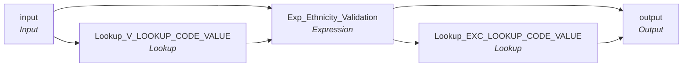

# mplt_Ethnicity_Validation

IDQ mapplet &rarr; CDI **Mapplet** `mplt_Ethnicity_Validation`.

> Verify that the Ethnicity Code code is found in master data set

## Summary

| IDQ transformation | CDI transformation | Count |
|---|---|---|
| ExpressionTx | Expression | 1 |
| LookupTx | Lookup | 2 |
| MappletInputTx | Input | 1 |
| MappletOutputTx | Output | 1 |

## Flow



## Transformations

In data-flow order.

### input

IDQ `MappletInputTx` &rarr; CDI **Input**. Mapplet Input transformation.

| Field | Type |
|---|---|
| Ethnicity_Cd | string(20) |
| Src_Sys | string(20) |

### Lookup_V_LOOKUP_CODE_VALUE

IDQ `LookupTx` &rarr; CDI **Lookup**. Connected lookup unless a return port is set (then unconnected).

| Property | Value |
|---|---|
| Connection | STAGING |
| Object | V_LOOKUP_CODE_VALUE (view) |
| Lookup condition | SRC_SYS = Src_Sys1 AND SRC_CODE_VALUE = Ethnicity_Cd |
| Multiple matches | Return any row |
| Cache | static cache |

Filter (CDI source/lookup *Filter* property; translated):

```sql
"V_LOOKUP_CODE_VALUE"."CODE_TYPE"='ETHNICITY'
```

| Lookup input field | Type |
|---|---|
| Src_Sys1 | string(20) |
| Ethnicity_Cd | string(20) |

| Return / pass-through field | Feeds |
|---|---|
| MSTR_CODE_VALUE | Exp_Ethnicity_Validation.MSTR_CODE_VALUE |

Links (target field &larr; upstream field):

| Field | From |
|---|---|
| Src_Sys1 | input.Src_Sys |
| Ethnicity_Cd | input.Ethnicity_Cd |

### Exp_Ethnicity_Validation

IDQ `ExpressionTx` &rarr; CDI **Expression**. Same expression language; variable fields are supported.

| Field | Kind | Type | Expression (CDI) |
|---|---|---|---|
| Src_Sys | in/out | string(20) | `Src_Sys` |
| Ethnicity_Cd | in/out | string(20) | `Ethnicity_Cd` |
| MSTR_CODE_VALUE | in/out | string(255) |  |
| out_Exception_Code | out | string(300) | `Decode(True<br>,ISNULL(MSTR_CODE_VALUE)<br>,'Invalid_Ethnicity'<br>)<br>` |

Links (target field &larr; upstream field):

| Field | From |
|---|---|
| Ethnicity_Cd | input.Ethnicity_Cd |
| MSTR_CODE_VALUE | Lookup_V_LOOKUP_CODE_VALUE.MSTR_CODE_VALUE |
| Src_Sys | input.Src_Sys |

### Lookup_EXC_LOOKUP_CODE_VALUE

IDQ `LookupTx` &rarr; CDI **Lookup**. Connected lookup unless a return port is set (then unconnected).

| Property | Value |
|---|---|
| Connection | STAGING |
| Object | EXC_LOOKUP_CODE_VALUE |
| Lookup condition | EXCEPTION_CODE = EXCEPTION_CODE1 |
| Multiple matches | Return any row |
| Cache | static cache |

| Lookup input field | Type |
|---|---|
| EXCEPTION_CODE1 | string(300) |

| Return / pass-through field | Feeds |
|---|---|
| EXCEPTION_CODE | output.EXCEPTION_CODE |
| EXCEPTION_DESC | output.EXCEPTION_DESC |
| EXCEPTION_TYPE | output.EXCEPTION_TYPE |

Links (target field &larr; upstream field):

| Field | From |
|---|---|
| EXCEPTION_CODE1 | Exp_Ethnicity_Validation.out_Exception_Code |

### output

IDQ `MappletOutputTx` &rarr; CDI **Output**. Mapplet Output transformation.

| Field | Type |
|---|---|
| Src_Sys | string(20) |
| Ethnicity_Cd | string(20) |
| MSTR_CODE_VALUE | string(255) |
| EXCEPTION_CODE | string(300) |
| EXCEPTION_DESC | string(300) |
| EXCEPTION_TYPE | string(300) |

Links (target field &larr; upstream field):

| Field | From |
|---|---|
| Ethnicity_Cd | Exp_Ethnicity_Validation.Ethnicity_Cd |
| MSTR_CODE_VALUE | Exp_Ethnicity_Validation.MSTR_CODE_VALUE |
| EXCEPTION_CODE | Lookup_EXC_LOOKUP_CODE_VALUE.EXCEPTION_CODE |
| EXCEPTION_DESC | Lookup_EXC_LOOKUP_CODE_VALUE.EXCEPTION_DESC |
| EXCEPTION_TYPE | Lookup_EXC_LOOKUP_CODE_VALUE.EXCEPTION_TYPE |
| Src_Sys | Exp_Ethnicity_Validation.Src_Sys |
