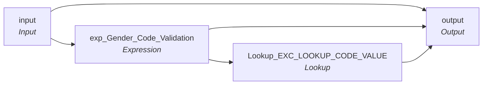

# mplt_Gender_Validation

IDQ mapplet &rarr; CDI **Mapplet** `mplt_Gender_Validation`.

> This mapplet vallidates Gender Code from each source system

[ML 12/29/2024]  Added WIC to the system list.

## Summary

| IDQ transformation | CDI transformation | Count |
|---|---|---|
| ExpressionTx | Expression | 1 |
| LookupTx | Lookup | 1 |
| MappletInputTx | Input | 1 |
| MappletOutputTx | Output | 1 |

## Flow

## Transformations

In data-flow order.

### input

IDQ `MappletInputTx` &rarr; CDI **Input**. Mapplet Input transformation.

| Field | Type |
|---|---|
| Gender_Code | string(10) |
| Src_Sys | string(10) |
| Party_Type | string(10) |

### exp_Gender_Code_Validation

IDQ `ExpressionTx` &rarr; CDI **Expression**. Same expression language; variable fields are supported.

| Field | Kind | Type | Expression (CDI) |
|---|---|---|---|
| in_Gender_Code | in | string(10) |  |
| v_Gender_First_Digit | variable | string(1) | `in_Gender_Code` |
| Party_Type | in | string(10) |  |
| v_Gender_Code | variable | string(10) | `Decode(True, IN(Party_Type,'I','Indv','INDV','HCP') AND IN(v_Gender_First_Digit,'B','U'), NULL, IN(Party_Type,'I','Indv','INDV','HCP') AND v_Gender_First_Digit= 'M', '1', IN(Party_Type,'I','Indv','INDV','HCP') AND v_Gender_First_Digit = 'F', '2', IN(Party_Type,'O','Org','ORG'), NULL )` |
| Gender_Code | out | string(10) | `v_Gender_Code` |
| Src_Sys | in | string(10) |  |
| Exception_Code | out | string(100) | `Decode(TRUE, 			IN(LTRIM(RTRIM(Src_Sys)),'P23','C21','P88','MAX','P84','PMR','TRS','CRE','ECI','WIC','FSS','TTF') AND 			IN(Party_Type,'HCP','Indv','INDV','I') AND 			ISNULL(v_Gender_First_Digit), 'Invalid_Gender',  			IN(LTRIM(RTRIM(Src_Sys)),'P23','C21','P88','MAX','P84','PMR','TRS','CRE','ECI','WIC','FSS','TTF') AND 			IN(Party_Type,'HCP','Indv','INDV','I') AND 			IS_NUMBER(v_Gender_First_Digit),'Invalid_Gender',  			IN(LTRIM(RTRIM(Src_Sys)),'P23','C21','P88','MAX','P84','PMR','TRS','CRE','ECI','WIC','FSS','TTF') AND 			IN(Party_Type,'HCP','Indv','INDV','I') AND 			NOT IN(v_Gender_First_Digit,'M','F','U','B'),'Invalid_Gender', NULL)` |
| Exception_Description | out | string(100) | `Decode(TRUE, ISNULL(v_Gender_First_Digit), 'Missing Gender', IS_NUMBER(v_Gender_First_Digit),'Gender Code is Numeric', NOT IN(v_Gender_First_Digit,'M','F','U','B'),'Invalid Gender', NULL)   --NOT IN(Gender,'M','F','U','B'),'Invalid Gender Code Value' --> Changed per agreement on Exception Handling of Gender Data DT:08/11/2023` |
| Exception_Type | out | string(100) | `Decode(TRUE, ISNULL(v_Gender_First_Digit), 'Bad Value', IS_NUMBER(v_Gender_First_Digit),'Bad Value', NOT IN(v_Gender_First_Digit,'M','F','U','B'),'Bad Value', NULL)` |

Links (target field &larr; upstream field):

| Field | From |
|---|---|
| in_Gender_Code | input.Gender_Code |
| Src_Sys | input.Src_Sys |
| Party_Type | input.Party_Type |

### Lookup_EXC_LOOKUP_CODE_VALUE

IDQ `LookupTx` &rarr; CDI **Lookup**. Connected lookup unless a return port is set (then unconnected).

| Property | Value |
|---|---|
| Connection | STAGING |
| Object | EXC_LOOKUP_CODE_VALUE |
| Lookup condition | EXCEPTION_CODE = In_Exception_Code |
| Multiple matches | Return any row |
| Cache | static cache |

| Lookup input field | Type |
|---|---|
| In_Exception_Code | string(300) |

| Return / pass-through field | Feeds |
|---|---|
| EXCEPTION_DESC | output.Gender_Exception_Description |
| EXCEPTION_TYPE | output.Gender_Exception_Type |

Links (target field &larr; upstream field):

| Field | From |
|---|---|
| In_Exception_Code | exp_Gender_Code_Validation.Exception_Code |

### output

IDQ `MappletOutputTx` &rarr; CDI **Output**. Mapplet Output transformation.

| Field | Type |
|---|---|
| Gender_Code | string(10) |
| Gender_Exception_Code | string(100) |
| Gender_Exception_Description | string(100) |
| Gender_Exception_Type | string(100) |
| MDM_Gender_Code | string(255) |

Links (target field &larr; upstream field):

| Field | From |
|---|---|
| MDM_Gender_Code | exp_Gender_Code_Validation.Gender_Code |
| Gender_Code | input.Gender_Code |
| Gender_Exception_Description | Lookup_EXC_LOOKUP_CODE_VALUE.EXCEPTION_DESC |
| Gender_Exception_Type | Lookup_EXC_LOOKUP_CODE_VALUE.EXCEPTION_TYPE |
| Gender_Exception_Code | exp_Gender_Code_Validation.Exception_Code |
