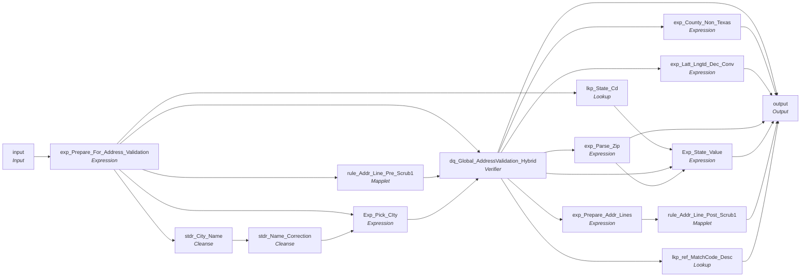

# mplt_Global_Addr_Validation

IDQ mapplet &rarr; CDI **Mapplet** `mplt_Global_Addr_Validation`.

> This mapplet generate standardized address from Address Doctor

[ML 10/28/2020] Added logic to default state for all systems when address Dr returns null.

## Summary

| IDQ transformation | CDI transformation | Count |
|---|---|---|
| AvTx | Verifier | 1 |
| ExpressionTx | Expression | 7 |
| LookupTx | Lookup | 2 |
| MappletInputTx | Input | 1 |
| MappletOutputTx | Output | 1 |
| MappletTx | Mapplet | 2 |
| TokenStandardiserTx | Cleanse | 2 |

## Flow



## Transformations

In data-flow order.

### input

IDQ `MappletInputTx` &rarr; CDI **Input**. Mapplet Input transformation.

| Field | Type |
|---|---|
| Address_1 | string(255) |
| Address_2 | string(255) |
| City | string(255) |
| State | string(255) |
| Postal_Code | string(255) |
| Country | string(255) |
| Src_sys | string(10) |

### exp_Prepare_For_Address_Validation

IDQ `ExpressionTx` &rarr; CDI **Expression**. Same expression language; variable fields are supported.

| Field | Kind | Type | Expression (CDI) |
|---|---|---|---|
| in_Address_1 | in | string(255) |  |
| Address_1 | out | string(255) | `DECODE(TRUE,<br>  (INSTR(UPPER(LTRIM(RTRIM(in_Address_1))), 'STE #') = LENGTH(UPPER(LTRIM(RTRIM(in_Address_1)))) - 4),<br>  SUBSTR(LTRIM(RTRIM(in_Address_1)), 1, INSTR(UPPER(in_Address_1), 'STE #') - 1),<br><br>  (INSTR(UPPER(LTRIM(RTRIM(in_Address_1))), 'SUITE') = LENGTH(UPPER(LTRIM(RTRIM(in_Address_1)))) - 4),<br>  SUBSTR(LTRIM(RTRIM(in_Address_1)), 1, INSTR(UPPER(in_Address_1), 'SUITE') - 1),<br><br>  (INSTR(UPPER(LTRIM(RTRIM(in_Address_1))), 'STE.') = LENGTH(UPPER(LTRIM(RTRIM(in_Address_1)))) - 3),<br>  SUBSTR(LTRIM(RTRIM(in_Address_1)), 1, INSTR(UPPER(in_Address_1), 'STE.') - 1),<br><br>  (INSTR(UPPER(LTRIM(RTRIM(in_Address_1))), 'STE') = LENGTH(UPPER(LTRIM(RTRIM(in_Address_1)))) - 2),<br>  SUBSTR(LTRIM(RTRIM(in_Address_1)), 1, INSTR(UPPER(in_Address_1), 'STE') - 1),<br><br>  in_Address_1<br>)` |
| in_Address_2 | in | string(255) |  |
| Address_2 | out | string(255) | `DECODE(TRUE,<br>  REG_MATCH(in_Address_2, '.*(?i)STE #$'),<br>  SUBSTR(LTRIM(RTRIM(in_Address_2)), 1, INSTR(UPPER(in_Address_2), 'STE #') - 1),<br><br>  REG_MATCH(in_Address_2, '.*(?i)SUITE$'),<br>  SUBSTR(LTRIM(RTRIM(in_Address_2)), 1, INSTR(UPPER(in_Address_2), 'SUITE') - 1),<br><br>  REG_MATCH(in_Address_2, '.*(?i)STE\.$'),<br>  SUBSTR(LTRIM(RTRIM(in_Address_2)), 1, INSTR(UPPER(in_Address_2), 'STE.') - 1),<br><br>  REG_MATCH(in_Address_2, '.*(?i)STE$'),<br>  SUBSTR(LTRIM(RTRIM(in_Address_2)), 1, INSTR(UPPER(in_Address_2), 'STE') - 1),<br><br>  in_Address_2<br>)<br>` |
| City | in/out | string(255) | `City` |
| State | in/out | string(255) | `State` |
| Postal_Code | in/out | string(255) | `Postal_Code` |
| Country | in/out | string(255) | `Country` |
| Src_sys | in/out | string(10) | `Src_sys` |
| Src_Sys_Out | out | string(10) | `IIF(ISNULL(Src_sys),'TRS',SRC_SYS) -- Use TIERS State conversion is a conversion table is not specified` |
| State_Out | out | string(255) | `UPPER(LTRIM(RTRIM(State)))` |

Links (target field &larr; upstream field):

| Field | From |
|---|---|
| in_Address_1 | input.Address_1 |
| in_Address_2 | input.Address_2 |
| City | input.City |
| State | input.State |
| Postal_Code | input.Postal_Code |
| Country | input.Country |
| Src_sys | input.Src_sys |

### stdr_City_Name

IDQ `TokenStandardiserTx` &rarr; CDI **Cleanse**. CDQ Cleanse asset with remove/replace steps (see cdq.md).

Settings: (defaults)

- `TokenStandardiserStrategy` **stdr_City_name** delimiters=` `, trim=`true`
  - function: `standardizer`
- `FieldParameter` **Input** field=`City_12_Bytes`
- `FieldParameter` **Output** field=`City`
- `UserOp` **Replace Custom Strings** replace=`true`, replacement=` `, searchStrings=`  `

Links (target field &larr; upstream field):

| Field | From |
|---|---|
| City_12_Bytes | exp_Prepare_For_Address_Validation.City |

### stdr_Name_Correction

IDQ `TokenStandardiserTx` &rarr; CDI **Cleanse**. CDQ Cleanse asset with remove/replace steps (see cdq.md).

Settings: (defaults)

- `TokenStandardiserStrategy` **stdr_Name_Correction** delimiters=` `, trim=`true`
  - function: `standardizer`
- `FieldParameter` **Input** field=`City`
- `FieldParameter` **Output** field=`City`
- `RtmOp` **Replace Reference Table Matches with Valid Values** replace=`true`, useRtmReplacement=`true`
- `Dictionary`  refTable=`ref_Valid_City`

Links (target field &larr; upstream field):

| Field | From |
|---|---|
| City | stdr_City_Name.City |

### rule_Addr_Line_Pre_Scrub1

IDQ `MappletTx` &rarr; CDI **Mapplet**. Reusable CDI mapplet (see the mapplets folder).

Mapplet: [`rule_Addr_Line_Pre_Scrub1`](../mapplets/rule_Addr_Line_Pre_Scrub1.md)

Links (target field &larr; upstream field):

| Field | From |
|---|---|
| Group.Address_Line1 | exp_Prepare_For_Address_Validation.Address_1 |
| Group.Address_Line2 | exp_Prepare_For_Address_Validation.Address_2 |

### lkp_State_Cd

IDQ `LookupTx` &rarr; CDI **Lookup**. Connected lookup unless a return port is set (then unconnected).

| Property | Value |
|---|---|
| Connection | STAGING |
| Object | V_LOOKUP_CODE_VALUE (view) |
| Lookup condition | SRC_CODE_VALUE = in_ADDR_STATE_CD AND SRC_SYS = in_SRC_SYS |
| Multiple matches | Return any row |
| Cache | static cache |
| Cache file name prefix | LKP_State_Code_TRS_ |

Filter (CDI source/lookup *Filter* property; translated):

```sql
"V_LOOKUP_CODE_VALUE"."CODE_TYPE"='STATE'
```

| Lookup input field | Type |
|---|---|
| in_SRC_SYS | string(10) |
| in_ADDR_STATE_CD | string(2) |

| Return / pass-through field | Feeds |
|---|---|
| MSTR_CODE_VALUE | Exp_State_Value.in_State_code |

Links (target field &larr; upstream field):

| Field | From |
|---|---|
| in_SRC_SYS | exp_Prepare_For_Address_Validation.Src_Sys_Out |
| in_ADDR_STATE_CD | exp_Prepare_For_Address_Validation.State_Out |

### Exp_Pick_CIty

IDQ `ExpressionTx` &rarr; CDI **Expression**. Same expression language; variable fields are supported.

| Field | Kind | Type | Expression (CDI) |
|---|---|---|---|
| City_Orig | in | string(255) |  |
| Src_sys | in | string(10) |  |
| City_Stdz | in | string(100) |  |
| City_Out | out | string(255) | `IIF(Substr(Src_sys,1,1) = 'P' and length(City_Orig) = 12<br>	,City_Stdz -- Pfiles frequently have cities truncated at 12 bytes, use corrected version<br>	,City_Orig)` |

Links (target field &larr; upstream field):

| Field | From |
|---|---|
| City_Orig | exp_Prepare_For_Address_Validation.City |
| Src_sys | exp_Prepare_For_Address_Validation.Src_sys |
| City_Stdz | stdr_Name_Correction.City |

### dq_Global_AddressValidation_Hybrid

IDQ `AvTx` &rarr; CDI **Verifier**. CDQ Verifier asset for address verification (see cdq.md).

Settings: activeInputStrategy=`Hybrid`, casingStyle=`MIXED`, countryOfOriginISO3=`USA`, defaultCountry=`USA`, forceCountry=`USA`, inputFormatType=`ADDRESS_ONLY`, mode=`CERTIFIED`, outputFormatType=`ADDRESS_ONLY`

- `AvOptionSet`
- `AvStringOption` **MaxResultCount** optionValue=`5`
- `AvStringOption` **Process:EnrichmentGeoCodingType** optionValue=`NONE`

Only the fields marked *linked* need to be selected in the Verifier asset.

| Port | Dir | AddressDoctor field | Group | Linked |
|---|---|---|---|---|
| DeliveryAddressLine1 | in | DeliveryAddressLine#1 | Hybrid | yes |
| DeliveryAddressLine2 | in | DeliveryAddressLine#2 | Hybrid | yes |
| DeliveryAddressLine3 | in | DeliveryAddressLine#3 | Hybrid |  |
| LocalityComplete1 | in | Locality#COMPLETE#1 | Hybrid | yes |
| Province1 | in | Province#COUNTRY_STANDARD#1 | Hybrid | yes |
| HybridPostcode1 | in | PostalCode#FORMATTED#1 | Hybrid | yes |
| HybridCountryName | in | Country#NAME#1 | Hybrid | yes |
| OrganizationComplete1 | out | OUT#Organization#COMPLETE#1 | Address Elements | yes |
| DeliveryAddressLine1 | out | OUT#DeliveryAddressLine#1 | Address Elements |  |
| DeliveryAddressLine2 | out | OUT#DeliveryAddressLine#2 | Address Elements |  |
| DeliveryAddressLine3 | out | OUT#DeliveryAddressLine#3 | Address Elements |  |
| LocalityComplete1 | out | OUT#Locality#COMPLETE#1 | LastLine Elements | yes |
| PostcodeComplete | out | OUT#PostalCode#FORMATTED#1 | LastLine Elements | yes |
| CountryCountryName1 | out | OUT#Country#NAME_EN#1 | Country |  |
| CountryCountryISO2Char | out | OUT#Country#ISO2#1 | Country | yes |
| StatusInfoMailabilityScore | out | OUT#MailabilityScore#_#ResData#_ | Status Info | yes |
| StatusInfoMatchCode | out | OUT#ProcessStatus#_#Result#_ | Status Info | yes |
| AddressElementsBuildingNumber1 | out | OUT#Building#NUMBER#1 | AddressElements | yes |
| AddressElementsStreetNumberComplete1 | out | OUT#Number#COMPLETE#1 | AddressElements | yes |
| AddressElementsSub_buildingNumber1 | out | OUT#SubBuilding#NUMBER#1 | AddressElements | yes |
| AddressElementsOrganizationDescriptor1 | out | OUT#Organization#DESCRIPTOR#1 | AddressElements | yes |
| AddressElementsOrganizationDepartment1 | out | OUT#Organization#DEPARTMENT#1 | AddressElements | yes |
| AddressElementsOrganizationName1 | out | OUT#Organization#NAME#1 | AddressElements | yes |
| AddressElementsOrganizationComplete1 | out | OUT#Organization#COMPLETE#1 | AddressElements |  |
| AddressElementsBuildingComplete1 | out | OUT#Building#COMPLETE#1 | AddressElements | yes |
| AddressElementsBuildingName1 | out | OUT#Building#NAME#1 | AddressElements | yes |
| AddressElementsSub_buildingComplete1 | out | OUT#SubBuilding#COMPLETE#1 | AddressElements | yes |
| AddressElementsSub_buildingDescriptor1 | out | OUT#SubBuilding#DESCRIPTOR#1 | AddressElements | yes |
| AddressElementsDeliveryAddressLine1 | out | OUT#DeliveryAddressLine#1 | AddressElements | yes |
| AddressElementsDeliveryAddressLine2 | out | OUT#DeliveryAddressLine#2 | AddressElements |  |
| AddressElementsBuildingCompleteWithSub_building1 | out | OUT#Building#COMPLETE_WITH_SUBBUILDING#1 | AddressElements | yes |
| AddressElementsStreetCompleteWithNumber1 | out | OUT#Street#COMPLETE_WITH_NUMBER#1 | AddressElements | yes |
| StatusInfoMatchCode1 | out | OUT#ProcessStatus#_#Result#_ | StatusInfo | yes |
| StatusInfoMailabilityScore1 | out | OUT#MailabilityScore#_#ResData#_ | StatusInfo |  |
| StatusInfoAddressType | out | OUT#AddressType#_#ResData#_ | StatusInfo | yes |
| CAMEOCAMEOStatus | out | OUT#CAMEOStatus#_#GetResultEnrichmentDataParameter#_@EnrichmentCAMEO="ON" | CAMEO |  |
| CAMEOCategoryCode | out | OUT#CAMEO#CATEGORY#Enrich#_@EnrichmentCAMEO="ON" | CAMEO |  |
| CAMEOGroupCode | out | OUT#CAMEO#GROUP#Enrich#_@EnrichmentCAMEO="ON" | CAMEO |  |
| CAMEOInternationalCode | out | OUT#CAMEO#INTERNATIONAL#Enrich#_@EnrichmentCAMEO="ON" | CAMEO |  |
| CAMEOMVID | out | OUT#CAMEO#MVID#Enrich#_@EnrichmentCAMEO="ON" | CAMEO |  |
| CAMEOCategoryDescription | out | OUT#CAMEO#CATEGORY_DESCRIPTION#Enrich#_@EnrichmentCAMEO="ON" | CAMEO |  |
| CAMEOGroupDescription | out | OUT#CAMEO#GROUP_DESCRIPTION#Enrich#_@EnrichmentCAMEO="ON" | CAMEO |  |
| CAMEOInternationalDescription | out | OUT#CAMEO#INTERNATIONAL_DESCRIPTION#Enrich#_@EnrichmentCAMEO="ON" | CAMEO |  |
| GeoCodingLatitude | out | OUT#GeoCoding#LATITUDE#Enrich#_@EnrichmentGeoCoding="ON" | GeoCoding | yes |
| GeoCodingLongitude | out | OUT#GeoCoding#LONGITUDE#Enrich#_@EnrichmentGeoCoding="ON" | GeoCoding | yes |
| GeoCodingGeocodingStatus | out | OUT#GeoCodingStatus#_#GetResultEnrichmentDataParameter#_@EnrichmentGeoCoding="ON" | GeoCoding | yes |
| GeoCodingGeocodingComplete | out | OUT#GeoCoding#COMPLETE#Enrich#_@EnrichmentGeoCoding="ON" | GeoCoding | yes |
| USSpecificResidentialDeliveryIndicator | out | OUT#CASS#RDI#Enrich#_@EnrichmentCASS="ON"@EnrichmentCASS="ON" | USSpecific | yes |
| LastLineElementsProvinceISO2 | out | OUT#Province#ISO#2 | LastLineElements |  |
| LastLineElementsProvinceISO3 | out | OUT#Province#ISO#3 | LastLineElements | yes |
| LastLineElementsProvinceISO1 | out | OUT#Province#ISO#1 | LastLineElements |  |
| USSupplementaryCountyFederalInformationProcessingStandardCode | out | OUT#SupplementaryUS#COUNTY_FIPS_CODE#Enrich#_@EnrichmentSupplementaryUS="ON" | USSupplementary | yes |
| USSupplementaryStateFederalInformationProcessingStandardCode | out | OUT#SupplementaryUS#STATE_FIPS_CODE#Enrich#_@EnrichmentSupplementaryUS="ON" | USSupplementary | yes |
| StatusInfoResultPercentage | out | OUT#ResultPercentage#_#ResData#_ | StatusInfo | yes |
| USSpecificEarlyWarningSystemReturnCode | out | OUT#CASS#EWS_RETURNCODE#Enrich#_@EnrichmentCASS="ON" | USSpecific | yes |
| USSpecificCongressionalDistrict | out | OUT#CASS#CONGRESSIONAL_DISTRICT#Enrich#_@EnrichmentCASS="ON" | USSpecific | yes |
| USSpecificCASSErrorCode | out | OUT#CASS#ERRORCODE#Enrich#_@EnrichmentCASS="ON" | USSpecific | yes |
| USSpecificRecordType | out | OUT#CASS#RECORDTYPE#Enrich#_@EnrichmentCASS="ON" | USSpecific | yes |
| USSpecificDeliveryPointValidationConfirmation | out | OUT#CASS#DPV_CONFIRMATION#Enrich#_@EnrichmentCASS="ON" | USSpecific | yes |
| USSupplementaryMetropolitanStatisticalAreaIdentification | out | OUT#SupplementaryUS#MSA_ID#Enrich#_@EnrichmentSupplementaryUS="ON" | USSupplementary | yes |
| USSupplementaryCore_BasedStatisticalAreaIdentification | out | OUT#SupplementaryUS#CBSA_ID#Enrich#_@EnrichmentSupplementaryUS="ON" | USSupplementary | yes |
| USSupplementaryConsolidatedMetropolitanStatisticalAreasIdentification | out | OUT#SupplementaryUS#CMSA_ID#Enrich#_@EnrichmentSupplementaryUS="ON" | USSupplementary | yes |
| USSupplementaryCensusTractNumber | out | OUT#SupplementaryUS#CENSUS_TRACT_NO#Enrich#_@EnrichmentSupplementaryUS="ON" | USSupplementary | yes |
| USSupplementaryCensusBlockNumber | out | OUT#SupplementaryUS#CENSUS_BLOCK_NO#Enrich#_@EnrichmentSupplementaryUS="ON" | USSupplementary | yes |
| USSupplementaryCensusBlockGroup | out | OUT#SupplementaryUS#CENSUS_BLOCK_GROUP#Enrich#_@EnrichmentSupplementaryUS="ON" | USSupplementary | yes |
| USSupplementaryPlaceFederalInformationProcessingStandardCode | out | OUT#SupplementaryUS#PLACE_FIPS_CODE#Enrich#_@EnrichmentSupplementaryUS="ON" | USSupplementary | yes |
| USSupplementaryMinorCivilDivisionIdentification | out | OUT#SupplementaryUS#MCD_ID#Enrich#_@EnrichmentSupplementaryUS="ON" | USSupplementary | yes |
| AddressElementsBuildingComplete2 | out | OUT#Building#COMPLETE#2 | AddressElements | yes |
| AddressElementsSub_buildingComplete2 | out | OUT#SubBuilding#COMPLETE#2 | AddressElements | yes |
| AddressElementsStreetCompleteWithNumber2 | out | OUT#Street#COMPLETE_WITH_NUMBER#2 | AddressElements | yes |
| AddressElementsPostalPhraseComplete1 | out | OUT#DeliveryService#COMPLETE#1 | AddressElements | yes |

Links (target field &larr; upstream field):

| Field | From |
|---|---|
| HybridPostcode1 | exp_Prepare_For_Address_Validation.Postal_Code |
| HybridCountryName | exp_Prepare_For_Address_Validation.Country |
| DeliveryAddressLine1 | rule_Addr_Line_Pre_Scrub1.out_Addr_Std.Address_Line1 |
| DeliveryAddressLine2 | rule_Addr_Line_Pre_Scrub1.out_Addr_Std.Address_Line2 |
| Province1 | exp_Prepare_For_Address_Validation.State_Out |
| LocalityComplete1 | Exp_Pick_CIty.City_Out |

### exp_County_Non_Texas

IDQ `ExpressionTx` &rarr; CDI **Expression**. Same expression language; variable fields are supported.

| Field | Kind | Type | Expression (CDI) |
|---|---|---|---|
| County | in | string(3) |  |
| State | in/out | string(2) | `State` |
| out_County | out | string(3) | `Decode(True,<br>State = '48',County,<br>ISNULL(County),<br>--Unknown State<br>'999',<br>--996 is out of State<br>'996')` |

Links (target field &larr; upstream field):

| Field | From |
|---|---|
| County | dq_Global_AddressValidation_Hybrid.USSupplementaryCountyFederalInformationProcessingStandardCode |
| State | dq_Global_AddressValidation_Hybrid.USSupplementaryStateFederalInformationProcessingStandardCode |

### exp_Latt_Lngtd_Dec_Conv

IDQ `ExpressionTx` &rarr; CDI **Expression**. Same expression language; variable fields are supported.

| Field | Kind | Type | Expression (CDI) |
|---|---|---|---|
| GeoCodingLatitude | in | string(30) |  |
| Lattd | out | decimal(38,6) | `Decode(TRUE,<br>NOT ISNULL(GeoCodingLatitude) AND RTRIM(GeoCodingLatitude) <> '', TO_DECIMAL(LTRIM(RTRIM(GeoCodingLatitude))), <br>ISNULL(GeoCodingLatitude) or GeoCodingLatitude='',0,<br>TO_DECIMAL(LTRIM(RTRIM(GeoCodingLatitude))))` |
| GeoCodingLongitude | in | string(30) |  |
| Lngtd | out | decimal(38,6) | `Decode(TRUE,<br>NOT ISNULL(GeoCodingLongitude) AND RTRIM(GeoCodingLongitude) <> '', TO_DECIMAL(LTRIM(RTRIM(GeoCodingLongitude))), <br><br>ISNULL(GeoCodingLatitude) or GeoCodingLatitude='',0,<br>TO_DECIMAL(LTRIM(RTRIM(GeoCodingLatitude))))` |

Links (target field &larr; upstream field):

| Field | From |
|---|---|
| GeoCodingLatitude | dq_Global_AddressValidation_Hybrid.GeoCodingLatitude |
| GeoCodingLongitude | dq_Global_AddressValidation_Hybrid.GeoCodingLongitude |

### exp_Parse_Zip

IDQ `ExpressionTx` &rarr; CDI **Expression**. Same expression language; variable fields are supported.

| Field | Kind | Type | Expression (CDI) |
|---|---|---|---|
| PostcodeComplete | in/out | string(15) | `PostcodeComplete` |
| Zip_cd_5 | out | string(10) | `SUBSTR(PostcodeComplete,1,5)` |
| Zip_cd_4_extn | out | string(10) | `SUBSTR(PostcodeComplete,7,4)` |

Links (target field &larr; upstream field):

| Field | From |
|---|---|
| PostcodeComplete | dq_Global_AddressValidation_Hybrid.PostcodeComplete |

### exp_Prepare_Addr_Lines

IDQ `ExpressionTx` &rarr; CDI **Expression**. Same expression language; variable fields are supported.

| Field | Kind | Type | Expression (CDI) |
|---|---|---|---|
| BuildingComplete1 | in/out | string(128) | `BuildingComplete1` |
| BuildingComplete2 | in/out | string(128) | `BuildingComplete2` |
| Sub_buildingComplete1 | in/out | string(128) | `Sub_buildingComplete1` |
| Sub_buildingComplete2 | in/out | string(128) | `Sub_buildingComplete2` |
| StreetCompleteWithNumber1 | in/out | string(128) | `StreetCompleteWithNumber1` |
| StreetCompleteWithNumber2 | in/out | string(128) | `StreetCompleteWithNumber2` |
| GeoCodingLatitude | in/out | string(30) | `GeoCodingLatitude` |
| GeoCodingLongitude | in/out | string(30) | `GeoCodingLongitude` |
| DeliveryAddressLine1 | in/out | string(128) | `DeliveryAddressLine1` |
| AddressElementsPostalPhraseComplete1 | in/out | string(50) | `AddressElementsPostalPhraseComplete1` |
| Out_Address_1 | out | string(240) | `--Modified by Max 5/01/2016 - changed to po box field having len > 0<br>RTRIM(LTRIM( <br>IIF( LENGTH(RTRIM(AddressElementsPostalPhraseComplete1)) >0 <br>and LENGTH(RTRIM(StreetCompleteWithNumber1)) =0 , AddressElementsPostalPhraseComplete1, <br>IIF(<br>LENGTH(RTRIM(AddressElementsPostalPhraseComplete1))>0 <br>AND  LENGTH(RTRIM(Sub_buildingComplete1))>0 <br>,RTRIM(StreetCompleteWithNumber1) \|\|' '\|\|Sub_buildingComplete1,<br>StreetCompleteWithNumber1 <br>)<br>)<br>))<br><br>--ORIGINAL CODE<br>--RTRIM(LTRIM( IIF( LENGTH(RTRIM(LTRIM(AddressElementsPostalPhraseComplete1))) ><br>--0 and ISNULL(StreetCompleteWithNumber1) OR LENGTH(RTRIM(StreetCompleteWithNumber1)) =0 , AddressElementsPostalPhraseComplete1, StreetCompleteWithNumber1 )))<br>` |
| Out_Address_2 | out | string(240) | `IIF(LENGTH(RTRIM(AddressElementsPostalPhraseComplete1)) > 0 and LENGTH(RTRIM(StreetCompleteWithNumber1))>0 , AddressElementsPostalPhraseComplete1,<br>REPLACESTR(1,<br>RTRIM(LTRIM(<br>BuildingComplete1\|\|' '\|\|<br>BuildingComplete2\|\|' '\|\|<br>Sub_buildingComplete1\|\|' '\|\|<br>Sub_buildingComplete2<br>	)),<br>	'  ',' '))` |
| USSupplementaryCountyFederalInformationProcessingStandardCode | in/out | string(3) | `USSupplementaryCountyFederalInformationProcessingStandardCode` |
| USSupplementaryStateFederalInformationProcessingStandardCode | in/out | string(2) | `USSupplementaryStateFederalInformationProcessingStandardCode` |

Links (target field &larr; upstream field):

| Field | From |
|---|---|
| BuildingComplete1 | dq_Global_AddressValidation_Hybrid.AddressElementsBuildingComplete1 |
| USSupplementaryCountyFederalInformationProcessingStandardCode | dq_Global_AddressValidation_Hybrid.USSupplementaryCountyFederalInformationProcessingStandardCode |
| USSupplementaryStateFederalInformationProcessingStandardCode | dq_Global_AddressValidation_Hybrid.USSupplementaryStateFederalInformationProcessingStandardCode |
| Sub_buildingComplete1 | dq_Global_AddressValidation_Hybrid.AddressElementsSub_buildingComplete1 |
| StreetCompleteWithNumber1 | dq_Global_AddressValidation_Hybrid.AddressElementsStreetCompleteWithNumber1 |
| GeoCodingLatitude | dq_Global_AddressValidation_Hybrid.GeoCodingLatitude |
| GeoCodingLongitude | dq_Global_AddressValidation_Hybrid.GeoCodingLongitude |
| Sub_buildingComplete2 | dq_Global_AddressValidation_Hybrid.AddressElementsSub_buildingComplete2 |
| StreetCompleteWithNumber2 | dq_Global_AddressValidation_Hybrid.AddressElementsStreetCompleteWithNumber2 |
| BuildingComplete2 | dq_Global_AddressValidation_Hybrid.AddressElementsBuildingComplete2 |
| DeliveryAddressLine1 | dq_Global_AddressValidation_Hybrid.AddressElementsDeliveryAddressLine1 |
| AddressElementsPostalPhraseComplete1 | dq_Global_AddressValidation_Hybrid.AddressElementsPostalPhraseComplete1 |

### Exp_State_Value

IDQ `ExpressionTx` &rarr; CDI **Expression**. Same expression language; variable fields are supported.

| Field | Kind | Type | Expression (CDI) |
|---|---|---|---|
| in_State_code | in/out | string(255) | `in_State_code` |
| Address_Doctor_State_code | in/out | string(2) | `Address_Doctor_State_code` |
| out_State_code | out | string(2) | `DECODE(TRUE,<br>-- Use Addr Dr State if valued<br>NOT (ISNULL(Address_Doctor_State_code) or Address_Doctor_State_code ='' or IS_SPACES(Address_Doctor_State_code))<br> , Address_Doctor_State_code<br>-- Else Use source sytems state<br>,NOT (ISNULL(in_State_code) or in_State_code ='' or IS_SPACES(in_State_code)), in_State_code<br>-- Else default Texas based on zip code<br>,Zip_cd_5 = '73301' OR (Zip_cd_5 >= '75001' and Zip_cd_5 <=  '79999' AND Zip_cd_5 <> '75502') OR (Zip_cd_5 >= '88510' AND Zip_cd_5 <= '88589')<br>,'48'<br>-- else null<br>,NULL)<br>--LTRIM(RTRIM(in_State_code)),<br>--Address_Doctor_State_code)` |
| Zip_cd_5 | in/out | string(10) | `Zip_cd_5` |

Links (target field &larr; upstream field):

| Field | From |
|---|---|
| Address_Doctor_State_code | dq_Global_AddressValidation_Hybrid.USSupplementaryStateFederalInformationProcessingStandardCode |
| in_State_code | lkp_State_Cd.MSTR_CODE_VALUE |
| Zip_cd_5 | exp_Parse_Zip.Zip_cd_5 |

### rule_Addr_Line_Post_Scrub1

IDQ `MappletTx` &rarr; CDI **Mapplet**. Reusable CDI mapplet (see the mapplets folder).

Mapplet: [`rule_Addr_Line_Post_Scrub`](../mapplets/rule_Addr_Line_Post_Scrub.md)

Links (target field &larr; upstream field):

| Field | From |
|---|---|
| Group.AddressLine1 | exp_Prepare_Addr_Lines.Out_Address_1 |
| Group.AddressLine2 | exp_Prepare_Addr_Lines.Out_Address_2 |

### lkp_ref_MatchCode_Desc

IDQ `LookupTx` &rarr; CDI **Lookup**. Connected lookup unless a return port is set (then unconnected).

| Property | Value |
|---|---|
| Connection | INFA_STAGE |
| Object | ref_MatchCode_Desc11021312 |
| Lookup condition | Match_Code = StatusInfoMatchCode |
| Multiple matches | Return any row |
| Cache | static cache |

| Lookup input field | Type |
|---|---|
| StatusInfoMatchCode | string(4) |

| Return / pass-through field | Feeds |
|---|---|
| Description | output.MatchCode_Description |

Links (target field &larr; upstream field):

| Field | From |
|---|---|
| StatusInfoMatchCode | dq_Global_AddressValidation_Hybrid.StatusInfoMatchCode |

### output

IDQ `MappletOutputTx` &rarr; CDI **Output**. Mapplet Output transformation.

| Field | Type |
|---|---|
| OrganizationComplete | string(128) |
| BuildingNumber | string(20) |
| DeliveryAddressLine1 | string(128) |
| DeliveryAddressLine2 | string(128) |
| City | string(50) |
| PostcodeComplete | string(15) |
| ProvinceISO3 | string(50) |
| CountryISO2Char | string(2) |
| MailabilityScore | string(2) |
| MatchCode | string(4) |
| GeoCodingLatitude | decimal(38,6) |
| GeoCodingLongitude | decimal(38,6) |
| GeocodingStatus | string(10) |
| GeoCodingGeocodingComplete | string(60) |
| CountyFederalInformationProcessingStandardCode | string(3) |
| StateFederalInformationProcessingStandardCode | string(2) |
| StatusInfoMatchCode | string(4) |
| MatchCode_Description | string(500) |
| ResidentialDeliveryIndicator | string(1) |
| StreetNumberComplete | string(30) |
| Sub_buildingNumber | string(50) |
| OrganizationDescriptor | string(50) |
| OrganizationDepartment | string(50) |
| OrganizationName | string(50) |
| BuildingComplete | string(128) |
| BuildingName | string(50) |
| Sub_buildingComplete | string(128) |
| Sub_buildingDescriptor | string(20) |
| BuildingCompleteWithSub_building | string(128) |
| StreetCompleteWithNumber1 | string(50) |
| AddressType | string(5) |
| EarlyWarningSystemReturnCode | string(1) |
| CongressionalDistrict | string(3) |
| CASSErrorCode | string(2) |
| RecordType | string(1) |
| DeliveryPointValidationConfirmation | string(1) |
| MetropolitanStatisticalAreaIdentification | string(5) |
| Core_BasedStatisticalAreaIdentification | string(5) |
| ConsolidatedMetropolitanStatisticalAreasIdentification | string(4) |
| CensusTractNumber | string(6) |
| CensusBlockNumber | string(4) |
| CensusBlockGroup | string(1) |
| PlaceFederalInformationProcessingStandardCode | string(5) |
| MinorCivilDivisionIdentification | string(5) |
| StatusInfoResultPercentage | string(6) |
| Zip_cd_5 | string(10) |
| Zip_cd_4_extn | string(10) |

Links (target field &larr; upstream field):

| Field | From |
|---|---|
| OrganizationComplete | dq_Global_AddressValidation_Hybrid.OrganizationComplete1 |
| City | dq_Global_AddressValidation_Hybrid.LocalityComplete1 |
| PostcodeComplete | dq_Global_AddressValidation_Hybrid.PostcodeComplete |
| CountryISO2Char | dq_Global_AddressValidation_Hybrid.CountryCountryISO2Char |
| MailabilityScore | dq_Global_AddressValidation_Hybrid.StatusInfoMailabilityScore |
| MatchCode | dq_Global_AddressValidation_Hybrid.StatusInfoMatchCode |
| BuildingNumber | dq_Global_AddressValidation_Hybrid.AddressElementsBuildingNumber1 |
| StreetNumberComplete | dq_Global_AddressValidation_Hybrid.AddressElementsStreetNumberComplete1 |
| Sub_buildingNumber | dq_Global_AddressValidation_Hybrid.AddressElementsSub_buildingNumber1 |
| OrganizationDescriptor | dq_Global_AddressValidation_Hybrid.AddressElementsOrganizationDescriptor1 |
| OrganizationDepartment | dq_Global_AddressValidation_Hybrid.AddressElementsOrganizationDepartment1 |
| OrganizationName | dq_Global_AddressValidation_Hybrid.AddressElementsOrganizationName1 |
| BuildingComplete | dq_Global_AddressValidation_Hybrid.AddressElementsBuildingComplete1 |
| BuildingName | dq_Global_AddressValidation_Hybrid.AddressElementsBuildingName1 |
| Sub_buildingComplete | dq_Global_AddressValidation_Hybrid.AddressElementsSub_buildingComplete1 |
| Sub_buildingDescriptor | dq_Global_AddressValidation_Hybrid.AddressElementsSub_buildingDescriptor1 |
| BuildingCompleteWithSub_building | dq_Global_AddressValidation_Hybrid.AddressElementsBuildingCompleteWithSub_building1 |
| StreetCompleteWithNumber1 | dq_Global_AddressValidation_Hybrid.AddressElementsStreetCompleteWithNumber1 |
| StatusInfoMatchCode | dq_Global_AddressValidation_Hybrid.StatusInfoMatchCode1 |
| AddressType | dq_Global_AddressValidation_Hybrid.StatusInfoAddressType |
| ProvinceISO3 | dq_Global_AddressValidation_Hybrid.LastLineElementsProvinceISO3 |
| GeocodingStatus | dq_Global_AddressValidation_Hybrid.GeoCodingGeocodingStatus |
| ResidentialDeliveryIndicator | dq_Global_AddressValidation_Hybrid.USSpecificResidentialDeliveryIndicator |
| EarlyWarningSystemReturnCode | dq_Global_AddressValidation_Hybrid.USSpecificEarlyWarningSystemReturnCode |
| CongressionalDistrict | dq_Global_AddressValidation_Hybrid.USSpecificCongressionalDistrict |
| CASSErrorCode | dq_Global_AddressValidation_Hybrid.USSpecificCASSErrorCode |
| RecordType | dq_Global_AddressValidation_Hybrid.USSpecificRecordType |
| DeliveryPointValidationConfirmation | dq_Global_AddressValidation_Hybrid.USSpecificDeliveryPointValidationConfirmation |
| MetropolitanStatisticalAreaIdentification | dq_Global_AddressValidation_Hybrid.USSupplementaryMetropolitanStatisticalAreaIdentification |
| Core_BasedStatisticalAreaIdentification | dq_Global_AddressValidation_Hybrid.USSupplementaryCore_BasedStatisticalAreaIdentification |
| ConsolidatedMetropolitanStatisticalAreasIdentification | dq_Global_AddressValidation_Hybrid.USSupplementaryConsolidatedMetropolitanStatisticalAreasIdentification |
| CensusTractNumber | dq_Global_AddressValidation_Hybrid.USSupplementaryCensusTractNumber |
| CensusBlockNumber | dq_Global_AddressValidation_Hybrid.USSupplementaryCensusBlockNumber |
| CensusBlockGroup | dq_Global_AddressValidation_Hybrid.USSupplementaryCensusBlockGroup |
| PlaceFederalInformationProcessingStandardCode | dq_Global_AddressValidation_Hybrid.USSupplementaryPlaceFederalInformationProcessingStandardCode |
| MinorCivilDivisionIdentification | dq_Global_AddressValidation_Hybrid.USSupplementaryMinorCivilDivisionIdentification |
| GeoCodingGeocodingComplete | dq_Global_AddressValidation_Hybrid.GeoCodingGeocodingComplete |
| StatusInfoResultPercentage | dq_Global_AddressValidation_Hybrid.StatusInfoResultPercentage |
| CountyFederalInformationProcessingStandardCode | exp_County_Non_Texas.out_County |
| GeoCodingLatitude | exp_Latt_Lngtd_Dec_Conv.Lattd |
| GeoCodingLongitude | exp_Latt_Lngtd_Dec_Conv.Lngtd |
| Zip_cd_5 | exp_Parse_Zip.Zip_cd_5 |
| Zip_cd_4_extn | exp_Parse_Zip.Zip_cd_4_extn |
| StateFederalInformationProcessingStandardCode | Exp_State_Value.out_State_code |
| DeliveryAddressLine1 | rule_Addr_Line_Post_Scrub1.out_Addr.AddrLine1 |
| DeliveryAddressLine2 | rule_Addr_Line_Post_Scrub1.out_Addr.AddrLine2 |
| MatchCode_Description | lkp_ref_MatchCode_Desc.Description |
