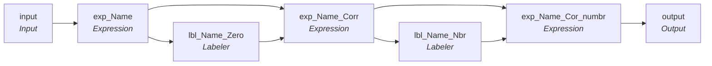

# mplt_Name_Standardization_Trailing_Num_Removal

IDQ mapplet &rarr; CDI **Mapplet** `mplt_Name_Standardization_Trailing_Num_Removal`.

> Removes trailing numbers in names.  TLF 5/25/2023 FullName was always being output as NULL.  Transformation "exp_Name_Cor_numbr" used results from individual name checks and concatinated results to create FullName out instead of running complete check on full name.

[ML 11/8/2024]  Corrected logic the concatenates middle name to full name to check null sting in addition to null, added trim to all var_ to remove leading and trailing spaces

## Summary

| IDQ transformation | CDI transformation | Count |
|---|---|---|
| ExpressionTx | Expression | 3 |
| LabelerTx | Labeler | 2 |
| MappletInputTx | Input | 1 |
| MappletOutputTx | Output | 1 |

## Flow

## Transformations

In data-flow order.

### input

IDQ `MappletInputTx` &rarr; CDI **Input**. Mapplet Input transformation.

| Field | Type |
|---|---|
| First_Name | string(30) |
| Last_Name | string(30) |
| Middle_Name | string(30) |
| Full_Name | string(255) |

### exp_Name

IDQ `ExpressionTx` &rarr; CDI **Expression**. Same expression language; variable fields are supported.

| Field | Kind | Type | Expression (CDI) |
|---|---|---|---|
| First_Name | in/out | string(30) | `First_Name` |
| Last_Name | in/out | string(30) | `Last_Name` |
| Middle_Name | in/out | string(30) | `Middle_Name` |
| Full_Name | in/out | string(255) | `Full_Name` |

Links (target field &larr; upstream field):

| Field | From |
|---|---|
| First_Name | input.First_Name |
| Last_Name | input.Last_Name |
| Middle_Name | input.Middle_Name |
| Full_Name | input.Full_Name |

### lbl_Name_Zero

IDQ `LabelerTx` &rarr; CDI **Labeler**. CDQ Labeler asset (see cdq.md).

Settings: (defaults)

- `LabelerTxStrategy` **FName** outputField=`Fname_lbl`
  - function: `labeler`
- `FieldParameter` **Input** field=`FName`, parameter=`Input0`
- `FieldParameter` **LabeledOutput** field=`Fname_lbl`
- `CharacterLabel` **Label_FName** enabled=`true`, characterSets=`EnglishAlphabet`, labelOverrides=``
- `LabelerTxStrategy` **LName** outputField=`LName_Lbl`
  - function: `labeler`
- `FieldParameter` **Input** field=`LName`, parameter=`Input0`
- `FieldParameter` **LabeledOutput** field=`LName_Lbl`
- `CharacterLabel` **Label Characters using Character Sets** enabled=`true`, characterSets=`EnglishAlphabet`, labelOverrides=``
- `LabelerTxStrategy` **FullName** outputField=`FullName_lbl`
  - function: `labeler`
- `FieldParameter` **Input** field=`Full_Name`, parameter=`Input0`
- `FieldParameter` **LabeledOutput** field=`FullName_lbl`
- `CharacterLabel` **Label Characters using Character Sets** enabled=`true`, characterSets=`EnglishAlphabet`, labelOverrides=``
- `LabelerTxStrategy` **MName** outputField=`MName_lbl`
  - function: `labeler`
- `FieldParameter` **Input** field=`MName`, parameter=`Input0`
- `FieldParameter` **LabeledOutput** field=`MName_lbl`
- `CharacterLabel` **Label Characters using Character Sets** enabled=`true`, characterSets=`EnglishAlphabet`, labelOverrides=``

Links (target field &larr; upstream field):

| Field | From |
|---|---|
| FName | exp_Name.First_Name |
| LName | exp_Name.Last_Name |
| MName | exp_Name.Middle_Name |
| Full_Name | exp_Name.Full_Name |

### exp_Name_Corr

IDQ `ExpressionTx` &rarr; CDI **Expression**. Same expression language; variable fields are supported.

| Field | Kind | Type | Expression (CDI) |
|---|---|---|---|
| FName_lbl | in/out | string(30) | `FName_lbl` |
| LName_Lbl | in/out | string(30) | `LName_Lbl` |
| MName_lbl | in/out | string(30) | `MName_lbl` |
| FullName_lbl | in/out | string(255) | `FullName_lbl` |
| FName | in/out | string(30) | `FName` |
| out_FName | out | string(30) | `Decode (True, INSTR(FName_lbl,'X0X') >0 AND NOT IS_NUMBER(SUBSTR(FName,LENGTH(LTRIM(RTRIM(FName))),1)), REPLACESTR ( 1, FName, '0', 'o'), --INSTR(FName_lbl,'XX0') >0, --REPLACESTR ( 1, FName, '0', 'o'), FName)` |
| Last_Name | in/out | string(30) | `Last_Name` |
| out_LName | out | string(30) | `Decode (True, INSTR(LName_Lbl,'X0X') >0 AND NOT IS_NUMBER(SUBSTR(Last_Name,LENGTH(LTRIM(RTRIM(Last_Name))),1)), REPLACESTR ( 1, Last_Name, '0', 'o'), --INSTR(LName_Lbl,'XX0') >0, --REPLACESTR ( 1, Last_Name, '0', 'o'), Last_Name)` |
| Middle_Name | in/out | string(30) | `Middle_Name` |
| out_MName | out | string(30) | `Decode (True, INSTR(MName_lbl,'X0X') >0 AND NOT IS_NUMBER(SUBSTR(Middle_Name,LENGTH(LTRIM(RTRIM(Middle_Name))),1)), REPLACESTR ( 1, Middle_Name, '0', 'o'), --INSTR(MName_lbl,'X0') >0, --REPLACESTR ( 1, Middle_Name, '0', 'o'), --INSTR(MName_lbl,'XX0') >0, --REPLACESTR ( 1, Middle_Name, '0', 'o'), Middle_Name)` |
| Full_Name | in/out | string(255) | `Full_Name` |
| out_FullName | out | string(255) | `Decode (True, INSTR(FullName_lbl,'X0X') >0 AND NOT IS_NUMBER(SUBSTR(Full_Name,LENGTH(LTRIM(RTRIM(Full_Name))),1)), REPLACESTR ( 1, Full_Name, '0', 'o'), --INSTR(FullName_lbl,'XX0') >0, --REPLACESTR ( 1, Full_Name, '0', 'o'), Full_Name)` |

Links (target field &larr; upstream field):

| Field | From |
|---|---|
| FName_lbl | lbl_Name_Zero.Fname_lbl |
| LName_Lbl | lbl_Name_Zero.LName_Lbl |
| MName_lbl | lbl_Name_Zero.MName_lbl |
| FName | exp_Name.First_Name |
| Last_Name | exp_Name.Last_Name |
| Middle_Name | exp_Name.Middle_Name |
| FullName_lbl | lbl_Name_Zero.FullName_lbl |
| Full_Name | exp_Name.Full_Name |

### lbl_Name_Nbr

IDQ `LabelerTx` &rarr; CDI **Labeler**. CDQ Labeler asset (see cdq.md).

Settings: (defaults)

- `LabelerTxStrategy` **FName_lbl** outputField=`FName_lbl`
  - function: `labeler`
- `FieldParameter` **Input** field=`FName`, parameter=`Input0`
- `FieldParameter` **LabeledOutput** field=`FName_lbl`
- `CharacterLabel` **Label Characters using Character Sets** enabled=`true`, characterSets=`EnglishAlphabet`, labelOverrides=` `
- `LabelerTxStrategy` **LName_lbl** outputField=`LName_lbl`
  - function: `labeler`
- `FieldParameter` **Input** field=`LName`, parameter=`Input0`
- `FieldParameter` **LabeledOutput** field=`LName_lbl`
- `CharacterLabel` **Label Characters using Character Sets** enabled=`true`, characterSets=`EnglishAlphabet`, labelOverrides=` `
- `LabelerTxStrategy` **FullName_lbl** outputField=`FullName_lbl`
  - function: `labeler`
- `FieldParameter` **Input** field=`FullName`, parameter=`Input0`
- `FieldParameter` **LabeledOutput** field=`FullName_lbl`
- `CharacterLabel` **Label Characters using Character Sets** enabled=`true`, characterSets=`EnglishAlphabet`, labelOverrides=` `
- `LabelerTxStrategy` **MName_lbl** outputField=`MName_lbl`
  - function: `labeler`
- `FieldParameter` **Input** field=`MName`, parameter=`Input0`
- `FieldParameter` **LabeledOutput** field=`MName_lbl`
- `CharacterLabel` **Label Characters using Character Sets** enabled=`true`, characterSets=`EnglishAlphabet`, labelOverrides=` `

Links (target field &larr; upstream field):

| Field | From |
|---|---|
| FName | exp_Name_Corr.out_FName |
| LName | exp_Name_Corr.out_LName |
| MName | exp_Name_Corr.out_MName |
| FullName | exp_Name_Corr.out_FullName |

### exp_Name_Cor_numbr

IDQ `ExpressionTx` &rarr; CDI **Expression**. Same expression language; variable fields are supported.

| Field | Kind | Type | Expression (CDI) |
|---|---|---|---|
| FName_lbl | in/out | string(30) | `FName_lbl` |
| FullName_lbl | in/out | string(255) | `FullName_lbl` |
| LName_lbl | in/out | string(30) | `LName_lbl` |
| MName_lbl | in/out | string(30) | `MName_lbl` |
| in_FName | in/out | string(30) | `in_FName` |
| var_FName | variable | string(30) | `RTRIM(LTRIM(  Decode (True, SUBSTR(LTRIM(RTRIM(FName_lbl)),LENGTH(LTRIM(RTRIM(FName_lbl)))-2,2)!= '99' AND SUBSTR(LTRIM(RTRIM(in_FName)),LENGTH(LTRIM(RTRIM(in_FName))),1) = '0',in_FName,  INSTR(FName_lbl,'9') >0, SUBSTR(in_FName,1, INSTR( FName_lbl, '9', 1, 1 )-1), in_FName)  ))` |
| out_FName | out | string(30) | `var_FName` |
| in_LName | in/out | string(30) | `in_LName` |
| var_LName | variable | string(30) | `RTRIM(LTRIM( Decode (True,  SUBSTR(LTRIM(RTRIM(LName_lbl)),LENGTH(LTRIM(RTRIM(LName_lbl)))-2,2)!= '99' AND SUBSTR(LTRIM(RTRIM(in_LName)),LENGTH(LTRIM(RTRIM(in_LName))),1) = '0',in_LName,  INSTR(LName_lbl,'9') >0, SUBSTR(in_LName,1, INSTR( LName_lbl, '9', 1, 1 )-1),in_LName)  ))` |
| out_LName | out | string(30) | `var_LName` |
| in_MName | in/out | string(30) | `in_MName` |
| var_MName | variable | string(30) | `RTRIM(LTRIM(  Decode (True, SUBSTR(LTRIM(RTRIM(MName_lbl)),LENGTH(LTRIM(RTRIM(MName_lbl)))-2,2)!= '99' AND SUBSTR(LTRIM(RTRIM(in_MName)),LENGTH(LTRIM(RTRIM(in_MName))),1) = '0',in_LName,   INSTR(MName_lbl,'9') >0, SUBSTR(in_MName,1, INSTR( MName_lbl, '9', 1, 1 )-1),in_MName)  ))` |
| out_MName | out | string(30) | `var_MName` |
| out_FullName | out | string(255) | `LTRIM(RTRIM(var_FName\|\| IIF(NOT (ISNULL(var_MName) OR var_MName = ''),' ' \|\| LTRIM(RTRIM(var_MName)), '') \|\| ' ' \|\|  LTRIM(var_LName)) )` |

Links (target field &larr; upstream field):

| Field | From |
|---|---|
| FullName_lbl | lbl_Name_Nbr.FullName_lbl |
| FName_lbl | lbl_Name_Nbr.FName_lbl |
| LName_lbl | lbl_Name_Nbr.LName_lbl |
| MName_lbl | lbl_Name_Nbr.MName_lbl |
| in_FName | exp_Name_Corr.out_FName |
| in_LName | exp_Name_Corr.out_LName |
| in_MName | exp_Name_Corr.out_MName |

### output

IDQ `MappletOutputTx` &rarr; CDI **Output**. Mapplet Output transformation.

| Field | Type |
|---|---|
| out_FName | string(30) |
| out_LName | string(30) |
| out_MName | string(30) |
| out_FullName | string(255) |

Links (target field &larr; upstream field):

| Field | From |
|---|---|
| out_FName | exp_Name_Cor_numbr.out_FName |
| out_LName | exp_Name_Cor_numbr.out_LName |
| out_MName | exp_Name_Cor_numbr.out_MName |
| out_FullName | exp_Name_Cor_numbr.out_FullName |
