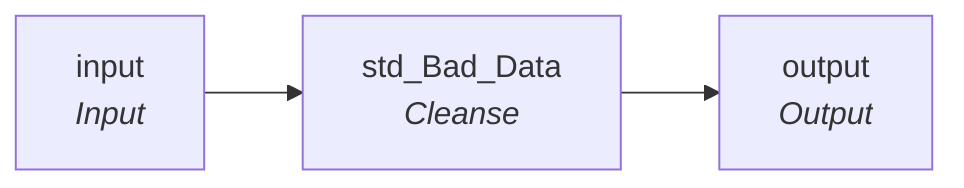

# rule_Addr_Line_Post_Scrub

IDQ mapplet &rarr; CDI **Mapplet** `rule_Addr_Line_Post_Scrub`.

> Change care of (C/O) from upper to lower case. remove any trailing secondary designators (Apt, Ste, Unit, # etc.)

## Summary

| IDQ transformation | CDI transformation | Count |
|---|---|---|
| MappletInputTx | Input | 1 |
| MappletOutputTx | Output | 1 |
| TokenStandardiserTx | Cleanse | 1 |

## Flow

## Transformations

In data-flow order.

### input

IDQ `MappletInputTx` &rarr; CDI **Input**. Mapplet Input transformation.

| Field | Type |
|---|---|
| AddressLine1 | string(100) |
| AddressLine2 | string(100) |

### std_Bad_Data

IDQ `TokenStandardiserTx` &rarr; CDI **Cleanse**. CDQ Cleanse asset with remove/replace steps (see cdq.md).

Settings: (defaults)

- `TokenStandardiserStrategy` **Standardizer1** removeMultipleSpaces=`true`, trim=`true`
  - function: `standardizer`
- `FieldParameter` **Input** field=`AddressLine1`
- `FieldParameter` **Output** field=`AddressLine1`
- `UserOp` **ReplaceCustomStrings** replace=`true`, replacement=`c/o `, scope=`start`, searchStrings=`C/O `
- `UserOp` **Replace Custom Strings1** replace=`true`, replacement=` c/o `, searchStrings=` C/O `
- `UserOp` **Remove Custom Strings** scope=`end`, searchStrings=`# Apt Bldg Dept Fl Hngr Key Lot Pier Rm Slip Spc Stop Ste Trlr Unit`
- `TokenStandardiserStrategy` **Standardizer2** removeMultipleSpaces=`true`, trim=`true`
  - function: `standardizer`
- `FieldParameter` **Input** field=`AddressLine2`
- `FieldParameter` **Output** field=`AddressLine2`
- `UserOp` **Replace Custom Strings** replace=`true`, replacement=`c/o `, scope=`start`, searchStrings=`C/O `
- `UserOp` **Replace Custom Strings1** replace=`true`, replacement=` c/o `, searchStrings=` C/O `
- `UserOp` **Remove Custom Strings** scope=`end`, searchStrings=`# Apt Bldg Dept Fl Hngr Key Lot Pier Rm Slip Spc Stop Ste Trlr Unit`

Links (target field &larr; upstream field):

| Field | From |
|---|---|
| AddressLine1 | input.AddressLine1 |
| AddressLine2 | input.AddressLine2 |

### output

IDQ `MappletOutputTx` &rarr; CDI **Output**. Mapplet Output transformation.

| Field | Type |
|---|---|
| AddrLine1 | string(100) |
| AddrLine2 | string(100) |

Links (target field &larr; upstream field):

| Field | From |
|---|---|
| AddrLine1 | std_Bad_Data.AddressLine1 |
| AddrLine2 | std_Bad_Data.AddressLine2 |
