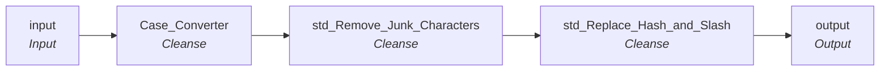

# rule_Addr_Line_Pre_Scrub1

IDQ mapplet &rarr; CDI **Mapplet** `rule_Addr_Line_Pre_Scrub1`.

> Cast upper case, remove Junk characters, replace backslash with forward, replace multiple # with one only  
(Rules applied before sending to address Dr)

[ML 10/28/2020] Removed UNIT conversion to #

## Summary

| IDQ transformation | CDI transformation | Count |
|---|---|---|
| CaseConverterTx | Cleanse | 1 |
| MappletInputTx | Input | 1 |
| MappletOutputTx | Output | 1 |
| TokenStandardiserTx | Cleanse | 2 |

## Flow

## Transformations

In data-flow order.

### input

IDQ `MappletInputTx` &rarr; CDI **Input**. Mapplet Input transformation.

| Field | Type |
|---|---|
| Address_Line1 | string(100) |
| Address_Line2 | string(100) |

### Case_Converter

IDQ `CaseConverterTx` &rarr; CDI **Cleanse**. CDQ Cleanse asset with a Change Case step (see cdq.md).

Settings: (defaults)

- `CaseConverterTxStrategy` **CaseConverter**
  - function: `TOUPPER`
- `FieldParameter` **Address_Line1** field=`Address_Line1`
- `FieldParameter` **Address_Line2** field=`Address_Line2`
- `FieldParameter` **Output** field=`Address_Line1`
- `FieldParameter` **Output1** field=`Address_Line2`

Links (target field &larr; upstream field):

| Field | From |
|---|---|
| Address_Line1 | input.Address_Line1 |
| Address_Line2 | input.Address_Line2 |

### std_Remove_Junk_Characters

IDQ `TokenStandardiserTx` &rarr; CDI **Cleanse**. CDQ Cleanse asset with remove/replace steps (see cdq.md).

Settings: (defaults)

- `TokenStandardiserStrategy` **Standardizer1** removeMultipleSpaces=`true`, trim=`true`
  - function: `standardizer`
- `FieldParameter` **Input** field=`Address_Line1`
- `FieldParameter` **Output** field=`Address_Line1`
- `UserOp` **Remove Custom Strings** searchStrings=`$ ) ( @ ^ ! ~ * % + _ = { } [ ] | : ; " ' < > ? &`
- `TokenStandardiserStrategy` **Standardizer2** removeMultipleSpaces=`true`, trim=`true`
  - function: `standardizer`
- `FieldParameter` **Input** field=`Address_Line2`
- `FieldParameter` **Output** field=`Address_Line2`
- `UserOp` **Remove Custom Strings** searchStrings=`$ ) ( @ ^ ! ~ * % + - = { } [ ] | : ; " ' < > ? &`

Links (target field &larr; upstream field):

| Field | From |
|---|---|
| Address_Line1 | Case_Converter.Address_Line1 |
| Address_Line2 | Case_Converter.Address_Line2 |

### std_Replace_Hash_and_Slash

IDQ `TokenStandardiserTx` &rarr; CDI **Cleanse**. CDQ Cleanse asset with remove/replace steps (see cdq.md).

Settings: (defaults)

- `TokenStandardiserStrategy` **Standardizer1**
  - function: `standardizer`
- `FieldParameter` **Input** field=`Address_Line1`
- `FieldParameter` **Output** field=`Address_Line1`
- `UserOp` **Replace Custom Strings** replace=`true`, replacement=`#`, searchStrings=`# # # # # # # # # ### ##`
- `UserOp` **Replace Custom Strings1** replace=`true`, replacement=`/`, searchStrings=`\`
- `TokenStandardiserStrategy` **Standardizer2**
  - function: `standardizer`
- `FieldParameter` **Input** field=`Address_Line2`
- `FieldParameter` **Output** field=`Address_Line2`
- `UserOp` **Replace Custom Strings** replace=`true`, replacement=`#`, searchStrings=`# # # # # # # # # ### ##`
- `UserOp` **Replace Custom Strings1** replace=`true`, replacement=`/`, searchStrings=`\`

Links (target field &larr; upstream field):

| Field | From |
|---|---|
| Address_Line1 | std_Remove_Junk_Characters.Address_Line1 |
| Address_Line2 | std_Remove_Junk_Characters.Address_Line2 |

### output

IDQ `MappletOutputTx` &rarr; CDI **Output**. Mapplet Output transformation.

| Field | Type |
|---|---|
| Address_Line1 | string(100) |
| Address_Line2 | string(100) |

Links (target field &larr; upstream field):

| Field | From |
|---|---|
| Address_Line1 | std_Replace_Hash_and_Slash.Address_Line1 |
| Address_Line2 | std_Replace_Hash_and_Slash.Address_Line2 |
