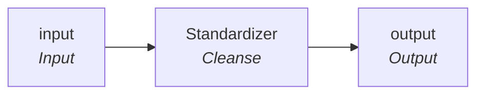

# rule_CARE_ID_Std

IDQ mapplet &rarr; CDI **Mapplet** `rule_CARE_ID_Std`.

## Summary

| IDQ transformation | CDI transformation | Count |
|---|---|---|
| MappletInputTx | Input | 1 |
| MappletOutputTx | Output | 1 |
| TokenStandardiserTx | Cleanse | 1 |

## Flow

## Transformations

In data-flow order.

### input

IDQ `MappletInputTx` &rarr; CDI **Input**. Mapplet Input transformation.

| Field | Type |
|---|---|
| CARE_ID | string(10) |

### Standardizer

IDQ `TokenStandardiserTx` &rarr; CDI **Cleanse**. CDQ Cleanse asset with remove/replace steps (see cdq.md).

Settings: (defaults)

- `TokenStandardiserStrategy` **Std_CARE_ID** delimiters=` `, removeMultipleSpaces=`true`, trim=`true`
  - function: `standardizer`
- `FieldParameter` **Input** field=`CARE_ID`
- `FieldParameter` **Output** field=`CARE_ID`
- `RtmOp` **Remove Reference Table Matches**
- `Dictionary`  refTable=`ref_special_char_list`

Links (target field &larr; upstream field):

| Field | From |
|---|---|
| CARE_ID | input.CARE_ID |

### output

IDQ `MappletOutputTx` &rarr; CDI **Output**. Mapplet Output transformation.

| Field | Type |
|---|---|
| CARE_ID | string(10) |
| CARE_ID_EXCEPTION_CODE | string(300) |
| CARE_ID_EXCEPTION_DESC | string(300) |
| CARE_ID_EXCEPTION_TYPE | string(300) |

Links (target field &larr; upstream field):

| Field | From |
|---|---|
| CARE_ID | Standardizer.CARE_ID |
