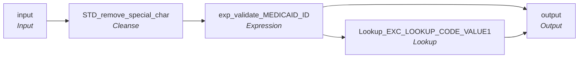

# rule_MEDICAID_ID_Std

IDQ mapplet &rarr; CDI **Mapplet** `rule_MEDICAID_ID_Std`.

> This mapplet validates the Phone Number to a length of 10.  
Returns "Valid" or "Invalid".

## Summary

| IDQ transformation | CDI transformation | Count |
|---|---|---|
| ExpressionTx | Expression | 1 |
| LookupTx | Lookup | 1 |
| MappletInputTx | Input | 1 |
| MappletOutputTx | Output | 1 |
| TokenStandardiserTx | Cleanse | 1 |

## Flow

## Transformations

In data-flow order.

### input

IDQ `MappletInputTx` &rarr; CDI **Input**. Mapplet Input transformation.

| Field | Type |
|---|---|
| MEDICAID_ID | string(20) |

### STD_remove_special_char

IDQ `TokenStandardiserTx` &rarr; CDI **Cleanse**. CDQ Cleanse asset with remove/replace steps (see cdq.md).

Settings: (defaults)

- `TokenStandardiserStrategy` **STD_remove_special_Char** removeMultipleSpaces=`true`, trim=`true`
  - function: `standardizer`
- `FieldParameter` **Input** field=`MEDICAID_ID`
- `FieldParameter` **Output** field=`MEDICAID_ID`
- `RtmOp` **Remove Reference Table Matches**
- `Dictionary`  filename=`ref_special_char_list`, path=`HHSC_SHARED`, refTable=`ref_special_char_list`

Links (target field &larr; upstream field):

| Field | From |
|---|---|
| MEDICAID_ID | input.MEDICAID_ID |

### exp_validate_MEDICAID_ID

IDQ `ExpressionTx` &rarr; CDI **Expression**. Same expression language; variable fields are supported.

| Field | Kind | Type | Expression (CDI) |
|---|---|---|---|
| MEDICAID_ID | in/out | string(10) | `MEDICAID_ID` |
| EXCEPTION_CODE | out | string(300) | `IIF( 	LENGTH(MEDICAID_ID) <> 9,  	'Invalid_Medicaid_Id', 	null)` |

Links (target field &larr; upstream field):

| Field | From |
|---|---|
| MEDICAID_ID | STD_remove_special_char.MEDICAID_ID |

### Lookup_EXC_LOOKUP_CODE_VALUE1

IDQ `LookupTx` &rarr; CDI **Lookup**. Connected lookup unless a return port is set (then unconnected).

| Property | Value |
|---|---|
| Connection | STAGING |
| Object | EXC_LOOKUP_CODE_VALUE |
| Lookup condition | EXCEPTION_CODE = EXCEPTION_CODE1 |
| Multiple matches | Return any row |
| Cache | static cache |

| Lookup input field | Type |
|---|---|
| EXCEPTION_CODE1 | string(300) |

| Return / pass-through field | Feeds |
|---|---|
| EXCEPTION_CODE1 | output.Medicaid_Id_Exception_Code |
| EXCEPTION_TYPE | output.Medicaid_Id_Exception_Type |
| EXCEPTION_DESC | output.Medicaid_Id_Exception_Desc |

Links (target field &larr; upstream field):

| Field | From |
|---|---|
| EXCEPTION_CODE1 | exp_validate_MEDICAID_ID.EXCEPTION_CODE |

### output

IDQ `MappletOutputTx` &rarr; CDI **Output**. Mapplet Output transformation.

| Field | Type |
|---|---|
| Medicaid_Id | string(10) |
| Medicaid_Id_Exception_Type | string(300) |
| Medicaid_Id_Exception_Code | string(300) |
| Medicaid_Id_Exception_Desc | string(300) |

Links (target field &larr; upstream field):

| Field | From |
|---|---|
| Medicaid_Id | exp_validate_MEDICAID_ID.MEDICAID_ID |
| Medicaid_Id_Exception_Type | Lookup_EXC_LOOKUP_CODE_VALUE1.EXCEPTION_TYPE |
| Medicaid_Id_Exception_Code | Lookup_EXC_LOOKUP_CODE_VALUE1.EXCEPTION_CODE1 |
| Medicaid_Id_Exception_Desc | Lookup_EXC_LOOKUP_CODE_VALUE1.EXCEPTION_DESC |
