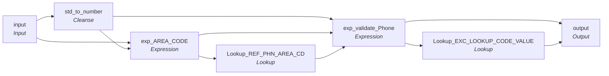

# rule_Phone_Std

IDQ mapplet &rarr; CDI **Mapplet** `rule_Phone_Std`.

> This mapplet validates the Phone Number.
Assumptions:
1. Phone numbers stored in the MDM should be valid US phone number (i.e. exclude Mexico and Canada if possible / practical)
2. Directory assistance / information / emergency numbers should be rejected (“Non-Area Codes”)
3. Toll free numbers should be rejected when used on members home/ main numbers (allowed for work / contact and for all provider numbers)

[ML 12/30/2024]  Bug FIx - Replace standardized function that was not removing phone punctuation i.e  (512) 332-2234 to 5123322234

## Summary

| IDQ transformation | CDI transformation | Count |
|---|---|---|
| ExpressionTx | Expression | 2 |
| LookupTx | Lookup | 2 |
| MappletInputTx | Input | 1 |
| MappletOutputTx | Output | 1 |
| TokenStandardiserTx | Cleanse | 1 |

## Flow



## Transformations

In data-flow order.

### input

IDQ `MappletInputTx` &rarr; CDI **Input**. Mapplet Input transformation.

| Field | Type |
|---|---|
| Phone | string(20) |
| SRC_SYS | string(10) |
| USG_TP | string(10) |

### std_to_number

IDQ `TokenStandardiserTx` &rarr; CDI **Cleanse**. CDQ Cleanse asset with remove/replace steps (see cdq.md).

Settings: (defaults)

- `TokenStandardiserStrategy` **std_Remove_Junk_MDL_Name** removeMultipleSpaces=`true`, trim=`true`
  - function: `standardizer`
- `FieldParameter` **Input** field=`Phione`
- `FieldParameter` **Output** field=`Phone`
- `UserOp` **Remove Custom Strings** searchStrings=`` ~ ` ! @ # $ % ^ & * ( ) _ - + = } { [ ] | \ " ' : ; ? / > . < , 	   ``

Links (target field &larr; upstream field):

| Field | From |
|---|---|
| Phione | input.Phone |

### exp_AREA_CODE

IDQ `ExpressionTx` &rarr; CDI **Expression**. Same expression language; variable fields are supported.

| Field | Kind | Type | Expression (CDI) |
|---|---|---|---|
| Phone | in/out | string(20) | `Phone` |
| AREA_CODE | out | string(10) | `SUBSTR(Phone,1,3)` |
| SRC_SYS | in/out | string(10) | `SRC_SYS` |
| USG_TP | in/out | string(10) | `USG_TP` |

Links (target field &larr; upstream field):

| Field | From |
|---|---|
| SRC_SYS | input.SRC_SYS |
| USG_TP | input.USG_TP |
| Phone | std_to_number.Phone |

### Lookup_REF_PHN_AREA_CD

IDQ `LookupTx` &rarr; CDI **Lookup**. Connected lookup unless a return port is set (then unconnected).

| Property | Value |
|---|---|
| Connection | Snowflake_PEI |
| Object | RDM.REF_PHN_AREA_CD |
| Lookup condition | NPA_ID = AREA_CODE |
| Multiple matches | Return any row |
| Cache | static cache |

Filter (CDI source/lookup *Filter* property; translated):

```sql
(
	in_service = 'Y'
	or
	current_date()>= in_service_dt
	)
and
	(
	service is null
	or
	service = 'Toll-Free'
    )
and (					-- Omit Canada and Caribbean countries
	country = 'US'
    or
    country is null -- toll free and non-geographic
    )
```

| Lookup input field | Type |
|---|---|
| AREA_CODE | string(10) |

| Return / pass-through field | Feeds |
|---|---|
| NPA_ID | exp_validate_Phone.NPA_ID |
| SERVICE | exp_validate_Phone.AREA_CODE_SERVICE |

Links (target field &larr; upstream field):

| Field | From |
|---|---|
| AREA_CODE | exp_AREA_CODE.AREA_CODE |

### exp_validate_Phone

IDQ `ExpressionTx` &rarr; CDI **Expression**. Same expression language; variable fields are supported.

| Field | Kind | Type | Expression (CDI) |
|---|---|---|---|
| Phone | in/out | string(10) | `Phone` |
| AREA_CODE | variable | string(10) | `SUBSTR(Phone,1,3)` |
| N_DIGIT_Pos_1 | variable | string(10) | `SUBSTR(Phone,1,1)` |
| N_DIGIT_Pos_4 | variable | string(10) | `SUBSTR(Phone,4,1)` |
| PHN_TP | in/out | string(10) |  |
| NPA_ID | in/out | string(250) |  |
| AREA_CODE_SERVICE | in/out | string(250) |  |
| SRC_SYS | in/out | string(10) | `SRC_SYS` |
| USG_TP | in/out | string(10) | `USG_TP` |
| EXCEPTION_CODE1 | out | string(300) | `DECODE(TRUE<br>,NOT IS_NUMBER(PHONE) --phone is not a number<br>,'Invalid_Phone_Number'<br>,LENGTH(Phone) <> 10 OR PHONE = '0000000000' --not 10 characters or all zeros<br>,'Invalid_Phone_Number'<br>,IN(N_DIGIT_Pos_4, '0','1') --fourth position is not 2-9<br>,'Invalid_Phone_Number'<br>,IN(SRC_SYS, 'ECI') and AREA_CODE = '000' --Missing area code appended with'000'<br>,'Missing_AreaCode'<br>,ISNULL(NPA_ID) --invalid area code not in lookup<br>,'Invalid_Phone_Number'<br>,IN(N_DIGIT_Pos_1, '0','1') --first position is not 2-9<br>,'Invalid_Phone_Number'<br>,IN(SRC_SYS, 'TRS','CRE','ECI') and IN(USG_TP, '001','003') and AREA_CODE_SERVICE = 'Toll-Free' --'Main' or 'Other' usage type cannot use toll free area codes<br>,'Invalid_Phone_Number'<br>,null<br>)` |

Links (target field &larr; upstream field):

| Field | From |
|---|---|
| Phone | std_to_number.Phone |
| SRC_SYS | exp_AREA_CODE.SRC_SYS |
| USG_TP | exp_AREA_CODE.USG_TP |
| NPA_ID | Lookup_REF_PHN_AREA_CD.NPA_ID |
| AREA_CODE_SERVICE | Lookup_REF_PHN_AREA_CD.SERVICE |

### Lookup_EXC_LOOKUP_CODE_VALUE

IDQ `LookupTx` &rarr; CDI **Lookup**. Connected lookup unless a return port is set (then unconnected).

| Property | Value |
|---|---|
| Connection | STAGING |
| Object | EXC_LOOKUP_CODE_VALUE |
| Lookup condition | EXCEPTION_CODE = in_Exception_Code |
| Multiple matches | Return any row |
| Cache | static cache |

| Lookup input field | Type |
|---|---|
| in_Exception_Code | string(300) |

| Return / pass-through field | Feeds |
|---|---|
| in_Exception_Code | output.Phone_Exception_Code |
| EXCEPTION_TYPE | output.Phone_Exception_Type |
| EXCEPTION_DESC | output.Phone_Exception_Desc |

Links (target field &larr; upstream field):

| Field | From |
|---|---|
| in_Exception_Code | exp_validate_Phone.EXCEPTION_CODE1 |

### output

IDQ `MappletOutputTx` &rarr; CDI **Output**. Mapplet Output transformation.

| Field | Type |
|---|---|
| Phone | string(10) |
| Phone_Exception_Type | string(300) |
| Phone_Exception_Code | string(300) |
| Phone_Exception_Desc | string(300) |

Links (target field &larr; upstream field):

| Field | From |
|---|---|
| Phone_Exception_Type | Lookup_EXC_LOOKUP_CODE_VALUE.EXCEPTION_TYPE |
| Phone_Exception_Code | Lookup_EXC_LOOKUP_CODE_VALUE.in_Exception_Code |
| Phone_Exception_Desc | Lookup_EXC_LOOKUP_CODE_VALUE.EXCEPTION_DESC |
| Phone | exp_validate_Phone.Phone |
