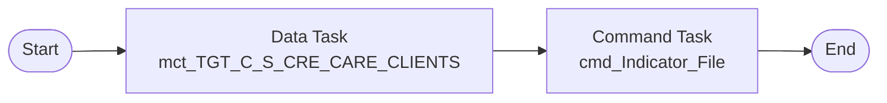

# Taskflow tf_CRE_Stage_Load_Ongoing

Replaces IDQ workflow `wf_CRE_Stage_Load_Ongoing`. Create it as a **Taskflow** (not a linear taskflow) because the workflow runs mapping tasks in parallel.

## IDQ workflow

## CDI taskflow

## Steps

| # | Step | Runs | Notes |
|---|---|---|---|
| 0 | Data Task | `mct_TGT_C_S_CRE_CARE_CLIENTS` |  |
| 1 | Command Task | cmd_Indicator_File | IDQ command `touch ${var:sys.WorkflowName}.ind`, working directory `/opt/apps/informatica/SrcFiles/Indicators`. See below. |
| 2 | End |  |  |

## Mapping tasks

Create one mapping task per mapping. IDQ mapping-task settings and their CDI home:

| Mapping task | Mapping | Date format (Advanced session property *Default date format*) | High precision (*Enable high precision*) | Tracing (*Override tracing*) | Sort order |
|---|---|---|---|---|---|
| `mct_TGT_C_S_CRE_CARE_CLIENTS` | [`m_Tgt_C_S_CRE_CARE_Clients`](mappings/m_Tgt_C_S_CRE_CARE_Clients.md) | MM/DD/YYYY HH24:MI:SS | true | normal | binary |

Each Data Task: *On error* = **Fail taskflow** (IDQ aborts the workflow when a mapping task fails). Pass the parameter file through the mapping task *Parameter file* setting (see the `.param` file).

Workflow variables `MappingIsSuccessful` are declared but never assigned or read in the IDQ workflow: not ported.

## Command task

IDQ runs `touch ${var:sys.WorkflowName}.ind` on the DIS host. In the CDI taskflow add a **Command Task** step that runs on the Linux Secure Agent runtime environment:

| Field | Value |
|---|---|
| Runtime Environment | the Linux Secure Agent group used by the mapping tasks |
| Script File Name | `/bin/sh` |
| Input Arguments | `-c "touch wf_CRE_Stage_Load_Ongoing.ind"` |
| Work Directory | `/opt/apps/informatica/SrcFiles/Indicators` |

`${var:sys.WorkflowName}` resolved to `wf_CRE_Stage_Load_Ongoing` so the indicator file name downstream consumers watch does not change. The agent user needs write access to the working directory.
