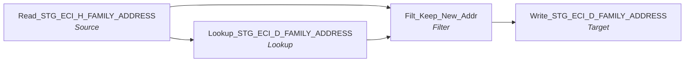

# m_Tgt_Stg_ECI_Pty_Reactivation_D_Family_Addr

IDQ mapping &rarr; CDI **Mapping** `m_Tgt_Stg_ECI_Pty_Reactivation_D_Family_Addr`.

> Move heirarchical child records of reactivated parties to from stage history to stage delta tables.   This will enable the creation of hub state 1 records for reactivation of  these dependant tables.

## Summary

| IDQ transformation | CDI transformation | Count |
|---|---|---|
| FilterTx | Filter | 1 |
| LookupTx | Lookup | 1 |
| SourceTx | Source | 1 |
| TargetTx | Target | 1 |

Sources:

| Instance | Object | Connection |
|---|---|---|
| Read_STG_ECI_H_FAMILY_ADDRESS | `STG_ECI_H_FAMILY_ADDRESS` | STAGING |

Targets:

| Instance | Object | Connection |
|---|---|---|
| Write_STG_ECI_D_FAMILY_ADDRESS | `STG_ECI_D_FAMILY_ADDRESS` | STAGING |

## Flow



## Filtered data

Every step that can stop, divert or collapse rows, and what happens to the rows that do not pass. A Filter keeps a row only when its condition is TRUE: FALSE **or NULL** drops the row silently (no target, no reject file). A Router writes a row to **every** group whose condition is TRUE; a row that matches no group goes to the default group and is discarded when that group is not linked. Comments (`--`, `//`) are removed from the conditions shown here. A `= ...` line reads a null check on a lookup return in plain terms; *no matching row* also covers a matching row whose returned field is NULL.

### Steps that filter rows

| Step | IDQ type | Rule | Rows that pass go to | Rows that do not pass |
|---|---|---|---|---|
| Read_STG_ECI_H_FAMILY_ADDRESS | SourceTx | source filter `(ID_FAMILY_ADDRESS,LOAD_DATE) IN (Select ID_FAMILY_ADDRESS, Max(LOAD_DATE) from STG_ECI_H_FAMILY_ADDRESS where ID_FAMILY in (select ID from V_ECI_ETL_LU_REACTIVATED_ID where ID_TYPE = 'ID_FAMILY') gro …` | `STG_ECI_D_FAMILY_ADDRESS` | never read |
| Filt_Keep_New_Addr | FilterTx | keep `IsNull(LKP_ID_FAMILY_ADDRESS)`<br>= no matching row in `STG_ECI_D_FAMILY_ADDRESS` | `STG_ECI_D_FAMILY_ADDRESS` | **discarded** |

### Where the condition fields come from

| Step | Field | Origin |
|---|---|---|
| Filt_Keep_New_Addr | `LKP_ID_FAMILY_ADDRESS` | `ID_FAMILY_ADDRESS` returned by lookup `Lookup_STG_ECI_D_FAMILY_ADDRESS` on `STG_ECI_D_FAMILY_ADDRESS` where `ID_FAMILY_ADDRESS = ID_FAMILY_ADDRESS1`; NULL when no row matches |

### Rows that do not reach `C_S_*` tables

This mapping writes no `C_S_*` table (it loads `STG_ECI_D_FAMILY_ADDRESS`); the steps above decide which rows it writes.

## Oracle stored procedure

Drop-in replacement in Oracle: [`sp_ors_main_m_Tgt_Stg_ECI_Pty_Reactivation_D_Family_Addr`](../../../idq-to-oracle/wf_ECI_Stage_Load/sp_ors_main_m_Tgt_Stg_ECI_Pty_Reactivation_D_Family_Addr.sql) (set-based SQL; one transaction that commits at the end and rolls back and re-raises on error). The IDQ mapplets and rules become the shared `fn_dq_*` functions; see [idq-to-oracle/README.md](../../../idq-to-oracle/README.md). Unlike the CDI spec above, the procedure **keeps the MDM timeline logic**; it is marked `TIMELINE` in the comments.

```text
Drop-in replacement of IDQ mapping m_Tgt_Stg_ECI_Pty_Reactivation_D_Family_Addr (workflow wf_ECI_Stage_Load).

Moves the latest history row of each address of a reactivated family (V_ECI_ETL_LU_REACTIVATED_ID, ID_FAMILY)
from STG_ECI_H_FAMILY_ADDRESS into the delta table STG_ECI_D_FAMILY_ADDRESS, so the address mapping re-sends it
to the MDM with hub state 1:
  Read_STG_ECI_H_FAMILY_ADDRESS (source filter: latest LOAD_DATE per ID_FAMILY_ADDRESS of reactivated families)
    -> Lookup_STG_ECI_D_FAMILY_ADDRESS -> Filt_Keep_New_Addr: address not already in the delta table
    -> Write_STG_ECI_D_FAMILY_ADDRESS (insert, no truncate)

Timeline: none.
```

Tables written:

| Table | Operation |
|---|---|
| `STG_ECI_D_FAMILY_ADDRESS` | insert |

Shared functions and procedures called:

| Object | Does |
|---|---|
| `sp_ors_helper02_common` | run log line: mapping, step, row count (DBMS_OUTPUT) |

## Transformations

In data-flow order.

### Read_STG_ECI_H_FAMILY_ADDRESS

IDQ `SourceTx` &rarr; CDI **Source**. Oracle connector source; carry the SQL override / filter below verbatim.

| Property | Value |
|---|---|
| Connection | STAGING |
| Object | STG_ECI_H_FAMILY_ADDRESS |

Filter (CDI source/lookup *Filter* property; translated):

```sql
(ID_FAMILY_ADDRESS,LOAD_DATE) 
IN 
(Select ID_FAMILY_ADDRESS, Max(LOAD_DATE)
from STG_ECI_H_FAMILY_ADDRESS
where ID_FAMILY in (select ID from V_ECI_ETL_LU_REACTIVATED_ID where ID_TYPE = 'ID_FAMILY')
group by ID_FAMILY_ADDRESS)
```

Columns: `ID_FAMILY_ADDRESS`, `ID_FAMILY`, `ID_CASE`, `ADDRESS_CD`, `ADDRESS1`, `ADDRESS2`, `ID_ST_CITY_CNTY_ZIP`, `CITY_NAME`, `COUNTY_NAME`, `ZIP_CODE`, `ZIP_SFX`, `STATE_ABBREV`, `CANCEL_DATE`, `DATE_CREATED`, `DATE_MODIFIED`, `MODIFIED_BY`, `CREATED_BY`, `LOAD_DATE`

### Lookup_STG_ECI_D_FAMILY_ADDRESS

IDQ `LookupTx` &rarr; CDI **Lookup**. Connected lookup unless a return port is set (then unconnected).

| Property | Value |
|---|---|
| Connection | STAGING |
| Object | STG_ECI_D_FAMILY_ADDRESS |
| Lookup condition | ID_FAMILY_ADDRESS = ID_FAMILY_ADDRESS1 |
| Multiple matches | Return any row |
| Cache | static cache |

| Lookup input field | Type |
|---|---|
| ID_FAMILY_ADDRESS1 | decimal(10) |

| Return / pass-through field | Feeds |
|---|---|
| ID_FAMILY_ADDRESS | Filt_Keep_New_Addr.LKP_ID_FAMILY_ADDRESS |

Links (target field &larr; upstream field):

| Field | From |
|---|---|
| ID_FAMILY_ADDRESS1 | Read_STG_ECI_H_FAMILY_ADDRESS.ID_FAMILY_ADDRESS |

### Filt_Keep_New_Addr

IDQ `FilterTx` &rarr; CDI **Filter**. Advanced filter condition.

Filter condition:

```
IsNull(LKP_ID_FAMILY_ADDRESS)
```

Links (target field &larr; upstream field):

| Field | From |
|---|---|
| LKP_ID_FAMILY_ADDRESS | Lookup_STG_ECI_D_FAMILY_ADDRESS.ID_FAMILY_ADDRESS |
| ID_FAMILY_ADDRESS | Read_STG_ECI_H_FAMILY_ADDRESS.ID_FAMILY_ADDRESS |
| ID_FAMILY | Read_STG_ECI_H_FAMILY_ADDRESS.ID_FAMILY |
| ID_CASE | Read_STG_ECI_H_FAMILY_ADDRESS.ID_CASE |
| ADDRESS_CD | Read_STG_ECI_H_FAMILY_ADDRESS.ADDRESS_CD |
| ADDRESS1 | Read_STG_ECI_H_FAMILY_ADDRESS.ADDRESS1 |
| ADDRESS2 | Read_STG_ECI_H_FAMILY_ADDRESS.ADDRESS2 |
| ID_ST_CITY_CNTY_ZIP | Read_STG_ECI_H_FAMILY_ADDRESS.ID_ST_CITY_CNTY_ZIP |
| CITY_NAME | Read_STG_ECI_H_FAMILY_ADDRESS.CITY_NAME |
| COUNTY_NAME | Read_STG_ECI_H_FAMILY_ADDRESS.COUNTY_NAME |
| ZIP_CODE | Read_STG_ECI_H_FAMILY_ADDRESS.ZIP_CODE |
| ZIP_SFX | Read_STG_ECI_H_FAMILY_ADDRESS.ZIP_SFX |
| STATE_ABBREV | Read_STG_ECI_H_FAMILY_ADDRESS.STATE_ABBREV |
| CANCEL_DATE | Read_STG_ECI_H_FAMILY_ADDRESS.CANCEL_DATE |
| DATE_CREATED | Read_STG_ECI_H_FAMILY_ADDRESS.DATE_CREATED |
| DATE_MODIFIED | Read_STG_ECI_H_FAMILY_ADDRESS.DATE_MODIFIED |
| MODIFIED_BY | Read_STG_ECI_H_FAMILY_ADDRESS.MODIFIED_BY |
| CREATED_BY | Read_STG_ECI_H_FAMILY_ADDRESS.CREATED_BY |
| LOAD_DATE | Read_STG_ECI_H_FAMILY_ADDRESS.LOAD_DATE |

### Write_STG_ECI_D_FAMILY_ADDRESS

IDQ `TargetTx` &rarr; CDI **Target**. Oracle connector target.

| Property | Value |
|---|---|
| Connection | STAGING |
| Object | STG_ECI_D_FAMILY_ADDRESS |
| Operation | Insert |
| Truncate target table | no |
| Load type | normal (no bulk load) |
| Reject file | Write_STG_ECI_D_FAMILY_ADDRESS.bad |

Links (target field &larr; upstream field):

| Field | From |
|---|---|
| ID_FAMILY_ADDRESS | Filt_Keep_New_Addr.ID_FAMILY_ADDRESS |
| ID_FAMILY | Filt_Keep_New_Addr.ID_FAMILY |
| ID_CASE | Filt_Keep_New_Addr.ID_CASE |
| ADDRESS_CD | Filt_Keep_New_Addr.ADDRESS_CD |
| ADDRESS1 | Filt_Keep_New_Addr.ADDRESS1 |
| ADDRESS2 | Filt_Keep_New_Addr.ADDRESS2 |
| ID_ST_CITY_CNTY_ZIP | Filt_Keep_New_Addr.ID_ST_CITY_CNTY_ZIP |
| CITY_NAME | Filt_Keep_New_Addr.CITY_NAME |
| COUNTY_NAME | Filt_Keep_New_Addr.COUNTY_NAME |
| ZIP_CODE | Filt_Keep_New_Addr.ZIP_CODE |
| ZIP_SFX | Filt_Keep_New_Addr.ZIP_SFX |
| STATE_ABBREV | Filt_Keep_New_Addr.STATE_ABBREV |
| CANCEL_DATE | Filt_Keep_New_Addr.CANCEL_DATE |
| DATE_CREATED | Filt_Keep_New_Addr.DATE_CREATED |
| DATE_MODIFIED | Filt_Keep_New_Addr.DATE_MODIFIED |
| MODIFIED_BY | Filt_Keep_New_Addr.MODIFIED_BY |
| CREATED_BY | Filt_Keep_New_Addr.CREATED_BY |
| LOAD_DATE | Filt_Keep_New_Addr.LOAD_DATE |
