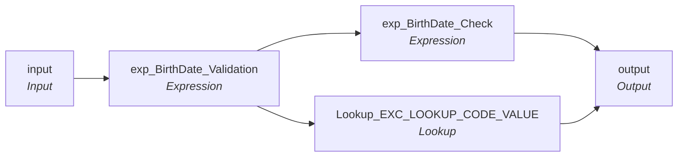

# mplt_BirthDate_Validation

IDQ mapplet &rarr; CDI **Mapplet** `mplt_BirthDate_Validation`.

> This mapplet will check for Future Date of Birth  and set the output  to Null.  TLF - Updated to use exception lookup table 8/25/2023.

[ML 12/29/2024] - Added WIC to system list

## Summary

| IDQ transformation | CDI transformation | Count |
|---|---|---|
| ExpressionTx | Expression | 2 |
| LookupTx | Lookup | 1 |
| MappletInputTx | Input | 1 |
| MappletOutputTx | Output | 1 |

## Flow

## Transformations

In data-flow order.

### input

IDQ `MappletInputTx` &rarr; CDI **Input**. Mapplet Input transformation.

| Field | Type |
|---|---|
| BirthDate | date/time |
| SrcSys | string(10) |
| PartyType | string(10) |

### exp_BirthDate_Validation

IDQ `ExpressionTx` &rarr; CDI **Expression**. Same expression language; variable fields are supported.

| Field | Kind | Type | Expression (CDI) |
|---|---|---|---|
| BirthDate | in/out | date/time | `BirthDate` |
| Party_Type | in | string(10) |  |
| Src_Sys | in | string(10) |  |
| Exception_Type | out | string(100) | `Decode(TRUE, IN(Src_Sys,'P23','C21','P88','MAX','P84','PMR','TRS','CRE','ECI','WIC','FSS', 'TTF') AND BirthDate > SYSDATE, 'Bad Value' ,NULL)` |
| Exception_Code | out | string(100) | `Decode(TRUE, 		IN(Src_Sys,'P23','C21','P88','MAX','P84','PMR','TRS','CRE','ECI','WIC','FSS', 'TTF') AND 		IN(Party_Type,'HCP','Indv','INDV','I') AND 		BirthDate > sysdate, 'Invalid_Birth_Date', 		NULL)					 ` |
| Exception_Description | out | string(100) | `Decode(TRUE, IN(Src_Sys,'P23','C21','P88','MAX','P84','PMR','TRS','CRE','FSS', 'TTF') AND BirthDate > SYSDATE, 'Birth Date is outside of the acceptable range', NULL)` |
| Attribute_Name | out | string(100) | `'Birth Date'` |
| Attribute_Value | out | date/time | `BirthDate` |

Links (target field &larr; upstream field):

| Field | From |
|---|---|
| BirthDate | input.BirthDate |
| Party_Type | input.PartyType |
| Src_Sys | input.SrcSys |

### exp_BirthDate_Check

IDQ `ExpressionTx` &rarr; CDI **Expression**. Same expression language; variable fields are supported.

| Field | Kind | Type | Expression (CDI) |
|---|---|---|---|
| BirthDate | in/out | date/time | `BirthDate` |
| Attribute_Name | in/out | string(100) | `Attribute_Name` |
| Exception_Attribute_Value | in/out | date/time | `Exception_Attribute_Value` |
| o_BirthDate | out | date/time | `Decode(TRUE, ISNULL(Exception_Code),BirthDate,NULL)` |
| Exception_Code | in/out | string(100) | `Exception_Code` |

Links (target field &larr; upstream field):

| Field | From |
|---|---|
| BirthDate | exp_BirthDate_Validation.BirthDate |
| Attribute_Name | exp_BirthDate_Validation.Attribute_Name |
| Exception_Attribute_Value | exp_BirthDate_Validation.Attribute_Value |
| Exception_Code | exp_BirthDate_Validation.Exception_Code |

### Lookup_EXC_LOOKUP_CODE_VALUE

IDQ `LookupTx` &rarr; CDI **Lookup**. Connected lookup unless a return port is set (then unconnected).

| Property | Value |
|---|---|
| Connection | STAGING |
| Object | EXC_LOOKUP_CODE_VALUE |
| Lookup condition | EXCEPTION_CODE = Exception_Code1 |
| Multiple matches | Return any row |
| Cache | static cache |

| Lookup input field | Type |
|---|---|
| Exception_Code1 | string(100) |

| Return / pass-through field | Feeds |
|---|---|
| EXCEPTION_DESC | output.Exception_Description |
| EXCEPTION_TYPE | output.Exception_Type |

Links (target field &larr; upstream field):

| Field | From |
|---|---|
| Exception_Code1 | exp_BirthDate_Validation.Exception_Code |

### output

IDQ `MappletOutputTx` &rarr; CDI **Output**. Mapplet Output transformation.

| Field | Type |
|---|---|
| BirthDate | date/time |
| Exception_Code | string(100) |
| Exception_Description | string(100) |
| Exception_Type | string(100) |
| Attribute_Name | string(100) |
| Attribute_Value | date/time |

Links (target field &larr; upstream field):

| Field | From |
|---|---|
| Attribute_Name | exp_BirthDate_Check.Attribute_Name |
| Attribute_Value | exp_BirthDate_Check.Exception_Attribute_Value |
| BirthDate | exp_BirthDate_Check.o_BirthDate |
| Exception_Description | Lookup_EXC_LOOKUP_CODE_VALUE.EXCEPTION_DESC |
| Exception_Type | Lookup_EXC_LOOKUP_CODE_VALUE.EXCEPTION_TYPE |
| Exception_Code | exp_BirthDate_Check.Exception_Code |
