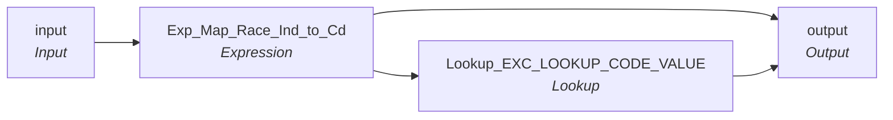

# mplt_Race_Ind_Validation

IDQ mapplet &rarr; CDI **Mapplet** `mplt_Race_Ind_Validation`.

> Map Race indicators to  Race code and raise and exception is no indicators are set or if indicators are null.

07/09/24 - M Layne - Created for ECI Project

## Summary

| IDQ transformation | CDI transformation | Count |
|---|---|---|
| ExpressionTx | Expression | 1 |
| LookupTx | Lookup | 1 |
| MappletInputTx | Input | 1 |
| MappletOutputTx | Output | 1 |

## Flow

## Transformations

In data-flow order.

### input

IDQ `MappletInputTx` &rarr; CDI **Input**. Mapplet Input transformation.

| Field | Type |
|---|---|
| White_Ind | decimal(1) |
| Black_Ind | decimal(1) |
| Asian_Ind | decimal(1) |
| Pacific_Islander_Ind | decimal(1) |
| Native_American_Ind | decimal(1) |

### Exp_Map_Race_Ind_to_Cd

IDQ `ExpressionTx` &rarr; CDI **Expression**. Same expression language; variable fields are supported.

| Field | Kind | Type | Expression (CDI) |
|---|---|---|---|
| White_Ind | in/out | decimal(1) | `White_Ind` |
| Black_Ind | in/out | decimal(1) | `Black_Ind` |
| Asian_Ind | in/out | decimal(1) | `Asian_Ind` |
| Pacific_Islander_Ind | in/out | decimal(1) | `Pacific_Islander_Ind` |
| Native_American_Ind | in/out | decimal(1) | `Native_American_Ind` |
| Ind_Ct | variable | decimal(1) | `White_Ind+Black_Ind+Asian_Ind+Pacific_Islander_Ind+Native_American_Ind` |
| MDM_Race_Cd | out | string(3) | `DECODE(TRUE ,Ind_Ct = 2,'006' ,Ind_Ct > 2 ,'007' ,Ind_Ct = 0,Null ,Ind_Ct=1 and White_Ind = 1, '001' ,Ind_Ct=1 and Black_Ind = 1, '002' ,Ind_Ct=1 and Native_American_Ind = 1, '003' ,Ind_Ct=1 and Asian_Ind = 1, '004' ,Ind_Ct=1 and Pacific_Islander_Ind = 1, '005' ,Null )` |
| Exception_Cd | out | string(40) | `IIF(Ind_Ct = 0 or IsNull(Ind_Ct),'Invalid_Race')` |
| Src_Race_Ind_List | out | string(40) | `'WH'\|\|White_Ind\|\| 'AA'\|\|Black_Ind\|\| -- African American 'AS'\|\|Asian_Ind\|\| 'PI'\|\|Pacific_Islander_Ind\|\| 'NA'\|\|Native_American_Ind` |

Links (target field &larr; upstream field):

| Field | From |
|---|---|
| White_Ind | input.White_Ind |
| Black_Ind | input.Black_Ind |
| Asian_Ind | input.Asian_Ind |
| Pacific_Islander_Ind | input.Pacific_Islander_Ind |
| Native_American_Ind | input.Native_American_Ind |

### Lookup_EXC_LOOKUP_CODE_VALUE

IDQ `LookupTx` &rarr; CDI **Lookup**. Connected lookup unless a return port is set (then unconnected).

| Property | Value |
|---|---|
| Connection | STAGING |
| Object | EXC_LOOKUP_CODE_VALUE |
| Lookup condition | EXCEPTION_CODE = in_Exception_Code |
| Multiple matches | Return any row |
| Cache | static cache |

| Lookup input field | Type |
|---|---|
| in_Exception_Code | string(300) |

| Return / pass-through field | Feeds |
|---|---|
| EXCEPTION_CODE | output.Exception_Cd |
| EXCEPTION_DESC | output.Exception_Desc |
| EXCEPTION_TYPE | output.Exception_Type |

Links (target field &larr; upstream field):

| Field | From |
|---|---|
| in_Exception_Code | Exp_Map_Race_Ind_to_Cd.Exception_Cd |

### output

IDQ `MappletOutputTx` &rarr; CDI **Output**. Mapplet Output transformation.

| Field | Type |
|---|---|
| White_Ind | decimal(1) |
| Black_Ind | decimal(1) |
| Asian_Ind | decimal(1) |
| Pacific_Islander_Ind | decimal(1) |
| Native_American_Ind | decimal(1) |
| MDM_Race_Cd | string(3) |
| Exception_Cd | string(40) |
| Exception_Desc | string(300) |
| Exception_Type | string(300) |
| Src_Race_Ind_List | string(40) |

Links (target field &larr; upstream field):

| Field | From |
|---|---|
| Exception_Cd | Lookup_EXC_LOOKUP_CODE_VALUE.EXCEPTION_CODE |
| Exception_Desc | Lookup_EXC_LOOKUP_CODE_VALUE.EXCEPTION_DESC |
| Exception_Type | Lookup_EXC_LOOKUP_CODE_VALUE.EXCEPTION_TYPE |
| White_Ind | Exp_Map_Race_Ind_to_Cd.White_Ind |
| Black_Ind | Exp_Map_Race_Ind_to_Cd.Black_Ind |
| Asian_Ind | Exp_Map_Race_Ind_to_Cd.Asian_Ind |
| Pacific_Islander_Ind | Exp_Map_Race_Ind_to_Cd.Pacific_Islander_Ind |
| Native_American_Ind | Exp_Map_Race_Ind_to_Cd.Native_American_Ind |
| MDM_Race_Cd | Exp_Map_Race_Ind_to_Cd.MDM_Race_Cd |
| Src_Race_Ind_List | Exp_Map_Race_Ind_to_Cd.Src_Race_Ind_List |
