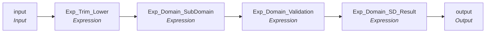

# rule_email_Domain_Subdomain_validation__V1

IDQ mapplet &rarr; CDI **Mapplet** `rule_email_Domain_Subdomain_validation__V1`.

## Summary

| IDQ transformation | CDI transformation | Count |
|---|---|---|
| ExpressionTx | Expression | 4 |
| MappletInputTx | Input | 1 |
| MappletOutputTx | Output | 1 |

## Flow

## Transformations

In data-flow order.

### input

IDQ `MappletInputTx` &rarr; CDI **Input**. Mapplet Input transformation.

| Field | Type |
|---|---|
| Email | string(255) |

### Exp_Trim_Lower

IDQ `ExpressionTx` &rarr; CDI **Expression**. Same expression language; variable fields are supported.

| Field | Kind | Type | Expression (CDI) |
|---|---|---|---|
| I_Email | in | string(255) |  |
| Email | out | string(255) | `LOWER(LTRIM(RTRIM(I_Email)))` |

Links (target field &larr; upstream field):

| Field | From |
|---|---|
| I_Email | input.Email |

### Exp_Domain_SubDomain

IDQ `ExpressionTx` &rarr; CDI **Expression**. Same expression language; variable fields are supported.

| Field | Kind | Type | Expression (CDI) |
|---|---|---|---|
| Email | in/out | string(255) | `Email` |
| V_RootDomain | variable | string(255) | `LTRIM(RTRIM(LOWER(SUBSTR(Email, INSTR( Email, '@', 1, 1)+1,255))))` |
| O_RootDomain | out | string(255) | `V_RootDomain` |
| V_TLD | variable | string(255) | `IIF( INSTR(V_RootDomain,'.',1,1)<1,'',SUBSTR(V_RootDomain,INSTR( V_RootDomain, '.', -1, 1)+1,99)) --` |
| V_Domain_SubDomain | variable | string(255) | `SUBSTR(V_RootDomain, 1,INSTR( V_RootDomain, '.', -1, 1)-1) ----IIF( INSTR(V_RootDomain,'.',1,2)<1,'',) -- DOMAIN ` |
| TLD | out | string(255) | `V_TLD` |
| Domain_SubDomain | out | string(255) | `V_Domain_SubDomain` |

Links (target field &larr; upstream field):

| Field | From |
|---|---|
| Email | Exp_Trim_Lower.Email |

### Exp_Domain_Validation

IDQ `ExpressionTx` &rarr; CDI **Expression**. Same expression language; variable fields are supported.

| Field | Kind | Type | Expression (CDI) |
|---|---|---|---|
| Email | in/out | string(255) | `Email` |
| TLD | in/out | string(255) | `TLD` |
| Domain_SubDomain | in/out | string(255) | `Domain_SubDomain` |
| length_TLD | variable | integer | `length(TLD)` |
| Domain_First_Last_Validation | out | string(10) | `IIF ((INSTR(Domain_SubDomain,'_', 1, 1)>1 OR IN(SUBSTR(Domain_SubDomain,1,1),'.','-' ) OR  IN(SUBSTR(Domain_SubDomain,-1,1),'-')),'Invalid','Valid' )  ` |
| Domain_Validation | out | string(10) | `IIF (reg_match(Domain_SubDomain,'[a-z0-9.-]+'),'Valid','Invalid' )  ` |
| Domain_Consecutivedot_Validation | out | string(10) | `IIF (INSTR(Domain_SubDomain,'..', 1, 1)>1,'Invalid','Valid' )  ` |
| TLD_Validation | out | string(10) | `IIF(reg_match(TLD,'[a-z0-9]+'),'Valid','Invalid' )  ` |
| TLD_Length_Validataion | out | string(10) | `IIF (length_TLD>=2 and length_TLD <=11,'Valid', 'Invalid' ) ` |
| O_RootDomain | in | string(255) |  |
| RootDomain_Validation | out | string(255) | `IIF (INSTR(O_RootDomain,'..', 1, 1)>1,'Invalid','Valid' ) ` |

Links (target field &larr; upstream field):

| Field | From |
|---|---|
| Email | Exp_Domain_SubDomain.Email |
| TLD | Exp_Domain_SubDomain.TLD |
| Domain_SubDomain | Exp_Domain_SubDomain.Domain_SubDomain |
| O_RootDomain | Exp_Domain_SubDomain.O_RootDomain |

### Exp_Domain_SD_Result

IDQ `ExpressionTx` &rarr; CDI **Expression**. Same expression language; variable fields are supported.

| Field | Kind | Type | Expression (CDI) |
|---|---|---|---|
| Email | in/out | string(255) | `Email` |
| TLD | in/out | string(255) | `TLD` |
| Domain_SubDomain | in/out | string(255) | `Domain_SubDomain` |
| Domain_First_Last_Validation | in | string(10) |  |
| Domain_Validation | in | string(10) |  |
| Domain_Consecutivedot_Validation | in | string(10) |  |
| TLD_Validation | in | string(10) |  |
| TLD_Length_Validataion | in | string(10) |  |
| RootDomain_Validation | in/out | string(255) | `RootDomain_Validation` |
| Domain_Subdomain_Result | out | string(10) | `IIF( (Domain_First_Last_Validation='Invalid' OR Domain_Validation='Invalid'  OR  Domain_Consecutivedot_Validation='Invalid' OR RootDomain_Validation='Invalid') , 'Invalid','Valid')` |
| TLD_Result | out | string(10) | `IIF( (TLD_Validation='Invalid' OR TLD_Length_Validataion='Invalid'), 'Invalid','Valid')` |

Links (target field &larr; upstream field):

| Field | From |
|---|---|
| Email | Exp_Domain_Validation.Email |
| TLD | Exp_Domain_Validation.TLD |
| Domain_SubDomain | Exp_Domain_Validation.Domain_SubDomain |
| Domain_First_Last_Validation | Exp_Domain_Validation.Domain_First_Last_Validation |
| Domain_Validation | Exp_Domain_Validation.Domain_Validation |
| TLD_Validation | Exp_Domain_Validation.TLD_Validation |
| Domain_Consecutivedot_Validation | Exp_Domain_Validation.Domain_Consecutivedot_Validation |
| TLD_Length_Validataion | Exp_Domain_Validation.TLD_Length_Validataion |
| RootDomain_Validation | Exp_Domain_Validation.RootDomain_Validation |

### output

IDQ `MappletOutputTx` &rarr; CDI **Output**. Mapplet Output transformation.

| Field | Type |
|---|---|
| Email | string(255) |
| Domain_Subdomain_Result | string(10) |
| TLD_Result | string(10) |

Links (target field &larr; upstream field):

| Field | From |
|---|---|
| Email | Exp_Domain_SD_Result.Email |
| Domain_Subdomain_Result | Exp_Domain_SD_Result.Domain_Subdomain_Result |
| TLD_Result | Exp_Domain_SD_Result.TLD_Result |
