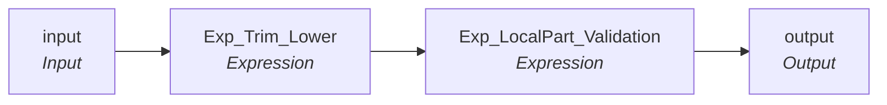

# rule_email_LocalPart_validation_V1

IDQ mapplet &rarr; CDI **Mapplet** `rule_email_LocalPart_validation_V1`.

## Summary

| IDQ transformation | CDI transformation | Count |
|---|---|---|
| ExpressionTx | Expression | 2 |
| MappletInputTx | Input | 1 |
| MappletOutputTx | Output | 1 |

## Flow

## Transformations

In data-flow order.

### input

IDQ `MappletInputTx` &rarr; CDI **Input**. Mapplet Input transformation.

| Field | Type |
|---|---|
| Email | string(255) |

### Exp_Trim_Lower

IDQ `ExpressionTx` &rarr; CDI **Expression**. Same expression language; variable fields are supported.

| Field | Kind | Type | Expression (CDI) |
|---|---|---|---|
| I_Email | in | string(255) |  |
| Email | out | string(255) | `LOWER(LTRIM(RTRIM(I_Email)))` |

Links (target field &larr; upstream field):

| Field | From |
|---|---|
| I_Email | input.Email |

### Exp_LocalPart_Validation

IDQ `ExpressionTx` &rarr; CDI **Expression**. Same expression language; variable fields are supported.

| Field | Kind | Type | Expression (CDI) |
|---|---|---|---|
| Email | in/out | string(255) | `Email` |
| Email_LocalPart_Validation | out | string(10) | `Email` |

Links (target field &larr; upstream field):

| Field | From |
|---|---|
| Email | Exp_Trim_Lower.Email |

### output

IDQ `MappletOutputTx` &rarr; CDI **Output**. Mapplet Output transformation.

| Field | Type |
|---|---|
| Email | string(255) |
| Email_LocalPart_Validation | string(10) |

Links (target field &larr; upstream field):

| Field | From |
|---|---|
| Email | Exp_LocalPart_Validation.Email |
| Email_LocalPart_Validation | Exp_LocalPart_Validation.Email_LocalPart_Validation |
