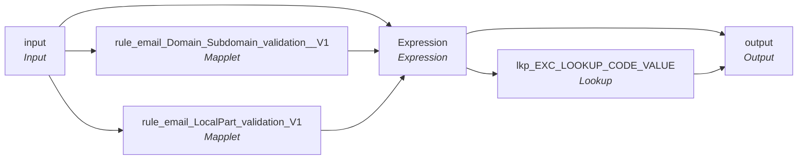

# rule_email_validation_v01

IDQ mapplet &rarr; CDI **Mapplet** `rule_email_validation_v01`.

> [ML 12/31/2024] changed the email to improve consistency for matching

## Summary

| IDQ transformation | CDI transformation | Count |
|---|---|---|
| ExpressionTx | Expression | 1 |
| LookupTx | Lookup | 1 |
| MappletInputTx | Input | 1 |
| MappletOutputTx | Output | 1 |
| MappletTx | Mapplet | 2 |

## Flow

## Transformations

In data-flow order.

### input

IDQ `MappletInputTx` &rarr; CDI **Input**. Mapplet Input transformation.

| Field | Type |
|---|---|
| Email | string(255) |

### rule_email_Domain_Subdomain_validation__V1

IDQ `MappletTx` &rarr; CDI **Mapplet**. Reusable CDI mapplet (see the mapplets folder).

Mapplet: [`rule_email_Domain_Subdomain_validation__V1`](../mapplets/rule_email_Domain_Subdomain_validation__V1.md)

Links (target field &larr; upstream field):

| Field | From |
|---|---|
| Group.Email | input.Email |

### rule_email_LocalPart_validation_V1

IDQ `MappletTx` &rarr; CDI **Mapplet**. Reusable CDI mapplet (see the mapplets folder).

Mapplet: [`rule_email_LocalPart_validation_V1`](../mapplets/rule_email_LocalPart_validation_V1.md)

Links (target field &larr; upstream field):

| Field | From |
|---|---|
| Group.Email | input.Email |

### Expression

IDQ `ExpressionTx` &rarr; CDI **Expression**. Same expression language; variable fields are supported.

| Field | Kind | Type | Expression (CDI) |
|---|---|---|---|
| EMAIL_ADDRESS | in/out | string(80) |  |
| O_EMAIL_ADDRESS | out | string(80) | `LOWER(LTRIM(RTRIM(EMAIL_ADDRESS)))` |
| Email_LocalPart_Validation | in | string(10) |  |
| Domain_Subdomain_Result | in | string(10) |  |
| TLD_Result | in | string(10) |  |
| V_EMAIL_ADDRESS | variable | string(80) | `IIF(REG_MATCH(LTRIM(RTRIM(EMAIL_ADDRESS)), '.*[\s]+.*'),'Invalid','Valid')` |
| EmailFormat | variable | string(50) | `IIF(    (INSTR(EMAIL_ADDRESS, '.', INSTR(EMAIL_ADDRESS, '@')) = 0 OR INSTR(EMAIL_ADDRESS, '@') = 0),    'Invalid',    'Valid' )` |
| Email_Validation_Result | out | string(50) | `IIF ( (V_EMAIL_ADDRESS='Invalid' OR Email_LocalPart_Validation='Invalid' OR  Domain_Subdomain_Result='Invalid'  OR TLD_Result='Invalid'    OR EmailFormat='Invalid'),'Invalid_Email',null)` |

Links (target field &larr; upstream field):

| Field | From |
|---|---|
| EMAIL_ADDRESS | input.Email |
| Email_LocalPart_Validation | rule_email_LocalPart_validation_V1.NEWOUTPUT.Email_LocalPart_Validation |
| Domain_Subdomain_Result | rule_email_Domain_Subdomain_validation__V1.OUTPUT.Domain_Subdomain_Result |
| TLD_Result | rule_email_Domain_Subdomain_validation__V1.OUTPUT.TLD_Result |

### lkp_EXC_LOOKUP_CODE_VALUE

IDQ `LookupTx` &rarr; CDI **Lookup**. Connected lookup unless a return port is set (then unconnected).

| Property | Value |
|---|---|
| Connection | STAGING |
| Object | EXC_LOOKUP_CODE_VALUE |
| Lookup condition | EXCEPTION_CODE = in_ExceptionCode |
| Multiple matches | Return any row |
| Cache | static cache |

| Lookup input field | Type |
|---|---|
| in_ExceptionCode | string(255) |

| Return / pass-through field | Feeds |
|---|---|
| EXCEPTION_CODE | output.EXCEPTION_CODE |
| EXCEPTION_DESC | output.EXCEPTION_DESC |
| EXCEPTION_TYPE | output.EXCEPTION_TYPE |

Links (target field &larr; upstream field):

| Field | From |
|---|---|
| in_ExceptionCode | Expression.Email_Validation_Result |

### output

IDQ `MappletOutputTx` &rarr; CDI **Output**. Mapplet Output transformation.

| Field | Type |
|---|---|
| EMAIL_ADDRESS | string(80) |
| Email_Validation_Result | string(10) |
| EXCEPTION_CODE | string(300) |
| EXCEPTION_DESC | string(300) |
| EXCEPTION_TYPE | string(300) |

Links (target field &larr; upstream field):

| Field | From |
|---|---|
| EXCEPTION_CODE | lkp_EXC_LOOKUP_CODE_VALUE.EXCEPTION_CODE |
| EXCEPTION_DESC | lkp_EXC_LOOKUP_CODE_VALUE.EXCEPTION_DESC |
| EXCEPTION_TYPE | lkp_EXC_LOOKUP_CODE_VALUE.EXCEPTION_TYPE |
| EMAIL_ADDRESS | Expression.O_EMAIL_ADDRESS |
