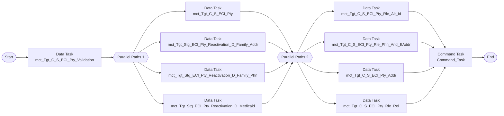

# Taskflow tf_ECI_Stage_Load

Replaces IDQ workflow `wf_ECI_Stage_Load`. Create it as a **Taskflow** (not a linear taskflow) because the workflow runs mapping tasks in parallel.

## IDQ workflow

```mermaid
flowchart LR
  u-pu-ttkrgee-ij8frz-j8ta(["Start_Event"])
  u-pu-tt0rgee-ij8frz-j8ta(["End_Event"])
  u-jywibergee-ij8frz-j8ta["m_Tgt_C_S_ECI_Pty"]
  u-jywiburgee-ij8frz-j8ta["m_Tgt_C_S_ECI_Pty_Rle_Alt_Id"]
  u-jywibkrgee-ij8frz-j8ta["m_Tgt_C_S_ECI_Pty_Rle_Phn_And_EAddr"]
  u-jywib0rgee-ij8frz-j8ta["m_Tgt_C_S_ECI_Pty_Validation"]
  u-s9rdsurgee-ij8frz-j8ta{"Inclusive_Gateway"}
  u-s9rdskrgee-ij8frz-j8ta{"Inclusive_Gateway1"}
  u-lnus7vqmee-2pll-ogjuig["Command_Task"]
  u-i6lxx2ymee-qbdugs5kq0w["m_Tgt_C_S_ECI_Pty_Addr"]
  u-d-gsyy2ee-gyif13runzw["m_Tgt_C_S_ECI_Pty_Rle_Rel"]
  u-yazmndhnee-csv9rrjw0sg["m_Tgt_Stg_ECI_Pty_Reactivation_D_Family_Addr"]
  u-tt8ri9odee-rgflaurx7qw{"Inclusive_Gateway2"}
  u-tt8rjnodee-rgflaurx7qw{"Inclusive_Gateway3"}
  u-tt8rjdodee-rgflaurx7qw["m_Tgt_Stg_ECI_Pty_Reactivation_D_Family_Phn"]
  u-tt8rjtodee-rgflaurx7qw["m_Tgt_Stg_ECI_Pty_Reactivation_D_Medicaid"]
  u-pu-ttkrgee-ij8frz-j8ta --> u-jywib0rgee-ij8frz-j8ta
  u-jywibergee-ij8frz-j8ta --> u-tt8rjnodee-rgflaurx7qw
  u-jywiburgee-ij8frz-j8ta --> u-s9rdskrgee-ij8frz-j8ta
  u-jywibkrgee-ij8frz-j8ta --> u-s9rdskrgee-ij8frz-j8ta
  u-jywib0rgee-ij8frz-j8ta --> u-tt8ri9odee-rgflaurx7qw
  u-s9rdsurgee-ij8frz-j8ta --> u-jywiburgee-ij8frz-j8ta
  u-s9rdsurgee-ij8frz-j8ta --> u-jywibkrgee-ij8frz-j8ta
  u-s9rdsurgee-ij8frz-j8ta --> u-i6lxx2ymee-qbdugs5kq0w
  u-s9rdsurgee-ij8frz-j8ta --> u-d-gsyy2ee-gyif13runzw
  u-s9rdsurgee-ij8frz-j8ta -->|default| u-s9rdskrgee-ij8frz-j8ta
  u-s9rdskrgee-ij8frz-j8ta --> u-lnus7vqmee-2pll-ogjuig
  u-lnus7vqmee-2pll-ogjuig --> u-pu-tt0rgee-ij8frz-j8ta
  u-i6lxx2ymee-qbdugs5kq0w --> u-s9rdskrgee-ij8frz-j8ta
  u-d-gsyy2ee-gyif13runzw --> u-s9rdskrgee-ij8frz-j8ta
  u-yazmndhnee-csv9rrjw0sg --> u-tt8rjnodee-rgflaurx7qw
  u-tt8ri9odee-rgflaurx7qw --> u-jywibergee-ij8frz-j8ta
  u-tt8ri9odee-rgflaurx7qw --> u-yazmndhnee-csv9rrjw0sg
  u-tt8ri9odee-rgflaurx7qw --> u-tt8rjdodee-rgflaurx7qw
  u-tt8ri9odee-rgflaurx7qw --> u-tt8rjtodee-rgflaurx7qw
  u-tt8ri9odee-rgflaurx7qw -->|default| u-tt8rjnodee-rgflaurx7qw
  u-tt8rjnodee-rgflaurx7qw --> u-s9rdsurgee-ij8frz-j8ta
  u-tt8rjdodee-rgflaurx7qw --> u-tt8rjnodee-rgflaurx7qw
  u-tt8rjtodee-rgflaurx7qw --> u-tt8rjnodee-rgflaurx7qw
```

## CDI taskflow

## Steps

| # | Step | Runs | Notes |
|---|---|---|---|
| 0 | Data Task | `mct_Tgt_C_S_ECI_Pty_Validation` |  |
| 1 | Parallel Paths | path 1: `mct_Tgt_C_S_ECI_Pty` path 2: `mct_Tgt_Stg_ECI_Pty_Reactivation_D_Family_Addr` path 3: `mct_Tgt_Stg_ECI_Pty_Reactivation_D_Family_Phn` path 4: `mct_Tgt_Stg_ECI_Pty_Reactivation_D_Medicaid` | Data Tasks in a path run in sequence; all paths must complete before the next step (same as the IDQ join gateway). |
| 2 | Parallel Paths | path 1: `mct_Tgt_C_S_ECI_Pty_Rle_Alt_Id` path 2: `mct_Tgt_C_S_ECI_Pty_Rle_Phn_And_EAddr` path 3: `mct_Tgt_C_S_ECI_Pty_Addr` path 4: `mct_Tgt_C_S_ECI_Pty_Rle_Rel` | Data Tasks in a path run in sequence; all paths must complete before the next step (same as the IDQ join gateway). |
| 3 | Command Task | Command_Task | IDQ command `touch ${var:sys.WorkflowName}.ind`, working directory `/opt/apps/informatica/SrcFiles/Indicators`. See below. |
| 4 | End |  |  |

## Mapping tasks

Create one mapping task per mapping. IDQ mapping-task settings and their CDI home:

| Mapping task | Mapping | Date format (Advanced session property *Default date format*) | High precision (*Enable high precision*) | Tracing (*Override tracing*) | Sort order |
|---|---|---|---|---|---|
| `mct_Tgt_C_S_ECI_Pty` | [`m_Tgt_C_S_ECI_Pty`](mappings/m_Tgt_C_S_ECI_Pty.md) | MM/DD/YYYY HH24:MI:SS | true | normal | binary |
| `mct_Tgt_C_S_ECI_Pty_Rle_Alt_Id` | [`m_Tgt_C_S_ECI_Pty_Rle_Alt_Id`](mappings/m_Tgt_C_S_ECI_Pty_Rle_Alt_Id.md) | MM/DD/YYYY HH24:MI:SS | true | normal | binary |
| `mct_Tgt_C_S_ECI_Pty_Rle_Phn_And_EAddr` | [`m_Tgt_C_S_ECI_Pty_Rle_Phn_And_EAddr`](mappings/m_Tgt_C_S_ECI_Pty_Rle_Phn_And_EAddr.md) | MM/DD/YYYY HH24:MI:SS | true | normal | binary |
| `mct_Tgt_C_S_ECI_Pty_Validation` | [`m_Tgt_C_S_ECI_Pty_Validation`](mappings/m_Tgt_C_S_ECI_Pty_Validation.md) | MM/DD/YYYY HH24:MI:SS | true | normal | binary |
| `mct_Tgt_C_S_ECI_Pty_Addr` | [`m_Tgt_C_S_ECI_Pty_Addr`](mappings/m_Tgt_C_S_ECI_Pty_Addr.md) | MM/DD/YYYY HH24:MI:SS | true | normal | binary |
| `mct_Tgt_C_S_ECI_Pty_Rle_Rel` | [`m_Tgt_C_S_ECI_Pty_Rle_Rel`](mappings/m_Tgt_C_S_ECI_Pty_Rle_Rel.md) | MM/DD/YYYY HH24:MI:SS | true | normal | binary |
| `mct_Tgt_Stg_ECI_Pty_Reactivation_D_Family_Addr` | [`m_Tgt_Stg_ECI_Pty_Reactivation_D_Family_Addr`](mappings/m_Tgt_Stg_ECI_Pty_Reactivation_D_Family_Addr.md) | MM/DD/YYYY HH24:MI:SS | true | normal | binary |
| `mct_Tgt_Stg_ECI_Pty_Reactivation_D_Family_Phn` | [`m_Tgt_Stg_ECI_Pty_Reactivation_D_Family_Phn`](mappings/m_Tgt_Stg_ECI_Pty_Reactivation_D_Family_Phn.md) | MM/DD/YYYY HH24:MI:SS | true | normal | binary |
| `mct_Tgt_Stg_ECI_Pty_Reactivation_D_Medicaid` | [`m_Tgt_Stg_ECI_Pty_Reactivation_D_Medicaid`](mappings/m_Tgt_Stg_ECI_Pty_Reactivation_D_Medicaid.md) | MM/DD/YYYY HH24:MI:SS | true | normal | binary |

Each Data Task: *On error* = **Fail taskflow** (IDQ aborts the workflow when a mapping task fails). Pass the parameter file through the mapping task *Parameter file* setting (see the `.param` file).

Workflow variables `MappingTaskSuccessful` are declared but never assigned or read in the IDQ workflow: not ported.

## Command task

IDQ runs `touch ${var:sys.WorkflowName}.ind` on the DIS host. In the CDI taskflow add a **Command Task** step that runs on the Linux Secure Agent runtime environment:

| Field | Value |
|---|---|
| Runtime Environment | the Linux Secure Agent group used by the mapping tasks |
| Script File Name | `/bin/sh` |
| Input Arguments | `-c "touch wf_ECI_Stage_Load.ind"` |
| Work Directory | `/opt/apps/informatica/SrcFiles/Indicators` |

`${var:sys.WorkflowName}` resolved to `wf_ECI_Stage_Load` so the indicator file name downstream consumers watch does not change. The agent user needs write access to the working directory.
