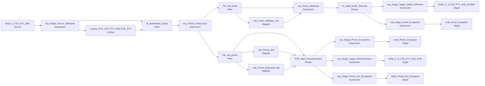

# m_Tgt_C_S_FSS_Pty_Rle_Phn_And_EAddr

IDQ mapping &rarr; CDI **Mapping** `m_Tgt_C_S_FSS_Pty_Rle_Phn_And_EAddr`.

> [SMohammed  04/25/2025]  Initial version created from replication of FSS

## Summary

| IDQ transformation | CDI transformation | Count |
|---|---|---|
| ExpressionTx | Expression | 8 |
| FilterTx | Filter | 3 |
| LookupTx | Lookup | 1 |
| MappletTx | Mapplet | 3 |
| RouterTx | Router | 2 |
| SourceTx | Source | 1 |
| TargetTx | Target | 5 |

Sources:

| Instance | Object | Connection |
|---|---|---|
| Read_V_FSS_ETL_SRC | `V_FSS_ETL_SRC` | STAGING |

Targets:

| Instance | Object | Connection |
|---|---|---|
| write_Phone_Exception | `EXC_STG_BAD_REC_MEMB` | STAGING |
| write_Email_Exception | `EXC_STG_BAD_REC_MEMB` | STAGING |
| Write_C_S_FSS_PTY_RLE_PHN | `C_S_FSS_PTY_RLE_PHN` | HHS_MDM_ORS |
| Write_C_S_FSS_PTY_RLE_EADDR | `C_S_FSS_PTY_RLE_EADDR` | HHS_MDM_ORS |
| Write_Phone_Ext_Exception | `EXC_STG_BAD_REC_MEMB` | STAGING |

`$sys.MappingName` is translated to the input parameter `$$MappingName` (default: the mapping name).

## Flow



## Filtered data

Every step that can stop, divert or collapse rows, and what happens to the rows that do not pass. A Filter keeps a row only when its condition is TRUE: FALSE **or NULL** drops the row silently (no target, no reject file). A Router writes a row to **every** group whose condition is TRUE; a row that matches no group goes to the default group and is discarded when that group is not linked. Comments (`--`, `//`) are removed from the conditions shown here. A `= ...` line reads a null check on a lookup return in plain terms; *no matching row* also covers a matching row whose returned field is NULL.

### Steps that filter rows

| Step | IDQ type | Rule | Rows that pass go to | Rows that do not pass |
|---|---|---|---|---|
| Read_V_FSS_ETL_SRC | SourceTx | source filter `"V_FSS_ETL_SRC"."DTL__CAPXACTION"<>'D'`; rows the view `V_FSS_ETL_SRC` returns (view logic is outside the export) | `EXC_STG_BAD_REC_MEMB`, `C_S_FSS_PTY_RLE_EADDR`, `C_S_FSS_PTY_RLE_PHN` | never read |
| fil_deactivated_status | FilterTx | keep `IsNull(DEACTIVATION_STS)`<br>= no matching row in `STG_FSS_PTY_INACTIVE_STS` | `EXC_STG_BAD_REC_MEMB`, `C_S_FSS_PTY_RLE_EADDR`, `C_S_FSS_PTY_RLE_PHN` | **discarded** |
| Filt_null_email | FilterTx | keep `NOT ISNULL(EMAIL)` | `EXC_STG_BAD_REC_MEMB`, `C_S_FSS_PTY_RLE_EADDR` | **discarded** |
| rtr_Valid_EAddr_Records | RouterTx | group `Valid_Records`: `ISNULL(DQ_Exception_Code)` | `C_S_FSS_PTY_RLE_EADDR` |  |
| rtr_Valid_EAddr_Records | RouterTx | group `Bad_Records`: `NOT ISNULL(DQ_Exception_Code)` | `EXC_STG_BAD_REC_MEMB` |  |
| rtr_Valid_EAddr_Records | RouterTx | default group `Default`: rows that match no other group | no row gets here: every row matches `Valid_Records` or `Bad_Records` |  |
| Filt_null_phone | FilterTx | keep `not isnull(SRC_PHONE)` | `EXC_STG_BAD_REC_MEMB`, `C_S_FSS_PTY_RLE_PHN` | **discarded** |
| RTR_Valid_PhoneNumbers | RouterTx | group `Good_Records`: `ISNULL(Phone_Exception_Code)` (comments removed) | `C_S_FSS_PTY_RLE_PHN` |  |
| RTR_Valid_PhoneNumbers | RouterTx | group `Bad_Phone_Records`: `NOT ISNULL(Phone_Exception_Code)` | `EXC_STG_BAD_REC_MEMB` |  |
| RTR_Valid_PhoneNumbers | RouterTx | group `Bad_Phone_Ext__Records`: `NOT ISNULL(Phone_Nbr_Ext_Exception_Code)` | `EXC_STG_BAD_REC_MEMB` |  |
| RTR_Valid_PhoneNumbers | RouterTx | default group `Default`: rows that match no other group | no row gets here: every row matches `Good_Records` or `Bad_Phone_Records` |  |

### Where the condition fields come from

| Step | Field | Origin |
|---|---|---|
| fil_deactivated_status | `DEACTIVATION_STS` | `DEACTIVATION_STS` returned by lookup `Lookup_STG_FSS_PTY_INACTIVE_STS` on `STG_FSS_PTY_INACTIVE_STS` where `SRC_KEY = PTY_SRC_KEY AND ROWID_SYSTEM = SRC_SYS`; NULL when no row matches; `STG_FSS_PTY_INACTIVE_STS` is loaded by `m_Tgt_C_S_FSS_Pty_Validation` in this workflow |
| Filt_null_email | `EMAIL` | source column `ADDR_EMAIL` read by `Read_V_FSS_ETL_SRC` |
| rtr_Valid_EAddr_Records | `DQ_Exception_Code` | mapplet `rule_email_validation_v01`: `EXCEPTION_CODE` returned by lookup `lkp_EXC_LOOKUP_CODE_VALUE` on `EXC_LOOKUP_CODE_VALUE` where `EXCEPTION_CODE = in_ExceptionCode`; NULL when no row matches |
| Filt_null_phone | `SRC_PHONE` | source column `NBR_PHONE` read by `Read_V_FSS_ETL_SRC` |
| RTR_Valid_PhoneNumbers | `Phone_Exception_Code` | mapplet `rule_Phone_Std`: `in_Exception_Code` returned by lookup `Lookup_EXC_LOOKUP_CODE_VALUE` on `EXC_LOOKUP_CODE_VALUE` where `EXCEPTION_CODE = in_Exception_Code`; NULL when no row matches |
| RTR_Valid_PhoneNumbers | `Phone_Nbr_Ext_Exception_Code` | mapplet `rule_Phone_Extension_Std`: `EXCEPTION_CODE1` returned by lookup `Lookup_EXC_LOOKUP_CODE_VALUE` on `EXC_LOOKUP_CODE_VALUE` where `EXCEPTION_CODE = EXCEPTION_CODE1`; NULL when no row matches |

### Rows that do not reach `C_S_*` tables

**`C_S_FSS_PTY_RLE_EADDR`** (`Write_C_S_FSS_PTY_RLE_EADDR`): a source row is written only when it passes every step below.

| Step | Must hold | Otherwise the row |
|---|---|---|
| `Read_V_FSS_ETL_SRC` | source filter `"V_FSS_ETL_SRC"."DTL__CAPXACTION"<>'D'`; rows the view `V_FSS_ETL_SRC` returns (view logic is outside the export) | never read |
| `fil_deactivated_status` | `IsNull(DEACTIVATION_STS)`<br>= no matching row in `STG_FSS_PTY_INACTIVE_STS` | **discarded** (not written anywhere) |
| `Filt_null_email` | `NOT ISNULL(EMAIL)` | **discarded** (not written anywhere) |
| `rtr_Valid_EAddr_Records` | group `Valid_Records`: `ISNULL(DQ_Exception_Code)` | if `NOT ISNULL(DQ_Exception_Code)`: group `Bad_Records` &rarr; `EXC_STG_BAD_REC_MEMB` |

**`C_S_FSS_PTY_RLE_PHN`** (`Write_C_S_FSS_PTY_RLE_PHN`): a source row is written only when it passes every step below.

| Step | Must hold | Otherwise the row |
|---|---|---|
| `Read_V_FSS_ETL_SRC` | source filter `"V_FSS_ETL_SRC"."DTL__CAPXACTION"<>'D'`; rows the view `V_FSS_ETL_SRC` returns (view logic is outside the export) | never read |
| `fil_deactivated_status` | `IsNull(DEACTIVATION_STS)`<br>= no matching row in `STG_FSS_PTY_INACTIVE_STS` | **discarded** (not written anywhere) |
| `Filt_null_phone` | `not isnull(SRC_PHONE)` | **discarded** (not written anywhere) |
| `RTR_Valid_PhoneNumbers` | group `Good_Records`: `ISNULL(Phone_Exception_Code)`<br>(a row that also matches `Bad_Phone_Ext__Records` is written there as well) | if `NOT ISNULL(Phone_Exception_Code)`: group `Bad_Phone_Records` &rarr; `EXC_STG_BAD_REC_MEMB`<br>if `NOT ISNULL(Phone_Nbr_Ext_Exception_Code)`: group `Bad_Phone_Ext__Records` &rarr; `EXC_STG_BAD_REC_MEMB` |

## Oracle stored procedure

Drop-in replacement in Oracle: [`sp_ors_main_m_Tgt_C_S_FSS_Pty_Rle_Phn_And_EAddr`](../../../idq-to-oracle/wf_FSS_Stage_Load/sp_ors_main_m_Tgt_C_S_FSS_Pty_Rle_Phn_And_EAddr.sql) (set-based SQL; one transaction that commits at the end and rolls back and re-raises on error). The IDQ mapplets and rules become the shared `fn_dq_*` functions; see [idq-to-oracle/README.md](../../../idq-to-oracle/README.md). Unlike the CDI spec above, the procedure **keeps the MDM timeline logic**; it is marked `TIMELINE` in the comments.

```text
Drop-in replacement of IDQ mapping m_Tgt_C_S_FSS_Pty_Rle_Phn_And_EAddr (workflow wf_FSS_Stage_Load).

Each FSS registration row (V_FSS_ETL_SRC, capture action not 'D') can give one e-mail and one phone:
  -> fil_deactivated_status: party not in STG_FSS_PTY_INACTIVE_STS, then two branches
  e-mail: Filt_null_email (ADDR_EMAIL not NULL) -> rule_email_validation_v01 -> rtr_Valid_EAddr_Records
          Valid_Records -> C_S_FSS_PTY_RLE_EADDR ; Bad_Records -> EXC_STG_BAD_REC_MEMB
  phone : Filt_null_phone (NBR_PHONE not NULL) -> rule_Phone_Std (usage 001 'Telephone', 'Primary') and
          rule_Phone_Extension_Std -> RTR_Valid_PhoneNumbers
          Good_Records (no phone code)  -> C_S_FSS_PTY_RLE_PHN (an invalid extension is blanked)
          Bad_Phone_Records             -> EXC_STG_BAD_REC_MEMB ('Rejected Record')
          Bad_Phone_Ext__Records        -> EXC_STG_BAD_REC_MEMB ('Bad Value'); a row with a good phone and a bad
                                           extension is loaded AND logged
Both C_S targets are truncated first.

TIMELINE: VERSION_SEQ = '1' on both targets; PERIOD_START_DATE = DT_LAST_UPDATE.
```

Tables written:

| Table | Operation |
|---|---|
| `C_S_FSS_PTY_RLE_EADDR` | truncate, insert |
| `C_S_FSS_PTY_RLE_PHN` | truncate, insert |
| `EXC_STG_BAD_REC_MEMB` | insert |

Shared functions and procedures called:

| Object | Does |
|---|---|
| `fn_dq_std_phone` | replaces `rule_Phone_Std`, returns `t_dq_phone` |
| `fn_dq_std_phone_ext` | replaces `rule_Phone_Extension_Std`, returns `t_dq_phone_ext` |
| `fn_dq_valid_email` | replaces `rule_email_validation_v01 (+ local part / domain)`, returns `t_dq_email` |
| `sp_ors_helper01_common` | truncate a target table (IDQ target property "Truncate target table") |
| `sp_ors_helper02_common` | run log line: mapping, step, row count (DBMS_OUTPUT) |

## Transformations

In data-flow order.

### Read_V_FSS_ETL_SRC

IDQ `SourceTx` &rarr; CDI **Source**. Oracle connector source; carry the SQL override / filter below verbatim.

| Property | Value |
|---|---|
| Connection | STAGING |
| Object | V_FSS_ETL_SRC (view) |

Filter (CDI source/lookup *Filter* property; translated):

```sql
"V_FSS_ETL_SRC"."DTL__CAPXACTION"<>'D'
-- Filter for testing
/*and (ora_hash("V_FSS_ETL_SRC"."ID_CLIENT",9999) in (8,9) 
or "V_FSS_ETL_SRC"."PTY_SRC_KEY" in ('0000006796'
,'0000016528'
,'0000018326'
,'0000028796')
or substr(NBR_PHONE, 1,3)='777'
or addr_email = 'TIFFANYPLYER@ICLOUD'
 )*/
```

Columns: `SOURCE_TYPE`, `DT_CREATED`, `DT_LAST_UPDATE`, `STG_UPDATE_DATE`, `ID_CLIENT`, `PTY_SRC_KEY`, `NM_FIRST`, `NM_LAST`, `NM_MIDDLE`, `DT_DOB`, `CD_GENDER`, `LANGUAGE_CD`, `CD_HISPANIC`, `RACE_AN`, `RACE_ASIAN`, `RACE_AA`, `RACE_WHITE`, `RACE_PI`, `RACE_DECLINED`, `RACE_UNABLE_TO_DETERMINE`, `RACE_INVALID`, `ADDR_LINE1`, `ADDR_LINE2`, `ADDR_CITY`, `ADDR_STATE`, `ADDR_ZIP`, `CD_CNTY`, `NBR_PHONE`, `NBR_PHONE_EXT`, `ADDR_EMAIL`, `CD_RELTSHP_TO_TC`, `CD_CLNT_TYPE`, `DTL__CAPXACTION`, `DTL__CAPXTIMESTAMP`, `CLIENT_DTL__CAPXACTION`, `CLIENT_DTL__CAPXTIMESTAMP`, `ID_REGISTRATION_CLIENT`, `ID_REGISTRATION`, `LAST_ACTIVE_CLIENT_REGISTRATION_YN`, `LAST_INACTV_CLIENT_YN`, `None`, `None`

### exp_Stage_Source_Attributes

IDQ `ExpressionTx` &rarr; CDI **Expression**. Same expression language; variable fields are supported.

| Field | Kind | Type | Expression (CDI) |
|---|---|---|---|
| ID_REGISTRATION_CLIENT | in/out | string(20) | `ID_REGISTRATION_CLIENT` |
| LAST_UPDATE_DT | out | date/time | `SYSTIMESTAMP()` |
| PTY_SRC_KEY | in/out | string(48) | `PTY_SRC_KEY` |
| PTY_RLE_FK | out | string(43) | `PTY_SRC_KEY \|\| '\|Member'` |
| PERIOD_START_DATE | in/out | date/time | `PERIOD_START_DATE` |
| PHONE | in/out | string(200) | `PHONE` |
| EMAIL | in/out | string(200) | `EMAIL` |
| SRC_SYS | out | string(255) | `'FSS'` |
| SOURCE_TYPE | in/out | string(10) |  |
| PHONE_EXT | in/out | string(10) |  |

Links (target field &larr; upstream field):

| Field | From |
|---|---|
| ID_REGISTRATION_CLIENT | Read_V_FSS_ETL_SRC.ID_REGISTRATION_CLIENT |
| PERIOD_START_DATE | Read_V_FSS_ETL_SRC.DT_LAST_UPDATE |
| PHONE | Read_V_FSS_ETL_SRC.NBR_PHONE |
| EMAIL | Read_V_FSS_ETL_SRC.ADDR_EMAIL |
| SOURCE_TYPE | Read_V_FSS_ETL_SRC.SOURCE_TYPE |
| PTY_SRC_KEY | Read_V_FSS_ETL_SRC.PTY_SRC_KEY |
| PHONE_EXT | Read_V_FSS_ETL_SRC.NBR_PHONE_EXT |

### Lookup_STG_FSS_PTY_INACTIVE_STS

IDQ `LookupTx` &rarr; CDI **Lookup**. Connected lookup unless a return port is set (then unconnected).

| Property | Value |
|---|---|
| Connection | STAGING |
| Object | STG_FSS_PTY_INACTIVE_STS |
| Lookup condition | SRC_KEY = PTY_SRC_KEY AND ROWID_SYSTEM = SRC_SYS |
| Multiple matches | Return any row |
| Cache | static cache |

| Lookup input field | Type |
|---|---|
| PTY_SRC_KEY | string(48) |
| SRC_SYS | string(255) |

| Return / pass-through field | Feeds |
|---|---|
| DEACTIVATION_STS | fil_deactivated_status.DEACTIVATION_STS |

Links (target field &larr; upstream field):

| Field | From |
|---|---|
| PTY_SRC_KEY | exp_Stage_Source_Attributes.PTY_SRC_KEY |
| SRC_SYS | exp_Stage_Source_Attributes.SRC_SYS |

### fil_deactivated_status

IDQ `FilterTx` &rarr; CDI **Filter**. Advanced filter condition.

Filter condition:

```
IsNull(DEACTIVATION_STS)
```

Links (target field &larr; upstream field):

| Field | From |
|---|---|
| ID_PHONE | exp_Stage_Source_Attributes.ID_REGISTRATION_CLIENT |
| LAST_UPDATE_DT | exp_Stage_Source_Attributes.LAST_UPDATE_DT |
| PTY_RLE_FK | exp_Stage_Source_Attributes.PTY_RLE_FK |
| PERIOD_START_DATE | exp_Stage_Source_Attributes.PERIOD_START_DATE |
| PHONE | exp_Stage_Source_Attributes.PHONE |
| EMAIL | exp_Stage_Source_Attributes.EMAIL |
| SOURCE_TYPE | exp_Stage_Source_Attributes.SOURCE_TYPE |
| SRC_SYS | exp_Stage_Source_Attributes.SRC_SYS |
| PTY_SRC_KEY | exp_Stage_Source_Attributes.PTY_SRC_KEY |
| DEACTIVATION_STS | Lookup_STG_FSS_PTY_INACTIVE_STS.DEACTIVATION_STS |
| PHONE_EXT | exp_Stage_Source_Attributes.PHONE_EXT |

### exp_Phone_Email_Keys

IDQ `ExpressionTx` &rarr; CDI **Expression**. Same expression language; variable fields are supported.

| Field | Kind | Type | Expression (CDI) |
|---|---|---|---|
| ID_PHONE | in/out | string(20) | `ID_PHONE` |
| LAST_UPDATE_DT | in/out | date/time | `LAST_UPDATE_DT` |
| PTY_RLE_FK | in/out | string(43) | `PTY_RLE_FK` |
| PTY_SRC_KEY | in/out | string(48) | `PTY_SRC_KEY` |
| PERIOD_START_DATE | in/out | date/time | `PERIOD_START_DATE` |
| SRC_PHONE | in/out | string(200) | `SRC_PHONE` |
| EMAIL | in/out | string(200) | `EMAIL` |
| v_PHONE_TP | variable | string(9) | `'Telephone'` |
| v_USG_TP | variable | string(3) | `'001'` |
| v_PREF_LVL | variable | string(8) | `'Primary'` |
| v_EADDR_TP | variable | string(10) | `'001'` |
| PHONE_TP | out | string(9) | `v_PHONE_TP` |
| USG_TP | out | string(3) | `v_USG_TP` |
| PREF_LVL | out | string(8) | `v_PREF_LVL` |
| EADDR_TP | out | string(10) | `v_EADDR_TP` |
| SRC_SYS | in/out | string(255) | `SRC_SYS` |
| o_PHN_PKEY_SRC_OBJECT | out | string(255) | `PTY_RLE_FK \|\|'\|'\|\| v_PHONE_TP \|\| '\|' \|\| v_USG_TP \|\| '\|'\|\|lpad(ID_PHONE,10,'0')\|\|'\|'\|\|LTRIM(RTRIM(SRC_PHONE))<br>` |
| o_EADDR_PKEY_SRC_OBJECT | out | string(255) | `PTY_RLE_FK\|\| '\|' \|\|'001'\|\|'\|'\|\|lpad(ID_PHONE,10,'0')\|\|'\|'\|\|LTRIM(RTRIM(EMAIL))<br>` |
| SOURCE_TYPE | in/out | string(10) |  |
| SRC_PHONE_EXT | in/out | string(5) | `SRC_PHONE_EXT` |

Links (target field &larr; upstream field):

| Field | From |
|---|---|
| SRC_SYS | fil_deactivated_status.SRC_SYS |
| ID_PHONE | fil_deactivated_status.ID_PHONE |
| LAST_UPDATE_DT | fil_deactivated_status.LAST_UPDATE_DT |
| PTY_RLE_FK | fil_deactivated_status.PTY_RLE_FK |
| PTY_SRC_KEY | fil_deactivated_status.PTY_SRC_KEY |
| PERIOD_START_DATE | fil_deactivated_status.PERIOD_START_DATE |
| SRC_PHONE | fil_deactivated_status.PHONE |
| EMAIL | fil_deactivated_status.EMAIL |
| SOURCE_TYPE | fil_deactivated_status.SOURCE_TYPE |
| SRC_PHONE_EXT | fil_deactivated_status.PHONE_EXT |

### Filt_null_email

IDQ `FilterTx` &rarr; CDI **Filter**. Advanced filter condition.

Filter condition:

```
NOT ISNULL(EMAIL)
```

Links (target field &larr; upstream field):

| Field | From |
|---|---|
| ID_PHONE | exp_Phone_Email_Keys.ID_PHONE |
| LAST_UPDATE_DT | exp_Phone_Email_Keys.LAST_UPDATE_DT |
| PTY_RLE_FK | exp_Phone_Email_Keys.PTY_RLE_FK |
| PTY_SRC_KEY | exp_Phone_Email_Keys.PTY_SRC_KEY |
| PERIOD_START_DATE | exp_Phone_Email_Keys.PERIOD_START_DATE |
| EMAIL | exp_Phone_Email_Keys.EMAIL |
| EADDR_TP | exp_Phone_Email_Keys.EADDR_TP |
| SRC_SYS | exp_Phone_Email_Keys.SRC_SYS |
| EADDR_PKEY_SRC_OBJECT | exp_Phone_Email_Keys.o_EADDR_PKEY_SRC_OBJECT |
| SOURCE_TYPE | exp_Phone_Email_Keys.SOURCE_TYPE |

### rule_email_validation_v01

IDQ `MappletTx` &rarr; CDI **Mapplet**. Reusable CDI mapplet (see the mapplets folder).

Mapplet: [`rule_email_validation_v01`](../mapplets/rule_email_validation_v01.md)

Links (target field &larr; upstream field):

| Field | From |
|---|---|
| Group.Email | Filt_null_email.EMAIL |

### exp_Setup_Attributes

IDQ `ExpressionTx` &rarr; CDI **Expression**. Same expression language; variable fields are supported.

| Field | Kind | Type | Expression (CDI) |
|---|---|---|---|
| PTY_RLE_FK | in/out | string(255) | `PTY_RLE_FK` |
| PTY_SRC_KEY | in/out | string(48) |  |
| SRC_SYS | in/out | string(255) |  |
| PKEY_SRC_OBJECT_EADDR | in/out | string(255) | `PKEY_SRC_OBJECT_EADDR` |
| PERIOD_START_DATE | in/out | date/time | `PERIOD_START_DATE` |
| ELEC_ADDR | in/out | string(200) | `ELEC_ADDR` |
| DQ_Exception | in/out | string(255) | `DQ_Exception` |
| DQ_Exception_Code | in/out | string(255) | `DQ_Exception_Code` |
| Email_Exception_Type | in/out | string(50) | `Email_Exception_Type` |
| src_Email | in/out | string(255) | `src_Email` |
| LAST_UPDATE_DT | in/out | date/time | `LAST_UPDATE_DT` |
| ID_FAMILY_PHONE | in/out | string(20) | `ID_FAMILY_PHONE` |
| SOURCE_TABLE | in/out | string(10) | `SOURCE_TABLE` |

Links (target field &larr; upstream field):

| Field | From |
|---|---|
| PKEY_SRC_OBJECT_EADDR | Filt_null_email.EADDR_PKEY_SRC_OBJECT |
| DQ_Exception | rule_email_validation_v01.NEWOUTPUT.EXCEPTION_DESC |
| DQ_Exception_Code | rule_email_validation_v01.NEWOUTPUT.EXCEPTION_CODE |
| PERIOD_START_DATE | Filt_null_email.PERIOD_START_DATE |
| ELEC_ADDR | rule_email_validation_v01.NEWOUTPUT.EMAIL_ADDRESS |
| Email_Exception_Type | rule_email_validation_v01.NEWOUTPUT.EXCEPTION_TYPE |
| PTY_RLE_FK | Filt_null_email.PTY_RLE_FK |
| src_Email | Filt_null_email.EMAIL |
| LAST_UPDATE_DT | Filt_null_email.LAST_UPDATE_DT |
| ID_FAMILY_PHONE | Filt_null_email.ID_PHONE |
| SOURCE_TABLE | Filt_null_email.SOURCE_TYPE |
| PTY_SRC_KEY | Filt_null_email.PTY_SRC_KEY |
| SRC_SYS | Filt_null_email.SRC_SYS |

### rtr_Valid_EAddr_Records

IDQ `RouterTx` &rarr; CDI **Router**. One output group per IDQ group; the default group is created automatically.

| Output group | Condition |
|---|---|
| Valid_Records | `ISNULL(DQ_Exception_Code)` |
| Bad_Records | `NOT ISNULL(DQ_Exception_Code)` |
| Default | (default group) |

Links (target field &larr; upstream field):

| Field | From |
|---|---|
| PKEY_SRC_OBJECT_EADDR | exp_Setup_Attributes.PKEY_SRC_OBJECT_EADDR |
| PERIOD_START_DATE | exp_Setup_Attributes.PERIOD_START_DATE |
| DQ_Exception | exp_Setup_Attributes.DQ_Exception |
| DQ_Exception_Code | exp_Setup_Attributes.DQ_Exception_Code |
| ELEC_ADDR | exp_Setup_Attributes.ELEC_ADDR |
| Email_Exception_Type | exp_Setup_Attributes.Email_Exception_Type |
| PTY_RLE_FK | exp_Setup_Attributes.PTY_RLE_FK |
| src_Email | exp_Setup_Attributes.src_Email |
| LAST_UPDATE_DT | exp_Setup_Attributes.LAST_UPDATE_DT |
| ID_FAMILY_PHONE | exp_Setup_Attributes.ID_FAMILY_PHONE |
| SOURCE_TABLE | exp_Setup_Attributes.SOURCE_TABLE |
| PTY_SRC_KEY | exp_Setup_Attributes.PTY_SRC_KEY |
| SRC_SYS | exp_Setup_Attributes.SRC_SYS |

### exp_Stage_Target_EAddr_Attributes

IDQ `ExpressionTx` &rarr; CDI **Expression**. Same expression language; variable fields are supported.

| Field | Kind | Type | Expression (CDI) |
|---|---|---|---|
| PKEY_SRC_OBJECT | in/out | string(255) |  |
| ROWID_OBJECT | in/out | string(14) |  |
| DELETED_IND | in/out | decimal(38) |  |
| DELETED_DATE | in/out | date/time |  |
| DELETED_BY | in/out | string(50) |  |
| PERIOD_START_DATE | in/out | date/time |  |
| PERIOD_END_DATE | in/out | date/time |  |
| VERSION_SEQ (stale timeline: omit) | out | decimal(38) | `'1'` |
| PERIOD_REFERENCE_TIME (stale timeline: omit) | in/out | date/time |  |
| TIMELINE_ACTION (stale timeline: omit) | in/out | decimal(38) |  |
| LAST_UPDATE_DATE | in/out | date/time |  |
| UPDATED_BY | in/out | string(50) |  |
| CREATE_DATE | in/out | date/time |  |
| CREATOR | in/out | string(50) |  |
| SRC_ROWID | out | string(30) | `PKEY_SRC_OBJECT` |
| HUB_STATE_IND | out | decimal(38) | `1` |
| PTY_RLE_FK | in/out | string(255) |  |
| ELEC_ADDR | in/out | string(200) |  |
| USG_TP | in/out | string(50) |  |
| ADDR_TP | out | string(20) | `'001'` |
| STS_CD | out | string(20) | `'Active'` |
| IS_VLD | out | string(1) | `'Y'` |

Links (target field &larr; upstream field):

| Field | From |
|---|---|
| PKEY_SRC_OBJECT | rtr_Valid_EAddr_Records.Valid_Records.PKEY_SRC_OBJECT_EADDR |
| PERIOD_START_DATE | rtr_Valid_EAddr_Records.Valid_Records.PERIOD_START_DATE |
| LAST_UPDATE_DATE | rtr_Valid_EAddr_Records.Valid_Records.LAST_UPDATE_DT |
| PTY_RLE_FK | rtr_Valid_EAddr_Records.Valid_Records.PTY_RLE_FK |
| ELEC_ADDR | rtr_Valid_EAddr_Records.Valid_Records.ELEC_ADDR |
| CREATE_DATE | rtr_Valid_EAddr_Records.Valid_Records.LAST_UPDATE_DT |

### exp_Stage_Email_Exceptions

IDQ `ExpressionTx` &rarr; CDI **Expression**. Same expression language; variable fields are supported.

| Field | Kind | Type | Expression (CDI) |
|---|---|---|---|
| SRC_SYS | in/out | string(50) | `SRC_SYS` |
| OBJECT_NAME | out | string(50) | `'C_S_FSS_PTY_RLE_EADDR'` |
| PTY_SRC_KEY | in/out | string(48) | `PTY_SRC_KEY` |
| ID_PHONE | in/out | string(20) |  |
| PERIOD_START_DATE | in/out | date/time | `PERIOD_START_DATE` |
| EXCEPTION_CODE | in/out | string(255) |  |
| EXCEPTION_DESC | in/out | string(255) |  |
| RUN_DATE | out | date/time | `SESSSTARTTIME` |
| EMAIL | in/out | string(200) |  |
| Email_Exception_Type | in/out | string(50) | `Email_Exception_Type` |
| MAPPING_NAME | out | string(255) | `$$MappingName` |
| Attribute_Name | out | string(30) | `'Email'` |

Links (target field &larr; upstream field):

| Field | From |
|---|---|
| SRC_SYS | rtr_Valid_EAddr_Records.Bad_Records.SRC_SYS |
| ID_PHONE | rtr_Valid_EAddr_Records.Bad_Records.ID_FAMILY_PHONE |
| EXCEPTION_CODE | rtr_Valid_EAddr_Records.Bad_Records.DQ_Exception_Code |
| EXCEPTION_DESC | rtr_Valid_EAddr_Records.Bad_Records.DQ_Exception |
| EMAIL | rtr_Valid_EAddr_Records.Bad_Records.src_Email |
| Email_Exception_Type | rtr_Valid_EAddr_Records.Bad_Records.Email_Exception_Type |
| PERIOD_START_DATE | rtr_Valid_EAddr_Records.Bad_Records.PERIOD_START_DATE |
| PTY_SRC_KEY | rtr_Valid_EAddr_Records.Bad_Records.PTY_SRC_KEY |

### write_Email_Exception

IDQ `TargetTx` &rarr; CDI **Target**. Oracle connector target.

| Property | Value |
|---|---|
| Connection | STAGING |
| Object | EXC_STG_BAD_REC_MEMB |
| Operation | Insert |
| Truncate target table | no |
| Load type | normal (no bulk load) |
| Reject file | Write_EXC_STG_BAD_REC_MEMB.bad |

Links (target field &larr; upstream field):

| Field | From |
|---|---|
| SRC_SYS | exp_Stage_Email_Exceptions.SRC_SYS |
| EXCEPTION_CODE | exp_Stage_Email_Exceptions.EXCEPTION_CODE |
| EXCEPTION_DESC | exp_Stage_Email_Exceptions.EXCEPTION_DESC |
| RUN_DATE | exp_Stage_Email_Exceptions.RUN_DATE |
| EMAIL | exp_Stage_Email_Exceptions.EMAIL |
| MAPPING_NAME | exp_Stage_Email_Exceptions.MAPPING_NAME |
| EXCEPTION_TYPE | exp_Stage_Email_Exceptions.Email_Exception_Type |
| PERIOD_START_DATE | exp_Stage_Email_Exceptions.PERIOD_START_DATE |
| ATTRIBUTE_VALUE | exp_Stage_Email_Exceptions.EMAIL |
| ATTRIBUTE_NAME | exp_Stage_Email_Exceptions.Attribute_Name |
| SRC_SYS_ID_1 | exp_Stage_Email_Exceptions.PTY_SRC_KEY |
| SRC_SYS_ID_2 | exp_Stage_Email_Exceptions.ID_PHONE |

### Write_C_S_FSS_PTY_RLE_EADDR

IDQ `TargetTx` &rarr; CDI **Target**. Oracle connector target.

| Property | Value |
|---|---|
| Connection | HHS_MDM_ORS |
| Object | C_S_FSS_PTY_RLE_EADDR |
| Operation | Insert |
| Truncate target table | yes |
| Load type | normal (no bulk load) |
| Reject file | Write_C_S_FSS_PTY_RLE_EADDR.bad |

Links (target field &larr; upstream field):

| Field | From |
|---|---|
| PKEY_SRC_OBJECT | exp_Stage_Target_EAddr_Attributes.PKEY_SRC_OBJECT |
| PERIOD_START_DATE | exp_Stage_Target_EAddr_Attributes.PERIOD_START_DATE |
| VERSION_SEQ (stale timeline: do not map) | exp_Stage_Target_EAddr_Attributes.VERSION_SEQ |
| LAST_UPDATE_DATE | exp_Stage_Target_EAddr_Attributes.LAST_UPDATE_DATE |
| CREATE_DATE | exp_Stage_Target_EAddr_Attributes.CREATE_DATE |
| SRC_ROWID | exp_Stage_Target_EAddr_Attributes.SRC_ROWID |
| HUB_STATE_IND | exp_Stage_Target_EAddr_Attributes.HUB_STATE_IND |
| PTY_RLE_FK | exp_Stage_Target_EAddr_Attributes.PTY_RLE_FK |
| ADDR_TP | exp_Stage_Target_EAddr_Attributes.ADDR_TP |
| USG_TP | exp_Stage_Target_EAddr_Attributes.USG_TP |
| ELEC_ADDR | exp_Stage_Target_EAddr_Attributes.ELEC_ADDR |
| STS_CD | exp_Stage_Target_EAddr_Attributes.STS_CD |
| IS_VLD | exp_Stage_Target_EAddr_Attributes.IS_VLD |
| SRC_LAST_UPD_DT | exp_Stage_Target_EAddr_Attributes.PERIOD_START_DATE |

### Filt_null_phone

IDQ `FilterTx` &rarr; CDI **Filter**. Advanced filter condition.

Filter condition:

```
not isnull(SRC_PHONE)
```

Links (target field &larr; upstream field):

| Field | From |
|---|---|
| ID_PHONE | exp_Phone_Email_Keys.ID_PHONE |
| LAST_UPDATE_DT | exp_Phone_Email_Keys.LAST_UPDATE_DT |
| PTY_RLE_FK | exp_Phone_Email_Keys.PTY_RLE_FK |
| PTY_SRC_KEY | exp_Phone_Email_Keys.PTY_SRC_KEY |
| PERIOD_START_DATE | exp_Phone_Email_Keys.PERIOD_START_DATE |
| SRC_PHONE | exp_Phone_Email_Keys.SRC_PHONE |
| EMAIL | exp_Phone_Email_Keys.EMAIL |
| PHONE_TP | exp_Phone_Email_Keys.PHONE_TP |
| USG_TP | exp_Phone_Email_Keys.USG_TP |
| PREF_LVL | exp_Phone_Email_Keys.PREF_LVL |
| EADDR_TP | exp_Phone_Email_Keys.EADDR_TP |
| SRC_SYS | exp_Phone_Email_Keys.SRC_SYS |
| o_PHN_PKEY_SRC_OBJECT | exp_Phone_Email_Keys.o_PHN_PKEY_SRC_OBJECT |
| o_EADDR_PKEY_SRC_OBJECT | exp_Phone_Email_Keys.o_EADDR_PKEY_SRC_OBJECT |
| SOURCE_TYPE | exp_Phone_Email_Keys.SOURCE_TYPE |
| SRC_PHONE_EXT | exp_Phone_Email_Keys.SRC_PHONE_EXT |

### rule_Phone_Std

IDQ `MappletTx` &rarr; CDI **Mapplet**. Reusable CDI mapplet (see the mapplets folder).

Mapplet: [`rule_Phone_Std`](../mapplets/rule_Phone_Std.md)

Links (target field &larr; upstream field):

| Field | From |
|---|---|
| Group.USG_TP | Filt_null_phone.USG_TP |
| Group.SRC_SYS | Filt_null_phone.SRC_SYS |
| Group.Phone | Filt_null_phone.SRC_PHONE |

### rule_Phone_Extension_Std

IDQ `MappletTx` &rarr; CDI **Mapplet**. Reusable CDI mapplet (see the mapplets folder).

Mapplet: [`rule_Phone_Extension_Std`](../mapplets/rule_Phone_Extension_Std.md)

Links (target field &larr; upstream field):

| Field | From |
|---|---|
| Group.Phone_Nbr_Ext | Filt_null_phone.SRC_PHONE_EXT |

### RTR_Valid_PhoneNumbers

IDQ `RouterTx` &rarr; CDI **Router**. One output group per IDQ group; the default group is created automatically.

| Output group | Condition |
|---|---|
| Good_Records | `ISNULL(Phone_Exception_Code) <br>--or Phone_Exception_Code='Missing_AreaCode'` |
| Bad_Phone_Records | `NOT ISNULL(Phone_Exception_Code)` |
| Bad_Phone_Ext__Records | `NOT ISNULL(Phone_Nbr_Ext_Exception_Code)` |
| Default | (default group) |

Links (target field &larr; upstream field):

| Field | From |
|---|---|
| Phone_Exception_Type | rule_Phone_Std.NEWOUTPUT.Phone_Exception_Type |
| Phone_Exception_Code | rule_Phone_Std.NEWOUTPUT.Phone_Exception_Code |
| Phone_Exception_Desc | rule_Phone_Std.NEWOUTPUT.Phone_Exception_Desc |
| PHONE_NUMBER | rule_Phone_Std.NEWOUTPUT.Phone |
| PHONE_NUMBER_EXT | rule_Phone_Extension_Std.NEWOUTPUT.Phone_Nbr_Ext |
| Phone_Nbr_Ext_Exception_Type | rule_Phone_Extension_Std.NEWOUTPUT.Phone_Nbr_Ext_Exception_Type |
| Phone_Nbr_Ext_Exception_Code | rule_Phone_Extension_Std.NEWOUTPUT.Phone_Nbr_Ext_Exception_Code |
| Phone_Nbr_Ext_Exception_Desc | rule_Phone_Extension_Std.NEWOUTPUT.Phone_Nbr_Ext_Exception_Desc |
| ID_PHONE | Filt_null_phone.ID_PHONE |
| LAST_UPDATE_DT | Filt_null_phone.LAST_UPDATE_DT |
| PTY_RLE_FK | Filt_null_phone.PTY_RLE_FK |
| PTY_SRC_KEY | Filt_null_phone.PTY_SRC_KEY |
| PERIOD_START_DATE | Filt_null_phone.PERIOD_START_DATE |
| SRC_PHONE | Filt_null_phone.SRC_PHONE |
| PHONE_TP | Filt_null_phone.PHONE_TP |
| USG_TP | Filt_null_phone.USG_TP |
| PREF_LVL | Filt_null_phone.PREF_LVL |
| SRC_SYS | Filt_null_phone.SRC_SYS |
| SOURCE_TYPE | Filt_null_phone.SOURCE_TYPE |
| SRC_PHONE_EXT | Filt_null_phone.SRC_PHONE_EXT |
| PKEY_SRC_OBJECT_PTY | Filt_null_phone.o_PHN_PKEY_SRC_OBJECT |
| SRC_LAST_UPDATE_DATE | Filt_null_phone.PERIOD_START_DATE |
| SRC_ROWID | Filt_null_phone.o_PHN_PKEY_SRC_OBJECT |

### exp_Stage_Phone_Exceptions

IDQ `ExpressionTx` &rarr; CDI **Expression**. Same expression language; variable fields are supported.

| Field | Kind | Type | Expression (CDI) |
|---|---|---|---|
| SRC_SYS | in/out | string(50) | `SRC_SYS` |
| OBJECT_NAME | out | string(50) | `'C_S_FSS_PTY_RLE_PHN'` |
| EXCEPTION_CODE | in/out | string(255) |  |
| EXCEPTION_DESC | in/out | string(255) |  |
| ID_PHONE | in/out | string(20) | `ID_PHONE` |
| EXC_Type | out | string(50) | `'Rejected Record'` |
| PTY_RLE_FK | in/out | string(255) | `PTY_RLE_FK` |
| PHN_TP | in/out | string(20) | `PHN_TP` |
| RUN_DATE | out | date/time | `SESSSTARTTIME` |
| PERIOD_START_DATE | in/out | date/time | `PERIOD_START_DATE` |
| PTY_FK | in/out | string(48) | `PTY_FK` |
| USG_TP | in/out | string(255) | `USG_TP` |
| ATTRIBUTE_OUT | out | string(50) | `DECODE(true,<br>USG_TP='001', 'Main Phone',<br>USG_TP='002', 'Work Phone',<br>USG_TP='003', 'Other Phone'<br>)` |
| PREF_LVL | in/out | string(255) | `PREF_LVL` |
| PHN_NUM | in/out | string(20) | `PHN_NUM` |
| PRIMARY_PHONE | out | string(20) | `iif(PREF_LVL='Primary', PHN_NUM, null)` |
| WORK_PHONE | out | string(20) | `iif(USG_TP='Work', PHN_NUM, null)` |
| SECONDARY_PHONE | out | string(20) | `iif(PREF_LVL='Secondary', PHN_NUM, null)` |
| MAPPING_NAME | out | string(255) | `$$MappingName<br>--Substr($$MappingName, --INSTR($$MappingName,'/',0)+1)<br>--'m_Tgt_C_S_WIC_Pty_Rle_Phn_And_EAddr'` |

Links (target field &larr; upstream field):

| Field | From |
|---|---|
| SRC_SYS | RTR_Valid_PhoneNumbers.Bad_Phone_Records.SRC_SYS |
| EXCEPTION_CODE | RTR_Valid_PhoneNumbers.Bad_Phone_Records.Phone_Exception_Code |
| EXCEPTION_DESC | RTR_Valid_PhoneNumbers.Bad_Phone_Records.Phone_Exception_Desc |
| PHN_NUM | RTR_Valid_PhoneNumbers.Bad_Phone_Records.SRC_PHONE |
| PTY_FK | RTR_Valid_PhoneNumbers.Bad_Phone_Records.PTY_SRC_KEY |
| USG_TP | RTR_Valid_PhoneNumbers.Bad_Phone_Records.USG_TP |
| PERIOD_START_DATE | RTR_Valid_PhoneNumbers.Bad_Phone_Records.PERIOD_START_DATE |
| PTY_RLE_FK | RTR_Valid_PhoneNumbers.Bad_Phone_Records.PTY_RLE_FK |
| PREF_LVL | RTR_Valid_PhoneNumbers.Bad_Phone_Records.PREF_LVL |
| PHN_TP | RTR_Valid_PhoneNumbers.Bad_Phone_Records.PHONE_TP |
| ID_PHONE | RTR_Valid_PhoneNumbers.Bad_Phone_Records.ID_PHONE |

### write_Phone_Exception

IDQ `TargetTx` &rarr; CDI **Target**. Oracle connector target.

| Property | Value |
|---|---|
| Connection | STAGING |
| Object | EXC_STG_BAD_REC_MEMB |
| Operation | Insert |
| Truncate target table | no |
| Load type | normal (no bulk load) |
| Reject file | Write_EXC_STG_BAD_REC_MEMB.bad |

Links (target field &larr; upstream field):

| Field | From |
|---|---|
| SRC_SYS | exp_Stage_Phone_Exceptions.SRC_SYS |
| EXCEPTION_CODE | exp_Stage_Phone_Exceptions.EXCEPTION_CODE |
| EXCEPTION_DESC | exp_Stage_Phone_Exceptions.EXCEPTION_DESC |
| RUN_DATE | exp_Stage_Phone_Exceptions.RUN_DATE |
| PRIMARY_PHONE | exp_Stage_Phone_Exceptions.PRIMARY_PHONE |
| WORK_PHONE | exp_Stage_Phone_Exceptions.WORK_PHONE |
| SECONDARY_PHONE | exp_Stage_Phone_Exceptions.SECONDARY_PHONE |
| MAPPING_NAME | exp_Stage_Phone_Exceptions.MAPPING_NAME |
| SRC_SYS_ID_1 | exp_Stage_Phone_Exceptions.PTY_FK |
| EXCEPTION_TYPE | exp_Stage_Phone_Exceptions.EXC_Type |
| PERIOD_START_DATE | exp_Stage_Phone_Exceptions.PERIOD_START_DATE |
| ATTRIBUTE_VALUE | exp_Stage_Phone_Exceptions.PHN_NUM |
| ATTRIBUTE_NAME | exp_Stage_Phone_Exceptions.ATTRIBUTE_OUT |
| SRC_SYS_ID_2 | exp_Stage_Phone_Exceptions.ID_PHONE |

### exp_Stage_Target_PhoneNumbers

IDQ `ExpressionTx` &rarr; CDI **Expression**. Same expression language; variable fields are supported.

| Field | Kind | Type | Expression (CDI) |
|---|---|---|---|
| PKEY_SRC_OBJECT_PTY | in/out | string(255) | `PKEY_SRC_OBJECT_PTY` |
| PERIOD_START_DATE | in/out | date/time | `PERIOD_START_DATE` |
| VERSION_SEQ (stale timeline: omit) | out | string(10) | `'1'` |
| LAST_UPDATE_DT | in/out | date/time | `LAST_UPDATE_DT` |
| SRC_ROWID | in/out | string(255) | `SRC_ROWID` |
| HUB_STATE_ING | out | decimal(10) | `1` |
| PTY_RLE_FK | in/out | string(255) | `PTY_RLE_FK` |
| PHONE_TP | in/out | string(10) | `PHONE_TP` |
| USG_TP | in/out | string(10) | `USG_TP` |
| PHONE_NUMBER | in/out | string(10) | `PHONE_NUMBER` |
| PREF_LVL | in/out | string(10) | `PREF_LVL` |
| PHONE_NUM_EXT | in/out | string(5) | `PHONE_NUM_EXT` |
| Phone_Nbr_Ext_Exception_Code | in/out | string(300) | `Phone_Nbr_Ext_Exception_Code` |
| Out_PHONE_NUM_EXT | out | string(5) | `IIF(ISNULL(Phone_Nbr_Ext_Exception_Code),PHONE_NUM_EXT,'')` |

Links (target field &larr; upstream field):

| Field | From |
|---|---|
| PKEY_SRC_OBJECT_PTY | RTR_Valid_PhoneNumbers.Good_Records.PKEY_SRC_OBJECT_PTY |
| PERIOD_START_DATE | RTR_Valid_PhoneNumbers.Good_Records.PERIOD_START_DATE |
| LAST_UPDATE_DT | RTR_Valid_PhoneNumbers.Good_Records.LAST_UPDATE_DT |
| SRC_ROWID | RTR_Valid_PhoneNumbers.Good_Records.SRC_ROWID |
| PTY_RLE_FK | RTR_Valid_PhoneNumbers.Good_Records.PTY_RLE_FK |
| PHONE_TP | RTR_Valid_PhoneNumbers.Good_Records.PHONE_TP |
| USG_TP | RTR_Valid_PhoneNumbers.Good_Records.USG_TP |
| PHONE_NUMBER | RTR_Valid_PhoneNumbers.Good_Records.PHONE_NUMBER |
| PREF_LVL | RTR_Valid_PhoneNumbers.Good_Records.PREF_LVL |
| PHONE_NUM_EXT | RTR_Valid_PhoneNumbers.Good_Records.PHONE_NUMBER_EXT |
| Phone_Nbr_Ext_Exception_Code | RTR_Valid_PhoneNumbers.Good_Records.Phone_Nbr_Ext_Exception_Code |

### Write_C_S_FSS_PTY_RLE_PHN

IDQ `TargetTx` &rarr; CDI **Target**. Oracle connector target.

| Property | Value |
|---|---|
| Connection | HHS_MDM_ORS |
| Object | C_S_FSS_PTY_RLE_PHN |
| Operation | Insert |
| Truncate target table | yes |
| Load type | normal (no bulk load) |
| Reject file | Write_C_S_FSS_PTY_RLE_PHN.bad |

Links (target field &larr; upstream field):

| Field | From |
|---|---|
| PKEY_SRC_OBJECT | exp_Stage_Target_PhoneNumbers.PKEY_SRC_OBJECT_PTY |
| PERIOD_START_DATE | exp_Stage_Target_PhoneNumbers.PERIOD_START_DATE |
| VERSION_SEQ (stale timeline: do not map) | exp_Stage_Target_PhoneNumbers.VERSION_SEQ |
| LAST_UPDATE_DATE | exp_Stage_Target_PhoneNumbers.LAST_UPDATE_DT |
| SRC_ROWID | exp_Stage_Target_PhoneNumbers.SRC_ROWID |
| HUB_STATE_IND | exp_Stage_Target_PhoneNumbers.HUB_STATE_ING |
| PTY_RLE_FK | exp_Stage_Target_PhoneNumbers.PTY_RLE_FK |
| PHN_TP | exp_Stage_Target_PhoneNumbers.PHONE_TP |
| USG_TP | exp_Stage_Target_PhoneNumbers.USG_TP |
| PHN_NUM | exp_Stage_Target_PhoneNumbers.PHONE_NUMBER |
| PREF_LVL | exp_Stage_Target_PhoneNumbers.PREF_LVL |
| SRC_LAST_UPD_DT | exp_Stage_Target_PhoneNumbers.PERIOD_START_DATE |
| PHN_NUM_EXT | exp_Stage_Target_PhoneNumbers.Out_PHONE_NUM_EXT |

### exp_Stage_Phone_Ext_Exceptions

IDQ `ExpressionTx` &rarr; CDI **Expression**. Same expression language; variable fields are supported.

| Field | Kind | Type | Expression (CDI) |
|---|---|---|---|
| SRC_SYS | in/out | string(50) | `SRC_SYS` |
| OBJECT_NAME | out | string(50) | `'C_S_FSS_PTY_RLE_PHN'` |
| EXCEPTION_CODE | in/out | string(255) |  |
| EXCEPTION_DESC | in/out | string(255) |  |
| ID_PHONE | in/out | string(20) | `ID_PHONE` |
| EXC_Type | out | string(50) | `'Bad Value'` |
| PTY_RLE_FK | in/out | string(255) | `PTY_RLE_FK` |
| PHN_TP | in/out | string(20) | `PHN_TP` |
| RUN_DATE | out | date/time | `SESSSTARTTIME` |
| PERIOD_START_DATE | in/out | date/time | `PERIOD_START_DATE` |
| PTY_FK | in/out | string(48) | `PTY_FK` |
| USG_TP | in/out | string(255) | `USG_TP` |
| ATTRIBUTE_NM_OUT | out | string(50) | `DECODE(true,<br>USG_TP='001', 'Main Phone Ext',<br>USG_TP='002', 'Work Phone Ext',<br>USG_TP='003', 'Other Phone Ext'<br>)` |
| PREF_LVL | in/out | string(255) | `PREF_LVL` |
| PHN_NUM_EXT | in/out | string(20) | `PHN_NUM_EXT` |
| PRIMARY_PHONE | out | string(20) | `iif(PREF_LVL='Primary', PHN_NUM_EXT, null)` |
| WORK_PHONE | out | string(20) | `iif(USG_TP='Work', PHN_NUM_EXT, null)` |
| SECONDARY_PHONE | out | string(20) | `iif(PREF_LVL='Secondary', PHN_NUM_EXT, null)` |
| MAPPING_NAME | out | string(255) | `$$MappingName<br>--Substr($$MappingName, --INSTR($$MappingName,'/',0)+1)<br>--'m_Tgt_C_S_WIC_Pty_Rle_Phn_And_EAddr'` |

Links (target field &larr; upstream field):

| Field | From |
|---|---|
| SRC_SYS | RTR_Valid_PhoneNumbers.Bad_Phone_Ext__Records.SRC_SYS |
| EXCEPTION_CODE | RTR_Valid_PhoneNumbers.Bad_Phone_Ext__Records.Phone_Nbr_Ext_Exception_Code |
| EXCEPTION_DESC | RTR_Valid_PhoneNumbers.Bad_Phone_Ext__Records.Phone_Nbr_Ext_Exception_Desc |
| ID_PHONE | RTR_Valid_PhoneNumbers.Bad_Phone_Ext__Records.ID_PHONE |
| PTY_RLE_FK | RTR_Valid_PhoneNumbers.Bad_Phone_Ext__Records.PTY_RLE_FK |
| PHN_TP | RTR_Valid_PhoneNumbers.Bad_Phone_Ext__Records.PHONE_TP |
| PERIOD_START_DATE | RTR_Valid_PhoneNumbers.Bad_Phone_Ext__Records.PERIOD_START_DATE |
| USG_TP | RTR_Valid_PhoneNumbers.Bad_Phone_Ext__Records.USG_TP |
| PTY_FK | RTR_Valid_PhoneNumbers.Bad_Phone_Ext__Records.PTY_SRC_KEY |
| PREF_LVL | RTR_Valid_PhoneNumbers.Bad_Phone_Ext__Records.PREF_LVL |
| PHN_NUM_EXT | RTR_Valid_PhoneNumbers.Bad_Phone_Ext__Records.SRC_PHONE_EXT |

### Write_Phone_Ext_Exception

IDQ `TargetTx` &rarr; CDI **Target**. Oracle connector target.

| Property | Value |
|---|---|
| Connection | STAGING |
| Object | EXC_STG_BAD_REC_MEMB |
| Operation | Insert |
| Truncate target table | no |
| Load type | normal (no bulk load) |
| Reject file | Write_EXC_STG_BAD_REC_MEMB.bad |

Links (target field &larr; upstream field):

| Field | From |
|---|---|
| SRC_SYS | exp_Stage_Phone_Ext_Exceptions.SRC_SYS |
| SRC_SYS_ID_1 | exp_Stage_Phone_Ext_Exceptions.PTY_FK |
| SRC_SYS_ID_2 | exp_Stage_Phone_Ext_Exceptions.ID_PHONE |
| EXCEPTION_TYPE | exp_Stage_Phone_Ext_Exceptions.EXC_Type |
| EXCEPTION_CODE | exp_Stage_Phone_Ext_Exceptions.EXCEPTION_CODE |
| EXCEPTION_DESC | exp_Stage_Phone_Ext_Exceptions.EXCEPTION_DESC |
| RUN_DATE | exp_Stage_Phone_Ext_Exceptions.RUN_DATE |
| PRIMARY_PHONE | exp_Stage_Phone_Ext_Exceptions.PHN_NUM_EXT |
| ATTRIBUTE_VALUE | exp_Stage_Phone_Ext_Exceptions.PHN_NUM_EXT |
| ATTRIBUTE_NAME | exp_Stage_Phone_Ext_Exceptions.ATTRIBUTE_NM_OUT |
| PERIOD_START_DATE | exp_Stage_Phone_Ext_Exceptions.PERIOD_START_DATE |
| MAPPING_NAME | exp_Stage_Phone_Ext_Exceptions.MAPPING_NAME |
