# m_Tgt_C_S_FSS_Pty_Rle_Rel

IDQ mapping &rarr; CDI **Mapping** `m_Tgt_C_S_FSS_Pty_Rle_Rel`.

> [MLayne 5/13/2025]  Populate realtionships between family and child and vice versa - Initial version
[MLayne 6/12/2025]  Updated to log gender as part of relation exceptions since most rejections are tied to a null gender.
[KKondapalli 6/10/2026] Updated unknown gender code of the relations mapping logic.

## Summary

| IDQ transformation | CDI transformation | Count |
|---|---|---|
| ExpressionTx | Expression | 4 |
| FilterTx | Filter | 1 |
| LookupTx | Lookup | 4 |
| RouterTx | Router | 1 |
| SourceTx | Source | 1 |
| TargetTx | Target | 2 |

Sources:

| Instance | Object | Connection |
|---|---|---|
| Read_V_FSS_ETL_SRC_RELATIONS | `V_FSS_ETL_SRC_RELATIONS` | STAGING |

Targets:

| Instance | Object | Connection |
|---|---|---|
| Write_EXC_STG_BAD_REC_MEMB | `EXC_STG_BAD_REC_MEMB` | STAGING |
| Write_C_S_FSS_PTY_RLE_REL | `C_S_FSS_PTY_RLE_REL` | HHS_MDM_ORS |

`$sys.MappingName` is translated to the input parameter `$$MappingName` (default: the mapping name).

## Flow

```mermaid
flowchart LR
  n0["Read_V_FSS_ETL_SRC_RELATIONS<br/><i>Source</i>"]
  n1["Exp_Build_Keys<br/><i>Expression</i>"]
  n2["Lkp_CHILD_STG_FSS_PTY_INACTIVE_STS<br/><i>Lookup</i>"]
  n3["Lkp_FAM_STG_FSS_PTY_INACTIVE_STS<br/><i>Lookup</i>"]
  n4["Filter_Fam_Child_Valid<br/><i>Filter</i>"]
  n5["Exp_Map_Code_Val_and_Gender<br/><i>Expression</i>"]
  n6["Lkp_Rel_Tp_Code_Value<br/><i>Lookup</i>"]
  n7["Route_Good_vs_Exceptions<br/><i>Router</i>"]
  n8["Exp_Build_Reln<br/><i>Expression</i>"]
  n9["Exp_Build_Exception<br/><i>Expression</i>"]
  n10["Lookup_EXC_LOOKUP_CODE_VALUE<br/><i>Lookup</i>"]
  n11["Write_EXC_STG_BAD_REC_MEMB<br/><i>Target</i>"]
  n12["Write_C_S_FSS_PTY_RLE_REL<br/><i>Target</i>"]
  n0 --> n1
  n1 --> n2
  n1 --> n3
  n1 --> n4
  n2 --> n4
  n3 --> n4
  n4 --> n5
  n4 --> n7
  n5 --> n6
  n5 --> n7
  n6 --> n7
  n7 --> n8
  n7 --> n9
  n8 --> n12
  n9 --> n10
  n9 --> n11
  n10 --> n11
```



## Filtered data

Every step that can stop, divert or collapse rows, and what happens to the rows that do not pass. A Filter keeps a row only when its condition is TRUE: FALSE **or NULL** drops the row silently (no target, no reject file). A Router writes a row to **every** group whose condition is TRUE; a row that matches no group goes to the default group and is discarded when that group is not linked. Comments (`--`, `//`) are removed from the conditions shown here. A `= ...` line reads a null check on a lookup return in plain terms; *no matching row* also covers a matching row whose returned field is NULL.

### Steps that filter rows

| Step | IDQ type | Rule | Rows that pass go to | Rows that do not pass |
|---|---|---|---|---|
| Read_V_FSS_ETL_SRC_RELATIONS | SourceTx | rows the view `V_FSS_ETL_SRC_RELATIONS` returns (view logic is outside the export) | `EXC_STG_BAD_REC_MEMB`, `C_S_FSS_PTY_RLE_REL` | never read |
| Filter_Fam_Child_Valid | FilterTx | keep `isnull(CHILD_DEACTIVATION_STS) and isnull(FAM_DEACTIVATION_STS1)`<br>= no matching row in `STG_FSS_PTY_INACTIVE_STS` (lookup `Lkp_CHILD_STG_FSS_PTY_INACTIVE_STS`) and no matching row in `STG_FSS_PTY_INACTIVE_STS` (lookup `Lkp_FAM_STG_FSS_PTY_INACTIVE_STS`) | `EXC_STG_BAD_REC_MEMB`, `C_S_FSS_PTY_RLE_REL` | **discarded** |
| Route_Good_vs_Exceptions | RouterTx | group `Valid_Relations`: `NOT IsNull(MSTR_REF_CODE)` (comments removed)<br>= a matching row exists in `LOOKUP_CODE_VALUE` | `C_S_FSS_PTY_RLE_REL` |  |
| Route_Good_vs_Exceptions | RouterTx | group `Relation_Exceptions`: `IsNull(MSTR_REF_CODE)`<br>= no matching row in `LOOKUP_CODE_VALUE` | `EXC_STG_BAD_REC_MEMB` |  |
| Route_Good_vs_Exceptions | RouterTx | default group `Default`: rows that match no other group | no row gets here: every row matches `Valid_Relations` or `Relation_Exceptions` |  |

### Where the condition fields come from

| Step | Field | Origin |
|---|---|---|
| Filter_Fam_Child_Valid | `CHILD_DEACTIVATION_STS` | `DEACTIVATION_STS` returned by lookup `Lkp_CHILD_STG_FSS_PTY_INACTIVE_STS` on `STG_FSS_PTY_INACTIVE_STS` where `SRC_KEY = PKEY_SRC_OBJECT AND ROWID_SYSTEM = SRC_SYSTEM`; NULL when no row matches; `STG_FSS_PTY_INACTIVE_STS` is loaded by `m_Tgt_C_S_FSS_Pty_Validation` in this workflow |
| Filter_Fam_Child_Valid | `FAM_DEACTIVATION_STS1` | `DEACTIVATION_STS` returned by lookup `Lkp_FAM_STG_FSS_PTY_INACTIVE_STS` on `STG_FSS_PTY_INACTIVE_STS` where `SRC_KEY = PKEY_SRC_OBJECT AND ROWID_SYSTEM = SRC_SYSTEM`; NULL when no row matches; `STG_FSS_PTY_INACTIVE_STS` is loaded by `m_Tgt_C_S_FSS_Pty_Validation` in this workflow |
| Route_Good_vs_Exceptions | `MSTR_REF_CODE` | `MSTR_REF_CODE` returned by lookup `Lkp_Rel_Tp_Code_Value` on `LOOKUP_CODE_VALUE` where `SRC_SYS = Source_System AND SRC_CODE_VALUE = RELATION_CD AND CODE_TYPE = IN_CODE_TYPE`; NULL when no row matches |

### Rows that do not reach `C_S_*` tables

**`C_S_FSS_PTY_RLE_REL`** (`Write_C_S_FSS_PTY_RLE_REL`): a source row is written only when it passes every step below.

| Step | Must hold | Otherwise the row |
|---|---|---|
| `Read_V_FSS_ETL_SRC_RELATIONS` | rows the view `V_FSS_ETL_SRC_RELATIONS` returns (view logic is outside the export) | never read |
| `Filter_Fam_Child_Valid` | `isnull(CHILD_DEACTIVATION_STS) and isnull(FAM_DEACTIVATION_STS1)`<br>= no matching row in `STG_FSS_PTY_INACTIVE_STS` (lookup `Lkp_CHILD_STG_FSS_PTY_INACTIVE_STS`) and no matching row in `STG_FSS_PTY_INACTIVE_STS` (lookup `Lkp_FAM_STG_FSS_PTY_INACTIVE_STS`) | **discarded** (not written anywhere) |
| `Route_Good_vs_Exceptions` | group `Valid_Relations`: `NOT IsNull(MSTR_REF_CODE)`<br>= a matching row exists in `LOOKUP_CODE_VALUE` | if `IsNull(MSTR_REF_CODE)`: group `Relation_Exceptions` &rarr; `EXC_STG_BAD_REC_MEMB` |

## Oracle stored procedure

Drop-in replacement in Oracle: [`sp_ors_main_m_Tgt_C_S_FSS_Pty_Rle_Rel`](../../../idq-to-oracle/wf_FSS_Stage_Load/sp_ors_main_m_Tgt_C_S_FSS_Pty_Rle_Rel.sql) (set-based SQL; one transaction that commits at the end and rolls back and re-raises on error). The IDQ mapplets and rules become the shared `fn_dq_*` functions; see [idq-to-oracle/README.md](../../../idq-to-oracle/README.md). Unlike the CDI spec above, the procedure **keeps the MDM timeline logic**; it is marked `TIMELINE` in the comments.

```text
Drop-in replacement of IDQ mapping m_Tgt_C_S_FSS_Pty_Rle_Rel (workflow wf_FSS_Stage_Load).

Relationships between FSS clients (V_FSS_ETL_SRC_RELATIONS, one row per direction) into C_S_FSS_PTY_RLE_REL
(insert only, never truncated):
  -> Filter_Fam_Child_Valid: neither PTY_SRC_KEY nor RELN_PTY_SRC_KEY is in STG_FSS_PTY_INACTIVE_STS
  -> Exp_Map_Code_Val_and_Gender: relation code (CAREGIVER when missing) || '|' || gender of the related party
     ('To Child': RELN_CD_GENDER with code type REL_TP; otherwise CD_GENDER with code type INVERSE_REL)
  -> Lkp_Rel_Tp_Code_Value (LOOKUP_CODE_VALUE) -> Route_Good_vs_Exceptions
       Valid_Relations     -> C_S_FSS_PTY_RLE_REL
       Relation_Exceptions -> EXC_STG_BAD_REC_MEMB ('Invalid_Relationship', attribute 'Relationship|Sex', gender)

TIMELINE: VERSION_SEQ = 1; PERIOD_START_DATE = RELN_DT_CREATED.
The exception row writes the looked-up EXCEPTION_CODE (NULL when 'Invalid_Relationship' is not configured).
```

Tables written:

| Table | Operation |
|---|---|
| `C_S_FSS_PTY_RLE_REL` | insert |
| `EXC_STG_BAD_REC_MEMB` | insert |

Shared functions and procedures called:

| Object | Does |
|---|---|
| `fn_ors_helper04_common` | EXC_LOOKUP_CODE_VALUE lookup: exception code -> EXCEPTION_DESC (any row) |
| `fn_ors_helper05_common` | EXC_LOOKUP_CODE_VALUE lookup: exception code -> EXCEPTION_TYPE (any row) |
| `fn_ors_helper08_common` | EXC_LOOKUP_CODE_VALUE lookup: exception code -> EXCEPTION_CODE (the code when it is configured, else NULL) |
| `sp_ors_helper02_common` | run log line: mapping, step, row count (DBMS_OUTPUT) |

## Transformations

In data-flow order.

### Read_V_FSS_ETL_SRC_RELATIONS

IDQ `SourceTx` &rarr; CDI **Source**. Oracle connector source; carry the SQL override / filter below verbatim.

| Property | Value |
|---|---|
| Connection | STAGING |
| Object | V_FSS_ETL_SRC_RELATIONS (view) |

Columns: `RELATION_DIRECTION`, `DT_CREATED`, `DT_LAST_UPDATE`, `RELN_DT_CREATED`, `RELN_DT_LAST_UPDATE`, `ID_CLIENT`, `PTY_SRC_KEY`, `RELN_PTY_SRC_KEY`, `CD_GENDER`, `RELN_CD_GENDER`, `CD_RELTSHP_TO_TC`, `RELN_CD_CLNT_TYPE`, `ID_REGISTRATION_CLIENT`, `RELN_ID_REGISTRATION_CLIENT`, `ID_REGISTRATION`, `None`

### Exp_Build_Keys

IDQ `ExpressionTx` &rarr; CDI **Expression**. Same expression language; variable fields are supported.

| Field | Kind | Type | Expression (CDI) |
|---|---|---|---|
| RELATION_DIRECTION | in/out | string(10) |  |
| ID_FAMILY | in/out | decimal(10) |  |
| CD_GENDER | in/out | string(16) |  |
| FAMILY_GENDER | in/out | string(16) |  |
| ID_CHILD | in/out | decimal(10) |  |
| CD_RELTSHP_TO_TC | in/out | string(16) |  |
| SRC_LAST_UPDATE_DATE | in/out | date/time |  |
| PERIOD_START_DATE | in/out | date/time |  |
| Child_Pty_Src_Key | in/out | string(10) | `Child_Pty_Src_Key` |
| Family_Pty_Src_Key | in/out | string(11) | `Family_Pty_Src_Key` |
| ID_REGISTRATION | in/out | decimal(16) |  |
| Source_System | out | string(3) | `'FSS'` |

Links (target field &larr; upstream field):

| Field | From |
|---|---|
| RELATION_DIRECTION | Read_V_FSS_ETL_SRC_RELATIONS.RELATION_DIRECTION |
| ID_FAMILY | Read_V_FSS_ETL_SRC_RELATIONS.RELN_ID_CLIENT |
| FAMILY_GENDER | Read_V_FSS_ETL_SRC_RELATIONS.RELN_CD_GENDER |
| ID_CHILD | Read_V_FSS_ETL_SRC_RELATIONS.ID_CLIENT |
| Child_Pty_Src_Key | Read_V_FSS_ETL_SRC_RELATIONS.PTY_SRC_KEY |
| Family_Pty_Src_Key | Read_V_FSS_ETL_SRC_RELATIONS.RELN_PTY_SRC_KEY |
| SRC_LAST_UPDATE_DATE | Read_V_FSS_ETL_SRC_RELATIONS.RELN_DT_LAST_UPDATE |
| PERIOD_START_DATE | Read_V_FSS_ETL_SRC_RELATIONS.RELN_DT_CREATED |
| CD_RELTSHP_TO_TC | Read_V_FSS_ETL_SRC_RELATIONS.CD_RELTSHP_TO_TC |
| CD_GENDER | Read_V_FSS_ETL_SRC_RELATIONS.CD_GENDER |
| ID_REGISTRATION | Read_V_FSS_ETL_SRC_RELATIONS.ID_REGISTRATION |

### Lkp_CHILD_STG_FSS_PTY_INACTIVE_STS

IDQ `LookupTx` &rarr; CDI **Lookup**. Connected lookup unless a return port is set (then unconnected).

| Property | Value |
|---|---|
| Connection | STAGING |
| Object | STG_FSS_PTY_INACTIVE_STS |
| Lookup condition | SRC_KEY = PKEY_SRC_OBJECT AND ROWID_SYSTEM = SRC_SYSTEM |
| Multiple matches | Return any row |
| Cache | static cache |

| Lookup input field | Type |
|---|---|
| PKEY_SRC_OBJECT | string(255) |
| SRC_SYSTEM | string(10) |

| Return / pass-through field | Feeds |
|---|---|
| DEACTIVATION_STS | Filter_Fam_Child_Valid.CHILD_DEACTIVATION_STS |

Links (target field &larr; upstream field):

| Field | From |
|---|---|
| PKEY_SRC_OBJECT | Exp_Build_Keys.Child_Pty_Src_Key |
| SRC_SYSTEM | Exp_Build_Keys.Source_System |

### Lkp_FAM_STG_FSS_PTY_INACTIVE_STS

IDQ `LookupTx` &rarr; CDI **Lookup**. Connected lookup unless a return port is set (then unconnected).

| Property | Value |
|---|---|
| Connection | STAGING |
| Object | STG_FSS_PTY_INACTIVE_STS |
| Lookup condition | SRC_KEY = PKEY_SRC_OBJECT AND ROWID_SYSTEM = SRC_SYSTEM |
| Multiple matches | Return any row |
| Cache | static cache |

| Lookup input field | Type |
|---|---|
| PKEY_SRC_OBJECT | string(255) |
| SRC_SYSTEM | string(10) |

| Return / pass-through field | Feeds |
|---|---|
| DEACTIVATION_STS | Filter_Fam_Child_Valid.FAM_DEACTIVATION_STS1 |

Links (target field &larr; upstream field):

| Field | From |
|---|---|
| PKEY_SRC_OBJECT | Exp_Build_Keys.Family_Pty_Src_Key |
| SRC_SYSTEM | Exp_Build_Keys.Source_System |

### Filter_Fam_Child_Valid

IDQ `FilterTx` &rarr; CDI **Filter**. Advanced filter condition.

Filter condition:

```
isnull(CHILD_DEACTIVATION_STS) and isnull(FAM_DEACTIVATION_STS1)
```

Links (target field &larr; upstream field):

| Field | From |
|---|---|
| RELATION_DIRECTION | Exp_Build_Keys.RELATION_DIRECTION |
| ID_FAMILY | Exp_Build_Keys.ID_FAMILY |
| FAMILY_GENDER | Exp_Build_Keys.FAMILY_GENDER |
| ID_CHILD | Exp_Build_Keys.ID_CHILD |
| RELATION_CD | Exp_Build_Keys.CD_RELTSHP_TO_TC |
| Child_Pty_Src_Key | Exp_Build_Keys.Child_Pty_Src_Key |
| Family_Pty_Src_Key | Exp_Build_Keys.Family_Pty_Src_Key |
| Source_System | Exp_Build_Keys.Source_System |
| CHILD_DEACTIVATION_STS | Lkp_CHILD_STG_FSS_PTY_INACTIVE_STS.DEACTIVATION_STS |
| FAM_DEACTIVATION_STS1 | Lkp_FAM_STG_FSS_PTY_INACTIVE_STS.DEACTIVATION_STS |
| SRC_LAST_UPDATE_DATE | Exp_Build_Keys.SRC_LAST_UPDATE_DATE |
| PERIOD_START_DATE | Exp_Build_Keys.PERIOD_START_DATE |
| CD_GENDER | Exp_Build_Keys.CD_GENDER |
| ID_REGISTRATION | Exp_Build_Keys.ID_REGISTRATION |

### Exp_Map_Code_Val_and_Gender

IDQ `ExpressionTx` &rarr; CDI **Expression**. Same expression language; variable fields are supported.

| Field | Kind | Type | Expression (CDI) |
|---|---|---|---|
| Source_System | in/out | string(3) |  |
| RELATION_DIRECTION | in/out | string(10) |  |
| RELATION_CD | in/out | string(16) |  |
| GENDER | in/out | string(16) |  |
| FAMILY_GENDER | in/out | string(16) |  |
| v_RELATION_CD | variable | string(16) | `IIF(ISNULL(RELATION_CD),'CAREGIVER',RELATION_CD)<br>-- Treat missing relations and relations between clients as other.` |
| v_GENDER | variable | string(10) | `IIF(GENDER = 'UNK','UNK',GENDER) -- treat unknown an null` |
| v_FAMILY_GENDER | variable | string(10) | `IIF(FAMILY_GENDER = 'UNK','UNK',FAMILY_GENDER) -- treat unknown an null` |
| out_RELATION_CD | out | string(20) | `IIF(RELATION_DIRECTION='To Child',v_RELATION_CD\|\|'\|'\|\|v_FAMILY_GENDER,v_RELATION_CD\|\|'\|'\|\|v_GENDER)` |
| out_CODE_TYPE | out | string(20) | `IIF(RELATION_DIRECTION='To Child','REL_TP','INVERSE_REL')` |
| out_Gender_Cd | out | string(10) | `IIF(RELATION_DIRECTION='To Child',FAMILY_GENDER,GENDER)` |

Links (target field &larr; upstream field):

| Field | From |
|---|---|
| Source_System | Filter_Fam_Child_Valid.Source_System |
| RELATION_CD | Filter_Fam_Child_Valid.RELATION_CD |
| RELATION_DIRECTION | Filter_Fam_Child_Valid.RELATION_DIRECTION |
| FAMILY_GENDER | Filter_Fam_Child_Valid.FAMILY_GENDER |
| GENDER | Filter_Fam_Child_Valid.CD_GENDER |

### Lkp_Rel_Tp_Code_Value

IDQ `LookupTx` &rarr; CDI **Lookup**. Connected lookup unless a return port is set (then unconnected).

| Property | Value |
|---|---|
| Connection | STAGING |
| Object | LOOKUP_CODE_VALUE |
| Lookup condition | SRC_SYS = Source_System AND SRC_CODE_VALUE = RELATION_CD AND CODE_TYPE = IN_CODE_TYPE |
| Multiple matches | Return any row |
| Cache | static cache |

Filter (CDI source/lookup *Filter* property; translated):

```sql
"LOOKUP_CODE_VALUE"."CODE_TYPE" IN ('REL_TP','INVERSE_REL')
```

| Lookup input field | Type |
|---|---|
| Source_System | string(3) |
| RELATION_CD | string(20) |
| IN_CODE_TYPE | string(20) |

| Return / pass-through field | Feeds |
|---|---|
| MSTR_REF_CODE | Route_Good_vs_Exceptions.MSTR_REF_CODE |
| MSTR_REF_LABEL | Route_Good_vs_Exceptions.MSTR_REF_LABEL |
| MSTR_REF_DESC | Route_Good_vs_Exceptions.MSTR_REF_DESC |
| RELATION_CD | Route_Good_vs_Exceptions.all_FAMILY_CD |

Links (target field &larr; upstream field):

| Field | From |
|---|---|
| Source_System | Exp_Map_Code_Val_and_Gender.Source_System |
| RELATION_CD | Exp_Map_Code_Val_and_Gender.out_RELATION_CD |
| IN_CODE_TYPE | Exp_Map_Code_Val_and_Gender.out_CODE_TYPE |

### Route_Good_vs_Exceptions

IDQ `RouterTx` &rarr; CDI **Router**. One output group per IDQ group; the default group is created automatically.

| Output group | Condition |
|---|---|
| Valid_Relations | `NOT IsNull(MSTR_REF_CODE) -- Add inverse relation as needed` |
| Relation_Exceptions | `IsNull(MSTR_REF_CODE)` |
| Default | (default group) |

Links (target field &larr; upstream field):

| Field | From |
|---|---|
| RELATION_DIRECTION | Filter_Fam_Child_Valid.RELATION_DIRECTION |
| ID_FAMILY | Filter_Fam_Child_Valid.ID_FAMILY |
| ID_CHILD | Filter_Fam_Child_Valid.ID_CHILD |
| RELATION_CD | Filter_Fam_Child_Valid.RELATION_CD |
| Child_Pty_Src_Key | Filter_Fam_Child_Valid.Child_Pty_Src_Key |
| Family_Pty_Src_Key | Filter_Fam_Child_Valid.Family_Pty_Src_Key |
| Source_System | Filter_Fam_Child_Valid.Source_System |
| MSTR_REF_CODE | Lkp_Rel_Tp_Code_Value.MSTR_REF_CODE |
| MSTR_REF_LABEL | Lkp_Rel_Tp_Code_Value.MSTR_REF_LABEL |
| MSTR_REF_DESC | Lkp_Rel_Tp_Code_Value.MSTR_REF_DESC |
| SRC_LAST_UPDATE_DATE | Filter_Fam_Child_Valid.SRC_LAST_UPDATE_DATE |
| PERIOD_START_DATE | Filter_Fam_Child_Valid.PERIOD_START_DATE |
| all_FAMILY_CD | Lkp_Rel_Tp_Code_Value.RELATION_CD |
| ID_REGISTRATION | Filter_Fam_Child_Valid.ID_REGISTRATION |
| GENDER | Exp_Map_Code_Val_and_Gender.out_Gender_Cd |

### Exp_Build_Reln

IDQ `ExpressionTx` &rarr; CDI **Expression**. Same expression language; variable fields are supported.

| Field | Kind | Type | Expression (CDI) |
|---|---|---|---|
| RELATION_DIRECTION | in/out | string(10) | `RELATION_DIRECTION` |
| ID_FAMILY | in/out | decimal(10) | `ID_FAMILY` |
| FAMILY_GENDER | in/out | string(1) | `FAMILY_GENDER` |
| ID_CHILD | in/out | decimal(10) | `ID_CHILD` |
| RELATION_CD | in/out | string(16) | `RELATION_CD` |
| Child_Pty_Src_Key | in/out | string(10) | `Child_Pty_Src_Key` |
| Family_Pty_Src_Key | in/out | string(11) | `Family_Pty_Src_Key` |
| Source_System | in/out | string(3) | `Source_System` |
| MSTR_REF_CODE | in/out | string(20) | `MSTR_REF_CODE` |
| MSTR_REF_LABEL | in/out | string(255) | `MSTR_REF_LABEL` |
| MSTR_REF_DESC | in/out | string(255) | `MSTR_REF_DESC` |
| v_Rel_FK_1 | variable | string(255) | `IIF(RELATION_DIRECTION = 'To Child'<br>,Family_Pty_Src_Key<br>,Child_Pty_Src_Key<br>) \|\| '\|Member'` |
| v_Ref_FK_2 | variable | string(255) | `IIF(RELATION_DIRECTION = 'To Child'<br>,Child_Pty_Src_Key<br>,Family_Pty_Src_Key<br>) \|\| '\|Member'` |
| v_Rel_Tp | variable | string(3) | `--IIF(RELATION_DIRECTION = 'To Child',<br>MSTR_REF_CODE<br>--,''  -- Add inverse relation value when defined<br>--)` |
| Rel_FK_1 | out | string(255) | `v_Rel_FK_1` |
| Rel_FK_2 | out | string(255) | `v_Ref_FK_2` |
| Rel_Tp | out | string(3) | `v_Rel_Tp` |
| Rel_Src_key | out | string(255) | `v_Rel_FK_1 \|\| '\|' \|\| v_Ref_FK_2 \|\| '\|' \|\|v_Rel_Tp` |
| VERSION_SEQ (stale timeline: omit) | out | decimal(10) | `1` |
| HUB_STATE_IND | out | decimal(10) | `1` |
| REL_TYPE_CODE | out | string(100) | `'Member Relationship'` |
| HIERARCHY_CODE | out | string(100) | `'Member'` |
| UPDATED_BY | out | string(100) | `'batchload'` |
| SRC_LAST_UPDATE_DATE | in/out | date/time | `SRC_LAST_UPDATE_DATE` |
| LAST_UPDATE_DATE | out | date/time | `SESSSTARTTIME` |
| PERIOD_START_DATE | in/out | date/time | `PERIOD_START_DATE` |

Links (target field &larr; upstream field):

| Field | From |
|---|---|
| RELATION_DIRECTION | Route_Good_vs_Exceptions.Valid_Relations.RELATION_DIRECTION |
| ID_FAMILY | Route_Good_vs_Exceptions.Valid_Relations.ID_FAMILY |
| FAMILY_GENDER | Route_Good_vs_Exceptions.Valid_Relations.GENDER |
| ID_CHILD | Route_Good_vs_Exceptions.Valid_Relations.ID_CHILD |
| RELATION_CD | Route_Good_vs_Exceptions.Valid_Relations.RELATION_CD |
| Child_Pty_Src_Key | Route_Good_vs_Exceptions.Valid_Relations.Child_Pty_Src_Key |
| Family_Pty_Src_Key | Route_Good_vs_Exceptions.Valid_Relations.Family_Pty_Src_Key |
| Source_System | Route_Good_vs_Exceptions.Valid_Relations.Source_System |
| MSTR_REF_CODE | Route_Good_vs_Exceptions.Valid_Relations.MSTR_REF_CODE |
| MSTR_REF_LABEL | Route_Good_vs_Exceptions.Valid_Relations.MSTR_REF_LABEL |
| MSTR_REF_DESC | Route_Good_vs_Exceptions.Valid_Relations.MSTR_REF_DESC |
| SRC_LAST_UPDATE_DATE | Route_Good_vs_Exceptions.Valid_Relations.SRC_LAST_UPDATE_DATE |
| PERIOD_START_DATE | Route_Good_vs_Exceptions.Valid_Relations.PERIOD_START_DATE |

### Exp_Build_Exception

IDQ `ExpressionTx` &rarr; CDI **Expression**. Same expression language; variable fields are supported.

| Field | Kind | Type | Expression (CDI) |
|---|---|---|---|
| RELATION_DIRECTION | in/out | string(10) | `RELATION_DIRECTION` |
| ID_FAMILY | in/out | decimal(10) | `ID_FAMILY` |
| GENDER | in/out | string(10) | `GENDER` |
| ID_CHILD | in/out | decimal(10) | `ID_CHILD` |
| RELATION_CD | in/out | string(16) | `RELATION_CD` |
| Child_Pty_Src_Key | in/out | string(10) | `Child_Pty_Src_Key` |
| Family_Pty_Src_Key | in/out | string(11) | `Family_Pty_Src_Key` |
| ID_REGISTRATION | in/out | decimal(16) | `ID_REGISTRATION` |
| Source_System | in/out | string(3) | `Source_System` |
| MSTR_REF_CODE | in/out | string(20) | `MSTR_REF_CODE` |
| MSTR_REF_LABEL | in/out | string(255) | `MSTR_REF_LABEL` |
| MSTR_REF_DESC | in/out | string(255) | `MSTR_REF_DESC` |
| v_Rel_FK_1 | variable | string(255) | `IIF(RELATION_DIRECTION = 'To Child'<br>,Family_Pty_Src_Key<br>,Child_Pty_Src_Key<br>) \|\| '\|Member'` |
| v_Ref_FK_2 | variable | string(255) | `IIF(RELATION_DIRECTION = 'To Child'<br>,Child_Pty_Src_Key<br>,Family_Pty_Src_Key<br>) \|\| '\|Member'` |
| v_Rel_Tp | variable | string(3) | `--IIF(RELATION_DIRECTION = 'To Child',<br>MSTR_REF_CODE<br>--,''  -- Add inverse relation value when defined<br>--)` |
| Rel_FK_1 | out | string(255) | `v_Rel_FK_1` |
| Rel_FK_2 | out | string(255) | `v_Ref_FK_2` |
| Rel_Tp | out | string(3) | `v_Rel_Tp` |
| Rel_Src_key | out | string(255) | `v_Rel_FK_1 \|\| '\|' \|\| v_Ref_FK_2 \|\| '\|' \|\|v_Rel_Tp` |
| VERSION_SEQ (stale timeline: omit) | out | decimal(10) | `1` |
| HUB_STATE_IND | out | decimal(10) | `1` |
| REL_TYPE_CODE | out | string(100) | `'Member Relationship'` |
| HIERARCHY_CODE | out | string(100) | `'Member'` |
| UPDATED_BY | out | string(100) | `'m_Tgt_C_S_FSS_Pty_Rle_Rel'` |
| SRC_LAST_UPDATE_DATE | in/out | date/time | `SRC_LAST_UPDATE_DATE` |
| LAST_UPDATE_DATE | out | date/time | `SESSSTARTTIME` |
| MAPPING_NAME | out | string(100) | `$$MappingName` |
| ATTRIBUTE_NAME | out | string(100) | `'Relationship\|Sex'` |
| PERIOD_START_DATE | in/out | date/time | `PERIOD_START_DATE` |
| Exception_Code | out | string(100) | `'Invalid_Relationship'` |
| ATTRIBUTE_VALUE | in/out | string(20) | `ATTRIBUTE_VALUE` |

Links (target field &larr; upstream field):

| Field | From |
|---|---|
| RELATION_DIRECTION | Route_Good_vs_Exceptions.Relation_Exceptions.RELATION_DIRECTION |
| ID_FAMILY | Route_Good_vs_Exceptions.Relation_Exceptions.ID_FAMILY |
| GENDER | Route_Good_vs_Exceptions.Relation_Exceptions.GENDER |
| ID_CHILD | Route_Good_vs_Exceptions.Relation_Exceptions.ID_CHILD |
| RELATION_CD | Route_Good_vs_Exceptions.Relation_Exceptions.RELATION_CD |
| Child_Pty_Src_Key | Route_Good_vs_Exceptions.Relation_Exceptions.Child_Pty_Src_Key |
| Family_Pty_Src_Key | Route_Good_vs_Exceptions.Relation_Exceptions.Family_Pty_Src_Key |
| Source_System | Route_Good_vs_Exceptions.Relation_Exceptions.Source_System |
| MSTR_REF_CODE | Route_Good_vs_Exceptions.Relation_Exceptions.MSTR_REF_CODE |
| MSTR_REF_LABEL | Route_Good_vs_Exceptions.Relation_Exceptions.MSTR_REF_LABEL |
| MSTR_REF_DESC | Route_Good_vs_Exceptions.Relation_Exceptions.MSTR_REF_DESC |
| SRC_LAST_UPDATE_DATE | Route_Good_vs_Exceptions.Relation_Exceptions.SRC_LAST_UPDATE_DATE |
| PERIOD_START_DATE | Route_Good_vs_Exceptions.Relation_Exceptions.PERIOD_START_DATE |
| ATTRIBUTE_VALUE | Route_Good_vs_Exceptions.Relation_Exceptions.all_FAMILY_CD |
| ID_REGISTRATION | Route_Good_vs_Exceptions.Relation_Exceptions.ID_REGISTRATION |

### Lookup_EXC_LOOKUP_CODE_VALUE

IDQ `LookupTx` &rarr; CDI **Lookup**. Connected lookup unless a return port is set (then unconnected).

| Property | Value |
|---|---|
| Connection | STAGING |
| Object | EXC_LOOKUP_CODE_VALUE |
| Lookup condition | EXCEPTION_CODE = in_Exception_Code |
| Multiple matches | Return any row |
| Cache | static cache |

| Lookup input field | Type |
|---|---|
| in_Exception_Code | string(300) |
| ADDRESS_COUNTRY | string(50) |

| Return / pass-through field | Feeds |
|---|---|
| EXCEPTION_TYPE | Write_EXC_STG_BAD_REC_MEMB.EXCEPTION_TYPE |
| EXCEPTION_CODE | Write_EXC_STG_BAD_REC_MEMB.EXCEPTION_CODE |
| EXCEPTION_DESC | Write_EXC_STG_BAD_REC_MEMB.EXCEPTION_DESC |

Links (target field &larr; upstream field):

| Field | From |
|---|---|
| in_Exception_Code | Exp_Build_Exception.Exception_Code |

### Write_EXC_STG_BAD_REC_MEMB

IDQ `TargetTx` &rarr; CDI **Target**. Oracle connector target.

| Property | Value |
|---|---|
| Connection | STAGING |
| Object | EXC_STG_BAD_REC_MEMB |
| Operation | Insert |
| Truncate target table | no |
| Load type | normal (no bulk load) |
| Reject file | Write_EXC_STG_BAD_REC_MEMB.bad |

Links (target field &larr; upstream field):

| Field | From |
|---|---|
| SRC_SYS | Exp_Build_Exception.Source_System |
| SRC_SYS_ID_1 | Exp_Build_Exception.ID_FAMILY |
| SRC_SYS_ID_2 | Exp_Build_Exception.ID_CHILD |
| RUN_DATE | Exp_Build_Exception.LAST_UPDATE_DATE |
| MAPPING_NAME | Exp_Build_Exception.MAPPING_NAME |
| ATTRIBUTE_NAME | Exp_Build_Exception.ATTRIBUTE_NAME |
| PERIOD_START_DATE | Exp_Build_Exception.PERIOD_START_DATE |
| EXCEPTION_TYPE | Lookup_EXC_LOOKUP_CODE_VALUE.EXCEPTION_TYPE |
| EXCEPTION_CODE | Lookup_EXC_LOOKUP_CODE_VALUE.EXCEPTION_CODE |
| EXCEPTION_DESC | Lookup_EXC_LOOKUP_CODE_VALUE.EXCEPTION_DESC |
| ATTRIBUTE_VALUE | Exp_Build_Exception.ATTRIBUTE_VALUE |
| SRC_SYS_ID_3 | Exp_Build_Exception.ID_REGISTRATION |
| GENDER | Exp_Build_Exception.GENDER |

### Write_C_S_FSS_PTY_RLE_REL

IDQ `TargetTx` &rarr; CDI **Target**. Oracle connector target.

| Property | Value |
|---|---|
| Connection | HHS_MDM_ORS |
| Object | C_S_FSS_PTY_RLE_REL |
| Operation | Insert |
| Truncate target table | yes |
| Load type | normal (no bulk load) |
| Reject file | Write_C_S_FSS_PTY_RLE_REL.bad |

Links (target field &larr; upstream field):

| Field | From |
|---|---|
| REL_TP | Exp_Build_Reln.Rel_Tp |
| VERSION_SEQ (stale timeline: do not map) | Exp_Build_Reln.VERSION_SEQ |
| HUB_STATE_IND | Exp_Build_Reln.HUB_STATE_IND |
| REL_TYPE_CODE | Exp_Build_Reln.REL_TYPE_CODE |
| HIERARCHY_CODE | Exp_Build_Reln.HIERARCHY_CODE |
| UPDATED_BY | Exp_Build_Reln.UPDATED_BY |
| LAST_UPDATE_DATE | Exp_Build_Reln.LAST_UPDATE_DATE |
| PERIOD_START_DATE | Exp_Build_Reln.PERIOD_START_DATE |
| PKEY_SRC_OBJECT | Exp_Build_Reln.Rel_Src_key |
| PTY_RLE_FK_1 | Exp_Build_Reln.Rel_FK_1 |
| PTY_RLE_FK_2 | Exp_Build_Reln.Rel_FK_2 |
| SRC_LAST_UPD_DT | Exp_Build_Reln.SRC_LAST_UPDATE_DATE |
| CREATOR | Exp_Build_Reln.UPDATED_BY |
| SRC_ROWID | Exp_Build_Reln.Rel_Src_key |
| CREATE_DATE | Exp_Build_Reln.SRC_LAST_UPDATE_DATE |
