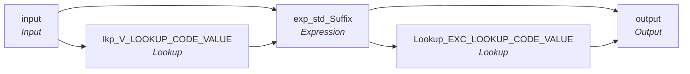

# rule_Suffix_Std

IDQ mapplet &rarr; CDI **Mapplet** `rule_Suffix_Std`.

> This mapplet validates the Suffix.  
Returns "Valid" or "Invalid".

## Summary

| IDQ transformation | CDI transformation | Count |
|---|---|---|
| ExpressionTx | Expression | 1 |
| LookupTx | Lookup | 2 |
| MappletInputTx | Input | 1 |
| MappletOutputTx | Output | 1 |

## Flow

## Transformations

In data-flow order.

### input

IDQ `MappletInputTx` &rarr; CDI **Input**. Mapplet Input transformation.

| Field | Type |
|---|---|
| Suffix | string(10) |
| Src_Sys | string(10) |

### lkp_V_LOOKUP_CODE_VALUE

IDQ `LookupTx` &rarr; CDI **Lookup**. Connected lookup unless a return port is set (then unconnected).

| Property | Value |
|---|---|
| Connection | STAGING |
| Object | V_LOOKUP_CODE_VALUE (view) |
| Lookup condition | SRC_CODE_VALUE = in_Suffix AND SRC_SYS = in_Src_Sys |
| Multiple matches | Return any row |
| Cache | static cache |
| Cache file name prefix | Rule_Suffix_V_LKP_CODE_ |

| Lookup input field | Type |
|---|---|
| in_Suffix | string(10) |
| in_Src_Sys | string(10) |

| Return / pass-through field | Feeds |
|---|---|
| MSTR_CODE_VALUE | exp_std_Suffix.std_Suffix |

Links (target field &larr; upstream field):

| Field | From |
|---|---|
| in_Suffix | input.Suffix |
| in_Src_Sys | input.Src_Sys |

### exp_std_Suffix

IDQ `ExpressionTx` &rarr; CDI **Expression**. Same expression language; variable fields are supported.

| Field | Kind | Type | Expression (CDI) |
|---|---|---|---|
| std_Suffix | in/out | string(20) | `std_Suffix` |
| Src_Suffix | in/out | string(10) | `Src_Suffix` |
| Exception_Code | out | string(300) | `IIF(  	NOT ISNULL(Src_Suffix) and  	ltrim(rtrim(Src_Suffix))<>'' and 	ISNULL(std_Suffix) 	,'Invalid_Suffix',null)` |

Links (target field &larr; upstream field):

| Field | From |
|---|---|
| Src_Suffix | input.Suffix |
| std_Suffix | lkp_V_LOOKUP_CODE_VALUE.MSTR_CODE_VALUE |

### Lookup_EXC_LOOKUP_CODE_VALUE

IDQ `LookupTx` &rarr; CDI **Lookup**. Connected lookup unless a return port is set (then unconnected).

| Property | Value |
|---|---|
| Connection | STAGING |
| Object | EXC_LOOKUP_CODE_VALUE |
| Lookup condition | EXCEPTION_CODE = Exception_Code1 |
| Multiple matches | Return any row |
| Cache | static cache |
| Cache file name prefix | rule_Suffix_Std_EXC_LKP_ |

| Lookup input field | Type |
|---|---|
| Exception_Code1 | string(20) |

| Return / pass-through field | Feeds |
|---|---|
| Exception_Code1 | output.Suffix_Exception_Code |
| EXCEPTION_TYPE | output.Suffix_Exception_Type |
| EXCEPTION_DESC | output.Suffix_Exception_Desc |

Links (target field &larr; upstream field):

| Field | From |
|---|---|
| Exception_Code1 | exp_std_Suffix.Exception_Code |

### output

IDQ `MappletOutputTx` &rarr; CDI **Output**. Mapplet Output transformation.

| Field | Type |
|---|---|
| Standardized_Suffix | string(20) |
| Source_Suffix | string(10) |
| Suffix_Exception_Type | string(300) |
| Suffix_Exception_Code | string(20) |
| Suffix_Exception_Desc | string(300) |

Links (target field &larr; upstream field):

| Field | From |
|---|---|
| Source_Suffix | exp_std_Suffix.Src_Suffix |
| Standardized_Suffix | exp_std_Suffix.std_Suffix |
| Suffix_Exception_Code | Lookup_EXC_LOOKUP_CODE_VALUE.Exception_Code1 |
| Suffix_Exception_Type | Lookup_EXC_LOOKUP_CODE_VALUE.EXCEPTION_TYPE |
| Suffix_Exception_Desc | Lookup_EXC_LOOKUP_CODE_VALUE.EXCEPTION_DESC |
