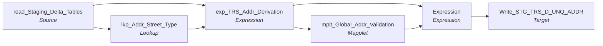

# m_Tgt_C_S_TRS_Addr_1

IDQ mapping &rarr; CDI **Mapping** `m_Tgt_C_S_TRS_Addr_1`.

> Find all unique address in the daily extract.  Run only unique address through address doctor (appox 1/10th are unique).  Write write all results (good and bad) to an intermediate table used by the next step (which will score the addresses).
NOTE since address doctors is slow, processing 1/10th of the volume will speed the load cycle.   

[ML 10/28/2020] Relocated the lookup of state code (conversion to mastered value) to the address validation maplett.

## Summary

| IDQ transformation | CDI transformation | Count |
|---|---|---|
| ExpressionTx | Expression | 2 |
| LookupTx | Lookup | 1 |
| MappletTx | Mapplet | 1 |
| SourceTx | Source | 1 |
| TargetTx | Target | 1 |

Sources:

| Instance | Object | Connection |
|---|---|---|
| read_Staging_Delta_Tables | `STG_TRS_D_INDV_ADDR` | STAGING |

Targets:

| Instance | Object | Connection |
|---|---|---|
| Write_STG_TRS_D_UNQ_ADDR | `STG_TRS_D_UNQ_ADDR` | STAGING |

## Parameters

Create as CDI input parameters (`$$Name`); defaults go in the parameter file.

| Parameter | Type | Precision | Default | Used in this mapping |
|---|---|---|---|---|
| Member_Role_Type | string | 30 | Member | no (declared only) |
| Member_Hierarchy_Code | string | 100 | Member | no (declared only) |
| Member_HM_REL_TP_CD | string | 1000 | Member Addr | no (declared only) |
| Min_Valid_Mailability_Score | integer | 10 | 3 | no (declared only) |
| Default_TX_State_CD | string | 2 | 48 | no (declared only) |
| County_CD_NonTX | string | 1000 | 996 | no (declared only) |
| CountyCD_DefaultAll | string | 1000 | 998 | no (declared only) |
| Default_NonUS_State_CD | string | 2 | 99 | no (declared only) |
| Default_NonUS_Country_CD | string | 2 | ZZ | no (declared only) |

## Flow



## Filtered data

Every step that can stop, divert or collapse rows, and what happens to the rows that do not pass. A Filter keeps a row only when its condition is TRUE: FALSE **or NULL** drops the row silently (no target, no reject file). A Router writes a row to **every** group whose condition is TRUE; a row that matches no group goes to the default group and is discarded when that group is not linked. Comments (`--`, `//`) are removed from the conditions shown here. A `= ...` line reads a null check on a lookup return in plain terms; *no matching row* also covers a matching row whose returned field is NULL.

### Steps that filter rows

| Step | IDQ type | Rule | Rows that pass go to | Rows that do not pass |
|---|---|---|---|---|
| read_Staging_Delta_Tables | SourceTx | custom SQL query (see the step): only the rows it returns | `STG_TRS_D_UNQ_ADDR` | never read |

### Rows that do not reach `C_S_*` tables

This mapping writes no `C_S_*` table (it loads `STG_TRS_D_UNQ_ADDR`); the steps above decide which rows it writes.

## Oracle stored procedure

Drop-in replacement in Oracle: [`sp_ors_main_m_Tgt_C_S_TRS_Addr_1`](../../../idq-to-oracle/wf_TRS_Stage_Load_1_Ongoing/sp_ors_main_m_Tgt_C_S_TRS_Addr_1.sql) (set-based SQL; one transaction that commits at the end and rolls back and re-raises on error). The IDQ mapplets and rules become the shared `fn_dq_*` functions; see [idq-to-oracle/README.md](../../../idq-to-oracle/README.md). Unlike the CDI spec above, the procedure **keeps the MDM timeline logic**; it is marked `TIMELINE` in the comments.

```text
Drop-in replacement of IDQ mapping m_Tgt_C_S_TRS_Addr_1 (workflow wf_TRS_Stage_Load_1_Ongoing).

Part 1 of the TIERS address load: every UNIQUE address of the daily extract (STG_TRS_D_INDV_ADDR, distinct on the
address parts) goes through the address validator once (about a tenth of the volume), and every result, good or
bad, is written to the intermediate table STG_TRS_D_UNQ_ADDR (truncated first). m_Tgt_C_S_TRS_Addr_2 joins it back
to the individuals.
  -> lkp_Addr_Street_Type (STG_TRS_CD_REF) + exp_TRS_Addr_Derivation:
       line 1 = street number, fraction, direction (EA/NO/SO/WE abbreviated to the first letter, any case), street
                name, street type description
       line 2 = dwelling type, apartment number, address line
       zip    = zip5 || '-' || zip4
  -> mplt_Global_Addr_Validation (fn_dq_valid_global_addr) -> Expression -> Write_STG_TRS_D_UNQ_ADDR

Timeline: none. SRC_COUNTY is linked to an unfed port (NULL).
```

Tables written:

| Table | Operation |
|---|---|
| `STG_TRS_D_UNQ_ADDR` | truncate, insert |

Shared functions and procedures called:

| Object | Does |
|---|---|
| `fn_dq_valid_global_addr` | replaces `mplt_Global_Addr_Validation (+ rule_Addr_Line_*)`, returns `t_dq_address` |
| `sp_ors_helper01_common` | truncate a target table (IDQ target property "Truncate target table") |
| `sp_ors_helper02_common` | run log line: mapping, step, row count (DBMS_OUTPUT) |

## Transformations

In data-flow order.

### read_Staging_Delta_Tables

IDQ `SourceTx` &rarr; CDI **Source**. Oracle connector source; carry the SQL override / filter below verbatim.

| Property | Value |
|---|---|
| Connection | STAGING |
| Object | STG_TRS_D_INDV_ADDR |
| queryMode | SEMI |

SQL override (CDI *SQL Override*; translated):

```sql
SELECT distinct
	 a.addr_st_num ||'|'||a.addr_st_num_frac ||'|'||a.addr_st_nm||'|'|| addr_st_dir_cd ||'|'|| addr_st_type_cd ||'|'||
			addr_dwelling_type_cd ||'|'|| a.addr_apt_num ||'|'||a.addr_line||'|'||a.addr_city||'|'||
			a.addr_state_cd||'|'||a.addr_zip5||'|'||a.addr_zip4    as addr_id
	,addr_st_num
	,addr_st_num_frac
	,addr_st_nm

	,addr_apt_num
	,addr_line
	,addr_city
	,addr_state_cd
	,addr_zip5
	,addr_zip4
	,addr_dwelling_type_cd
	,addr_st_type_cd
	,addr_st_dir_cd


--	,addr_type_cd
--


FROM STG_TRS_D_INDV_ADDR a
```

Columns: `None`, `None`, `None`, `None`, `None`, `None`, `None`, `None`, `None`, `None`, `None`, `None`, `None`

### lkp_Addr_Street_Type

IDQ `LookupTx` &rarr; CDI **Lookup**. Connected lookup unless a return port is set (then unconnected).

| Property | Value |
|---|---|
| Connection | STAGING |
| Object | STG_TRS_CD_REF |
| Lookup condition | CODE = ADDR_ST_TYPE_CD |
| Multiple matches | Return any row |
| Cache | static cache |

| Lookup input field | Type |
|---|---|
| ADDR_ST_TYPE_CD | string(4) |

| Return / pass-through field | Feeds |
|---|---|
| DESCRIPTION | exp_TRS_Addr_Derivation.STREET_TYPE_DESC |
| ADDR_ST_TYPE_CD | exp_TRS_Addr_Derivation.ADDR_ST_TYPE_CD |

Links (target field &larr; upstream field):

| Field | From |
|---|---|
| ADDR_ST_TYPE_CD | read_Staging_Delta_Tables.ADDR_ST_TYPE_CD |

### exp_TRS_Addr_Derivation

IDQ `ExpressionTx` &rarr; CDI **Expression**. Same expression language; variable fields are supported.

| Field | Kind | Type | Expression (CDI) |
|---|---|---|---|
| ADDR_ID | in/out | string(400) |  |
| ADDR_ST_NUM | in | string(6) |  |
| ADDR_ST_NUM_FRAC | in | string(3) |  |
| ADDR_ST_NM | in | string(30) |  |
| ADDR_APT_NUM | in | string(8) |  |
| ADDR_LINE | in | string(50) |  |
| ADDR_CITY | in/out | string(25) |  |
| ADDR_STATE_CD | in/out | string(2) |  |
| ADDR_ZIP5 | in/out | string(10) | `ADDR_ZIP5` |
| ADDR_ZIP4 | in/out | string(10) | `ADDR_ZIP4` |
| ADDR_DWELLING_TYPE_CD | in/out | string(4) |  |
| ADDR_ST_TYPE_CD | in/out | string(4) |  |
| ADDR_ST_DIR_CD | in/out | string(2) |  |
| v_ADDR_ST_DIR_DESC | variable | string(2) | `iif(in(ADDR_ST_DIR_CD, 'EA', 'NO', 'SO', 'WE', 0), substr(ADDR_ST_DIR_CD, 0, 1), ADDR_ST_DIR_CD)<br>--make Tiers street directions more standard as expected by USPS. Main 4 cardinal directions should be abbreviated with first letter only, the ones in between (SE, SW,etc.) can be left as is.` |
| STREET_TYPE_DESC | in/out | string(60) |  |
| ADDR_LINE_1 | out | string(100) | `ltrim(rtrim(ADDR_ST_NUM \|\| ' ' \|\|ADDR_ST_NUM_FRAC \|\| ' ' \|\| v_ADDR_ST_DIR_DESC \|\| ' ' \|\|  ADDR_ST_NM \|\| ' ' \|\| STREET_TYPE_DESC ))` |
| ADDR_LINE_2 | out | string(100) | `rtrim(ltrim(ADDR_DWELLING_TYPE_CD \|\| ' ' \|\| ADDR_APT_NUM  \|\| ' ' \|\| ADDR_LINE))` |
| ZIP_CODE_OUT | out | string(20) | `ADDR_ZIP5 \|\| '-' \|\| ADDR_ZIP4` |
| SRC_SYS | out | string(50) | `'TRS'` |
| COUNTRY_DEFAULT | out | string(10) | `'US'` |

Links (target field &larr; upstream field):

| Field | From |
|---|---|
| ADDR_ID | read_Staging_Delta_Tables.ADDR_ID |
| ADDR_CITY | read_Staging_Delta_Tables.ADDR_CITY |
| ADDR_STATE_CD | read_Staging_Delta_Tables.ADDR_STATE_CD |
| ADDR_ZIP5 | read_Staging_Delta_Tables.ADDR_ZIP5 |
| ADDR_ZIP4 | read_Staging_Delta_Tables.ADDR_ZIP4 |
| ADDR_ST_TYPE_CD | lkp_Addr_Street_Type.ADDR_ST_TYPE_CD |
| STREET_TYPE_DESC | lkp_Addr_Street_Type.DESCRIPTION |
| ADDR_ST_NUM | read_Staging_Delta_Tables.ADDR_ST_NUM |
| ADDR_ST_NUM_FRAC | read_Staging_Delta_Tables.ADDR_ST_NUM_FRAC |
| ADDR_ST_NM | read_Staging_Delta_Tables.ADDR_ST_NM |
| ADDR_APT_NUM | read_Staging_Delta_Tables.ADDR_APT_NUM |
| ADDR_LINE | read_Staging_Delta_Tables.ADDR_LINE |
| ADDR_DWELLING_TYPE_CD | read_Staging_Delta_Tables.ADDR_DWELLING_TYPE_CD |
| ADDR_ST_DIR_CD | read_Staging_Delta_Tables.ADDR_ST_DIR_CD |

### mplt_Global_Addr_Validation

IDQ `MappletTx` &rarr; CDI **Mapplet**. Reusable CDI mapplet (see the mapplets folder).

Mapplet: [`mplt_Global_Addr_Validation`](../mapplets/mplt_Global_Addr_Validation.md)

Links (target field &larr; upstream field):

| Field | From |
|---|---|
| Group.Address_1 | exp_TRS_Addr_Derivation.ADDR_LINE_1 |
| Group.Address_2 | exp_TRS_Addr_Derivation.ADDR_LINE_2 |
| Group.Src_sys | exp_TRS_Addr_Derivation.SRC_SYS |
| Group.Country | exp_TRS_Addr_Derivation.COUNTRY_DEFAULT |
| Group.Postal_Code | exp_TRS_Addr_Derivation.ZIP_CODE_OUT |
| Group.State | exp_TRS_Addr_Derivation.ADDR_STATE_CD |
| Group.City | exp_TRS_Addr_Derivation.ADDR_CITY |

### Expression

IDQ `ExpressionTx` &rarr; CDI **Expression**. Same expression language; variable fields are supported.

| Field | Kind | Type | Expression (CDI) |
|---|---|---|---|
| ADDR_ID | in/out | string(400) |  |
| ADDR_LN_1 | in/out | string(200) |  |
| ADDR_LN_2 | in/out | string(100) |  |
| BLDNG_NM | in/out | string(50) |  |
| FLR_NUM | in/out | string(10) |  |
| CITY | in/out | string(50) |  |
| COUNTY | in/out | string(10) |  |
| STATE | in/out | string(50) |  |
| CNTRY_CD | in/out | string(2) |  |
| PSTL_CD | in/out | string(10) |  |
| PSTL_CD_EXT | in/out | string(10) |  |
| NA__CRDNT_SYS | in/out | string(50) |  |
| NA__LCTN_CRDNT_DESC | in/out | string(50) |  |
| LATTD | in/out | decimal(20,6) |  |
| LNGTD | in/out | decimal(20,6) |  |
| NA__PSTL_BRCD | in/out | string(20) |  |
| VLDTN_MSG | in/out | string(50) |  |
| VLDTN_DESC | in/out | string(255) |  |
| NA__RGN_CD | in/out | string(20) |  |
| MLBLTY_SCR | in/out | string(1) |  |
| ADDR_TP_CD | in/out | string(5) |  |
| ORG_DESC | in/out | string(50) |  |
| ORG_DEPT | in/out | string(50) |  |
| ORG_NM | in/out | string(50) |  |
| BLDG_NMBR | in/out | string(20) |  |
| SUB_BLDG_NM | in/out | string(128) |  |
| SUB_BLDG_DESC | in/out | string(20) |  |
| GEOCD_STS_CD | in/out | string(10) |  |
| RSDNTL_DLVRY_IND | in/out | string(1) |  |
| ADDRDR_RSLT_PCT | in/out | decimal(5,2) |  |
| ERLY_WRNG_CD | in/out | string(1) |  |
| CASS_ERR_CD | in/out | string(2) |  |
| DLVRY_PNT_VLDN | in/out | string(1) |  |
| SRC_ADDR_LN_1 | in/out | string(200) |  |
| SRC_ADDR_LN_2 | in/out | string(100) |  |
| SRC_CITY | in/out | string(50) |  |
| SRC_COUNTY | in/out | string(100) |  |
| SRC_STATE | in/out | string(50) |  |
| SRC_CNTRY | in/out | string(50) |  |
| SRC_PSTL_CD | in/out | string(10) |  |
| SRC_PSTL_CD_EXT | in/out | string(10) |  |

Links (target field &larr; upstream field):

| Field | From |
|---|---|
| ADDR_ID | exp_TRS_Addr_Derivation.ADDR_ID |
| ADDR_LN_1 | mplt_Global_Addr_Validation.out_Std_Address.DeliveryAddressLine1 |
| ADDR_LN_2 | mplt_Global_Addr_Validation.out_Std_Address.DeliveryAddressLine2 |
| BLDNG_NM | mplt_Global_Addr_Validation.out_Std_Address.BuildingName |
| FLR_NUM | mplt_Global_Addr_Validation.out_Std_Address.Sub_buildingNumber |
| CITY | mplt_Global_Addr_Validation.out_Std_Address.City |
| COUNTY | mplt_Global_Addr_Validation.out_Std_Address.CountyFederalInformationProcessingStandardCode |
| STATE | mplt_Global_Addr_Validation.out_Std_Address.StateFederalInformationProcessingStandardCode |
| CNTRY_CD | mplt_Global_Addr_Validation.out_Std_Address.CountryISO2Char |
| PSTL_CD | mplt_Global_Addr_Validation.out_Std_Address.Zip_cd_5 |
| PSTL_CD_EXT | mplt_Global_Addr_Validation.out_Std_Address.Zip_cd_4_extn |
| LATTD | mplt_Global_Addr_Validation.out_Std_Address.GeoCodingLatitude |
| LNGTD | mplt_Global_Addr_Validation.out_Std_Address.GeoCodingLongitude |
| VLDTN_MSG | mplt_Global_Addr_Validation.out_Std_Address.MatchCode |
| MLBLTY_SCR | mplt_Global_Addr_Validation.out_Std_Address.MailabilityScore |
| ADDR_TP_CD | mplt_Global_Addr_Validation.out_Std_Address.AddressType |
| ORG_DESC | mplt_Global_Addr_Validation.out_Std_Address.OrganizationDescriptor |
| ORG_NM | mplt_Global_Addr_Validation.out_Std_Address.OrganizationName |
| BLDG_NMBR | mplt_Global_Addr_Validation.out_Std_Address.BuildingNumber |
| SUB_BLDG_NM | mplt_Global_Addr_Validation.out_Std_Address.Sub_buildingComplete |
| SUB_BLDG_DESC | mplt_Global_Addr_Validation.out_Std_Address.Sub_buildingDescriptor |
| GEOCD_STS_CD | mplt_Global_Addr_Validation.out_Std_Address.GeocodingStatus |
| RSDNTL_DLVRY_IND | mplt_Global_Addr_Validation.out_Std_Address.ResidentialDeliveryIndicator |
| SRC_ADDR_LN_1 | exp_TRS_Addr_Derivation.ADDR_LINE_1 |
| SRC_ADDR_LN_2 | exp_TRS_Addr_Derivation.ADDR_LINE_2 |
| SRC_CITY | exp_TRS_Addr_Derivation.ADDR_CITY |
| SRC_STATE | exp_TRS_Addr_Derivation.ADDR_STATE_CD |
| SRC_CNTRY | exp_TRS_Addr_Derivation.COUNTRY_DEFAULT |
| SRC_PSTL_CD | exp_TRS_Addr_Derivation.ADDR_ZIP5 |
| SRC_PSTL_CD_EXT | exp_TRS_Addr_Derivation.ADDR_ZIP4 |
| ADDRDR_RSLT_PCT | mplt_Global_Addr_Validation.out_Std_Address.StatusInfoResultPercentage |
| ERLY_WRNG_CD | mplt_Global_Addr_Validation.out_Std_Address.EarlyWarningSystemReturnCode |
| CASS_ERR_CD | mplt_Global_Addr_Validation.out_Std_Address.CASSErrorCode |
| DLVRY_PNT_VLDN | mplt_Global_Addr_Validation.out_Std_Address.DeliveryPointValidationConfirmation |
| VLDTN_DESC | mplt_Global_Addr_Validation.out_Std_Address.MatchCode_Description |
| ORG_DEPT | mplt_Global_Addr_Validation.out_Std_Address.OrganizationDepartment |

### Write_STG_TRS_D_UNQ_ADDR

IDQ `TargetTx` &rarr; CDI **Target**. Oracle connector target.

| Property | Value |
|---|---|
| Connection | STAGING |
| Object | STG_TRS_D_UNQ_ADDR |
| Operation | Insert |
| Truncate target table | yes |
| Load type | normal (no bulk load) |
| Reject file | Write_STG_TRS_D_UNQ_ADDR.bad |

Links (target field &larr; upstream field):

| Field | From |
|---|---|
| ADDR_ID | Expression.ADDR_ID |
| ADDR_LN_1 | Expression.ADDR_LN_1 |
| ADDR_LN_2 | Expression.ADDR_LN_2 |
| BLDNG_NM | Expression.BLDNG_NM |
| FLR_NUM | Expression.FLR_NUM |
| CITY | Expression.CITY |
| COUNTY | Expression.COUNTY |
| STATE | Expression.STATE |
| CNTRY_CD | Expression.CNTRY_CD |
| PSTL_CD | Expression.PSTL_CD |
| PSTL_CD_EXT | Expression.PSTL_CD_EXT |
| LATTD | Expression.LATTD |
| LNGTD | Expression.LNGTD |
| VLDTN_MSG | Expression.VLDTN_MSG |
| VLDTN_DESC | Expression.VLDTN_DESC |
| MLBLTY_SCR | Expression.MLBLTY_SCR |
| ADDR_TP_CD | Expression.ADDR_TP_CD |
| ORG_DESC | Expression.ORG_DESC |
| ORG_NM | Expression.ORG_NM |
| BLDG_NMBR | Expression.BLDG_NMBR |
| SUB_BLDG_NM | Expression.SUB_BLDG_NM |
| SUB_BLDG_DESC | Expression.SUB_BLDG_DESC |
| GEOCD_STS_CD | Expression.GEOCD_STS_CD |
| RSDNTL_DLVRY_IND | Expression.RSDNTL_DLVRY_IND |
| ADDRDR_RSLT_PCT | Expression.ADDRDR_RSLT_PCT |
| ERLY_WRNG_CD | Expression.ERLY_WRNG_CD |
| CASS_ERR_CD | Expression.CASS_ERR_CD |
| DLVRY_PNT_VLDN | Expression.DLVRY_PNT_VLDN |
| SRC_ADDR_LN_1 | Expression.SRC_ADDR_LN_1 |
| SRC_ADDR_LN_2 | Expression.SRC_ADDR_LN_2 |
| SRC_CITY | Expression.SRC_CITY |
| SRC_COUNTY | Expression.SRC_COUNTY |
| SRC_STATE | Expression.SRC_STATE |
| SRC_CNTRY | Expression.SRC_CNTRY |
| SRC_PSTL_CD | Expression.SRC_PSTL_CD |
| SRC_PSTL_CD_EXT | Expression.SRC_PSTL_CD_EXT |
| ORG_DEPT | Expression.ORG_DEPT |
