# m_Tgt_C_S_TRS_Addr_2

IDQ mapping &rarr; CDI **Mapping** `m_Tgt_C_S_TRS_Addr_2`.

> Part 2 of TIRES address load. Join TIERS addresses per indv  / case to unique prevalidated address from step 1.   Route the results to exceptions or MDM stage tables as applicable.  Added EFF_BEGIN_DT to the PKEY_PTY_RLE_ADDR TLF 4/15/2021

## Summary

| IDQ transformation | CDI transformation | Count |
|---|---|---|
| ExpressionTx | Expression | 7 |
| LookupTx | Lookup | 2 |
| MappletTx | Mapplet | 1 |
| RouterTx | Router | 1 |
| SorterTx | Sorter | 1 |
| SourceTx | Source | 1 |
| TargetTx | Target | 3 |

Sources:

| Instance | Object | Connection |
|---|---|---|
| read_Staging_Delta_Tables | `STG_TRS_D_INDV_ADDR` | STAGING |

Targets:

| Instance | Object | Connection |
|---|---|---|
| write_TRS_Exc_Member_Rec | `EXC_STG_BAD_REC_MEMB` | STAGING |
| Write_DQM_ADDRESS | `DQM_ADDRESS` | STAGING |
| Write_C_S_TRS_PTY_RLE_ADDR | `C_S_TRS_PTY_RLE_ADDR` | HHS_MDM_ORS |

## Parameters

Create as CDI input parameters (`$$Name`); defaults go in the parameter file.

| Parameter | Type | Precision | Default | Used in this mapping |
|---|---|---|---|---|
| Member_Role_Type | string | 30 | Member | yes |
| Member_Hierarchy_Code | string | 100 | Member | yes |
| Member_HM_REL_TP_CD | string | 1000 | Member Addr | yes |
| Min_Valid_Mailability_Score | integer | 10 | 3 | no (declared only) |
| Default_TX_State_CD | string | 2 | 48 | no (declared only) |
| County_CD_NonTX | string | 1000 | 996 | no (declared only) |
| CountyCD_DefaultAll | string | 1000 | 998 | no (declared only) |
| Default_NonUS_State_CD | string | 2 | 99 | no (declared only) |
| Default_NonUS_Country_CD | string | 2 | ZZ | no (declared only) |

`$sys.MappingName` is translated to the input parameter `$$MappingName` (default: the mapping name).

## Flow

```mermaid
flowchart LR
  n0["read_Staging_Delta_Tables<br/><i>Source</i>"]
  n1["Exp_src_defaults<br/><i>Expression</i>"]
  n2["Write_DQM_ADDRESS<br/><i>Target</i>"]
  n3["lkp_Address_Type<br/><i>Lookup</i>"]
  n4["exp_Score_and_Exception_details<br/><i>Expression</i>"]
  n5["rtr_Good_vs_Exception_Pty_Records<br/><i>Router</i>"]
  n6["exp_TRS_US_Addr_Good_Rec<br/><i>Expression</i>"]
  n7["exp_Address_Hold<br/><i>Expression</i>"]
  n8["srt_Party_Role_Addr_By_PKey_Beg_Date<br/><i>Sorter</i>"]
  n9["exp_Party_Role_Address_Attribute_Hold<br/><i>Expression</i>"]
  n10["exp_Stage_Target_Party_Role_Addr_Attributes<br/><i>Expression</i>"]
  n11["exp_TRS_US_Addr_Exc_Rec<br/><i>Expression</i>"]
  n12["mplt_Date_Greater_Than_Fifty_Years<br/><i>Mapplet</i>"]
  n13["Write_C_S_TRS_PTY_RLE_ADDR<br/><i>Target</i>"]
  n14["Lookup_EXC_LOOKUP_CODE_VALUE<br/><i>Lookup</i>"]
  n15["write_TRS_Exc_Member_Rec<br/><i>Target</i>"]
  n0 --> n1
  n1 --> n2
  n1 --> n3
  n1 --> n4
  n1 --> n5
  n3 --> n4
  n4 --> n5
  n5 --> n6
  n5 --> n11
  n6 --> n7
  n7 --> n8
  n8 --> n9
  n9 --> n10
  n10 --> n12
  n10 --> n13
  n11 --> n14
  n11 --> n15
  n12 --> n13
  n14 --> n15
```



## Filtered data

Every step that can stop, divert or collapse rows, and what happens to the rows that do not pass. A Filter keeps a row only when its condition is TRUE: FALSE **or NULL** drops the row silently (no target, no reject file). A Router writes a row to **every** group whose condition is TRUE; a row that matches no group goes to the default group and is discarded when that group is not linked. Comments (`--`, `//`) are removed from the conditions shown here. A `= ...` line reads a null check on a lookup return in plain terms; *no matching row* also covers a matching row whose returned field is NULL.

### Steps that filter rows

| Step | IDQ type | Rule | Rows that pass go to | Rows that do not pass |
|---|---|---|---|---|
| read_Staging_Delta_Tables | SourceTx | custom SQL query (see the step): only the rows it returns | `DQM_ADDRESS`, `C_S_TRS_PTY_RLE_ADDR`, `EXC_STG_BAD_REC_MEMB` | never read |
| rtr_Good_vs_Exception_Pty_Records | RouterTx | group `Good`: `Score = '100'` | `C_S_TRS_PTY_RLE_ADDR` |  |
| rtr_Good_vs_Exception_Pty_Records | RouterTx | group `Exception`: `Score = '40'` | `EXC_STG_BAD_REC_MEMB` |  |
| rtr_Good_vs_Exception_Pty_Records | RouterTx | default group `Default`: rows that match no other group | nothing: group not linked, **discarded** |  |

### Where the condition fields come from

| Step | Field | Origin |
|---|---|---|
| rtr_Good_vs_Exception_Pty_Records | `Score` | `exp_Score_and_Exception_details.Score` = `Decode(True, Addr_Tp_Mstr_Cd != '002' AND MailabilityScore <= '3','40', Addr_Tp_Mstr_Cd = '002' AND MailabilityScore < '3' AND IN(SUBSTR(MatchCode,1,1),'I','N'),'40', ISNULL(Addr_Tp_Mstr_Cd), '40', '100')` |

### Rows that do not reach `C_S_*` tables

**`C_S_TRS_PTY_RLE_ADDR`** (`Write_C_S_TRS_PTY_RLE_ADDR`): a source row is written only when it passes every step below.

| Step | Must hold | Otherwise the row |
|---|---|---|
| `read_Staging_Delta_Tables` | custom SQL query (see the step): only the rows it returns | never read |
| `rtr_Good_vs_Exception_Pty_Records` | group `Good`: `Score = '100'` | if `Score = '40'`: group `Exception` &rarr; `EXC_STG_BAD_REC_MEMB`<br>if no group matches: **discarded** (default group not linked) |

## Oracle stored procedure

Drop-in replacement in Oracle: [`sp_ors_main_m_Tgt_C_S_TRS_Addr_2`](../../../idq-to-oracle/wf_TRS_Stage_Load_1_Ongoing/sp_ors_main_m_Tgt_C_S_TRS_Addr_2.sql) (set-based SQL; one transaction that commits at the end and rolls back and re-raises on error). The IDQ mapplets and rules become the shared `fn_dq_*` functions; see [idq-to-oracle/README.md](../../../idq-to-oracle/README.md). Unlike the CDI spec above, the procedure **keeps the MDM timeline logic**; it is marked `TIMELINE` in the comments.

```text
Drop-in replacement of IDQ mapping m_Tgt_C_S_TRS_Addr_2 (workflow wf_TRS_Stage_Load_1_Ongoing).

Part 2 of the TIERS address load: the individual addresses of the extract (latest create per individual / address
type / case / EDG) joined to the pre-validated unique addresses of m_Tgt_C_S_TRS_Addr_1 (STG_TRS_D_UNQ_ADDR) and to
the valid members:
  -> Write_DQM_ADDRESS (every row)
  -> lkp_Address_Type (V_LOOKUP_CODE_VALUE ADDR_TP, 'TRS') -> exp_Score_and_Exception_details
  -> rtr_Good_vs_Exception_Pty_Records
       Good ('100')     -> exp_Address_Hold -> srt_Party_Role_Addr_By_PKey_Beg_Date
                           -> exp_Party_Role_Address_Attribute_Hold (VERSION_SEQ) -> C_S_TRS_PTY_RLE_ADDR (truncated)
       Exception ('40') -> EXC_STG_BAD_REC_MEMB ('Invalid_Address', looked-up code)
       Default          -> not linked (the score is always '40' or '100')

TIMELINE (stale MDM timeline, ported as IDQ does it):
  * VERSION_SEQ is a running number per role-address key in (key, SRC_LAST_UPDATE_DATE desc, EFF_END_DT desc,
    EFF_BEGIN_DT desc; NULL high) order - every row is written, numbered 1, 2, 3, ... within the key.
  * SRC_ROWID = key || '|' || VERSION_SEQ.
  * PERIOD_REFERENCE_TIME = run start when EFF_END_DT is set.
  * PERIOD_END_DATE / EFF_END_DT = mplt_Date_Greater_Than_Fifty_Years(EFF_END_DT): NULL (open) when more than 50
    years away.
  * PERIOD_START_DATE / EFF_STRT_DT = EFF_BEGIN_DT.
The source's "select distinct" flag is ignored by IDQ when custom SQL is used, so it is not applied here either.
Unfed ports written as NULL: ROWID_OBJECT, DELETED_*, UPDATED_BY, HUB_STATE_IND, USG_TP, CRDNT_SYS, PSTL_BRCD,
RGN_CD, CREATOR, CREATE_DATE, LCTN_CRDNT_DESC (sorter port without input).
```

Parameters:

| Parameter | Type | Default | Replaces / meaning |
|---|---|---|---|
| `p_member_role_type` | VARCHAR2 | `'Member'` | $Member_Role_Type |
| `p_member_hierarchy_code` | VARCHAR2 | `'Member'` | $Member_Hierarchy_Code |
| `p_member_hm_rel_tp_cd` | VARCHAR2 | `'Member Addr'` | $Member_HM_REL_TP_CD |

Tables written:

| Table | Operation |
|---|---|
| `C_S_TRS_PTY_RLE_ADDR` | truncate, insert |
| `DQM_ADDRESS` | insert |
| `EXC_STG_BAD_REC_MEMB` | insert |

Shared functions and procedures called:

| Object | Does |
|---|---|
| `fn_dq_date_within_50y` | replaces `mplt_Date_Greater_Than_Fifty_Years`, returns `t_dq_date_50y` |
| `fn_ors_helper03_common` | V_LOOKUP_CODE_VALUE lookup: source code -> MSTR_CODE_VALUE (any row) |
| `fn_ors_helper04_common` | EXC_LOOKUP_CODE_VALUE lookup: exception code -> EXCEPTION_DESC (any row) |
| `fn_ors_helper05_common` | EXC_LOOKUP_CODE_VALUE lookup: exception code -> EXCEPTION_TYPE (any row) |
| `fn_ors_helper08_common` | EXC_LOOKUP_CODE_VALUE lookup: exception code -> EXCEPTION_CODE (the code when it is configured, else NULL) |
| `fn_ors_helper09_common` | address score of exp_Score_and_Exception_details: '40' exception / '100' |
| `fn_ors_helper10_common` | address issue text of exp_Score_and_Exception_details (Addr_Issue_Desc) |
| `fn_ors_helper11_common` | exp_Address_Hold line 1: empty line 1 replaced by line 2 |
| `fn_ors_helper12_common` | exp_Address_Hold line 2: cleared when it repeats the held line 1 |
| `sp_ors_helper01_common` | truncate a target table (IDQ target property "Truncate target table") |
| `sp_ors_helper02_common` | run log line: mapping, step, row count (DBMS_OUTPUT) |

## Transformations

In data-flow order.

### read_Staging_Delta_Tables

IDQ `SourceTx` &rarr; CDI **Source**. Oracle connector source; carry the SQL override / filter below verbatim.

| Property | Value |
|---|---|
| Connection | STAGING |
| Object | STG_TRS_D_INDV_ADDR |
| queryMode | SEMI |

SQL override (CDI *SQL Override*; translated):

```sql
WITH addr_de_dup AS
(
SELECT
	indv_id
	,case_num
	,edg_num
	,addr_type_cd
	, a.addr_st_num ||'|'||a.addr_st_num_frac ||'|'||a.addr_st_nm||'|'|| addr_st_dir_cd ||'|'|| addr_st_type_cd ||'|'||
			addr_dwelling_type_cd ||'|'|| a.addr_apt_num ||'|'||a.addr_line||'|'||a.addr_city||'|'||
			a.addr_state_cd||'|'||a.addr_zip5||'|'||a.addr_zip4    as addr_id
	,greatest(create_dt, nvl(update_dt,create_dt)) create_dt  -- there is some junk data where create > update
	,eff_begin_dt
	,eff_end_dt
	--,addr_st_dir_cd
	,row_number() over (partition by indv_id, addr_type_cd, case_num, edg_num  -- Src Key Attributes
						order by greatest(create_dt, nvl(update_dt,create_dt)) desc, eff_begin_dt desc) key_rn    -- last create dt = 1
FROM STG_TRS_D_INDV_ADDR a
)
SELECT /*+ parallel (4) */
	a.indv_id
	,a.case_num
	,a.edg_num
	,vm.pty_pk    -- return >1 row per indv if reported from 2 sources
	,a.addr_type_cd
	,a.create_dt
	,a.eff_begin_dt
	,a.eff_end_dt
	,u.addr_id
	,u.addr_ln_1
	,u.addr_ln_2
	,u.bldng_nm
	,u.flr_num
	,u.city
	,u.county
	,u.state
	,u.cntry_cd
	,u.pstl_cd
	,u.pstl_cd_ext
	,u.crdnt_sys
	,u.lctn_crdnt_desc
	,u.lattd
	,u.lngtd
	,u.pstl_brcd
	,u.vldtn_msg
	,u.vldtn_desc
	,u.rgn_cd
	,u.mlblty_scr
	,u.addr_tp_cd
	,u.org_desc
	,u.org_dept  -- DQM Addr
	,u.org_nm
	,u.bldg_nmbr
	,u.sub_bldg_nm
	,u.sub_bldg_desc
	,u.geocd_sts_cd
	,u.rsdntl_dlvry_ind
	-- DQM Specific
	,u.addrdr_rslt_pct
	,u.erly_wrng_cd
	,u.cass_err_cd
	,u.dlvry_pnt_vldn
	-- Source Attributes
	,u.src_addr_ln_1
	,u.src_addr_ln_2
	,u.src_city
	,u.src_county
	,u.src_state
	,u.src_cntry
	,u.src_pstl_cd
	,u.src_pstl_cd_ext


FROM addr_de_dup a
JOIN stg_trs_d_unq_addr u   -- pre-validated address, unique by address
	on a.addr_id = u.addr_id
JOIN stg_trs_valid_members vm
	on a.indv_id = vm.indv_id
WHERE
	key_rn = 1      -- [ML 10/25/2020] Keep only the last create date per source key
```

Columns: `None`, `None`, `None`, `None`, `None`, `None`, `None`, `None`, `None`, `None`, `None`, `None`, `None`, `None`, `None`, `None`, `None`, `None`, `None`, `None`, `None`, `None`, `None`, `None`, `None`, `None`, `None`, `None`, `None`, `None`, `None`, `None`, `None`, `None`, `None`, `None`, `None`, `None`, `None`, `None`, `None`, `None`, `None`, `None`, `None`, `None`, `None`, `None`, `None`

### Exp_src_defaults

IDQ `ExpressionTx` &rarr; CDI **Expression**. Same expression language; variable fields are supported.

| Field | Kind | Type | Expression (CDI) |
|---|---|---|---|
| INDV_ID | in/out | double |  |
| CASE_NUM | in/out | double |  |
| EDG_NUM | in/out | double |  |
| PTY_PK | in/out | string(255) |  |
| ADDR_TYPE_CD | in/out | string(2) |  |
| CREATE_DT | in/out | date/time |  |
| EFF_BEGIN_DT | in/out | date/time |  |
| EFF_END_DT | in/out | date/time |  |
| ADDR_ID | in/out | string(400) |  |
| ADDR_LN_1 | in/out | string(200) |  |
| ADDR_LN_2 | in/out | string(100) |  |
| BLDNG_NM | in/out | string(50) |  |
| FLR_NUM | in/out | string(10) |  |
| CITY | in/out | string(50) |  |
| COUNTY | in/out | string(10) |  |
| STATE | in/out | string(50) |  |
| CNTRY_CD | in/out | string(2) |  |
| PSTL_CD | in/out | string(10) |  |
| PSTL_CD_EXT | in/out | string(10) |  |
| CRDNT_SYS | in/out | string(50) |  |
| LCTN_CRDNT_DESC | in/out | string(50) |  |
| LATTD | in/out | decimal(20,6) |  |
| LNGTD | in/out | decimal(20,6) |  |
| PSTL_BRCD | in/out | string(20) |  |
| VLDTN_MSG | in/out | string(50) |  |
| VLDTN_DESC | in/out | string(500) |  |
| RGN_CD | in/out | string(20) |  |
| MLBLTY_SCR | in/out | string(1) |  |
| ADDR_TP_CD | in/out | string(5) |  |
| ORG_DESC | in/out | string(50) |  |
| ORG_DEPT | in/out | string(50) | `ORG_DEPT` |
| ORG_NM | in/out | string(50) |  |
| BLDG_NMBR | in/out | string(20) |  |
| SUB_BLDG_NM | in/out | string(128) |  |
| SUB_BLDG_DESC | in/out | string(20) |  |
| GEOCD_STS_CD | in/out | string(10) |  |
| RSDNTL_DLVRY_IND | in/out | string(1) |  |
| ADDRDR_RSLT_PCT | in/out | decimal(5,2) |  |
| ERLY_WRNG_CD | in/out | string(1) |  |
| CASS_ERR_CD | in/out | string(2) |  |
| DLVRY_PNT_VLDN | in/out | string(1) |  |
| SRC_ADDR_LN_1 | in/out | string(200) |  |
| SRC_ADDR_LN_2 | in/out | string(100) |  |
| SRC_CITY | in/out | string(50) |  |
| SRC_COUNTY | in/out | string(100) |  |
| SRC_STATE | in/out | string(50) |  |
| SRC_CNTRY | in/out | string(50) |  |
| SRC_PSTL_CD | in/out | string(10) |  |
| SRC_PSTL_CD_EXT | in/out | string(10) |  |
| SRC_SYS | out | string(10) | `'TRS'` |
| SRC_PSTL_CD_CONCAT | out | string(20) | `SRC_PSTL_CD \|\| <br>IIF(ISNULL(SRC_PSTL_CD_EXT),'','-'\|\|SRC_PSTL_CD_EXT)` |
| RSLT_PSTL_CD_CONCAT_v | variable | string(20) | `PSTL_CD \|\| <br>IIF(ISNULL(PSTL_CD_EXT),'','-'\|\|PSTL_CD_EXT)` |
| RSLT_PSTL_CD_CONCAT | out | string(20) | `RSLT_PSTL_CD_CONCAT_v` |
| LOC_IDN_v | variable | string(40) | `TO_CHAR(CASE_NUM) \|\| '\|' \|\| TO_CHAR(EDG_NUM)` |
| DQM_ADDR_KEY | out | string(255) | `ADDR_LN_1\|\|'\|'\|\|ADDR_LN_2\|\|'\|'\|\|<br>City\|\|'\|'\|\|RSLT_PSTL_CD_CONCAT_v\|\|'\|'\|\|State\|\|'\|'\|\|CNTRY_CD` |
| MAPPING_RUN_DATE | out | date/time | `SESSSTARTTIME` |

Links (target field &larr; upstream field):

| Field | From |
|---|---|
| PTY_PK | read_Staging_Delta_Tables.PTY_PK |
| ADDR_TYPE_CD | read_Staging_Delta_Tables.ADDR_TYPE_CD |
| ADDR_LN_1 | read_Staging_Delta_Tables.ADDR_LN_1 |
| ADDR_LN_2 | read_Staging_Delta_Tables.ADDR_LN_2 |
| CITY | read_Staging_Delta_Tables.CITY |
| COUNTY | read_Staging_Delta_Tables.COUNTY |
| STATE | read_Staging_Delta_Tables.STATE |
| CNTRY_CD | read_Staging_Delta_Tables.CNTRY_CD |
| LATTD | read_Staging_Delta_Tables.LATTD |
| LNGTD | read_Staging_Delta_Tables.LNGTD |
| VLDTN_MSG | read_Staging_Delta_Tables.VLDTN_MSG |
| MLBLTY_SCR | read_Staging_Delta_Tables.MLBLTY_SCR |
| ADDR_TP_CD | read_Staging_Delta_Tables.ADDR_TP_CD |
| ORG_DESC | read_Staging_Delta_Tables.ORG_DESC |
| BLDG_NMBR | read_Staging_Delta_Tables.BLDG_NMBR |
| SUB_BLDG_NM | read_Staging_Delta_Tables.SUB_BLDG_NM |
| GEOCD_STS_CD | read_Staging_Delta_Tables.GEOCD_STS_CD |
| RSDNTL_DLVRY_IND | read_Staging_Delta_Tables.RSDNTL_DLVRY_IND |
| ADDRDR_RSLT_PCT | read_Staging_Delta_Tables.ADDRDR_RSLT_PCT |
| ERLY_WRNG_CD | read_Staging_Delta_Tables.ERLY_WRNG_CD |
| CASS_ERR_CD | read_Staging_Delta_Tables.CASS_ERR_CD |
| DLVRY_PNT_VLDN | read_Staging_Delta_Tables.DLVRY_PNT_VLDN |
| SRC_ADDR_LN_1 | read_Staging_Delta_Tables.SRC_ADDR_LN_1 |
| SRC_ADDR_LN_2 | read_Staging_Delta_Tables.SRC_ADDR_LN_2 |
| SRC_CITY | read_Staging_Delta_Tables.SRC_CITY |
| SRC_COUNTY | read_Staging_Delta_Tables.SRC_COUNTY |
| SRC_STATE | read_Staging_Delta_Tables.SRC_STATE |
| SRC_CNTRY | read_Staging_Delta_Tables.SRC_CNTRY |
| SRC_PSTL_CD | read_Staging_Delta_Tables.SRC_PSTL_CD |
| SRC_PSTL_CD_EXT | read_Staging_Delta_Tables.SRC_PSTL_CD_EXT |
| INDV_ID | read_Staging_Delta_Tables.INDV_ID |
| CASE_NUM | read_Staging_Delta_Tables.CASE_NUM |
| EDG_NUM | read_Staging_Delta_Tables.EDG_NUM |
| CREATE_DT | read_Staging_Delta_Tables.CREATE_DT |
| EFF_BEGIN_DT | read_Staging_Delta_Tables.EFF_BEGIN_DT |
| EFF_END_DT | read_Staging_Delta_Tables.EFF_END_DT |
| ADDR_ID | read_Staging_Delta_Tables.ADDR_ID |
| BLDNG_NM | read_Staging_Delta_Tables.BLDNG_NM |
| FLR_NUM | read_Staging_Delta_Tables.FLR_NUM |
| PSTL_CD | read_Staging_Delta_Tables.PSTL_CD |
| PSTL_CD_EXT | read_Staging_Delta_Tables.PSTL_CD_EXT |
| CRDNT_SYS | read_Staging_Delta_Tables.CRDNT_SYS |
| LCTN_CRDNT_DESC | read_Staging_Delta_Tables.LCTN_CRDNT_DESC |
| PSTL_BRCD | read_Staging_Delta_Tables.PSTL_BRCD |
| VLDTN_DESC | read_Staging_Delta_Tables.VLDTN_DESC |
| RGN_CD | read_Staging_Delta_Tables.RGN_CD |
| ORG_NM | read_Staging_Delta_Tables.ORG_NM |
| SUB_BLDG_DESC | read_Staging_Delta_Tables.SUB_BLDG_DESC |
| ORG_DEPT | read_Staging_Delta_Tables.ORG_DEPT |

### Write_DQM_ADDRESS

IDQ `TargetTx` &rarr; CDI **Target**. Oracle connector target.

| Property | Value |
|---|---|
| Connection | STAGING |
| Object | DQM_ADDRESS |
| Operation | Insert |
| Truncate target table | no |
| Load type | normal (no bulk load) |
| Reject file | Write_DQM_ADDRESS.bad |

Links (target field &larr; upstream field):

| Field | From |
|---|---|
| ADDR_SRC_KEY | Exp_src_defaults.DQM_ADDR_KEY |
| SRC_SYSTEM | Exp_src_defaults.SRC_SYS |
| PTY_SRC_KEY | Exp_src_defaults.PTY_PK |
| LOAD_DT | Exp_src_defaults.MAPPING_RUN_DATE |
| SRC_ADDR_1 | Exp_src_defaults.SRC_ADDR_LN_1 |
| SRC_ADDR_2 | Exp_src_defaults.SRC_ADDR_LN_2 |
| SRC_CITY | Exp_src_defaults.SRC_CITY |
| SRC_CNTRY | Exp_src_defaults.SRC_CNTRY |
| RSLT_ADDR_1 | Exp_src_defaults.ADDR_LN_1 |
| RSLT_ADDR_2 | Exp_src_defaults.ADDR_LN_2 |
| RSLT_CITY | Exp_src_defaults.CITY |
| RSLT_STATE | Exp_src_defaults.STATE |
| RSLT_CNTRY | Exp_src_defaults.CNTRY_CD |
| COUNTY_FIPS | Exp_src_defaults.COUNTY |
| STATE_FIPS | Exp_src_defaults.STATE |
| LATTD | Exp_src_defaults.LATTD |
| LNGTD | Exp_src_defaults.LNGTD |
| RSLT_PSTL_CD | Exp_src_defaults.RSLT_PSTL_CD_CONCAT |
| GEOCD_STS_CD | Exp_src_defaults.GEOCD_STS_CD |
| RSDNTL_DLVRY_IND | Exp_src_defaults.RSDNTL_DLVRY_IND |
| ORG_DESC | Exp_src_defaults.ORG_DESC |
| BLDG | Exp_src_defaults.BLDG_NMBR |
| SUB_BLDG | Exp_src_defaults.SUB_BLDG_NM |
| MLBLTY_SCR | Exp_src_defaults.MLBLTY_SCR |
| ADDRDR_MTCH_CD | Exp_src_defaults.VLDTN_MSG |
| ERLY_WRNG_CD | Exp_src_defaults.ERLY_WRNG_CD |
| CASS_ERR_CD | Exp_src_defaults.CASS_ERR_CD |
| DLVRY_PNT_VLDN | Exp_src_defaults.DLVRY_PNT_VLDN |
| ADDRDR_RSLT_PCT | Exp_src_defaults.ADDRDR_RSLT_PCT |
| ADDRDR_ADDR_TP_CD | Exp_src_defaults.ADDR_TP_CD |
| RSLT_COUNTY | Exp_src_defaults.COUNTY |
| ORG_DEPT | Exp_src_defaults.ORG_DEPT |
| ORG_NM | Exp_src_defaults.ORG_NM |
| SRC_COUNTY | Exp_src_defaults.SRC_COUNTY |
| SRC_STATE | Exp_src_defaults.SRC_STATE |
| SRC_PSTL_CD | Exp_src_defaults.SRC_PSTL_CD_CONCAT |
| MDM_ADDR_TP | Exp_src_defaults.ADDR_TYPE_CD |

### lkp_Address_Type

IDQ `LookupTx` &rarr; CDI **Lookup**. Connected lookup unless a return port is set (then unconnected).

| Property | Value |
|---|---|
| Connection | STAGING |
| Object | V_LOOKUP_CODE_VALUE (view) |
| Lookup condition | SRC_CODE_VALUE = SRC_ADDR_TP AND SRC_SYS = SRC_SYS_IN |
| Multiple matches | Return any row |
| Cache | static cache |
| Cache file name prefix | LKP_ADDR_TYPE_CD_ |

Filter (CDI source/lookup *Filter* property; translated):

```sql
"V_LOOKUP_CODE_VALUE"."CODE_TYPE"='ADDR_TP'
```

| Lookup input field | Type |
|---|---|
| SRC_ADDR_TP | string(10) |
| SRC_SYS_IN | string(10) |

| Return / pass-through field | Feeds |
|---|---|
| MSTR_CODE_VALUE | exp_Score_and_Exception_details.Addr_Tp_Mstr_Cd |

Links (target field &larr; upstream field):

| Field | From |
|---|---|
| SRC_SYS_IN | Exp_src_defaults.SRC_SYS |
| SRC_ADDR_TP | Exp_src_defaults.ADDR_TYPE_CD |

### exp_Score_and_Exception_details

IDQ `ExpressionTx` &rarr; CDI **Expression**. Same expression language; variable fields are supported.

| Field | Kind | Type | Expression (CDI) |
|---|---|---|---|
| MailabilityScore | in/out | string(2) | `MailabilityScore` |
| MatchCode | in/out | string(4) | `MatchCode` |
| Addr_Tp_Cd_Src | in/out | string(2) |  |
| Addr_Tp_Mstr_Cd | in/out | string(20) |  |
| Addr_Issue_Desc | variable | string(100) | `Decode(True,<br><br>Addr_Tp_Mstr_Cd != '002'<br>AND<br>MailabilityScore <= '3',<br>'Invalid Address',<br>--<br>Addr_Tp_Mstr_Cd = '002'<br>AND<br>MailabilityScore < '3'<br>AND<br>IN(SUBSTR(MatchCode,1,1),'I','N'),<br>'Invalid Address',<br>--<br>ISNULL(Addr_Tp_Mstr_Cd), 'Invalid Address Type',<br>NULL)` |
| Issue_Type_Addr | variable | string(30) | `Decode(True,<br>NOT ISNULL(Addr_Issue_Desc), 'Address',<br>NULL)` |
| Attribute_Name | out | string(30) | `Decode(True,<br>NOT ISNULL(Addr_Issue_Desc), 'Address',<br>NULL)` |
| Attribute_Value | out | string(255) | `Decode(True,<br>NOT ISNULL(Addr_Issue_Desc), SRC_ADDR_LN_1\|\|' '\|\|SRC_ADDR_LN_2\|\|' '\|\|SRC_CITY\|\|' '\|\|SRC_STATE\|\|' '\|\|SRC_PSTL_CD\|\|' '\|\|SRC_PSTL_CD_EXT\|\|' '\|\|SRC_CNTRY,<br>NULL)` |
| Score | out | string(10) | `Decode(True,<br>--If Address Type is not Physcial Mail and<br>--mailability scores are equal or less than 3 , then route mails to exception queue <br>Addr_Tp_Mstr_Cd != '002'<br>AND<br>MailabilityScore <= '3','40',<br><br>--If Address Type is Physcial Mail and<br>--mailability scores are less than  3, Check Match --codes as well. If the Match code starts with I or N , then --route mails to exception queue else consider it as valid --address.<br><br>Addr_Tp_Mstr_Cd = '002'<br>AND<br>MailabilityScore < '3'<br>AND<br>IN(SUBSTR(MatchCode,1,1),'I','N'),'40',<br><br>-- If valid Address Type is not returned from Lookup Code value table, the record should be routed to Exception.This is applicable for P23 since we are not receiving Address Type from P23<br><br>ISNULL(Addr_Tp_Mstr_Cd), '40', '100')` |
| SRC_ADDR_LN_1 | in/out | string(200) | `SRC_ADDR_LN_1` |
| SRC_ADDR_LN_2 | in/out | string(100) | `SRC_ADDR_LN_2` |
| SRC_CITY | in/out | string(50) | `SRC_CITY` |
| SRC_COUNTY | in/out | string(100) | `SRC_COUNTY` |
| SRC_STATE | in/out | string(50) | `SRC_STATE` |
| SRC_CNTRY | in/out | string(50) | `SRC_CNTRY` |
| SRC_PSTL_CD | in/out | string(10) | `SRC_PSTL_CD` |
| SRC_PSTL_CD_EXT | in/out | string(10) | `SRC_PSTL_CD_EXT` |

Links (target field &larr; upstream field):

| Field | From |
|---|---|
| MailabilityScore | Exp_src_defaults.MLBLTY_SCR |
| MatchCode | Exp_src_defaults.VLDTN_MSG |
| Addr_Tp_Cd_Src | Exp_src_defaults.ADDR_TYPE_CD |
| Addr_Tp_Mstr_Cd | lkp_Address_Type.MSTR_CODE_VALUE |
| SRC_ADDR_LN_1 | Exp_src_defaults.SRC_ADDR_LN_1 |
| SRC_ADDR_LN_2 | Exp_src_defaults.SRC_ADDR_LN_2 |
| SRC_CITY | Exp_src_defaults.SRC_CITY |
| SRC_PSTL_CD | Exp_src_defaults.SRC_PSTL_CD |
| SRC_PSTL_CD_EXT | Exp_src_defaults.SRC_PSTL_CD_EXT |
| SRC_CNTRY | Exp_src_defaults.SRC_CNTRY |
| SRC_STATE | Exp_src_defaults.SRC_STATE |
| SRC_COUNTY | Exp_src_defaults.SRC_COUNTY |

### rtr_Good_vs_Exception_Pty_Records

IDQ `RouterTx` &rarr; CDI **Router**. One output group per IDQ group; the default group is created automatically.

| Output group | Condition |
|---|---|
| Good | `Score = '100'` |
| Exception | `Score = '40'` |
| Default | (default group) |

Links (target field &larr; upstream field):

| Field | From |
|---|---|
| MailabilityScore | exp_Score_and_Exception_details.MailabilityScore |
| MatchCode | exp_Score_and_Exception_details.MatchCode |
| Addr_Tp_Cd_Src | exp_Score_and_Exception_details.Addr_Tp_Cd_Src |
| Addr_Tp_Mstr_Cd | exp_Score_and_Exception_details.Addr_Tp_Mstr_Cd |
| Attribute_Name | exp_Score_and_Exception_details.Attribute_Name |
| Attribute_Value | exp_Score_and_Exception_details.Attribute_Value |
| Score | exp_Score_and_Exception_details.Score |
| SRC_ADDR_LN_1 | exp_Score_and_Exception_details.SRC_ADDR_LN_1 |
| SRC_ADDR_LN_2 | exp_Score_and_Exception_details.SRC_ADDR_LN_2 |
| SRC_CITY | exp_Score_and_Exception_details.SRC_CITY |
| SRC_COUNTY | exp_Score_and_Exception_details.SRC_COUNTY |
| SRC_STATE | exp_Score_and_Exception_details.SRC_STATE |
| SRC_CNTRY | exp_Score_and_Exception_details.SRC_CNTRY |
| SRC_PSTL_CD | exp_Score_and_Exception_details.SRC_PSTL_CD |
| SRC_PSTL_CD_EXT | exp_Score_and_Exception_details.SRC_PSTL_CD_EXT |
| MatchCode_Description | Exp_src_defaults.VLDTN_DESC |
| Indv_Id | Exp_src_defaults.INDV_ID |
| Case_Num | Exp_src_defaults.CASE_NUM |
| Edg_Num | Exp_src_defaults.EDG_NUM |
| Eff_Begin_Dt | Exp_src_defaults.EFF_BEGIN_DT |
| Eff_End_Dt | Exp_src_defaults.EFF_END_DT |
| City | Exp_src_defaults.CITY |
| State | Exp_src_defaults.STATE |
| Src_Sys | Exp_src_defaults.SRC_SYS |
| AddressLine1 | Exp_src_defaults.ADDR_LN_1 |
| AddressLine2 | Exp_src_defaults.ADDR_LN_2 |
| PostalCode | Exp_src_defaults.PSTL_CD |
| PostalCode_Ext | Exp_src_defaults.PSTL_CD_EXT |
| Country | Exp_src_defaults.CNTRY_CD |
| Latitude | Exp_src_defaults.LATTD |
| Longitude | Exp_src_defaults.LNGTD |
| GeocodingStatus | Exp_src_defaults.GEOCD_STS_CD |
| County_FIPS_Cd | Exp_src_defaults.COUNTY |
| State_FIPS_Cd | Exp_src_defaults.STATE |
| ResidentialDeliveryIndicator | Exp_src_defaults.RSDNTL_DLVRY_IND |
| OrganizationDescriptor | Exp_src_defaults.ORG_DESC |
| OrganizationName | Exp_src_defaults.ORG_NM |
| PTY_FK | Exp_src_defaults.PTY_PK |
| Sub_buildingNumber | Exp_src_defaults.FLR_NUM |
| BuildingName | Exp_src_defaults.BLDNG_NM |
| Sub_buildingComplete | Exp_src_defaults.SUB_BLDG_NM |
| Sub_buildingDescriptor | Exp_src_defaults.SUB_BLDG_DESC |
| AD_AddressType | Exp_src_defaults.ADDR_TP_CD |
| SRC_LAST_UPDATE_DATE | Exp_src_defaults.CREATE_DT |
| BuildingNumber | Exp_src_defaults.BLDG_NMBR |

### exp_TRS_US_Addr_Good_Rec

IDQ `ExpressionTx` &rarr; CDI **Expression**. Same expression language; variable fields are supported.

| Field | Kind | Type | Expression (CDI) |
|---|---|---|---|
| Src_Sys | in/out | string(50) | `Src_Sys` |
| Edg_Num | in/out | double | `Edg_Num` |
| Case_Num | in/out | double | `Case_Num` |
| Indv_Id | in/out | double | `Indv_Id` |
| Eff_Begin_Dt | in/out | date/time | `Eff_Begin_Dt` |
| Eff_End_Dt | in/out | date/time | `Eff_End_Dt` |
| AddressLine1 | in/out | string(128) | `AddressLine1` |
| AddressLine2 | in/out | string(128) | `AddressLine2` |
| City | in/out | string(50) | `City` |
| PostalCode | in/out | string(10) | `PostalCode` |
| PostalCode_Ext | in/out | string(10) | `PostalCode_Ext` |
| Country | in/out | string(2) | `Country` |
| MailabilityScore | in/out | string(2) | `MailabilityScore` |
| MatchCode | in/out | string(4) | `MatchCode` |
| Latitude | in/out | string(30) | `Latitude` |
| Longitude | in/out | string(30) | `Longitude` |
| GeocodingStatus | in/out | string(10) | `GeocodingStatus` |
| County_FIPS_Cd | in/out | string(3) | `County_FIPS_Cd` |
| State_FIPS_Cd | in/out | string(2) | `State_FIPS_Cd` |
| ResidentialDeliveryIndicator | in/out | string(1) | `ResidentialDeliveryIndicator` |
| Sub_buildingNumber | in/out | string(50) | `Sub_buildingNumber` |
| OrganizationDescriptor | in/out | string(50) | `OrganizationDescriptor` |
| OrganizationName | in/out | string(50) | `OrganizationName` |
| BuildingName | in/out | string(50) | `BuildingName` |
| Sub_buildingComplete | in/out | string(128) | `Sub_buildingComplete` |
| Sub_buildingDescriptor | in/out | string(20) | `Sub_buildingDescriptor` |
| AD_AddressType | in/out | string(5) | `AD_AddressType` |
| Addr_Tp_Mstr_Cd | in/out | string(20) | `Addr_Tp_Mstr_Cd` |
| BuildingNumber | in/out | string(20) | `BuildingNumber` |
| PTY_FK | in/out | string(255) | `PTY_FK` |
| SRC_ADDR_LN_1 | in/out | string(200) | `SRC_ADDR_LN_1` |
| SRC_ADDR_LN_2 | in/out | string(100) | `SRC_ADDR_LN_2` |
| SRC_CITY | in/out | string(50) | `SRC_CITY` |
| SRC_COUNTY | in/out | string(100) | `SRC_COUNTY` |
| SRC_STATE | in/out | string(50) | `SRC_STATE` |
| SRC_CNTRY | in/out | string(50) | `SRC_CNTRY` |
| SRC_PSTL_CD | in/out | string(10) | `SRC_PSTL_CD` |
| SRC_PSTL_CD_EXT | in/out | string(10) | `SRC_PSTL_CD_EXT` |
| SRC_LAST_UPDATE_DATE | in/out | date/time | `SRC_LAST_UPDATE_DATE` |

Links (target field &larr; upstream field):

| Field | From |
|---|---|
| Src_Sys | rtr_Good_vs_Exception_Pty_Records.Good.Src_Sys |
| Edg_Num | rtr_Good_vs_Exception_Pty_Records.Good.Edg_Num |
| Case_Num | rtr_Good_vs_Exception_Pty_Records.Good.Case_Num |
| Indv_Id | rtr_Good_vs_Exception_Pty_Records.Good.Indv_Id |
| Eff_Begin_Dt | rtr_Good_vs_Exception_Pty_Records.Good.Eff_Begin_Dt |
| Eff_End_Dt | rtr_Good_vs_Exception_Pty_Records.Good.Eff_End_Dt |
| AddressLine1 | rtr_Good_vs_Exception_Pty_Records.Good.AddressLine1 |
| AddressLine2 | rtr_Good_vs_Exception_Pty_Records.Good.AddressLine2 |
| City | rtr_Good_vs_Exception_Pty_Records.Good.City |
| PostalCode | rtr_Good_vs_Exception_Pty_Records.Good.PostalCode |
| PostalCode_Ext | rtr_Good_vs_Exception_Pty_Records.Good.PostalCode_Ext |
| Country | rtr_Good_vs_Exception_Pty_Records.Good.Country |
| MailabilityScore | rtr_Good_vs_Exception_Pty_Records.Good.MailabilityScore |
| MatchCode | rtr_Good_vs_Exception_Pty_Records.Good.MatchCode |
| Latitude | rtr_Good_vs_Exception_Pty_Records.Good.Latitude |
| Longitude | rtr_Good_vs_Exception_Pty_Records.Good.Longitude |
| GeocodingStatus | rtr_Good_vs_Exception_Pty_Records.Good.GeocodingStatus |
| County_FIPS_Cd | rtr_Good_vs_Exception_Pty_Records.Good.County_FIPS_Cd |
| State_FIPS_Cd | rtr_Good_vs_Exception_Pty_Records.Good.State_FIPS_Cd |
| ResidentialDeliveryIndicator | rtr_Good_vs_Exception_Pty_Records.Good.ResidentialDeliveryIndicator |
| Sub_buildingNumber | rtr_Good_vs_Exception_Pty_Records.Good.Sub_buildingNumber |
| OrganizationDescriptor | rtr_Good_vs_Exception_Pty_Records.Good.OrganizationDescriptor |
| OrganizationName | rtr_Good_vs_Exception_Pty_Records.Good.OrganizationName |
| BuildingName | rtr_Good_vs_Exception_Pty_Records.Good.BuildingName |
| Sub_buildingComplete | rtr_Good_vs_Exception_Pty_Records.Good.Sub_buildingComplete |
| Sub_buildingDescriptor | rtr_Good_vs_Exception_Pty_Records.Good.Sub_buildingDescriptor |
| AD_AddressType | rtr_Good_vs_Exception_Pty_Records.Good.AD_AddressType |
| Addr_Tp_Mstr_Cd | rtr_Good_vs_Exception_Pty_Records.Good.Addr_Tp_Mstr_Cd |
| BuildingNumber | rtr_Good_vs_Exception_Pty_Records.Good.BuildingNumber |
| PTY_FK | rtr_Good_vs_Exception_Pty_Records.Good.PTY_FK |
| SRC_ADDR_LN_1 | rtr_Good_vs_Exception_Pty_Records.Good.SRC_ADDR_LN_1 |
| SRC_ADDR_LN_2 | rtr_Good_vs_Exception_Pty_Records.Good.SRC_ADDR_LN_2 |
| SRC_CITY | rtr_Good_vs_Exception_Pty_Records.Good.SRC_CITY |
| SRC_COUNTY | rtr_Good_vs_Exception_Pty_Records.Good.SRC_COUNTY |
| SRC_STATE | rtr_Good_vs_Exception_Pty_Records.Good.SRC_STATE |
| SRC_CNTRY | rtr_Good_vs_Exception_Pty_Records.Good.SRC_CNTRY |
| SRC_PSTL_CD | rtr_Good_vs_Exception_Pty_Records.Good.SRC_PSTL_CD |
| SRC_PSTL_CD_EXT | rtr_Good_vs_Exception_Pty_Records.Good.SRC_PSTL_CD_EXT |
| SRC_LAST_UPDATE_DATE | rtr_Good_vs_Exception_Pty_Records.Good.SRC_LAST_UPDATE_DATE |

### exp_Address_Hold

IDQ `ExpressionTx` &rarr; CDI **Expression**. Same expression language; variable fields are supported.

| Field | Kind | Type | Expression (CDI) |
|---|---|---|---|
| INDV_ID | in/out | double | `INDV_ID` |
| PTY_FK | in/out | string(48) | `PTY_FK` |
| CASE_NUM | in/out | double | `CASE_NUM` |
| ADDR_ST_TYPE_CD | in/out | string(20) | `ADDR_ST_TYPE_CD` |
| EFF_BEGIN_DT | in/out | date/time | `EFF_BEGIN_DT` |
| EFF_END_DT | in/out | date/time | `EFF_END_DT` |
| EDG_NUM | in/out | double | `EDG_NUM` |
| ADDR_TYPE_CD | in/out | string(20) | `ADDR_TYPE_CD` |
| ADDR_LINE_1 | in | string(200) |  |
| out_ADDR_LINE_1 | out | string(200) | `IIF(ISNULL(ADDR_LINE_1) or ltrim(rtrim(ADDR_LINE_1)) = '', ADDR_LINE_2, ADDR_LINE_1)` |
| v_ADDR_LINE_1 | variable | string(200) | `IIF(ISNULL(ADDR_LINE_1) or ltrim(rtrim(ADDR_LINE_1)) = '', ADDR_LINE_2, ADDR_LINE_1)` |
| ADDR_LINE_2 | in | string(100) |  |
| out_ADDR_LINE_2 | out | string(100) | `IIF(v_ADDR_LINE_1 = ADDR_LINE_2, null, ADDR_LINE_2)` |
| ADDR_CITY | in/out | string(50) | `ADDR_CITY` |
| ZIP_CD | in/out | string(10) | `ZIP_CD` |
| ZIP_EXT | in/out | string(10) | `ZIP_EXT` |
| SRC_SYS | in/out | string(10) | `SRC_SYS` |
| Country | in/out | string(2) | `Country` |
| COUNTRY_CD | in/out | string(2) | `COUNTRY_CD` |
| VLDTN_MSG | in/out | string(50) | `VLDTN_MSG` |
| LATTD | in/out | string(30) | `LATTD` |
| LNGTD | in/out | string(30) | `LNGTD` |
| PSTL_BRCD | in/out | string(20) | `PSTL_BRCD` |
| RGN_CD | in/out | string(20) | `RGN_CD` |
| COUNTY | in/out | string(10) | `COUNTY` |
| CRDNT_SYS | in/out | string(50) | `CRDNT_SYS` |
| LCTN_CRDNT_DESC | in/out | string(50) | `LCTN_CRDNT_DESC` |
| BLDNG_NM | in/out | string(50) | `BLDNG_NM` |
| FLR_NUM | in/out | string(10) | `FLR_NUM` |
| Out_MailabilityScore | in/out | string(1) | `Out_MailabilityScore` |
| Address_Type_LBL | in/out | string(20) | `Address_Type_LBL` |
| STD_STATE_CD | in/out | string(50) | `STD_STATE_CD` |
| PKEY_ADDR | out | string(255) | `RTRIM(ADDR_LINE_1 \|\| ' ' \|\| ADDR_LINE_2) \|\| '\|' \|\|  ADDR_CITY \|\| '\|' \|\| STD_STATE_CD \|\| '\|' \|\|  ZIP_CD \|\| ZIP_EXT \|\| '\|' \|\|  COUNTRY_CD` |
| PKEY_PTY_RLE_ADDR | out | string(255) | `PTY_FK \|\| '\|' \|\| $$Member_Role_Type \|\| '\|' \|\| ADDR_TYPE_CD \|\| '\|' \|\|  TO_CHAR(CASE_NUM) \|\| '\|' \|\| TO_CHAR(EDG_NUM) \|\| '\|' \|\| TO_CHAR(EFF_BEGIN_DT, 'YYYYMMDD')` |
| ResidentialDeliveryIndicator | in/out | string(1) | `ResidentialDeliveryIndicator` |
| OrganizationDescriptor | in/out | string(50) | `OrganizationDescriptor` |
| OrganizationName | in/out | string(50) | `OrganizationName` |
| Sub_buildingComplete | in/out | string(128) | `Sub_buildingComplete` |
| Sub_buildingDescriptor | in/out | string(20) | `Sub_buildingDescriptor` |
| AD_AddressType | in/out | string(5) | `AD_AddressType` |
| GeoCodingGeocodingComplete | in/out | string(60) | `GeoCodingGeocodingComplete` |
| GeocodingStatus | in/out | string(10) | `GeocodingStatus` |
| BuildingNumber | in/out | string(20) | `BuildingNumber` |
| SRC_ADDR_LN_1 | in/out | string(200) | `SRC_ADDR_LN_1` |
| SRC_ADDR_LN_2 | in/out | string(100) | `SRC_ADDR_LN_2` |
| SRC_CITY | in/out | string(50) | `SRC_CITY` |
| SRC_COUNTY | in/out | string(100) | `SRC_COUNTY` |
| SRC_STATE | in/out | string(50) | `SRC_STATE` |
| SRC_CNTRY | in/out | string(50) | `SRC_CNTRY` |
| SRC_PSTL_CD | in/out | string(10) | `SRC_PSTL_CD` |
| SRC_PSTL_CD_EXT | in/out | string(10) | `SRC_PSTL_CD_EXT` |
| SRC_LAST_UPDATE_DATE | in/out | date/time | `SRC_LAST_UPDATE_DATE` |

Links (target field &larr; upstream field):

| Field | From |
|---|---|
| INDV_ID | exp_TRS_US_Addr_Good_Rec.Indv_Id |
| CASE_NUM | exp_TRS_US_Addr_Good_Rec.Case_Num |
| EFF_BEGIN_DT | exp_TRS_US_Addr_Good_Rec.Eff_Begin_Dt |
| EFF_END_DT | exp_TRS_US_Addr_Good_Rec.Eff_End_Dt |
| EDG_NUM | exp_TRS_US_Addr_Good_Rec.Edg_Num |
| ADDR_TYPE_CD | exp_TRS_US_Addr_Good_Rec.Addr_Tp_Mstr_Cd |
| ADDR_CITY | exp_TRS_US_Addr_Good_Rec.City |
| ZIP_CD | exp_TRS_US_Addr_Good_Rec.PostalCode |
| ZIP_EXT | exp_TRS_US_Addr_Good_Rec.PostalCode_Ext |
| COUNTRY_CD | exp_TRS_US_Addr_Good_Rec.Country |
| VLDTN_MSG | exp_TRS_US_Addr_Good_Rec.MatchCode |
| LATTD | exp_TRS_US_Addr_Good_Rec.Latitude |
| LNGTD | exp_TRS_US_Addr_Good_Rec.Longitude |
| COUNTY | exp_TRS_US_Addr_Good_Rec.County_FIPS_Cd |
| Out_MailabilityScore | exp_TRS_US_Addr_Good_Rec.MailabilityScore |
| STD_STATE_CD | exp_TRS_US_Addr_Good_Rec.State_FIPS_Cd |
| PTY_FK | exp_TRS_US_Addr_Good_Rec.PTY_FK |
| ADDR_LINE_1 | exp_TRS_US_Addr_Good_Rec.AddressLine1 |
| ResidentialDeliveryIndicator | exp_TRS_US_Addr_Good_Rec.ResidentialDeliveryIndicator |
| OrganizationDescriptor | exp_TRS_US_Addr_Good_Rec.OrganizationDescriptor |
| OrganizationName | exp_TRS_US_Addr_Good_Rec.OrganizationName |
| Sub_buildingComplete | exp_TRS_US_Addr_Good_Rec.Sub_buildingComplete |
| Sub_buildingDescriptor | exp_TRS_US_Addr_Good_Rec.Sub_buildingDescriptor |
| AD_AddressType | exp_TRS_US_Addr_Good_Rec.AD_AddressType |
| ADDR_LINE_2 | exp_TRS_US_Addr_Good_Rec.AddressLine2 |
| SRC_SYS | exp_TRS_US_Addr_Good_Rec.Src_Sys |
| Country | exp_TRS_US_Addr_Good_Rec.Country |
| BLDNG_NM | exp_TRS_US_Addr_Good_Rec.BuildingName |
| FLR_NUM | exp_TRS_US_Addr_Good_Rec.Sub_buildingNumber |
| Address_Type_LBL | exp_TRS_US_Addr_Good_Rec.Addr_Tp_Mstr_Cd |
| GeocodingStatus | exp_TRS_US_Addr_Good_Rec.GeocodingStatus |
| BuildingNumber | exp_TRS_US_Addr_Good_Rec.BuildingNumber |
| SRC_ADDR_LN_1 | exp_TRS_US_Addr_Good_Rec.SRC_ADDR_LN_1 |
| SRC_ADDR_LN_2 | exp_TRS_US_Addr_Good_Rec.SRC_ADDR_LN_2 |
| SRC_CITY | exp_TRS_US_Addr_Good_Rec.SRC_CITY |
| SRC_COUNTY | exp_TRS_US_Addr_Good_Rec.SRC_COUNTY |
| SRC_STATE | exp_TRS_US_Addr_Good_Rec.SRC_STATE |
| SRC_CNTRY | exp_TRS_US_Addr_Good_Rec.SRC_CNTRY |
| SRC_PSTL_CD | exp_TRS_US_Addr_Good_Rec.SRC_PSTL_CD |
| SRC_PSTL_CD_EXT | exp_TRS_US_Addr_Good_Rec.SRC_PSTL_CD_EXT |
| SRC_LAST_UPDATE_DATE | exp_TRS_US_Addr_Good_Rec.SRC_LAST_UPDATE_DATE |

### srt_Party_Role_Addr_By_PKey_Beg_Date

IDQ `SorterTx` &rarr; CDI **Sorter**. Sort keys in the order listed; distinct, case and null settings below.

| # | Sort key | Order |
|---|---|---|
| 1 | PKEY_SRC_OBJECT_PTY_RL_OBJECT | ascending |
| 2 | SRC_LAST_UPDATE_DATE | descending |
| 3 | EFF_END_DT | descending |
| 4 | EFF_BEGIN_DT | descending |

| Property | Value |
|---|---|
| Distinct | no |
| Case sensitive | yes |
| Null treated high | yes |

Links (target field &larr; upstream field):

| Field | From |
|---|---|
| PKEY_SRC_OBJECT_PTY_RL_OBJECT | exp_Address_Hold.PKEY_PTY_RLE_ADDR |
| EFF_BEGIN_DT | exp_Address_Hold.EFF_BEGIN_DT |
| CASE_NUM | exp_Address_Hold.CASE_NUM |
| EDG_NUM | exp_Address_Hold.EDG_NUM |
| EFF_END_DT | exp_Address_Hold.EFF_END_DT |
| INDV_ID | exp_Address_Hold.INDV_ID |
| ADDR_TYPE_CD | exp_Address_Hold.ADDR_TYPE_CD |
| PKEY_SRC_OBJECT_ADDR | exp_Address_Hold.PKEY_ADDR |
| PTY_FK | exp_Address_Hold.PTY_FK |
| ADDR_LINE_1 | exp_Address_Hold.out_ADDR_LINE_1 |
| ADDR_LINE_2 | exp_Address_Hold.out_ADDR_LINE_2 |
| ADDR_CITY | exp_Address_Hold.ADDR_CITY |
| ZIP_CD | exp_Address_Hold.ZIP_CD |
| ZIP_EXT | exp_Address_Hold.ZIP_EXT |
| COUNTRY_DEFAULT | exp_Address_Hold.COUNTRY_CD |
| VLDTN_MSG | exp_Address_Hold.VLDTN_MSG |
| LATTD | exp_Address_Hold.LATTD |
| LNGTD | exp_Address_Hold.LNGTD |
| PSTL_BRCD | exp_Address_Hold.PSTL_BRCD |
| RGN_CD | exp_Address_Hold.RGN_CD |
| COUNTY | exp_Address_Hold.COUNTY |
| CRDNT_SYS | exp_Address_Hold.CRDNT_SYS |
| Out_MailabilityScore | exp_Address_Hold.Out_MailabilityScore |
| STD_STATE_CD | exp_Address_Hold.STD_STATE_CD |
| ResidentialDeliveryIndicator | exp_Address_Hold.ResidentialDeliveryIndicator |
| OrganizationDescriptor | exp_Address_Hold.OrganizationDescriptor |
| AD_AddressType | exp_Address_Hold.AD_AddressType |
| OrganizationName | exp_Address_Hold.OrganizationName |
| BLDNG_NM | exp_Address_Hold.BLDNG_NM |
| FLR_NUM | exp_Address_Hold.FLR_NUM |
| GeoCodingGeocodingComplete | exp_Address_Hold.GeoCodingGeocodingComplete |
| GeocodingStatus | exp_Address_Hold.GeocodingStatus |
| Sub_buildingComplete | exp_Address_Hold.Sub_buildingComplete |
| Sub_buildingDescriptor | exp_Address_Hold.Sub_buildingDescriptor |
| BuildingNumber | exp_Address_Hold.BuildingNumber |
| SRC_ADDR_LN_1 | exp_Address_Hold.SRC_ADDR_LN_1 |
| SRC_ADDR_LN_2 | exp_Address_Hold.SRC_ADDR_LN_2 |
| SRC_CITY | exp_Address_Hold.SRC_CITY |
| SRC_COUNTY | exp_Address_Hold.SRC_COUNTY |
| SRC_STATE | exp_Address_Hold.SRC_STATE |
| SRC_CNTRY | exp_Address_Hold.SRC_CNTRY |
| SRC_PSTL_CD | exp_Address_Hold.SRC_PSTL_CD |
| SRC_PSTL_CD_EXT | exp_Address_Hold.SRC_PSTL_CD_EXT |
| SRC_LAST_UPDATE_DATE | exp_Address_Hold.SRC_LAST_UPDATE_DATE |

### exp_Party_Role_Address_Attribute_Hold

IDQ `ExpressionTx` &rarr; CDI **Expression**. Same expression language; variable fields are supported.

| Field | Kind | Type | Expression (CDI) |
|---|---|---|---|
| PKEY_SRC_OBJECT_PTY_RL_OBJECT | in/out | string(255) |  |
| PTY_FK | in/out | string(48) |  |
| EFF_BEGIN_DT | in/out | date/time |  |
| CASE_NUM | in/out | double |  |
| EDG_NUM | in/out | double |  |
| EFF_END_DT | in/out | date/time |  |
| INDV_ID | in/out | double |  |
| ADDR_TYPE_CD | in/out | string(20) |  |
| PKEY_SRC_OBJECT_ADDR | in/out | string(255) |  |
| v_VERSION_SEQ_NUM (stale timeline: omit) | variable | integer | `IIF(PKEY_SRC_OBJECT_PTY_RL_OBJECT <> v_LAST_PKEY, 1, v_VERSION_SEQ_NUM+1)<br>` |
| VERSION_SEQ_NUM (stale timeline: omit) | out | integer | `v_VERSION_SEQ_NUM<br>` |
| v_UNIQUE_RANK | variable | integer | `IIF(PKEY_SRC_OBJECT_PTY_RL_OBJECT = v_LAST_PKEY AND v_VERSION_SEQ_NUM=v_LAST_VERSION_SEQ_NUM AND v_LAST_EFF_END_DT = EFF_END_DT, v_UNIQUE_RANK+1, 1)` |
| v_LAST_PKEY | variable | string(255) | `PKEY_SRC_OBJECT_PTY_RL_OBJECT` |
| v_LAST_VERSION_SEQ_NUM (stale timeline: omit) | variable | integer | `v_VERSION_SEQ_NUM` |
| v_LAST_PKEY_ADDR | variable | string(255) | `PKEY_SRC_OBJECT_ADDR` |
| v_LAST_EFF_END_DT | variable | date/time | `EFF_END_DT` |
| ADDR_LINE_1 | in/out | string(200) |  |
| ADDR_LINE_2 | in/out | string(100) |  |
| ADDR_CITY | in/out | string(50) |  |
| ZIP_CD | in/out | string(10) |  |
| ZIP_EXT | in/out | string(10) |  |
| COUNTRY_DEFAULT | in/out | string(2) |  |
| VLDTN_MSG | in/out | string(50) |  |
| LATTD | in/out | string(30) |  |
| LNGTD | in/out | string(30) |  |
| PSTL_BRCD | in/out | string(20) |  |
| RGN_CD | in/out | string(20) |  |
| COUNTY | in/out | string(10) |  |
| CRDNT_SYS | in/out | string(50) |  |
| LCTN_CRDNT_DESC | in/out | string(50) | `LCTN_CRDNT_DESC` |
| Out_MailabilityScore | in/out | string(1) |  |
| STD_STATE_CD | in/out | string(50) |  |
| ResidentialDeliveryIndicator | in/out | string(1) |  |
| OrganizationDescriptor | in/out | string(50) |  |
| AD_AddressType | in/out | string(5) |  |
| OrganizationName | in/out | string(50) |  |
| BLDNG_NM | in/out | string(50) |  |
| FLR_NUM | in/out | string(10) |  |
| GeoCodingGeocodingComplete | in/out | string(60) |  |
| GeocodingStatus | in/out | string(10) |  |
| Sub_buildingComplete | in/out | string(128) |  |
| Sub_buildingDescriptor | in/out | string(20) |  |
| BuildingNumber | in/out | string(20) |  |
| SRC_ADDR_LN_1 | in/out | string(200) |  |
| SRC_ADDR_LN_2 | in/out | string(100) |  |
| SRC_CITY | in/out | string(50) |  |
| SRC_COUNTY | in/out | string(100) |  |
| SRC_STATE | in/out | string(50) |  |
| SRC_CNTRY | in/out | string(50) |  |
| SRC_PSTL_CD | in/out | string(10) |  |
| SRC_PSTL_CD_EXT | in/out | string(10) |  |
| SRC_LAST_UPDATE_DATE | in/out | date/time |  |

Links (target field &larr; upstream field):

| Field | From |
|---|---|
| PKEY_SRC_OBJECT_PTY_RL_OBJECT | srt_Party_Role_Addr_By_PKey_Beg_Date.PKEY_SRC_OBJECT_PTY_RL_OBJECT |
| EFF_BEGIN_DT | srt_Party_Role_Addr_By_PKey_Beg_Date.EFF_BEGIN_DT |
| CASE_NUM | srt_Party_Role_Addr_By_PKey_Beg_Date.CASE_NUM |
| EDG_NUM | srt_Party_Role_Addr_By_PKey_Beg_Date.EDG_NUM |
| EFF_END_DT | srt_Party_Role_Addr_By_PKey_Beg_Date.EFF_END_DT |
| INDV_ID | srt_Party_Role_Addr_By_PKey_Beg_Date.INDV_ID |
| ADDR_TYPE_CD | srt_Party_Role_Addr_By_PKey_Beg_Date.ADDR_TYPE_CD |
| PKEY_SRC_OBJECT_ADDR | srt_Party_Role_Addr_By_PKey_Beg_Date.PKEY_SRC_OBJECT_ADDR |
| PTY_FK | srt_Party_Role_Addr_By_PKey_Beg_Date.PTY_FK |
| ADDR_LINE_1 | srt_Party_Role_Addr_By_PKey_Beg_Date.ADDR_LINE_1 |
| ADDR_LINE_2 | srt_Party_Role_Addr_By_PKey_Beg_Date.ADDR_LINE_2 |
| ADDR_CITY | srt_Party_Role_Addr_By_PKey_Beg_Date.ADDR_CITY |
| ZIP_CD | srt_Party_Role_Addr_By_PKey_Beg_Date.ZIP_CD |
| ZIP_EXT | srt_Party_Role_Addr_By_PKey_Beg_Date.ZIP_EXT |
| COUNTRY_DEFAULT | srt_Party_Role_Addr_By_PKey_Beg_Date.COUNTRY_DEFAULT |
| VLDTN_MSG | srt_Party_Role_Addr_By_PKey_Beg_Date.VLDTN_MSG |
| LATTD | srt_Party_Role_Addr_By_PKey_Beg_Date.LATTD |
| LNGTD | srt_Party_Role_Addr_By_PKey_Beg_Date.LNGTD |
| PSTL_BRCD | srt_Party_Role_Addr_By_PKey_Beg_Date.PSTL_BRCD |
| RGN_CD | srt_Party_Role_Addr_By_PKey_Beg_Date.RGN_CD |
| COUNTY | srt_Party_Role_Addr_By_PKey_Beg_Date.COUNTY |
| CRDNT_SYS | srt_Party_Role_Addr_By_PKey_Beg_Date.CRDNT_SYS |
| Out_MailabilityScore | srt_Party_Role_Addr_By_PKey_Beg_Date.Out_MailabilityScore |
| STD_STATE_CD | srt_Party_Role_Addr_By_PKey_Beg_Date.STD_STATE_CD |
| ResidentialDeliveryIndicator | srt_Party_Role_Addr_By_PKey_Beg_Date.ResidentialDeliveryIndicator |
| OrganizationDescriptor | srt_Party_Role_Addr_By_PKey_Beg_Date.OrganizationDescriptor |
| AD_AddressType | srt_Party_Role_Addr_By_PKey_Beg_Date.AD_AddressType |
| OrganizationName | srt_Party_Role_Addr_By_PKey_Beg_Date.OrganizationName |
| BLDNG_NM | srt_Party_Role_Addr_By_PKey_Beg_Date.BLDNG_NM |
| FLR_NUM | srt_Party_Role_Addr_By_PKey_Beg_Date.FLR_NUM |
| GeoCodingGeocodingComplete | srt_Party_Role_Addr_By_PKey_Beg_Date.GeoCodingGeocodingComplete |
| GeocodingStatus | srt_Party_Role_Addr_By_PKey_Beg_Date.GeocodingStatus |
| Sub_buildingComplete | srt_Party_Role_Addr_By_PKey_Beg_Date.Sub_buildingComplete |
| Sub_buildingDescriptor | srt_Party_Role_Addr_By_PKey_Beg_Date.Sub_buildingDescriptor |
| BuildingNumber | srt_Party_Role_Addr_By_PKey_Beg_Date.BuildingNumber |
| LCTN_CRDNT_DESC | srt_Party_Role_Addr_By_PKey_Beg_Date.LCTN_CRDNT_DESC |
| SRC_ADDR_LN_1 | srt_Party_Role_Addr_By_PKey_Beg_Date.SRC_ADDR_LN_1 |
| SRC_ADDR_LN_2 | srt_Party_Role_Addr_By_PKey_Beg_Date.SRC_ADDR_LN_2 |
| SRC_CITY | srt_Party_Role_Addr_By_PKey_Beg_Date.SRC_CITY |
| SRC_COUNTY | srt_Party_Role_Addr_By_PKey_Beg_Date.SRC_COUNTY |
| SRC_STATE | srt_Party_Role_Addr_By_PKey_Beg_Date.SRC_STATE |
| SRC_CNTRY | srt_Party_Role_Addr_By_PKey_Beg_Date.SRC_CNTRY |
| SRC_PSTL_CD | srt_Party_Role_Addr_By_PKey_Beg_Date.SRC_PSTL_CD |
| SRC_PSTL_CD_EXT | srt_Party_Role_Addr_By_PKey_Beg_Date.SRC_PSTL_CD_EXT |
| SRC_LAST_UPDATE_DATE | srt_Party_Role_Addr_By_PKey_Beg_Date.SRC_LAST_UPDATE_DATE |

### exp_Stage_Target_Party_Role_Addr_Attributes

IDQ `ExpressionTx` &rarr; CDI **Expression**. Same expression language; variable fields are supported.

| Field | Kind | Type | Expression (CDI) |
|---|---|---|---|
| PKEY_SRC_OBJECT_PTY_RL_OBJECT | in/out | string(255) |  |
| ROWID_OBJECT | in/out | string(14) | `ROWID_OBJECT` |
| DELETED_IND | in/out | decimal(38) | `DELETED_IND` |
| DELETED_DATE | in/out | date/time | `DELETED_DATE` |
| DELETED_BY | in/out | string(50) | `DELETED_BY` |
| PTY_FK | in/out | string(48) |  |
| EFF_BEGIN_DT | in/out | date/time |  |
| EFF_END_DT | in/out | date/time |  |
| EDG_NUM | in/out | double |  |
| INDV_ID | in/out | double |  |
| VERSION_SEQ_NUM (stale timeline: omit) | in/out | integer |  |
| UPDATED_BY | in/out | string(50) | `UPDATED_BY` |
| CREATE_DATE | in/out | date/time | `CREATE_DATE` |
| CREATOR | in/out | string(50) | `CREATOR` |
| CASE_NUM | in/out | double |  |
| ADDR_TYPE_CD | in/out | string(20) |  |
| PKEY_SRC_OBJECT_ADDR | in | string(255) |  |
| out_PKEY_SRC_OBJECT_ADDR | out | string(255) | `ltrim(rtrim(PKEY_SRC_OBJECT_ADDR))` |
| LAST_UPDATE_DATE_out | out | date/time | `SESSSTARTTIME` |
| PARTY_RL_FK | out | string(100) | `PTY_FK \|\| '\|' \|\| $$Member_Role_Type` |
| PREF_LVL | out | string(10) | `'Primary'` |
| LOC_IDN | out | string(100) | `TO_CHAR(TO_INTEGER(CASE_NUM))<br> \|\| '\|' \|\| TO_CHAR(TO_INTEGER(EDG_NUM))` |
| SRC_ROWID | out | string(200) | `PKEY_SRC_OBJECT_PTY_RL_OBJECT \|\| '\|' \|\| TO_CHAR(VERSION_SEQ_NUM)`<br>**Timeline, not ported as is:** drop the `\|version` suffix: `SUBSTR(PKEY_SRC_OBJECT_PTY_RL_OBJECT, 1, 30)` |
| HUB_STATE_IND | in/out | decimal(38) | `HUB_STATE_IND` |
| USG_TP | in/out | string(50) | `USG_TP` |
| HIERARCHY_CODE | out | string(200) | `$$Member_Hierarchy_Code` |
| HM_REL_TP_CD | out | string(100) | `$$Member_HM_REL_TP_CD` |
| PERIOD_REFERENCE_TIME (stale timeline: omit) | out | date/time | `IIF(NOT ISNULL(EFF_END_DT),SESSSTARTTIME,NULL)` |
| ADDR_LINE_1 | in/out | string(200) |  |
| ADDR_LINE_2 | in/out | string(100) |  |
| ADDR_CITY | in/out | string(50) |  |
| ZIP_CD | in/out | string(10) |  |
| ZIP_EXT | in/out | string(10) |  |
| COUNTRY_DEFAULT | in/out | string(2) |  |
| VLDTN_MSG | in/out | string(50) |  |
| LATTD | in/out | string(30) |  |
| LNGTD | in/out | string(30) |  |
| PSTL_BRCD | in/out | string(20) |  |
| RGN_CD | in/out | string(20) |  |
| COUNTY | in/out | string(10) |  |
| CRDNT_SYS | in/out | string(50) |  |
| LCTN_CRDNT_DESC | in/out | string(50) | `LCTN_CRDNT_DESC` |
| Out_MailabilityScore | in/out | string(1) |  |
| STD_STATE_CD | in/out | string(50) |  |
| ResidentialDeliveryIndicator | in/out | string(1) |  |
| OrganizationDescriptor | in/out | string(50) |  |
| AD_AddressType | in/out | string(5) |  |
| OrganizationName | in/out | string(50) |  |
| BLDNG_NM | in/out | string(50) |  |
| FLR_NUM | in/out | string(10) |  |
| GeoCodingGeocodingComplete | in/out | string(60) |  |
| GeocodingStatus | in/out | string(10) |  |
| Sub_buildingComplete | in/out | string(128) |  |
| Sub_buildingDescriptor | in/out | string(20) |  |
| BuildingNumber | in/out | string(20) |  |
| SRC_ADDR_LN_1 | in/out | string(200) |  |
| SRC_ADDR_LN_2 | in/out | string(100) |  |
| SRC_CITY | in/out | string(50) |  |
| SRC_COUNTY | in/out | string(100) |  |
| SRC_STATE | in/out | string(50) |  |
| SRC_CNTRY | in/out | string(50) |  |
| SRC_PSTL_CD | in/out | string(10) |  |
| SRC_PSTL_CD_EXT | in/out | string(10) |  |
| SRC_LAST_UPDATE_DATE | in/out | date/time |  |

Links (target field &larr; upstream field):

| Field | From |
|---|---|
| PKEY_SRC_OBJECT_PTY_RL_OBJECT | exp_Party_Role_Address_Attribute_Hold.PKEY_SRC_OBJECT_PTY_RL_OBJECT |
| EFF_BEGIN_DT | exp_Party_Role_Address_Attribute_Hold.EFF_BEGIN_DT |
| EFF_END_DT | exp_Party_Role_Address_Attribute_Hold.EFF_END_DT |
| ADDR_TYPE_CD | exp_Party_Role_Address_Attribute_Hold.ADDR_TYPE_CD |
| VERSION_SEQ_NUM (stale timeline: do not map) | exp_Party_Role_Address_Attribute_Hold.VERSION_SEQ_NUM |
| ADDR_LINE_1 | exp_Party_Role_Address_Attribute_Hold.ADDR_LINE_1 |
| ADDR_LINE_2 | exp_Party_Role_Address_Attribute_Hold.ADDR_LINE_2 |
| ADDR_CITY | exp_Party_Role_Address_Attribute_Hold.ADDR_CITY |
| ZIP_CD | exp_Party_Role_Address_Attribute_Hold.ZIP_CD |
| ZIP_EXT | exp_Party_Role_Address_Attribute_Hold.ZIP_EXT |
| COUNTRY_DEFAULT | exp_Party_Role_Address_Attribute_Hold.COUNTRY_DEFAULT |
| VLDTN_MSG | exp_Party_Role_Address_Attribute_Hold.VLDTN_MSG |
| LATTD | exp_Party_Role_Address_Attribute_Hold.LATTD |
| LNGTD | exp_Party_Role_Address_Attribute_Hold.LNGTD |
| PSTL_BRCD | exp_Party_Role_Address_Attribute_Hold.PSTL_BRCD |
| RGN_CD | exp_Party_Role_Address_Attribute_Hold.RGN_CD |
| COUNTY | exp_Party_Role_Address_Attribute_Hold.COUNTY |
| CRDNT_SYS | exp_Party_Role_Address_Attribute_Hold.CRDNT_SYS |
| Out_MailabilityScore | exp_Party_Role_Address_Attribute_Hold.Out_MailabilityScore |
| STD_STATE_CD | exp_Party_Role_Address_Attribute_Hold.STD_STATE_CD |
| ResidentialDeliveryIndicator | exp_Party_Role_Address_Attribute_Hold.ResidentialDeliveryIndicator |
| OrganizationDescriptor | exp_Party_Role_Address_Attribute_Hold.OrganizationDescriptor |
| AD_AddressType | exp_Party_Role_Address_Attribute_Hold.AD_AddressType |
| OrganizationName | exp_Party_Role_Address_Attribute_Hold.OrganizationName |
| BLDNG_NM | exp_Party_Role_Address_Attribute_Hold.BLDNG_NM |
| FLR_NUM | exp_Party_Role_Address_Attribute_Hold.FLR_NUM |
| GeocodingStatus | exp_Party_Role_Address_Attribute_Hold.GeocodingStatus |
| Sub_buildingComplete | exp_Party_Role_Address_Attribute_Hold.Sub_buildingComplete |
| Sub_buildingDescriptor | exp_Party_Role_Address_Attribute_Hold.Sub_buildingDescriptor |
| BuildingNumber | exp_Party_Role_Address_Attribute_Hold.BuildingNumber |
| LCTN_CRDNT_DESC | exp_Party_Role_Address_Attribute_Hold.LCTN_CRDNT_DESC |
| SRC_ADDR_LN_1 | exp_Party_Role_Address_Attribute_Hold.SRC_ADDR_LN_1 |
| SRC_ADDR_LN_2 | exp_Party_Role_Address_Attribute_Hold.SRC_ADDR_LN_2 |
| SRC_CITY | exp_Party_Role_Address_Attribute_Hold.SRC_CITY |
| SRC_COUNTY | exp_Party_Role_Address_Attribute_Hold.SRC_COUNTY |
| SRC_STATE | exp_Party_Role_Address_Attribute_Hold.SRC_STATE |
| SRC_CNTRY | exp_Party_Role_Address_Attribute_Hold.SRC_CNTRY |
| SRC_PSTL_CD | exp_Party_Role_Address_Attribute_Hold.SRC_PSTL_CD |
| SRC_PSTL_CD_EXT | exp_Party_Role_Address_Attribute_Hold.SRC_PSTL_CD_EXT |
| SRC_LAST_UPDATE_DATE | exp_Party_Role_Address_Attribute_Hold.SRC_LAST_UPDATE_DATE |
| GeoCodingGeocodingComplete | exp_Party_Role_Address_Attribute_Hold.GeoCodingGeocodingComplete |
| PTY_FK | exp_Party_Role_Address_Attribute_Hold.PTY_FK |
| CASE_NUM | exp_Party_Role_Address_Attribute_Hold.CASE_NUM |
| EDG_NUM | exp_Party_Role_Address_Attribute_Hold.EDG_NUM |
| INDV_ID | exp_Party_Role_Address_Attribute_Hold.INDV_ID |
| PKEY_SRC_OBJECT_ADDR | exp_Party_Role_Address_Attribute_Hold.PKEY_SRC_OBJECT_ADDR |

### exp_TRS_US_Addr_Exc_Rec

IDQ `ExpressionTx` &rarr; CDI **Expression**. Same expression language; variable fields are supported.

| Field | Kind | Type | Expression (CDI) |
|---|---|---|---|
| Src_Sys | in/out | string(50) | `Src_Sys` |
| Edg_Num | in/out | double | `Edg_Num` |
| Case_Num | in/out | double | `Case_Num` |
| Indv_Id | in/out | double | `Indv_Id` |
| Eff_Begin_Dt | in/out | date/time | `Eff_Begin_Dt` |
| Eff_End_Dt | in/out | date/time | `Eff_End_Dt` |
| MailabilityScore | in/out | string(2) | `MailabilityScore` |
| MatchCode | in/out | string(4) | `MatchCode` |
| MatchCode_Description | in/out | string(500) | `MatchCode_Description` |
| Addr_Tp_Cd_Src | in/out | string(2) | `Addr_Tp_Cd_Src` |
| Attribute_Name | in/out | string(30) | `Attribute_Name` |
| Attribute_Value | in/out | string(255) | `Attribute_Value` |
| Mapping_Name | out | string(30) | `Substr($$MappingName, INSTR($$MappingName,'/',0)+1)` |
| Exception_Code | out | string(100) | `'Invalid_Address'` |
| Run_Date | out | date/time | `SESSSTARTTIME` |
| SRC_ADDR_LN_1 | in/out | string(200) | `SRC_ADDR_LN_1` |
| SRC_ADDR_LN_2 | in/out | string(100) | `SRC_ADDR_LN_2` |
| SRC_CITY | in/out | string(50) | `SRC_CITY` |
| SRC_COUNTY | in/out | string(100) | `SRC_COUNTY` |
| SRC_STATE | in/out | string(50) | `SRC_STATE` |
| SRC_CNTRY | in/out | string(50) | `SRC_CNTRY` |
| SRC_PSTL_CD | in/out | string(10) | `SRC_PSTL_CD` |
| SRC_PSTL_CD_EXT | in/out | string(10) | `SRC_PSTL_CD_EXT` |

Links (target field &larr; upstream field):

| Field | From |
|---|---|
| Src_Sys | rtr_Good_vs_Exception_Pty_Records.Exception.Src_Sys |
| Edg_Num | rtr_Good_vs_Exception_Pty_Records.Exception.Edg_Num |
| Case_Num | rtr_Good_vs_Exception_Pty_Records.Exception.Case_Num |
| Indv_Id | rtr_Good_vs_Exception_Pty_Records.Exception.Indv_Id |
| Eff_Begin_Dt | rtr_Good_vs_Exception_Pty_Records.Exception.Eff_Begin_Dt |
| Eff_End_Dt | rtr_Good_vs_Exception_Pty_Records.Exception.Eff_End_Dt |
| MailabilityScore | rtr_Good_vs_Exception_Pty_Records.Exception.MailabilityScore |
| MatchCode | rtr_Good_vs_Exception_Pty_Records.Exception.MatchCode |
| MatchCode_Description | rtr_Good_vs_Exception_Pty_Records.Exception.MatchCode_Description |
| Addr_Tp_Cd_Src | rtr_Good_vs_Exception_Pty_Records.Exception.Addr_Tp_Cd_Src |
| Attribute_Name | rtr_Good_vs_Exception_Pty_Records.Exception.Attribute_Name |
| Attribute_Value | rtr_Good_vs_Exception_Pty_Records.Exception.Attribute_Value |
| SRC_ADDR_LN_1 | rtr_Good_vs_Exception_Pty_Records.Exception.SRC_ADDR_LN_1 |
| SRC_ADDR_LN_2 | rtr_Good_vs_Exception_Pty_Records.Exception.SRC_ADDR_LN_2 |
| SRC_CITY | rtr_Good_vs_Exception_Pty_Records.Exception.SRC_CITY |
| SRC_COUNTY | rtr_Good_vs_Exception_Pty_Records.Exception.SRC_COUNTY |
| SRC_STATE | rtr_Good_vs_Exception_Pty_Records.Exception.SRC_STATE |
| SRC_CNTRY | rtr_Good_vs_Exception_Pty_Records.Exception.SRC_CNTRY |
| SRC_PSTL_CD | rtr_Good_vs_Exception_Pty_Records.Exception.SRC_PSTL_CD |
| SRC_PSTL_CD_EXT | rtr_Good_vs_Exception_Pty_Records.Exception.SRC_PSTL_CD_EXT |

### mplt_Date_Greater_Than_Fifty_Years

IDQ `MappletTx` &rarr; CDI **Mapplet**. Reusable CDI mapplet (see the mapplets folder).

Mapplet: [`mplt_Date_Greater_Than_Fifty_Years`](../mapplets/mplt_Date_Greater_Than_Fifty_Years.md)

Links (target field &larr; upstream field):

| Field | From |
|---|---|
| Group.Input_Date | exp_Stage_Target_Party_Role_Addr_Attributes.EFF_END_DT |

### Write_C_S_TRS_PTY_RLE_ADDR

IDQ `TargetTx` &rarr; CDI **Target**. Oracle connector target.

| Property | Value |
|---|---|
| Connection | HHS_MDM_ORS |
| Object | C_S_TRS_PTY_RLE_ADDR |
| Operation | Insert |
| Truncate target table | yes |
| Load type | normal (no bulk load) |
| Reject file | Write_C_S_TRS_PTY_RLE_ADDR1.bad |

Links (target field &larr; upstream field):

| Field | From |
|---|---|
| PKEY_SRC_OBJECT | exp_Stage_Target_Party_Role_Addr_Attributes.PKEY_SRC_OBJECT_PTY_RL_OBJECT |
| PERIOD_START_DATE | exp_Stage_Target_Party_Role_Addr_Attributes.EFF_BEGIN_DT |
| VERSION_SEQ (stale timeline: do not map) | exp_Stage_Target_Party_Role_Addr_Attributes.VERSION_SEQ_NUM |
| PERIOD_REFERENCE_TIME (stale timeline: do not map) | exp_Stage_Target_Party_Role_Addr_Attributes.PERIOD_REFERENCE_TIME |
| HIERARCHY_CODE | exp_Stage_Target_Party_Role_Addr_Attributes.HIERARCHY_CODE |
| HM_REL_TP_CD | exp_Stage_Target_Party_Role_Addr_Attributes.HM_REL_TP_CD |
| LAST_UPDATE_DATE | exp_Stage_Target_Party_Role_Addr_Attributes.LAST_UPDATE_DATE_out |
| ROWID_OBJECT | exp_Stage_Target_Party_Role_Addr_Attributes.ROWID_OBJECT |
| DELETED_IND | exp_Stage_Target_Party_Role_Addr_Attributes.DELETED_IND |
| DELETED_DATE | exp_Stage_Target_Party_Role_Addr_Attributes.DELETED_DATE |
| DELETED_BY | exp_Stage_Target_Party_Role_Addr_Attributes.DELETED_BY |
| UPDATED_BY | exp_Stage_Target_Party_Role_Addr_Attributes.UPDATED_BY |
| SRC_ROWID | exp_Stage_Target_Party_Role_Addr_Attributes.SRC_ROWID |
| HUB_STATE_IND | exp_Stage_Target_Party_Role_Addr_Attributes.HUB_STATE_IND |
| PREF_LVL | exp_Stage_Target_Party_Role_Addr_Attributes.PREF_LVL |
| LOC_IDN | exp_Stage_Target_Party_Role_Addr_Attributes.LOC_IDN |
| ADDR_TP | exp_Stage_Target_Party_Role_Addr_Attributes.ADDR_TYPE_CD |
| PTY_RLE_FK | exp_Stage_Target_Party_Role_Addr_Attributes.PARTY_RL_FK |
| USG_TP | exp_Stage_Target_Party_Role_Addr_Attributes.USG_TP |
| ADDR_LN_1 | exp_Stage_Target_Party_Role_Addr_Attributes.ADDR_LINE_1 |
| ADDR_LN_2 | exp_Stage_Target_Party_Role_Addr_Attributes.ADDR_LINE_2 |
| CITY | exp_Stage_Target_Party_Role_Addr_Attributes.ADDR_CITY |
| PSTL_CD | exp_Stage_Target_Party_Role_Addr_Attributes.ZIP_CD |
| PSTL_CD_EXT | exp_Stage_Target_Party_Role_Addr_Attributes.ZIP_EXT |
| CNTRY_CD | exp_Stage_Target_Party_Role_Addr_Attributes.COUNTRY_DEFAULT |
| CRDNT_SYS | exp_Stage_Target_Party_Role_Addr_Attributes.CRDNT_SYS |
| LATTD | exp_Stage_Target_Party_Role_Addr_Attributes.LATTD |
| LNGTD | exp_Stage_Target_Party_Role_Addr_Attributes.LNGTD |
| PSTL_BRCD | exp_Stage_Target_Party_Role_Addr_Attributes.PSTL_BRCD |
| FLR_NUM | exp_Stage_Target_Party_Role_Addr_Attributes.FLR_NUM |
| BLDNG_NM | exp_Stage_Target_Party_Role_Addr_Attributes.BLDNG_NM |
| COUNTY | exp_Stage_Target_Party_Role_Addr_Attributes.COUNTY |
| STATE | exp_Stage_Target_Party_Role_Addr_Attributes.STD_STATE_CD |
| LCTN_CRDNT_DESC | exp_Stage_Target_Party_Role_Addr_Attributes.LCTN_CRDNT_DESC |
| VLDTN_MSG | exp_Stage_Target_Party_Role_Addr_Attributes.VLDTN_MSG |
| RGN_CD | exp_Stage_Target_Party_Role_Addr_Attributes.RGN_CD |
| MLBLTY_SCR | exp_Stage_Target_Party_Role_Addr_Attributes.Out_MailabilityScore |
| ADDR_TP_CD | exp_Stage_Target_Party_Role_Addr_Attributes.AD_AddressType |
| ORG_DESC | exp_Stage_Target_Party_Role_Addr_Attributes.OrganizationDescriptor |
| ORG_NM | exp_Stage_Target_Party_Role_Addr_Attributes.OrganizationName |
| GEOCD_STS_CD | exp_Stage_Target_Party_Role_Addr_Attributes.GeocodingStatus |
| SUB_BLDG_NM | exp_Stage_Target_Party_Role_Addr_Attributes.Sub_buildingComplete |
| BLDG_NMBR | exp_Stage_Target_Party_Role_Addr_Attributes.BuildingNumber |
| SUB_BLDG_DESC | exp_Stage_Target_Party_Role_Addr_Attributes.Sub_buildingDescriptor |
| RSDNTL_DLVRY_IND | exp_Stage_Target_Party_Role_Addr_Attributes.ResidentialDeliveryIndicator |
| SRC_ADDR_LN_1 | exp_Stage_Target_Party_Role_Addr_Attributes.SRC_ADDR_LN_1 |
| SRC_ADDR_LN_2 | exp_Stage_Target_Party_Role_Addr_Attributes.SRC_ADDR_LN_2 |
| SRC_CITY | exp_Stage_Target_Party_Role_Addr_Attributes.SRC_CITY |
| SRC_COUNTY | exp_Stage_Target_Party_Role_Addr_Attributes.SRC_COUNTY |
| SRC_STATE | exp_Stage_Target_Party_Role_Addr_Attributes.SRC_STATE |
| SRC_CNTRY | exp_Stage_Target_Party_Role_Addr_Attributes.SRC_CNTRY |
| SRC_PSTL_CD | exp_Stage_Target_Party_Role_Addr_Attributes.SRC_PSTL_CD |
| SRC_PSTL_CD_EXT | exp_Stage_Target_Party_Role_Addr_Attributes.SRC_PSTL_CD_EXT |
| SRC_LAST_UPD_DT | exp_Stage_Target_Party_Role_Addr_Attributes.SRC_LAST_UPDATE_DATE |
| CREATOR | exp_Stage_Target_Party_Role_Addr_Attributes.CREATOR |
| CREATE_DATE | exp_Stage_Target_Party_Role_Addr_Attributes.CREATE_DATE |
| EFF_STRT_DT | exp_Stage_Target_Party_Role_Addr_Attributes.EFF_BEGIN_DT |
| PERIOD_END_DATE | mplt_Date_Greater_Than_Fifty_Years.out_Date_Diff.out_Date |
| EFF_END_DT | mplt_Date_Greater_Than_Fifty_Years.out_Date_Diff.out_Date |

### Lookup_EXC_LOOKUP_CODE_VALUE

IDQ `LookupTx` &rarr; CDI **Lookup**. Connected lookup unless a return port is set (then unconnected).

| Property | Value |
|---|---|
| Connection | STAGING |
| Object | EXC_LOOKUP_CODE_VALUE |
| Lookup condition | EXCEPTION_CODE = in_Exception_Code |
| Multiple matches | Return any row |
| Cache | static cache |

| Lookup input field | Type |
|---|---|
| in_Exception_Code | string(100) |

| Return / pass-through field | Feeds |
|---|---|
| EXCEPTION_CODE | write_TRS_Exc_Member_Rec.EXCEPTION_CODE |
| EXCEPTION_DESC | write_TRS_Exc_Member_Rec.EXCEPTION_DESC |
| EXCEPTION_TYPE | write_TRS_Exc_Member_Rec.EXCEPTION_TYPE |

Links (target field &larr; upstream field):

| Field | From |
|---|---|
| in_Exception_Code | exp_TRS_US_Addr_Exc_Rec.Exception_Code |

### write_TRS_Exc_Member_Rec

IDQ `TargetTx` &rarr; CDI **Target**. Oracle connector target.

| Property | Value |
|---|---|
| Connection | STAGING |
| Object | EXC_STG_BAD_REC_MEMB |
| Operation | Insert |
| Truncate target table | no |
| Load type | normal (no bulk load) |
| Reject file | Write_EXC_STG_BAD_REC_MEMB.bad |

Links (target field &larr; upstream field):

| Field | From |
|---|---|
| SRC_SYS | exp_TRS_US_Addr_Exc_Rec.Src_Sys |
| ADDRESS_DR_ERROR_CODE | exp_TRS_US_Addr_Exc_Rec.MatchCode |
| ADDRESS_DR_ERROR_DESC | exp_TRS_US_Addr_Exc_Rec.MatchCode_Description |
| ADDRESS_DR_MAILABILITY_SCORE | exp_TRS_US_Addr_Exc_Rec.MailabilityScore |
| ATTRIBUTE_NAME | exp_TRS_US_Addr_Exc_Rec.Attribute_Name |
| ATTRIBUTE_VALUE | exp_TRS_US_Addr_Exc_Rec.Attribute_Value |
| MAPPING_NAME | exp_TRS_US_Addr_Exc_Rec.Mapping_Name |
| ADDRESS_TYPE | exp_TRS_US_Addr_Exc_Rec.Addr_Tp_Cd_Src |
| PERIOD_START_DATE | exp_TRS_US_Addr_Exc_Rec.Eff_Begin_Dt |
| PERIOD_END_DATE | exp_TRS_US_Addr_Exc_Rec.Eff_End_Dt |
| RUN_DATE | exp_TRS_US_Addr_Exc_Rec.Run_Date |
| ADDRESS_LINE_1 | exp_TRS_US_Addr_Exc_Rec.SRC_ADDR_LN_1 |
| ADDRESS_LINE_2 | exp_TRS_US_Addr_Exc_Rec.SRC_ADDR_LN_2 |
| ADDRESS_CITY | exp_TRS_US_Addr_Exc_Rec.SRC_CITY |
| ADDRESS_COUNTY | exp_TRS_US_Addr_Exc_Rec.SRC_COUNTY |
| ADDRESS_STATE | exp_TRS_US_Addr_Exc_Rec.SRC_STATE |
| ADDRESS_ZIP | exp_TRS_US_Addr_Exc_Rec.SRC_PSTL_CD |
| ADDRESS_ZIP_EXT | exp_TRS_US_Addr_Exc_Rec.SRC_PSTL_CD_EXT |
| ADDRESS_COUNTRY | exp_TRS_US_Addr_Exc_Rec.SRC_CNTRY |
| SRC_SYS_ID_1 | exp_TRS_US_Addr_Exc_Rec.Indv_Id |
| SRC_SYS_ID_2 | exp_TRS_US_Addr_Exc_Rec.Case_Num |
| SRC_SYS_ID_3 | exp_TRS_US_Addr_Exc_Rec.Edg_Num |
| EXCEPTION_CODE | Lookup_EXC_LOOKUP_CODE_VALUE.EXCEPTION_CODE |
| EXCEPTION_DESC | Lookup_EXC_LOOKUP_CODE_VALUE.EXCEPTION_DESC |
| EXCEPTION_TYPE | Lookup_EXC_LOOKUP_CODE_VALUE.EXCEPTION_TYPE |
