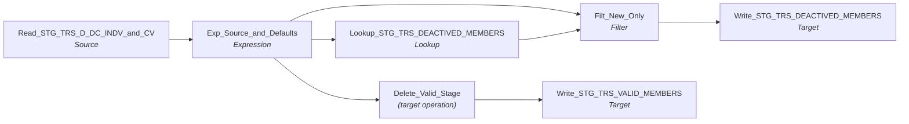

# m_Tgt_C_S_TRS_Pty_Deactivation_1

IDQ mapping &rarr; CDI **Mapping** `m_Tgt_C_S_TRS_Pty_Deactivation_1`.

> This mapping processes deactivated records in TIERS and is part of the process to correpondingly soft delete them in the MDM

1) Find TIERS members that have been deactivated or deleted 
2) Remove them from the valid member list
3) Write them to a deactivation log in staging as 'un processed'

A subsequent mapping writes unprocessed the source keys to an MDM table used SOAP UI calls & soft deleting.

## Summary

| IDQ transformation | CDI transformation | Count |
|---|---|---|
| ExpressionTx | Expression | 1 |
| FilterTx | Filter | 1 |
| LookupTx | Lookup | 1 |
| SourceTx | Source | 1 |
| TargetTx | Target | 2 |
| UpdateStrategyTx | (target operation) | 1 |

Sources:

| Instance | Object | Connection |
|---|---|---|
| Read_STG_TRS_D_DC_INDV_and_CV | `STG_TRS_D_DC_INDV` | STAGING |

Targets:

| Instance | Object | Connection |
|---|---|---|
| Write_STG_TRS_DEACTIVED_MEMBERS | `STG_TRS_DEACTIVED_MEMBERS` | STAGING |
| Write_STG_TRS_VALID_MEMBERS | `STG_TRS_VALID_MEMBERS` | STAGING |

## Flow



## Filtered data

Every step that can stop, divert or collapse rows, and what happens to the rows that do not pass. A Filter keeps a row only when its condition is TRUE: FALSE **or NULL** drops the row silently (no target, no reject file). A Router writes a row to **every** group whose condition is TRUE; a row that matches no group goes to the default group and is discarded when that group is not linked. Comments (`--`, `//`) are removed from the conditions shown here. A `= ...` line reads a null check on a lookup return in plain terms; *no matching row* also covers a matching row whose returned field is NULL.

### Steps that filter rows

| Step | IDQ type | Rule | Rows that pass go to | Rows that do not pass |
|---|---|---|---|---|
| Read_STG_TRS_D_DC_INDV_and_CV | SourceTx | custom SQL query (see the step): only the rows it returns | `STG_TRS_DEACTIVED_MEMBERS`, `STG_TRS_VALID_MEMBERS` | never read |
| Delete_Valid_Stage | UpdateStrategyTx | `DD_DELETE` | `STG_TRS_VALID_MEMBERS` | not dropped: each row deletes the target row |
| Filt_New_Only | FilterTx | keep `ISNULL(PTY_PK1)`<br>= no matching row in `STG_TRS_DEACTIVED_MEMBERS` | `STG_TRS_DEACTIVED_MEMBERS` | **discarded** |

### Where the condition fields come from

| Step | Field | Origin |
|---|---|---|
| Filt_New_Only | `PTY_PK1` | `PTY_PK` returned by lookup `Lookup_STG_TRS_DEACTIVED_MEMBERS` on `STG_TRS_DEACTIVED_MEMBERS` where `PTY_PK = PTY_PK1`; NULL when no row matches |

### Rows that do not reach `C_S_*` tables

This mapping writes no `C_S_*` table (it loads `STG_TRS_DEACTIVED_MEMBERS`, `STG_TRS_VALID_MEMBERS`); the steps above decide which rows it writes.

## Oracle stored procedure

Drop-in replacement in Oracle: [`sp_ors_main_m_Tgt_C_S_TRS_Pty_Deactivation_1`](../../../idq-to-oracle/wf_TRS_Stage_Load_1_Ongoing/sp_ors_main_m_Tgt_C_S_TRS_Pty_Deactivation_1.sql) (set-based SQL; one transaction that commits at the end and rolls back and re-raises on error). The IDQ mapplets and rules become the shared `fn_dq_*` functions; see [idq-to-oracle/README.md](../../../idq-to-oracle/README.md). Unlike the CDI spec above, the procedure **keeps the MDM timeline logic**; it is marked `TIMELINE` in the comments.

```text
Drop-in replacement of IDQ mapping m_Tgt_C_S_TRS_Pty_Deactivation_1 (workflow wf_TRS_Stage_Load_1_Ongoing).

Processes TIERS members that were deactivated or deleted, as the first part of soft-deleting them in the MDM:
  Read_STG_TRS_D_DC_INDV_and_CV (custom SQL): valid members (STG_TRS_VALID_MEMBERS) whose individual is inactive or
    deleted in STG_TRS_D_DC_INDV, or inactive in STG_TRS_D_CV_DC_MCI_INDV
  -> Delete_Valid_Stage (DD_DELETE)  -> STG_TRS_VALID_MEMBERS rows with that PTY_PK deleted
  -> Lookup_STG_TRS_DEACTIVED_MEMBERS + Filt_New_Only (not logged yet)
       -> STG_TRS_DEACTIVED_MEMBERS (PROCESSED_YN 'N', LOAD_DATE = run start)
A later process sends the unprocessed keys to the MDM.

Timeline: none.
Order: the insert runs first; the delete removes the same members (its subquery reads STG_TRS_VALID_MEMBERS in its
own consistent snapshot, which still holds them).
```

Tables written:

| Table | Operation |
|---|---|
| `STG_TRS_DEACTIVED_MEMBERS` | insert |

Shared functions and procedures called:

| Object | Does |
|---|---|
| `sp_ors_helper02_common` | run log line: mapping, step, row count (DBMS_OUTPUT) |

## Transformations

In data-flow order.

### Read_STG_TRS_D_DC_INDV_and_CV

IDQ `SourceTx` &rarr; CDI **Source**. Oracle connector source; carry the SQL override / filter below verbatim.

| Property | Value |
|---|---|
| Connection | STAGING |
| Object | STG_TRS_D_DC_INDV |
| queryMode | SEMI |

SQL override (CDI *SQL Override*; translated):

```sql
with deactv as
(
Select indv_id, inactive_ind, delete_sw, create_dt
from STG_TRS_D_DC_INDV
where inactive_ind = 'Y' or delete_sw = 'Y'

UNION all

Select indv_id, inactive_ind, null , create_dt
from STG_TRS_D_CV_DC_MCI_INDV
where inactive_ind = 'Y'
)
, deactv_id as
(
select indv_id
	, max(inactive_ind) inactive_ind
	, max(delete_sw) delete_sw
	, min(create_dt) src_deactivation_date
from deactv
group by indv_id
)
select vm.INDV_ID
		, vm.PTY_PK
		, vm.SRC_TBL
		, vm.CREATE_DATE
		, src_deactivation_date
		, inactive_ind
		, delete_sw
from STG_TRS_VALID_MEMBERS vm
join deactv_id d
	on d.indv_id = vm.indv_id
```

Columns: `None`, `None`, `None`, `None`, `None`, `None`, `None`

### Exp_Source_and_Defaults

IDQ `ExpressionTx` &rarr; CDI **Expression**. Same expression language; variable fields are supported.

| Field | Kind | Type | Expression (CDI) |
|---|---|---|---|
| INDV_ID | in/out | double |  |
| PTY_PK | in/out | string(255) |  |
| SRC_TBL | in/out | string(20) |  |
| CREATE_DATE | in/out | date/time |  |
| SRC_DEACTIVATION_DATE | in/out | date/time |  |
| Run_Date | out | date/time | `SESSSTARTTIME` |
| INACTIVE_IND | in/out | string(1) |  |
| DELETE_SW | in/out | string(1) |  |
| Processed_YN | out | string(1) | `'N'` |
| Src_System | out | string(3) | `'TRS'` |

Links (target field &larr; upstream field):

| Field | From |
|---|---|
| INDV_ID | Read_STG_TRS_D_DC_INDV_and_CV.INDV_ID |
| PTY_PK | Read_STG_TRS_D_DC_INDV_and_CV.PTY_PK |
| SRC_TBL | Read_STG_TRS_D_DC_INDV_and_CV.SRC_TBL |
| CREATE_DATE | Read_STG_TRS_D_DC_INDV_and_CV.CREATE_DATE |
| SRC_DEACTIVATION_DATE | Read_STG_TRS_D_DC_INDV_and_CV.SRC_DEACTIVATION_DATE |
| INACTIVE_IND | Read_STG_TRS_D_DC_INDV_and_CV.INACTIVE_IND |
| DELETE_SW | Read_STG_TRS_D_DC_INDV_and_CV.DELETE_SW |

### Delete_Valid_Stage

IDQ `UpdateStrategyTx` &rarr; CDI **(target operation)**. CDI has no Update Strategy transformation: set the downstream target operation to Data Driven with the condition below.

Update strategy expression: `DD_DELETE` (forward rejected rows: true). In CDI set the target operation to **Data Driven** with condition `DD_DELETE` (or simply **Delete** when the expression is a constant), and mark the linked target columns as the update/delete key.

Links (target field &larr; upstream field):

| Field | From |
|---|---|
| PTY_PK | Exp_Source_and_Defaults.PTY_PK |

### Lookup_STG_TRS_DEACTIVED_MEMBERS

IDQ `LookupTx` &rarr; CDI **Lookup**. Connected lookup unless a return port is set (then unconnected).

| Property | Value |
|---|---|
| Connection | STAGING |
| Object | STG_TRS_DEACTIVED_MEMBERS |
| Lookup condition | PTY_PK = PTY_PK1 |
| Multiple matches | Return any row |
| Cache | static cache |

| Lookup input field | Type |
|---|---|
| PTY_PK1 | string(255) |

| Return / pass-through field | Feeds |
|---|---|
| PTY_PK | Filt_New_Only.PTY_PK1 |

Links (target field &larr; upstream field):

| Field | From |
|---|---|
| PTY_PK1 | Exp_Source_and_Defaults.PTY_PK |

### Filt_New_Only

IDQ `FilterTx` &rarr; CDI **Filter**. Advanced filter condition.

Filter condition:

```
ISNULL(PTY_PK1)
```

Links (target field &larr; upstream field):

| Field | From |
|---|---|
| INDV_ID | Exp_Source_and_Defaults.INDV_ID |
| PTY_PK | Exp_Source_and_Defaults.PTY_PK |
| SRC_TBL | Exp_Source_and_Defaults.SRC_TBL |
| CREATE_DATE | Exp_Source_and_Defaults.CREATE_DATE |
| SRC_DEACTIVATION_DATE | Exp_Source_and_Defaults.SRC_DEACTIVATION_DATE |
| Run_Date | Exp_Source_and_Defaults.Run_Date |
| INACTIVE_IND | Exp_Source_and_Defaults.INACTIVE_IND |
| DELETE_SW | Exp_Source_and_Defaults.DELETE_SW |
| Processed_YN | Exp_Source_and_Defaults.Processed_YN |
| PTY_PK1 | Lookup_STG_TRS_DEACTIVED_MEMBERS.PTY_PK |

### Write_STG_TRS_DEACTIVED_MEMBERS

IDQ `TargetTx` &rarr; CDI **Target**. Oracle connector target.

| Property | Value |
|---|---|
| Connection | STAGING |
| Object | STG_TRS_DEACTIVED_MEMBERS |
| Operation | Insert |
| Truncate target table | no |
| Load type | normal (no bulk load) |
| Reject file | Write_STG_TRS_DEACTIVED_MEMBERS.bad |

Links (target field &larr; upstream field):

| Field | From |
|---|---|
| INDV_ID | Filt_New_Only.INDV_ID |
| PTY_PK | Filt_New_Only.PTY_PK |
| SRC_TBL | Filt_New_Only.SRC_TBL |
| CREATE_DATE | Filt_New_Only.CREATE_DATE |
| SRC_DEACTIVATION_DATE | Filt_New_Only.SRC_DEACTIVATION_DATE |
| LOAD_DATE | Filt_New_Only.Run_Date |
| INACTIVE_IND | Filt_New_Only.INACTIVE_IND |
| DELETE_SW | Filt_New_Only.DELETE_SW |
| PROCESSED_YN | Filt_New_Only.Processed_YN |

### Write_STG_TRS_VALID_MEMBERS

IDQ `TargetTx` &rarr; CDI **Target**. Oracle connector target.

| Property | Value |
|---|---|
| Connection | STAGING |
| Object | STG_TRS_VALID_MEMBERS |
| Operation | Data Driven (see the upstream Update Strategy) |
| Truncate target table | no |
| Load type | normal (no bulk load) |
| Reject file | Write_STG_TRS_VALID_MEMBERS.bad |

Links (target field &larr; upstream field):

| Field | From |
|---|---|
| PTY_PK | Delete_Valid_Stage.PTY_PK |
