# m_Tgt_C_S_TRS_Pty_Rle_Alt_Id

IDQ mapping &rarr; CDI **Mapping** `m_Tgt_C_S_TRS_Pty_Rle_Alt_Id`.

> [ML 10/24/2020]  Added de-duplication logic to the source SQL

[ML 01/20/2025] Updated to poplulate Medicaid ID in preparation for adding Medicaid ID match rule (i.e. Memeber ID creates two ALT ID rows)

## Summary

| IDQ transformation | CDI transformation | Count |
|---|---|---|
| ExpressionTx | Expression | 2 |
| LookupTx | Lookup | 1 |
| MappletTx | Mapplet | 1 |
| SorterTx | Sorter | 1 |
| SourceTx | Source | 1 |
| TargetTx | Target | 1 |

## Not ported (stale MDM timeline)

These steps are not built (and not counted above); their sections below say how to rewire around them.

| Step | IDQ type | Reason |
|---|---|---|
| exp_Rank | ExpressionTx | Version rank for `fltr_Rank`. Replaced together with `fltr_Rank` (see there). |
| fltr_Rank | FilterTx | Keeps `VERSION_SEQ = 1`. Replace `exp_Rank` + `fltr_Rank` with an Aggregator grouped by `PKEY_SRC_OBJECT` (one row per key, as the Java port does); a CDI Aggregator without aggregate functions returns the last row of each group in the upstream `srtr_Pkey` order. |

Sources:

| Instance | Object | Connection |
|---|---|---|
| Read_STG_TRS_D_DC_INDV | `STG_TRS_D_DC_INDV` | STAGING |

Targets:

| Instance | Object | Connection |
|---|---|---|
| Write_C_S_TRS_PTY_RLE_ALT_ID | `C_S_TRS_PTY_RLE_ALT_ID` | HHS_MDM_ORS |

## Parameters

Create as CDI input parameters (`$$Name`); defaults go in the parameter file.

| Parameter | Type | Precision | Default | Used in this mapping |
|---|---|---|---|---|
| DC_INDV_TBL_SRC | string | 1000 | DC_INDV | no (declared only) |
| MCI_TBL_SRC | string | 1000 | MCI | no (declared only) |

## Flow

```mermaid
flowchart LR
  n0["Read_STG_TRS_D_DC_INDV<br/><i>Source</i>"]
  n1["exp_TRS_Pty_Rle_Alt_Id<br/><i>Expression</i>"]
  n2["lkp_Valid_SSN<br/><i>Lookup</i>"]
  n3["mplt_TRS_Pty_Rle_Alt_Id_Normalization<br/><i>Mapplet</i>"]
  n4["srtr_Pkey<br/><i>Sorter</i>"]
  n5["exp_Rank<br/><i>not ported</i>"]
  n6["fltr_Rank<br/><i>not ported</i>"]
  n7["exp_Safe_C_S_TRS_Pty_Rle_Alt_Id<br/><i>Expression</i>"]
  n8["Write_C_S_TRS_PTY_RLE_ALT_ID<br/><i>Target</i>"]
  n0 --> n1
  n1 --> n2
  n1 --> n3
  n2 --> n3
  n3 --> n4
  n4 --> n5
  n5 --> n6
  n6 --> n7
  n7 --> n8
  classDef retired stroke-dasharray: 5 5,opacity:0.5
  class n5,n6 retired
```



## Filtered data

Every step that can stop, divert or collapse rows, and what happens to the rows that do not pass. A Filter keeps a row only when its condition is TRUE: FALSE **or NULL** drops the row silently (no target, no reject file). A Router writes a row to **every** group whose condition is TRUE; a row that matches no group goes to the default group and is discarded when that group is not linked. Comments (`--`, `//`) are removed from the conditions shown here. A `= ...` line reads a null check on a lookup return in plain terms; *no matching row* also covers a matching row whose returned field is NULL.

### Steps that filter rows

| Step | IDQ type | Rule | Rows that pass go to | Rows that do not pass |
|---|---|---|---|---|
| Read_STG_TRS_D_DC_INDV | SourceTx | custom SQL query (see the step): only the rows it returns<br>Note: filter `INDV_ID=504937068` is also stored; it is not part of the custom query text and looks like a test filter: confirm it is not applied | `C_S_TRS_PTY_RLE_ALT_ID` | never read |
| mplt_TRS_Pty_Rle_Alt_Id_Normalization | MappletTx | `FLTR_Remove_Null_Alt_IDs`: keep `NOT ISNULL(ALT_ID_VAL) AND RTRIM(ALT_ID_VAL) <> ''`<br>`RTR_Invalid_Alt_Ids`: passes only rows of the linked group(s) `Valid_Alt_ID` (`ISNULL(DQ_EXCP_CD) OR LENGTH(RTRIM(DQ_EXCP_CD))=0`), default `Default` | `C_S_TRS_PTY_RLE_ALT_ID` | **discarded** inside the mapplet |
| fltr_Rank | FilterTx | **not ported** (stale MDM timeline): Keeps `VERSION_SEQ = 1`. Replace `exp_Rank` + `fltr_Rank` with an Aggregator grouped by `PKEY_SRC_OBJECT` (one row per key, as the Java port does); a CDI Aggregator without aggregate functions returns the last row of each group in the upstream `srtr_Pkey` order. |  |  |

### Rows that do not reach `C_S_*` tables

**`C_S_TRS_PTY_RLE_ALT_ID`** (`Write_C_S_TRS_PTY_RLE_ALT_ID`): a source row is written only when it passes every step below.

| Step | Must hold | Otherwise the row |
|---|---|---|
| `Read_STG_TRS_D_DC_INDV` | custom SQL query (see the step): only the rows it returns<br>Note: filter `INDV_ID=504937068` is also stored; it is not part of the custom query text and looks like a test filter: confirm it is not applied | never read |
| `mplt_TRS_Pty_Rle_Alt_Id_Normalization` | `FLTR_Remove_Null_Alt_IDs`: keep `NOT ISNULL(ALT_ID_VAL) AND RTRIM(ALT_ID_VAL) <> ''`<br>`RTR_Invalid_Alt_Ids`: passes only rows of the linked group(s) `Valid_Alt_ID` (`ISNULL(DQ_EXCP_CD) OR LENGTH(RTRIM(DQ_EXCP_CD))=0`), default `Default` | **discarded** inside the mapplet |

## Oracle stored procedure

Drop-in replacement in Oracle: [`sp_ors_main_m_Tgt_C_S_TRS_Pty_Rle_Alt_Id`](../../../idq-to-oracle/wf_TRS_Stage_Load_1_Ongoing/sp_ors_main_m_Tgt_C_S_TRS_Pty_Rle_Alt_Id.sql) (set-based SQL; one transaction that commits at the end and rolls back and re-raises on error). The IDQ mapplets and rules become the shared `fn_dq_*` functions; see [idq-to-oracle/README.md](../../../idq-to-oracle/README.md). Unlike the CDI spec above, the procedure **keeps the MDM timeline logic**; it is marked `TIMELINE` in the comments.

```text
Drop-in replacement of IDQ mapping m_Tgt_C_S_TRS_Pty_Rle_Alt_Id (workflow wf_TRS_Stage_Load_1_Ongoing).

Alternate ids of valid TIERS members into C_S_TRS_PTY_RLE_ALT_ID (insert only, never truncated):
  Read_STG_TRS_D_DC_INDV (custom SQL: MCI, DC_INDV and merged-individual keys of valid members, one row per key
    keeping the longest, latest SSN)
  -> lkp_Valid_SSN: the SSN is used only when STG_TRS_H_DC_INDV has it SSA-validated for the individual
  -> mplt_TRS_Pty_Rle_Alt_Id_Normalization (TABLE(fn_dq_norm_trs_alt_id(...))): Medicaid id and member id (both the
     member id), validated SSN; one row per non-empty id
       valid rows   -> srtr_Pkey -> exp_Rank / fltr_Rank (TIMELINE) -> target
       invalid rows -> EXC_STG_BAD_REC_MEMB (written INSIDE the IDQ mapplet; written here by the procedure)

TIMELINE (stale MDM timeline, ported as IDQ does it):
  * exp_Rank ranks versions per key but VERSION_SEQ is hard-coded to 1 (the rank is commented out), so fltr_Rank
    (VERSION_SEQ = 1) keeps EVERY row; no de-duplication happens. VERSION_SEQ = 1.
  * PERIOD_START_DATE / CREATE_DATE / SRC_LAST_UPD_DT = START_DT; PERIOD_END_DATE, PERIOD_REFERENCE_TIME,
    TIMELINE_ACTION are linked to unfed ports (NULL).
Unfed ports written as NULL: ROWID_OBJECT, DELETED_*, UPDATED_BY, CREATOR, HUB_STATE_IND.
The stored source filter INDV_ID = 504937068 is not part of the custom query and is not applied.
```

Tables written:

| Table | Operation |
|---|---|
| `C_S_TRS_PTY_RLE_ALT_ID` | insert |
| `EXC_STG_BAD_REC_MEMB` | insert |

Shared functions and procedures called:

| Object | Does |
|---|---|
| `fn_dq_norm_trs_alt_id` | replaces `mplt_TRS_Pty_Rle_Alt_Id_Normalization (TRS)`, returns `t_dq_trs_alt_id_tab (pipelined)` |
| `fn_ors_helper07_common` | IDQ TO_DECIMAL(value, scale): non-numeric -> 0, NULL -> NULL |
| `sp_ors_helper02_common` | run log line: mapping, step, row count (DBMS_OUTPUT) |

## Transformations

In data-flow order.

### Read_STG_TRS_D_DC_INDV

IDQ `SourceTx` &rarr; CDI **Source**. Oracle connector source; carry the SQL override / filter below verbatim.

| Property | Value |
|---|---|
| Connection | STAGING |
| Object | STG_TRS_D_DC_INDV |
| queryMode | SEMI |

Filter (CDI source/lookup *Filter* property; translated):

```sql
INDV_ID=504937068
```

SQL override (CDI *SQL Override*; translated):

```sql
WITH all_indv AS
(
SELECT  DISTINCT
	to_char(indv_id) as pty_pkey,
	mci_indv.indv_id as member_id,
	mci_indv.create_dt,
	ssn,
	'1' cv_ind
FROM stg_trs_d_cv_dc_mci_indv mci_indv

	UNION ALL

SELECT DISTINCT
	to_char(indv_id) || '|DC_INDV'  as pty_pkey,
	indv_id as member_id,
	create_dt,
	ssn,
	null cv_ind
FROM stg_trs_d_dc_indv indv

    UNION ALL

SELECT DISTINCT
	to_char(old_indv_id) as pty_pkey,
	mrg.indv_id as member_id,
	mrg.create_dt,
	null as ssn,
	null as cv_ind
FROM
	stg_trs_d_cv_dc_mrg_sprt_indv mrg
WHERE type_cd = 'ME'  -- merge records
)
,de_dup_indv as
(
	SELECT
		pty_pkey,
		to_char(member_id) as member_id,
		create_dt start_dt,
		ssn,
		cv_ind,
		row_number() over (partition by pty_pkey
							order by length(ssn) desc
									, create_dt desc) key_rn  -- prioritize longer, more recent ssns when there are dups
	FROM all_indv
	JOIN stg_trs_valid_members vm
		ON all_indv.pty_pkey = vm.pty_pk
)
SELECT /*+ PARALLEL (4) */
	pty_pkey,
	member_id,
	start_dt,
	ssn,
	cv_ind
FROM de_dup_indv
WHERE key_rn =  1 -- [ML 10/24/2020] when > 1 SSN per Pty_Key, keep the longest and latest only
```

Columns: `None`, `None`, `None`, `None`, `None`

### exp_TRS_Pty_Rle_Alt_Id

IDQ `ExpressionTx` &rarr; CDI **Expression**. Same expression language; variable fields are supported.

| Field | Kind | Type | Expression (CDI) |
|---|---|---|---|
| PTY_PKEY | in/out | string(255) |  |
| MEMBER_ID | in/out | string(40) |  |
| v_Member_Id | variable | double | `TO_DECIMAL(MEMBER_ID,0)` |
| out_Member_Id | out | double | `v_Member_Id` |
| START_DT | in/out | date/time |  |
| SSN | in/out | double |  |
| SRC_SYS | out | string(10) | `'TRS'` |
| CV_IND | in/out | string(1) |  |

Links (target field &larr; upstream field):

| Field | From |
|---|---|
| PTY_PKEY | Read_STG_TRS_D_DC_INDV.PTY_PKEY |
| START_DT | Read_STG_TRS_D_DC_INDV.START_DT |
| SSN | Read_STG_TRS_D_DC_INDV.SSN |
| MEMBER_ID | Read_STG_TRS_D_DC_INDV.MEMBER_ID |
| CV_IND | Read_STG_TRS_D_DC_INDV.CV_IND |

### lkp_Valid_SSN

IDQ `LookupTx` &rarr; CDI **Lookup**. Connected lookup unless a return port is set (then unconnected).

| Property | Value |
|---|---|
| Connection | STAGING |
| Object | STG_TRS_H_DC_INDV |
| queryMode | SEMI |
| Lookup condition | INDV_ID = MEMBER_ID AND SSN = SSN1 |
| Multiple matches | Return any row |
| Cache | static cache |

SQL override (CDI *SQL Override*; translated):

```sql
select /*+ parallel (4) */ distinct INDV_ID as INDV_ID, SSN as SSN
from STG_TRS_H_DC_INDV
where SSA_VALIDATION_SW = 'Y'
and SSN > 0
```

| Lookup input field | Type |
|---|---|
| MEMBER_ID | double |
| SSN1 | double |

| Return / pass-through field | Feeds |
|---|---|
| SSN | mplt_TRS_Pty_Rle_Alt_Id_Normalization.Group.ALT_ID_VAL_SSN |

Links (target field &larr; upstream field):

| Field | From |
|---|---|
| SSN1 | exp_TRS_Pty_Rle_Alt_Id.SSN |
| MEMBER_ID | exp_TRS_Pty_Rle_Alt_Id.out_Member_Id |

### mplt_TRS_Pty_Rle_Alt_Id_Normalization

IDQ `MappletTx` &rarr; CDI **Mapplet**. Reusable CDI mapplet (see the mapplets folder).

Mapplet: [`mplt_TRS_Pty_Rle_Alt_Id_Normalization`](../mapplets/mplt_TRS_Pty_Rle_Alt_Id_Normalization.md)

Links (target field &larr; upstream field):

| Field | From |
|---|---|
| Group.PKEY_SRC_OBJECT_PTY | exp_TRS_Pty_Rle_Alt_Id.PTY_PKEY |
| Group.PERIOD_START_DATE | exp_TRS_Pty_Rle_Alt_Id.START_DT |
| Group.SRC_SYS | exp_TRS_Pty_Rle_Alt_Id.SRC_SYS |
| Group.ALT_ID_VAL_MEMBER_ID | exp_TRS_Pty_Rle_Alt_Id.MEMBER_ID |
| Group.ALT_ID_VAL_SSN | lkp_Valid_SSN.SSN |
| Group.CV_IND | exp_TRS_Pty_Rle_Alt_Id.CV_IND |
| Group.ALT_ID_VAL_MEDICAID_ID | exp_TRS_Pty_Rle_Alt_Id.MEMBER_ID |

### srtr_Pkey

IDQ `SorterTx` &rarr; CDI **Sorter**. Sort keys in the order listed; distinct, case and null settings below.

| # | Sort key | Order |
|---|---|---|
| 1 | PKEY_SRC_OBJECT | ascending |
| 2 | PERIOD_START_DATE | ascending |

| Property | Value |
|---|---|
| Distinct | no |
| Case sensitive | no |
| Null treated high | yes |

Links (target field &larr; upstream field):

| Field | From |
|---|---|
| PTY_RLE_FK | mplt_TRS_Pty_Rle_Alt_Id_Normalization.NEWOUTPUT.PTY_RLE_FK |
| PKEY_SRC_OBJECT | mplt_TRS_Pty_Rle_Alt_Id_Normalization.NEWOUTPUT.PKEY_SRC_OBJECT_ALT_ID |
| PERIOD_START_DATE | mplt_TRS_Pty_Rle_Alt_Id_Normalization.NEWOUTPUT.PERIOD_START_DATE |
| ALT_ID_VAL | mplt_TRS_Pty_Rle_Alt_Id_Normalization.NEWOUTPUT.ALT_ID_VAL |
| ALT_ID_TYP | mplt_TRS_Pty_Rle_Alt_Id_Normalization.NEWOUTPUT.ALT_ID_TYP |
| SRC_SYS | mplt_TRS_Pty_Rle_Alt_Id_Normalization.NEWOUTPUT.SRC_SYS |
| CV_IND | mplt_TRS_Pty_Rle_Alt_Id_Normalization.NEWOUTPUT.CV_IND |

### exp_Rank (not ported)

IDQ `ExpressionTx`. **Not ported: stale MDM timeline.** Version rank for `fltr_Rank`. Replaced together with `fltr_Rank` (see there).

Links (target field &larr; upstream field):

| Field | From |
|---|---|
| PKEY_SRC_OBJECT | srtr_Pkey.PKEY_SRC_OBJECT |
| PTY_RLE_FK | srtr_Pkey.PTY_RLE_FK |
| PERIOD_START_DATE | srtr_Pkey.PERIOD_START_DATE |
| ALT_ID_VAL | srtr_Pkey.ALT_ID_VAL |
| ALT_ID_TYP | srtr_Pkey.ALT_ID_TYP |
| PERIOD_END_DATE | srtr_Pkey.PERIOD_END_DATE |
| SRC_SYS | srtr_Pkey.SRC_SYS |
| REC_IND | srtr_Pkey.REC_IND |
| CV_IND | srtr_Pkey.CV_IND |

### fltr_Rank (not ported)

IDQ `FilterTx`. **Not ported: stale MDM timeline.** Keeps `VERSION_SEQ = 1`. Replace `exp_Rank` + `fltr_Rank` with an Aggregator grouped by `PKEY_SRC_OBJECT` (one row per key, as the Java port does); a CDI Aggregator without aggregate functions returns the last row of each group in the upstream `srtr_Pkey` order.

Links (target field &larr; upstream field):

| Field | From |
|---|---|
| PKEY_SRC_OBJECT | exp_Rank.PKEY_SRC_OBJECT |
| PTY_RLE_FK | exp_Rank.PTY_RLE_FK |
| PERIOD_START_DATE | exp_Rank.PERIOD_START_DATE |
| ALT_ID_VAL | exp_Rank.ALT_ID_VAL |
| ALT_ID_TYP | exp_Rank.ALT_ID_TYP |
| PERIOD_END_DATE | exp_Rank.PERIOD_END_DATE |
| SRC_SYS | exp_Rank.SRC_SYS |
| VERSION_SEQ (stale timeline: do not map) | exp_Rank.VERSION_SEQ |
| REC_IND | exp_Rank.REC_IND |
| CV_IND | exp_Rank.CV_IND |

### exp_Safe_C_S_TRS_Pty_Rle_Alt_Id

IDQ `ExpressionTx` &rarr; CDI **Expression**. Same expression language; variable fields are supported.

| Field | Kind | Type | Expression (CDI) |
|---|---|---|---|
| PKEY_SRC_OBJECT | in/out | string(255) |  |
| ROWID_OBJECT | in/out | string(14) | `ROWID_OBJECT` |
| DELETED_IND | in/out | decimal(38) | `DELETED_IND` |
| DELETED_DATE | in/out | date/time | `DELETED_DATE` |
| DELETED_BY | in/out | string(50) | `DELETED_BY` |
| PERIOD_START_DATE | in/out | date/time |  |
| PERIOD_END_DATE | in/out | date/time | `PERIOD_END_DATE` |
| VERSION_SEQ (stale timeline: omit) | in/out | decimal(38) |  |
| PERIOD_REFERENCE_TIME (stale timeline: omit) | in/out | date/time | `PERIOD_REFERENCE_TIME` |
| TIMELINE_ACTION (stale timeline: omit) | in/out | decimal(38) | `TIMELINE_ACTION` |
| LAST_UPDATE_DATE | out | date/time | `SESSSTARTTIME` |
| UPDATED_BY | in/out | string(50) | `UPDATED_BY` |
| CREATE_DATE | in/out | date/time | `CREATE_DATE` |
| CREATOR | in/out | string(50) | `CREATOR` |
| HUB_STATE_IND | in/out | decimal(38) | `HUB_STATE_IND` |
| ALT_ID_TP | in/out | string(20) |  |
| ALT_ID_VAL | in/out | string(50) |  |
| STS_CD | out | string(20) | `'Issued'` |
| ALT_ID_TP_FLTR | in/out | string(20) |  |
| PTY_RLE_FK | in/out | string(255) |  |
| CV_IND | in/out | string(1) |  |

Links (target field &larr; upstream field):

| Field | From |
|---|---|
| PKEY_SRC_OBJECT | fltr_Rank.PKEY_SRC_OBJECT |
| PERIOD_START_DATE | fltr_Rank.PERIOD_START_DATE |
| VERSION_SEQ (stale timeline: do not map) | fltr_Rank.VERSION_SEQ |
| ALT_ID_TP | fltr_Rank.ALT_ID_TYP |
| ALT_ID_VAL | fltr_Rank.ALT_ID_VAL |
| PTY_RLE_FK | fltr_Rank.PTY_RLE_FK |
| ALT_ID_TP_FLTR | fltr_Rank.ALT_ID_TYP |
| CV_IND | fltr_Rank.CV_IND |
| CREATE_DATE | fltr_Rank.PERIOD_START_DATE |

### Write_C_S_TRS_PTY_RLE_ALT_ID

IDQ `TargetTx` &rarr; CDI **Target**. Oracle connector target.

| Property | Value |
|---|---|
| Connection | HHS_MDM_ORS |
| Object | C_S_TRS_PTY_RLE_ALT_ID |
| Operation | Insert |
| Truncate target table | yes |
| Load type | normal (no bulk load) |
| Reject file | Write_C_S_TRS_PTY_RLE_ALT_ID1.bad |

Links (target field &larr; upstream field):

| Field | From |
|---|---|
| PKEY_SRC_OBJECT | exp_Safe_C_S_TRS_Pty_Rle_Alt_Id.PKEY_SRC_OBJECT |
| SRC_ROWID | exp_Safe_C_S_TRS_Pty_Rle_Alt_Id.PKEY_SRC_OBJECT |
| PERIOD_START_DATE | exp_Safe_C_S_TRS_Pty_Rle_Alt_Id.PERIOD_START_DATE |
| VERSION_SEQ (stale timeline: do not map) | exp_Safe_C_S_TRS_Pty_Rle_Alt_Id.VERSION_SEQ |
| LAST_UPDATE_DATE | exp_Safe_C_S_TRS_Pty_Rle_Alt_Id.LAST_UPDATE_DATE |
| ALT_ID_TP | exp_Safe_C_S_TRS_Pty_Rle_Alt_Id.ALT_ID_TP |
| ALT_ID_VAL | exp_Safe_C_S_TRS_Pty_Rle_Alt_Id.ALT_ID_VAL |
| STS_CD | exp_Safe_C_S_TRS_Pty_Rle_Alt_Id.STS_CD |
| ALT_ID_TP_FLTR | exp_Safe_C_S_TRS_Pty_Rle_Alt_Id.ALT_ID_TP_FLTR |
| CV_IND | exp_Safe_C_S_TRS_Pty_Rle_Alt_Id.CV_IND |
| PTY_RLE_FK | exp_Safe_C_S_TRS_Pty_Rle_Alt_Id.PTY_RLE_FK |
| ROWID_OBJECT | exp_Safe_C_S_TRS_Pty_Rle_Alt_Id.ROWID_OBJECT |
| DELETED_IND | exp_Safe_C_S_TRS_Pty_Rle_Alt_Id.DELETED_IND |
| DELETED_DATE | exp_Safe_C_S_TRS_Pty_Rle_Alt_Id.DELETED_DATE |
| DELETED_BY | exp_Safe_C_S_TRS_Pty_Rle_Alt_Id.DELETED_BY |
| PERIOD_END_DATE | exp_Safe_C_S_TRS_Pty_Rle_Alt_Id.PERIOD_END_DATE |
| PERIOD_REFERENCE_TIME (stale timeline: do not map) | exp_Safe_C_S_TRS_Pty_Rle_Alt_Id.PERIOD_REFERENCE_TIME |
| TIMELINE_ACTION (stale timeline: do not map) | exp_Safe_C_S_TRS_Pty_Rle_Alt_Id.TIMELINE_ACTION |
| UPDATED_BY | exp_Safe_C_S_TRS_Pty_Rle_Alt_Id.UPDATED_BY |
| CREATE_DATE | exp_Safe_C_S_TRS_Pty_Rle_Alt_Id.CREATE_DATE |
| CREATOR | exp_Safe_C_S_TRS_Pty_Rle_Alt_Id.CREATOR |
| HUB_STATE_IND | exp_Safe_C_S_TRS_Pty_Rle_Alt_Id.HUB_STATE_IND |
| SRC_LAST_UPD_DT | exp_Safe_C_S_TRS_Pty_Rle_Alt_Id.CREATE_DATE |
