# m_Tgt_C_S_TRS_Pty_Rle_Rel_DeActivation_1

IDQ mapping &rarr; CDI **Mapping** `m_Tgt_C_S_TRS_Pty_Rle_Rel_DeActivation_1`.

> This mapping processes deactivated relationships in TIERS and is part of the process to correpondingly soft delete them in the MDM

1) Find TIERS Relationships that have been deactivated or deleted 
2) Remove them from the valid relationship list
3) Write them to a deactivation log in staging as 'un processed'

A subsequent mapping writes unprocessed the source keys to an MDM table used SOAP UI calls & soft deleting.

[ML 2/6/2025] Added criteria to filter transformation to only keep records that are in the MDM.

## Summary

| IDQ transformation | CDI transformation | Count |
|---|---|---|
| ExpressionTx | Expression | 2 |
| FilterTx | Filter | 1 |
| LookupTx | Lookup | 3 |
| SourceTx | Source | 1 |
| TargetTx | Target | 1 |

Sources:

| Instance | Object | Connection |
|---|---|---|
| Read_STG_TRS_D_DC_RELATIONSHIPS_A | `STG_TRS_D_DC_RELATIONSHIPS_A` | STAGING |

Targets:

| Instance | Object | Connection |
|---|---|---|
| Write_STG_TRS_DEACTIVATED_RELATIONSHIPS | `STG_TRS_DEACTIVATED_RELATIONSHIPS` | STAGING |

## Parameters

Create as CDI input parameters (`$$Name`); defaults go in the parameter file.

| Parameter | Type | Precision | Default | Used in this mapping |
|---|---|---|---|---|
| ABSENT_PAR_SQ_ALT_ID_TP | string | 3 | 012 | no (declared only) |
| INDV_ID_ALT_ID_TP | string | 3 | 007 | no (declared only) |

## Flow

```mermaid
flowchart LR
  n0["Read_STG_TRS_D_DC_RELATIONSHIPS_A<br/><i>Source</i>"]
  n1["Lookup_V_LOOKUP_CODE_VALUE<br/><i>Lookup</i>"]
  n2["Exp_Gen_PKEY<br/><i>Expression</i>"]
  n3["Lkp_C_B_PTY_RLE_REL_XREF<br/><i>Lookup</i>"]
  n4["Exp_TRS_PTY_RLE_REL_DeActivate<br/><i>Expression</i>"]
  n5["Lookup_STG_TRS_DEACTIVATED_RELATIONSHIPS<br/><i>Lookup</i>"]
  n6["Fil_New_Deactivations<br/><i>Filter</i>"]
  n7["Write_STG_TRS_DEACTIVATED_RELATIONSHIPS<br/><i>Target</i>"]
  n0 --> n1
  n0 --> n2
  n1 --> n2
  n2 --> n3
  n2 --> n4
  n3 --> n4
  n4 --> n5
  n4 --> n6
  n5 --> n6
  n6 --> n7
```



## Filtered data

Every step that can stop, divert or collapse rows, and what happens to the rows that do not pass. A Filter keeps a row only when its condition is TRUE: FALSE **or NULL** drops the row silently (no target, no reject file). A Router writes a row to **every** group whose condition is TRUE; a row that matches no group goes to the default group and is discarded when that group is not linked. Comments (`--`, `//`) are removed from the conditions shown here. A `= ...` line reads a null check on a lookup return in plain terms; *no matching row* also covers a matching row whose returned field is NULL.

### Steps that filter rows

| Step | IDQ type | Rule | Rows that pass go to | Rows that do not pass |
|---|---|---|---|---|
| Read_STG_TRS_D_DC_RELATIONSHIPS_A | SourceTx | custom SQL query (see the step): only the rows it returns | `STG_TRS_DEACTIVATED_RELATIONSHIPS` | never read |
| Fil_New_Deactivations | FilterTx | keep `ISNULL(Lkp_PKEY_SRC_OBJECT) and not ISNULL(ROWID_XREF)` (comments removed)<br>= no matching row in `STG_TRS_DEACTIVATED_RELATIONSHIPS` (lookup `Lookup_STG_TRS_DEACTIVATED_RELATIONSHIPS`) and a matching row exists in `C_B_PTY_RLE_REL_XREF` (lookup `Lkp_C_B_PTY_RLE_REL_XREF`) | `STG_TRS_DEACTIVATED_RELATIONSHIPS` | **discarded** |

### Where the condition fields come from

| Step | Field | Origin |
|---|---|---|
| Fil_New_Deactivations | `Lkp_PKEY_SRC_OBJECT` | `PKEY_SRC_OBJECT` returned by lookup `Lookup_STG_TRS_DEACTIVATED_RELATIONSHIPS` on `STG_TRS_DEACTIVATED_RELATIONSHIPS` where `PKEY_SRC_OBJECT = PKEY_SRC_OBJECT1`; NULL when no row matches |
| Fil_New_Deactivations | `ROWID_XREF` | `MIN_ROWID_XREF` returned by lookup `Lkp_C_B_PTY_RLE_REL_XREF` on `C_B_PTY_RLE_REL_XREF` where `PKEY_SRC_OBJECT = in_PKEY_SRC_OBJECT`; NULL when no row matches |

### Rows that do not reach `C_S_*` tables

This mapping writes no `C_S_*` table (it loads `STG_TRS_DEACTIVATED_RELATIONSHIPS`); the steps above decide which rows it writes.

## Oracle stored procedure

Drop-in replacement in Oracle: [`sp_ors_main_m_Tgt_C_S_TRS_Pty_Rle_Rel_DeActivation_1`](../../../idq-to-oracle/wf_TRS_Stage_Load_1_Ongoing/sp_ors_main_m_Tgt_C_S_TRS_Pty_Rle_Rel_DeActivation_1.sql) (set-based SQL; one transaction that commits at the end and rolls back and re-raises on error). The IDQ mapplets and rules become the shared `fn_dq_*` functions; see [idq-to-oracle/README.md](../../../idq-to-oracle/README.md). Unlike the CDI spec above, the procedure **keeps the MDM timeline logic**; it is marked `TIMELINE` in the comments.

```text
Drop-in replacement of IDQ mapping m_Tgt_C_S_TRS_Pty_Rle_Rel_DeActivation_1 (workflow wf_TRS_Stage_Load_1_Ongoing).

Logs TIERS relationships that were deactivated (STG_TRS_D_DC_RELATIONSHIPS_A, both sides valid members) so a
later process can soft-delete them in the MDM:
  -> Lookup_V_LOOKUP_CODE_VALUE (code type PTY_REL) + Exp_Gen_PKEY: key = member|ref member|master type
  -> Lookup_STG_TRS_DEACTIVATED_RELATIONSHIPS (unprocessed rows only) and Lkp_C_B_PTY_RLE_REL_XREF (custom lookup
     SQL: per MDM cross-reference the record count, merge / master / soft-delete flags, lowest ROWID_XREF of the key)
  -> Fil_New_Deactivations: not yet logged as unprocessed AND present in the MDM (a cross-reference exists)
  -> STG_TRS_DEACTIVATED_RELATIONSHIPS (insert; PROCESSED_YN is not linked - left to the column default)
The mapping description also mentions removing relationships from a valid list; the IDQ mapping has no such target.

Timeline: none.
```

Tables written:

| Table | Operation |
|---|---|
| `STG_TRS_DEACTIVATED_RELATIONSHIPS` | insert |

Shared functions and procedures called:

| Object | Does |
|---|---|
| `fn_ors_helper03_common` | V_LOOKUP_CODE_VALUE lookup: source code -> MSTR_CODE_VALUE (any row) |
| `sp_ors_helper02_common` | run log line: mapping, step, row count (DBMS_OUTPUT) |

## Transformations

In data-flow order.

### Read_STG_TRS_D_DC_RELATIONSHIPS_A

IDQ `SourceTx` &rarr; CDI **Source**. Oracle connector source; carry the SQL override / filter below verbatim.

| Property | Value |
|---|---|
| Connection | STAGING |
| Object | STG_TRS_D_DC_RELATIONSHIPS_A |
| queryMode | SEMI |

SQL override (CDI *SQL Override*; translated):

```sql
WITH min_pk as  -- find 1 source key per indiv, prioritze the mci record
(
SELECT 	 indv_id
		,MIN(pty_pk) pty_pk
FROM stg_trs_valid_members
GROUP BY indv_id
)
SELECT /*+ parallel (4) */
    rel.indv_id,
    ref_indv_id,
    eff_begin_dt,
    eff_end_dt,
    relationship_type_cd,
    pk1.pty_pk 				as pty_pkey,
    pk2.pty_pk 				as ref_pty_pkey,
    'TRS' 						as src_sys
FROM stg_trs_d_dc_relationships_a rel
JOIN min_pk pk1
	ON rel.indv_id = pk1.indv_id
JOIN min_pk pk2
	ON rel.ref_indv_id = pk2.indv_id
```

Columns: `None`, `None`, `None`, `None`, `None`, `None`, `None`, `None`

### Lookup_V_LOOKUP_CODE_VALUE

IDQ `LookupTx` &rarr; CDI **Lookup**. Connected lookup unless a return port is set (then unconnected).

| Property | Value |
|---|---|
| Connection | STAGING |
| Object | V_LOOKUP_CODE_VALUE (view) |
| Lookup condition | SRC_CODE_VALUE = RELATIONSHIP_TYPE_CD AND SRC_SYS = SRC_SYS_IN |
| Multiple matches | Return any row |
| Cache | static cache |
| Cache file name prefix | V_LKP_REL_CD_ |

Filter (CDI source/lookup *Filter* property; translated):

```sql
"V_LOOKUP_CODE_VALUE"."CODE_TYPE"='PTY_REL'
```

| Lookup input field | Type |
|---|---|
| RELATIONSHIP_TYPE_CD | string(8) |
| SRC_SYS_IN | string(10) |

| Return / pass-through field | Feeds |
|---|---|
| MSTR_CODE_VALUE | Exp_Gen_PKEY.in_RELATIONSHIP_TYPE_MSTR_CD |

Links (target field &larr; upstream field):

| Field | From |
|---|---|
| SRC_SYS_IN | Read_STG_TRS_D_DC_RELATIONSHIPS_A.SRC_SYS |
| RELATIONSHIP_TYPE_CD | Read_STG_TRS_D_DC_RELATIONSHIPS_A.RELATIONSHIP_TYPE_CD |

### Exp_Gen_PKEY

IDQ `ExpressionTx` &rarr; CDI **Expression**. Same expression language; variable fields are supported.

| Field | Kind | Type | Expression (CDI) |
|---|---|---|---|
| INDV_ID | in/out | double |  |
| REF_INDV_ID | in/out | double |  |
| EFF_BEGIN_DT | in/out | date/time |  |
| EFF_END_DT | in/out | date/time |  |
| RELATIONSHIP_TYPE_CD | in/out | string(24) |  |
| in_RELATIONSHIP_TYPE_MSTR_CD | in/out | string(255) |  |
| SRC_SYS | in/out | string(10) | `SRC_SYS` |
| in_PTY_PKEY | in | string(255) |  |
| in_REF_PTY_PKEY | in | string(255) |  |
| v_PTY_RLE_FK_REF_INDV | variable | string(255) | `IIF( ISNULL(in_REF_PTY_PKEY)<br>	,NULL<br>	,LTRIM(RTRIM(in_REF_PTY_PKEY)) \|\| '\|Member'<br>	)` |
| v_PTY_RLE_FK_INDV | variable | string(255) | `IIF( ISNULL(in_PTY_PKEY)<br>	,NULL<br>	,LTRIM(RTRIM(in_PTY_PKEY)) \|\| '\|Member'<br>	)` |
| PTY_RLE_FK_1 | out | string(255) | `v_PTY_RLE_FK_INDV` |
| PTY_RLE_FK_2 | out | string(255) | `v_PTY_RLE_FK_REF_INDV` |
| PKEY_SRC_OBJECT | out | string(255) | `v_PTY_RLE_FK_INDV \|\| '\|' \|\| <br>v_PTY_RLE_FK_REF_INDV \|\| '\|' \|\|<br>in_RELATIONSHIP_TYPE_MSTR_CD` |

Links (target field &larr; upstream field):

| Field | From |
|---|---|
| RELATIONSHIP_TYPE_CD | Read_STG_TRS_D_DC_RELATIONSHIPS_A.RELATIONSHIP_TYPE_CD |
| INDV_ID | Read_STG_TRS_D_DC_RELATIONSHIPS_A.INDV_ID |
| REF_INDV_ID | Read_STG_TRS_D_DC_RELATIONSHIPS_A.REF_INDV_ID |
| EFF_BEGIN_DT | Read_STG_TRS_D_DC_RELATIONSHIPS_A.EFF_BEGIN_DT |
| EFF_END_DT | Read_STG_TRS_D_DC_RELATIONSHIPS_A.EFF_END_DT |
| SRC_SYS | Read_STG_TRS_D_DC_RELATIONSHIPS_A.SRC_SYS |
| in_PTY_PKEY | Read_STG_TRS_D_DC_RELATIONSHIPS_A.PTY_PKEY |
| in_REF_PTY_PKEY | Read_STG_TRS_D_DC_RELATIONSHIPS_A.REF_PTY_PKEY |
| in_RELATIONSHIP_TYPE_MSTR_CD | Lookup_V_LOOKUP_CODE_VALUE.MSTR_CODE_VALUE |

### Lkp_C_B_PTY_RLE_REL_XREF

IDQ `LookupTx` &rarr; CDI **Lookup**. Connected lookup unless a return port is set (then unconnected).

| Property | Value |
|---|---|
| Connection | HHS_MDM_ORS |
| Object | C_B_PTY_RLE_REL_XREF |
| queryMode | SEMI |
| Lookup condition | PKEY_SRC_OBJECT = in_PKEY_SRC_OBJECT |
| Multiple matches | Report error |
| Cache | static cache |

SQL override (CDI *SQL Override*; translated):

```sql
SELECT DISTINCT
 T.ROWID_OBJECT
,T.PKEY_SRC_OBJECT
, T.ROWID_SYSTEM
,COUNT(DISTINCT PKEY_SRC_OBJECT) OVER (PARTITION BY ROWID_OBJECT)  SRC_PKEY_CT
,CASE WHEN COUNT(DISTINCT PKEY_SRC_OBJECT) OVER (PARTITION BY ROWID_OBJECT)  > 1 THEN 'Y' ELSE 'N' END MERGE_YN
,case when T.ROWID_OBJECT = T.ORIG_ROWID_OBJECT then 'Y' else 'N' end  MASTER_RECORD_YN
,case when max(HUB_STATE_IND) OVER (PARTITION BY ROWID_OBJECT) = -1  then 'Y' else 'N' end  SOFT_DELETE_YN
,min(rowid_xref) over (partition by PKEY_SRC_OBJECT) MIN_ROWID_XREF
FROM C_B_PTY_RLE_REL_XREF T
```

| Lookup input field | Type |
|---|---|
| in_PKEY_SRC_OBJECT | string(255) |

| Return / pass-through field | Feeds |
|---|---|
| ROWID_OBJECT | Exp_TRS_PTY_RLE_REL_DeActivate.ROWID_OBJECT |
| SRC_PKEY_CT | Exp_TRS_PTY_RLE_REL_DeActivate.SRC_PKEY_CT |
| MERGE_YN | Exp_TRS_PTY_RLE_REL_DeActivate.MERGE_YN |
| MASTER_RECORD_YN | Exp_TRS_PTY_RLE_REL_DeActivate.MASTER_RECORD_YN |
| MIN_ROWID_XREF | Exp_TRS_PTY_RLE_REL_DeActivate.ROWID_XREF |
| SOFT_DELETE_YN | Exp_TRS_PTY_RLE_REL_DeActivate.SOFT_DELETE_YN |

Links (target field &larr; upstream field):

| Field | From |
|---|---|
| in_PKEY_SRC_OBJECT | Exp_Gen_PKEY.PKEY_SRC_OBJECT |

### Exp_TRS_PTY_RLE_REL_DeActivate

IDQ `ExpressionTx` &rarr; CDI **Expression**. Same expression language; variable fields are supported.

| Field | Kind | Type | Expression (CDI) |
|---|---|---|---|
| INDV_ID | in/out | double |  |
| REF_INDV_ID | in/out | double |  |
| PKEY_SRC_OBJECT | in/out | string(255) |  |
| ROWID_OBJECT | in/out | string(14) |  |
| LAST_UPDATE_DATE | out | date/time | `sysdate` |
| S_PTY_RLE_FK_1 | in/out | string(255) |  |
| S_REL_TYPE_CODE | in/out | string(255) |  |
| S_PTY_RLE_FK_2 | in/out | string(255) |  |
| SRC_PKEY_CT | in/out | double |  |
| MASTER_RECORD_YN | in/out | string(1) |  |
| ROWID_XREF | in/out | decimal(38) |  |
| MERGE_YN | in | string(1) |  |
| o_MERGE_YN | out | string(1) | `RTRIM(LTRIM(MERGE_YN))` |
| ROWID_SYSTEM | in/out | string(14) |  |
| PROCESSED_YN | out | string(1) | `IIF(SOFT_DELETE_YN = 'Y' , 'Y','N') -- count records previously soft deleted as processed.` |
| SOFT_DELETE_YN | in/out | string(1) |  |

Links (target field &larr; upstream field):

| Field | From |
|---|---|
| INDV_ID | Exp_Gen_PKEY.INDV_ID |
| REF_INDV_ID | Exp_Gen_PKEY.REF_INDV_ID |
| ROWID_XREF | Lkp_C_B_PTY_RLE_REL_XREF.MIN_ROWID_XREF |
| PKEY_SRC_OBJECT | Exp_Gen_PKEY.PKEY_SRC_OBJECT |
| ROWID_OBJECT | Lkp_C_B_PTY_RLE_REL_XREF.ROWID_OBJECT |
| S_PTY_RLE_FK_1 | Exp_Gen_PKEY.PTY_RLE_FK_1 |
| S_PTY_RLE_FK_2 | Exp_Gen_PKEY.PTY_RLE_FK_2 |
| S_REL_TYPE_CODE | Exp_Gen_PKEY.RELATIONSHIP_TYPE_CD |
| SRC_PKEY_CT | Lkp_C_B_PTY_RLE_REL_XREF.SRC_PKEY_CT |
| MASTER_RECORD_YN | Lkp_C_B_PTY_RLE_REL_XREF.MASTER_RECORD_YN |
| ROWID_SYSTEM | Exp_Gen_PKEY.SRC_SYS |
| MERGE_YN | Lkp_C_B_PTY_RLE_REL_XREF.MERGE_YN |
| SOFT_DELETE_YN | Lkp_C_B_PTY_RLE_REL_XREF.SOFT_DELETE_YN |

### Lookup_STG_TRS_DEACTIVATED_RELATIONSHIPS

IDQ `LookupTx` &rarr; CDI **Lookup**. Connected lookup unless a return port is set (then unconnected).

| Property | Value |
|---|---|
| Connection | STAGING |
| Object | STG_TRS_DEACTIVATED_RELATIONSHIPS |
| queryMode | SEMI |
| Lookup condition | PKEY_SRC_OBJECT = PKEY_SRC_OBJECT1 |
| Multiple matches | Return any row |
| Cache | static cache |

SQL override (CDI *SQL Override*; translated):

```sql
SELECT /*+ Parallel (4) */
 INDV_ID
,REF_INDV_ID
,PTY_RLE_FK_1
,PTY_RLE_FK_2
,REL_TYPE_CODE
,ROWID_XREF
,PKEY_SRC_OBJECT
,ROWID_OBJECT
,ROWID_SYSTEM
,LOAD_DATE
,SRC_PKEY_CT
,MASTER_RECORD_YN
,MERGED_YN
,PROCESSED_YN 
FROM STG_TRS_DEACTIVATED_RELATIONSHIPS
where PROCESSED_YN = 'N'
```

| Lookup input field | Type |
|---|---|
| PKEY_SRC_OBJECT1 | string(255) |

| Return / pass-through field | Feeds |
|---|---|
| PKEY_SRC_OBJECT | Fil_New_Deactivations.Lkp_PKEY_SRC_OBJECT |

Links (target field &larr; upstream field):

| Field | From |
|---|---|
| PKEY_SRC_OBJECT1 | Exp_TRS_PTY_RLE_REL_DeActivate.PKEY_SRC_OBJECT |

### Fil_New_Deactivations

IDQ `FilterTx` &rarr; CDI **Filter**. Advanced filter condition.

Filter condition:

```
ISNULL(Lkp_PKEY_SRC_OBJECT)
and not ISNULL(ROWID_XREF) -- [ML 2/6/2025] Only keep records that are in the MDM.
```

Links (target field &larr; upstream field):

| Field | From |
|---|---|
| INDV_ID | Exp_TRS_PTY_RLE_REL_DeActivate.INDV_ID |
| REF_INDV_ID | Exp_TRS_PTY_RLE_REL_DeActivate.REF_INDV_ID |
| PKEY_SRC_OBJECT | Exp_TRS_PTY_RLE_REL_DeActivate.PKEY_SRC_OBJECT |
| ROWID_OBJECT | Exp_TRS_PTY_RLE_REL_DeActivate.ROWID_OBJECT |
| LAST_UPDATE_DATE | Exp_TRS_PTY_RLE_REL_DeActivate.LAST_UPDATE_DATE |
| S_PTY_RLE_FK_1 | Exp_TRS_PTY_RLE_REL_DeActivate.S_PTY_RLE_FK_1 |
| S_REL_TYPE_CODE | Exp_TRS_PTY_RLE_REL_DeActivate.S_REL_TYPE_CODE |
| S_PTY_RLE_FK_2 | Exp_TRS_PTY_RLE_REL_DeActivate.S_PTY_RLE_FK_2 |
| SRC_PKEY_CT | Exp_TRS_PTY_RLE_REL_DeActivate.SRC_PKEY_CT |
| MASTER_RECORD_YN | Exp_TRS_PTY_RLE_REL_DeActivate.MASTER_RECORD_YN |
| ROWID_XREF | Exp_TRS_PTY_RLE_REL_DeActivate.ROWID_XREF |
| MERGE_YN | Exp_TRS_PTY_RLE_REL_DeActivate.o_MERGE_YN |
| ROWID_SYSTEM | Exp_TRS_PTY_RLE_REL_DeActivate.ROWID_SYSTEM |
| PROCESSED_YN | Exp_TRS_PTY_RLE_REL_DeActivate.PROCESSED_YN |
| Lkp_PKEY_SRC_OBJECT | Lookup_STG_TRS_DEACTIVATED_RELATIONSHIPS.PKEY_SRC_OBJECT |

### Write_STG_TRS_DEACTIVATED_RELATIONSHIPS

IDQ `TargetTx` &rarr; CDI **Target**. Oracle connector target.

| Property | Value |
|---|---|
| Connection | STAGING |
| Object | STG_TRS_DEACTIVATED_RELATIONSHIPS |
| Operation | Insert |
| Truncate target table | no |
| Load type | normal (no bulk load) |
| Reject file | Write_STG_TRS_DEACTIVATED_RELATIONSHIPS.bad |

Links (target field &larr; upstream field):

| Field | From |
|---|---|
| INDV_ID | Fil_New_Deactivations.INDV_ID |
| REF_INDV_ID | Fil_New_Deactivations.REF_INDV_ID |
| PTY_RLE_FK_1 | Fil_New_Deactivations.S_PTY_RLE_FK_1 |
| PTY_RLE_FK_2 | Fil_New_Deactivations.S_PTY_RLE_FK_2 |
| REL_TYPE_CODE | Fil_New_Deactivations.S_REL_TYPE_CODE |
| SRC_PKEY_CT | Fil_New_Deactivations.SRC_PKEY_CT |
| LOAD_DATE | Fil_New_Deactivations.LAST_UPDATE_DATE |
| PKEY_SRC_OBJECT | Fil_New_Deactivations.PKEY_SRC_OBJECT |
| ROWID_OBJECT | Fil_New_Deactivations.ROWID_OBJECT |
| MASTER_RECORD_YN | Fil_New_Deactivations.MASTER_RECORD_YN |
| MERGED_YN | Fil_New_Deactivations.MERGE_YN |
| ROWID_SYSTEM | Fil_New_Deactivations.ROWID_SYSTEM |
| ROWID_XREF | Fil_New_Deactivations.ROWID_XREF |
