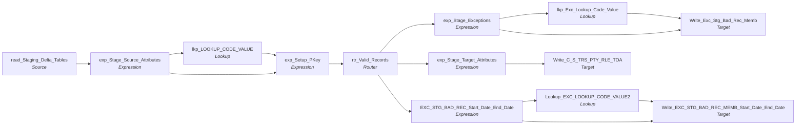

# m_Tgt_C_S_TRS_Pty_Rle_TOA

IDQ mapping &rarr; CDI **Mapping** `m_Tgt_C_S_TRS_Pty_Rle_TOA`.

> Pre-MDM Staging to MDM Staging mapping for TIERS Type of Assistance

[ML 3/7/2022] Correct exception logging (correct logged source keys and attribute names)

## Summary

| IDQ transformation | CDI transformation | Count |
|---|---|---|
| ExpressionTx | Expression | 5 |
| LookupTx | Lookup | 3 |
| RouterTx | Router | 1 |
| SourceTx | Source | 1 |
| TargetTx | Target | 3 |

Sources:

| Instance | Object | Connection |
|---|---|---|
| read_Staging_Delta_Tables | `STG_TRS_D_DC_LTSS_ELIG_PER` | STAGING |

Targets:

| Instance | Object | Connection |
|---|---|---|
| Write_Exc_Stg_Bad_Rec_Memb | `EXC_STG_BAD_REC_MEMB` | STAGING |
| Write_C_S_TRS_PTY_RLE_TOA | `C_S_TRS_PTY_RLE_TOA` | HHS_MDM_ORS |
| Write_EXC_STG_BAD_REC_MEMB_Start_Date_End_Date | `EXC_STG_BAD_REC_MEMB` | STAGING |

`$sys.MappingName` is translated to the input parameter `$$MappingName` (default: the mapping name).

## Flow



## Filtered data

Every step that can stop, divert or collapse rows, and what happens to the rows that do not pass. A Filter keeps a row only when its condition is TRUE: FALSE **or NULL** drops the row silently (no target, no reject file). A Router writes a row to **every** group whose condition is TRUE; a row that matches no group goes to the default group and is discarded when that group is not linked. Comments (`--`, `//`) are removed from the conditions shown here. A `= ...` line reads a null check on a lookup return in plain terms; *no matching row* also covers a matching row whose returned field is NULL.

### Steps that filter rows

| Step | IDQ type | Rule | Rows that pass go to | Rows that do not pass |
|---|---|---|---|---|
| read_Staging_Delta_Tables | SourceTx | custom SQL query (see the step): only the rows it returns | `EXC_STG_BAD_REC_MEMB`, `C_S_TRS_PTY_RLE_TOA` | never read |
| rtr_Valid_Records | RouterTx | group `Bad_Value`: `isnull(TOA_CD)`<br>= no matching row in `LOOKUP_CODE_VALUE` | `EXC_STG_BAD_REC_MEMB` |  |
| rtr_Valid_Records | RouterTx | group `Period_Begin_Date_GT_Period_End_Date`: `BEGIN_DT > END_DT` | `EXC_STG_BAD_REC_MEMB` |  |
| rtr_Valid_Records | RouterTx | default group `Default`: rows that match no other group | `C_S_TRS_PTY_RLE_TOA` |  |

### Where the condition fields come from

| Step | Field | Origin |
|---|---|---|
| rtr_Valid_Records | `TOA_CD` | `MSTR_REF_CODE` returned by lookup `lkp_LOOKUP_CODE_VALUE` on `LOOKUP_CODE_VALUE` where `SRC_SYS = in_SRC_SYS AND SRC_CODE_VALUE = in_TYPE_OF_ASSISTANCE_CD`; NULL when no row matches |
| rtr_Valid_Records | `BEGIN_DT` | source column `BEGIN_DT` read by `read_Staging_Delta_Tables` |
| rtr_Valid_Records | `END_DT` | source column `END_DT` read by `read_Staging_Delta_Tables` |

### Rows that do not reach `C_S_*` tables

**`C_S_TRS_PTY_RLE_TOA`** (`Write_C_S_TRS_PTY_RLE_TOA`): a source row is written only when it passes every step below.

| Step | Must hold | Otherwise the row |
|---|---|---|
| `read_Staging_Delta_Tables` | custom SQL query (see the step): only the rows it returns | never read |
| `rtr_Valid_Records` | matches none of the other groups (default `Default`) | if `isnull(TOA_CD)`: group `Bad_Value` &rarr; `EXC_STG_BAD_REC_MEMB`<br>if `BEGIN_DT > END_DT`: group `Period_Begin_Date_GT_Period_End_Date` &rarr; `EXC_STG_BAD_REC_MEMB` |

## Oracle stored procedure

Drop-in replacement in Oracle: [`sp_ors_main_m_Tgt_C_S_TRS_Pty_Rle_TOA`](../../../idq-to-oracle/wf_TRS_Stage_Load_1_Ongoing/sp_ors_main_m_Tgt_C_S_TRS_Pty_Rle_TOA.sql) (set-based SQL; one transaction that commits at the end and rolls back and re-raises on error). The IDQ mapplets and rules become the shared `fn_dq_*` functions; see [idq-to-oracle/README.md](../../../idq-to-oracle/README.md). Unlike the CDI spec above, the procedure **keeps the MDM timeline logic**; it is marked `TIMELINE` in the comments.

```text
Drop-in replacement of IDQ mapping m_Tgt_C_S_TRS_Pty_Rle_TOA (workflow wf_TRS_Stage_Load_1_Ongoing).

Type of assistance of valid TIERS members (STG_TRS_D_CV_MCI_EDG_INDV_TOA, latest create per individual / EDG /
program / MCI sequence) into C_S_TRS_PTY_RLE_TOA (insert only, never truncated):
  -> lkp_LOOKUP_CODE_VALUE (code type TOA, source 'TRS') -> rtr_Valid_Records
       Bad_Value (TOA code does not translate)            -> EXC_STG_BAD_REC_MEMB ('Invalid_TOA')
       Period_Begin_Date_GT_Period_End_Date (BEGIN > END) -> EXC_STG_BAD_REC_MEMB
                                                             ('Period_Start_Date_>_Period_End_Date')
       Default (neither)                                  -> C_S_TRS_PTY_RLE_TOA
  A row with an untranslated code AND begin > end writes both exception rows.
  Key = INDV_ID|Member|<TOA master code>|TIERS|<EDG_NUM>|<PROGRAM_CD>|<MCI_CREATE_SEQ>.

TIMELINE: VERSION_SEQ is the source ROW_NUMBER() kept only where it equals 1, i.e. always 1; PERIOD_START_DATE /
EFF_STRT_DT = BEGIN_DT, PERIOD_END_DATE / EFF_END_DT = END_DT; PERIOD_REFERENCE_TIME is linked to an unfed port.
IDQ quirks kept: the Bad_Value row writes the looked-up EXCEPTION_CODE (NULL when 'Invalid_TOA' is not
configured); the date row writes the computed code.
Unfed ports written as NULL: ROWID_OBJECT, DELETED_*, UPDATED_BY, CREATOR, HUB_STATE_IND, and the name / address /
phone columns of the Bad_Value exception row.
```

Tables written:

| Table | Operation |
|---|---|
| `EXC_STG_BAD_REC_MEMB` | insert |
| `C_S_TRS_PTY_RLE_TOA` | insert |

Shared functions and procedures called:

| Object | Does |
|---|---|
| `fn_ors_helper04_common` | EXC_LOOKUP_CODE_VALUE lookup: exception code -> EXCEPTION_DESC (any row) |
| `fn_ors_helper05_common` | EXC_LOOKUP_CODE_VALUE lookup: exception code -> EXCEPTION_TYPE (any row) |
| `fn_ors_helper08_common` | EXC_LOOKUP_CODE_VALUE lookup: exception code -> EXCEPTION_CODE (the code when it is configured, else NULL) |
| `sp_ors_helper02_common` | run log line: mapping, step, row count (DBMS_OUTPUT) |

## Transformations

In data-flow order.

### read_Staging_Delta_Tables

IDQ `SourceTx` &rarr; CDI **Source**. Oracle connector source; carry the SQL override / filter below verbatim.

| Property | Value |
|---|---|
| Connection | STAGING |
| Object | STG_TRS_D_DC_LTSS_ELIG_PER |
| queryMode | SEMI |

SQL override (CDI *SQL Override*; translated):

```sql
with toa_src as
(
SELECT
	TO_CHAR(toa.INDV_ID) as INDV_ID
	,TYPE_OF_ASSISTANCE_CD
	,ELIG_EFF_BEGIN_DT as BEGIN_DT
	,ELIG_EFF_END_DT as END_DT
	,'MCI_EDG_INDV' as SRC_TBL
	,ROW_NUMBER() OVER(PARTITION BY toa.INDV_ID|| '|'||toa.EDG_NUM || '|' ||  toa.PROGRAM_CD || '|' || toa.MCI_CREATE_SEQ
		ORDER BY toa.CREATE_Dt desc) as VERSION_SEQ
	,TO_CHAR(toa.INDV_ID) as PTY_PK
	,EDG_NUM
	,CASE_NUM
	,MCI_CREATE_SEQ
	,PROGRAM_CD
	,PART_STATUS_CD
	,SYSTEM_CD
	,CONVERT_DT
	,toa.CREATE_DT 

FROM STG_TRS_D_CV_MCI_EDG_INDV_TOA toa
JOIN STG_TRS_VALID_MEMBERS vm
	ON TO_CHAR(toa.INDV_ID) = vm.PTY_PK
WHERE TYPE_OF_ASSISTANCE_CD IS NOT NULL
AND (CONVERSION_IND IS NULL or CONVERSION_IND = 'C')
)
select *
from TOA_SRC
where version_seq = 1  -- keep only the last records per source key
```

Columns: `None`, `None`, `None`, `None`, `None`, `None`, `None`, `None`, `None`, `None`, `None`, `None`, `None`, `None`, `None`

### exp_Stage_Source_Attributes

IDQ `ExpressionTx` &rarr; CDI **Expression**. Same expression language; variable fields are supported.

| Field | Kind | Type | Expression (CDI) |
|---|---|---|---|
| INDV_ID | in/out | string(40) |  |
| TYPE_OF_ASSISTANCE_CD | in/out | string(4) |  |
| BEGIN_DT | in/out | date/time |  |
| END_DT | in/out | date/time |  |
| SRC_TBL | in/out | string(13) |  |
| VERSION_SEQ (stale timeline: omit) | in/out | double |  |
| out_SRC_SYS | out | string(255) | `'TRS'` |
| out_TOA_SOURCE | out | string(255) | `decode(SRC_TBL, 'LTSS_ELIG_PER', 'DADS', 'MCI_EDG_INDV', 'TIERS')` |
| out_LAST_UPDATE_DATE | out | date/time | `SESSSTARTTIME` |
| PTY_PK | in/out | string(40) |  |
| EDG_NUM | in/out | double |  |
| CASE_NUM | in/out | double |  |
| MCI_CREATE_SEQ | in/out | double | `MCI_CREATE_SEQ` |
| PROGRAM_CD | in/out | string(4) |  |
| PART_STATUS_CD | in/out | string(2) |  |
| SGMNT_KEY | out | string(80) | `EDG_NUM \|\| '\|' \|\|  PROGRAM_CD \|\| '\|' \|\| MCI_CREATE_SEQ` |
| SYSTEM_CD | in/out | string(2) |  |
| CONVERT_DT | in/out | date/time |  |
| CREATE_DT | in/out | date/time |  |

Links (target field &larr; upstream field):

| Field | From |
|---|---|
| INDV_ID | read_Staging_Delta_Tables.INDV_ID |
| TYPE_OF_ASSISTANCE_CD | read_Staging_Delta_Tables.TYPE_OF_ASSISTANCE_CD |
| BEGIN_DT | read_Staging_Delta_Tables.BEGIN_DT |
| END_DT | read_Staging_Delta_Tables.END_DT |
| SRC_TBL | read_Staging_Delta_Tables.SRC_TBL |
| VERSION_SEQ (stale timeline: do not map) | read_Staging_Delta_Tables.VERSION_SEQ |
| PTY_PK | read_Staging_Delta_Tables.PTY_PK |
| EDG_NUM | read_Staging_Delta_Tables.EDG_NUM |
| CASE_NUM | read_Staging_Delta_Tables.CASE_NUM |
| PART_STATUS_CD | read_Staging_Delta_Tables.PART_STATUS_CD |
| SYSTEM_CD | read_Staging_Delta_Tables.SYSTEM_CD |
| CONVERT_DT | read_Staging_Delta_Tables.CONVERT_DT |
| CREATE_DT | read_Staging_Delta_Tables.CREATE_DT |
| MCI_CREATE_SEQ | read_Staging_Delta_Tables.MCI_CREATE_SEQ |
| PROGRAM_CD | read_Staging_Delta_Tables.PROGRAM_CD |

### lkp_LOOKUP_CODE_VALUE

IDQ `LookupTx` &rarr; CDI **Lookup**. Connected lookup unless a return port is set (then unconnected).

| Property | Value |
|---|---|
| Connection | STAGING |
| Object | LOOKUP_CODE_VALUE |
| Lookup condition | SRC_SYS = in_SRC_SYS AND SRC_CODE_VALUE = in_TYPE_OF_ASSISTANCE_CD |
| Multiple matches | Return any row |
| Cache | static cache |

Filter (CDI source/lookup *Filter* property; translated):

```sql
"LOOKUP_CODE_VALUE"."CODE_TYPE" = 'TOA'
```

| Lookup input field | Type |
|---|---|
| in_TYPE_OF_ASSISTANCE_CD | string(4) |
| in_SRC_SYS | string(255) |

| Return / pass-through field | Feeds |
|---|---|
| in_TYPE_OF_ASSISTANCE_CD | exp_Setup_PKey.TYPE_OF_ASSISTANCE_CD |
| in_SRC_SYS | exp_Setup_PKey.SRC_SYS |
| MSTR_REF_CODE | exp_Setup_PKey.TOA_CD |

Links (target field &larr; upstream field):

| Field | From |
|---|---|
| in_TYPE_OF_ASSISTANCE_CD | exp_Stage_Source_Attributes.TYPE_OF_ASSISTANCE_CD |
| in_SRC_SYS | exp_Stage_Source_Attributes.out_SRC_SYS |

### exp_Setup_PKey

IDQ `ExpressionTx` &rarr; CDI **Expression**. Same expression language; variable fields are supported.

| Field | Kind | Type | Expression (CDI) |
|---|---|---|---|
| INDV_ID | in/out | string(40) |  |
| TYPE_OF_ASSISTANCE_CD | in/out | string(4) |  |
| BEGIN_DT | in/out | date/time |  |
| END_DT | in/out | date/time |  |
| SRC_TBL | in/out | string(13) |  |
| VERSION_SEQ (stale timeline: omit) | in/out | double |  |
| SRC_SYS | in/out | string(255) |  |
| TOA_SOURCE | in/out | string(255) | `TOA_SOURCE` |
| TOA_CD | in/out | string(20) |  |
| LAST_UPDATE_DATE | in/out | date/time | `LAST_UPDATE_DATE` |
| TIMELINE_ACTION (stale timeline: omit) | in/out | integer | `TIMELINE_ACTION` |
| PERIOD_REFERENCE_TIME (stale timeline: omit) | in/out | date/time | `PERIOD_REFERENCE_TIME` |
| out_PKEY_SRC_OBJ_PTY_RLE | out | string(255) | `v_PKEY_SRC_OBJ_PTY_RLE` |
| out_PKEY_SRC_OBJ_PTY_RLE_TOA | out | string(255) | `v_PKEY_SRC_OBJ_PTY_RLE \|\| '\|' \|\|  <br>TOA_CD \|\| '\|' \|\| <br>TOA_SOURCE  \|\| '\|' \|\| <br>SGMNT_KEY` |
| v_PKEY_SRC_OBJ_PTY_RLE | variable | string(255) | `concat(to_char(INDV_ID), '\|Member')` |
| PTY_PK | in/out | string(40) |  |
| EDG_NUM | in/out | double |  |
| CASE_NUM | in/out | double |  |
| PART_STATUS_CD | in/out | string(2) |  |
| SGMNT_KEY | in/out | string(80) | `SGMNT_KEY` |
| SYSTEM_CD | in/out | string(2) |  |
| CONVERT_DT | in/out | date/time |  |
| CREATE_DATE | in/out | date/time |  |
| MCI_CREATE_SEQ | in/out | double | `MCI_CREATE_SEQ` |

Links (target field &larr; upstream field):

| Field | From |
|---|---|
| INDV_ID | exp_Stage_Source_Attributes.INDV_ID |
| TYPE_OF_ASSISTANCE_CD | lkp_LOOKUP_CODE_VALUE.in_TYPE_OF_ASSISTANCE_CD |
| BEGIN_DT | exp_Stage_Source_Attributes.BEGIN_DT |
| END_DT | exp_Stage_Source_Attributes.END_DT |
| SRC_TBL | exp_Stage_Source_Attributes.SRC_TBL |
| SRC_SYS | lkp_LOOKUP_CODE_VALUE.in_SRC_SYS |
| TOA_CD | lkp_LOOKUP_CODE_VALUE.MSTR_REF_CODE |
| TOA_SOURCE | exp_Stage_Source_Attributes.out_TOA_SOURCE |
| LAST_UPDATE_DATE | exp_Stage_Source_Attributes.out_LAST_UPDATE_DATE |
| VERSION_SEQ (stale timeline: do not map) | exp_Stage_Source_Attributes.VERSION_SEQ |
| PTY_PK | exp_Stage_Source_Attributes.PTY_PK |
| EDG_NUM | exp_Stage_Source_Attributes.EDG_NUM |
| CASE_NUM | exp_Stage_Source_Attributes.CASE_NUM |
| PART_STATUS_CD | exp_Stage_Source_Attributes.PART_STATUS_CD |
| SGMNT_KEY | exp_Stage_Source_Attributes.SGMNT_KEY |
| SYSTEM_CD | exp_Stage_Source_Attributes.SYSTEM_CD |
| CONVERT_DT | exp_Stage_Source_Attributes.CONVERT_DT |
| CREATE_DATE | exp_Stage_Source_Attributes.CREATE_DT |
| MCI_CREATE_SEQ | exp_Stage_Source_Attributes.MCI_CREATE_SEQ |

### rtr_Valid_Records

IDQ `RouterTx` &rarr; CDI **Router**. One output group per IDQ group; the default group is created automatically.

| Output group | Condition |
|---|---|
| Bad_Value | `isnull(TOA_CD)` |
| Period_Begin_Date_GT_Period_End_Date | `BEGIN_DT > END_DT` |
| Default | (default group) |

Links (target field &larr; upstream field):

| Field | From |
|---|---|
| INDV_ID | exp_Setup_PKey.INDV_ID |
| TYPE_OF_ASSISTANCE_CD | exp_Setup_PKey.TYPE_OF_ASSISTANCE_CD |
| BEGIN_DT | exp_Setup_PKey.BEGIN_DT |
| END_DT | exp_Setup_PKey.END_DT |
| SRC_TBL | exp_Setup_PKey.SRC_TBL |
| SRC_SYS | exp_Setup_PKey.SRC_SYS |
| TOA_CD | exp_Setup_PKey.TOA_CD |
| PKEY_SRC_OBJ_PTY_RLE | exp_Setup_PKey.out_PKEY_SRC_OBJ_PTY_RLE |
| PKEY_SRC_OBJ_PTY_RLE_TOA | exp_Setup_PKey.out_PKEY_SRC_OBJ_PTY_RLE_TOA |
| TOA_SOURCE | exp_Setup_PKey.TOA_SOURCE |
| LAST_UPDATE_DATE | exp_Setup_PKey.LAST_UPDATE_DATE |
| TIMELINE_ACTION (stale timeline: do not map) | exp_Setup_PKey.TIMELINE_ACTION |
| PERIOD_REFERENCE_TIME (stale timeline: do not map) | exp_Setup_PKey.PERIOD_REFERENCE_TIME |
| VERSION_SEQ (stale timeline: do not map) | exp_Setup_PKey.VERSION_SEQ |
| PTY_PK | exp_Setup_PKey.PTY_PK |
| EDG_NUM | exp_Setup_PKey.EDG_NUM |
| CASE_NUM | exp_Setup_PKey.CASE_NUM |
| PART_STATUS_CD | exp_Setup_PKey.PART_STATUS_CD |
| SGMNT_KEY | exp_Setup_PKey.SGMNT_KEY |
| SYSTEM_CD | exp_Setup_PKey.SYSTEM_CD |
| CONVERT_DT | exp_Setup_PKey.CONVERT_DT |
| CREATE_DATE | exp_Setup_PKey.CREATE_DATE |
| MCI_CREATE_SEQ | exp_Setup_PKey.MCI_CREATE_SEQ |

### exp_Stage_Exceptions

IDQ `ExpressionTx` &rarr; CDI **Expression**. Same expression language; variable fields are supported.

| Field | Kind | Type | Expression (CDI) |
|---|---|---|---|
| SRC_SYS | in/out | string(50) |  |
| SRC_SYS_ID_1 | in/out | string(255) |  |
| SRC_SYS_ID_2 | in/out | string(255) |  |
| SRC_SYS_ID_3 | in/out | string(255) |  |
| EXCEPTION_TYPE | in/out | string(50) | `EXCEPTION_TYPE` |
| out_EXCEPTION_CODE | out | string(255) | `'Invalid_TOA'` |
| EXCEPTION_DESC | in/out | string(255) | `EXCEPTION_DESC` |
| TOA_CD | in/out | string(20) | `TOA_CD` |
| out_RUN_DATE | out | date/time | `systimestamp()` |
| PREFIX | in/out | string(10) |  |
| FIRST_NAME | in/out | string(50) |  |
| MIDDLE_NAME | in/out | string(50) |  |
| LAST_NAME | in/out | string(50) |  |
| SUFFIX | in/out | string(10) |  |
| ALIAS_PREFIX | in/out | string(10) |  |
| ALIAS_FIRST_NAME | in/out | string(50) |  |
| ALIAS_MIDDLE_NAME | in/out | string(50) |  |
| ALIAS_LAST_NAME | in/out | string(50) |  |
| ALIAS_SUFFIX | in/out | string(10) |  |
| BIRTH_DATE | in/out | date/time |  |
| GENDER | in/out | string(20) |  |
| ADDRESS_TYPE | in/out | string(20) |  |
| ADDRESS_LINE_1 | in/out | string(200) |  |
| ADDRESS_LINE_2 | in/out | string(100) |  |
| ADDRESS_CITY | in/out | string(50) |  |
| ADDRESS_COUNTY | in/out | string(50) |  |
| ADDRESS_STATE | in/out | string(50) |  |
| ADDRESS_ZIP | in/out | string(10) |  |
| ADDRESS_ZIP_EXT | in/out | string(10) |  |
| ADDRESS_COUNTRY | in/out | string(50) |  |
| ADDRESS_DR_ERROR_CODE | in/out | string(255) |  |
| ADDRESS_DR_ERROR_DESC | in/out | string(255) |  |
| ADDRESS_DR_MAILABILITY_SCORE | in/out | decimal(1) |  |
| PRIMARY_PHONE | in/out | string(20) |  |
| WORK_PHONE | in/out | string(20) |  |
| SECONDARY_PHONE | in/out | string(20) |  |
| EMAIL | in/out | string(200) |  |
| out_ATTRIBUTE_NAME | out | string(50) | `'Type of Assistance'` |
| ATTRIBUTE_VALUE | in/out | string(255) | `ATTRIBUTE_VALUE` |
| out_MAPPING_NAME | out | string(255) | `Substr($$MappingName, INSTR($$MappingName,'/',0)+1)` |
| PERIOD_START_DATE | in/out | date/time |  |
| PERIOD_END_DATE | in/out | date/time |  |
| PTY_PK | in/out | string(40) | `PTY_PK` |
| EDG_NUM | in/out | double | `EDG_NUM` |
| CASE_NUM | in/out | double | `CASE_NUM` |
| PART_STATUS_CD | in/out | string(2) | `PART_STATUS_CD` |
| SGMNT_KEY | in/out | string(80) | `SGMNT_KEY` |
| INDV_ID | in/out | string(40) | `INDV_ID` |
| MCI_CREATE_SEQ | in/out | double | `MCI_CREATE_SEQ` |

Links (target field &larr; upstream field):

| Field | From |
|---|---|
| SRC_SYS | rtr_Valid_Records.Bad_Value.SRC_SYS |
| SRC_SYS_ID_1 | rtr_Valid_Records.Bad_Value.PKEY_SRC_OBJ_PTY_RLE_TOA |
| ATTRIBUTE_VALUE | rtr_Valid_Records.Bad_Value.TYPE_OF_ASSISTANCE_CD |
| PERIOD_START_DATE | rtr_Valid_Records.Bad_Value.BEGIN_DT |
| PERIOD_END_DATE | rtr_Valid_Records.Bad_Value.END_DT |
| SRC_SYS_ID_2 | rtr_Valid_Records.Bad_Value.PKEY_SRC_OBJ_PTY_RLE |
| PTY_PK | rtr_Valid_Records.Bad_Value.PTY_PK |
| EDG_NUM | rtr_Valid_Records.Bad_Value.EDG_NUM |
| CASE_NUM | rtr_Valid_Records.Bad_Value.CASE_NUM |
| PART_STATUS_CD | rtr_Valid_Records.Bad_Value.PART_STATUS_CD |
| SGMNT_KEY | rtr_Valid_Records.Bad_Value.SGMNT_KEY |
| TOA_CD | rtr_Valid_Records.Bad_Value.TOA_CD |
| INDV_ID | rtr_Valid_Records.Bad_Value.INDV_ID |
| MCI_CREATE_SEQ | rtr_Valid_Records.Bad_Value.MCI_CREATE_SEQ |

### exp_Stage_Target_Attributes

IDQ `ExpressionTx` &rarr; CDI **Expression**. Same expression language; variable fields are supported.

| Field | Kind | Type | Expression (CDI) |
|---|---|---|---|
| PKEY_SRC_OBJECT | in/out | string(255) |  |
| ROWID_OBJECT | in/out | string(14) |  |
| DELETED_IND | in/out | decimal(38) |  |
| DELETED_DATE | in/out | date/time |  |
| DELETED_BY | in/out | string(50) |  |
| PERIOD_START_DATE | in/out | date/time |  |
| PERIOD_END_DATE | in/out | date/time |  |
| VERSION_SEQ (stale timeline: omit) | in/out | decimal(38) |  |
| PERIOD_REFERENCE_TIME (stale timeline: omit) | in/out | date/time |  |
| TIMELINE_ACTION (stale timeline: omit) | in/out | decimal(38) |  |
| LAST_UPDATE_DATE | in/out | date/time |  |
| UPDATED_BY | in/out | string(50) |  |
| CREATE_DATE | in/out | date/time |  |
| CREATOR | in/out | string(50) |  |
| SRC_ROWID | in/out | string(30) |  |
| HUB_STATE_IND | in/out | decimal(38) |  |
| TOA_SOURCE | in/out | string(100) |  |
| TOA_FK | in/out | string(100) |  |
| EFF_STRT_DT | in/out | date/time |  |
| EFF_END_DT | in/out | date/time |  |
| PTY_RLE_FK | in/out | string(255) |  |
| PTY_PK | in/out | string(40) | `PTY_PK` |
| EDG_NUM | in/out | double | `EDG_NUM` |
| CASE_NUM | in/out | double | `CASE_NUM` |
| PART_STATUS_CD | in/out | string(2) | `PART_STATUS_CD` |
| SGMNT_KEY | in/out | string(80) | `SGMNT_KEY` |
| SYSTEM_CD | in/out | string(2) | `SYSTEM_CD` |
| CONVERT_DT | in/out | date/time | `CONVERT_DT` |

Links (target field &larr; upstream field):

| Field | From |
|---|---|
| PKEY_SRC_OBJECT | rtr_Valid_Records.Default.PKEY_SRC_OBJ_PTY_RLE_TOA |
| PERIOD_START_DATE | rtr_Valid_Records.Default.BEGIN_DT |
| PERIOD_END_DATE | rtr_Valid_Records.Default.END_DT |
| VERSION_SEQ (stale timeline: do not map) | rtr_Valid_Records.Default.VERSION_SEQ |
| PERIOD_REFERENCE_TIME (stale timeline: do not map) | rtr_Valid_Records.Default.PERIOD_REFERENCE_TIME |
| TIMELINE_ACTION (stale timeline: do not map) | rtr_Valid_Records.Default.TIMELINE_ACTION |
| LAST_UPDATE_DATE | rtr_Valid_Records.Default.LAST_UPDATE_DATE |
| SRC_ROWID | rtr_Valid_Records.Default.PKEY_SRC_OBJ_PTY_RLE_TOA |
| TOA_SOURCE | rtr_Valid_Records.Default.TOA_SOURCE |
| TOA_FK | rtr_Valid_Records.Default.TOA_CD |
| EFF_STRT_DT | rtr_Valid_Records.Default.BEGIN_DT |
| EFF_END_DT | rtr_Valid_Records.Default.END_DT |
| PTY_RLE_FK | rtr_Valid_Records.Default.PKEY_SRC_OBJ_PTY_RLE |
| CREATE_DATE | rtr_Valid_Records.Default.CREATE_DATE |
| PTY_PK | rtr_Valid_Records.Default.PTY_PK |
| EDG_NUM | rtr_Valid_Records.Default.EDG_NUM |
| CASE_NUM | rtr_Valid_Records.Default.CASE_NUM |
| PART_STATUS_CD | rtr_Valid_Records.Default.PART_STATUS_CD |
| SGMNT_KEY | rtr_Valid_Records.Default.SGMNT_KEY |
| SYSTEM_CD | rtr_Valid_Records.Default.SYSTEM_CD |
| CONVERT_DT | rtr_Valid_Records.Default.CONVERT_DT |

### lkp_Exc_Lookup_Code_Value

IDQ `LookupTx` &rarr; CDI **Lookup**. Connected lookup unless a return port is set (then unconnected).

| Property | Value |
|---|---|
| Connection | STAGING |
| Object | EXC_LOOKUP_CODE_VALUE |
| Lookup condition | EXCEPTION_CODE = in_EXCEPTION_CODE |
| Multiple matches | Return any row |
| Cache | static cache |

| Lookup input field | Type |
|---|---|
| in_EXCEPTION_CODE | string(255) |

| Return / pass-through field | Feeds |
|---|---|
| EXCEPTION_CODE | Write_Exc_Stg_Bad_Rec_Memb.EXCEPTION_CODE |
| EXCEPTION_DESC | Write_Exc_Stg_Bad_Rec_Memb.EXCEPTION_DESC |
| EXCEPTION_TYPE | Write_Exc_Stg_Bad_Rec_Memb.EXCEPTION_TYPE |

Links (target field &larr; upstream field):

| Field | From |
|---|---|
| in_EXCEPTION_CODE | exp_Stage_Exceptions.out_EXCEPTION_CODE |

### Write_Exc_Stg_Bad_Rec_Memb

IDQ `TargetTx` &rarr; CDI **Target**. Oracle connector target.

| Property | Value |
|---|---|
| Connection | STAGING |
| Object | EXC_STG_BAD_REC_MEMB |
| Operation | Insert |
| Truncate target table | no |
| Load type | normal (no bulk load) |
| Reject file | Write_EXC_STG_BAD_REC_MEMB.bad |

Links (target field &larr; upstream field):

| Field | From |
|---|---|
| SRC_SYS | exp_Stage_Exceptions.SRC_SYS |
| RUN_DATE | exp_Stage_Exceptions.out_RUN_DATE |
| PREFIX | exp_Stage_Exceptions.PREFIX |
| FIRST_NAME | exp_Stage_Exceptions.FIRST_NAME |
| MIDDLE_NAME | exp_Stage_Exceptions.MIDDLE_NAME |
| LAST_NAME | exp_Stage_Exceptions.LAST_NAME |
| SUFFIX | exp_Stage_Exceptions.SUFFIX |
| ALIAS_PREFIX | exp_Stage_Exceptions.ALIAS_PREFIX |
| ALIAS_FIRST_NAME | exp_Stage_Exceptions.ALIAS_FIRST_NAME |
| ALIAS_MIDDLE_NAME | exp_Stage_Exceptions.ALIAS_MIDDLE_NAME |
| ALIAS_LAST_NAME | exp_Stage_Exceptions.ALIAS_LAST_NAME |
| ALIAS_SUFFIX | exp_Stage_Exceptions.ALIAS_SUFFIX |
| BIRTH_DATE | exp_Stage_Exceptions.BIRTH_DATE |
| GENDER | exp_Stage_Exceptions.GENDER |
| ADDRESS_TYPE | exp_Stage_Exceptions.ADDRESS_TYPE |
| ADDRESS_LINE_1 | exp_Stage_Exceptions.ADDRESS_LINE_1 |
| ADDRESS_LINE_2 | exp_Stage_Exceptions.ADDRESS_LINE_2 |
| ADDRESS_CITY | exp_Stage_Exceptions.ADDRESS_CITY |
| ADDRESS_COUNTY | exp_Stage_Exceptions.ADDRESS_COUNTY |
| ADDRESS_STATE | exp_Stage_Exceptions.ADDRESS_STATE |
| ADDRESS_ZIP | exp_Stage_Exceptions.ADDRESS_ZIP |
| ADDRESS_ZIP_EXT | exp_Stage_Exceptions.ADDRESS_ZIP_EXT |
| ADDRESS_COUNTRY | exp_Stage_Exceptions.ADDRESS_COUNTRY |
| ADDRESS_DR_ERROR_CODE | exp_Stage_Exceptions.ADDRESS_DR_ERROR_CODE |
| ADDRESS_DR_ERROR_DESC | exp_Stage_Exceptions.ADDRESS_DR_ERROR_DESC |
| ADDRESS_DR_MAILABILITY_SCORE | exp_Stage_Exceptions.ADDRESS_DR_MAILABILITY_SCORE |
| PRIMARY_PHONE | exp_Stage_Exceptions.PRIMARY_PHONE |
| WORK_PHONE | exp_Stage_Exceptions.WORK_PHONE |
| SECONDARY_PHONE | exp_Stage_Exceptions.SECONDARY_PHONE |
| EMAIL | exp_Stage_Exceptions.EMAIL |
| ATTRIBUTE_NAME | exp_Stage_Exceptions.out_ATTRIBUTE_NAME |
| MAPPING_NAME | exp_Stage_Exceptions.out_MAPPING_NAME |
| PERIOD_START_DATE | exp_Stage_Exceptions.PERIOD_START_DATE |
| PERIOD_END_DATE | exp_Stage_Exceptions.PERIOD_END_DATE |
| EXCEPTION_CODE | lkp_Exc_Lookup_Code_Value.EXCEPTION_CODE |
| EXCEPTION_DESC | lkp_Exc_Lookup_Code_Value.EXCEPTION_DESC |
| EXCEPTION_TYPE | lkp_Exc_Lookup_Code_Value.EXCEPTION_TYPE |
| ATTRIBUTE_VALUE | exp_Stage_Exceptions.ATTRIBUTE_VALUE |
| SRC_SYS_ID_1 | exp_Stage_Exceptions.INDV_ID |
| SRC_SYS_ID_2 | exp_Stage_Exceptions.EDG_NUM |
| SRC_SYS_ID_3 | exp_Stage_Exceptions.MCI_CREATE_SEQ |

### Write_C_S_TRS_PTY_RLE_TOA

IDQ `TargetTx` &rarr; CDI **Target**. Oracle connector target.

| Property | Value |
|---|---|
| Connection | HHS_MDM_ORS |
| Object | C_S_TRS_PTY_RLE_TOA |
| Operation | Insert |
| Truncate target table | yes |
| Load type | normal (no bulk load) |
| Reject file | Write_C_S_TRS_PTY_RLE_TOA1.bad |

Links (target field &larr; upstream field):

| Field | From |
|---|---|
| PKEY_SRC_OBJECT | exp_Stage_Target_Attributes.PKEY_SRC_OBJECT |
| ROWID_OBJECT | exp_Stage_Target_Attributes.ROWID_OBJECT |
| DELETED_IND | exp_Stage_Target_Attributes.DELETED_IND |
| DELETED_DATE | exp_Stage_Target_Attributes.DELETED_DATE |
| DELETED_BY | exp_Stage_Target_Attributes.DELETED_BY |
| PERIOD_START_DATE | exp_Stage_Target_Attributes.PERIOD_START_DATE |
| PERIOD_END_DATE | exp_Stage_Target_Attributes.PERIOD_END_DATE |
| VERSION_SEQ (stale timeline: do not map) | exp_Stage_Target_Attributes.VERSION_SEQ |
| PERIOD_REFERENCE_TIME (stale timeline: do not map) | exp_Stage_Target_Attributes.PERIOD_REFERENCE_TIME |
| LAST_UPDATE_DATE | exp_Stage_Target_Attributes.LAST_UPDATE_DATE |
| UPDATED_BY | exp_Stage_Target_Attributes.UPDATED_BY |
| CREATE_DATE | exp_Stage_Target_Attributes.CREATE_DATE |
| CREATOR | exp_Stage_Target_Attributes.CREATOR |
| SRC_ROWID | exp_Stage_Target_Attributes.SRC_ROWID |
| HUB_STATE_IND | exp_Stage_Target_Attributes.HUB_STATE_IND |
| TOA_SOURCE | exp_Stage_Target_Attributes.TOA_SOURCE |
| TOA_FK | exp_Stage_Target_Attributes.TOA_FK |
| EFF_STRT_DT | exp_Stage_Target_Attributes.EFF_STRT_DT |
| EFF_END_DT | exp_Stage_Target_Attributes.EFF_END_DT |
| PTY_RLE_FK | exp_Stage_Target_Attributes.PTY_RLE_FK |
| EDG_NUM | exp_Stage_Target_Attributes.EDG_NUM |
| CASE_NUM | exp_Stage_Target_Attributes.CASE_NUM |
| SGMNT_KEY | exp_Stage_Target_Attributes.SGMNT_KEY |
| CNVRT_DT | exp_Stage_Target_Attributes.CONVERT_DT |
| CNVRT_SYS_CD | exp_Stage_Target_Attributes.SYSTEM_CD |
| INDV_ID | exp_Stage_Target_Attributes.PTY_PK |
| PRTCPNT_STS_CD | exp_Stage_Target_Attributes.PART_STATUS_CD |
| SRC_LAST_UPD_DT | exp_Stage_Target_Attributes.CREATE_DATE |

### EXC_STG_BAD_REC_Start_Date_End_Date

IDQ `ExpressionTx` &rarr; CDI **Expression**. Same expression language; variable fields are supported.

| Field | Kind | Type | Expression (CDI) |
|---|---|---|---|
| SRC_SYS1 | in/out | string(255) | `SRC_SYS1` |
| OBJECT_NAME | out | string(50) | `'C_S_TRS_PTY_RLE_REL'` |
| SRC_SYS_ID_1 | in/out | string(50) |  |
| SRC_SYS_ID_2 | in/out | string(50) |  |
| SRC_SYS_ID_3 | in/out | string(50) |  |
| RUN_DATE | out | date/time | `systimestamp()` |
| MEMBER_ID | in/out | string(20) |  |
| MAPPING_NAME | out | string(60) | `Substr($$MappingName, INSTR($$MappingName,'/',0)+1)` |
| EXC_CODE_LKP | out | string(50) | `'Period_Start_Date_>_Period_End_Date'` |
| ATTR_NM | out | string(50) | `'Effective Date'` |
| PERIOD_START_DATE | in/out | date/time | `PERIOD_START_DATE` |
| PERIOD_END_DATE | in/out | date/time | `PERIOD_END_DATE` |

Links (target field &larr; upstream field):

| Field | From |
|---|---|
| SRC_SYS_ID_1 | rtr_Valid_Records.Period_Begin_Date_GT_Period_End_Date.PKEY_SRC_OBJ_PTY_RLE_TOA |
| SRC_SYS_ID_2 | rtr_Valid_Records.Period_Begin_Date_GT_Period_End_Date.PKEY_SRC_OBJ_PTY_RLE |
| PERIOD_START_DATE | rtr_Valid_Records.Period_Begin_Date_GT_Period_End_Date.BEGIN_DT |
| PERIOD_END_DATE | rtr_Valid_Records.Period_Begin_Date_GT_Period_End_Date.END_DT |
| SRC_SYS1 | rtr_Valid_Records.Period_Begin_Date_GT_Period_End_Date.SRC_SYS |
| MEMBER_ID | rtr_Valid_Records.Period_Begin_Date_GT_Period_End_Date.INDV_ID |

### Lookup_EXC_LOOKUP_CODE_VALUE2

IDQ `LookupTx` &rarr; CDI **Lookup**. Connected lookup unless a return port is set (then unconnected).

| Property | Value |
|---|---|
| Connection | STAGING |
| Object | EXC_LOOKUP_CODE_VALUE |
| Lookup condition | EXCEPTION_CODE = EXC_CODE_LKP |
| Multiple matches | Return any row |
| Cache | static cache |

| Lookup input field | Type |
|---|---|
| EXC_CODE_LKP | string(50) |

| Return / pass-through field | Feeds |
|---|---|
| EXCEPTION_DESC | Write_EXC_STG_BAD_REC_MEMB_Start_Date_End_Date.EXCEPTION_DESC |
| EXCEPTION_TYPE | Write_EXC_STG_BAD_REC_MEMB_Start_Date_End_Date.EXCEPTION_TYPE |

Links (target field &larr; upstream field):

| Field | From |
|---|---|
| EXC_CODE_LKP | EXC_STG_BAD_REC_Start_Date_End_Date.EXC_CODE_LKP |

### Write_EXC_STG_BAD_REC_MEMB_Start_Date_End_Date

IDQ `TargetTx` &rarr; CDI **Target**. Oracle connector target.

| Property | Value |
|---|---|
| Connection | STAGING |
| Object | EXC_STG_BAD_REC_MEMB |
| Operation | Insert |
| Truncate target table | no |
| Load type | normal (no bulk load) |
| Reject file | Write_EXC_STG_BAD_REC_MEMB.bad |

Links (target field &larr; upstream field):

| Field | From |
|---|---|
| SRC_SYS_ID_1 | EXC_STG_BAD_REC_Start_Date_End_Date.SRC_SYS_ID_1 |
| SRC_SYS_ID_2 | EXC_STG_BAD_REC_Start_Date_End_Date.SRC_SYS_ID_2 |
| MAPPING_NAME | EXC_STG_BAD_REC_Start_Date_End_Date.MAPPING_NAME |
| RUN_DATE | EXC_STG_BAD_REC_Start_Date_End_Date.RUN_DATE |
| ATTRIBUTE_NAME | EXC_STG_BAD_REC_Start_Date_End_Date.ATTR_NM |
| PERIOD_START_DATE | EXC_STG_BAD_REC_Start_Date_End_Date.PERIOD_START_DATE |
| PERIOD_END_DATE | EXC_STG_BAD_REC_Start_Date_End_Date.PERIOD_END_DATE |
| SRC_SYS | EXC_STG_BAD_REC_Start_Date_End_Date.SRC_SYS1 |
| EXCEPTION_DESC | Lookup_EXC_LOOKUP_CODE_VALUE2.EXCEPTION_DESC |
| EXCEPTION_TYPE | Lookup_EXC_LOOKUP_CODE_VALUE2.EXCEPTION_TYPE |
| EXCEPTION_CODE | EXC_STG_BAD_REC_Start_Date_End_Date.EXC_CODE_LKP |
