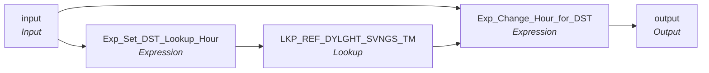

# mplt_DST_Correction

IDQ mapplet &rarr; CDI **Mapplet** `mplt_DST_Correction`.

> **Not ported: stale MDM timeline.** This mapplet shifts end dates by one hour around daylight-saving changes for the timeline. Do not build it; the callers link around it. The spec below is kept for reference only.

> Informatica has a bug in 'fall back' daylight savings time handling that causes duplicate keys in MDM loads and batch to be rejected.    Check if end dates are on the 'fall back' date and if so adjust the record's end date.

## Summary

## Flow

## Transformations

In data-flow order.

### input

IDQ `MappletInputTx` &rarr; CDI **Input**. Mapplet Input transformation.

| Field | Type |
|---|---|
| Period_Start_Date | date/time |
| Period_End_Date | date/time |

### Exp_Set_DST_Lookup_Hour

IDQ `ExpressionTx` &rarr; CDI **Expression**. Same expression language; variable fields are supported.

| Field | Kind | Type | Expression (CDI) |
|---|---|---|---|
| Period_End_Date | in/out | date/time | `Period_End_Date` |
| DST_Lookup_Date | out | date/time | `add_to_date(PERIOD_END_DATE, 'HH', 2)` |

Links (target field &larr; upstream field):

| Field | From |
|---|---|
| Period_End_Date | input.Period_End_Date |

### LKP_REF_DYLGHT_SVNGS_TM

IDQ `LookupTx` &rarr; CDI **Lookup**. Connected lookup unless a return port is set (then unconnected).

| Property | Value |
|---|---|
| Connection | STAGING |
| Object | REF_DYLGHT_SVNGS_TM |
| Lookup condition | DST = DST_Lookup_Date |
| Multiple matches | Return any row |
| Cache | static cache |

| Lookup input field | Type |
|---|---|
| DST_Lookup_Date | date/time |

| Return / pass-through field | Feeds |
|---|---|
| DST | Exp_Change_Hour_for_DST.lkp_DST |

Links (target field &larr; upstream field):

| Field | From |
|---|---|
| DST_Lookup_Date | Exp_Set_DST_Lookup_Hour.DST_Lookup_Date |

### Exp_Change_Hour_for_DST

IDQ `ExpressionTx` &rarr; CDI **Expression**. Same expression language; variable fields are supported.

| Field | Kind | Type | Expression (CDI) |
|---|---|---|---|
| Period_Start_Date | in | date/time |  |
| Period_End_Date | in | date/time |  |
| lkp_DST | in | date/time |  |
| out_End_Date | out | date/time | `iif((PERIOD_START_DATE = PERIOD_END_DATE) or (not isnull(lkp_DST)), add_to_date(PERIOD_END_DATE, 'HH', 1), PERIOD_END_DATE)` |

Links (target field &larr; upstream field):

| Field | From |
|---|---|
| lkp_DST | LKP_REF_DYLGHT_SVNGS_TM.DST |
| Period_Start_Date | input.Period_Start_Date |
| Period_End_Date | input.Period_End_Date |

### output

IDQ `MappletOutputTx` &rarr; CDI **Output**. Mapplet Output transformation.

| Field | Type |
|---|---|
| Period_End_Date | date/time |

Links (target field &larr; upstream field):

| Field | From |
|---|---|
| Period_End_Date | Exp_Change_Hour_for_DST.out_End_Date |
