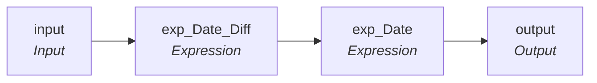

# mplt_Date_Greater_Than_Fifty_Years

IDQ mapplet &rarr; CDI **Mapplet** `mplt_Date_Greater_Than_Fifty_Years`.

## Summary

| IDQ transformation | CDI transformation | Count |
|---|---|---|
| ExpressionTx | Expression | 2 |
| MappletInputTx | Input | 1 |
| MappletOutputTx | Output | 1 |

## Flow

## Transformations

In data-flow order.

### input

IDQ `MappletInputTx` &rarr; CDI **Input**. Mapplet Input transformation.

| Field | Type |
|---|---|
| Input_Date | date/time |

### exp_Date_Diff

IDQ `ExpressionTx` &rarr; CDI **Expression**. Same expression language; variable fields are supported.

| Field | Kind | Type | Expression (CDI) |
|---|---|---|---|
| Input_Date | in/out | date/time | `Input_Date` |
| out_Date_Diff | out | string(10) | `DATE_DIFF(Input_Date, SYSDATE, 'YY')` |

Links (target field &larr; upstream field):

| Field | From |
|---|---|
| Input_Date | input.Input_Date |

### exp_Date

IDQ `ExpressionTx` &rarr; CDI **Expression**. Same expression language; variable fields are supported.

| Field | Kind | Type | Expression (CDI) |
|---|---|---|---|
| Input_Date | in/out | date/time | `Input_Date` |
| out_Date_Diff | in/out | string(10) | `out_Date_Diff` |
| out_Date | out | date/time | `Decode(True, out_Date_Diff > '50',NULL,Input_Date)` |

Links (target field &larr; upstream field):

| Field | From |
|---|---|
| Input_Date | exp_Date_Diff.Input_Date |
| out_Date_Diff | exp_Date_Diff.out_Date_Diff |

### output

IDQ `MappletOutputTx` &rarr; CDI **Output**. Mapplet Output transformation.

| Field | Type |
|---|---|
| Input_Date | date/time |
| out_Date_Diff | string(10) |
| out_Date | date/time |

Links (target field &larr; upstream field):

| Field | From |
|---|---|
| Input_Date | exp_Date.Input_Date |
| out_Date_Diff | exp_Date.out_Date_Diff |
| out_Date | exp_Date.out_Date |
