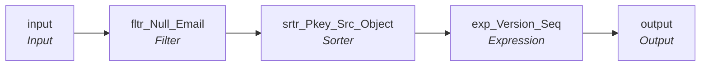

# mplt_Member_Pty_Rle_EAddr_Consolidation

IDQ mapplet &rarr; CDI **Mapplet** `mplt_Member_Pty_Rle_EAddr_Consolidation`.

## Summary

| IDQ transformation | CDI transformation | Count |
|---|---|---|
| ExpressionTx | Expression | 1 |
| FilterTx | Filter | 1 |
| MappletInputTx | Input | 1 |
| MappletOutputTx | Output | 1 |
| SorterTx | Sorter | 1 |

## Flow



## Filtered data

Every step that can stop, divert or collapse rows, and what happens to the rows that do not pass. A Filter keeps a row only when its condition is TRUE: FALSE **or NULL** drops the row silently (no target, no reject file). A Router writes a row to **every** group whose condition is TRUE; a row that matches no group goes to the default group and is discarded when that group is not linked. Comments (`--`, `//`) are removed from the conditions shown here. A `= ...` line reads a null check on a lookup return in plain terms; *no matching row* also covers a matching row whose returned field is NULL.

### Steps that filter rows

| Step | IDQ type | Rule | Rows that pass go to | Rows that do not pass |
|---|---|---|---|---|
| fltr_Null_Email | FilterTx | keep `ISNULL(ELEC_ADDR) = 0` | mapplet output `output` | **discarded** |
| srtr_Pkey_Src_Object | SorterTx | distinct: exact duplicate rows are collapsed into one | mapplet output `output` | collapsed into the row kept for the same key |

### Where the condition fields come from

| Step | Field | Origin |
|---|---|---|
| fltr_Null_Email | `ELEC_ADDR` | mapplet input `ELEC_ADDR` |

## Transformations

In data-flow order.

### input

IDQ `MappletInputTx` &rarr; CDI **Input**. Mapplet Input transformation.

| Field | Type |
|---|---|
| PKEY_SRC_OBJECT | string(255) |
| PTY_RLE_FK | string(255) |
| PERIOD_START_DATE | date/time |
| ELEC_ADDR | string(200) |
| FILE_DATE | date/time |
| SRC_LAST_UPDATE_DATE | date/time |

### fltr_Null_Email

IDQ `FilterTx` &rarr; CDI **Filter**. Advanced filter condition.

Filter condition:

```
ISNULL(ELEC_ADDR) = 0
```

Links (target field &larr; upstream field):

| Field | From |
|---|---|
| PERIOD_START_DATE | input.PERIOD_START_DATE |
| PKEY_SRC_OBJECT | input.PKEY_SRC_OBJECT |
| PTY_RLE_FK | input.PTY_RLE_FK |
| FILE_DATE | input.FILE_DATE |
| ELEC_ADDR | input.ELEC_ADDR |
| SRC_LAST_UPDATE_DATE | input.SRC_LAST_UPDATE_DATE |

### srtr_Pkey_Src_Object

IDQ `SorterTx` &rarr; CDI **Sorter**. Sort keys in the order listed; distinct, case and null settings below.

| # | Sort key | Order |
|---|---|---|
| 1 | FILE_DATE | ascending |
| 2 | PKEY_SRC_OBJECT | ascending |
| 3 | PERIOD_START_DATE | ascending |

| Property | Value |
|---|---|
| Distinct | yes |
| Case sensitive | yes |
| Null treated high | yes |

Links (target field &larr; upstream field):

| Field | From |
|---|---|
| PERIOD_START_DATE | fltr_Null_Email.PERIOD_START_DATE |
| PKEY_SRC_OBJECT | fltr_Null_Email.PKEY_SRC_OBJECT |
| PTY_RLE_FK | fltr_Null_Email.PTY_RLE_FK |
| FILE_DATE | fltr_Null_Email.FILE_DATE |
| ELEC_ADDR | fltr_Null_Email.ELEC_ADDR |
| SRC_LAST_UPDATE_DATE | fltr_Null_Email.SRC_LAST_UPDATE_DATE |

### exp_Version_Seq

IDQ `ExpressionTx` &rarr; CDI **Expression**. Same expression language; variable fields are supported.

| Field | Kind | Type | Expression (CDI) |
|---|---|---|---|
| PKEY_SRC_OBJECT | in/out | string(255) |  |
| PTY_RLE_FK | in/out | string(255) |  |
| PERIOD_START_DATE | in/out | date/time |  |
| ELEC_ADDR | in/out | string(200) |  |
| FILE_DATE | in | date/time |  |
| v_CUR_PKEY_SRC_OBJECT | variable | string(255) | `PKEY_SRC_OBJECT` |
| v_CUR_RANK (stale timeline: omit) | variable | integer | `IIF(v_CUR_PKEY_SRC_OBJECT <> v_LST_PKEY_SRC_OBJECT, 1, v_LST_RANK + 1)` |
| VERSION_SEQ (stale timeline: omit) | out | decimal(38) | `v_CUR_RANK` |
| v_LST_PKEY_SRC_OBJECT | variable | string(255) | `v_CUR_PKEY_SRC_OBJECT` |
| v_LST_RANK (stale timeline: omit) | variable | integer | `v_CUR_RANK` |
| LAST_UPDATE_DATE | out | date/time | `SYSTIMESTAMP()` |
| SRC_ROWID | out | string(30) | `PKEY_SRC_OBJECT` |
| STS_CD | out | string(20) | `'Active'` |
| ADDR_TP | out | string(20) | `'001'` |
| IS_VLD | out | string(1) | `'Y'` |
| SRC_LAST_UPDATE_DATE | in/out | date/time |  |

Links (target field &larr; upstream field):

| Field | From |
|---|---|
| PERIOD_START_DATE | srtr_Pkey_Src_Object.PERIOD_START_DATE |
| PKEY_SRC_OBJECT | srtr_Pkey_Src_Object.PKEY_SRC_OBJECT |
| PTY_RLE_FK | srtr_Pkey_Src_Object.PTY_RLE_FK |
| FILE_DATE | srtr_Pkey_Src_Object.FILE_DATE |
| ELEC_ADDR | srtr_Pkey_Src_Object.ELEC_ADDR |
| SRC_LAST_UPDATE_DATE | srtr_Pkey_Src_Object.SRC_LAST_UPDATE_DATE |

### output

IDQ `MappletOutputTx` &rarr; CDI **Output**. Mapplet Output transformation.

| Field | Type |
|---|---|
| PKEY_SRC_OBJECT | string(255) |
| PTY_RLE_FK | string(255) |
| PERIOD_START_DATE | date/time |
| ELEC_ADDR | string(200) |
| VERSION_SEQ | decimal(38) |
| LAST_UPDATE_DATE | date/time |
| SRC_ROWID | string(30) |
| STS_CD | string(20) |
| ADDR_TP | string(20) |
| IS_VLD | string(1) |
| SRC_LAST_UPDATE_DATE | date/time |

Links (target field &larr; upstream field):

| Field | From |
|---|---|
| PERIOD_START_DATE | exp_Version_Seq.PERIOD_START_DATE |
| PKEY_SRC_OBJECT | exp_Version_Seq.PKEY_SRC_OBJECT |
| PTY_RLE_FK | exp_Version_Seq.PTY_RLE_FK |
| LAST_UPDATE_DATE | exp_Version_Seq.LAST_UPDATE_DATE |
| SRC_ROWID | exp_Version_Seq.SRC_ROWID |
| VERSION_SEQ (stale timeline: do not map) | exp_Version_Seq.VERSION_SEQ |
| ELEC_ADDR | exp_Version_Seq.ELEC_ADDR |
| STS_CD | exp_Version_Seq.STS_CD |
| ADDR_TP | exp_Version_Seq.ADDR_TP |
| IS_VLD | exp_Version_Seq.IS_VLD |
| SRC_LAST_UPDATE_DATE | exp_Version_Seq.SRC_LAST_UPDATE_DATE |
