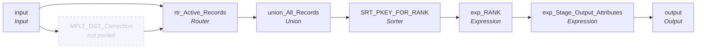

# mplt_Pty_Rle_Rel_Timeline_Validation

IDQ mapplet &rarr; CDI **Mapplet** `mplt_Pty_Rle_Rel_Timeline_Validation`.

> **Not ported: stale MDM timeline.** This mapplet duplicates end-dated relationships into open and closed versions, re-ranks `VERSION_SEQ`, sets `PERIOD_REFERENCE_TIME` / `TIMELINE_ACTION` and forces `HUB_STATE_IND` on open rows. Do not build it; the callers link around it. The spec below is kept for reference only.

> Mapplet validates and calculates PERIOD_START_DATE, PERIOD_END_DATE, VERSION_SEQ, PERIOD_REFERENCE_TIME, TIMELINE_ACTION, and LAST_UPDATE_DATE for PTY_RLE_REL

## Summary

## Not ported (stale MDM timeline)

These steps are not built (and not counted above); their sections below say how to rewire around them.

| Step | IDQ type | Reason |
|---|---|---|
| MPLT_DST_Correction | MappletTx | Calls the retired mapplet `mplt_DST_Correction`, which shifts end dates by one hour around daylight-saving changes for the timeline. Link the fields that feed it straight to the fields it fed. |

## Flow

## Transformations

In data-flow order.

### input

IDQ `MappletInputTx` &rarr; CDI **Input**. Mapplet Input transformation.

| Field | Type |
|---|---|
| PKEY_SRC_OBJECT | string(255) |
| ROWID_OBJECT | string(14) |
| DELETED_IND | decimal(38) |
| DELETED_DATE | date/time |
| DELETED_BY | string(50) |
| PERIOD_START_DATE | date/time |
| PERIOD_END_DATE | date/time |
| VERSION_SEQ | decimal(38) |
| PERIOD_REFERENCE_TIME | date/time |
| TIMELINE_ACTION | decimal(38) |
| LAST_UPDATE_DATE | date/time |
| UPDATED_BY | string(50) |
| CREATE_DATE | date/time |
| CREATOR | string(50) |
| SRC_ROWID | string(30) |
| HUB_STATE_IND | decimal(38) |
| PTY_RLE_FK_1 | string(255) |
| PTY_RLE_FK_2 | string(255) |
| REL_TYPE_CODE | string(255) |
| HIERARCHY_CODE | string(255) |
| REL_TP | string(255) |
| SRC_LAST_UPD_DT | date/time |

### MPLT_DST_Correction (not ported)

IDQ `MappletTx`. **Not ported: stale MDM timeline.** Calls the retired mapplet `mplt_DST_Correction`, which shifts end dates by one hour around daylight-saving changes for the timeline. Link the fields that feed it straight to the fields it fed.

Links (target field &larr; upstream field):

| Field | From |
|---|---|
| Group.Period_Start_Date | input.PERIOD_START_DATE |
| Group.Period_End_Date | input.PERIOD_END_DATE |

### rtr_Active_Records

IDQ `RouterTx` &rarr; CDI **Router**. One output group per IDQ group; the default group is created automatically.

| Output group | Condition |
|---|---|
| End_Dated_Records | `not isnull(PERIOD_END_DATE)` |
| Default | (default group) |

Links (target field &larr; upstream field):

| Field | From |
|---|---|
| PERIOD_END_DATE | MPLT_DST_Correction.output_DST_correction.Period_End_Date |
| PKEY_SRC_OBJECT | input.PKEY_SRC_OBJECT |
| ROWID_OBJECT | input.ROWID_OBJECT |
| DELETED_IND | input.DELETED_IND |
| DELETED_DATE | input.DELETED_DATE |
| DELETED_BY | input.DELETED_BY |
| PERIOD_START_DATE | input.PERIOD_START_DATE |
| VERSION_SEQ (stale timeline: do not map) | input.VERSION_SEQ |
| PERIOD_REFERENCE_TIME (stale timeline: do not map) | input.PERIOD_REFERENCE_TIME |
| TIMELINE_ACTION (stale timeline: do not map) | input.TIMELINE_ACTION |
| LAST_UPDATE_DATE | input.LAST_UPDATE_DATE |
| UPDATED_BY | input.UPDATED_BY |
| CREATE_DATE | input.CREATE_DATE |
| CREATOR | input.CREATOR |
| SRC_ROWID | input.SRC_ROWID |
| HUB_STATE_IND | input.HUB_STATE_IND |
| PTY_RLE_FK_1 | input.PTY_RLE_FK_1 |
| PTY_RLE_FK_2 | input.PTY_RLE_FK_2 |
| REL_TYPE_CODE | input.REL_TYPE_CODE |
| HIERARCHY_CODE | input.HIERARCHY_CODE |
| REL_TP | input.REL_TP |
| SRC_LAST_UPD_DT | input.SRC_LAST_UPD_DT |

### union_All_Records

IDQ `UnionTx` &rarr; CDI **Union**. One input group per IDQ group.

Input groups: `Active_Records`, `New_Active_Records`, `End_Dated_Records`

Links (target field &larr; upstream field):

| Field | From |
|---|---|
| Active_Records.PKEY_SRC_OBJECT | rtr_Active_Records.Default.PKEY_SRC_OBJECT |
| Active_Records.ROWID_OBJECT | rtr_Active_Records.Default.ROWID_OBJECT |
| Active_Records.DELETED_IND | rtr_Active_Records.Default.DELETED_IND |
| Active_Records.DELETED_DATE | rtr_Active_Records.Default.DELETED_DATE |
| Active_Records.DELETED_BY | rtr_Active_Records.Default.DELETED_BY |
| Active_Records.PERIOD_START_DATE | rtr_Active_Records.Default.PERIOD_START_DATE |
| Active_Records.PERIOD_END_DATE | rtr_Active_Records.Default.PERIOD_END_DATE |
| Active_Records.VERSION_SEQ (stale timeline: do not map) | rtr_Active_Records.Default.VERSION_SEQ |
| Active_Records.PERIOD_REFERENCE_TIME (stale timeline: do not map) | rtr_Active_Records.Default.PERIOD_REFERENCE_TIME |
| Active_Records.TIMELINE_ACTION (stale timeline: do not map) | rtr_Active_Records.Default.TIMELINE_ACTION |
| Active_Records.LAST_UPDATE_DATE | rtr_Active_Records.Default.LAST_UPDATE_DATE |
| Active_Records.UPDATED_BY | rtr_Active_Records.Default.UPDATED_BY |
| Active_Records.CREATE_DATE | rtr_Active_Records.Default.CREATE_DATE |
| Active_Records.CREATOR | rtr_Active_Records.Default.CREATOR |
| Active_Records.SRC_ROWID | rtr_Active_Records.Default.SRC_ROWID |
| Active_Records.HUB_STATE_IND | rtr_Active_Records.Default.HUB_STATE_IND |
| Active_Records.PTY_RLE_FK_1 | rtr_Active_Records.Default.PTY_RLE_FK_1 |
| Active_Records.PTY_RLE_FK_2 | rtr_Active_Records.Default.PTY_RLE_FK_2 |
| Active_Records.REL_TYPE_CODE | rtr_Active_Records.Default.REL_TYPE_CODE |
| Active_Records.HIERARCHY_CODE | rtr_Active_Records.Default.HIERARCHY_CODE |
| Active_Records.REL_TP | rtr_Active_Records.Default.REL_TP |
| New_Active_Records.PKEY_SRC_OBJECT | rtr_Active_Records.End_Dated_Records.PKEY_SRC_OBJECT |
| New_Active_Records.ROWID_OBJECT | rtr_Active_Records.End_Dated_Records.ROWID_OBJECT |
| New_Active_Records.DELETED_IND | rtr_Active_Records.End_Dated_Records.DELETED_IND |
| New_Active_Records.DELETED_DATE | rtr_Active_Records.End_Dated_Records.DELETED_DATE |
| New_Active_Records.DELETED_BY | rtr_Active_Records.End_Dated_Records.DELETED_BY |
| New_Active_Records.PERIOD_START_DATE | rtr_Active_Records.End_Dated_Records.PERIOD_START_DATE |
| New_Active_Records.VERSION_SEQ (stale timeline: do not map) | rtr_Active_Records.End_Dated_Records.VERSION_SEQ |
| New_Active_Records.PERIOD_REFERENCE_TIME (stale timeline: do not map) | rtr_Active_Records.End_Dated_Records.PERIOD_REFERENCE_TIME |
| New_Active_Records.TIMELINE_ACTION (stale timeline: do not map) | rtr_Active_Records.End_Dated_Records.TIMELINE_ACTION |
| New_Active_Records.LAST_UPDATE_DATE | rtr_Active_Records.End_Dated_Records.LAST_UPDATE_DATE |
| New_Active_Records.UPDATED_BY | rtr_Active_Records.End_Dated_Records.UPDATED_BY |
| New_Active_Records.CREATE_DATE | rtr_Active_Records.End_Dated_Records.CREATE_DATE |
| New_Active_Records.CREATOR | rtr_Active_Records.End_Dated_Records.CREATOR |
| New_Active_Records.SRC_ROWID | rtr_Active_Records.End_Dated_Records.SRC_ROWID |
| New_Active_Records.HUB_STATE_IND | rtr_Active_Records.End_Dated_Records.HUB_STATE_IND |
| New_Active_Records.PTY_RLE_FK_1 | rtr_Active_Records.End_Dated_Records.PTY_RLE_FK_1 |
| New_Active_Records.PTY_RLE_FK_2 | rtr_Active_Records.End_Dated_Records.PTY_RLE_FK_2 |
| New_Active_Records.REL_TYPE_CODE | rtr_Active_Records.End_Dated_Records.REL_TYPE_CODE |
| New_Active_Records.HIERARCHY_CODE | rtr_Active_Records.End_Dated_Records.HIERARCHY_CODE |
| New_Active_Records.REL_TP | rtr_Active_Records.End_Dated_Records.REL_TP |
| End_Dated_Records.PKEY_SRC_OBJECT | rtr_Active_Records.End_Dated_Records.PKEY_SRC_OBJECT |
| End_Dated_Records.ROWID_OBJECT | rtr_Active_Records.End_Dated_Records.ROWID_OBJECT |
| End_Dated_Records.DELETED_IND | rtr_Active_Records.End_Dated_Records.DELETED_IND |
| End_Dated_Records.DELETED_DATE | rtr_Active_Records.End_Dated_Records.DELETED_DATE |
| End_Dated_Records.DELETED_BY | rtr_Active_Records.End_Dated_Records.DELETED_BY |
| End_Dated_Records.PERIOD_START_DATE | rtr_Active_Records.End_Dated_Records.PERIOD_START_DATE |
| End_Dated_Records.PERIOD_END_DATE | rtr_Active_Records.End_Dated_Records.PERIOD_END_DATE |
| End_Dated_Records.VERSION_SEQ (stale timeline: do not map) | rtr_Active_Records.End_Dated_Records.VERSION_SEQ |
| End_Dated_Records.PERIOD_REFERENCE_TIME (stale timeline: do not map) | rtr_Active_Records.End_Dated_Records.PERIOD_REFERENCE_TIME |
| End_Dated_Records.TIMELINE_ACTION (stale timeline: do not map) | rtr_Active_Records.End_Dated_Records.TIMELINE_ACTION |
| End_Dated_Records.LAST_UPDATE_DATE | rtr_Active_Records.End_Dated_Records.LAST_UPDATE_DATE |
| End_Dated_Records.UPDATED_BY | rtr_Active_Records.End_Dated_Records.UPDATED_BY |
| End_Dated_Records.CREATE_DATE | rtr_Active_Records.End_Dated_Records.CREATE_DATE |
| End_Dated_Records.CREATOR | rtr_Active_Records.End_Dated_Records.CREATOR |
| End_Dated_Records.SRC_ROWID | rtr_Active_Records.End_Dated_Records.SRC_ROWID |
| End_Dated_Records.HUB_STATE_IND | rtr_Active_Records.End_Dated_Records.HUB_STATE_IND |
| End_Dated_Records.PTY_RLE_FK_1 | rtr_Active_Records.End_Dated_Records.PTY_RLE_FK_1 |
| End_Dated_Records.PTY_RLE_FK_2 | rtr_Active_Records.End_Dated_Records.PTY_RLE_FK_2 |
| End_Dated_Records.REL_TYPE_CODE | rtr_Active_Records.End_Dated_Records.REL_TYPE_CODE |
| End_Dated_Records.HIERARCHY_CODE | rtr_Active_Records.End_Dated_Records.HIERARCHY_CODE |
| End_Dated_Records.REL_TP | rtr_Active_Records.End_Dated_Records.REL_TP |
| Active_Records.SRC_LAST_UPD_DT | rtr_Active_Records.Default.SRC_LAST_UPD_DT |
| New_Active_Records.SRC_LAST_UPD_DT | rtr_Active_Records.End_Dated_Records.SRC_LAST_UPD_DT |
| End_Dated_Records.SRC_LAST_UPD_DT | rtr_Active_Records.End_Dated_Records.SRC_LAST_UPD_DT |

### SRT_PKEY_FOR_RANK

IDQ `SorterTx` &rarr; CDI **Sorter**. Sort keys in the order listed; distinct, case and null settings below.

| # | Sort key | Order |
|---|---|---|
| 1 | PKEY_SRC_OBJECT | ascending |
| 2 | PERIOD_START_DATE | ascending |
| 3 | PERIOD_END_DATE | descending |

| Property | Value |
|---|---|
| Distinct | no |
| Case sensitive | yes |
| Null treated high | yes |

Links (target field &larr; upstream field):

| Field | From |
|---|---|
| PKEY_SRC_OBJECT | union_All_Records.OUTPUT.PKEY_SRC_OBJECT |
| ROWID_OBJECT | union_All_Records.OUTPUT.ROWID_OBJECT |
| DELETED_IND | union_All_Records.OUTPUT.DELETED_IND |
| DELETED_DATE | union_All_Records.OUTPUT.DELETED_DATE |
| DELETED_BY | union_All_Records.OUTPUT.DELETED_BY |
| PERIOD_START_DATE | union_All_Records.OUTPUT.PERIOD_START_DATE |
| PERIOD_END_DATE | union_All_Records.OUTPUT.PERIOD_END_DATE |
| VERSION_SEQ (stale timeline: do not map) | union_All_Records.OUTPUT.VERSION_SEQ |
| PERIOD_REFERENCE_TIME (stale timeline: do not map) | union_All_Records.OUTPUT.PERIOD_REFERENCE_TIME |
| TIMELINE_ACTION (stale timeline: do not map) | union_All_Records.OUTPUT.TIMELINE_ACTION |
| LAST_UPDATE_DATE | union_All_Records.OUTPUT.LAST_UPDATE_DATE |
| UPDATED_BY | union_All_Records.OUTPUT.UPDATED_BY |
| CREATE_DATE | union_All_Records.OUTPUT.CREATE_DATE |
| CREATOR | union_All_Records.OUTPUT.CREATOR |
| SRC_ROWID | union_All_Records.OUTPUT.SRC_ROWID |
| HUB_STATE_IND | union_All_Records.OUTPUT.HUB_STATE_IND |
| PTY_RLE_FK_1 | union_All_Records.OUTPUT.PTY_RLE_FK_1 |
| PTY_RLE_FK_2 | union_All_Records.OUTPUT.PTY_RLE_FK_2 |
| REL_TYPE_CODE | union_All_Records.OUTPUT.REL_TYPE_CODE |
| HIERARCHY_CODE | union_All_Records.OUTPUT.HIERARCHY_CODE |
| REL_TP | union_All_Records.OUTPUT.REL_TP |
| SRC_LAST_UPD_DT | union_All_Records.OUTPUT.SRC_LAST_UPD_DT |

### exp_RANK

IDQ `ExpressionTx` &rarr; CDI **Expression**. Same expression language; variable fields are supported.

| Field | Kind | Type | Expression (CDI) |
|---|---|---|---|
| PKEY_SRC_OBJECT | in/out | string(255) |  |
| ROWID_OBJECT | in/out | string(14) |  |
| DELETED_IND | in/out | decimal(38) |  |
| DELETED_DATE | in/out | date/time |  |
| DELETED_BY | in/out | string(50) |  |
| PERIOD_START_DATE | in/out | date/time |  |
| PERIOD_END_DATE | in/out | date/time |  |
| VERSION_SEQ (stale timeline: omit) | in | decimal(38) |  |
| PERIOD_REFERENCE_TIME (stale timeline: omit) | in/out | date/time |  |
| TIMELINE_ACTION (stale timeline: omit) | in/out | decimal(38) |  |
| LAST_UPDATE_DATE | in/out | date/time |  |
| UPDATED_BY | in/out | string(50) |  |
| CREATE_DATE | in/out | date/time |  |
| CREATOR | in/out | string(50) |  |
| SRC_ROWID | in/out | string(30) |  |
| HUB_STATE_IND | in/out | decimal(38) |  |
| PTY_RLE_FK_1 | in/out | string(255) |  |
| PTY_RLE_FK_2 | in/out | string(255) |  |
| REL_TYPE_CODE | in/out | string(255) |  |
| HIERARCHY_CODE | in/out | string(255) |  |
| REL_TP | in/out | string(255) |  |
| v_CUR_PKEY_SRC_OBJECT | variable | string(255) | `PKEY_SRC_OBJECT` |
| v_CUR_RANK (stale timeline: omit) | variable | integer | `IIF(v_CUR_PKEY_SRC_OBJECT<>v_LST_PKEY_SRC_OBJECT,1,v_CUR_RANK+1)` |
| o_VERSION_SEQ (stale timeline: omit) | out | integer | `v_CUR_RANK` |
| v_LST_PKEY_SRC_OBJECT | variable | string(255) | `v_CUR_PKEY_SRC_OBJECT` |
| SRC_LAST_UPD_DT | in/out | date/time |  |

Links (target field &larr; upstream field):

| Field | From |
|---|---|
| PKEY_SRC_OBJECT | SRT_PKEY_FOR_RANK.PKEY_SRC_OBJECT |
| ROWID_OBJECT | SRT_PKEY_FOR_RANK.ROWID_OBJECT |
| DELETED_IND | SRT_PKEY_FOR_RANK.DELETED_IND |
| DELETED_DATE | SRT_PKEY_FOR_RANK.DELETED_DATE |
| DELETED_BY | SRT_PKEY_FOR_RANK.DELETED_BY |
| PERIOD_START_DATE | SRT_PKEY_FOR_RANK.PERIOD_START_DATE |
| PERIOD_END_DATE | SRT_PKEY_FOR_RANK.PERIOD_END_DATE |
| VERSION_SEQ (stale timeline: do not map) | SRT_PKEY_FOR_RANK.VERSION_SEQ |
| PERIOD_REFERENCE_TIME (stale timeline: do not map) | SRT_PKEY_FOR_RANK.PERIOD_REFERENCE_TIME |
| TIMELINE_ACTION (stale timeline: do not map) | SRT_PKEY_FOR_RANK.TIMELINE_ACTION |
| LAST_UPDATE_DATE | SRT_PKEY_FOR_RANK.LAST_UPDATE_DATE |
| UPDATED_BY | SRT_PKEY_FOR_RANK.UPDATED_BY |
| CREATE_DATE | SRT_PKEY_FOR_RANK.CREATE_DATE |
| CREATOR | SRT_PKEY_FOR_RANK.CREATOR |
| SRC_ROWID | SRT_PKEY_FOR_RANK.SRC_ROWID |
| HUB_STATE_IND | SRT_PKEY_FOR_RANK.HUB_STATE_IND |
| PTY_RLE_FK_1 | SRT_PKEY_FOR_RANK.PTY_RLE_FK_1 |
| PTY_RLE_FK_2 | SRT_PKEY_FOR_RANK.PTY_RLE_FK_2 |
| REL_TYPE_CODE | SRT_PKEY_FOR_RANK.REL_TYPE_CODE |
| HIERARCHY_CODE | SRT_PKEY_FOR_RANK.HIERARCHY_CODE |
| REL_TP | SRT_PKEY_FOR_RANK.REL_TP |
| SRC_LAST_UPD_DT | SRT_PKEY_FOR_RANK.SRC_LAST_UPD_DT |

### exp_Stage_Output_Attributes

IDQ `ExpressionTx` &rarr; CDI **Expression**. Same expression language; variable fields are supported.

| Field | Kind | Type | Expression (CDI) |
|---|---|---|---|
| PKEY_SRC_OBJECT | in/out | string(255) | `PKEY_SRC_OBJECT` |
| ROWID_OBJECT | in/out | string(14) | `ROWID_OBJECT` |
| DELETED_IND | in/out | decimal(38) | `DELETED_IND` |
| DELETED_DATE | in/out | date/time | `DELETED_DATE` |
| DELETED_BY | in/out | string(50) | `DELETED_BY` |
| PERIOD_START_DATE | in/out | date/time | `PERIOD_START_DATE` |
| PERIOD_END_DATE | in/out | date/time | `PERIOD_END_DATE` |
| VERSION_SEQ (stale timeline: omit) | in/out | decimal(38) | `VERSION_SEQ` |
| PERIOD_REFERENCE_TIME (stale timeline: omit) | in/out | date/time | `PERIOD_REFERENCE_TIME` |
| TIMELINE_ACTION (stale timeline: omit) | in/out | decimal(38) | `TIMELINE_ACTION` |
| LAST_UPDATE_DATE | in/out | date/time | `LAST_UPDATE_DATE` |
| UPDATED_BY | in/out | string(50) | `UPDATED_BY` |
| CREATE_DATE | in/out | date/time | `CREATE_DATE` |
| CREATOR | in/out | string(50) | `CREATOR` |
| SRC_ROWID | in/out | string(30) | `SRC_ROWID` |
| HUB_STATE_IND | in/out | decimal(38) | `HUB_STATE_IND` |
| PTY_RLE_FK_1 | in/out | string(255) | `PTY_RLE_FK_1` |
| PTY_RLE_FK_2 | in/out | string(255) | `PTY_RLE_FK_2` |
| REL_TYPE_CODE | in/out | string(255) | `REL_TYPE_CODE` |
| HIERARCHY_CODE | in/out | string(255) | `HIERARCHY_CODE` |
| REL_TP | in/out | string(255) | `REL_TP` |
| out_PERIOD_REFERENCE_TIME (stale timeline: omit) | out | date/time | `iif(not isnull(PERIOD_END_DATE), PERIOD_END_DATE, null)` |
| out_TIMELINE_ACTION (stale timeline: omit) | out | integer | `iif(not isnull(PERIOD_END_DATE), 2, null)` |
| out_LAST_UPDATE_DATE | out | date/time | `SESSSTARTTIME` |
| out_HUB_STATE_IND | out | decimal(38) | `iif(isnull(PERIOD_END_DATE) and isnull (HUB_STATE_IND) and VERSION_SEQ = 1, 1, HUB_STATE_IND) -- For un terminated records ("Open" records) force the hub state to active.   -- This addresses a bug where informatica will raise a PRT error if all xrefs are soft deleted before end dating` |
| SRC_LAST_UPD_DT | in/out | date/time |  |

Links (target field &larr; upstream field):

| Field | From |
|---|---|
| PKEY_SRC_OBJECT | exp_RANK.PKEY_SRC_OBJECT |
| ROWID_OBJECT | exp_RANK.ROWID_OBJECT |
| DELETED_IND | exp_RANK.DELETED_IND |
| DELETED_DATE | exp_RANK.DELETED_DATE |
| DELETED_BY | exp_RANK.DELETED_BY |
| PERIOD_START_DATE | exp_RANK.PERIOD_START_DATE |
| PERIOD_END_DATE | exp_RANK.PERIOD_END_DATE |
| UPDATED_BY | exp_RANK.UPDATED_BY |
| CREATE_DATE | exp_RANK.CREATE_DATE |
| CREATOR | exp_RANK.CREATOR |
| SRC_ROWID | exp_RANK.SRC_ROWID |
| HUB_STATE_IND | exp_RANK.HUB_STATE_IND |
| PTY_RLE_FK_1 | exp_RANK.PTY_RLE_FK_1 |
| PTY_RLE_FK_2 | exp_RANK.PTY_RLE_FK_2 |
| REL_TYPE_CODE | exp_RANK.REL_TYPE_CODE |
| HIERARCHY_CODE | exp_RANK.HIERARCHY_CODE |
| REL_TP | exp_RANK.REL_TP |
| VERSION_SEQ (stale timeline: do not map) | exp_RANK.o_VERSION_SEQ |
| PERIOD_REFERENCE_TIME (stale timeline: do not map) | exp_RANK.PERIOD_REFERENCE_TIME |
| TIMELINE_ACTION (stale timeline: do not map) | exp_RANK.TIMELINE_ACTION |
| LAST_UPDATE_DATE | exp_RANK.LAST_UPDATE_DATE |
| SRC_LAST_UPD_DT | exp_RANK.SRC_LAST_UPD_DT |

### output

IDQ `MappletOutputTx` &rarr; CDI **Output**. Mapplet Output transformation.

| Field | Type |
|---|---|
| PKEY_SRC_OBJECT | string(255) |
| ROWID_OBJECT | string(14) |
| DELETED_IND | decimal(38) |
| DELETED_DATE | date/time |
| DELETED_BY | string(50) |
| PERIOD_START_DATE | date/time |
| PERIOD_END_DATE | date/time |
| VERSION_SEQ | decimal(38) |
| PERIOD_REFERENCE_TIME | date/time |
| TIMELINE_ACTION | decimal(38) |
| LAST_UPDATE_DATE | date/time |
| UPDATED_BY | string(50) |
| CREATE_DATE | date/time |
| CREATOR | string(50) |
| SRC_ROWID | string(30) |
| HUB_STATE_IND | decimal(38) |
| PTY_RLE_FK_1 | string(255) |
| PTY_RLE_FK_2 | string(255) |
| REL_TYPE_CODE | string(255) |
| HIERARCHY_CODE | string(255) |
| REL_TP | string(255) |
| SRC_LAST_UPD_DT | date/time |

Links (target field &larr; upstream field):

| Field | From |
|---|---|
| PKEY_SRC_OBJECT | exp_Stage_Output_Attributes.PKEY_SRC_OBJECT |
| ROWID_OBJECT | exp_Stage_Output_Attributes.ROWID_OBJECT |
| DELETED_IND | exp_Stage_Output_Attributes.DELETED_IND |
| DELETED_DATE | exp_Stage_Output_Attributes.DELETED_DATE |
| DELETED_BY | exp_Stage_Output_Attributes.DELETED_BY |
| PERIOD_START_DATE | exp_Stage_Output_Attributes.PERIOD_START_DATE |
| PERIOD_END_DATE | exp_Stage_Output_Attributes.PERIOD_END_DATE |
| VERSION_SEQ (stale timeline: do not map) | exp_Stage_Output_Attributes.VERSION_SEQ |
| UPDATED_BY | exp_Stage_Output_Attributes.UPDATED_BY |
| CREATE_DATE | exp_Stage_Output_Attributes.CREATE_DATE |
| CREATOR | exp_Stage_Output_Attributes.CREATOR |
| SRC_ROWID | exp_Stage_Output_Attributes.SRC_ROWID |
| PTY_RLE_FK_1 | exp_Stage_Output_Attributes.PTY_RLE_FK_1 |
| PTY_RLE_FK_2 | exp_Stage_Output_Attributes.PTY_RLE_FK_2 |
| REL_TYPE_CODE | exp_Stage_Output_Attributes.REL_TYPE_CODE |
| HIERARCHY_CODE | exp_Stage_Output_Attributes.HIERARCHY_CODE |
| REL_TP | exp_Stage_Output_Attributes.REL_TP |
| PERIOD_REFERENCE_TIME (stale timeline: do not map) | exp_Stage_Output_Attributes.out_PERIOD_REFERENCE_TIME |
| TIMELINE_ACTION (stale timeline: do not map) | exp_Stage_Output_Attributes.out_TIMELINE_ACTION |
| LAST_UPDATE_DATE | exp_Stage_Output_Attributes.out_LAST_UPDATE_DATE |
| HUB_STATE_IND | exp_Stage_Output_Attributes.out_HUB_STATE_IND |
| SRC_LAST_UPD_DT | exp_Stage_Output_Attributes.SRC_LAST_UPD_DT |
