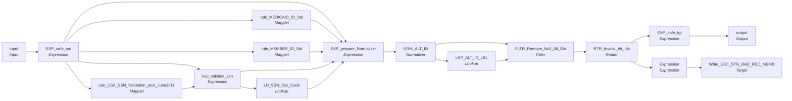

# mplt_TRS_Pty_Rle_Alt_Id_Normalization

IDQ mapplet &rarr; CDI **Mapplet** `mplt_TRS_Pty_Rle_Alt_Id_Normalization`.

## Summary

| IDQ transformation | CDI transformation | Count |
|---|---|---|
| ExpressionTx | Expression | 5 |
| FilterTx | Filter | 1 |
| LookupTx | Lookup | 2 |
| MappletInputTx | Input | 1 |
| MappletOutputTx | Output | 1 |
| MappletTx | Mapplet | 3 |
| NormalizerTx | Normalizer | 1 |
| RouterTx | Router | 1 |
| TargetTx | Target | 1 |

Targets:

| Instance | Object | Connection |
|---|---|---|
| Write_EXC_STG_BAD_REC_MEMB | `EXC_STG_BAD_REC_MEMB` | STAGING |

`$sys.MappingName` is translated to the input parameter `$$MappingName` (default: the mapping name).

## Flow



## Filtered data

Every step that can stop, divert or collapse rows, and what happens to the rows that do not pass. A Filter keeps a row only when its condition is TRUE: FALSE **or NULL** drops the row silently (no target, no reject file). A Router writes a row to **every** group whose condition is TRUE; a row that matches no group goes to the default group and is discarded when that group is not linked. Comments (`--`, `//`) are removed from the conditions shown here. A `= ...` line reads a null check on a lookup return in plain terms; *no matching row* also covers a matching row whose returned field is NULL.

### Steps that filter rows

| Step | IDQ type | Rule | Rows that pass go to | Rows that do not pass |
|---|---|---|---|---|
| FLTR_Remove_Null_Alt_IDs | FilterTx | keep `NOT ISNULL(ALT_ID_VAL) AND RTRIM(ALT_ID_VAL) <> ''` | mapplet output `output`, `EXC_STG_BAD_REC_MEMB` | **discarded** |
| RTR_Invalid_Alt_Ids | RouterTx | group `Valid_Alt_ID`: `ISNULL(DQ_EXCP_CD) OR LENGTH(RTRIM(DQ_EXCP_CD))=0` | mapplet output `output` |  |
| RTR_Invalid_Alt_Ids | RouterTx | default group `Default`: rows that match no other group | `EXC_STG_BAD_REC_MEMB` |  |

### Where the condition fields come from

| Step | Field | Origin |
|---|---|---|
| FLTR_Remove_Null_Alt_IDs | `ALT_ID_VAL` | `ALT_ID_VAL` output of `NRM_ALT_ID` (CDI Normalizer) |
| RTR_Invalid_Alt_Ids | `DQ_EXCP_CD` | `DQ_EXCP_CD` output of `NRM_ALT_ID` (CDI Normalizer) |

## Transformations

In data-flow order.

### input

IDQ `MappletInputTx` &rarr; CDI **Input**. Mapplet Input transformation.

| Field | Type |
|---|---|
| PKEY_SRC_OBJECT_PTY | string(255) |
| PERIOD_START_DATE | date/time |
| ALT_ID_VAL_MEDICAID_ID | string(20) |
| ALT_ID_VAL_SSN | decimal(20) |
| ALT_ID_VAL_MEMBER_ID | string(20) |
| ALT_ID_VAL_NS_CLIENT_ID | string(20) |
| SRC_SYS | string(10) |
| CV_IND | string(1) |

### EXP_safe_src

IDQ `ExpressionTx` &rarr; CDI **Expression**. Same expression language; variable fields are supported.

| Field | Kind | Type | Expression (CDI) |
|---|---|---|---|
| PKEY_SRC_OBJECT_PTY | in/out | string(255) | `PKEY_SRC_OBJECT_PTY` |
| PERIOD_START_DATE | in/out | date/time | `PERIOD_START_DATE` |
| ALT_ID_VAL_MEDICAID_ID | in/out | string(20) | `ALT_ID_VAL_MEDICAID_ID` |
| ALT_ID_TYP_MEDICAID_ID | out | string(20) | `'002'` |
| ALT_ID_VAL_SSN_NUM | in/out | decimal(20) | `ALT_ID_VAL_SSN_NUM` |
| ALT_ID_VAL_SSN_TXT | out | string(10) | `LPAD(ALT_ID_VAL_SSN_NUM,9,'0')` |
| ALT_ID_TYP_SSN | out | string(20) | `'004'` |
| ALT_ID_VAL_MEMBER_ID | in/out | string(20) | `ALT_ID_VAL_MEMBER_ID` |
| ALT_ID_TYP_MEMBER_ID | out | string(20) | `'007'` |
| ALT_ID_VAL_NS_CLIENT_ID | in/out | string(20) | `ALT_ID_VAL_NS_CLIENT_ID` |
| ALIT_ID_TYP_NIS_CLIENT_ID | out | string(20) | `'009'` |
| SRC_SYS | in/out | string(10) | `SRC_SYS` |
| CV_IND | in/out | string(1) | `CV_IND` |

Links (target field &larr; upstream field):

| Field | From |
|---|---|
| PKEY_SRC_OBJECT_PTY | input.PKEY_SRC_OBJECT_PTY |
| PERIOD_START_DATE | input.PERIOD_START_DATE |
| ALT_ID_VAL_MEDICAID_ID | input.ALT_ID_VAL_MEDICAID_ID |
| ALT_ID_VAL_SSN_NUM | input.ALT_ID_VAL_SSN |
| ALT_ID_VAL_MEMBER_ID | input.ALT_ID_VAL_MEMBER_ID |
| SRC_SYS | input.SRC_SYS |
| ALT_ID_VAL_NS_CLIENT_ID | input.ALT_ID_VAL_NS_CLIENT_ID |
| CV_IND | input.CV_IND |

### rule_MEDICAID_ID_Std

IDQ `MappletTx` &rarr; CDI **Mapplet**. Reusable CDI mapplet (see the mapplets folder).

Mapplet: [`rule_MEDICAID_ID_Std`](../mapplets/rule_MEDICAID_ID_Std.md)

Links (target field &larr; upstream field):

| Field | From |
|---|---|
| Group.MEDICAID_ID | EXP_safe_src.ALT_ID_VAL_MEDICAID_ID |

### rule_MEMBER_ID_Std

IDQ `MappletTx` &rarr; CDI **Mapplet**. Reusable CDI mapplet (see the mapplets folder).

Mapplet: [`rule_Member_Id_Std`](../mapplets/rule_Member_Id_Std.md)

Links (target field &larr; upstream field):

| Field | From |
|---|---|
| Group.MEMBER_ID | EXP_safe_src.ALT_ID_VAL_MEMBER_ID |

### rule_USA_SSN_Validation_post_June2011

IDQ `MappletTx` &rarr; CDI **Mapplet**. Reusable CDI mapplet (see the mapplets folder).

Mapplet: [`rule_USA_SSN_Validation_post_June2011`](../mapplets/rule_USA_SSN_Validation_post_June2011.md)

Links (target field &larr; upstream field):

| Field | From |
|---|---|
| Group.In_SSN | EXP_safe_src.ALT_ID_VAL_SSN_TXT |

### exp_validate_ssn

IDQ `ExpressionTx` &rarr; CDI **Expression**. Same expression language; variable fields are supported.

| Field | Kind | Type | Expression (CDI) |
|---|---|---|---|
| std_SSN_in | in | string(10) |  |
| std_SSN_out | out | string(10) | `IIF( SSN_Status = 'Invalid'<br>	,Null<br>	,std_SSN_in<br>)` |
| EXCEPTION_CODE1 | out | string(300) | `IIF( SSN_Status = 'Invalid'<br>	,'Invalid_SSN'<br>	,Null<br>)` |
| SSN_Status | in/out | string(15) | `SSN_Status` |

Links (target field &larr; upstream field):

| Field | From |
|---|---|
| std_SSN_in | EXP_safe_src.ALT_ID_VAL_SSN_TXT |
| SSN_Status | rule_USA_SSN_Validation_post_June2011.OUTPUT.Out_SSN_Status |

### LU_SSN_Exc_Code

IDQ `LookupTx` &rarr; CDI **Lookup**. Connected lookup unless a return port is set (then unconnected).

| Property | Value |
|---|---|
| Connection | STAGING |
| Object | EXC_LOOKUP_CODE_VALUE |
| Lookup condition | EXCEPTION_CODE = EXCEPTION_CODE1 |
| Multiple matches | Return any row |
| Cache | static cache |

| Lookup input field | Type |
|---|---|
| EXCEPTION_CODE1 | string(300) |

| Return / pass-through field | Feeds |
|---|---|
| EXCEPTION_CODE | EXP_prepare_Normalizer.DQ_Exception_Code_SSN |
| EXCEPTION_DESC | EXP_prepare_Normalizer.DQ_Exception_SSN |

Links (target field &larr; upstream field):

| Field | From |
|---|---|
| EXCEPTION_CODE1 | exp_validate_ssn.EXCEPTION_CODE1 |

### EXP_prepare_Normalizer

IDQ `ExpressionTx` &rarr; CDI **Expression**. Same expression language; variable fields are supported.

| Field | Kind | Type | Expression (CDI) |
|---|---|---|---|
| PKEY_SRC_OBJECT_PTY | in/out | string(255) | `PKEY_SRC_OBJECT_PTY` |
| PERIOD_START_DATE | in/out | date/time | `PERIOD_START_DATE` |
| ALT_ID_VAL_MEDICAID_ID | in/out | string(20) | `ALT_ID_VAL_MEDICAID_ID` |
| ALT_ID_TYP_MEDICAID_ID | in/out | string(20) | `ALT_ID_TYP_MEDICAID_ID` |
| DQ_EXCP_MEDICAID_ID | out | string(300) | `'Valid Medicaid ID'` |
| ALT_ID_VAL_SSN | in/out | string(20) | `ALT_ID_VAL_SSN` |
| ALT_ID_TYP_SSN | in/out | string(20) | `ALT_ID_TYP_SSN` |
| ALT_ID_VAL_MEMBER_ID | in/out | string(20) | `ALT_ID_VAL_MEMBER_ID` |
| ALT_ID_TYP_MEMBER_ID | in/out | string(20) | `ALT_ID_TYP_MEMBER_ID` |
| DQ_EXCP_MEMBER_ID | out | string(300) | `'Valid Member ID'` |
| DQ_Exception_Code_SSN | in/out | string(300) | `DQ_Exception_Code_SSN` |
| DQ_Exception_SSN | in/out | string(300) | `DQ_Exception_SSN` |
| ORIGINAL_SSN | in/out | string(20) | `ORIGINAL_SSN` |
| SRC_SYS | in/out | string(10) | `SRC_SYS` |
| ALT_ID_VAL_NS_CLIENT_ID | in/out | string(20) | `ALT_ID_VAL_NS_CLIENT_ID` |
| ALIT_ID_TYP_NIS_CLIENT_ID | in/out | string(20) | `ALIT_ID_TYP_NIS_CLIENT_ID` |
| Member_Id | in/out | string(10) | `Member_Id` |
| Member_Id_Exception_Type | in/out | string(300) | `Member_Id_Exception_Type` |
| Member_Id_Exception_Code | in/out | string(300) | `Member_Id_Exception_Code` |
| Member_Id_Exception_Desc | in/out | string(300) | `Member_Id_Exception_Desc` |
| Medicaid_Id | in/out | string(10) | `Medicaid_Id` |
| Medicaid_Id_Exception_Type | in/out | string(300) | `Medicaid_Id_Exception_Type` |
| Medicaid_Id_Exception_Code | in/out | string(300) | `Medicaid_Id_Exception_Code` |
| Medicaid_Id_Exception_Desc | in/out | string(300) | `Medicaid_Id_Exception_Desc` |
| CV_IND | in/out | string(1) | `CV_IND` |

Links (target field &larr; upstream field):

| Field | From |
|---|---|
| PKEY_SRC_OBJECT_PTY | EXP_safe_src.PKEY_SRC_OBJECT_PTY |
| PERIOD_START_DATE | EXP_safe_src.PERIOD_START_DATE |
| ALT_ID_VAL_SSN | exp_validate_ssn.std_SSN_out |
| ALT_ID_VAL_MEDICAID_ID | EXP_safe_src.ALT_ID_VAL_MEDICAID_ID |
| ALT_ID_VAL_MEMBER_ID | EXP_safe_src.ALT_ID_VAL_MEMBER_ID |
| ALT_ID_TYP_MEDICAID_ID | EXP_safe_src.ALT_ID_TYP_MEDICAID_ID |
| ALT_ID_TYP_SSN | EXP_safe_src.ALT_ID_TYP_SSN |
| ALT_ID_TYP_MEMBER_ID | EXP_safe_src.ALT_ID_TYP_MEMBER_ID |
| DQ_Exception_Code_SSN | LU_SSN_Exc_Code.EXCEPTION_CODE |
| DQ_Exception_SSN | LU_SSN_Exc_Code.EXCEPTION_DESC |
| ORIGINAL_SSN | EXP_safe_src.ALT_ID_VAL_SSN_TXT |
| SRC_SYS | EXP_safe_src.SRC_SYS |
| Member_Id | rule_MEMBER_ID_Std.NEWOUTPUT.Member_Id |
| Member_Id_Exception_Type | rule_MEMBER_ID_Std.NEWOUTPUT.Member_Id_Exception_Type |
| Member_Id_Exception_Code | rule_MEMBER_ID_Std.NEWOUTPUT.Member_Id_Exception_Code |
| Member_Id_Exception_Desc | rule_MEMBER_ID_Std.NEWOUTPUT.Member_Id_Exception_Desc |
| Medicaid_Id | rule_MEDICAID_ID_Std.NEWOUTPUT.Medicaid_Id |
| Medicaid_Id_Exception_Type | rule_MEDICAID_ID_Std.NEWOUTPUT.Medicaid_Id_Exception_Type |
| Medicaid_Id_Exception_Code | rule_MEDICAID_ID_Std.NEWOUTPUT.Medicaid_Id_Exception_Code |
| Medicaid_Id_Exception_Desc | rule_MEDICAID_ID_Std.NEWOUTPUT.Medicaid_Id_Exception_Desc |
| ALT_ID_VAL_NS_CLIENT_ID | EXP_safe_src.ALT_ID_VAL_NS_CLIENT_ID |
| ALIT_ID_TYP_NIS_CLIENT_ID | EXP_safe_src.ALIT_ID_TYP_NIS_CLIENT_ID |
| CV_IND | EXP_safe_src.CV_IND |

### NRM_ALT_ID

IDQ `NormalizerTx` &rarr; CDI **Normalizer**. Normalized fields with their occurrence counts below.

Normalized fields (a record with *Occurs* > 1 is a multiple-occurring field group):

| Field / record | Type | Occurs |
|---|---|---|
| PERIOD_START_DATE | date/time | 1 |
| PKEY_SRC_OBJECT_PTY | string(255) | 1 |
| ORIGINAL_SSN | string(20) | 1 |
| ALT_ID | record | 5 |
| &nbsp;&nbsp;ALT_ID_VAL | string(20) | 1 |
| &nbsp;&nbsp;ALT_ID_TYP | string(20) | 1 |
| &nbsp;&nbsp;DQ_EXCP | string(300) | 1 |
| &nbsp;&nbsp;DQ_EXCP_CD | string(300) | 1 |
| SRC_SYS | string(10) | 1 |
| CV_IND | string(1) | 1 |

IDQ output groups: `Output`, `Output1`. Downstream links below name the group; check that the CDI Normalizer exposes the same split, otherwise route the second group with a Router after a single output group.

Links (target field &larr; upstream field):

| Field | From |
|---|---|
| ALT_ID_TYP_MEDICAID_ID | EXP_prepare_Normalizer.ALT_ID_TYP_MEDICAID_ID |
| ALT_ID_TYP_SSN | EXP_prepare_Normalizer.ALT_ID_TYP_SSN |
| ALT_ID_VAL_MEDICAID_ID | EXP_prepare_Normalizer.ALT_ID_VAL_MEDICAID_ID |
| ALT_ID_VAL_SSN | EXP_prepare_Normalizer.ALT_ID_VAL_SSN |
| ALT_ID_VAL_MEMBER_ID | EXP_prepare_Normalizer.ALT_ID_VAL_MEMBER_ID |
| ALT_ID_TYP_MEMBER_ID | EXP_prepare_Normalizer.ALT_ID_TYP_MEMBER_ID |
| PERIOD_START_DATE | EXP_prepare_Normalizer.PERIOD_START_DATE |
| PKEY_SRC_OBJECT_PTY | EXP_prepare_Normalizer.PKEY_SRC_OBJECT_PTY |
| DQ_EXCP_SSN | EXP_prepare_Normalizer.DQ_Exception_SSN |
| DQ_EXCP_CD_SSN | EXP_prepare_Normalizer.DQ_Exception_Code_SSN |
| ORIGINAL_SSN | EXP_prepare_Normalizer.ORIGINAL_SSN |
| SRC_SYS | EXP_prepare_Normalizer.SRC_SYS |
| DQ_EXCP_CD_MEDICAID_ID | EXP_prepare_Normalizer.Medicaid_Id_Exception_Code |
| DQ_EXCP_MEDICAID_ID | EXP_prepare_Normalizer.Medicaid_Id_Exception_Desc |
| DQ_EXCP_CD_MEMBER_ID | EXP_prepare_Normalizer.Member_Id_Exception_Code |
| DQ_EXCP_MEMBER_ID | EXP_prepare_Normalizer.Member_Id_Exception_Desc |
| ALT_ID_VAL_NS_CIENT_ID | EXP_prepare_Normalizer.ALT_ID_VAL_NS_CLIENT_ID |
| ALT_ID_TYP_NS_CLIENT_ID | EXP_prepare_Normalizer.ALIT_ID_TYP_NIS_CLIENT_ID |
| CV_IND | EXP_prepare_Normalizer.CV_IND |

### LKP_ALT_ID_LBL

IDQ `LookupTx` &rarr; CDI **Lookup**. Connected lookup unless a return port is set (then unconnected).

| Property | Value |
|---|---|
| Connection | STAGING |
| Object | LOOKUP_CODE_VALUE |
| Lookup condition | MSTR_REF_CODE = ALT_ID_TYP AND SRC_SYS = SRC_SYS1 |
| Multiple matches | Return any row |
| Cache | static cache |

Filter (CDI source/lookup *Filter* property; translated):

```sql
"LOOKUP_CODE_VALUE"."CODE_TYPE"='ALT_ID_TP'
```

| Lookup input field | Type |
|---|---|
| ALT_ID_TYP | string(20) |
| SRC_SYS1 | string(10) |

| Return / pass-through field | Feeds |
|---|---|
| MSTR_REF_CODE | FLTR_Remove_Null_Alt_IDs.MSTR_REF_CODE |
| MSTR_REF_LABEL | FLTR_Remove_Null_Alt_IDs.MSTR_REF_LABEL |

Links (target field &larr; upstream field):

| Field | From |
|---|---|
| SRC_SYS1 | NRM_ALT_ID.Output1.SRC_SYS |
| ALT_ID_TYP | NRM_ALT_ID.Output1.ALT_ID_TYP |

### FLTR_Remove_Null_Alt_IDs

IDQ `FilterTx` &rarr; CDI **Filter**. Advanced filter condition.

Filter condition:

```
NOT ISNULL(ALT_ID_VAL) AND  RTRIM(ALT_ID_VAL) <> ''
```

Links (target field &larr; upstream field):

| Field | From |
|---|---|
| PERIOD_START_DATE | NRM_ALT_ID.Output1.PERIOD_START_DATE |
| PKEY_SRC_OBJECT_PTY | NRM_ALT_ID.Output1.PKEY_SRC_OBJECT_PTY |
| ORIGINAL_SSN | NRM_ALT_ID.Output1.ORIGINAL_SSN |
| ALT_ID_VAL | NRM_ALT_ID.Output1.ALT_ID_VAL |
| ALT_ID_TYP | NRM_ALT_ID.Output1.ALT_ID_TYP |
| DQ_EXCP | NRM_ALT_ID.Output1.DQ_EXCP |
| DQ_EXCP_CD | NRM_ALT_ID.Output1.DQ_EXCP_CD |
| SRC_SYS | NRM_ALT_ID.Output1.SRC_SYS |
| MSTR_REF_CODE | LKP_ALT_ID_LBL.MSTR_REF_CODE |
| MSTR_REF_LABEL | LKP_ALT_ID_LBL.MSTR_REF_LABEL |
| CV_IND | NRM_ALT_ID.Output1.CV_IND |

### RTR_Invalid_Alt_Ids

IDQ `RouterTx` &rarr; CDI **Router**. One output group per IDQ group; the default group is created automatically.

| Output group | Condition |
|---|---|
| Valid_Alt_ID | `ISNULL(DQ_EXCP_CD) OR LENGTH(RTRIM(DQ_EXCP_CD))=0` |
| Default | (default group) |

Links (target field &larr; upstream field):

| Field | From |
|---|---|
| PERIOD_START_DATE | FLTR_Remove_Null_Alt_IDs.PERIOD_START_DATE |
| PKEY_SRC_OBJECT_PTY | FLTR_Remove_Null_Alt_IDs.PKEY_SRC_OBJECT_PTY |
| ORIGINAL_SSN | FLTR_Remove_Null_Alt_IDs.ORIGINAL_SSN |
| ALT_ID_VAL | FLTR_Remove_Null_Alt_IDs.ALT_ID_VAL |
| ALT_ID_TYP | FLTR_Remove_Null_Alt_IDs.ALT_ID_TYP |
| DQ_EXCP | FLTR_Remove_Null_Alt_IDs.DQ_EXCP |
| DQ_EXCP_CD | FLTR_Remove_Null_Alt_IDs.DQ_EXCP_CD |
| SRC_SYS | FLTR_Remove_Null_Alt_IDs.SRC_SYS |
| MSTR_REF_CODE | FLTR_Remove_Null_Alt_IDs.MSTR_REF_CODE |
| MSTR_REF_LABEL | FLTR_Remove_Null_Alt_IDs.MSTR_REF_LABEL |
| CV_IND | FLTR_Remove_Null_Alt_IDs.CV_IND |

### EXP_safe_tgt

IDQ `ExpressionTx` &rarr; CDI **Expression**. Same expression language; variable fields are supported.

| Field | Kind | Type | Expression (CDI) |
|---|---|---|---|
| PERIOD_START_DATE | in/out | date/time | `PERIOD_START_DATE` |
| PKEY_SRC_OBJECT_PTY | in/out | string(255) | `PKEY_SRC_OBJECT_PTY` |
| ALT_ID_VAL | in/out | string(20) | `ALT_ID_VAL` |
| ALT_ID_TP_CD_MSTR | in/out | string(20) | `ALT_ID_TP_CD_MSTR` |
| SRC_SYS | in/out | string(10) |  |
| PKEY_SRC_OBJECT | out | string(255) | `PKEY_SRC_OBJECT_PTY \|\| '\|Member\|' \|\| ALT_ID_TP_CD_MSTR \|\| '\|' \|\| ALT_ID_VAL` |
| PKEY_SRC_OBJECT_PTYRLE | out | string(55) | `PKEY_SRC_OBJECT_PTY \|\| '\|' \|\| 'Member'` |
| CV_IND | in/out | string(1) | `CV_IND` |

Links (target field &larr; upstream field):

| Field | From |
|---|---|
| PERIOD_START_DATE | RTR_Invalid_Alt_Ids.Valid_Alt_ID.PERIOD_START_DATE |
| PKEY_SRC_OBJECT_PTY | RTR_Invalid_Alt_Ids.Valid_Alt_ID.PKEY_SRC_OBJECT_PTY |
| ALT_ID_VAL | RTR_Invalid_Alt_Ids.Valid_Alt_ID.ALT_ID_VAL |
| SRC_SYS | RTR_Invalid_Alt_Ids.Valid_Alt_ID.SRC_SYS |
| ALT_ID_TP_CD_MSTR | RTR_Invalid_Alt_Ids.Valid_Alt_ID.MSTR_REF_CODE |
| CV_IND | RTR_Invalid_Alt_Ids.Valid_Alt_ID.CV_IND |

### output

IDQ `MappletOutputTx` &rarr; CDI **Output**. Mapplet Output transformation.

| Field | Type |
|---|---|
| PERIOD_START_DATE | date/time |
| PTY_RLE_FK | string(255) |
| ALT_ID_VAL | string(20) |
| ALT_ID_TYP | string(20) |
| SRC_SYS | string(10) |
| PKEY_SRC_OBJECT_ALT_ID | string(255) |
| CV_IND | string(1) |

Links (target field &larr; upstream field):

| Field | From |
|---|---|
| PERIOD_START_DATE | EXP_safe_tgt.PERIOD_START_DATE |
| ALT_ID_VAL | EXP_safe_tgt.ALT_ID_VAL |
| SRC_SYS | EXP_safe_tgt.SRC_SYS |
| PKEY_SRC_OBJECT_ALT_ID | EXP_safe_tgt.PKEY_SRC_OBJECT |
| ALT_ID_TYP | EXP_safe_tgt.ALT_ID_TP_CD_MSTR |
| PTY_RLE_FK | EXP_safe_tgt.PKEY_SRC_OBJECT_PTYRLE |
| CV_IND | EXP_safe_tgt.CV_IND |

### Expression

IDQ `ExpressionTx` &rarr; CDI **Expression**. Same expression language; variable fields are supported.

| Field | Kind | Type | Expression (CDI) |
|---|---|---|---|
| PERIOD_START_DATE | in/out | date/time | `PERIOD_START_DATE` |
| PKEY_SRC_OBJECT_PTY | in/out | string(255) | `PKEY_SRC_OBJECT_PTY` |
| ORIGINAL_SSN | in/out | string(20) | `ORIGINAL_SSN` |
| ALT_ID_VAL | in/out | string(20) | `ALT_ID_VAL` |
| ALT_ID_TYP | in/out | string(20) | `ALT_ID_TYP` |
| DQ_EXCP | in/out | string(300) | `DQ_EXCP` |
| DQ_EXCP_CD | in/out | string(300) | `DQ_EXCP_CD` |
| EXC_TP | out | string(20) | `'Bad Value'` |
| SRC_SYS | in/out | string(10) | `SRC_SYS` |
| RUN_DATE | out | date/time | `SESSSTARTTIME` |
| MAPPING_NAME | out | string(50) | `$$MappingName` |

Links (target field &larr; upstream field):

| Field | From |
|---|---|
| PERIOD_START_DATE | RTR_Invalid_Alt_Ids.Default.PERIOD_START_DATE |
| PKEY_SRC_OBJECT_PTY | RTR_Invalid_Alt_Ids.Default.PKEY_SRC_OBJECT_PTY |
| ORIGINAL_SSN | RTR_Invalid_Alt_Ids.Default.ORIGINAL_SSN |
| ALT_ID_VAL | RTR_Invalid_Alt_Ids.Default.ALT_ID_VAL |
| ALT_ID_TYP | RTR_Invalid_Alt_Ids.Default.MSTR_REF_LABEL |
| DQ_EXCP | RTR_Invalid_Alt_Ids.Default.DQ_EXCP |
| DQ_EXCP_CD | RTR_Invalid_Alt_Ids.Default.DQ_EXCP_CD |
| SRC_SYS | RTR_Invalid_Alt_Ids.Default.SRC_SYS |

### Write_EXC_STG_BAD_REC_MEMB

IDQ `TargetTx` &rarr; CDI **Target**. Oracle connector target.

| Property | Value |
|---|---|
| Connection | STAGING |
| Object | EXC_STG_BAD_REC_MEMB |
| Operation | Insert |
| Truncate target table | no |
| Load type | normal (no bulk load) |
| Reject file | Write_EXC_STG_BAD_REC_MEMB.bad |

Links (target field &larr; upstream field):

| Field | From |
|---|---|
| MAPPING_NAME | Expression.MAPPING_NAME |
| ATTRIBUTE_VALUE | Expression.ALT_ID_VAL |
| ATTRIBUTE_NAME | Expression.ALT_ID_TYP |
| EXCEPTION_DESC | Expression.DQ_EXCP |
| EXCEPTION_CODE | Expression.DQ_EXCP_CD |
| EXCEPTION_TYPE | Expression.EXC_TP |
| SRC_SYS_ID_1 | Expression.PKEY_SRC_OBJECT_PTY |
| SRC_SYS | Expression.SRC_SYS |
| RUN_DATE | Expression.RUN_DATE |
