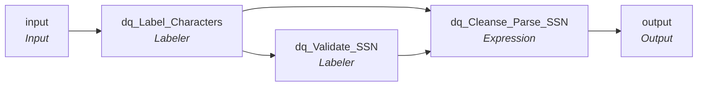

# rule_USA_SSN_Validation_post_June2011

IDQ mapplet &rarr; CDI **Mapplet** `rule_USA_SSN_Validation_post_June2011`.

> Rule validates a Social security number for length, numeric values and known min/max 
values of the area, group and serial number sections.  It does not check if the SSN is an 
issued number and no longer validates the group and area number combination
due to SSN Randomization effictive June 25, 2011.  See Docket No. SSA 2007-0046 for more information.

## Summary

| IDQ transformation | CDI transformation | Count |
|---|---|---|
| ExpressionTx | Expression | 1 |
| LabelerTx | Labeler | 2 |
| MappletInputTx | Input | 1 |
| MappletOutputTx | Output | 1 |

## Flow

## Transformations

In data-flow order.

### input

IDQ `MappletInputTx` &rarr; CDI **Input**. Mapplet Input transformation.

| Field | Type |
|---|---|
| In_SSN | string(30) |

### dq_Label_Characters

IDQ `LabelerTx` &rarr; CDI **Labeler**. CDQ Labeler asset (see cdq.md).

Settings: (defaults)

- `LabelerTxStrategy` **Label Chars** delimiters=` `, outputField=`Out_SSN`
  - function: `labeler`
- `FieldParameter` **Input** field=`In_SSN`
- `FieldParameter` **LabeledOutput** field=`Out_SSN`
- `CharacterLabel` **Label Characters using Character Sets** enabled=`true`, characterSets=`English_Alphabet`, labelOverrides=``
  - character set **English_Alphabet**: label `X`, characters `a-z, A-Z`

Links (target field &larr; upstream field):

| Field | From |
|---|---|
| In_SSN | input.In_SSN |

### dq_Validate_SSN

IDQ `LabelerTx` &rarr; CDI **Labeler**. CDQ Labeler asset (see cdq.md).

Settings: labelerType=`token`

- `LabelerTxStrategy` **Labeler1** labelerType=`token`, outputField=`Out_SSN_Status`, tokenizedOutputField=`TokenizedData`
  - function: `labeler`
- `FieldParameter` **Input** field=`In_SSN`
- `FieldParameter` **LabeledOutput** field=`Out_SSN_Status`
- `FieldParameter` **Output** field=`TokenizedData`
- `TokenLabel` **Label Tokens with Token Set** enabled=`true`, labelOverrides=`*`, preserveCases=`false`
- `ExecutionItem`  tokenSetReference=`National_ID_USA_exact`
  - token set **National_ID_USA_exact**: label `USANATID1`, regular expression `^(?!219[- ]?09[- ]?9999|078[- ]?05[- ]?1120)(?!666|000|9\d{2})\d{3}[- ]?(?!00)\d{2}[- ]?(?!0{4})\d{4}$` (Matches the format of the US Social Security Number (SSN). Performs some basic rule checks on certain number ranges that are not allowed.)

Links (target field &larr; upstream field):

| Field | From |
|---|---|
| In_SSN | dq_Label_Characters.Out_SSN |

### dq_Cleanse_Parse_SSN

IDQ `ExpressionTx` &rarr; CDI **Expression**. Same expression language; variable fields are supported.

| Field | Kind | Type | Expression (CDI) |
|---|---|---|---|
| In_SSN | in | string(30) |  |
| SSN_Numbers | variable | string(30) | `ltrim(rtrim(replacestr(0,In_SSN,'-',' ','X','')))` |
| SSN_Area | variable | string(3) | `substr(SSN_Numbers,1,3)` |
| SSN_Group | variable | string(2) | `substr(SSN_Numbers,4,2)` |
| SSN_Serial | variable | string(4) | `substr(SSN_Numbers,6,4)` |
| SSN_Length | variable | integer | `length(SSN_Numbers)` |
| In_SSN_Label | in | string(15) |  |
| SSN_Status | out | string(15) | `iif(In_SSN_Label = 'USANATID1','Valid','Invalid')` |
| SSN_Error_Message | out | string(100) | `iif(SSN_Length <> 9,'Invalid SSN length', iif(SSN_Area = '000' or SSN_Area = '666' or SSN_Area > '899', 'SSN area invalid', iif(SSN_Group = '00', 'SSN group invalid', iif(SSN_Serial = '0000', 'SSN serial invalid', 'No error')))) ` |

Links (target field &larr; upstream field):

| Field | From |
|---|---|
| In_SSN | dq_Label_Characters.Out_SSN |
| In_SSN_Label | dq_Validate_SSN.Out_SSN_Status |

### output

IDQ `MappletOutputTx` &rarr; CDI **Output**. Mapplet Output transformation.

| Field | Type |
|---|---|
| Out_SSN_Status | string(15) |
| Out_SSN_Error_Message | string(100) |

Links (target field &larr; upstream field):

| Field | From |
|---|---|
| Out_SSN_Status | dq_Cleanse_Parse_SSN.SSN_Status |
| Out_SSN_Error_Message | dq_Cleanse_Parse_SSN.SSN_Error_Message |
