# Taskflow tf_TRS_Stage_Load_1_Ongoing

Replaces IDQ workflow `wf_TRS_Stage_Load_1_Ongoing`. Create it as a **Taskflow** (not a linear taskflow) because the workflow runs mapping tasks in parallel.

## IDQ workflow

```mermaid
flowchart LR
  u-gfe27hnoeeqod-cks43j-q(["Start_Event"])
  u-gfe27xnoeeqod-cks43j-q(["End_Event"])
  u-gfe27nnoeeqod-cks43j-q["m_TGT_C_S_TRS_PTY"]
  u-gfe273noeeqod-cks43j-q["Command_Task"]
  u-gfe28hnoeeqod-cks43j-q["m_TGT_C_S_TRS_PTY_MNG_ATTR_AUTH_REP_ONGOING"]
  u-gfe28xnoeeqod-cks43j-q["m_TGT_C_S_TRS_PTY_NM"]
  u-gfe28nnoeeqod-cks43j-q["m_TGT_C_S_TRS_PTY_RLE_ALT_ID"]
  u-gfe283noeeqod-cks43j-q["m_TGT_C_S_TRS_PTY_RLE_PLN"]
  u-gfe29hnoeeqod-cks43j-q["m_TGT_C_S_TRS_PTY_RLE_PHN_AND_EADDR"]
  u-gfe29nnoeeqod-cks43j-q["m_TGT_C_S_TRS_PTY_MNG_ATTR_SW"]
  u-gfe293noeeqod-cks43j-q["m_TGT_C_S_TRS_PTY_RLE_TOA"]
  u-ezk6tameeeurjioko6bfpq{"Inclusive_Gateway"}
  u-ezk6tqmeeeurjioko6bfpq{"Inclusive_Gateway1"}
  u-ezk6tgmeeeurjioko6bfpq["m_TGT_C_S_TRS_PTY_RLE_REL_1_MEM_TO_MEM"]
  u-u38w9qmeeeurjioko6bfpq["m_TGT_C_S_TRS_PTY_RLE_REL_2_MEM_TO_PCP"]
  u-cv4azq85eeuvk-wdxnsttq["m_Tgt_C_S_TRS_Pty_Deactivation_1"]
  u-hsfumbryeeuqm73rwwmdta["m_Tgt_C_S_TRS_Addr_1"]
  u-hsfumrryeeuqm73rwwmdta["m_Tgt_C_S_TRS_Addr_2"]
  u-foq5h-dcee6norvjfum1ig["m_Tgt_C_S_TRS_Pty_Rle_Rel_DeActivation_1"]
  u-gfe27hnoeeqod-cks43j-q --> u-gfe27nnoeeqod-cks43j-q
  u-gfe27nnoeeqod-cks43j-q --> u-cv4azq85eeuvk-wdxnsttq
  u-gfe273noeeqod-cks43j-q --> u-gfe27xnoeeqod-cks43j-q
  u-gfe28hnoeeqod-cks43j-q --> u-gfe28xnoeeqod-cks43j-q
  u-gfe28xnoeeqod-cks43j-q --> u-gfe28nnoeeqod-cks43j-q
  u-gfe28nnoeeqod-cks43j-q --> u-gfe283noeeqod-cks43j-q
  u-gfe283noeeqod-cks43j-q --> u-ezk6tqmeeeurjioko6bfpq
  u-gfe29hnoeeqod-cks43j-q --> u-ezk6tqmeeeurjioko6bfpq
  u-gfe29nnoeeqod-cks43j-q --> u-gfe28hnoeeqod-cks43j-q
  u-gfe293noeeqod-cks43j-q --> u-ezk6tgmeeeurjioko6bfpq
  u-ezk6tameeeurjioko6bfpq --> u-gfe293noeeqod-cks43j-q
  u-ezk6tameeeurjioko6bfpq --> u-gfe29hnoeeqod-cks43j-q
  u-ezk6tameeeurjioko6bfpq --> u-gfe29nnoeeqod-cks43j-q
  u-ezk6tameeeurjioko6bfpq -->|default| u-ezk6tqmeeeurjioko6bfpq
  u-ezk6tameeeurjioko6bfpq --> u-hsfumbryeeuqm73rwwmdta
  u-ezk6tqmeeeurjioko6bfpq --> u-gfe273noeeqod-cks43j-q
  u-ezk6tgmeeeurjioko6bfpq --> u-foq5h-dcee6norvjfum1ig
  u-u38w9qmeeeurjioko6bfpq --> u-ezk6tqmeeeurjioko6bfpq
  u-cv4azq85eeuvk-wdxnsttq --> u-ezk6tameeeurjioko6bfpq
  u-hsfumbryeeuqm73rwwmdta --> u-hsfumrryeeuqm73rwwmdta
  u-hsfumrryeeuqm73rwwmdta --> u-ezk6tqmeeeurjioko6bfpq
  u-foq5h-dcee6norvjfum1ig --> u-u38w9qmeeeurjioko6bfpq
```

## CDI taskflow

```mermaid
flowchart LR
  s(["Start"])
  p0["Data Task<br/>mct_TGT_C_S_TRS_PTY"]
  s --> p0
  p1["Data Task<br/>mct_Tgt_C_S_TRS_Pty_Deactivation_1"]
  p0 --> p1
  p2{{"Parallel Paths 2"}}
  p1 --> p2
  p2b0s0["Data Task<br/>mct_TGT_C_S_TRS_PTY_RLE_TOA"]
  p2 --> p2b0s0
  p2b0s1["Data Task<br/>mct_TGT_C_S_TRS_PTY_RLE_REL_1_MEM_TO_MEM"]
  p2b0s0 --> p2b0s1
  p2b0s2["Data Task<br/>mct_Tgt_C_S_TRS_Pty_Rle_Rel_DeActivation_1"]
  p2b0s1 --> p2b0s2
  p2b0s3["Data Task<br/>mct_TGT_C_S_TRS_PTY_RLE_REL_2_MEM_TO_PCP"]
  p2b0s2 --> p2b0s3
  p2b1s0["Data Task<br/>mct_TGT_C_S_TRS_PTY_RLE_PHN_AND_EADDR"]
  p2 --> p2b1s0
  p2b2s0["Data Task<br/>mct_TGT_C_S_TRS_PTY_MNG_ATTR_SW"]
  p2 --> p2b2s0
  p2b2s1["Data Task<br/>mct_TGT_C_S_TRS_PTY_MNG_ATTR_AUTH_REP_ONGOING"]
  p2b2s0 --> p2b2s1
  p2b2s2["Data Task<br/>mct_TGT_C_S_TRS_PTY_NM"]
  p2b2s1 --> p2b2s2
  p2b2s3["Data Task<br/>mct_TGT_C_S_TRS_PTY_RLE_ALT_ID"]
  p2b2s2 --> p2b2s3
  p2b2s4["Data Task<br/>mct_TGT_C_S_TRS_PTY_RLE_PLN"]
  p2b2s3 --> p2b2s4
  p2b3s0["Data Task<br/>mct_Tgt_C_S_TRS_Addr_1"]
  p2 --> p2b3s0
  p2b3s1["Data Task<br/>mct_Tgt_C_S_TRS_Addr_2"]
  p2b3s0 --> p2b3s1
  p3["Command Task<br/>Command_Task"]
  p2b0s3 --> p3
  p2b1s0 --> p3
  p2b2s4 --> p3
  p2b3s1 --> p3
  p4(["End"])
  p3 --> p4
```

## Steps

| # | Step | Runs | Notes |
|---|---|---|---|
| 0 | Data Task | `mct_TGT_C_S_TRS_PTY` |  |
| 1 | Data Task | `mct_Tgt_C_S_TRS_Pty_Deactivation_1` |  |
| 2 | Parallel Paths | path 1: `mct_TGT_C_S_TRS_PTY_RLE_TOA` &rarr; `mct_TGT_C_S_TRS_PTY_RLE_REL_1_MEM_TO_MEM` &rarr; `mct_Tgt_C_S_TRS_Pty_Rle_Rel_DeActivation_1` &rarr; `mct_TGT_C_S_TRS_PTY_RLE_REL_2_MEM_TO_PCP` path 2: `mct_TGT_C_S_TRS_PTY_RLE_PHN_AND_EADDR` path 3: `mct_TGT_C_S_TRS_PTY_MNG_ATTR_SW` &rarr; `mct_TGT_C_S_TRS_PTY_MNG_ATTR_AUTH_REP_ONGOING` &rarr; `mct_TGT_C_S_TRS_PTY_NM` &rarr; `mct_TGT_C_S_TRS_PTY_RLE_ALT_ID` &rarr; `mct_TGT_C_S_TRS_PTY_RLE_PLN` path 4: `mct_Tgt_C_S_TRS_Addr_1` &rarr; `mct_Tgt_C_S_TRS_Addr_2` | Data Tasks in a path run in sequence; all paths must complete before the next step (same as the IDQ join gateway). |
| 3 | Command Task | Command_Task | IDQ command `touch ${var:sys.WorkflowName}.ind`, working directory `/opt/apps/informatica/SrcFiles/Indicators`. See below. |
| 4 | End |  |  |

## Mapping tasks

Create one mapping task per mapping. IDQ mapping-task settings and their CDI home:

| Mapping task | Mapping | Date format (Advanced session property *Default date format*) | High precision (*Enable high precision*) | Tracing (*Override tracing*) | Sort order |
|---|---|---|---|---|---|
| `mct_TGT_C_S_TRS_PTY` | [`m_Tgt_C_S_TRS_Pty_OnGoing`](mappings/m_Tgt_C_S_TRS_Pty_OnGoing.md) | MM/DD/YYYY HH24:MI:SS | true | normal | binary |
| `mct_TGT_C_S_TRS_PTY_MNG_ATTR_AUTH_REP_ONGOING` | [`m_Tgt_C_S_TRS_Pty_Mng_Attr_Auth_Rep_Ongoing`](mappings/m_Tgt_C_S_TRS_Pty_Mng_Attr_Auth_Rep_Ongoing.md) | MM/DD/YYYY HH24:MI:SS | true | normal | binary |
| `mct_TGT_C_S_TRS_PTY_NM` | [`m_Tgt_C_S_TRS_Pty_Nm`](mappings/m_Tgt_C_S_TRS_Pty_Nm.md) | MM/DD/YYYY HH24:MI:SS | true | normal | binary |
| `mct_TGT_C_S_TRS_PTY_RLE_ALT_ID` | [`m_Tgt_C_S_TRS_Pty_Rle_Alt_Id`](mappings/m_Tgt_C_S_TRS_Pty_Rle_Alt_Id.md) | MM/DD/YYYY HH24:MI:SS | true | normal | binary |
| `mct_TGT_C_S_TRS_PTY_RLE_PLN` | [`m_Tgt_C_S_TRS_Pty_Rle_Pln`](mappings/m_Tgt_C_S_TRS_Pty_Rle_Pln.md) | MM/DD/YYYY HH24:MI:SS | true | normal | binary |
| `mct_TGT_C_S_TRS_PTY_RLE_PHN_AND_EADDR` | [`m_Tgt_C_S_TRS_Pty_Rle_Phn_And_EAddr`](mappings/m_Tgt_C_S_TRS_Pty_Rle_Phn_And_EAddr.md) | MM/DD/YYYY HH24:MI:SS | true | normal | binary |
| `mct_TGT_C_S_TRS_PTY_MNG_ATTR_SW` | [`m_Tgt_C_S_TRS_Pty_Mng_Attr_Sw`](mappings/m_Tgt_C_S_TRS_Pty_Mng_Attr_Sw.md) | MM/DD/YYYY HH24:MI:SS | true | normal | binary |
| `mct_TGT_C_S_TRS_PTY_RLE_TOA` | [`m_Tgt_C_S_TRS_Pty_Rle_TOA`](mappings/m_Tgt_C_S_TRS_Pty_Rle_TOA.md) | MM/DD/YYYY HH24:MI:SS | true | normal | binary |
| `mct_TGT_C_S_TRS_PTY_RLE_REL_1_MEM_TO_MEM` | [`m_Tgt_C_S_TRS_Pty_Rle_Rel_1_Mem_To_Mem`](mappings/m_Tgt_C_S_TRS_Pty_Rle_Rel_1_Mem_To_Mem.md) | MM/DD/YYYY HH24:MI:SS | true | normal | binary |
| `mct_TGT_C_S_TRS_PTY_RLE_REL_2_MEM_TO_PCP` | [`m_Tgt_C_S_TRS_Pty_Rle_Rel_2_Mem_To_PCP`](mappings/m_Tgt_C_S_TRS_Pty_Rle_Rel_2_Mem_To_PCP.md) | MM/DD/YYYY HH24:MI:SS | true | normal | binary |
| `mct_Tgt_C_S_TRS_Pty_Deactivation_1` | [`m_Tgt_C_S_TRS_Pty_Deactivation_1`](mappings/m_Tgt_C_S_TRS_Pty_Deactivation_1.md) | MM/DD/YYYY HH24:MI:SS | true | normal | binary |
| `mct_Tgt_C_S_TRS_Addr_1` | [`m_Tgt_C_S_TRS_Addr_1`](mappings/m_Tgt_C_S_TRS_Addr_1.md) | MM/DD/YYYY HH24:MI:SS | true | normal | binary |
| `mct_Tgt_C_S_TRS_Addr_2` | [`m_Tgt_C_S_TRS_Addr_2`](mappings/m_Tgt_C_S_TRS_Addr_2.md) | MM/DD/YYYY HH24:MI:SS | true | normal | binary |
| `mct_Tgt_C_S_TRS_Pty_Rle_Rel_DeActivation_1` | [`m_Tgt_C_S_TRS_Pty_Rle_Rel_DeActivation_1`](mappings/m_Tgt_C_S_TRS_Pty_Rle_Rel_DeActivation_1.md) | MM/DD/YYYY HH24:MI:SS | true | normal | binary |

Each Data Task: *On error* = **Fail taskflow** (IDQ aborts the workflow when a mapping task fails). Pass the parameter file through the mapping task *Parameter file* setting (see the `.param` file).

Workflow variables `MappingTaskSuccessful` are declared but never assigned or read in the IDQ workflow: not ported.

## Command task

IDQ runs `touch ${var:sys.WorkflowName}.ind` on the DIS host. In the CDI taskflow add a **Command Task** step that runs on the Linux Secure Agent runtime environment:

| Field | Value |
|---|---|
| Runtime Environment | the Linux Secure Agent group used by the mapping tasks |
| Script File Name | `/bin/sh` |
| Input Arguments | `-c "touch wf_TRS_Stage_Load_1_Ongoing.ind"` |
| Work Directory | `/opt/apps/informatica/SrcFiles/Indicators` |

`${var:sys.WorkflowName}` resolved to `wf_TRS_Stage_Load_1_Ongoing` so the indicator file name downstream consumers watch does not change. The agent user needs write access to the working directory.
