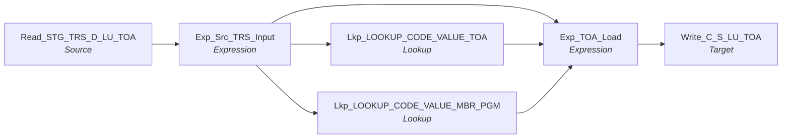

# m_Tgt_C_S_TRS_Stg_TOA

IDQ mapping &rarr; CDI **Mapping** `m_Tgt_C_S_TRS_Stg_TOA`.

## Summary

| IDQ transformation | CDI transformation | Count |
|---|---|---|
| ExpressionTx | Expression | 2 |
| LookupTx | Lookup | 2 |
| SourceTx | Source | 1 |
| TargetTx | Target | 1 |

Sources:

| Instance | Object | Connection |
|---|---|---|
| Read_STG_TRS_D_LU_TOA | `STG_TRS_D_LU_TOA` | STAGING |

Targets:

| Instance | Object | Connection |
|---|---|---|
| Write_C_S_LU_TOA | `C_S_LU_TOA` | HHS_MDM_ORS |

## Flow



## Filtered data

No step in this mapping drops, diverts or collapses rows: every source row reaches every target.

## Transformations

In data-flow order.

### Read_STG_TRS_D_LU_TOA

IDQ `SourceTx` &rarr; CDI **Source**. Oracle connector source; carry the SQL override / filter below verbatim.

| Property | Value |
|---|---|
| Connection | STAGING |
| Object | STG_TRS_D_LU_TOA |

Columns: `PROGRAM_CODE`, `TOA_CODE`, `TOA_DESC`, `DISPLAY_ORDER_NUM`, `EFF_BEGIN_DT`, `EFF_END_DT`, `HISTORY_SEQ`, `UNIQUE_TRANS_ID`, `HIST_NAV_IND`, `CREATE_USER_ID`, `CREATE_DT`, `UPDATE_USER_ID`, `UPDATE_DT`, `ARCHIVE_DT`, `LOAD_DATE`

### Exp_Src_TRS_Input

IDQ `ExpressionTx` &rarr; CDI **Expression**. Same expression language; variable fields are supported.

| Field | Kind | Type | Expression (CDI) |
|---|---|---|---|
| PROGRAM_CODE | in/out | string(9) |  |
| TOA_CODE | in/out | string(12) |  |
| TOA_DESC | in/out | string(300) |  |
| DISPLAY_ORDER_NUM | in/out | double |  |
| EFF_BEGIN_DT | in/out | date/time |  |
| EFF_END_DT | in/out | date/time |  |
| HISTORY_SEQ | in/out | double |  |
| UNIQUE_TRANS_ID | in/out | double |  |
| HIST_NAV_IND | in/out | string(3) |  |
| CREATE_USER_ID | in/out | string(60) |  |
| CREATE_DT | in/out | date/time |  |
| UPDATE_USER_ID | in/out | string(60) |  |
| UPDATE_DT | in | date/time |  |
| o_UPDATE_DT | out | date/time | `SESSSTARTTIME` |
| ARCHIVE_DT | in/out | date/time |  |
| LOAD_DATE | in/out | date/time |  |
| SRC_SYS | out | string(10) | `'TRS'` |

Links (target field &larr; upstream field):

| Field | From |
|---|---|
| PROGRAM_CODE | Read_STG_TRS_D_LU_TOA.PROGRAM_CODE |
| TOA_CODE | Read_STG_TRS_D_LU_TOA.TOA_CODE |
| TOA_DESC | Read_STG_TRS_D_LU_TOA.TOA_DESC |
| DISPLAY_ORDER_NUM | Read_STG_TRS_D_LU_TOA.DISPLAY_ORDER_NUM |
| EFF_BEGIN_DT | Read_STG_TRS_D_LU_TOA.EFF_BEGIN_DT |
| EFF_END_DT | Read_STG_TRS_D_LU_TOA.EFF_END_DT |
| HISTORY_SEQ | Read_STG_TRS_D_LU_TOA.HISTORY_SEQ |
| UNIQUE_TRANS_ID | Read_STG_TRS_D_LU_TOA.UNIQUE_TRANS_ID |
| HIST_NAV_IND | Read_STG_TRS_D_LU_TOA.HIST_NAV_IND |
| CREATE_USER_ID | Read_STG_TRS_D_LU_TOA.CREATE_USER_ID |
| CREATE_DT | Read_STG_TRS_D_LU_TOA.CREATE_DT |
| UPDATE_USER_ID | Read_STG_TRS_D_LU_TOA.UPDATE_USER_ID |
| UPDATE_DT | Read_STG_TRS_D_LU_TOA.UPDATE_DT |
| ARCHIVE_DT | Read_STG_TRS_D_LU_TOA.ARCHIVE_DT |
| LOAD_DATE | Read_STG_TRS_D_LU_TOA.LOAD_DATE |

### Lkp_LOOKUP_CODE_VALUE_TOA

IDQ `LookupTx` &rarr; CDI **Lookup**. Connected lookup unless a return port is set (then unconnected).

| Property | Value |
|---|---|
| Connection | STAGING |
| Object | LOOKUP_CODE_VALUE |
| queryMode | SEMI |
| Lookup condition | MSTR_REF_LABEL = TOA_CODE |
| Multiple matches | Return any row |
| Cache | static cache |

SQL override (CDI *SQL Override*; translated):

```sql
SELECT 
 Lkp.CREATED_BY
,Lkp.CREATE_DATE
,Lkp.UPDATED_BY
,Lkp.LAST_UPDATE_DATE
,Lkp.CODE_TYPE
,Lkp.MSTR_REF_CODE
,Lkp.MSTR_REF_LABEL
,Lkp.MSTR_REF_DESC
,Lkp.SRC_CODE_VALUE
,Lkp.SRC_SYS
,Lkp.SRC_CODE_DESC
FROM LOOKUP_CODE_VALUE Lkp
WHERE Lkp.CODE_TYPE = 'TOA'
```

| Lookup input field | Type |
|---|---|
| TOA_CODE | string(12) |

| Return / pass-through field | Feeds |
|---|---|
| MSTR_REF_CODE | Exp_TOA_Load.PKEY_SRC_OBJECT |
| MSTR_REF_LABEL | Exp_TOA_Load.MSTR_REF_LABEL |

Links (target field &larr; upstream field):

| Field | From |
|---|---|
| TOA_CODE | Exp_Src_TRS_Input.TOA_CODE |

### Lkp_LOOKUP_CODE_VALUE_MBR_PGM

IDQ `LookupTx` &rarr; CDI **Lookup**. Connected lookup unless a return port is set (then unconnected).

| Property | Value |
|---|---|
| Connection | STAGING |
| Object | LOOKUP_CODE_VALUE |
| queryMode | SEMI |
| Lookup condition | MSTR_REF_LABEL = PROGRAM_CODE |
| Multiple matches | Return any row |
| Cache | static cache |

SQL override (CDI *SQL Override*; translated):

```sql
SELECT 
 Lkp.CREATED_BY
,Lkp.CREATE_DATE
,Lkp.UPDATED_BY
,Lkp.LAST_UPDATE_DATE
,Lkp.CODE_TYPE
,Lkp.MSTR_REF_CODE
,Lkp.MSTR_REF_LABEL
,Lkp.MSTR_REF_DESC
,Lkp.SRC_CODE_VALUE
,Lkp.SRC_SYS
,Lkp.SRC_CODE_DESC
FROM LOOKUP_CODE_VALUE Lkp
WHERE Lkp.CODE_TYPE = 'MEMBER_PRG'
```

| Lookup input field | Type |
|---|---|
| PROGRAM_CODE | string(12) |

| Return / pass-through field | Feeds |
|---|---|
| MSTR_REF_CODE | Exp_TOA_Load.PROGRAM_CODE |

Links (target field &larr; upstream field):

| Field | From |
|---|---|
| PROGRAM_CODE | Exp_Src_TRS_Input.PROGRAM_CODE |

### Exp_TOA_Load

IDQ `ExpressionTx` &rarr; CDI **Expression**. Same expression language; variable fields are supported.

| Field | Kind | Type | Expression (CDI) |
|---|---|---|---|
| PROGRAM_CODE | in/out | string(9) | `PROGRAM_CODE` |
| TOA_CODE | in/out | string(12) | `TOA_CODE` |
| TOA_DESC | in/out | string(300) | `TOA_DESC` |
| EFF_BEGIN_DT | in/out | date/time | `EFF_BEGIN_DT` |
| EFF_END_DT | in/out | date/time | `EFF_END_DT` |
| CREATE_USER_ID | in/out | string(60) | `CREATE_USER_ID` |
| CREATE_DT | in/out | date/time | `CREATE_DT` |
| UPDATE_USER_ID | in/out | string(60) | `UPDATE_USER_ID` |
| UPDATE_DT | in/out | date/time | `UPDATE_DT` |
| ARCHIVE_DT | in/out | date/time | `ARCHIVE_DT` |
| LOAD_DATE | in/out | date/time | `LOAD_DATE` |
| SRC_SYS | in/out | string(10) | `SRC_SYS` |
| CODE_TYPE | variable | string(10) | `'TOA'` |
| PKEY_SRC_OBJECT | in/out | string(10) | `PKEY_SRC_OBJECT` |
| ROWID_OBJECT | out | string(10) | `LTRIM(LTRIM(RTRIM(PKEY_SRC_OBJECT)),0) ` |
| MSTR_REF_LABEL | in/out | string(255) |  |
| HUB_STATE_IND | out | string(10) | `'1'` |
| CREATOR | out | string(50) | `'admin'` |
| VERSION_SEQ (stale timeline: omit) | out | decimal(38) | `'1'` |

Links (target field &larr; upstream field):

| Field | From |
|---|---|
| TOA_CODE | Exp_Src_TRS_Input.TOA_CODE |
| TOA_DESC | Exp_Src_TRS_Input.TOA_DESC |
| EFF_BEGIN_DT | Exp_Src_TRS_Input.EFF_BEGIN_DT |
| EFF_END_DT | Exp_Src_TRS_Input.EFF_END_DT |
| CREATE_USER_ID | Exp_Src_TRS_Input.CREATE_USER_ID |
| CREATE_DT | Exp_Src_TRS_Input.CREATE_DT |
| UPDATE_USER_ID | Exp_Src_TRS_Input.UPDATE_USER_ID |
| UPDATE_DT | Exp_Src_TRS_Input.o_UPDATE_DT |
| PKEY_SRC_OBJECT | Lkp_LOOKUP_CODE_VALUE_TOA.MSTR_REF_CODE |
| SRC_SYS | Exp_Src_TRS_Input.SRC_SYS |
| LOAD_DATE | Exp_Src_TRS_Input.LOAD_DATE |
| ARCHIVE_DT | Exp_Src_TRS_Input.ARCHIVE_DT |
| MSTR_REF_LABEL | Lkp_LOOKUP_CODE_VALUE_TOA.MSTR_REF_LABEL |
| PROGRAM_CODE | Lkp_LOOKUP_CODE_VALUE_MBR_PGM.MSTR_REF_CODE |

### Write_C_S_LU_TOA

IDQ `TargetTx` &rarr; CDI **Target**. Oracle connector target.

| Property | Value |
|---|---|
| Connection | HHS_MDM_ORS |
| Object | C_S_LU_TOA |
| Operation | Insert |
| Truncate target table | yes |
| Load type | normal (no bulk load) |
| Reject file | Write_C_S_LU_TOA.bad |

Links (target field &larr; upstream field):

| Field | From |
|---|---|
| EFF_STRT_DT | Exp_TOA_Load.EFF_BEGIN_DT |
| EFF_END_DT | Exp_TOA_Load.EFF_END_DT |
| TOA_DESC | Exp_TOA_Load.TOA_DESC |
| CREATE_DATE | Exp_TOA_Load.CREATE_DT |
| UPDATED_BY | Exp_TOA_Load.UPDATE_USER_ID |
| LAST_UPDATE_DATE | Exp_TOA_Load.UPDATE_DT |
| SRC_ROWID | Exp_TOA_Load.PKEY_SRC_OBJECT |
| PKEY_SRC_OBJECT | Exp_TOA_Load.PKEY_SRC_OBJECT |
| TOA_LBL | Exp_TOA_Load.MSTR_REF_LABEL |
| HUB_STATE_IND | Exp_TOA_Load.HUB_STATE_IND |
| CREATOR | Exp_TOA_Load.CREATOR |
| TOA_CD | Exp_TOA_Load.PKEY_SRC_OBJECT |
| MBR_PRG_CD | Exp_TOA_Load.PROGRAM_CODE |
| VERSION_SEQ (stale timeline: do not map) | Exp_TOA_Load.VERSION_SEQ |
