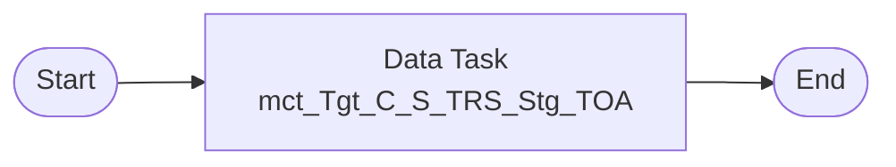

# Taskflow tf_TRS_Stage_Load_TOA

Replaces IDQ workflow `wf_TRS_Stage_Load_TOA`. Create it as a **Taskflow** (not a linear taskflow) because the workflow runs mapping tasks in parallel.

## IDQ workflow

## CDI taskflow

## Steps

| # | Step | Runs | Notes |
|---|---|---|---|
| 0 | Data Task | `mct_Tgt_C_S_TRS_Stg_TOA` |  |
| 1 | End |  |  |

## Mapping tasks

Create one mapping task per mapping. IDQ mapping-task settings and their CDI home:

| Mapping task | Mapping | Date format (Advanced session property *Default date format*) | High precision (*Enable high precision*) | Tracing (*Override tracing*) | Sort order |
|---|---|---|---|---|---|
| `mct_Tgt_C_S_TRS_Stg_TOA` | [`m_Tgt_C_S_TRS_Stg_TOA`](mappings/m_Tgt_C_S_TRS_Stg_TOA.md) | MM/DD/YYYY HH24:MI:SS | true | normal | binary |

Each Data Task: *On error* = **Fail taskflow** (IDQ aborts the workflow when a mapping task fails). Pass the parameter file through the mapping task *Parameter file* setting (see the `.param` file).
