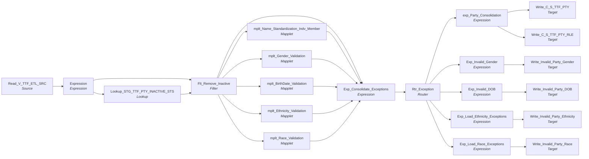

# m_Tgt_C_S_TTF_Pty

IDQ mapping &rarr; CDI **Mapping** `m_Tgt_C_S_TTF_Pty`.

> KKondapalli 05/12/2026	
Objective: Initial version created from TTF Data Mapping


Scope: Transfer data from Staging DB to MDM Staging


Focus: Valid Party & Party Relation Data

## Summary

| IDQ transformation | CDI transformation | Count |
|---|---|---|
| ExpressionTx | Expression | 7 |
| FilterTx | Filter | 1 |
| LookupTx | Lookup | 1 |
| MappletTx | Mapplet | 5 |
| RouterTx | Router | 1 |
| SourceTx | Source | 1 |
| TargetTx | Target | 6 |

Sources:

| Instance | Object | Connection |
|---|---|---|
| Read_V_TTF_ETL_SRC | `V_TTF_ETL_SRC` | STAGING |

Targets:

| Instance | Object | Connection |
|---|---|---|
| Write_Invalid_Party_Gender | `EXC_STG_BAD_REC_MEMB` | STAGING |
| Write_Invalid_Party_DOB | `EXC_STG_BAD_REC_MEMB` | STAGING |
| Write_Invalid_Party_Ethnicity | `EXC_STG_BAD_REC_MEMB` | STAGING |
| Write_Invalid_Party_Race | `EXC_STG_BAD_REC_MEMB` | STAGING |
| Write_C_S_TTF_PTY | `C_S_TTF_PTY` | HHS_MDM_ORS |
| Write_C_S_TTF_PTY_RLE | `C_S_TTF_PTY_RLE` | HHS_MDM_ORS |

## Parameters

Create as CDI input parameters (`$$Name`); defaults go in the parameter file.

| Parameter | Type | Precision | Default | Used in this mapping |
|---|---|---|---|---|
| PTY_BO_CLASS_CD_Member | string | 10 | Indv | yes |
| ECI_PTY_TBL_SRC | string | 1000 | ECI_CHILD | no (declared only) |
| RLE_BO_CLASS_CD_Member | string | 10 | Member | yes |

`$sys.MappingName` is translated to the input parameter `$$MappingName` (default: the mapping name).

## Flow



## Filtered data

Every step that can stop, divert or collapse rows, and what happens to the rows that do not pass. A Filter keeps a row only when its condition is TRUE: FALSE **or NULL** drops the row silently (no target, no reject file). A Router writes a row to **every** group whose condition is TRUE; a row that matches no group goes to the default group and is discarded when that group is not linked. Comments (`--`, `//`) are removed from the conditions shown here. A `= ...` line reads a null check on a lookup return in plain terms; *no matching row* also covers a matching row whose returned field is NULL.

### Steps that filter rows

| Step | IDQ type | Rule | Rows that pass go to | Rows that do not pass |
|---|---|---|---|---|
| Read_V_TTF_ETL_SRC | SourceTx | rows the view `V_TTF_ETL_SRC` returns (view logic is outside the export) | `EXC_STG_BAD_REC_MEMB`, `C_S_TTF_PTY`, `C_S_TTF_PTY_RLE` | never read |
| Flt_Remove_Inactive | FilterTx | keep `isnull(DEACTIVATION_STS)`<br>= no matching row in `STG_TTF_PTY_INACTIVE_STS` | `EXC_STG_BAD_REC_MEMB`, `C_S_TTF_PTY`, `C_S_TTF_PTY_RLE` | **discarded** |
| Rtr_Exception | RouterTx | group `Valid_Party`: `TRUE` | `C_S_TTF_PTY`, `C_S_TTF_PTY_RLE` |  |
| Rtr_Exception | RouterTx | group `Invalid_Birth_Date`: `NOT ISNULL(BirthDate_Exception_Code)` | `EXC_STG_BAD_REC_MEMB` |  |
| Rtr_Exception | RouterTx | group `Invalid_Gender_Code`: `NOT ISNULL(Gender_Exception_Description)` | `EXC_STG_BAD_REC_MEMB` |  |
| Rtr_Exception | RouterTx | group `Invalid_Ethnicity`: `NOT IsNull(Ethnicity_EXCEPTION_CODE)` | `EXC_STG_BAD_REC_MEMB` |  |
| Rtr_Exception | RouterTx | group `Invalid_Race`: `NOT IsNull(Race_Exception_Desc)` | `EXC_STG_BAD_REC_MEMB` |  |
| Rtr_Exception | RouterTx | group `Invalid_Language`: `NOT IsNull(Language_EXCEPTION_CODE)` | nothing: group not linked, **discarded** |  |
| Rtr_Exception | RouterTx | group `Invalid_Suffix`: `NOT IsNull(Suffix_Exception_Code)` | nothing: group not linked, **discarded** |  |
| Rtr_Exception | RouterTx | default group `Default`: rows that match no other group | nothing: group not linked, **discarded** |  |

### Where the condition fields come from

| Step | Field | Origin |
|---|---|---|
| Flt_Remove_Inactive | `DEACTIVATION_STS` | `DEACTIVATION_STS` returned by lookup `Lookup_STG_TTF_PTY_INACTIVE_STS` on `STG_TTF_PTY_INACTIVE_STS` where `SRC_KEY = PTY_SRC_KEY AND ROWID_SYSTEM = SRC_SYSTEM`; NULL when no row matches; `STG_TTF_PTY_INACTIVE_STS` is loaded by `m_Tgt_C_S_TTF_Pty_Validation` in this workflow |
| Rtr_Exception | `BirthDate_Exception_Code` | mapplet `mplt_BirthDate_Validation`: `exp_BirthDate_Validation.Exception_Code` = `Decode(TRUE, IN(Src_Sys,'P23','C21','P88','MAX','P84','PMR','TRS','CRE','ECI','WIC','FSS', 'TTF') AND IN(Party_Type,'HCP','Indv','INDV','I') AND BirthDate > sysdate, 'Invalid_Birth_Date', NULL)` |
| Rtr_Exception | `Gender_Exception_Description` | mapplet `mplt_Gender_Validation`: `EXCEPTION_DESC` returned by lookup `Lookup_EXC_LOOKUP_CODE_VALUE` on `EXC_LOOKUP_CODE_VALUE` where `EXCEPTION_CODE = In_Exception_Code`; NULL when no row matches |
| Rtr_Exception | `Ethnicity_EXCEPTION_CODE` | mapplet `mplt_Ethnicity_Validation`: `EXCEPTION_CODE` returned by lookup `Lookup_EXC_LOOKUP_CODE_VALUE` on `EXC_LOOKUP_CODE_VALUE` where `EXCEPTION_CODE = EXCEPTION_CODE1`; NULL when no row matches |
| Rtr_Exception | `Race_Exception_Desc` | mapplet `mplt_Race_Validation`: `EXCEPTION_DESC` returned by lookup `Lookup_EXC_LOOKUP_CODE_VALUE` on `EXC_LOOKUP_CODE_VALUE` where `EXCEPTION_CODE = in_Exception_Code`; NULL when no row matches |
| Rtr_Exception | `Language_EXCEPTION_CODE` | not linked |
| Rtr_Exception | `Suffix_Exception_Code` | not linked |

### Rows that do not reach `C_S_*` tables

**`C_S_TTF_PTY`** (`Write_C_S_TTF_PTY`): a source row is written only when it passes every step below.

| Step | Must hold | Otherwise the row |
|---|---|---|
| `Read_V_TTF_ETL_SRC` | rows the view `V_TTF_ETL_SRC` returns (view logic is outside the export) | never read |
| `Flt_Remove_Inactive` | `isnull(DEACTIVATION_STS)`<br>= no matching row in `STG_TTF_PTY_INACTIVE_STS` | **discarded** (not written anywhere) |
| `Rtr_Exception` | group `Valid_Party`: `TRUE`<br>(a row that also matches `Invalid_Birth_Date`, `Invalid_Gender_Code`, `Invalid_Ethnicity`, `Invalid_Race`, `Invalid_Language`, `Invalid_Suffix` is written there as well) | never (condition is always TRUE) |

**`C_S_TTF_PTY_RLE`** (`Write_C_S_TTF_PTY_RLE`): a source row is written only when it passes every step below.

| Step | Must hold | Otherwise the row |
|---|---|---|
| `Read_V_TTF_ETL_SRC` | rows the view `V_TTF_ETL_SRC` returns (view logic is outside the export) | never read |
| `Flt_Remove_Inactive` | `isnull(DEACTIVATION_STS)`<br>= no matching row in `STG_TTF_PTY_INACTIVE_STS` | **discarded** (not written anywhere) |
| `Rtr_Exception` | group `Valid_Party`: `TRUE`<br>(a row that also matches `Invalid_Birth_Date`, `Invalid_Gender_Code`, `Invalid_Ethnicity`, `Invalid_Race`, `Invalid_Language`, `Invalid_Suffix` is written there as well) | never (condition is always TRUE) |

## Oracle stored procedure

Drop-in replacement in Oracle: [`sp_ors_main_m_Tgt_C_S_TTF_Pty`](../../../idq-to-oracle/wf_TTF_Stage_Load/sp_ors_main_m_Tgt_C_S_TTF_Pty.sql) (set-based SQL; one transaction that commits at the end and rolls back and re-raises on error). The IDQ mapplets and rules become the shared `fn_dq_*` functions; see [idq-to-oracle/README.md](../../../idq-to-oracle/README.md). Unlike the CDI spec above, the procedure **keeps the MDM timeline logic**; it is marked `TIMELINE` in the comments.

```text
Drop-in replacement of IDQ mapping m_Tgt_C_S_TTF_Pty (workflow wf_TTF_Stage_Load).

Loads the TTF clients (V_TTF_ETL_SRC) into C_S_TTF_PTY and C_S_TTF_PTY_RLE (both insert only, never truncated) and logs
demographic exceptions:
  -> Flt_Remove_Inactive: party (PTY_SRC_KEY) not in STG_TTF_PTY_INACTIVE_STS
  -> Expression: gender from SEXID (33 -> F, 34 -> M, else U); ethnicity = '55' when RACEETHNICITYID = '55'
  -> name standardization, gender, birth date, ethnicity, race by code (mplt_Race_Validation on RACEETHNICITYID)
  -> Rtr_Exception: Valid_Party is TRUE (every active client loaded); birth date, gender, ethnicity and race
     failures each write an EXC_STG_BAD_REC_MEMB row for every row (no source-table condition in TTF).
     The Invalid_Language / Invalid_Suffix groups test ports that are not fed in IDQ and have no target: no rows.

TIMELINE: VERSION_SEQ hard-coded to 1; party PERIOD_START_DATE = run start ($sys.MappingRunStartTime), role
PERIOD_START_DATE = SUBMITDATE.
PRFRD_LANG_CD and SFX_NM are linked to unfed ports in IDQ (NULL).
```

Parameters:

| Parameter | Type | Default | Replaces / meaning |
|---|---|---|---|
| `p_pty_bo_class_cd_member` | VARCHAR2 | `'Indv'` | $PTY_BO_CLASS_CD_Member |
| `p_rle_bo_class_cd_member` | VARCHAR2 | `'Member'` | $RLE_BO_CLASS_CD_Member |

Tables written:

| Table | Operation |
|---|---|
| `C_S_TTF_PTY` | insert |
| `C_S_TTF_PTY_RLE` | insert |
| `EXC_STG_BAD_REC_MEMB` | insert |

Shared functions and procedures called:

| Object | Does |
|---|---|
| `fn_dq_std_name_indv_member` | replaces `mplt_Name_Standardization_Indv_Member (+ TTF CopyOf)`, returns `t_dq_name_std` |
| `fn_dq_valid_birth_date` | replaces `mplt_BirthDate_Validation`, returns `t_dq_birth_date` |
| `fn_dq_valid_ethnicity` | replaces `mplt_Ethnicity_Validation`, returns `t_dq_code_check` |
| `fn_dq_valid_gender` | replaces `mplt_Gender_Validation`, returns `t_dq_gender` |
| `fn_dq_valid_race` | replaces `mplt_Race_Validation`, returns `t_dq_code_check` |
| `sp_ors_helper02_common` | run log line: mapping, step, row count (DBMS_OUTPUT) |

## Transformations

In data-flow order.

### Read_V_TTF_ETL_SRC

IDQ `SourceTx` &rarr; CDI **Source**. Oracle connector source; carry the SQL override / filter below verbatim.

| Property | Value |
|---|---|
| Connection | STAGING |
| Object | V_TTF_ETL_SRC (view) |

Columns: `DEMOGRAPHICS_ID`, `None`, `YEAR`, `MONTH`, `ZIP`, `SEXID`, `COUNTYID`, `GESTAGEATENROLLMENT`, `RACEETHNICITYID`, `SUBMISSIONID`, `ACTIVE`, `MEDICAIDID`, `FIRSTNAME`, `LASTNAME`, `MIDDLENAME`, `DOB`, `LOAD_DATE`, `CREATEDDATE`, `UPDATEDDATE`, `PHONE`, `FYCLIENTS_ID`, `CONTRACTID`, `CLIENTS_ID`, `CLIENTCODE`, `CONTRACTORID`, `None`, `None`, `None`, `None`, `None`

### Expression

IDQ `ExpressionTx` &rarr; CDI **Expression**. Same expression language; variable fields are supported.

| Field | Kind | Type | Expression (CDI) |
|---|---|---|---|
| DATEKEY | in/out | date/time | `DATEKEY` |
| LOAD_DATE | in/out | date/time | `LOAD_DATE` |
| ID_CLIENT | in/out | decimal(4000) |  |
| PTY_SRC_KEY | in/out | string(48) | `PTY_SRC_KEY` |
| FIRST_NAME | in/out | string(4000) |  |
| LAST_NAME | in/out | string(4000) |  |
| MIDDLE_NAME | in/out | string(4000) |  |
| DOB | in/out | date/time |  |
| SEXID | in/out | string(10) | `SEXID` |
| GENDER | out | string(10) | `DECODE( SEXID, '33', 'F', '34', 'M', 'U' )<br>` |
| RACEETHNICITYID | in/out | string(10) | `RACEETHNICITYID` |
| ETHNICITY | out | string(4000) | `IIF(RACEETHNICITYID = '55', '55', NULL)<br>` |
| SRC_SYSTEM | out | string(10) | `'TTF'` |
| PARTY_TYPE | out | string(10) | `'Indv'` |
| OBJECT_NM | out | string(50) | `'C_S_TTF_PTY'` |
| FULL_NM | out | string(100) | `LTRIM(RTRIM(<br>FIRST_NAME\|\| IIF(NOT ISNULL(MIDDLE_NAME ) ,<br>' ' \|\| LTRIM(RTRIM(MIDDLE_NAME)), '') \|\| ' ' \|\|  LTRIM(LAST_NAME)) )` |

Links (target field &larr; upstream field):

| Field | From |
|---|---|
| DATEKEY | Read_V_TTF_ETL_SRC.SUBMITDATE |
| LOAD_DATE | Read_V_TTF_ETL_SRC.LOAD_DATE |
| ID_CLIENT | Read_V_TTF_ETL_SRC.CLIENTS_ID |
| PTY_SRC_KEY | Read_V_TTF_ETL_SRC.PTY_SRC_KEY |
| FIRST_NAME | Read_V_TTF_ETL_SRC.FIRSTNAME |
| LAST_NAME | Read_V_TTF_ETL_SRC.LASTNAME |
| MIDDLE_NAME | Read_V_TTF_ETL_SRC.MIDDLENAME |
| DOB | Read_V_TTF_ETL_SRC.DOB |
| SEXID | Read_V_TTF_ETL_SRC.SEXID |
| RACEETHNICITYID | Read_V_TTF_ETL_SRC.RACEETHNICITYID |

### Lookup_STG_TTF_PTY_INACTIVE_STS

IDQ `LookupTx` &rarr; CDI **Lookup**. Connected lookup unless a return port is set (then unconnected).

| Property | Value |
|---|---|
| Connection | STAGING |
| Object | STG_TTF_PTY_INACTIVE_STS |
| Lookup condition | SRC_KEY = PTY_SRC_KEY AND ROWID_SYSTEM = SRC_SYSTEM |
| Multiple matches | Return any row |
| Cache | static cache |

| Lookup input field | Type |
|---|---|
| PTY_SRC_KEY | string(48) |
| SRC_SYSTEM | string(10) |

| Return / pass-through field | Feeds |
|---|---|
| DEACTIVATION_STS | Flt_Remove_Inactive.DEACTIVATION_STS |

Links (target field &larr; upstream field):

| Field | From |
|---|---|
| PTY_SRC_KEY | Expression.PTY_SRC_KEY |
| SRC_SYSTEM | Expression.SRC_SYSTEM |

### Flt_Remove_Inactive

IDQ `FilterTx` &rarr; CDI **Filter**. Advanced filter condition.

Filter condition:

```
isnull(DEACTIVATION_STS)
```

Links (target field &larr; upstream field):

| Field | From |
|---|---|
| ID_CLIENT | Expression.ID_CLIENT |
| PARTY_TYPE | Expression.PARTY_TYPE |
| FIRST_NAME | Expression.FIRST_NAME |
| LAST_NAME | Expression.LAST_NAME |
| MIDDLE_NAME | Expression.MIDDLE_NAME |
| DOB | Expression.DOB |
| GENDER | Expression.GENDER |
| DATE_CREATED | Expression.DATEKEY |
| DATE_MODIFIED | Expression.DATEKEY |
| ETHNICITY | Expression.ETHNICITY |
| SRC_SYSTEM | Expression.SRC_SYSTEM |
| OBJECT_NAME | Expression.OBJECT_NM |
| PKEY_SRC_OBJECT | Expression.PTY_SRC_KEY |
| FULL_NAME | Expression.FULL_NM |
| SRC_FULL_NAME | Expression.FULL_NM |
| LOAD_DATE | Expression.LOAD_DATE |
| DEACTIVATION_STS | Lookup_STG_TTF_PTY_INACTIVE_STS.DEACTIVATION_STS |
| RACE | Expression.RACEETHNICITYID |

### mplt_Name_Standardization_Indv_Member

IDQ `MappletTx` &rarr; CDI **Mapplet**. Reusable CDI mapplet (see the mapplets folder).

Mapplet: [`mplt_Name_Standardization_Indv_Member`](../mapplets/mplt_Name_Standardization_Indv_Member.md)

Links (target field &larr; upstream field):

| Field | From |
|---|---|
| Group.First_Name | Flt_Remove_Inactive.FIRST_NAME |
| Group.Mdl_Name | Flt_Remove_Inactive.MIDDLE_NAME |
| Group.Lst_Name | Flt_Remove_Inactive.LAST_NAME |
| Group.Full_Name | Flt_Remove_Inactive.SRC_FULL_NAME |
| Group.Src_System | Flt_Remove_Inactive.SRC_SYSTEM |

### mplt_Gender_Validation

IDQ `MappletTx` &rarr; CDI **Mapplet**. Reusable CDI mapplet (see the mapplets folder).

Mapplet: [`mplt_Gender_Validation`](../mapplets/mplt_Gender_Validation.md)

Links (target field &larr; upstream field):

| Field | From |
|---|---|
| Group.Party_Type | Flt_Remove_Inactive.PARTY_TYPE |
| Group.Src_Sys | Flt_Remove_Inactive.SRC_SYSTEM |
| Group.Gender_Code | Flt_Remove_Inactive.GENDER |

### mplt_BirthDate_Validation

IDQ `MappletTx` &rarr; CDI **Mapplet**. Reusable CDI mapplet (see the mapplets folder).

Mapplet: [`mplt_BirthDate_Validation`](../mapplets/mplt_BirthDate_Validation.md)

Links (target field &larr; upstream field):

| Field | From |
|---|---|
| Group.BirthDate | Flt_Remove_Inactive.DOB |
| Group.SrcSys | Flt_Remove_Inactive.SRC_SYSTEM |
| Group.PartyType | Flt_Remove_Inactive.PARTY_TYPE |

### mplt_Ethnicity_Validation

IDQ `MappletTx` &rarr; CDI **Mapplet**. Reusable CDI mapplet (see the mapplets folder).

Mapplet: [`mplt_Ethnicity_Validation`](../mapplets/mplt_Ethnicity_Validation.md)

Links (target field &larr; upstream field):

| Field | From |
|---|---|
| Group1.Src_Sys | Flt_Remove_Inactive.SRC_SYSTEM |
| Group1.Ethnicity_Cd | Flt_Remove_Inactive.ETHNICITY |

### mplt_Race_Validation

IDQ `MappletTx` &rarr; CDI **Mapplet**. Reusable CDI mapplet (see the mapplets folder).

Mapplet: [`mplt_Race_Validation`](../mapplets/mplt_Race_Validation.md)

Links (target field &larr; upstream field):

| Field | From |
|---|---|
| Group1.Src_Sys | Flt_Remove_Inactive.SRC_SYSTEM |
| Group1.Race_Cd | Flt_Remove_Inactive.RACE |

### Exp_Consolidate_Exceptions

IDQ `ExpressionTx` &rarr; CDI **Expression**. Same expression language; variable fields are supported.

| Field | Kind | Type | Expression (CDI) |
|---|---|---|---|
| ID_CLIENT | in/out | decimal(10) |  |
| PARTY_TYPE | in/out | string(10) | `PARTY_TYPE` |
| FIRST_NAME | in/out | string(60) |  |
| LAST_NAME | in/out | string(60) |  |
| MIDDLE_INITIAL | in/out | string(60) |  |
| DOB | in/out | date/time |  |
| GENDER | in/out | string(20) |  |
| BIRTH_WT_LB | in/out | double |  |
| BIRTH_WT_OZ | in/out | double |  |
| LANGUAGE_CD | in/out | string(20) |  |
| DATE_CREATED | in/out | date/time |  |
| DATE_MODIFIED | in/out | date/time |  |
| ETHNICITY | in/out | string(30) |  |
| LOAD_DATE | in/out | string(20) |  |
| SRC_SYSTEM | in/out | string(10) | `SRC_SYSTEM` |
| OBJECT_NAME | in/out | string(50) | `OBJECT_NAME` |
| SRC_TBL | in/out | string(255) | `SRC_TBL` |
| PKEY_SRC_OBJECT | in/out | string(255) | `PKEY_SRC_OBJECT` |
| FULL_NAME | in/out | string(255) | `FULL_NAME` |
| SRC_FULL_NAME | in/out | string(255) | `SRC_FULL_NAME` |
| First_Name1 | in/out | string(50) | `First_Name1` |
| Mdl_Name | in/out | string(50) | `Mdl_Name` |
| Lst_Name | in/out | string(50) | `Lst_Name` |
| Full_Name1 | in/out | string(100) | `Full_Name1` |
| Src_Full_Name1 | in/out | string(100) | `Src_Full_Name1` |
| Prfx_Name | in/out | string(10) | `Prfx_Name` |
| Gender_Code | in/out | string(10) | `Gender_Code` |
| Gender_Exception_Code | in/out | string(100) | `Gender_Exception_Code` |
| Gender_Exception_Description | in/out | string(100) | `Gender_Exception_Description` |
| Gender_Exception_Type | in/out | string(100) | `Gender_Exception_Type` |
| MDM_Gender_Code | in/out | string(255) | `MDM_Gender_Code` |
| BirthDate | in/out | date/time | `BirthDate` |
| BirthDate_Exception_Code | in/out | string(100) | `BirthDate_Exception_Code` |
| BirthDate_Exception_Description | in/out | string(100) | `BirthDate_Exception_Description` |
| BirthDate_Exception_Type | in/out | string(100) | `BirthDate_Exception_Type` |
| Attribute_Name_BirthDate | in/out | string(100) | `Attribute_Name_BirthDate` |
| Attribute_Name_Name | out | string(50) | `'Name'` |
| Attribute_Name_Gender | out | string(50) | `'Gender'` |
| BirthDate_Attribute_Value | in/out | date/time | `BirthDate_Attribute_Value` |
| Ethnicity_Cd | in/out | string(20) | `Ethnicity_Cd` |
| Ethnicity_MSTR_CODE_VALUE | in/out | string(255) | `Ethnicity_MSTR_CODE_VALUE` |
| Ethnicity_EXCEPTION_CODE | in/out | string(300) | `Ethnicity_EXCEPTION_CODE` |
| Ethnicity_EXCEPTION_DESC | in/out | string(300) | `Ethnicity_EXCEPTION_DESC` |
| Ethnicity_EXCEPTION_TYPE | in/out | string(300) | `Ethnicity_EXCEPTION_TYPE` |
| MDM_Race_Cd | in/out | string(3) | `MDM_Race_Cd` |
| Race_Exception_Cd | in/out | string(300) | `Race_Exception_Cd` |
| Race_Exception_Desc | in/out | string(300) | `Race_Exception_Desc` |
| Race_Exception_Type | in/out | string(300) | `Race_Exception_Type` |
| Src_Race_Ind_List | in/out | string(40) | `Src_Race_Ind_List` |
| Language_Cd1 | in/out | string(20) | `Language_Cd1` |
| Language_MSTR_CODE_VALUE | in/out | string(255) | `Language_MSTR_CODE_VALUE` |
| Language_EXCEPTION_CODE | in/out | string(300) | `Language_EXCEPTION_CODE` |
| Language_EXCEPTION_DESC | in/out | string(300) | `Language_EXCEPTION_DESC` |
| Language_EXCEPTION_TYPE | in/out | string(300) | `Language_EXCEPTION_TYPE` |
| Standardized_Suffix | in/out | string(20) | `Standardized_Suffix` |
| Source_Suffix | in/out | string(10) | `Source_Suffix` |
| Suffix_Exception_Type | in/out | string(300) | `Suffix_Exception_Type` |
| Suffix_Exception_Code | in/out | string(20) | `Suffix_Exception_Code` |
| Suffix_Exception_Desc | in/out | string(300) | `Suffix_Exception_Desc` |

Links (target field &larr; upstream field):

| Field | From |
|---|---|
| ID_CLIENT | Flt_Remove_Inactive.ID_CLIENT |
| PARTY_TYPE | Flt_Remove_Inactive.PARTY_TYPE |
| FIRST_NAME | Flt_Remove_Inactive.FIRST_NAME |
| LAST_NAME | Flt_Remove_Inactive.LAST_NAME |
| MIDDLE_INITIAL | Flt_Remove_Inactive.MIDDLE_NAME |
| DOB | Flt_Remove_Inactive.DOB |
| GENDER | Flt_Remove_Inactive.GENDER |
| DATE_CREATED | Flt_Remove_Inactive.DATE_CREATED |
| DATE_MODIFIED | Flt_Remove_Inactive.DATE_MODIFIED |
| ETHNICITY | Flt_Remove_Inactive.ETHNICITY |
| LOAD_DATE | Flt_Remove_Inactive.LOAD_DATE |
| SRC_SYSTEM | Flt_Remove_Inactive.SRC_SYSTEM |
| OBJECT_NAME | Flt_Remove_Inactive.OBJECT_NAME |
| SRC_TBL | Flt_Remove_Inactive.SRC_TBL |
| PKEY_SRC_OBJECT | Flt_Remove_Inactive.PKEY_SRC_OBJECT |
| FULL_NAME | Flt_Remove_Inactive.FULL_NAME |
| SRC_FULL_NAME | Flt_Remove_Inactive.SRC_FULL_NAME |
| First_Name1 | mplt_Name_Standardization_Indv_Member.out_Standardized_Names.First_Name |
| Mdl_Name | mplt_Name_Standardization_Indv_Member.out_Standardized_Names.Mdl_Name |
| Lst_Name | mplt_Name_Standardization_Indv_Member.out_Standardized_Names.Lst_Name |
| Full_Name1 | mplt_Name_Standardization_Indv_Member.out_Standardized_Names.Full_Name |
| Src_Full_Name1 | mplt_Name_Standardization_Indv_Member.out_Standardized_Names.Src_Full_Name |
| Prfx_Name | mplt_Name_Standardization_Indv_Member.out_Standardized_Names.Prfx_Name |
| Gender_Code | mplt_Gender_Validation.out_Gender_Code_Validation.Gender_Code |
| Gender_Exception_Code | mplt_Gender_Validation.out_Gender_Code_Validation.Gender_Exception_Code |
| Gender_Exception_Description | mplt_Gender_Validation.out_Gender_Code_Validation.Gender_Exception_Description |
| Gender_Exception_Type | mplt_Gender_Validation.out_Gender_Code_Validation.Gender_Exception_Type |
| MDM_Gender_Code | mplt_Gender_Validation.out_Gender_Code_Validation.MDM_Gender_Code |
| BirthDate | mplt_BirthDate_Validation.o_BirthDate.BirthDate |
| BirthDate_Exception_Code | mplt_BirthDate_Validation.o_BirthDate.Exception_Code |
| BirthDate_Exception_Description | mplt_BirthDate_Validation.o_BirthDate.Exception_Description |
| BirthDate_Exception_Type | mplt_BirthDate_Validation.o_BirthDate.Exception_Type |
| Attribute_Name_BirthDate | mplt_BirthDate_Validation.o_BirthDate.Attribute_Name |
| BirthDate_Attribute_Value | mplt_BirthDate_Validation.o_BirthDate.Attribute_Value |
| Ethnicity_Cd | mplt_Ethnicity_Validation.NEWOUTPUT.Ethnicity_Cd |
| Ethnicity_MSTR_CODE_VALUE | mplt_Ethnicity_Validation.NEWOUTPUT.MSTR_CODE_VALUE |
| Ethnicity_EXCEPTION_CODE | mplt_Ethnicity_Validation.NEWOUTPUT.EXCEPTION_CODE |
| Ethnicity_EXCEPTION_DESC | mplt_Ethnicity_Validation.NEWOUTPUT.EXCEPTION_DESC |
| Ethnicity_EXCEPTION_TYPE | mplt_Ethnicity_Validation.NEWOUTPUT.EXCEPTION_TYPE |
| MDM_Race_Cd | mplt_Race_Validation.NEWOUTPUT.MSTR_CODE_VALUE |
| Race_Exception_Cd | mplt_Race_Validation.NEWOUTPUT.EXCEPTION_CODE |
| Race_Exception_Desc | mplt_Race_Validation.NEWOUTPUT.EXCEPTION_DESC |
| Race_Exception_Type | mplt_Race_Validation.NEWOUTPUT.EXCEPTION_TYPE |
| Src_Race_Ind_List | mplt_Race_Validation.NEWOUTPUT.Race_Cd |

### Rtr_Exception

IDQ `RouterTx` &rarr; CDI **Router**. One output group per IDQ group; the default group is created automatically.

| Output group | Condition |
|---|---|
| Valid_Party | `TRUE` |
| Invalid_Birth_Date | `NOT ISNULL(BirthDate_Exception_Code)` |
| Invalid_Gender_Code | `NOT ISNULL(Gender_Exception_Description)` |
| Invalid_Ethnicity | `NOT IsNull(Ethnicity_EXCEPTION_CODE)` |
| Invalid_Race | `NOT IsNull(Race_Exception_Desc)` |
| Invalid_Language | `NOT IsNull(Language_EXCEPTION_CODE)` |
| Invalid_Suffix | `NOT IsNull(Suffix_Exception_Code)` |
| Default | (default group) |

Links (target field &larr; upstream field):

| Field | From |
|---|---|
| ID_CLIENT | Exp_Consolidate_Exceptions.ID_CLIENT |
| PARTY_TYPE | Exp_Consolidate_Exceptions.PARTY_TYPE |
| FIRST_NAME | Exp_Consolidate_Exceptions.FIRST_NAME |
| LAST_NAME | Exp_Consolidate_Exceptions.LAST_NAME |
| MIDDLE_INITIAL | Exp_Consolidate_Exceptions.MIDDLE_INITIAL |
| DOB | Exp_Consolidate_Exceptions.DOB |
| GENDER | Exp_Consolidate_Exceptions.GENDER |
| BIRTH_WT_LB | Exp_Consolidate_Exceptions.BIRTH_WT_LB |
| BIRTH_WT_OZ | Exp_Consolidate_Exceptions.BIRTH_WT_OZ |
| LANGUAGE_CD | Exp_Consolidate_Exceptions.LANGUAGE_CD |
| DATE_CREATED | Exp_Consolidate_Exceptions.DATE_CREATED |
| DATE_MODIFIED | Exp_Consolidate_Exceptions.DATE_MODIFIED |
| ETHNICITY | Exp_Consolidate_Exceptions.ETHNICITY |
| LOAD_DATE | Exp_Consolidate_Exceptions.LOAD_DATE |
| SRC_SYSTEM | Exp_Consolidate_Exceptions.SRC_SYSTEM |
| OBJECT_NAME | Exp_Consolidate_Exceptions.OBJECT_NAME |
| SRC_TBL | Exp_Consolidate_Exceptions.SRC_TBL |
| PKEY_SRC_OBJECT | Exp_Consolidate_Exceptions.PKEY_SRC_OBJECT |
| FULL_NAME | Exp_Consolidate_Exceptions.FULL_NAME |
| SRC_FULL_NAME | Exp_Consolidate_Exceptions.SRC_FULL_NAME |
| Src_Full_Name1 | Exp_Consolidate_Exceptions.Src_Full_Name1 |
| Prfx_Name | Exp_Consolidate_Exceptions.Prfx_Name |
| Gender_Code | Exp_Consolidate_Exceptions.Gender_Code |
| MDM_Gender_Code | Exp_Consolidate_Exceptions.MDM_Gender_Code |
| BirthDate | Exp_Consolidate_Exceptions.BirthDate |
| Attribute_Name_BirthDate | Exp_Consolidate_Exceptions.Attribute_Name_BirthDate |
| BirthDate_Attribute_Value | Exp_Consolidate_Exceptions.BirthDate_Attribute_Value |
| Gender_Exception_Description | Exp_Consolidate_Exceptions.Gender_Exception_Description |
| BirthDate_Exception_Code | Exp_Consolidate_Exceptions.BirthDate_Exception_Code |
| BirthDate_Exception_Description | Exp_Consolidate_Exceptions.BirthDate_Exception_Description |
| BirthDate_Exception_Type | Exp_Consolidate_Exceptions.BirthDate_Exception_Type |
| Gender_Exception_Code | Exp_Consolidate_Exceptions.Gender_Exception_Code |
| Gender_Exception_Type | Exp_Consolidate_Exceptions.Gender_Exception_Type |
| Attribute_Name_Gender | Exp_Consolidate_Exceptions.Attribute_Name_Gender |
| Attribute_Name_Name | Exp_Consolidate_Exceptions.Attribute_Name_Name |
| Ethnicity_EXCEPTION_CODE | Exp_Consolidate_Exceptions.Ethnicity_EXCEPTION_CODE |
| Ethnicity_EXCEPTION_DESC | Exp_Consolidate_Exceptions.Ethnicity_EXCEPTION_DESC |
| Ethnicity_EXCEPTION_TYPE | Exp_Consolidate_Exceptions.Ethnicity_EXCEPTION_TYPE |
| MDM_Race_Cd | Exp_Consolidate_Exceptions.MDM_Race_Cd |
| Race_Exception_Desc | Exp_Consolidate_Exceptions.Race_Exception_Desc |
| Race_Exception_Type | Exp_Consolidate_Exceptions.Race_Exception_Type |
| Src_Race_Ind_List | Exp_Consolidate_Exceptions.Src_Race_Ind_List |
| Race_Exception_Cd | Exp_Consolidate_Exceptions.Race_Exception_Cd |
| MDM_Ethnicity_Cd | Exp_Consolidate_Exceptions.Ethnicity_MSTR_CODE_VALUE |
| Ethnicity_Cd | Exp_Consolidate_Exceptions.Ethnicity_Cd |
| Language_Cd1 | Exp_Consolidate_Exceptions.Language_Cd1 |
| MDM_Language_Cd | Exp_Consolidate_Exceptions.Language_MSTR_CODE_VALUE |
| Language_EXCEPTION_CODE | Exp_Consolidate_Exceptions.Language_EXCEPTION_CODE |
| Language_EXCEPTION_DESC | Exp_Consolidate_Exceptions.Language_EXCEPTION_DESC |
| Language_EXCEPTION_TYPE | Exp_Consolidate_Exceptions.Language_EXCEPTION_TYPE |
| First_Name1 | Exp_Consolidate_Exceptions.First_Name1 |
| Mdl_Name | Exp_Consolidate_Exceptions.Mdl_Name |
| Lst_Name | Exp_Consolidate_Exceptions.Lst_Name |
| Full_Name1 | Exp_Consolidate_Exceptions.Full_Name1 |
| Standardized_Suffix | Exp_Consolidate_Exceptions.Standardized_Suffix |
| Source_Suffix | Exp_Consolidate_Exceptions.Source_Suffix |
| Suffix_Exception_Type | Exp_Consolidate_Exceptions.Suffix_Exception_Type |
| Suffix_Exception_Code | Exp_Consolidate_Exceptions.Suffix_Exception_Code |
| Suffix_Exception_Desc | Exp_Consolidate_Exceptions.Suffix_Exception_Desc |

### exp_Party_Consolidation

IDQ `ExpressionTx` &rarr; CDI **Expression**. Same expression language; variable fields are supported.

| Field | Kind | Type | Expression (CDI) |
|---|---|---|---|
| ID_CLIENT | in/out | decimal(10) |  |
| PKEY_SRC_OBJECT | in | string(255) |  |
| PARTY_TYPE | in/out | string(10) |  |
| DOB | in/out | date/time | `DOB` |
| GENDER | in/out | string(1) |  |
| BIRTH_WT_LB | in/out | double |  |
| BIRTH_WT_OZ | in/out | double |  |
| LANGUAGE_CD | in/out | string(20) | `LANGUAGE_CD` |
| RACE_CD | in/out | decimal(5) |  |
| DATE_CREATED | in/out | date/time |  |
| DATE_MODIFIED | in/out | date/time |  |
| PERIOD_START_DATE | out | date/time | `SESSSTARTTIME` |
| ETHNICITY | in/out | string(30) |  |
| LOAD_DATE | in/out | string(20) |  |
| SRC_SYSTEM | in/out | string(10) |  |
| OBJECT_NAME | in/out | string(50) |  |
| SRC_TBL | in/out | string(255) |  |
| v_CUR_PKEY_SRC_OBJECT | variable | string(255) | `PKEY_SRC_OBJECT` |
| o_PKEY_SRC_OBJECT | out | string(255) | `LTRIM(RTRIM(PKEY_SRC_OBJECT))` |
| First_Name | in/out | string(50) |  |
| Mdl_Name | in/out | string(50) |  |
| Lst_Name | in/out | string(50) |  |
| Full_Name | in/out | string(100) |  |
| Src_Full_Name | in/out | string(100) |  |
| Prfx_Name | in/out | string(10) |  |
| v_MD5 | variable | string(30) | `MD5(TO_CHAR(GENDER) \|\| '\|' \|\|<br>First_Name \|\| '\|' \|\|<br>Prfx_Name \|\| '\|' \|\|<br>Lst_Name \|\| '\|' \|\|<br>Mdl_Name \|\| '\|' \|\|<br>Full_Name \|\| '\|' \|\|<br>TO_CHAR(DOB, 'YYYYDDMM') )` |
| v_VERS_SEQ_NUM | variable | integer | `1` |
| v_DUP_RANK (stale timeline: omit) | variable | integer | `IIF(v_CUR_PKEY_SRC_OBJECT<> v_LST_PKEY_SRC_OBJECT, 1, IIF(v_VERS_SEQ_NUM>v_LST_VERS_SEQ_NUM, 1, v_DUP_RANK+1))` |
| DUP_RANK (stale timeline: omit) | out | string(10) | `v_DUP_RANK` |
| BirthDate | in/out | date/time |  |
| v_LAST_MD5 | variable | string(30) | `v_MD5` |
| v_UPDATE_DT_LAST | variable | date/time | `TO_DATE(LOAD_DATE)` |
| v_LST_PKEY_SRC_OBJECT | variable | string(255) | `v_CUR_PKEY_SRC_OBJECT` |
| v_LST_VERS_SEQ_NUM | variable | integer | `v_VERS_SEQ_NUM` |
| Src_Ethnicity_Cd | in/out | string(20) | `Src_Ethnicity_Cd` |
| MDM_Ethnicity_Code | in/out | string(255) | `MDM_Ethnicity_Code` |
| MDM_Race_Code | in/out | string(255) | `MDM_Race_Code` |
| VERSION_SEQ_NUM (stale timeline: omit) | out | integer | `v_VERS_SEQ_NUM` |
| Src_Race_Ind_List | in/out | string(40) |  |
| Src_Race_Ind_List1 | out | string(40) | `IIF(MDM_Race_Code='100',null,Src_Race_Ind_List)<br>` |
| LAST_UPDATE_DATE | out | date/time | `SYSDATE` |
| PTY_BO_CLASS_CD | out | string(255) | `$$PTY_BO_CLASS_CD_Member` |
| PKEY_SRC_OBJECT_Pty_Rle | out | string(255) | `LTRIM(RTRIM(PKEY_SRC_OBJECT))\|\| '\|' \|\|$$RLE_BO_CLASS_CD_Member` |
| RLE_BO_CLASS_CD | out | string(255) | `$$RLE_BO_CLASS_CD_Member` |
| O_Birth_weight_grams | out | decimal(8,2) | `BIRTH_WT_OZ*28.35 --+BIRTH_WT_LB*453.6` |
| HUB_STATE_IND | out | decimal(38) | `1` |
| MDM_Language_Cd | in/out | string(255) | `MDM_Language_Cd` |
| Standardized_Suffix | in/out | string(20) | `Standardized_Suffix` |

Links (target field &larr; upstream field):

| Field | From |
|---|---|
| ID_CLIENT | Rtr_Exception.Valid_Party.ID_CLIENT |
| PARTY_TYPE | Rtr_Exception.Valid_Party.PARTY_TYPE |
| DOB | Rtr_Exception.Valid_Party.DOB |
| GENDER | Rtr_Exception.Valid_Party.MDM_Gender_Code |
| BIRTH_WT_LB | Rtr_Exception.Valid_Party.BIRTH_WT_LB |
| BIRTH_WT_OZ | Rtr_Exception.Valid_Party.BIRTH_WT_OZ |
| DATE_CREATED | Rtr_Exception.Valid_Party.DATE_CREATED |
| DATE_MODIFIED | Rtr_Exception.Valid_Party.DATE_MODIFIED |
| ETHNICITY | Rtr_Exception.Valid_Party.ETHNICITY |
| LOAD_DATE | Rtr_Exception.Valid_Party.LOAD_DATE |
| SRC_SYSTEM | Rtr_Exception.Valid_Party.SRC_SYSTEM |
| OBJECT_NAME | Rtr_Exception.Valid_Party.OBJECT_NAME |
| SRC_TBL | Rtr_Exception.Valid_Party.SRC_TBL |
| First_Name | Rtr_Exception.Valid_Party.First_Name1 |
| Mdl_Name | Rtr_Exception.Valid_Party.Mdl_Name |
| Lst_Name | Rtr_Exception.Valid_Party.Lst_Name |
| Full_Name | Rtr_Exception.Valid_Party.Full_Name1 |
| Src_Full_Name | Rtr_Exception.Valid_Party.Src_Full_Name1 |
| Prfx_Name | Rtr_Exception.Valid_Party.Prfx_Name |
| BirthDate | Rtr_Exception.Valid_Party.BirthDate |
| Src_Ethnicity_Cd | Rtr_Exception.Valid_Party.ETHNICITY |
| MDM_Ethnicity_Code | Rtr_Exception.Valid_Party.MDM_Ethnicity_Cd |
| MDM_Race_Code | Rtr_Exception.Valid_Party.MDM_Race_Cd |
| Src_Race_Ind_List | Rtr_Exception.Valid_Party.Src_Race_Ind_List |
| PKEY_SRC_OBJECT | Rtr_Exception.Valid_Party.PKEY_SRC_OBJECT |
| MDM_Language_Cd | Rtr_Exception.Valid_Party.MDM_Language_Cd |
| LANGUAGE_CD | Rtr_Exception.Valid_Party.Language_Cd1 |
| Standardized_Suffix | Rtr_Exception.Valid_Party.Standardized_Suffix |

### Exp_Invalid_Gender

IDQ `ExpressionTx` &rarr; CDI **Expression**. Same expression language; variable fields are supported.

| Field | Kind | Type | Expression (CDI) |
|---|---|---|---|
| ID_CLIENT | in/out | decimal(10) | `ID_CLIENT` |
| SRC_SYSTEM | in/out | string(10) | `SRC_SYSTEM` |
| PKEY_SRC_OBJECT | in/out | string(255) | `PKEY_SRC_OBJECT` |
| MAPPING_NAME | out | string(255) | `$$MappingName` |
| FIRST_NAME | in/out | string(50) |  |
| MIDDLE_NAME | in/out | string(50) |  |
| LAST_NAME | in/out | string(50) |  |
| BIRTH_DATE | in/out | date/time |  |
| GENDER | in/out | string(20) |  |
| Gender_Exception_Code | in/out | string(100) | `Gender_Exception_Code` |
| Gender_Exception_Type | in/out | string(100) | `Gender_Exception_Type` |
| Gender_Exception_Description | in/out | string(100) | `Gender_Exception_Description` |
| Attribute_Name_Gender | in/out | string(50) | `Attribute_Name_Gender` |
| RUN_DATE | out | date/time | `SESSSTARTTIME` |

Links (target field &larr; upstream field):

| Field | From |
|---|---|
| ID_CLIENT | Rtr_Exception.Invalid_Gender_Code.ID_CLIENT |
| SRC_SYSTEM | Rtr_Exception.Invalid_Gender_Code.SRC_SYSTEM |
| PKEY_SRC_OBJECT | Rtr_Exception.Invalid_Gender_Code.PKEY_SRC_OBJECT |
| LAST_NAME | Rtr_Exception.Invalid_Gender_Code.LAST_NAME |
| MIDDLE_NAME | Rtr_Exception.Invalid_Gender_Code.MIDDLE_INITIAL |
| FIRST_NAME | Rtr_Exception.Invalid_Gender_Code.FIRST_NAME |
| BIRTH_DATE | Rtr_Exception.Invalid_Gender_Code.DOB |
| GENDER | Rtr_Exception.Invalid_Gender_Code.GENDER |
| Gender_Exception_Code | Rtr_Exception.Invalid_Gender_Code.Gender_Exception_Code |
| Gender_Exception_Type | Rtr_Exception.Invalid_Gender_Code.Gender_Exception_Type |
| Gender_Exception_Description | Rtr_Exception.Invalid_Gender_Code.Gender_Exception_Description |
| Attribute_Name_Gender | Rtr_Exception.Invalid_Gender_Code.Attribute_Name_Gender |

### Exp_Invalid_DOB

IDQ `ExpressionTx` &rarr; CDI **Expression**. Same expression language; variable fields are supported.

| Field | Kind | Type | Expression (CDI) |
|---|---|---|---|
| SRC_SYSTEM | in/out | string(10) | `SRC_SYSTEM` |
| DOB | in/out | date/time | `DOB` |
| BirthDate | out | string(29) | `TO_CHAR(DOB,'MM/DD/YYYY')` |
| Pkey_Source_Object | in/out | string(255) | `Pkey_Source_Object` |
| DATE_CREATED | in/out | date/time | `DATE_CREATED` |
| MAPPING_NAME | out | string(255) | `$$MappingName` |
| FIRST_NAME | in/out | string(20) | `FIRST_NAME` |
| LAST_NAME | in/out | string(30) | `LAST_NAME` |
| MIDDLE_INITIAL | in/out | string(1) | `MIDDLE_INITIAL` |
| GENDER | in/out | string(20) | `GENDER` |
| Attribut_Name_DOB | in/out | string(50) |  |
| BirthDate_Exception_Code | in/out | string(100) | `BirthDate_Exception_Code` |
| BirthDate_Exception_Description | in/out | string(100) | `BirthDate_Exception_Description` |
| BirthDate_Exception_Type | in/out | string(100) | `BirthDate_Exception_Type` |
| RUN_DATE | out | date/time | `SESSSTARTTIME` |
| Prfx_Name | in/out | string(10) | `Prfx_Name` |
| ID_CLIENT | in/out | decimal(10) | `ID_CLIENT` |

Links (target field &larr; upstream field):

| Field | From |
|---|---|
| SRC_SYSTEM | Rtr_Exception.Invalid_Birth_Date.SRC_SYSTEM |
| Pkey_Source_Object | Rtr_Exception.Invalid_Birth_Date.PKEY_SRC_OBJECT |
| DOB | Rtr_Exception.Invalid_Birth_Date.DOB |
| DATE_CREATED | Rtr_Exception.Invalid_Birth_Date.DATE_CREATED |
| FIRST_NAME | Rtr_Exception.Invalid_Birth_Date.FIRST_NAME |
| LAST_NAME | Rtr_Exception.Invalid_Birth_Date.LAST_NAME |
| MIDDLE_INITIAL | Rtr_Exception.Invalid_Birth_Date.MIDDLE_INITIAL |
| GENDER | Rtr_Exception.Invalid_Birth_Date.GENDER |
| BirthDate_Exception_Code | Rtr_Exception.Invalid_Birth_Date.BirthDate_Exception_Code |
| BirthDate_Exception_Description | Rtr_Exception.Invalid_Birth_Date.BirthDate_Exception_Description |
| BirthDate_Exception_Type | Rtr_Exception.Invalid_Birth_Date.BirthDate_Exception_Type |
| Attribut_Name_DOB | Rtr_Exception.Invalid_Birth_Date.Attribute_Name_BirthDate |
| Prfx_Name | Rtr_Exception.Invalid_Birth_Date.Prfx_Name |
| ID_CLIENT | Rtr_Exception.Invalid_Birth_Date.ID_CLIENT |

### Exp_Load_Ethnicity_Exceptions

IDQ `ExpressionTx` &rarr; CDI **Expression**. Same expression language; variable fields are supported.

| Field | Kind | Type | Expression (CDI) |
|---|---|---|---|
| Attribute_Name_Ethnicity | out | string(255) | `'Ethnicity_Cd'` |
| Src_Ethnicity_Cd | in/out | string(20) |  |
| PKEY_SRC_OBJECT | in/out | string(255) |  |
| SRC_SYSTEM | in/out | string(10) |  |
| LOAD_DATE | in/out | string(20) |  |
| ETHNICITY | in/out | string(30) |  |
| DATE_CREATED | in/out | date/time |  |
| GENDER | in/out | string(20) |  |
| DOB | in/out | date/time |  |
| First_Name | in/out | string(50) |  |
| Mdl_Name | in/out | string(50) |  |
| Lst_Name | in/out | string(50) |  |
| Full_Name | in/out | string(100) |  |
| MAPPING_NAME | out | string(255) | `$$MappingName` |
| Ethnicity_Exception_Code | in/out | string(300) |  |
| Ethnicity_Exception_Desc | in/out | string(300) |  |
| Ethnicity_Exception_Type | in/out | string(300) |  |
| RUN_DATE | out | date/time | `SESSSTARTTIME` |
| ID_CLIENT | in/out | decimal(10) |  |

Links (target field &larr; upstream field):

| Field | From |
|---|---|
| PKEY_SRC_OBJECT | Rtr_Exception.Invalid_Ethnicity.PKEY_SRC_OBJECT |
| SRC_SYSTEM | Rtr_Exception.Invalid_Ethnicity.SRC_SYSTEM |
| DATE_CREATED | Rtr_Exception.Invalid_Ethnicity.DATE_CREATED |
| GENDER | Rtr_Exception.Invalid_Ethnicity.GENDER |
| DOB | Rtr_Exception.Invalid_Ethnicity.DOB |
| First_Name | Rtr_Exception.Invalid_Ethnicity.FIRST_NAME |
| Mdl_Name | Rtr_Exception.Invalid_Ethnicity.Mdl_Name |
| Lst_Name | Rtr_Exception.Invalid_Ethnicity.Lst_Name |
| Ethnicity_Exception_Code | Rtr_Exception.Invalid_Ethnicity.Ethnicity_EXCEPTION_CODE |
| Ethnicity_Exception_Desc | Rtr_Exception.Invalid_Ethnicity.Ethnicity_EXCEPTION_DESC |
| Ethnicity_Exception_Type | Rtr_Exception.Invalid_Ethnicity.Ethnicity_EXCEPTION_TYPE |
| ID_CLIENT | Rtr_Exception.Invalid_Ethnicity.ID_CLIENT |
| ETHNICITY | Rtr_Exception.Invalid_Ethnicity.ETHNICITY |
| LOAD_DATE | Rtr_Exception.Invalid_Ethnicity.LOAD_DATE |
| Full_Name | Rtr_Exception.Invalid_Ethnicity.FULL_NAME |
| Src_Ethnicity_Cd | Rtr_Exception.Invalid_Ethnicity.Ethnicity_Cd |

### Write_Invalid_Party_Gender

IDQ `TargetTx` &rarr; CDI **Target**. Oracle connector target.

| Property | Value |
|---|---|
| Connection | STAGING |
| Object | EXC_STG_BAD_REC_MEMB |
| Operation | Insert |
| Truncate target table | no |
| Load type | normal (no bulk load) |
| Reject file | Write_EXC_STG_BAD_REC_MEMB.bad |

Links (target field &larr; upstream field):

| Field | From |
|---|---|
| SRC_SYS | Exp_Invalid_Gender.SRC_SYSTEM |
| EXCEPTION_TYPE | Exp_Invalid_Gender.Gender_Exception_Type |
| EXCEPTION_CODE | Exp_Invalid_Gender.Gender_Exception_Code |
| EXCEPTION_DESC | Exp_Invalid_Gender.Gender_Exception_Description |
| ATTRIBUTE_NAME | Exp_Invalid_Gender.Attribute_Name_Gender |
| ATTRIBUTE_VALUE | Exp_Invalid_Gender.GENDER |
| MAPPING_NAME | Exp_Invalid_Gender.MAPPING_NAME |
| SRC_SYS_ID_1 | Exp_Invalid_Gender.PKEY_SRC_OBJECT |
| SRC_SYS_ID_2 | Exp_Invalid_Gender.ID_CLIENT |
| GENDER | Exp_Invalid_Gender.GENDER |
| BIRTH_DATE | Exp_Invalid_Gender.BIRTH_DATE |
| RUN_DATE | Exp_Invalid_Gender.RUN_DATE |
| FIRST_NAME | Exp_Invalid_Gender.FIRST_NAME |
| MIDDLE_NAME | Exp_Invalid_Gender.MIDDLE_NAME |
| LAST_NAME | Exp_Invalid_Gender.LAST_NAME |

### Write_Invalid_Party_DOB

IDQ `TargetTx` &rarr; CDI **Target**. Oracle connector target.

| Property | Value |
|---|---|
| Connection | STAGING |
| Object | EXC_STG_BAD_REC_MEMB |
| Operation | Insert |
| Truncate target table | no |
| Load type | normal (no bulk load) |
| Reject file | Write_EXC_STG_BAD_REC_MEMB.bad |

Links (target field &larr; upstream field):

| Field | From |
|---|---|
| SRC_SYS | Exp_Invalid_DOB.SRC_SYSTEM |
| SRC_SYS_ID_1 | Exp_Invalid_DOB.Pkey_Source_Object |
| EXCEPTION_CODE | Exp_Invalid_DOB.BirthDate_Exception_Code |
| EXCEPTION_DESC | Exp_Invalid_DOB.BirthDate_Exception_Description |
| EXCEPTION_TYPE | Exp_Invalid_DOB.BirthDate_Exception_Type |
| RUN_DATE | Exp_Invalid_DOB.RUN_DATE |
| MAPPING_NAME | Exp_Invalid_DOB.MAPPING_NAME |
| GENDER | Exp_Invalid_DOB.GENDER |
| ATTRIBUTE_NAME | Exp_Invalid_DOB.Attribut_Name_DOB |
| SRC_SYS_ID_2 | Exp_Invalid_DOB.ID_CLIENT |
| PREFIX | Exp_Invalid_DOB.Prfx_Name |
| FIRST_NAME | Exp_Invalid_DOB.FIRST_NAME |
| LAST_NAME | Exp_Invalid_DOB.LAST_NAME |
| MIDDLE_NAME | Exp_Invalid_DOB.MIDDLE_INITIAL |
| ATTRIBUTE_VALUE | Exp_Invalid_DOB.BirthDate |
| BIRTH_DATE | Exp_Invalid_DOB.DOB |

### Write_Invalid_Party_Ethnicity

IDQ `TargetTx` &rarr; CDI **Target**. Oracle connector target.

| Property | Value |
|---|---|
| Connection | STAGING |
| Object | EXC_STG_BAD_REC_MEMB |
| Operation | Insert |
| Truncate target table | no |
| Load type | normal (no bulk load) |
| Reject file | Write_EXC_STG_BAD_REC_MEMB.bad |

Links (target field &larr; upstream field):

| Field | From |
|---|---|
| RUN_DATE | Exp_Load_Ethnicity_Exceptions.RUN_DATE |
| EXCEPTION_CODE | Exp_Load_Ethnicity_Exceptions.Ethnicity_Exception_Code |
| EXCEPTION_TYPE | Exp_Load_Ethnicity_Exceptions.Ethnicity_Exception_Type |
| EXCEPTION_DESC | Exp_Load_Ethnicity_Exceptions.Ethnicity_Exception_Desc |
| ATTRIBUTE_NAME | Exp_Load_Ethnicity_Exceptions.Attribute_Name_Ethnicity |
| GENDER | Exp_Load_Ethnicity_Exceptions.GENDER |
| SRC_SYS_ID_1 | Exp_Load_Ethnicity_Exceptions.PKEY_SRC_OBJECT |
| SRC_SYS | Exp_Load_Ethnicity_Exceptions.SRC_SYSTEM |
| FIRST_NAME | Exp_Load_Ethnicity_Exceptions.First_Name |
| LAST_NAME | Exp_Load_Ethnicity_Exceptions.Lst_Name |
| MIDDLE_NAME | Exp_Load_Ethnicity_Exceptions.Mdl_Name |
| MAPPING_NAME | Exp_Load_Ethnicity_Exceptions.MAPPING_NAME |
| BIRTH_DATE | Exp_Load_Ethnicity_Exceptions.DOB |
| PERIOD_START_DATE | Exp_Load_Ethnicity_Exceptions.DATE_CREATED |
| SRC_SYS_ID_2 | Exp_Load_Ethnicity_Exceptions.ID_CLIENT |
| ATTRIBUTE_VALUE | Exp_Load_Ethnicity_Exceptions.Src_Ethnicity_Cd |

### Exp_Load_Race_Exceptions

IDQ `ExpressionTx` &rarr; CDI **Expression**. Same expression language; variable fields are supported.

| Field | Kind | Type | Expression (CDI) |
|---|---|---|---|
| ID_CLIENT | in/out | decimal(10) |  |
| PARTY_TYPE | in/out | string(10) |  |
| DOB | in/out | date/time |  |
| GESTATION_AGE | in/out | string(3) |  |
| GENDER | in/out | string(20) |  |
| BIRTH_WT_LB | in/out | double |  |
| BIRTH_WT_OZ | in/out | double |  |
| LANGUAGE_CD | in/out | string(20) |  |
| RACE_CD | in/out | decimal(5) |  |
| DATE_CREATED | in/out | date/time |  |
| DATE_MODIFIED | in/out | date/time |  |
| ETHNICITY | in/out | string(20) |  |
| LOAD_DATE | in/out | string(20) |  |
| SRC_SYSTEM | in/out | string(10) |  |
| OBJECT_NAME | in/out | string(50) |  |
| SRC_TBL | in/out | string(255) |  |
| PKEY_SRC_OBJECT | in/out | string(255) |  |
| First_Name | in/out | string(50) |  |
| Mdl_Name | in/out | string(50) |  |
| Lst_Name | in/out | string(50) |  |
| Full_Name | in/out | string(100) |  |
| Src_Full_Name | in/out | string(100) |  |
| Prfx_Name | in/out | string(10) |  |
| DUP_RANK (stale timeline: omit) | in/out | string(10) |  |
| BirthDate | in/out | date/time |  |
| Src_Race_Cd | in/out | string(20) |  |
| MDM_Race_Code | in/out | string(255) |  |
| Attribute_Name_Race | out | string(255) | `'Race_Cd'` |
| EXCEPTION_CODE | in/out | string(300) |  |
| EXCEPTION_DESC | in/out | string(300) |  |
| EXCEPTION_TYPE | in/out | string(300) |  |
| RUN_DATE | out | date/time | `SESSSTARTTIME` |
| MAPPING_NAME | out | string(255) | `$$MappingName` |

Links (target field &larr; upstream field):

| Field | From |
|---|---|
| ID_CLIENT | Rtr_Exception.Invalid_Race.ID_CLIENT |
| DOB | Rtr_Exception.Invalid_Race.DOB |
| GENDER | Rtr_Exception.Invalid_Race.GENDER |
| DATE_CREATED | Rtr_Exception.Invalid_Race.DATE_CREATED |
| SRC_SYSTEM | Rtr_Exception.Invalid_Race.SRC_SYSTEM |
| PKEY_SRC_OBJECT | Rtr_Exception.Invalid_Race.PKEY_SRC_OBJECT |
| First_Name | Rtr_Exception.Invalid_Race.FIRST_NAME |
| Mdl_Name | Rtr_Exception.Invalid_Race.Mdl_Name |
| Lst_Name | Rtr_Exception.Invalid_Race.Lst_Name |
| Prfx_Name | Rtr_Exception.Invalid_Race.Prfx_Name |
| EXCEPTION_CODE | Rtr_Exception.Invalid_Race.Race_Exception_Cd |
| EXCEPTION_DESC | Rtr_Exception.Invalid_Race.Race_Exception_Desc |
| EXCEPTION_TYPE | Rtr_Exception.Invalid_Race.Race_Exception_Type |
| PARTY_TYPE | Rtr_Exception.Invalid_Race.PARTY_TYPE |
| BIRTH_WT_LB | Rtr_Exception.Invalid_Race.BIRTH_WT_LB |
| BIRTH_WT_OZ | Rtr_Exception.Invalid_Race.BIRTH_WT_OZ |
| LANGUAGE_CD | Rtr_Exception.Invalid_Race.LANGUAGE_CD |
| DATE_MODIFIED | Rtr_Exception.Invalid_Race.DATE_MODIFIED |
| LOAD_DATE | Rtr_Exception.Invalid_Race.LOAD_DATE |
| OBJECT_NAME | Rtr_Exception.Invalid_Race.OBJECT_NAME |
| SRC_TBL | Rtr_Exception.Invalid_Race.SRC_TBL |
| Full_Name | Rtr_Exception.Invalid_Race.FULL_NAME |
| Src_Full_Name | Rtr_Exception.Invalid_Race.SRC_FULL_NAME |
| BirthDate | Rtr_Exception.Invalid_Race.BirthDate |
| Src_Race_Cd | Rtr_Exception.Invalid_Race.Src_Race_Ind_List |
| MDM_Race_Code | Rtr_Exception.Invalid_Race.MDM_Race_Cd |

### Write_Invalid_Party_Race

IDQ `TargetTx` &rarr; CDI **Target**. Oracle connector target.

| Property | Value |
|---|---|
| Connection | STAGING |
| Object | EXC_STG_BAD_REC_MEMB |
| Operation | Insert |
| Truncate target table | no |
| Load type | normal (no bulk load) |
| Reject file | Write_EXC_STG_BAD_REC_MEMB.bad |

Links (target field &larr; upstream field):

| Field | From |
|---|---|
| SRC_SYS_ID_2 | Exp_Load_Race_Exceptions.ID_CLIENT |
| SRC_SYS_ID_1 | Exp_Load_Race_Exceptions.PKEY_SRC_OBJECT |
| SRC_SYS | Exp_Load_Race_Exceptions.SRC_SYSTEM |
| EXCEPTION_CODE | Exp_Load_Race_Exceptions.EXCEPTION_CODE |
| EXCEPTION_DESC | Exp_Load_Race_Exceptions.EXCEPTION_DESC |
| EXCEPTION_TYPE | Exp_Load_Race_Exceptions.EXCEPTION_TYPE |
| RUN_DATE | Exp_Load_Race_Exceptions.RUN_DATE |
| FIRST_NAME | Exp_Load_Race_Exceptions.First_Name |
| MIDDLE_NAME | Exp_Load_Race_Exceptions.Mdl_Name |
| LAST_NAME | Exp_Load_Race_Exceptions.Lst_Name |
| GENDER | Exp_Load_Race_Exceptions.GENDER |
| BIRTH_DATE | Exp_Load_Race_Exceptions.DOB |
| ATTRIBUTE_NAME | Exp_Load_Race_Exceptions.Attribute_Name_Race |
| PREFIX | Exp_Load_Race_Exceptions.Prfx_Name |
| PERIOD_START_DATE | Exp_Load_Race_Exceptions.DATE_CREATED |
| MAPPING_NAME | Exp_Load_Race_Exceptions.MAPPING_NAME |
| ATTRIBUTE_VALUE | Exp_Load_Race_Exceptions.Src_Race_Cd |

### Write_C_S_TTF_PTY

IDQ `TargetTx` &rarr; CDI **Target**. Oracle connector target.

| Property | Value |
|---|---|
| Connection | HHS_MDM_ORS |
| Object | C_S_TTF_PTY |
| Operation | Insert |
| Truncate target table | yes |
| Load type | normal (no bulk load) |
| Reject file | Write_C_S_FSS_PTY.bad |

Links (target field &larr; upstream field):

| Field | From |
|---|---|
| PKEY_SRC_OBJECT | exp_Party_Consolidation.o_PKEY_SRC_OBJECT |
| VERSION_SEQ (stale timeline: do not map) | exp_Party_Consolidation.VERSION_SEQ_NUM |
| LAST_UPDATE_DATE | exp_Party_Consolidation.LAST_UPDATE_DATE |
| CREATE_DATE | exp_Party_Consolidation.DATE_CREATED |
| SRC_ROWID | exp_Party_Consolidation.o_PKEY_SRC_OBJECT |
| HUB_STATE_IND | exp_Party_Consolidation.HUB_STATE_IND |
| PTY_BO_CLASS_CD | exp_Party_Consolidation.PTY_BO_CLASS_CD |
| PRFX_NM | exp_Party_Consolidation.Prfx_Name |
| FRST_NM | exp_Party_Consolidation.First_Name |
| MDL_NM | exp_Party_Consolidation.Mdl_Name |
| LST_NM | exp_Party_Consolidation.Lst_Name |
| FULL_NM | exp_Party_Consolidation.Full_Name |
| GNDR_CD | exp_Party_Consolidation.GENDER |
| SRC_FULL_NM | exp_Party_Consolidation.Src_Full_Name |
| ETHNCTY | exp_Party_Consolidation.MDM_Ethnicity_Code |
| SRC_ETHNCTY | exp_Party_Consolidation.Src_Ethnicity_Cd |
| RACE_CD | exp_Party_Consolidation.MDM_Race_Code |
| SRC_RACE_CD | exp_Party_Consolidation.Src_Race_Ind_List |
| SRC_LAST_UPD_DT | exp_Party_Consolidation.DATE_MODIFIED |
| PRFRD_LANG_CD | exp_Party_Consolidation.MDM_Language_Cd |
| SFX_NM | exp_Party_Consolidation.Standardized_Suffix |
| PERIOD_START_DATE | exp_Party_Consolidation.PERIOD_START_DATE |
| BIRTH_DT | exp_Party_Consolidation.BirthDate |

### Write_C_S_TTF_PTY_RLE

IDQ `TargetTx` &rarr; CDI **Target**. Oracle connector target.

| Property | Value |
|---|---|
| Connection | HHS_MDM_ORS |
| Object | C_S_TTF_PTY_RLE |
| Operation | Insert |
| Truncate target table | yes |
| Load type | normal (no bulk load) |
| Reject file | Write_C_S_FSS_PTY_RLE.bad |

Links (target field &larr; upstream field):

| Field | From |
|---|---|
| PKEY_SRC_OBJECT | exp_Party_Consolidation.PKEY_SRC_OBJECT_Pty_Rle |
| PERIOD_START_DATE | exp_Party_Consolidation.DATE_MODIFIED |
| VERSION_SEQ (stale timeline: do not map) | exp_Party_Consolidation.VERSION_SEQ_NUM |
| LAST_UPDATE_DATE | exp_Party_Consolidation.LAST_UPDATE_DATE |
| CREATE_DATE | exp_Party_Consolidation.DATE_CREATED |
| SRC_ROWID | exp_Party_Consolidation.PKEY_SRC_OBJECT_Pty_Rle |
| HUB_STATE_IND | exp_Party_Consolidation.HUB_STATE_IND |
| PTY_FK | exp_Party_Consolidation.o_PKEY_SRC_OBJECT |
| RLE_BO_CLASS_CD | exp_Party_Consolidation.RLE_BO_CLASS_CD |
| SRC_LAST_UPD_DT | exp_Party_Consolidation.DATE_MODIFIED |
