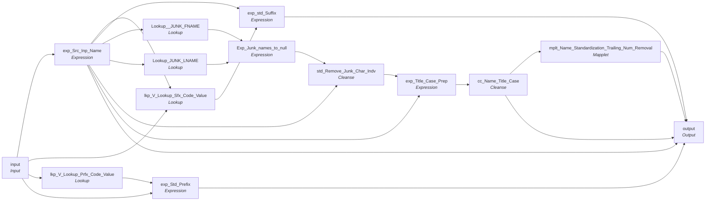

# CopyOf_mplt_Name_Standardization_Indv_Member

IDQ mapplet &rarr; CDI **Mapplet** `CopyOf_mplt_Name_Standardization_Indv_Member`.

> This mapplet Standardize Individual Member Name

[JC-IPS 7/27/2020] Added Source full name with no transformations
[ML 11/6/2020] Added prefix / suffix source and exception codes to output
[ML 11/22/2024] Added tab to the junk character list for all cleanse functions
[ML 02/20/2025] Added lookup to a list if junk names (trear junk names as null)
[ML 03/05/2025] Updated the Junk Name match to use trimmed upper case

## Summary

| IDQ transformation | CDI transformation | Count |
|---|---|---|
| CaseConverterTx | Cleanse | 1 |
| ExpressionTx | Expression | 5 |
| LookupTx | Lookup | 4 |
| MappletInputTx | Input | 1 |
| MappletOutputTx | Output | 1 |
| MappletTx | Mapplet | 1 |
| TokenStandardiserTx | Cleanse | 1 |

## Flow



## Transformations

In data-flow order.

### input

IDQ `MappletInputTx` &rarr; CDI **Input**. Mapplet Input transformation.

| Field | Type |
|---|---|
| First_Name | string(50) |
| Mdl_Name | string(50) |
| Lst_Name | string(50) |
| Prfx_Name | string(10) |
| Sfx_Name | string(10) |
| Full_Name | string(100) |
| Org_Name | string(50) |
| DBA_Name | string(50) |
| Src_System | string(30) |

### exp_Src_Inp_Name

IDQ `ExpressionTx` &rarr; CDI **Expression**. Same expression language; variable fields are supported.

| Field | Kind | Type | Expression (CDI) |
|---|---|---|---|
| First_Name | in/out | string(50) | `First_Name` |
| Up_First_Name | out | string(50) | `Ltrim(Rtrim(Upper(First_Name)))` |
| Mdl_Name | in/out | string(50) | `Mdl_Name` |
| Lst_Name | in/out | string(50) | `Lst_Name` |
| Up_Lst_Name | out | string(50) | `Rtrim(Ltrim(Upper(Lst_Name)))` |
| Full_Name_In | in/out | string(100) | `Full_Name_In` |
| Full_Name_Out | out | string(100) | `IIF(IsNull(Full_Name_In)<br>,ltrim(rtrim(First_Name)) \|\| ' ' \|\| ltrim(rtrim(Lst_Name))<br>, Full_Name_In)<br><br>` |
| Src_Full_Name_Out | out | string(100) | `IIF(IsNull(Full_Name_In)<br>,ltrim(rtrim(First_Name)) \|\| ' ' \|\| ltrim(rtrim(Lst_Name))<br>, Full_Name_In)<br><br>` |
| Org_Name | in/out | string(50) | `Org_Name` |
| DBA_Name | in/out | string(50) | `DBA_Name` |
| Prfx_Name | in/out | string(10) | `Prfx_Name` |
| Sfx_Name | in/out | string(10) | `Sfx_Name` |

Links (target field &larr; upstream field):

| Field | From |
|---|---|
| First_Name | input.First_Name |
| Mdl_Name | input.Mdl_Name |
| Lst_Name | input.Lst_Name |
| Full_Name_In | input.Full_Name |
| Org_Name | input.Org_Name |
| DBA_Name | input.DBA_Name |
| Prfx_Name | input.Prfx_Name |
| Sfx_Name | input.Sfx_Name |

### lkp_V_Lookup_Sfx_Code_Value

IDQ `LookupTx` &rarr; CDI **Lookup**. Connected lookup unless a return port is set (then unconnected).

| Property | Value |
|---|---|
| Connection | STAGING |
| Object | V_LOOKUP_CODE_VALUE (view) |
| Lookup condition | SRC_CODE_VALUE = in_Suffix AND SRC_SYS = in_Src_Sys |
| Multiple matches | Return any row |
| Cache | static cache |
| Cache file name prefix | Rule_Suffix_V_LKP_CODE_ |

Filter (CDI source/lookup *Filter* property; translated):

```sql
"V_LOOKUP_CODE_VALUE"."CODE_TYPE"  = 'SUFFIX'
```

| Lookup input field | Type |
|---|---|
| in_Suffix | string(10) |
| in_Src_Sys | string(10) |

| Return / pass-through field | Feeds |
|---|---|
| MSTR_CODE_VALUE | exp_std_Suffix.std_Suffix |

Links (target field &larr; upstream field):

| Field | From |
|---|---|
| in_Suffix | exp_Src_Inp_Name.Sfx_Name |
| in_Src_Sys | input.Src_System |

### exp_std_Suffix

IDQ `ExpressionTx` &rarr; CDI **Expression**. Same expression language; variable fields are supported.

| Field | Kind | Type | Expression (CDI) |
|---|---|---|---|
| std_Suffix | in/out | string(20) | `std_Suffix` |
| Src_Suffix | in/out | string(10) | `Src_Suffix` |
| Exception_Code | out | string(300) | `IIF( <br>	NOT ISNULL(Src_Suffix) and <br>	ltrim(rtrim(Src_Suffix))<>'' and<br>	ISNULL(std_Suffix)<br>	,'Invalid_Suffix',null)` |

Links (target field &larr; upstream field):

| Field | From |
|---|---|
| std_Suffix | lkp_V_Lookup_Sfx_Code_Value.MSTR_CODE_VALUE |
| Src_Suffix | exp_Src_Inp_Name.Sfx_Name |

### lkp_V_Lookup_Prfx_Code_Value

IDQ `LookupTx` &rarr; CDI **Lookup**. Connected lookup unless a return port is set (then unconnected).

| Property | Value |
|---|---|
| Connection | STAGING |
| Object | V_LOOKUP_CODE_VALUE (view) |
| Lookup condition | SRC_CODE_VALUE = in_Prefix AND SRC_SYS = in_Src_Sys |
| Multiple matches | Return any row |
| Cache | static cache |
| Cache file name prefix | rule_Prefix_Std_V_LKP_CODE_ |

Filter (CDI source/lookup *Filter* property; translated):

```sql
"V_LOOKUP_CODE_VALUE"."CODE_TYPE"='PREFIX'
```

| Lookup input field | Type |
|---|---|
| in_Prefix | string(10) |
| in_Src_Sys | string(10) |

| Return / pass-through field | Feeds |
|---|---|
| MSTR_CODE_VALUE | exp_Std_Prefix.std_Prefix |

Links (target field &larr; upstream field):

| Field | From |
|---|---|
| in_Prefix | input.Prfx_Name |
| in_Src_Sys | input.Src_System |

### exp_Std_Prefix

IDQ `ExpressionTx` &rarr; CDI **Expression**. Same expression language; variable fields are supported.

| Field | Kind | Type | Expression (CDI) |
|---|---|---|---|
| std_Prefix | in/out | string(20) | `std_Prefix` |
| Src_Prefix | in/out | string(10) |  |
| Exception_Code | out | string(20) | `IIF( <br>	NOT ISNULL(Src_Prefix) and <br>	ltrim(rtrim(Src_Prefix))<>'' and<br>	ISNULL(std_Prefix)<br>	,'Invalid_Prefix',null)` |

Links (target field &larr; upstream field):

| Field | From |
|---|---|
| std_Prefix | lkp_V_Lookup_Prfx_Code_Value.MSTR_CODE_VALUE |
| Src_Prefix | input.Prfx_Name |

### Lookup__JUNK_FNAME

IDQ `LookupTx` &rarr; CDI **Lookup**. Connected lookup unless a return port is set (then unconnected).

| Property | Value |
|---|---|
| Connection | STAGING |
| Object | REF_JUNK_NAME_LIST |
| Lookup condition | NAME = Up_First_Name |
| Multiple matches | Return any row |
| Cache | static cache |

Filter (CDI source/lookup *Filter* property; translated):

```sql
"REF_JUNK_NAME_LIST"."EDIT_LIMITATION" is null or "REF_JUNK_NAME_LIST"."EDIT_LIMITATION" = 'FIRST'
```

| Lookup input field | Type |
|---|---|
| First_Name | string(50) |
| Up_First_Name | string(50) |

| Return / pass-through field | Feeds |
|---|---|
| First_Name | Exp_Junk_names_to_null.First_Name |
| NAME | Exp_Junk_names_to_null.FNAME_JUNK |

Links (target field &larr; upstream field):

| Field | From |
|---|---|
| First_Name | exp_Src_Inp_Name.First_Name |
| Up_First_Name | exp_Src_Inp_Name.Up_First_Name |

### Lookup_JUNK_LNAME

IDQ `LookupTx` &rarr; CDI **Lookup**. Connected lookup unless a return port is set (then unconnected).

| Property | Value |
|---|---|
| Connection | STAGING |
| Object | REF_JUNK_NAME_LIST |
| Lookup condition | NAME = Up_Lst_Name |
| Multiple matches | Return any row |
| Cache | static cache |

Filter (CDI source/lookup *Filter* property; translated):

```sql
"REF_JUNK_NAME_LIST"."EDIT_LIMITATION" is null or "REF_JUNK_NAME_LIST"."EDIT_LIMITATION" = 'LAST'
```

| Lookup input field | Type |
|---|---|
| Lst_Name | string(50) |
| Up_Lst_Name | string(50) |

| Return / pass-through field | Feeds |
|---|---|
| Lst_Name | Exp_Junk_names_to_null.Lst_Name |
| NAME | Exp_Junk_names_to_null.LNAME_JUNK |

Links (target field &larr; upstream field):

| Field | From |
|---|---|
| Lst_Name | exp_Src_Inp_Name.Lst_Name |
| Up_Lst_Name | exp_Src_Inp_Name.Up_Lst_Name |

### Exp_Junk_names_to_null

IDQ `ExpressionTx` &rarr; CDI **Expression**. Same expression language; variable fields are supported.

| Field | Kind | Type | Expression (CDI) |
|---|---|---|---|
| FNAME_JUNK | in/out | string(255) |  |
| LNAME_JUNK | in/out | string(255) |  |
| First_Name | in/out | string(50) |  |
| Lst_Name | in/out | string(50) |  |
| FName_out | out | string(50) | `IIF(ISNULL(FNAME_JUNK), First_Name, NULL)` |
| LName_out | out | string(50) | `IIF(ISNULL(LNAME_JUNK),Lst_Name, NULL)` |

Links (target field &larr; upstream field):

| Field | From |
|---|---|
| FNAME_JUNK | Lookup__JUNK_FNAME.NAME |
| LNAME_JUNK | Lookup_JUNK_LNAME.NAME |
| First_Name | Lookup__JUNK_FNAME.First_Name |
| Lst_Name | Lookup_JUNK_LNAME.Lst_Name |

### std_Remove_Junk_Char_Indv

IDQ `TokenStandardiserTx` &rarr; CDI **Cleanse**. CDQ Cleanse asset with remove/replace steps (see cdq.md).

Settings: (defaults)

- `TokenStandardiserStrategy` **std_Remove_Junk_First_Name** removeMultipleSpaces=`true`, trim=`true`
  - function: `standardizer`
- `FieldParameter` **Input** field=`First_Name`
- `FieldParameter` **Output** field=`First_Name`
- `UserOp` **Remove Custom Strings** searchStrings=`` ~ ! ` @ # $ % ^ & * ( ) _ + = " : ; ? / . > , < 	 ``
- `TokenStandardiserStrategy` **std_Remove_Junk_MDL_Name** removeMultipleSpaces=`true`, trim=`true`
  - function: `standardizer`
- `FieldParameter` **Input** field=`Mdl_Name`
- `FieldParameter` **Output** field=`Mdl_Name`
- `UserOp` **Remove Custom Strings** searchStrings=`` ~ ` ! @ # $ % ^ & * ( ) _ - + = } { [ ] | \ " ' : ; ? / > . < , 	 ``
- `TokenStandardiserStrategy` **std_Remove_Junk_Last_Name** removeMultipleSpaces=`true`, trim=`true`
  - function: `standardizer`
- `FieldParameter` **Input** field=`Last_Name`
- `FieldParameter` **Output** field=`Lst_Name`
- `UserOp` **Remove Custom Strings** searchStrings=`` ~ ` ! @ # $ % ^ & * ( ) _ + = | \ } { [ ] " ; : ? > . < , 	 ``
- `TokenStandardiserStrategy` **std_Remove_Junk_Full_Name** removeMultipleSpaces=`true`, trim=`true`
  - function: `standardizer`
- `FieldParameter` **Input** field=`Full_Name`
- `FieldParameter` **Output** field=`Full_Name`
- `UserOp` **Remove Custom Strings** searchStrings=`` ~ ` ! @ # $ % ^ * ( ) _ + = \ | } ] { [ " : ; ? / > . < , 	 ``
- `TokenStandardiserStrategy` **std_Remove_Junk_Org_Name** trim=`true`
  - function: `standardizer`
- `FieldParameter` **Input** field=`Org_Name`
- `FieldParameter` **Output** field=`Org_Name`
- `UserOp` **Remove Custom Strings** searchStrings=`` ~ ` ! @ # $ % ^ * ( ) _ + = | \ } ] { [ " : ; ? / > . < , 	 ``
- `TokenStandardiserStrategy` **std_Remove_Junk_DBA_Name** trim=`true`
  - function: `standardizer`
- `FieldParameter` **Input** field=`DBA_Name`
- `FieldParameter` **Output** field=`DBA_Name`
- `UserOp` **Remove Custom Strings** searchStrings=`` ~ ` ! @ # $ % ^ * ( ) _ - + = | \ } ] { [ " ' : ; ? / > . < , 	 ``

Links (target field &larr; upstream field):

| Field | From |
|---|---|
| Mdl_Name | exp_Src_Inp_Name.Mdl_Name |
| Org_Name | exp_Src_Inp_Name.Org_Name |
| DBA_Name | exp_Src_Inp_Name.DBA_Name |
| Full_Name | exp_Src_Inp_Name.Full_Name_Out |
| First_Name | Exp_Junk_names_to_null.FName_out |
| Last_Name | Exp_Junk_names_to_null.LName_out |

### exp_Title_Case_Prep

IDQ `ExpressionTx` &rarr; CDI **Expression**. Same expression language; variable fields are supported.

| Field | Kind | Type | Expression (CDI) |
|---|---|---|---|
| First_Name | in/out | string(50) | `First_Name` |
| Mdl_Name | in/out | string(50) | `Mdl_Name` |
| Lst_Name | in/out | string(50) | `Lst_Name` |
| Full_Name | in/out | string(100) | `Full_Name` |
| Org_Name | in/out | string(50) | `Org_Name` |
| DBA_Name | in/out | string(50) | `DBA_Name` |
| Prfx_Name | in/out | string(10) | `Prfx_Name` |
| Sfx_Name | in/out | string(10) | `Sfx_Name` |

Links (target field &larr; upstream field):

| Field | From |
|---|---|
| First_Name | std_Remove_Junk_Char_Indv.First_Name |
| Mdl_Name | std_Remove_Junk_Char_Indv.Mdl_Name |
| Lst_Name | std_Remove_Junk_Char_Indv.Lst_Name |
| Full_Name | std_Remove_Junk_Char_Indv.Full_Name |
| Org_Name | std_Remove_Junk_Char_Indv.Org_Name |
| DBA_Name | std_Remove_Junk_Char_Indv.DBA_Name |
| Prfx_Name | exp_Src_Inp_Name.Prfx_Name |
| Sfx_Name | exp_Src_Inp_Name.Sfx_Name |

### cc_Name_Title_Case

IDQ `CaseConverterTx` &rarr; CDI **Cleanse**. CDQ Cleanse asset with a Change Case step (see cdq.md).

Settings: (defaults)

- `CaseConverterTxStrategy` **cc_First_Name** conversionType=`TITLE`, delimiterList=` `
  - function: `TITLE`
- `FieldParameter` **First_Name** field=`First_Name`
- `FieldParameter` **Output** field=`First_Name`
- `CaseConverterTxStrategy` **cc_MDL_Name** conversionType=`TITLE`, delimiterList=` `
  - function: `TITLE`
- `FieldParameter` **Mdl_Name** field=`Mdl_Name`
- `FieldParameter` **Output** field=`Mdl_Name`
- `CaseConverterTxStrategy` **cc_Last_Name** conversionType=`TITLE`, delimiterList=` `
  - function: `TITLE`
- `FieldParameter` **Lst_Name** field=`Lst_Name`
- `FieldParameter` **Output** field=`Lst_Name`
- `CaseConverterTxStrategy` **cc_Full_Name** conversionType=`TITLE`, delimiterList=` `
  - function: `TITLE`
- `FieldParameter` **Full_Name** field=`Full_Name`
- `FieldParameter` **Output** field=`Full_Name`
- `CaseConverterTxStrategy` **cc_Org_Name** conversionType=`TITLE`, delimiterList=` `
  - function: `TITLE`
- `FieldParameter` **Org_Name** field=`Org_Name`
- `FieldParameter` **Output** field=`Org_Name`
- `CaseConverterTxStrategy` **cc_DBA_Name** conversionType=`TITLE`, delimiterList=` `
  - function: `TITLE`
- `FieldParameter` **DBA_Name** field=`DBA_Name`
- `FieldParameter` **Output** field=`DBA_Name`

Links (target field &larr; upstream field):

| Field | From |
|---|---|
| First_Name | exp_Title_Case_Prep.First_Name |
| Mdl_Name | exp_Title_Case_Prep.Mdl_Name |
| Lst_Name | exp_Title_Case_Prep.Lst_Name |
| Full_Name | exp_Title_Case_Prep.Full_Name |
| Org_Name | exp_Title_Case_Prep.Org_Name |
| DBA_Name | exp_Title_Case_Prep.DBA_Name |

### mplt_Name_Standardization_Trailing_Num_Removal

IDQ `MappletTx` &rarr; CDI **Mapplet**. Reusable CDI mapplet (see the mapplets folder).

Mapplet: [`CopyOf_mplt_Name_Standardization_Trailing_Num_Removal`](../mapplets/CopyOf_mplt_Name_Standardization_Trailing_Num_Removal.md)

Links (target field &larr; upstream field):

| Field | From |
|---|---|
| Group.First_Name | cc_Name_Title_Case.First_Name |
| Group.Last_Name | cc_Name_Title_Case.Lst_Name |
| Group.Middle_Name | cc_Name_Title_Case.Mdl_Name |
| Group.Full_Name | cc_Name_Title_Case.Full_Name |

### output

IDQ `MappletOutputTx` &rarr; CDI **Output**. Mapplet Output transformation.

| Field | Type |
|---|---|
| First_Name | string(50) |
| Mdl_Name | string(50) |
| Lst_Name | string(50) |
| Full_Name | string(100) |
| Src_Full_Name | string(100) |
| Org_Name | string(50) |
| DBA_Name | string(50) |
| Prfx_Name | string(10) |
| Sfx_Name | string(10) |
| Src_Prefix | string(10) |
| Prefix_Exception_Code | string(20) |
| Src_Suffix | string(10) |
| Suffix_Exception_Code | string(300) |

Links (target field &larr; upstream field):

| Field | From |
|---|---|
| Org_Name | cc_Name_Title_Case.Org_Name |
| DBA_Name | cc_Name_Title_Case.DBA_Name |
| Src_Full_Name | exp_Src_Inp_Name.Src_Full_Name_Out |
| Sfx_Name | exp_std_Suffix.std_Suffix |
| Prfx_Name | exp_Std_Prefix.std_Prefix |
| Suffix_Exception_Code | exp_std_Suffix.Exception_Code |
| Prefix_Exception_Code | exp_Std_Prefix.Exception_Code |
| Src_Suffix | exp_std_Suffix.Src_Suffix |
| Src_Prefix | exp_Std_Prefix.Src_Prefix |
| First_Name | mplt_Name_Standardization_Trailing_Num_Removal.out_Corrected_Name.out_FName |
| Mdl_Name | mplt_Name_Standardization_Trailing_Num_Removal.out_Corrected_Name.out_MName |
| Lst_Name | mplt_Name_Standardization_Trailing_Num_Removal.out_Corrected_Name.out_LName |
| Full_Name | mplt_Name_Standardization_Trailing_Num_Removal.out_Corrected_Name.out_FullName |
