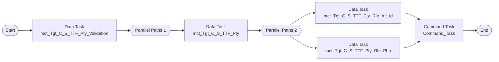

# Taskflow tf_TTF_Stage_Load

Replaces IDQ workflow `wf_TTF_Stage_Load`. Create it as a **Taskflow** (not a linear taskflow) because the workflow runs mapping tasks in parallel.

## IDQ workflow

```mermaid
flowchart LR
  u-5pcxxvqefgxadfummbr1g(["Start_Event"])
  u-5pcxnvqefgxadfummbr1g(["End_Event"])
  u-5pcx3vqefgxadfummbr1g["m_Tgt_C_S_TTF_Pty_Validation"]
  u-5pcyhvqefgxadfummbr1g{"Inclusive_Gateway"}
  u-5pcyxvqefgxadfummbr1g["m_Tgt_C_S_TTF_Pty"]
  u-5pcynvqefgxadfummbr1g{"Inclusive_Gateway1"}
  u-5pcy3vqefgxadfummbr1g["m_Tgt_C_S_TTF_Pty_Rle_Alt_Id"]
  u-5pczhvqefgxadfummbr1g["m_Tgt_C_S_TTF_Pty_Rle_Phn"]
  u-5pczxvqefgxadfummbr1g{"Inclusive_Gateway2"}
  u-5pcznvqefgxadfummbr1g{"Inclusive_Gateway3"}
  u-5pcz3vqefgxadfummbr1g["Command_Task"]
  u-5pcxxvqefgxadfummbr1g --> u-5pcx3vqefgxadfummbr1g
  u-5pcx3vqefgxadfummbr1g --> u-5pcyhvqefgxadfummbr1g
  u-5pcyhvqefgxadfummbr1g --> u-5pcyxvqefgxadfummbr1g
  u-5pcyhvqefgxadfummbr1g -->|default| u-5pcynvqefgxadfummbr1g
  u-5pcyxvqefgxadfummbr1g --> u-5pcynvqefgxadfummbr1g
  u-5pcynvqefgxadfummbr1g --> u-5pczxvqefgxadfummbr1g
  u-5pcy3vqefgxadfummbr1g --> u-5pcznvqefgxadfummbr1g
  u-5pczhvqefgxadfummbr1g --> u-5pcznvqefgxadfummbr1g
  u-5pczxvqefgxadfummbr1g -->|default| u-5pcznvqefgxadfummbr1g
  u-5pczxvqefgxadfummbr1g --> u-5pcy3vqefgxadfummbr1g
  u-5pczxvqefgxadfummbr1g --> u-5pczhvqefgxadfummbr1g
  u-5pcznvqefgxadfummbr1g --> u-5pcz3vqefgxadfummbr1g
  u-5pcz3vqefgxadfummbr1g --> u-5pcxnvqefgxadfummbr1g
```

## CDI taskflow

## Steps

| # | Step | Runs | Notes |
|---|---|---|---|
| 0 | Data Task | `mct_Tgt_C_S_TTF_Pty_Validation` |  |
| 1 | Parallel Paths | path 1: `mct_Tgt_C_S_TTF_Pty` | Data Tasks in a path run in sequence; all paths must complete before the next step (same as the IDQ join gateway). |
| 2 | Parallel Paths | path 1: `mct_Tgt_C_S_TTF_Pty_Rle_Alt_Id` path 2: `mct_Tgt_C_S_TTF_Pty_Rle_Phn` | Data Tasks in a path run in sequence; all paths must complete before the next step (same as the IDQ join gateway). |
| 3 | Command Task | Command_Task | IDQ command `touch ${var:sys.WorkflowName}.ind`, working directory `/opt/apps/informatica/SrcFiles/Indicators`. See below. |
| 4 | End |  |  |

## Mapping tasks

Create one mapping task per mapping. IDQ mapping-task settings and their CDI home:

| Mapping task | Mapping | Date format (Advanced session property *Default date format*) | High precision (*Enable high precision*) | Tracing (*Override tracing*) | Sort order |
|---|---|---|---|---|---|
| `mct_Tgt_C_S_TTF_Pty_Validation` | [`m_Tgt_C_S_TTF_Pty_Validation`](mappings/m_Tgt_C_S_TTF_Pty_Validation.md) | MM/DD/YYYY HH24:MI:SS | true | normal | binary |
| `mct_Tgt_C_S_TTF_Pty` | [`m_Tgt_C_S_TTF_Pty`](mappings/m_Tgt_C_S_TTF_Pty.md) | MM/DD/YYYY HH24:MI:SS | true | normal | binary |
| `mct_Tgt_C_S_TTF_Pty_Rle_Alt_Id` | [`m_Tgt_C_S_TTF_Pty_Rle_Alt_Id`](mappings/m_Tgt_C_S_TTF_Pty_Rle_Alt_Id.md) | MM/DD/YYYY HH24:MI:SS | true | normal | binary |
| `mct_Tgt_C_S_TTF_Pty_Rle_Phn` | [`m_Tgt_C_S_TTF_Pty_Rle_Phn`](mappings/m_Tgt_C_S_TTF_Pty_Rle_Phn.md) | MM/DD/YYYY HH24:MI:SS | true | normal | binary |

Each Data Task: *On error* = **Fail taskflow** (IDQ aborts the workflow when a mapping task fails). Pass the parameter file through the mapping task *Parameter file* setting (see the `.param` file).

## Command task

IDQ runs `touch ${var:sys.WorkflowName}.ind` on the DIS host. In the CDI taskflow add a **Command Task** step that runs on the Linux Secure Agent runtime environment:

| Field | Value |
|---|---|
| Runtime Environment | the Linux Secure Agent group used by the mapping tasks |
| Script File Name | `/bin/sh` |
| Input Arguments | `-c "touch wf_TTF_Stage_Load.ind"` |
| Work Directory | `/opt/apps/informatica/SrcFiles/Indicators` |

`${var:sys.WorkflowName}` resolved to `wf_TTF_Stage_Load` so the indicator file name downstream consumers watch does not change. The agent user needs write access to the working directory.
