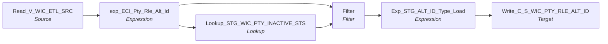

# m_Tgt_C_S_WIC_Pty_Rle_Alt_Id

IDQ mapping &rarr; CDI **Mapping** `m_Tgt_C_S_WIC_Pty_Rle_Alt_Id`.

> [MLayne 12/20/2024]  Initial version (copied from ECI)

## Summary

| IDQ transformation | CDI transformation | Count |
|---|---|---|
| ExpressionTx | Expression | 2 |
| FilterTx | Filter | 1 |
| LookupTx | Lookup | 1 |
| SourceTx | Source | 1 |
| TargetTx | Target | 1 |

Sources:

| Instance | Object | Connection |
|---|---|---|
| Read_V_WIC_ETL_SRC | `V_WIC_ETL_SRC` | STAGING |

Targets:

| Instance | Object | Connection |
|---|---|---|
| Write_C_S_WIC_PTY_RLE_ALT_ID | `C_S_WIC_PTY_RLE_ALT_ID` | HHS_MDM_ORS |

## Flow



## Filtered data

Every step that can stop, divert or collapse rows, and what happens to the rows that do not pass. A Filter keeps a row only when its condition is TRUE: FALSE **or NULL** drops the row silently (no target, no reject file). A Router writes a row to **every** group whose condition is TRUE; a row that matches no group goes to the default group and is discarded when that group is not linked. Comments (`--`, `//`) are removed from the conditions shown here. A `= ...` line reads a null check on a lookup return in plain terms; *no matching row* also covers a matching row whose returned field is NULL.

### Steps that filter rows

| Step | IDQ type | Rule | Rows that pass go to | Rows that do not pass |
|---|---|---|---|---|
| Read_V_WIC_ETL_SRC | SourceTx | rows the view `V_WIC_ETL_SRC` returns (view logic is outside the export) | `C_S_WIC_PTY_RLE_ALT_ID` | never read |
| Filter | FilterTx | keep `IsNull(DEACTIVATION_STS)`<br>= no matching row in `STG_WIC_PTY_INACTIVE_STS` | `C_S_WIC_PTY_RLE_ALT_ID` | **discarded** |

### Where the condition fields come from

| Step | Field | Origin |
|---|---|---|
| Filter | `DEACTIVATION_STS` | `DEACTIVATION_STS` returned by lookup `Lookup_STG_WIC_PTY_INACTIVE_STS` on `STG_WIC_PTY_INACTIVE_STS` where `SRC_KEY = PTY_SRC_KEY AND ROWID_SYSTEM = SRC_SYSTEM`; NULL when no row matches; `STG_WIC_PTY_INACTIVE_STS` is loaded by `m_Tgt_C_S_WIC_Pty_Validation` in this workflow |

### Rows that do not reach `C_S_*` tables

**`C_S_WIC_PTY_RLE_ALT_ID`** (`Write_C_S_WIC_PTY_RLE_ALT_ID`): a source row is written only when it passes every step below.

| Step | Must hold | Otherwise the row |
|---|---|---|
| `Read_V_WIC_ETL_SRC` | rows the view `V_WIC_ETL_SRC` returns (view logic is outside the export) | never read |
| `Filter` | `IsNull(DEACTIVATION_STS)`<br>= no matching row in `STG_WIC_PTY_INACTIVE_STS` | **discarded** (not written anywhere) |

## Oracle stored procedure

Drop-in replacement in Oracle: [`sp_ors_main_m_Tgt_C_S_WIC_Pty_Rle_Alt_Id`](../../../idq-to-oracle/wf_WIC_Stage_Load/sp_ors_main_m_Tgt_C_S_WIC_Pty_Rle_Alt_Id.sql) (set-based SQL; one transaction that commits at the end and rolls back and re-raises on error). The IDQ mapplets and rules become the shared `fn_dq_*` functions; see [idq-to-oracle/README.md](../../../idq-to-oracle/README.md). Unlike the CDI spec above, the procedure **keeps the MDM timeline logic**; it is marked `TIMELINE` in the comments.

```text
Drop-in replacement of IDQ mapping m_Tgt_C_S_WIC_Pty_Rle_Alt_Id (workflow wf_WIC_Stage_Load).

One alternate id per active WIC party into C_S_WIC_PTY_RLE_ALT_ID (truncated first): the WIC id padded to 12,
type '020' for SOURCE_TABLE 'CLIENT' and '021' otherwise.
  Read_V_WIC_ETL_SRC -> Filter: party not in STG_WIC_PTY_INACTIVE_STS -> target

TIMELINE: VERSION_SEQ = 1; PERIOD_START_DATE = DATEKEY.
HUB_STATE_IND is not linked in this IDQ mapping (left to the column default).
```

Tables written:

| Table | Operation |
|---|---|
| `C_S_WIC_PTY_RLE_ALT_ID` | truncate, insert |

Shared functions and procedures called:

| Object | Does |
|---|---|
| `sp_ors_helper01_common` | truncate a target table (IDQ target property "Truncate target table") |
| `sp_ors_helper02_common` | run log line: mapping, step, row count (DBMS_OUTPUT) |

## Transformations

In data-flow order.

### Read_V_WIC_ETL_SRC

IDQ `SourceTx` &rarr; CDI **Source**. Oracle connector source; carry the SQL override / filter below verbatim.

| Property | Value |
|---|---|
| Connection | STAGING |
| Object | V_WIC_ETL_SRC (view) |

Columns: `SOURCE_TABLE`, `DATEKEY`, `LOAD_DATE`, `ID`, `PTY_SRC_KEY`, `CID`, `FID`, `FIRST_NAME`, `LAST_NAME`, `MIDDLE_NAME`, `DOB`, `GENDER`, `BIRTH_WT_LB`, `BIRTH_WT_OZ`, `LANGUAGE_CD`, `ETHNICITY`, `RACE_WHITE_IND`, `RACE_AA_IND`, `RACE_ASIAN_IND`, `RACE_PI_IND`, `RACE_AN_IND`, `ADDRESS1`, `ADDRESS2`, `CITY`, `ZIP_CODE`, `COUNTY`, `PHONE`, `EMAIL`, `DATE_ADDRESS_VALID_FROM`

### exp_ECI_Pty_Rle_Alt_Id

IDQ `ExpressionTx` &rarr; CDI **Expression**. Same expression language; variable fields are supported.

| Field | Kind | Type | Expression (CDI) |
|---|---|---|---|
| SOURCE_TABLE | in/out | string(6) |  |
| ID | in/out | string(15) |  |
| PTY_SRC_KEY | in/out | string(255) | `PTY_SRC_KEY` |
| PKEY_SRC_OBJECT | out | string(255) | `v_PTY_RLE_FK \|\| '\|' \|\| v_ALT_ID_TP \|\| '\|' \|\| LPAD(ID,12,'0')` |
| v_PTY_RLE_FK | variable | string(255) | `PTY_SRC_KEY \|\| '\|Member'` |
| PTY_RLE_FK | out | string(255) | `v_PTY_RLE_FK` |
| v_ALT_ID_TP | variable | string(10) | `IIF(SOURCE_TABLE = 'CLIENT', '020','021')` |
| ALT_ID_TP | out | string(3) | `v_ALT_ID_TP` |
| ALT_ID_VAL | out | string(15) | `LPAD(ID,12,'0')` |
| DATE_CREATED | in/out | date/time |  |
| DATE_MODIFIED | in/out | date/time |  |
| SRC_SYSTEM | out | string(10) | `'WIC'` |

Links (target field &larr; upstream field):

| Field | From |
|---|---|
| ID | Read_V_WIC_ETL_SRC.ID |
| DATE_CREATED | Read_V_WIC_ETL_SRC.DATEKEY |
| DATE_MODIFIED | Read_V_WIC_ETL_SRC.DATEKEY |
| PTY_SRC_KEY | Read_V_WIC_ETL_SRC.PTY_SRC_KEY |
| SOURCE_TABLE | Read_V_WIC_ETL_SRC.SOURCE_TABLE |

### Lookup_STG_WIC_PTY_INACTIVE_STS

IDQ `LookupTx` &rarr; CDI **Lookup**. Connected lookup unless a return port is set (then unconnected).

| Property | Value |
|---|---|
| Connection | STAGING |
| Object | STG_WIC_PTY_INACTIVE_STS |
| Lookup condition | SRC_KEY = PTY_SRC_KEY AND ROWID_SYSTEM = SRC_SYSTEM |
| Multiple matches | Return any row |
| Cache | static cache |

| Lookup input field | Type |
|---|---|
| PTY_SRC_KEY | string(255) |
| SRC_SYSTEM | string(10) |

| Return / pass-through field | Feeds |
|---|---|
| DEACTIVATION_STS | Filter.DEACTIVATION_STS |

Links (target field &larr; upstream field):

| Field | From |
|---|---|
| PTY_SRC_KEY | exp_ECI_Pty_Rle_Alt_Id.PTY_SRC_KEY |
| SRC_SYSTEM | exp_ECI_Pty_Rle_Alt_Id.SRC_SYSTEM |

### Filter

IDQ `FilterTx` &rarr; CDI **Filter**. Advanced filter condition.

Filter condition:

```
IsNull(DEACTIVATION_STS)
```

Links (target field &larr; upstream field):

| Field | From |
|---|---|
| ID | exp_ECI_Pty_Rle_Alt_Id.ID |
| PKEY_SRC_OBJECT | exp_ECI_Pty_Rle_Alt_Id.PKEY_SRC_OBJECT |
| PTY_REL_FK | exp_ECI_Pty_Rle_Alt_Id.PTY_RLE_FK |
| ALT_ID_TP | exp_ECI_Pty_Rle_Alt_Id.ALT_ID_TP |
| ALT_ID_VAL | exp_ECI_Pty_Rle_Alt_Id.ALT_ID_VAL |
| DATE_CREATED | exp_ECI_Pty_Rle_Alt_Id.DATE_CREATED |
| DATE_MODIFIED | exp_ECI_Pty_Rle_Alt_Id.DATE_MODIFIED |
| SRC_SYSTEM | exp_ECI_Pty_Rle_Alt_Id.SRC_SYSTEM |
| DEACTIVATION_STS | Lookup_STG_WIC_PTY_INACTIVE_STS.DEACTIVATION_STS |

### Exp_STG_ALT_ID_Type_Load

IDQ `ExpressionTx` &rarr; CDI **Expression**. Same expression language; variable fields are supported.

| Field | Kind | Type | Expression (CDI) |
|---|---|---|---|
| ID | in/out | string(15) | `ID` |
| PKEY_SRC_OBJECT | in/out | string(255) | `PKEY_SRC_OBJECT` |
| PTY_REL_FK | in/out | string(255) | `PTY_REL_FK` |
| ALT_ID_TP | in/out | string(3) | `ALT_ID_TP` |
| ALT_ID_VAL | in/out | string(15) | `ALT_ID_VAL` |
| DATE_CREATED | in/out | date/time | `DATE_CREATED` |
| DATE_MODIFIED | in/out | date/time | `DATE_MODIFIED` |
| Last_Changed_Dt | out | date/time | `IIF(IsNull(DATE_MODIFIED),DATE_CREATED,DATE_MODIFIED)` |
| SRC_SYSTEM | in/out | string(10) | `SRC_SYSTEM` |
| LAST_UPDATE_DATE | out | date/time | `SESSSTARTTIME` |
| SRC_ROWID | out | string(30) | `TO_CHAR(ID)\|\|'\|'\|\|ALT_ID_TP` |
| VERSION_SEQ (stale timeline: omit) | out | decimal(38) | `1` |
| STS_CD | out | string(20) | `'Issued'` |
| HUB_STATE_IND | out | decimal(38) | `1` |

Links (target field &larr; upstream field):

| Field | From |
|---|---|
| PTY_REL_FK | Filter.PTY_REL_FK |
| ALT_ID_TP | Filter.ALT_ID_TP |
| ALT_ID_VAL | Filter.ALT_ID_VAL |
| DATE_CREATED | Filter.DATE_CREATED |
| DATE_MODIFIED | Filter.DATE_MODIFIED |
| PKEY_SRC_OBJECT | Filter.PKEY_SRC_OBJECT |
| ID | Filter.ID |
| SRC_SYSTEM | Filter.SRC_SYSTEM |

### Write_C_S_WIC_PTY_RLE_ALT_ID

IDQ `TargetTx` &rarr; CDI **Target**. Oracle connector target.

| Property | Value |
|---|---|
| Connection | HHS_MDM_ORS |
| Object | C_S_WIC_PTY_RLE_ALT_ID |
| Operation | Insert |
| Truncate target table | yes |
| Load type | normal (no bulk load) |
| Reject file | Write_C_S_WIC_PTY_RLE_ALT_ID.bad |

Links (target field &larr; upstream field):

| Field | From |
|---|---|
| PKEY_SRC_OBJECT | Exp_STG_ALT_ID_Type_Load.PKEY_SRC_OBJECT |
| SRC_ROWID | Exp_STG_ALT_ID_Type_Load.SRC_ROWID |
| VERSION_SEQ (stale timeline: do not map) | Exp_STG_ALT_ID_Type_Load.VERSION_SEQ |
| PTY_RLE_FK | Exp_STG_ALT_ID_Type_Load.PTY_REL_FK |
| ALT_ID_TP | Exp_STG_ALT_ID_Type_Load.ALT_ID_TP |
| ALT_ID_VAL | Exp_STG_ALT_ID_Type_Load.ALT_ID_VAL |
| CREATE_DATE | Exp_STG_ALT_ID_Type_Load.DATE_CREATED |
| LAST_UPDATE_DATE | Exp_STG_ALT_ID_Type_Load.LAST_UPDATE_DATE |
| ALT_ID_TP_FLTR | Exp_STG_ALT_ID_Type_Load.ALT_ID_TP |
| SRC_LAST_UPD_DT | Exp_STG_ALT_ID_Type_Load.Last_Changed_Dt |
| STS_CD | Exp_STG_ALT_ID_Type_Load.STS_CD |
| PERIOD_START_DATE | Exp_STG_ALT_ID_Type_Load.DATE_CREATED |
