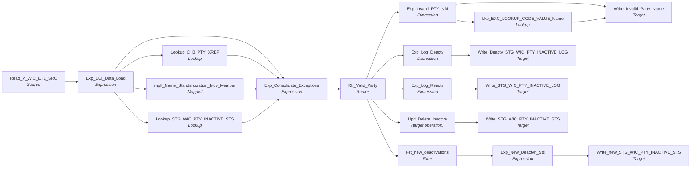

# m_Tgt_C_S_WIC_Pty_Validation

IDQ mapping &rarr; CDI **Mapping** `m_Tgt_C_S_WIC_Pty_Validation`.

> Check party data to see if it passes criteria to be included in the MDM.  If not, record keys in a deactivation list that is used as a filter in subsequent jobs.   Handle reactivations (removal from deactivation list).

DEACTIVATION_STS In the PTY_INACTIVE_STS table is populated as follows
			H - Records were deactivates as the time of the historical load so record was never loaded into the MDM
			P - Deactivation is pending (to be processed)
			D - Deactivated (Hub state ind = -1 in MDM)

## Summary

| IDQ transformation | CDI transformation | Count |
|---|---|---|
| ExpressionTx | Expression | 6 |
| FilterTx | Filter | 1 |
| LookupTx | Lookup | 3 |
| MappletTx | Mapplet | 1 |
| RouterTx | Router | 1 |
| SourceTx | Source | 1 |
| TargetTx | Target | 5 |
| UpdateStrategyTx | (target operation) | 1 |

Sources:

| Instance | Object | Connection |
|---|---|---|
| Read_V_WIC_ETL_SRC | `V_WIC_ETL_SRC` | STAGING |

Targets:

| Instance | Object | Connection |
|---|---|---|
| Write_Invalid_Party_Name | `EXC_STG_BAD_REC_MEMB` | STAGING |
| Write_new_STG_WIC_PTY_INACTIVE_STS | `STG_WIC_PTY_INACTIVE_STS` | STAGING |
| Write_Deactv_STG_WIC_PTY_INACTIVE_LOG | `STG_WIC_PTY_INACTIVE_LOG` | STAGING |
| Write_STG_WIC_PTY_INACTIVE_LOG | `STG_WIC_PTY_INACTIVE_LOG` | STAGING |
| Write_STG_WIC_PTY_INACTIVE_STS | `STG_WIC_PTY_INACTIVE_STS` | STAGING |

## Parameters

Create as CDI input parameters (`$$Name`); defaults go in the parameter file.

| Parameter | Type | Precision | Default | Used in this mapping |
|---|---|---|---|---|
| PTY_BO_CLASS_CD_Member | string | 10 | Indiv | no (declared only) |
| ECI_PTY_TBL_SRC | string | 1000 | ECI_CHILD | no (declared only) |
| RLE_BO_CLASS_CD_Member | string | 10 | Member | no (declared only) |

`$sys.MappingName` is translated to the input parameter `$$MappingName` (default: the mapping name).

## Flow



## Filtered data

Every step that can stop, divert or collapse rows, and what happens to the rows that do not pass. A Filter keeps a row only when its condition is TRUE: FALSE **or NULL** drops the row silently (no target, no reject file). A Router writes a row to **every** group whose condition is TRUE; a row that matches no group goes to the default group and is discarded when that group is not linked. Comments (`--`, `//`) are removed from the conditions shown here. A `= ...` line reads a null check on a lookup return in plain terms; *no matching row* also covers a matching row whose returned field is NULL.

### Steps that filter rows

| Step | IDQ type | Rule | Rows that pass go to | Rows that do not pass |
|---|---|---|---|---|
| Read_V_WIC_ETL_SRC | SourceTx | rows the view `V_WIC_ETL_SRC` returns (view logic is outside the export) | `EXC_STG_BAD_REC_MEMB`, `STG_WIC_PTY_INACTIVE_STS`, `STG_WIC_PTY_INACTIVE_LOG` | never read |
| Rtr_Valid_Party | RouterTx | group `Invalid_Party_Name`: `(Length(Rtrim(FIRST_NAME))=0 OR Length(Rtrim(LAST_NAME))=0 OR IsNULL(FIRST_NAME) OR IsNULL(LAST_NAME) )` | `EXC_STG_BAD_REC_MEMB` |  |
| Rtr_Valid_Party | RouterTx | group `Deactivation`: `Length(Rtrim(FIRST_NAME))=0 OR Length(Rtrim(LAST_NAME))=0 OR IsNULL(FIRST_NAME) OR IsNULL(LAST_NAME)` | `STG_WIC_PTY_INACTIVE_STS`, `STG_WIC_PTY_INACTIVE_LOG` |  |
| Rtr_Valid_Party | RouterTx | group `Reactivation`: `NOT IsNull(DEACTIVATION_STS) and Length(Rtrim(FIRST_NAME))>0 and Length(Rtrim(LAST_NAME))>0` | `STG_WIC_PTY_INACTIVE_LOG`, `STG_WIC_PTY_INACTIVE_STS` |  |
| Rtr_Valid_Party | RouterTx | default group `Default`: rows that match no other group | nothing: group not linked, **discarded** |  |
| Filt_new_deactivations | FilterTx | keep `IsNull(DEACTIVATION_STS)`<br>= no matching row in `STG_WIC_PTY_INACTIVE_STS` | `STG_WIC_PTY_INACTIVE_STS` | **discarded** |
| Upd_Delete_Inactive | UpdateStrategyTx | `DD_DELETE` | `STG_WIC_PTY_INACTIVE_STS` | not dropped: each row deletes the target row |

### Where the condition fields come from

| Step | Field | Origin |
|---|---|---|
| Rtr_Valid_Party | `FIRST_NAME` | mapplet `mplt_Name_Standardization_Indv_Member`: mapplet `mplt_Name_Standardization_Trailing_Num_Removal`: `exp_Name_Cor_numbr.var_FName` = `RTRIM(LTRIM( Decode (True, SUBSTR(LTRIM(RTRIM(FName_lbl)),LENGTH(LTRIM(RTRIM(FName_lbl)))-2,2)!= '99' AND SUBSTR(LTRIM(RTRIM(in_FName)),LENGTH(LTRIM(RTRIM(in_FName))),1) = '0',in_FName, INSTR(FName_lbl,'9') >0, SUBSTR(in_FName,1, INSTR( FName_lbl, '9', 1, 1 )-1), in_FName) ))` |
| Rtr_Valid_Party | `LAST_NAME` | mapplet `mplt_Name_Standardization_Indv_Member`: mapplet `mplt_Name_Standardization_Trailing_Num_Removal`: `exp_Name_Cor_numbr.var_LName` = `RTRIM(LTRIM( Decode (True, SUBSTR(LTRIM(RTRIM(LName_lbl)),LENGTH(LTRIM(RTRIM(LName_lbl)))-2,2)!= '99' AND SUBSTR(LTRIM(RTRIM(in_LName)),LENGTH(LTRIM(RTRIM(in_LName))),1) = '0',in_LName, INSTR(LName_lbl,'9') >0, SUBSTR(in_LName,1, INSTR( LName_lbl, '9', 1, 1 )-1),in_LName) ))` |
| Rtr_Valid_Party | `DEACTIVATION_STS` | `DEACTIVATION_STS` returned by lookup `Lookup_STG_WIC_PTY_INACTIVE_STS` on `STG_WIC_PTY_INACTIVE_STS` where `ROWID_SYSTEM = SRC_SYSTEM AND SRC_KEY = PKEY_SRC_OBJECT`; NULL when no row matches |
| Filt_new_deactivations | `DEACTIVATION_STS` | `DEACTIVATION_STS` returned by lookup `Lookup_STG_WIC_PTY_INACTIVE_STS` on `STG_WIC_PTY_INACTIVE_STS` where `ROWID_SYSTEM = SRC_SYSTEM AND SRC_KEY = PKEY_SRC_OBJECT`; NULL when no row matches |

### Rows that do not reach `C_S_*` tables

This mapping writes no `C_S_*` table (it loads `EXC_STG_BAD_REC_MEMB`, `STG_WIC_PTY_INACTIVE_STS`, `STG_WIC_PTY_INACTIVE_LOG`); the steps above decide which rows it writes.

## Oracle stored procedure

Drop-in replacement in Oracle: [`sp_ors_main_m_Tgt_C_S_WIC_Pty_Validation`](../../../idq-to-oracle/wf_WIC_Stage_Load/sp_ors_main_m_Tgt_C_S_WIC_Pty_Validation.sql) (set-based SQL; one transaction that commits at the end and rolls back and re-raises on error). The IDQ mapplets and rules become the shared `fn_dq_*` functions; see [idq-to-oracle/README.md](../../../idq-to-oracle/README.md). Unlike the CDI spec above, the procedure **keeps the MDM timeline logic**; it is marked `TIMELINE` in the comments.

```text
Drop-in replacement of IDQ mapping m_Tgt_C_S_WIC_Pty_Validation (workflow wf_WIC_Stage_Load, first step).

Checks the WIC parties (V_WIC_ETL_SRC) and maintains the deactivation list used by every later WIC mapping:
  * Rtr_Valid_Party.Invalid_Party_Name : standardized first or last name blank      -> EXC_STG_BAD_REC_MEMB
  * Rtr_Valid_Party.Deactivation       : the same condition
                                         -> STG_WIC_PTY_INACTIVE_LOG ('Deactivation')
                                         -> STG_WIC_PTY_INACTIVE_STS (new row H / D / P, only when no status yet)
  * Rtr_Valid_Party.Reactivation       : has a status and both names present
                                         -> STG_WIC_PTY_INACTIVE_LOG ('Reactivation')
                                         -> STG_WIC_PTY_INACTIVE_STS row deleted (Upd_Delete_Inactive DD_DELETE)
  * Default group: not linked.

Timeline: none.
Snapshot: all routing happens in one multi-table INSERT (read-consistent, lookups see the pre-run status); the
DELETE then removes exactly the keys logged as 'Reactivation' in this run.
```

Tables written:

| Table | Operation |
|---|---|
| `STG_WIC_PTY_INACTIVE_STS` | delete, insert |
| `EXC_STG_BAD_REC_MEMB` | insert |
| `STG_WIC_PTY_INACTIVE_LOG` | insert |

Shared functions and procedures called:

| Object | Does |
|---|---|
| `fn_dq_std_name_indv_member` | replaces `mplt_Name_Standardization_Indv_Member (+ TTF CopyOf)`, returns `t_dq_name_std` |
| `fn_ors_helper02_common` | new deactivation status from the hub state: H history / D deactivated / P |
| `fn_ors_helper04_common` | EXC_LOOKUP_CODE_VALUE lookup: exception code -> EXCEPTION_DESC (any row) |
| `fn_ors_helper05_common` | EXC_LOOKUP_CODE_VALUE lookup: exception code -> EXCEPTION_TYPE (any row) |
| `sp_ors_helper02_common` | run log line: mapping, step, row count (DBMS_OUTPUT) |

## Transformations

In data-flow order.

### Read_V_WIC_ETL_SRC

IDQ `SourceTx` &rarr; CDI **Source**. Oracle connector source; carry the SQL override / filter below verbatim.

| Property | Value |
|---|---|
| Connection | STAGING |
| Object | V_WIC_ETL_SRC (view) |

Columns: `SOURCE_TABLE`, `DATEKEY`, `LOAD_DATE`, `ID`, `PTY_SRC_KEY`, `CID`, `FID`, `FIRST_NAME`, `LAST_NAME`, `MIDDLE_NAME`, `DOB`, `GENDER`, `BIRTH_WT_LB`, `BIRTH_WT_OZ`, `LANGUAGE_CD`, `ETHNICITY`, `RACE_WHITE_IND`, `RACE_AA_IND`, `RACE_ASIAN_IND`, `RACE_PI_IND`, `RACE_AN_IND`, `ADDRESS1`, `ADDRESS2`, `CITY`, `ZIP_CODE`, `COUNTY`, `PHONE`, `EMAIL`, `DATE_ADDRESS_VALID_FROM`

### Exp_ECI_Data_Load

IDQ `ExpressionTx` &rarr; CDI **Expression**. Same expression language; variable fields are supported.

| Field | Kind | Type | Expression (CDI) |
|---|---|---|---|
| SOURCE_TABLE | in/out | string(255) | `SOURCE_TABLE` |
| ID | in/out | decimal(10) |  |
| PKEY_SRC_OBJECT | in/out | string(255) | `PKEY_SRC_OBJECT` |
| PARTY_TYPE | out | string(10) | `'Indv'` |
| FIRST_NAME | in/out | string(20) |  |
| LAST_NAME | in/out | string(30) |  |
| MIDDLE_INITIAL | in/out | string(1) |  |
| DOB | in/out | date/time |  |
| DATE_CREATED | in/out | date/time |  |
| SRC_SYSTEM | out | string(10) | `'WIC'` |
| OBJECT_NAME | out | string(50) | `'C_S_WIC_PTY'` |
| v_FULL_NAME | variable | string(10) | `LTRIM(RTRIM(<br>FIRST_NAME\|\| IIF(NOT ISNULL(MIDDLE_INITIAL ) ,<br>' ' \|\| LTRIM(RTRIM(MIDDLE_INITIAL)), '') \|\| ' ' \|\|  LTRIM(LAST_NAME)) )` |
| FULL_NAME | out | string(255) | `v_FULL_NAME` |
| LOAD_DATE | in/out | string(20) |  |

Links (target field &larr; upstream field):

| Field | From |
|---|---|
| ID | Read_V_WIC_ETL_SRC.ID |
| FIRST_NAME | Read_V_WIC_ETL_SRC.FIRST_NAME |
| LAST_NAME | Read_V_WIC_ETL_SRC.LAST_NAME |
| MIDDLE_INITIAL | Read_V_WIC_ETL_SRC.MIDDLE_NAME |
| DATE_CREATED | Read_V_WIC_ETL_SRC.DATEKEY |
| LOAD_DATE | Read_V_WIC_ETL_SRC.LOAD_DATE |
| SOURCE_TABLE | Read_V_WIC_ETL_SRC.SOURCE_TABLE |
| PKEY_SRC_OBJECT | Read_V_WIC_ETL_SRC.PTY_SRC_KEY |
| DOB | Read_V_WIC_ETL_SRC.DOB |

### Lookup_C_B_PTY_XREF

IDQ `LookupTx` &rarr; CDI **Lookup**. Connected lookup unless a return port is set (then unconnected).

| Property | Value |
|---|---|
| Connection | HHS_MDM_ORS |
| Object | C_B_PTY_XREF |
| Lookup condition | PKEY_SRC_OBJECT = PKEY_SRC_OBJECT1 |
| Multiple matches | Report error |
| Cache | static cache |

Filter (CDI source/lookup *Filter* property; translated):

```sql
"C_B_PTY_XREF"."ROWID_SYSTEM" = 'WIC'
```

| Lookup input field | Type |
|---|---|
| SRC_SYSTEM | string(10) |
| PKEY_SRC_OBJECT1 | string(255) |

| Return / pass-through field | Feeds |
|---|---|
| HUB_STATE_IND | Exp_Consolidate_Exceptions.HUB_STATE_IND |

Links (target field &larr; upstream field):

| Field | From |
|---|---|
| SRC_SYSTEM | Exp_ECI_Data_Load.SRC_SYSTEM |
| PKEY_SRC_OBJECT1 | Exp_ECI_Data_Load.PKEY_SRC_OBJECT |

### mplt_Name_Standardization_Indv_Member

IDQ `MappletTx` &rarr; CDI **Mapplet**. Reusable CDI mapplet (see the mapplets folder).

Mapplet: [`mplt_Name_Standardization_Indv_Member`](../mapplets/mplt_Name_Standardization_Indv_Member.md)

Links (target field &larr; upstream field):

| Field | From |
|---|---|
| Group.First_Name | Exp_ECI_Data_Load.FIRST_NAME |
| Group.Mdl_Name | Exp_ECI_Data_Load.MIDDLE_INITIAL |
| Group.Lst_Name | Exp_ECI_Data_Load.LAST_NAME |
| Group.Src_System | Exp_ECI_Data_Load.SRC_SYSTEM |
| Group.Full_Name | Exp_ECI_Data_Load.FULL_NAME |

### Lookup_STG_WIC_PTY_INACTIVE_STS

IDQ `LookupTx` &rarr; CDI **Lookup**. Connected lookup unless a return port is set (then unconnected).

| Property | Value |
|---|---|
| Connection | STAGING |
| Object | STG_WIC_PTY_INACTIVE_STS |
| Lookup condition | ROWID_SYSTEM = SRC_SYSTEM AND SRC_KEY = PKEY_SRC_OBJECT |
| Multiple matches | Return any row |
| Cache | static cache |

| Lookup input field | Type |
|---|---|
| PKEY_SRC_OBJECT | string(255) |
| SRC_SYSTEM | string(10) |

| Return / pass-through field | Feeds |
|---|---|
| DEACTIVATION_STS | Exp_Consolidate_Exceptions.DEACTIVATION_STS |

Links (target field &larr; upstream field):

| Field | From |
|---|---|
| PKEY_SRC_OBJECT | Exp_ECI_Data_Load.PKEY_SRC_OBJECT |
| SRC_SYSTEM | Exp_ECI_Data_Load.SRC_SYSTEM |

### Exp_Consolidate_Exceptions

IDQ `ExpressionTx` &rarr; CDI **Expression**. Same expression language; variable fields are supported.

| Field | Kind | Type | Expression (CDI) |
|---|---|---|---|
| ID_CHILD | in/out | decimal(10) |  |
| PKEY_SRC_OBJECT | in/out | string(255) | `PKEY_SRC_OBJECT` |
| PARTY_TYPE | in/out | string(10) | `PARTY_TYPE` |
| FIRST_NAME | in/out | string(20) |  |
| LAST_NAME | in/out | string(30) |  |
| MIDDLE_INITIAL | in/out | string(1) |  |
| DOB | in/out | date/time |  |
| DATE_CREATED | in/out | date/time |  |
| LOAD_DATE | in/out | string(20) |  |
| SRC_SYSTEM | in/out | string(10) | `SRC_SYSTEM` |
| OBJECT_NAME | in/out | string(50) | `OBJECT_NAME` |
| SOURCE_TABLE | in/out | string(255) | `SOURCE_TABLE` |
| Attribute_Name_Name | out | string(50) | `'Name'` |
| HUB_STATE_IND | in/out | decimal(38) |  |
| DEACTIVATION_STS | in/out | string(8) |  |

Links (target field &larr; upstream field):

| Field | From |
|---|---|
| ID_CHILD | Exp_ECI_Data_Load.ID |
| PARTY_TYPE | Exp_ECI_Data_Load.PARTY_TYPE |
| FIRST_NAME | mplt_Name_Standardization_Indv_Member.out_Standardized_Names.First_Name |
| LAST_NAME | mplt_Name_Standardization_Indv_Member.out_Standardized_Names.Lst_Name |
| MIDDLE_INITIAL | mplt_Name_Standardization_Indv_Member.out_Standardized_Names.Mdl_Name |
| DATE_CREATED | Exp_ECI_Data_Load.DATE_CREATED |
| LOAD_DATE | Exp_ECI_Data_Load.LOAD_DATE |
| SRC_SYSTEM | Exp_ECI_Data_Load.SRC_SYSTEM |
| OBJECT_NAME | Exp_ECI_Data_Load.OBJECT_NAME |
| SOURCE_TABLE | Exp_ECI_Data_Load.SOURCE_TABLE |
| PKEY_SRC_OBJECT | Exp_ECI_Data_Load.PKEY_SRC_OBJECT |
| HUB_STATE_IND | Lookup_C_B_PTY_XREF.HUB_STATE_IND |
| DEACTIVATION_STS | Lookup_STG_WIC_PTY_INACTIVE_STS.DEACTIVATION_STS |
| DOB | Exp_ECI_Data_Load.DOB |

### Rtr_Valid_Party

IDQ `RouterTx` &rarr; CDI **Router**. One output group per IDQ group; the default group is created automatically.

| Output group | Condition |
|---|---|
| Invalid_Party_Name | `(Length(Rtrim(FIRST_NAME))=0 <br>OR <br>Length(Rtrim(LAST_NAME))=0 <br>OR <br>IsNULL(FIRST_NAME) <br>OR <br>IsNULL(LAST_NAME)<br>)` |
| Deactivation | `Length(Rtrim(FIRST_NAME))=0 <br>OR <br>Length(Rtrim(LAST_NAME))=0 <br>OR <br>IsNULL(FIRST_NAME) <br>OR <br>IsNULL(LAST_NAME)` |
| Reactivation | `NOT IsNull(DEACTIVATION_STS) <br>and <br>Length(Rtrim(FIRST_NAME))>0 <br>and<br>Length(Rtrim(LAST_NAME))>0` |
| Default | (default group) |

Links (target field &larr; upstream field):

| Field | From |
|---|---|
| ID_CHILD | Exp_Consolidate_Exceptions.ID_CHILD |
| PARTY_TYPE | Exp_Consolidate_Exceptions.PARTY_TYPE |
| FIRST_NAME | Exp_Consolidate_Exceptions.FIRST_NAME |
| LAST_NAME | Exp_Consolidate_Exceptions.LAST_NAME |
| MIDDLE_INITIAL | Exp_Consolidate_Exceptions.MIDDLE_INITIAL |
| DATE_CREATED | Exp_Consolidate_Exceptions.DATE_CREATED |
| LOAD_DATE | Exp_Consolidate_Exceptions.LOAD_DATE |
| SRC_SYSTEM | Exp_Consolidate_Exceptions.SRC_SYSTEM |
| OBJECT_NAME | Exp_Consolidate_Exceptions.OBJECT_NAME |
| SOURCE_TABLE | Exp_Consolidate_Exceptions.SOURCE_TABLE |
| PKEY_SRC_OBJECT | Exp_Consolidate_Exceptions.PKEY_SRC_OBJECT |
| Attribute_Name_Name | Exp_Consolidate_Exceptions.Attribute_Name_Name |
| HUB_STATE_IND | Exp_Consolidate_Exceptions.HUB_STATE_IND |
| DEACTIVATION_STS | Exp_Consolidate_Exceptions.DEACTIVATION_STS |
| DOB | Exp_Consolidate_Exceptions.DOB |

### Exp_Invalid_PTY_NM

IDQ `ExpressionTx` &rarr; CDI **Expression**. Same expression language; variable fields are supported.

| Field | Kind | Type | Expression (CDI) |
|---|---|---|---|
| SRC_SYSTEM | in/out | string(10) | `SRC_SYSTEM` |
| PKEY_SRC_OBJECT | in/out | string(255) | `PKEY_SRC_OBJECT` |
| EXCEPTION_DESC_Name | out | string(255) | `Decode(True,<br>Length(Rtrim(FIRST_NAME))=0 <br>OR <br>IsNULL(FIRST_NAME) ,'Missing First Name',<br>Length(Rtrim(LAST_NAME))=0 <br>OR <br>IsNULL(LAST_NAME),'Missing Last Name')` |
| RUN_DATE | out | date/time | `SYSTIMESTAMP()` |
| FIRST_NAME | in/out | string(50) |  |
| MIDDLE_NAME | in/out | string(50) |  |
| LAST_NAME | in/out | string(50) |  |
| MAPPING_NAME | out | string(255) | `$$MappingName` |
| ATTRIBUTE_NAME_Name | out | string(50) | `Decode(True,<br>Length(Rtrim(FIRST_NAME))=0 <br>OR <br>IsNULL(FIRST_NAME) ,'First Name',<br>Length(Rtrim(LAST_NAME))=0 <br>OR <br>IsNULL(LAST_NAME),'Last Name')` |
| ATTRIBUTE_VALUE_Name | out | string(255) | `Decode(True,<br>Length(Rtrim(FIRST_NAME))=0 <br>OR <br>IsNULL(FIRST_NAME) ,FIRST_NAME,<br>Length(Rtrim(LAST_NAME))=0 <br>OR <br>IsNULL(LAST_NAME),LAST_NAME)` |
| PERIOD_START_DATE | in/out | date/time |  |
| Exception_Code_Name | out | string(150) | `Decode(True,<br>Length(Rtrim(FIRST_NAME))=0 <br>OR <br>IsNULL(FIRST_NAME) ,'Missing_First_Name',<br>Length(Rtrim(LAST_NAME))=0 <br>OR <br>IsNULL(LAST_NAME),'Missing_Last_Name')` |
| BIRTH_DATE | in/out | date/time |  |

Links (target field &larr; upstream field):

| Field | From |
|---|---|
| SRC_SYSTEM | Rtr_Valid_Party.Invalid_Party_Name.SRC_SYSTEM |
| PERIOD_START_DATE | Rtr_Valid_Party.Invalid_Party_Name.DATE_CREATED |
| FIRST_NAME | Rtr_Valid_Party.Invalid_Party_Name.FIRST_NAME |
| MIDDLE_NAME | Rtr_Valid_Party.Invalid_Party_Name.MIDDLE_INITIAL |
| LAST_NAME | Rtr_Valid_Party.Invalid_Party_Name.LAST_NAME |
| PKEY_SRC_OBJECT | Rtr_Valid_Party.Invalid_Party_Name.PKEY_SRC_OBJECT |
| BIRTH_DATE | Rtr_Valid_Party.Invalid_Party_Name.DOB |

### Lkp_EXC_LOOKUP_CODE_VALUE_Name

IDQ `LookupTx` &rarr; CDI **Lookup**. Connected lookup unless a return port is set (then unconnected).

| Property | Value |
|---|---|
| Connection | STAGING |
| Object | EXC_LOOKUP_CODE_VALUE |
| Lookup condition | EXCEPTION_CODE = Exception_Code_Name |
| Multiple matches | Report error |
| Cache | static cache |

| Lookup input field | Type |
|---|---|
| Exception_Code_Name | string(150) |

| Return / pass-through field | Feeds |
|---|---|
| EXCEPTION_DESC | Write_Invalid_Party_Name.EXCEPTION_DESC |
| EXCEPTION_TYPE | Write_Invalid_Party_Name.EXCEPTION_TYPE |

Links (target field &larr; upstream field):

| Field | From |
|---|---|
| Exception_Code_Name | Exp_Invalid_PTY_NM.Exception_Code_Name |

### Write_Invalid_Party_Name

IDQ `TargetTx` &rarr; CDI **Target**. Oracle connector target.

| Property | Value |
|---|---|
| Connection | STAGING |
| Object | EXC_STG_BAD_REC_MEMB |
| Operation | Insert |
| Truncate target table | no |
| Load type | normal (no bulk load) |
| Reject file | Write_EXC_STG_BAD_REC_MEMB.bad |

Links (target field &larr; upstream field):

| Field | From |
|---|---|
| PERIOD_START_DATE | Exp_Invalid_PTY_NM.PERIOD_START_DATE |
| MAPPING_NAME | Exp_Invalid_PTY_NM.MAPPING_NAME |
| ATTRIBUTE_NAME | Exp_Invalid_PTY_NM.ATTRIBUTE_NAME_Name |
| ATTRIBUTE_VALUE | Exp_Invalid_PTY_NM.ATTRIBUTE_VALUE_Name |
| FIRST_NAME | Exp_Invalid_PTY_NM.FIRST_NAME |
| MIDDLE_NAME | Exp_Invalid_PTY_NM.MIDDLE_NAME |
| LAST_NAME | Exp_Invalid_PTY_NM.LAST_NAME |
| RUN_DATE | Exp_Invalid_PTY_NM.RUN_DATE |
| SRC_SYS | Exp_Invalid_PTY_NM.SRC_SYSTEM |
| SRC_SYS_ID_1 | Exp_Invalid_PTY_NM.PKEY_SRC_OBJECT |
| EXCEPTION_DESC | Lkp_EXC_LOOKUP_CODE_VALUE_Name.EXCEPTION_DESC |
| EXCEPTION_TYPE | Lkp_EXC_LOOKUP_CODE_VALUE_Name.EXCEPTION_TYPE |
| EXCEPTION_CODE | Exp_Invalid_PTY_NM.Exception_Code_Name |
| BIRTH_DATE | Exp_Invalid_PTY_NM.BIRTH_DATE |

### Filt_new_deactivations

IDQ `FilterTx` &rarr; CDI **Filter**. Advanced filter condition.

Filter condition:

```
IsNull(DEACTIVATION_STS)
```

Links (target field &larr; upstream field):

| Field | From |
|---|---|
| SRC_SYSTEM | Rtr_Valid_Party.Deactivation.SRC_SYSTEM |
| PKEY_SRC_OBJECT | Rtr_Valid_Party.Deactivation.PKEY_SRC_OBJECT |
| HUB_STATE_IND | Rtr_Valid_Party.Deactivation.HUB_STATE_IND |
| DEACTIVATION_STS | Rtr_Valid_Party.Deactivation.DEACTIVATION_STS |

### Exp_New_Deactvn_Sts

IDQ `ExpressionTx` &rarr; CDI **Expression**. Same expression language; variable fields are supported.

| Field | Kind | Type | Expression (CDI) |
|---|---|---|---|
| SRC_KEY | in/out | string(255) |  |
| ROWID_SYSTEM | in/out | string(14) |  |
| DEACTIVATION_STS | out | string(8) | `IIF(IsNull(HUB_STATE_IND), 'H' -- History<br>	,IIF(HUB_STATE_IND = -1, 'D'  -- Deactivated<br>			,'P' -- Pending deactivation<br>        	)<br>     )` |
| DEACTIVATION_DT | out | date/time | `SESSSTARTTIME` |
| HUB_STATE_IND | in/out | decimal(38) |  |

Links (target field &larr; upstream field):

| Field | From |
|---|---|
| SRC_KEY | Filt_new_deactivations.PKEY_SRC_OBJECT |
| ROWID_SYSTEM | Filt_new_deactivations.SRC_SYSTEM |
| HUB_STATE_IND | Filt_new_deactivations.HUB_STATE_IND |

### Exp_Log_Deactv

IDQ `ExpressionTx` &rarr; CDI **Expression**. Same expression language; variable fields are supported.

| Field | Kind | Type | Expression (CDI) |
|---|---|---|---|
| SRC_KEY | in/out | string(255) |  |
| ROWID_SYSTEM | in/out | string(14) |  |
| ACTION | out | string(255) | `'Deactivation'` |
| ACTION_DT | out | date/time | `SESSSTARTTIME` |

Links (target field &larr; upstream field):

| Field | From |
|---|---|
| SRC_KEY | Rtr_Valid_Party.Deactivation.PKEY_SRC_OBJECT |
| ROWID_SYSTEM | Rtr_Valid_Party.Deactivation.SRC_SYSTEM |

### Upd_Delete_Inactive

IDQ `UpdateStrategyTx` &rarr; CDI **(target operation)**. CDI has no Update Strategy transformation: set the downstream target operation to Data Driven with the condition below.

Update strategy expression: `DD_DELETE` (forward rejected rows: true). In CDI set the target operation to **Data Driven** with condition `DD_DELETE` (or simply **Delete** when the expression is a constant), and mark the linked target columns as the update/delete key.

Links (target field &larr; upstream field):

| Field | From |
|---|---|
| SRC_KEY | Rtr_Valid_Party.Reactivation.PKEY_SRC_OBJECT |
| ROWID_SYSTEM | Rtr_Valid_Party.Reactivation.SRC_SYSTEM |

### Exp_Log_Reactv

IDQ `ExpressionTx` &rarr; CDI **Expression**. Same expression language; variable fields are supported.

| Field | Kind | Type | Expression (CDI) |
|---|---|---|---|
| SRC_KEY | in/out | string(255) |  |
| ROWID_SYSTEM | in/out | string(14) |  |
| ACTION | out | string(255) | `'Reactivation'` |
| ACTION_DT | out | date/time | `SESSSTARTTIME` |

Links (target field &larr; upstream field):

| Field | From |
|---|---|
| SRC_KEY | Rtr_Valid_Party.Reactivation.PKEY_SRC_OBJECT |
| ROWID_SYSTEM | Rtr_Valid_Party.Reactivation.SRC_SYSTEM |

### Write_new_STG_WIC_PTY_INACTIVE_STS

IDQ `TargetTx` &rarr; CDI **Target**. Oracle connector target.

| Property | Value |
|---|---|
| Connection | STAGING |
| Object | STG_WIC_PTY_INACTIVE_STS |
| Operation | Insert |
| Truncate target table | no |
| Load type | normal (no bulk load) |
| Reject file | Write_STG_WIC_PTY_INACTIVE_STS.bad |

Links (target field &larr; upstream field):

| Field | From |
|---|---|
| SRC_KEY | Exp_New_Deactvn_Sts.SRC_KEY |
| ROWID_SYSTEM | Exp_New_Deactvn_Sts.ROWID_SYSTEM |
| DEACTIVATION_STS | Exp_New_Deactvn_Sts.DEACTIVATION_STS |
| DEACTIVATION_DT | Exp_New_Deactvn_Sts.DEACTIVATION_DT |

### Write_Deactv_STG_WIC_PTY_INACTIVE_LOG

IDQ `TargetTx` &rarr; CDI **Target**. Oracle connector target.

| Property | Value |
|---|---|
| Connection | STAGING |
| Object | STG_WIC_PTY_INACTIVE_LOG |
| Operation | Insert |
| Truncate target table | no |
| Load type | normal (no bulk load) |
| Reject file | Write_STG_WIC_PTY_INACTIVE_LOG.bad |

Links (target field &larr; upstream field):

| Field | From |
|---|---|
| SRC_KEY | Exp_Log_Deactv.SRC_KEY |
| ROWID_SYSTEM | Exp_Log_Deactv.ROWID_SYSTEM |
| ACTION | Exp_Log_Deactv.ACTION |
| ACTION_DT | Exp_Log_Deactv.ACTION_DT |

### Write_STG_WIC_PTY_INACTIVE_LOG

IDQ `TargetTx` &rarr; CDI **Target**. Oracle connector target.

| Property | Value |
|---|---|
| Connection | STAGING |
| Object | STG_WIC_PTY_INACTIVE_LOG |
| Operation | Insert |
| Truncate target table | no |
| Load type | normal (no bulk load) |
| Reject file | Write_STG_WIC_PTY_INACTIVE_LOG.bad |

Links (target field &larr; upstream field):

| Field | From |
|---|---|
| SRC_KEY | Exp_Log_Reactv.SRC_KEY |
| ROWID_SYSTEM | Exp_Log_Reactv.ROWID_SYSTEM |
| ACTION | Exp_Log_Reactv.ACTION |
| ACTION_DT | Exp_Log_Reactv.ACTION_DT |

### Write_STG_WIC_PTY_INACTIVE_STS

IDQ `TargetTx` &rarr; CDI **Target**. Oracle connector target.

| Property | Value |
|---|---|
| Connection | STAGING |
| Object | STG_WIC_PTY_INACTIVE_STS |
| Operation | Data Driven (see the upstream Update Strategy) |
| Truncate target table | no |
| Load type | normal (no bulk load) |
| Reject file | Write_STG_WIC_PTY_INACTIVE_STS.bad |

Links (target field &larr; upstream field):

| Field | From |
|---|---|
| SRC_KEY | Upd_Delete_Inactive.SRC_KEY |
| ROWID_SYSTEM | Upd_Delete_Inactive.ROWID_SYSTEM |
