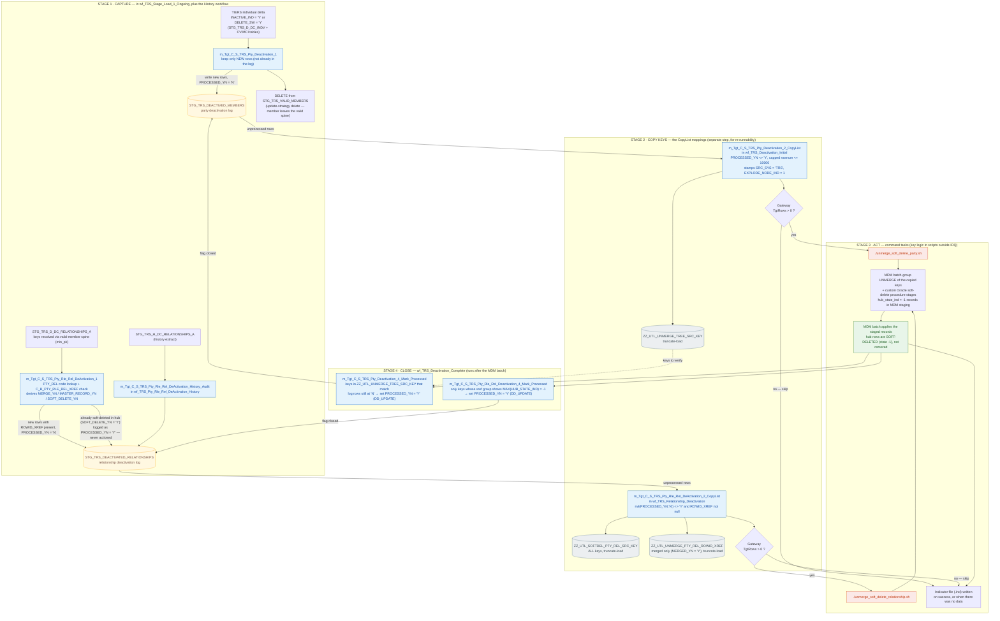

# TRS IDQ — Deactivation Lifecycle

How a party or relationship deactivated in TIERS is removed from the MDM hub:
four stages across five workflows, driven by two log tables
(`STG_TRS_DEACTIVED_MEMBERS`, `STG_TRS_DEACTIVATED_RELATIONSHIPS`) and the
`PROCESSED_YN` flag. Detail for every object named here is in
`TRS_IDQ_Workflow_and_Mapping_Analysis.md` (§2 lifecycle, §6.3–§6.6).

## How to read it

- **Stage 1 — Capture** happens inside the Ongoing load (plus the History
  workflow for history/audit relationships). New deactivations are logged with
  `PROCESSED_YN = 'N'`; parties are also deleted from the valid-member spine.
  A relationship already soft-deleted in the hub is logged directly as `'Y'`
  and is never actioned.
- **Stage 2 — Copy** moves unprocessed keys into the MDM utility tables.
  It is a separate step by design (re-runnability). Gateways skip Stage 3
  entirely when a CopyList wrote 0 rows.
- **Stage 3 — Act** is the one black box: the unmerge + soft-delete work is
  done by shell scripts outside IDQ (`unmerge_soft_delete_party.sh`,
  `unmerge_soft_delete_relationship.sh`), staging `hub_state_ind = -1`
  records that the MDM batch applies. Nothing is physically deleted.
- **Stage 4 — Close** (`wf_TRS_Deactivation_Complete`) flips the flag to
  `'Y'`. The party mapping trusts the copied key table; the relationship
  mapping verifies the hub first (`MAX(HUB_STATE_IND) = -1`). Anything left
  at `'N'` is retried next cycle by design.
