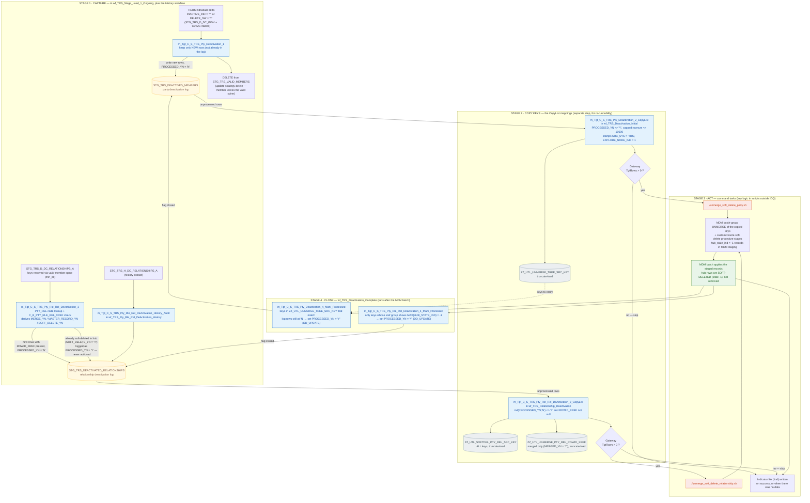

# TRS IDQ — Deactivation Logic

Focused write-up of how parties and relationships deactivated in TIERS are removed from the Informatica MDM hub. Extracted from the full analysis (`TRS_IDQ_Workflow_and_Mapping_Analysis.md`, v2) — everything here is taken from the IDQ IMX exports (`wf_TRS_Stage_Load_1_Ongoing.xml` and the four deactivation exports, `-2` versions), including the mappings serialised inside them.

**Scope.** Five workflows take part: `wf_TRS_Stage_Load_1_Ongoing` (capture only), `wf_TRS_Deactivation_Initial`, `wf_TRS_Relationship_Deactivation`, `wf_TRS_Pty_Rle_Rel_DeActivation_History` and `wf_TRS_Deactivation_Complete`. Nine mappings implement the logic; every one is documented in full below.

## The lifecycle in one diagram



## How it works, stage by stage

### Stage 1 — Capture (inside the Ongoing load, plus the History workflow)

*Parties* — `m_Tgt_C_S_TRS_Pty_Deactivation_1`: a source SQL union over the individual extracts (`STG_TRS_D_DC_INDV` and the CV/MCI table) selects everyone flagged `INACTIVE_IND = 'Y'` or `DELETE_SW = 'Y'`. A lookup against the deactivation log keeps only people not already logged; they are written to `STG_TRS_DEACTIVED_MEMBERS` with `PROCESSED_YN = 'N'`, and the same people are deleted from the valid-member spine `STG_TRS_VALID_MEMBERS` by an update-strategy delete, so no downstream load picks them up again. (The main Party mapping's SQL also MINUSes deactivated members when rebuilding the spine.)

*Relationships* — `m_Tgt_C_S_TRS_Pty_Rle_Rel_DeActivation_1`: reads `STG_TRS_D_DC_RELATIONSHIPS_A`, resolves both individuals to party keys through the valid-member spine (`min_pk` CTE — one key per individual, MCI record preferred), translates the relationship type through the `PTY_REL` code crosswalk, and builds the composite `PKEY_SRC_OBJECT`. It then interrogates the MDM cross-reference `C_B_PTY_RLE_REL_XREF` and derives, per hub record: `MERGE_YN` (more than one source key merged into it), `MASTER_RECORD_YN` (this record is the merge master) and `SOFT_DELETE_YN` (max `HUB_STATE_IND` = -1). Only new rows that actually exist in the MDM (`ROWID_XREF` present) are logged — and a relationship that is *already* soft-deleted in the hub is logged with `PROCESSED_YN = 'Y'`, so it is never actioned.

*History* — `m_Tgt_C_S_TRS_Pty_Rle_Rel_DeActivation_History_Audit` runs the same capture pattern over the history extract `STG_TRS_H_DC_RELATIONSHIPS_A`, feeding the same relationship log. Its workflow is a single mapping task: no gateway, no command, no indicator file.

### Stage 2 — Copy keys (the CopyList mappings)

A deliberately separate step — the designer note says it exists 'to improve re-runablility'. *Party* CopyList (`wf_TRS_Deactivation_Initial`) reads log rows with `PROCESSED_YN <> 'Y'`, capped at `rownum <= 10000` (a designer-documented guard tied to the old 30-minute web-service unmerge timeout), stamps `SRC_SYS = 'TRS'` (space-padded, as the MDM expects) and `EXPLODE_NODE_IND = 1`, and truncate-loads `ZZ_UTL_UNMERGE_TREE_SRC_KEY`. *Relationship* CopyList (`wf_TRS_Relationship_Deactivation`) reads unprocessed rows with a `ROWID_XREF`, truncate-loads **all** keys to `ZZ_UTL_SOFTDEL_PTY_REL_SRC_KEY` for the soft-delete process and only the merged ones (`MERGED_YN = 'Y'`) to `ZZ_UTL_UNMERGE_PTY_REL_ROWID_XREF` for the unmerge process; a designer comment warns that master records must stay in that filter, or data merged into a master would be wrongly soft-deleted. Both workflows gate on `$var:TgtRows > 0` — with no copied rows, the command step is skipped and only the indicator file is written.

### Stage 3 — Act (shell scripts, outside IDQ)

Command tasks run `./unmerge_soft_delete_party.sh` / `./unmerge_soft_delete_relationship.sh` from `/u01/apps/informatica/mdm_exec_batch/scripts`. Per the workflow annotations, each script runs the MDM batch-group **unmerge** for the copied keys, then a custom Oracle soft-delete procedure that stages `hub_state_ind = -1` records into the MDM staging tables; the MDM batch applies them. Nothing is physically deleted — hub rows are flagged -1. The scripts are not part of the IDQ exports, so their internals are the one black box in the chain. A zero exit code leads to the workflow's `.ind` indicator file.

### Stage 4 — Close (`wf_TRS_Deactivation_Complete`, after the MDM batch)

*Party* Mark Processed reads the keys in `ZZ_UTL_UNMERGE_TREE_SRC_KEY`, looks each up among log rows still at `PROCESSED_YN = 'N'`, keeps the matches, sets `'Y'` and writes back with update strategy `DD_UPDATE` — it trusts the key table and does not re-verify hub state. *Relationship* Mark Processed is stricter: a row is only flagged when its cross-reference group proves the soft delete landed (`MAX(HUB_STATE_IND) = -1` in `C_B_PTY_RLE_REL_XREF`); its source filter was corrected on 2025-09-24 to include rows where `PROCESSED_YN` is null. Both mappings are idempotent by design, so Complete is the safe re-run point after a failed cycle.

### The `PROCESSED_YN` state machine

| State | Meaning | Set by |
|---|---|---|
| *(no row)* | Not (yet) identified as deactivated | — |
| `'N'` | Captured, awaiting copy/action; will be (re)picked up next cycle | Capture mappings (Stage 1) |
| `'Y'` at capture | Relationship already soft-deleted in the hub — logged for audit, never actioned | Relationship capture (`SOFT_DELETE_YN = 'Y'`) |
| `'Y'` at close | Unmerge + soft-delete verified/applied | Mark Processed mappings (Stage 4) |

## Points to verify (deactivation-specific)

1. **The 10,000-row CopyList cap.** Party deactivation drains at most 10k keys per cycle, for a reason (web-service timeout) that may no longer apply now the unmerge runs as a command task. Confirm the cap is still wanted and that backlog behaviour is understood.
2. **The scripts are the system of action — and are not in the exports.** `unmerge_soft_delete_*.sh` and the Oracle soft-delete procedure they call do the real hub work. Version and review them with the same rigour as the IDQ objects.
3. **Re-run behaviour.** Re-running Initial/Relationship after a partial failure re-populates the utility tables and can fail on duplicate keys if soft-delete rows were already staged (per the workflows' own annotations). Runbooks should sequence recovery as Complete/clean-up first, not a blind restart.
4. **Party vs relationship close-out asymmetry.** Only the relationship Mark Processed verifies the hub state before flagging a row processed; the party mapping trusts the copied keys. A party key that failed to unmerge could therefore be marked processed — worth confirming this is intentional.

---

## Full detail — the capture mappings (inside `wf_TRS_Stage_Load_1_Ongoing`)

##### m_Tgt_C_S_TRS_Pty_Deactivation_1

- **Kind:** Target mapping (executable load) · **Transformations / instances:** 7
- **Reads:** `STG_TRS_D_DC_INDV`
- **Writes:** `STG_TRS_DEACTIVED_MEMBERS`, `STG_TRS_VALID_MEMBERS`
- **Lookups against:** `STG_TRS_DEACTIVED_MEMBERS`

**Purpose.** Party deactivation capture inside the ongoing load. Its source SQL unions the individual-extract rows flagged inactive or deleted (INACTIVE_IND = 'Y' or DELETE_SW = 'Y' in STG_TRS_D_DC_INDV and the CV equivalent); rows not already in the log (lookup on STG_TRS_DEACTIVED_MEMBERS, keep the ISNULL matches) are written to STG_TRS_DEACTIVED_MEMBERS flagged PROCESSED_YN = 'N', and the same members are deleted from the valid-member spine STG_TRS_VALID_MEMBERS via an update-strategy delete.

> **Designer note on this mapping:** This mapping processes deactivated records in TIERS and is part of the process to correpondingly soft delete them in the MDM

1) Find TIERS members that have been deactivated or deleted 
2) Remove them from the valid member list
3) Write them to a deactivation log in staging as 'un processed'

A subsequent mapping writes unprocessed the source keys to an MDM table used SOAP UI calls & soft deleting.

**Data flow (instance to instance, as wired in the export):**
- `Read_STG_TRS_D_DC_INDV_and_CV` → `Exp_Source_and_Defaults`
- `Exp_Source_and_Defaults` → `Delete_Valid_Stage`
- `Exp_Source_and_Defaults` → `Lookup_STG_TRS_DEACTIVED_MEMBERS`
- `Exp_Source_and_Defaults` → `Filt_New_Only`
- `Delete_Valid_Stage` → `Write_STG_TRS_VALID_MEMBERS`
- `Lookup_STG_TRS_DEACTIVED_MEMBERS` → `Filt_New_Only`
- `Filt_New_Only` → `Write_STG_TRS_DEACTIVED_MEMBERS`

**Transformations in this mapping:**

| # | Instance | Type | What it does / notes from the export |
|---|---|---|---|
| 1 | `Read_STG_TRS_D_DC_INDV_and_CV` | Source (read) | Find deactivated or deleted members in delta tables who are also in valid stage (previously validated members) |
| 2 | `Exp_Source_and_Defaults` | Expression | Add default attributes to source columns.  Treat all new records as un-processed. |
| 3 | `Write_STG_TRS_DEACTIVED_MEMBERS` | Target (write) |  |
| 4 | `Delete_Valid_Stage` | Update Strategy | Flag inactivated members for deletion from valid stage. |
| 5 | `Lookup_STG_TRS_DEACTIVED_MEMBERS` | Lookup |  |
| 6 | `Filt_New_Only` | Filter | Keep only records that have not been written to the deactivation table before.  (Simplifies re-run of this mapping if necessary). |
| 7 | `Write_STG_TRS_VALID_MEMBERS` | Target (write) |  |

**Transformation logic in detail:**

- **Read_STG_TRS_D_DC_INDV_and_CV** (Source (read))
  - Table(s): `STG_TRS_D_DC_INDV`
  - Custom SQL:

    ```sql
    with deactv as
    (
    Select indv_id, inactive_ind, delete_sw, create_dt
    from STG_TRS_D_DC_INDV
    where inactive_ind = 'Y' or delete_sw = 'Y'
    
    UNION all
    
    Select indv_id, inactive_ind, null , create_dt
    from STG_TRS_D_CV_DC_MCI_INDV
    where inactive_ind = 'Y'
    )
    , deactv_id as
    (
    select indv_id
    	, max(inactive_ind) inactive_ind
    	, max(delete_sw) delete_sw
    	, min(create_dt) src_deactivation_date
    from deactv
    group by indv_id
    )
    select vm.INDV_ID
    		, vm.PTY_PK
    		, vm.SRC_TBL
    		, vm.CREATE_DATE
    		, src_deactivation_date
    		, inactive_ind
    		, delete_sw
    from STG_TRS_VALID_MEMBERS vm
    join deactv_id d
    	on d.indv_id = vm.indv_id
    ```

- **Exp_Source_and_Defaults** (Expression)
  - Derived / assigned fields (3):
    - `Run_Date` = `$sys.MappingRunStartTime`
    - `Processed_YN` = `'N'`
    - `Src_System` = `'TRS'`

- **Write_STG_TRS_DEACTIVED_MEMBERS** (Target (write))
  - Table(s): `STG_TRS_DEACTIVED_MEMBERS`
  - Load type: Normal

- **Delete_Valid_Stage** (Update Strategy)
  - Update strategy: `DD_DELETE`

- **Lookup_STG_TRS_DEACTIVED_MEMBERS** (Lookup)
  - Table(s): `STG_TRS_DEACTIVED_MEMBERS`
  - Lookup condition: `PTY_PK = PTY_PK1` · multiple matches: returnAny

- **Filt_New_Only** (Filter)
  - Filter condition: `ISNULL(PTY_PK1)`

- **Write_STG_TRS_VALID_MEMBERS** (Target (write))
  - Table(s): `STG_TRS_VALID_MEMBERS`
  - Load type: Normal

##### m_Tgt_C_S_TRS_Pty_Rle_Rel_DeActivation_1

- **Kind:** Target mapping (executable load) · **Transformations / instances:** 8
- **Reads:** `STG_TRS_D_DC_RELATIONSHIPS_A`
- **Writes:** `STG_TRS_DEACTIVATED_RELATIONSHIPS`
- **Lookups against:** `C_B_PTY_RLE_REL_XREF`, `V_LOOKUP_CODE_VALUE`, `STG_TRS_DEACTIVATED_RELATIONSHIPS`

**Purpose.** Captures deactivated relationships during the ongoing load. Reads the relationship delta (STG_TRS_D_DC_RELATIONSHIPS_A), checks the MDM cross-reference (C_B_PTY_RLE_REL_XREF) for source keys whose hub state is already -1 (deleted in the hub), filters out keys already logged, and writes the newly-deactivated relationships to the deactivation log STG_TRS_DEACTIVATED_RELATIONSHIPS for the deactivation workflows to process.

> **Designer note on this mapping:** This mapping processes deactivated relationships in TIERS and is part of the process to correpondingly soft delete them in the MDM

1) Find TIERS Relationships that have been deactivated or deleted 
2) Remove them from the valid relationship list
3) Write them to a deactivation log in staging as 'un processed'

A subsequent mapping writes unprocessed the source keys to an MDM table used SOAP UI calls & soft deleting.

[ML 2/6/2025] Added criteria to filter transformation to only keep records that are in the MDM.

**Mapping parameters:**
- `ABSENT_PAR_SQ_ALT_ID_TP` — type string, precision 3
- `INDV_ID_ALT_ID_TP` — type string, precision 3

**Data flow (instance to instance, as wired in the export):**
- `Read_STG_TRS_D_DC_RELATIONSHIPS_A` → `Exp_Gen_PKEY`
- `Read_STG_TRS_D_DC_RELATIONSHIPS_A` → `Lookup_V_LOOKUP_CODE_VALUE`
- `Exp_Gen_PKEY` → `Lkp_C_B_PTY_RLE_REL_XREF`
- `Exp_Gen_PKEY` → `Exp_TRS_PTY_RLE_REL_DeActivate`
- `Exp_TRS_PTY_RLE_REL_DeActivate` → `Fil_New_Deactivations`
- `Exp_TRS_PTY_RLE_REL_DeActivate` → `Lookup_STG_TRS_DEACTIVATED_RELATIONSHIPS`
- `Lkp_C_B_PTY_RLE_REL_XREF` → `Exp_TRS_PTY_RLE_REL_DeActivate`
- `Lookup_V_LOOKUP_CODE_VALUE` → `Exp_Gen_PKEY`
- `Fil_New_Deactivations` → `Write_STG_TRS_DEACTIVATED_RELATIONSHIPS`
- `Lookup_STG_TRS_DEACTIVATED_RELATIONSHIPS` → `Fil_New_Deactivations`

**Transformations in this mapping:**

| # | Instance | Type | What it does / notes from the export |
|---|---|---|---|
| 1 | `Read_STG_TRS_D_DC_RELATIONSHIPS_A` | Source (read) | The query Extracts relationship data from Table "STG_TRS_D_DC_RELATIONSHIPS_A", associating it with individual records from table "STG_TRS_VALID_MEMBERS", and organizing the output for further analysis or presentation. The CTE is used to prioritize certain records for each individual before joining with the main relationship data. |
| 2 | `Exp_Gen_PKEY` | Expression | Derive Primary Key for data originating from Staging to process and attach with Relationship Data Elements |
| 3 | `Exp_TRS_PTY_RLE_REL_DeActivate` | Expression |  |
| 4 | `Lkp_C_B_PTY_RLE_REL_XREF` | Lookup | Lookup against ROWID_XREF from Mastered Data elements in MDM and attach the Primary Keys from Source with MDM Data |
| 5 | `Lookup_V_LOOKUP_CODE_VALUE` | Lookup | Lookup against Code Value Table to Extract Master Relationship Type Code |
| 6 | `Fil_New_Deactivations` | Filter | Keep only new deactivations (improves re-runability of mapping) |
| 7 | `Write_STG_TRS_DEACTIVATED_RELATIONSHIPS` | Target (write) |  |
| 8 | `Lookup_STG_TRS_DEACTIVATED_RELATIONSHIPS` | Lookup |  |

**Transformation logic in detail:**

- **Read_STG_TRS_D_DC_RELATIONSHIPS_A** (Source (read))
  - Table(s): `STG_TRS_D_DC_RELATIONSHIPS_A`
  - Custom SQL:

    ```sql
    WITH min_pk as  -- find 1 source key per indiv, prioritze the mci record
    (
    SELECT 	 indv_id
    		,MIN(pty_pk) pty_pk
    FROM stg_trs_valid_members
    GROUP BY indv_id
    )
    SELECT /*+ parallel (4) */
        rel.indv_id,
        ref_indv_id,
        eff_begin_dt,
        eff_end_dt,
        relationship_type_cd,
        pk1.pty_pk 				as pty_pkey,
        pk2.pty_pk 				as ref_pty_pkey,
        'TRS' 						as src_sys
    FROM stg_trs_d_dc_relationships_a rel
    JOIN min_pk pk1
    	ON rel.indv_id = pk1.indv_id
    JOIN min_pk pk2
    	ON rel.ref_indv_id = pk2.indv_id
    ```

- **Exp_Gen_PKEY** (Expression)
  - Derived / assigned fields (6):
    - `SRC_SYS` = `SRC_SYS`
    - `v_PTY_RLE_FK_REF_INDV` = `IIF( ISNULL(in_REF_PTY_PKEY)
	,NULL
	,LTRIM(RTRIM(in_REF_PTY_PKEY)) || '|Member'
	)`
    - `v_PTY_RLE_FK_INDV` = `IIF( ISNULL(in_PTY_PKEY)
	,NULL
	,LTRIM(RTRIM(in_PTY_PKEY)) || '|Member'
	)`
    - `PTY_RLE_FK_1` = `v_PTY_RLE_FK_INDV`
    - `PTY_RLE_FK_2` = `v_PTY_RLE_FK_REF_INDV`
    - `PKEY_SRC_OBJECT` = `v_PTY_RLE_FK_INDV || '|' || 
v_PTY_RLE_FK_REF_INDV || '|' ||
in_RELATIONSHIP_TYPE_MSTR_CD`

- **Exp_TRS_PTY_RLE_REL_DeActivate** (Expression)
  - Derived / assigned fields (3):
    - `LAST_UPDATE_DATE` = `sysdate`
    - `o_MERGE_YN` = `RTRIM(LTRIM(MERGE_YN))`
    - `PROCESSED_YN` = `IIF(SOFT_DELETE_YN = 'Y' , 'Y','N') -- count records previously soft deleted as processed.`

- **Lkp_C_B_PTY_RLE_REL_XREF** (Lookup)
  - Table(s): `C_B_PTY_RLE_REL_XREF`
  - Lookup condition: `PKEY_SRC_OBJECT = in_PKEY_SRC_OBJECT`
  - Custom SQL:

    ```sql
    SELECT DISTINCT
     T.ROWID_OBJECT
    ,T.PKEY_SRC_OBJECT
    , T.ROWID_SYSTEM
    ,COUNT(DISTINCT PKEY_SRC_OBJECT) OVER (PARTITION BY ROWID_OBJECT)  SRC_PKEY_CT
    ,CASE WHEN COUNT(DISTINCT PKEY_SRC_OBJECT) OVER (PARTITION BY ROWID_OBJECT)  > 1 THEN 'Y' ELSE 'N' END MERGE_YN
    ,case when T.ROWID_OBJECT = T.ORIG_ROWID_OBJECT then 'Y' else 'N' end  MASTER_RECORD_YN
    ,case when max(HUB_STATE_IND) OVER (PARTITION BY ROWID_OBJECT) = -1  then 'Y' else 'N' end  SOFT_DELETE_YN
    ,min(rowid_xref) over (partition by PKEY_SRC_OBJECT) MIN_ROWID_XREF
    FROM C_B_PTY_RLE_REL_XREF T
    ```

- **Lookup_V_LOOKUP_CODE_VALUE** (Lookup)
  - Table(s): `V_LOOKUP_CODE_VALUE`
  - Source/lookup filter: `"V_LOOKUP_CODE_VALUE"."CODE_TYPE"='PTY_REL'`
  - Lookup condition: `SRC_CODE_VALUE = RELATIONSHIP_TYPE_CD AND SRC_SYS = SRC_SYS_IN` · multiple matches: returnAny

- **Fil_New_Deactivations** (Filter)
  - Filter condition: `ISNULL(Lkp_PKEY_SRC_OBJECT)
and not ISNULL(ROWID_XREF) -- [ML 2/6/2025] Only keep records that are in the MDM.`

- **Write_STG_TRS_DEACTIVATED_RELATIONSHIPS** (Target (write))
  - Table(s): `STG_TRS_DEACTIVATED_RELATIONSHIPS`
  - Load type: Normal

- **Lookup_STG_TRS_DEACTIVATED_RELATIONSHIPS** (Lookup)
  - Table(s): `STG_TRS_DEACTIVATED_RELATIONSHIPS`
  - Lookup condition: `PKEY_SRC_OBJECT = PKEY_SRC_OBJECT1` · multiple matches: returnAny
  - Custom SQL:

    ```sql
    SELECT /*+ Parallel (4) */
     INDV_ID
    ,REF_INDV_ID
    ,PTY_RLE_FK_1
    ,PTY_RLE_FK_2
    ,REL_TYPE_CODE
    ,ROWID_XREF
    ,PKEY_SRC_OBJECT
    ,ROWID_OBJECT
    ,ROWID_SYSTEM
    ,LOAD_DATE
    ,SRC_PKEY_CT
    ,MASTER_RECORD_YN
    ,MERGED_YN
    ,PROCESSED_YN 
    FROM STG_TRS_DEACTIVATED_RELATIONSHIPS
    where PROCESSED_YN = 'N'
    ```

## Full detail — workflow chapters

### 6.3 `wf_TRS_Deactivation_Initial`

*Export file: `wf_TRS_Deactivation_Initial-2.xml` (50 KB) · Project: HHSC_Enterprise_Development, ZZ_Rana · Connections: STAGING, HHS_MDM_ORS*

#### Business view

Handles members who have been deactivated in TIERS and must be correspondingly removed from the MDM. Upstream (in the ongoing load) those members are captured in a deactivation log in HIP staging and removed from the valid-member list; new log rows are flagged as unprocessed. This workflow (1) copies the deactivated source keys from HIP staging into an MDM utility table, then (2) — only if any keys were copied — runs a command that unmerges those source keys from the MDM base object and stages soft-delete records (hub_state_ind = -1) for the party and all of its child tables in the MDM staging tables. Those soft-delete rows are then picked up by normal MDM batch processing, so the party disappears from the hub without a physical delete and with its history/audit trail retained.

> **Designer description on the workflow:** Process TIERS members that have been desctivated in TIER by correspondingly soft deleting them from the MDM.  
Prior to this mapping (in ongoing mapping) Capture deactivated in TIERS in an deactivation log table in HIP staging and also removing them from the valid member list.  New data in the deactivation log is flagged as unprocessed 

Work flow mapping step are as follows	 
	1) Copy all deactivated source keys from HIP staging to an MDM table 
	2) Using the MDM table above, 1st unmerge the source keys from the BO, then create soft delete records (hib_state_ind = -1) in the MDM staging tables for all parties and their child tables.  
		These records will be ADDED to the MDM statging table and will be processed as part of normal batch processing
NOTE this job is re-runable but will attempt to re-populate the MDM staging tables if re-run.  If soft delete records already exist it will fail with a duplicate key error.

[ML 2/1/2021]  Skip 2nd mapping when 1st step finds no data to process.
[MLayne 9/2/2025] Changed unmerge and soft delete from web service to command call.

#### Technical view — workflow control flow

| Step | Task | Type | Mapping / command | Flows to (condition) |
|---:|---|---|---|---|
| 1 | `Start_Event` | Start |  | m_Tgt_C_S_TRS_Pty_Deactivation_2_CopyList |
| 2 | `m_Tgt_C_S_TRS_Pty_Deactivation_2_CopyList` | Mapping task | `m_Tgt_C_S_TRS_Pty_Deactivation_2_CopyList` | Exclusive_Gateway_skip_when_no_data |
| 3 | `Exclusive_Gateway_skip_when_no_data` | Exclusive gateway |  | Exclusive_Gateway1 [default]; Cmd_Unmerge_Soft_Delete [$var:TgtRows > 0] |

> **Note on `Exclusive_Gateway_skip_when_no_data`:** Run the next step only if the 1st step finds data to be processed (since the next step generates an error when there is no data).
| 4 | `Exclusive_Gateway1` | Exclusive gateway |  | Command_Task [IIF($var:TgtRows = 0 or ($var:CmdTaskSuccessful = true and $var:CmdExitCode = 0), true, false)] |
| 5 | `Command_Task` | Command task | `touch ${var:sys.WorkflowName}.ind` — working dir `/opt/apps/informatica/SrcFiles/Indicators` | End_Event |
| 6 | `End_Event` | End |  |  |
| 7 | `Cmd_Unmerge_Soft_Delete` | Command task | `./unmerge_soft_delete_party.sh` — working dir `/u01/apps/informatica/mdm_exec_batch/scripts` | Exclusive_Gateway1 |

> **Note on `Cmd_Unmerge_Soft_Delete`:** Unmerge identified keys for the party and all associated child tables via an MDM batch group call then call an Oracle procedure to stage a soft delete (hub state -1) row for the corresponding records.

**Workflow variables:**
- `MappingIsSuccessful` — initial value: `true`
- `TgtRows` — Taget Rows Written
- `CmdExitCode` — initial value: `-1` — The exit code of a command task
- `CmdTaskSuccessful` — Command tasks success code

**Notes:**
- Re-runnable, with a documented caveat in the workflow: a re-run re-populates the MDM staging tables, and if soft-delete records already exist it will fail with a duplicate-key error.
- The 'skip when no data' gateway was added 2021-02-01: if the copy step writes 0 target rows the unmerge/soft-delete command is skipped, because that step errors when there is nothing to process.
- Change on 2025-09-02 (MLayne): the unmerge + soft delete, previously done via a web-service call, is now done by the command task Cmd_Unmerge_Soft_Delete running ./unmerge_soft_delete_party.sh from /u01/apps/informatica/mdm_exec_batch/scripts. The script itself (MDM batch-group call + Oracle procedure) is outside this export.
- Completion is signalled with the standard indicator file in /opt/apps/informatica/SrcFiles/Indicators, but only when there was no data or the command succeeded (taskStatus = true and exit code = 0).
- The CopyList mapping itself (now documented in full below) reads only unprocessed log rows (PROCESSED_YN <> 'Y') and caps the read at 10,000 rows (rownum <= 10000); its designer note ties that cap to the old 30-minute web-service unmerge timeout, so a backlog over 10k needs repeated runs — and the cap's rationale may be stale now that the unmerge is a command call.

#### Mappings in this workflow

##### m_Tgt_C_S_TRS_Pty_Deactivation_2_CopyList

- **Kind:** Target mapping (executable load) · **Transformations / instances:** 3
- **Reads:** `STG_TRS_DEACTIVED_MEMBERS`
- **Writes:** `ZZ_UTL_UNMERGE_TREE_SRC_KEY`

**Purpose.** Copies unprocessed deactivated-party rows (source filter PROCESSED_YN <> 'Y' and rownum <= 10000 — the 10k cap is a designer-documented guard tied to the old web-service unmerge timeout) from the staging log STG_TRS_DEACTIVED_MEMBERS, stamps the source system ('TRS', space-padded as the MDM expects) and EXPLODE_NODE_IND = 1, and truncate-loads the keys to the MDM utility table ZZ_UTL_UNMERGE_TREE_SRC_KEY that the unmerge/soft-delete command works from.

> **Designer note on this mapping:** This mapping processes deactivated records in TIERS and is part of the process to correpondingly soft delete them in the MDM

Specifically, this mapping copies un-processed deactivation records to an MDM table used SOAP UI calls for unmerging records (also used by a custom soft delete process).  This step is separate from the main mapping to improve re-runablility.

**Data flow (instance to instance, as wired in the export):**
- `Read_STG_TRS_DEACTIVED_MEMBERS` → `Exp_Default_System`
- `Exp_Default_System` → `Write_ZZ_UTL_UNMERGE_TREE_SRC_KEY`

**Transformations in this mapping:**

| # | Instance | Type | What it does / notes from the export |
|---|---|---|---|
| 1 | `Read_STG_TRS_DEACTIVED_MEMBERS` | Source (read) | Capped at 10k rows to coincide with the WS time out (30min).  10k Rows typically unmerge in 15 min.  This allows for a buffer to complete the unmerge as the WS does not produce an error on time out. |
| 2 | `Exp_Default_System` | Expression |  |
| 3 | `Write_ZZ_UTL_UNMERGE_TREE_SRC_KEY` | Target (write) |  |

**Transformation logic in detail:**

- **Read_STG_TRS_DEACTIVED_MEMBERS** (Source (read))
  - Table(s): `STG_TRS_DEACTIVED_MEMBERS`
  - Source/lookup filter: `"STG_TRS_DEACTIVED_MEMBERS"."PROCESSED_YN" <> 'Y'
and rownum <= 10000`

- **Exp_Default_System** (Expression)
  - Derived / assigned fields (2):
    - `Soruce_System` = `'TRS           ' -- NOTE the MDM pads with sapces!!`
    - `EXPLODE_NODE_IND` = `1`

- **Write_ZZ_UTL_UNMERGE_TREE_SRC_KEY** (Target (write))
  - Table(s): `ZZ_UTL_UNMERGE_TREE_SRC_KEY`
  - Truncates the target table before load.
  - Load type: Normal

### 6.4 `wf_TRS_Relationship_Deactivation`

*Export file: `wf_TRS_Relationship_Deactivation-2.xml` (55 KB) · Project: HHSC_Enterprise_Development, ZZ_Rana · Connections: STAGING, HHS_MDM_ORS*

#### Business view

The relationship counterpart of wf_TRS_Deactivation_Initial. It processes TIERS relationships that have been deactivated in TIERS so they are correspondingly soft-deleted from the MDM: (1) copy the deactivated relationship source keys from HIP staging into MDM utility tables, then (2) — only if any keys were copied — unmerge those keys and stage soft-delete records (hub_state_ind = -1) for the relationships, to be applied by normal MDM batch processing.

> **Designer description on the workflow:** Process TIERS Relationships that have been desctivated in TIER by correspondingly soft deleting them from the MDM.  
Prior to this mapping (in ongoing mapping) Capture deactivated Relationships in TIERS in an deactivation log table in HIP staging and also removing them from the valid member list.  New data in the deactivation log is flagged as unprocessed 

Work flow mapping step are as follows	 
	1) Copy all deactivated source keys from HIP staging to an MDM table 
	2) Using the MDM table above, 1st unmerge the source keys from the BO, then create soft delete records (hib_state_ind = -1) in the MDM staging tables for all relationships.  
		These records will be ADDED to the MDM statging table and will be processed as part of normal batch processing
NOTE this job is re-runable but will attempt to re-populate the MDM staging tables if re-run.  If soft delete records already exist it will fail with a duplicate key error.

[MLayne 9/2/2025] Changed unmerge and soft delete from web service to command call.

#### Technical view — workflow control flow

| Step | Task | Type | Mapping / command | Flows to (condition) |
|---:|---|---|---|---|
| 1 | `Start_Event` | Start |  | m_Tgt_C_S_TRS_Pty_Rle_Rel_DeActivation_2_CopyList |
| 2 | `m_Tgt_C_S_TRS_Pty_Rle_Rel_DeActivation_2_CopyList` | Mapping task | `m_Tgt_C_S_TRS_Pty_Rle_Rel_DeActivation_2_CopyList` | Exclusive_Gateway_skip_when_no_data |
| 3 | `Exclusive_Gateway_skip_when_no_data` | Exclusive gateway |  | Exclusive_Gateway [default]; Cmd_Unmerge_Soft_Delete [$var:TgtRows > 0] |

> **Note on `Exclusive_Gateway_skip_when_no_data`:** Run the next step only if the 1st step finds data to be processed (since the next step generates an error when there is no data).
| 4 | `Exclusive_Gateway` | Exclusive gateway |  | Command_Task [IIF($var:TgtRows = 0 or ($var:CmdTaskSuccessful = true and $var:CmdExitCode = 0), true, false)] |
| 5 | `Command_Task` | Command task | `touch ${var:sys.WorkflowName}.ind` — working dir `/opt/apps/informatica/SrcFiles/Indicators` | End_Event |
| 6 | `End_Event` | End |  |  |
| 7 | `Cmd_Unmerge_Soft_Delete` | Command task | `./unmerge_soft_delete_relationship.sh` — working dir `/u01/apps/informatica/mdm_exec_batch/scripts` | Exclusive_Gateway |

> **Note on `Cmd_Unmerge_Soft_Delete`:** Unmerge identified keys for the party and all associated child tables via an MDM batch group call then call an Oracle procedure to stage a soft delete (hub state -1) row for the corresponding records.

**Workflow variables:**
- `MappingIsSuccessful` — initial value: `true`
- `TgtRows` — Taget Rows Written
- `CmdExitCode` — initial value: `-1` — The exit code of a command task
- `CmdTaskSuccessful` — Command tasks success code

**Notes:**
- Same control pattern as the party deactivation: TgtRows > 0 gateway, Cmd_Unmerge_Soft_Delete running ./unmerge_soft_delete_relationship.sh from /u01/apps/informatica/mdm_exec_batch/scripts, and the same indicator-file completion step.
- Same documented re-run caveat: re-running re-populates the MDM staging tables and can fail with a duplicate-key error if the soft-delete records already exist.
- Change on 2025-09-02 (MLayne): unmerge and soft delete changed from a web-service call to the command call, as in the party workflow.
- The CopyList mapping (documented in full below) reads unprocessed log rows with a ROWID_XREF (nvl(PROCESSED_YN,'N') <> 'Y'), truncate-loads every key to ZZ_UTL_SOFTDEL_PTY_REL_SRC_KEY, and truncate-loads only the merged relationships (MERGED_YN = 'Y') to ZZ_UTL_UNMERGE_PTY_REL_ROWID_XREF. A designer comment records why master records must not be excluded from that filter: doing so would soft-delete data that was merged into a master record.

#### Mappings in this workflow

##### m_Tgt_C_S_TRS_Pty_Rle_Rel_DeActivation_2_CopyList

- **Kind:** Target mapping (executable load) · **Transformations / instances:** 5
- **Reads:** `STG_TRS_DEACTIVATED_RELATIONSHIPS`
- **Writes:** `ZZ_UTL_UNMERGE_PTY_REL_ROWID_XREF`, `ZZ_UTL_SOFTDEL_PTY_REL_SRC_KEY`

**Purpose.** Relationship equivalent of the party CopyList. Reads unprocessed relationship log rows (nvl(PROCESSED_YN,'N') <> 'Y' and ROWID_XREF is not null) from STG_TRS_DEACTIVATED_RELATIONSHIPS, truncate-loads all keys to ZZ_UTL_SOFTDEL_PTY_REL_SRC_KEY for the soft-delete process, and truncate-loads only the merged ones (filter MERGED_YN = 'Y') to ZZ_UTL_UNMERGE_PTY_REL_ROWID_XREF for the unmerge process.

> **Designer note on this mapping:** [9/2/2025 ML] Corrected source fiter criteria to include null processed_YN

**Data flow (instance to instance, as wired in the export):**
- `Exp_Default_System` → `Fil_Merged_Relationships`
- `Exp_Default_System` → `Write_ZZ_UTL_SOFTDEL_PTY_REL_SRC_KEY`
- `Fil_Merged_Relationships` → `Write_ZZ_UTL_UNMERGE_PTY_REL_ROWID_XREF`
- `Read_STG_TRS_DEACTIVATED_RELATIONSHIPS` → `Exp_Default_System`

**Transformations in this mapping:**

| # | Instance | Type | What it does / notes from the export |
|---|---|---|---|
| 1 | `Exp_Default_System` | Expression |  |
| 2 | `Write_ZZ_UTL_UNMERGE_PTY_REL_ROWID_XREF` | Target (write) |  |
| 3 | `Fil_Merged_Relationships` | Filter | Keep only merged records that are not the master record. |
| 4 | `Write_ZZ_UTL_SOFTDEL_PTY_REL_SRC_KEY` | Target (write) |  |
| 5 | `Read_STG_TRS_DEACTIVATED_RELATIONSHIPS` | Source (read) |  |

**Transformation logic in detail:**

- **Write_ZZ_UTL_UNMERGE_PTY_REL_ROWID_XREF** (Target (write))
  - Table(s): `ZZ_UTL_UNMERGE_PTY_REL_ROWID_XREF`
  - Truncates the target table before load.
  - Settings: orderInsensitive = false

- **Fil_Merged_Relationships** (Filter)
  - Filter condition: `MERGED_YN ='Y' 
--and MASTER_RECORD_YN ='N'
-- [ML 12/6/2024] Excluding master records will lead to soft deleting data that was merged with a master record which would be an error.   Therefore flag was commented out.`

- **Write_ZZ_UTL_SOFTDEL_PTY_REL_SRC_KEY** (Target (write))
  - Table(s): `ZZ_UTL_SOFTDEL_PTY_REL_SRC_KEY`
  - Truncates the target table before load.

- **Read_STG_TRS_DEACTIVATED_RELATIONSHIPS** (Source (read))
  - Table(s): `STG_TRS_DEACTIVATED_RELATIONSHIPS`
  - Source/lookup filter: `nvl("STG_TRS_DEACTIVATED_RELATIONSHIPS"."PROCESSED_YN",'N') <>'Y'
and "STG_TRS_DEACTIVATED_RELATIONSHIPS"."ROWID_XREF" is not null`

### 6.5 `wf_TRS_Pty_Rle_Rel_DeActivation_History`

*Export file: `wf_TRS_Pty_Rle_Rel_DeActivation_History-2.xml` (95 KB) · Project: HHSC_Enterprise_Development, ZZ_Rana · Connections: STAGING, HHS_MDM_ORS*

#### Business view

The history/audit variant of relationship deactivation. Where the main relationship deactivation works on current relationship data, this workflow works on the history extract (STG_TRS_H_DC_RELATIONSHIPS_A): it captures relationships that have been deactivated in TIERS into the deactivation log in HIP staging (STG_TRS_DEACTIVATED_RELATIONSHIPS), removing them from the valid list, with new log data flagged as unprocessed — so historical/audit relationship records are deactivated in step with the current records.

> **Designer description on the workflow:** Process TIERS Relationships (History Audit) that have been deactivated in TIER by correspondingly soft deleting them from the MDM. This Workflow Captures deactivated Relationships in TIERS in an deactivation log table in HIP staging and also removing them from the valid member list.  New data in the deactivation log is flagged as unprocessed

#### Technical view — workflow control flow

| Step | Task | Type | Mapping / command | Flows to (condition) |
|---:|---|---|---|---|
| 1 | `Start_Event` | Start |  | m_Tgt_C_S_TRS_Pty_Rle_Rel_DeActivation_History_Audit |
| 2 | `m_Tgt_C_S_TRS_Pty_Rle_Rel_DeActivation_History_Audit` | Mapping task | `m_Tgt_C_S_TRS_Pty_Rle_Rel_DeActivation_History_Audit` | End_Event |
| 3 | `End_Event` | End |  |  |

**Notes:**
- Simplest deactivation workflow: Start -> single mapping task -> End. No gateway, no command task, no indicator file and no workflow variables in the export.
- The single mapping (m_Tgt_C_S_TRS_Pty_Rle_Rel_DeActivation_History_Audit, documented in full below) reads the history extract with the same min_pk source SQL pattern as the live relationship loads (one source key per individual, prioritising the MCI record, from STG_TRS_VALID_MEMBERS), translates the relationship type via V_LOOKUP_CODE_VALUE (PTY_REL), checks the MDM cross-reference C_B_PTY_RLE_REL_XREF, builds the composite PKEY_SRC_OBJECT (party key | referred-party key | relationship type | dates) and writes the deactivation rows to STG_TRS_DEACTIVATED_RELATIONSHIPS.

#### Mappings in this workflow

##### m_Tgt_C_S_TRS_Pty_Rle_Rel_DeActivation_History_Audit

- **Kind:** Target mapping (executable load) · **Transformations / instances:** 6
- **Reads:** `STG_TRS_H_DC_RELATIONSHIPS_A`
- **Writes:** `STG_TRS_DEACTIVATED_RELATIONSHIPS`
- **Lookups against:** `C_B_PTY_RLE_REL_XREF`, `V_LOOKUP_CODE_VALUE`

**Purpose.** History/audit capture of deactivated relationships. Reads the history extract STG_TRS_H_DC_RELATIONSHIPS_A with the same min_pk source-SQL pattern as the live relationship loads (one key per individual from STG_TRS_VALID_MEMBERS, MCI record prioritised), translates the relationship type through V_LOOKUP_CODE_VALUE (CODE_TYPE = 'PTY_REL'), checks the MDM cross-reference C_B_PTY_RLE_REL_XREF, builds the composite PKEY_SRC_OBJECT, and writes the rows to the deactivation log STG_TRS_DEACTIVATED_RELATIONSHIPS.

**Mapping parameters:**
- `ABSENT_PAR_SQ_ALT_ID_TP` — type string, precision 3
- `INDV_ID_ALT_ID_TP` — type string, precision 3

**Data flow (instance to instance, as wired in the export):**
- `Exp_Gen_PKEY` → `Lkp_C_B_PTY_RLE_REL_XREF`
- `Exp_Gen_PKEY` → `Exp_TRS_PTY_RLE_REL_DeActivate`
- `Exp_TRS_PTY_RLE_REL_DeActivate` → `Write_STG_TRS_DEACTIVATED_RELATIONSHIPS`
- `Lkp_C_B_PTY_RLE_REL_XREF` → `Exp_TRS_PTY_RLE_REL_DeActivate`
- `Lookup_V_LOOKUP_CODE_VALUE` → `Exp_Gen_PKEY`
- `Read_STG_TRS_H_DC_RELATIONSHIPS_A` → `Lookup_V_LOOKUP_CODE_VALUE`
- `Read_STG_TRS_H_DC_RELATIONSHIPS_A` → `Exp_Gen_PKEY`

**Transformations in this mapping:**

| # | Instance | Type | What it does / notes from the export |
|---|---|---|---|
| 1 | `Exp_Gen_PKEY` | Expression | Derive Primary Key for data originating from Staging to process and attach with Relationship Data Elements |
| 2 | `Exp_TRS_PTY_RLE_REL_DeActivate` | Expression |  |
| 3 | `Lkp_C_B_PTY_RLE_REL_XREF` | Lookup | Lookup against ROWID_XREF from Mastered Data elements in MDM and attach the Primary Keys from Source with MDM Data |
| 4 | `Lookup_V_LOOKUP_CODE_VALUE` | Lookup | Lookup against Code Value Table to Extract Master Relationship Type Code |
| 5 | `Read_STG_TRS_H_DC_RELATIONSHIPS_A` | Source (read) |  |
| 6 | `Write_STG_TRS_DEACTIVATED_RELATIONSHIPS` | Target (write) |  |

**Transformation logic in detail:**

- **Exp_Gen_PKEY** (Expression)
  - Derived / assigned fields (6):
    - `SRC_SYS` = `SRC_SYS`
    - `v_PTY_RLE_FK_REF_INDV` = `IIF( ISNULL(in_REF_PTY_PKEY)
	,NULL
	,LTRIM(RTRIM(in_REF_PTY_PKEY)) || '|Member'
	)`
    - `v_PTY_RLE_FK_INDV` = `IIF( ISNULL(in_PTY_PKEY)
	,NULL
	,LTRIM(RTRIM(in_PTY_PKEY)) || '|Member'
	)`
    - `PTY_RLE_FK_1` = `v_PTY_RLE_FK_INDV`
    - `PTY_RLE_FK_2` = `v_PTY_RLE_FK_REF_INDV`
    - `PKEY_SRC_OBJECT` = `v_PTY_RLE_FK_INDV || '|' || 
v_PTY_RLE_FK_REF_INDV || '|' ||
in_RELATIONSHIP_TYPE_MSTR_CD`

- **Exp_TRS_PTY_RLE_REL_DeActivate** (Expression)
  - Derived / assigned fields (2):
    - `LAST_UPDATE_DATE` = `sysdate`
    - `o_MERGE_YN` = `RTRIM(LTRIM(MERGE_YN))`

- **Lkp_C_B_PTY_RLE_REL_XREF** (Lookup)
  - Table(s): `C_B_PTY_RLE_REL_XREF`
  - Lookup condition: `PKEY_SRC_OBJECT = in_PKEY_SRC_OBJECT`
  - Custom SQL:

    ```sql
    SELECT DISTINCT
     T.ROWID_OBJECT
    ,T.PKEY_SRC_OBJECT
    , T.ROWID_SYSTEM
    ,COUNT(DISTINCT PKEY_SRC_OBJECT) OVER (PARTITION BY ROWID_OBJECT)  SRC_PKEY_CT
    ,CASE WHEN COUNT(DISTINCT PKEY_SRC_OBJECT) OVER (PARTITION BY ROWID_OBJECT)  > 1 THEN 'Y' ELSE 'N' END MERGE_YN
    ,case when T.ROWID_OBJECT = T.ORIG_ROWID_OBJECT then 'Y' else 'N' end  MASTER_RECORD_YN
    ,min(rowid_xref) over (partition by PKEY_SRC_OBJECT) MIN_ROWID_XREF
    FROM C_B_PTY_RLE_REL_XREF T
    ```

- **Lookup_V_LOOKUP_CODE_VALUE** (Lookup)
  - Table(s): `V_LOOKUP_CODE_VALUE`
  - Source/lookup filter: `"V_LOOKUP_CODE_VALUE"."CODE_TYPE"='PTY_REL'`
  - Lookup condition: `SRC_CODE_VALUE = RELATIONSHIP_TYPE_CD AND SRC_SYS = SRC_SYS_IN` · multiple matches: returnAny

- **Read_STG_TRS_H_DC_RELATIONSHIPS_A** (Source (read))
  - Table(s): `STG_TRS_H_DC_RELATIONSHIPS_A`
  - Custom SQL:

    ```sql
    WITH min_pk as  -- find 1 source key per indiv, prioritze the mci record
    (
    SELECT 	 indv_id
    		,MIN(pty_pk) pty_pk
    FROM stg_trs_valid_members
    GROUP BY indv_id
    )
    SELECT /*+ parallel (4) */
        rel.indv_id,
        ref_indv_id,
        eff_begin_dt,
        eff_end_dt,
        relationship_type_cd,
        pk1.pty_pk 				as pty_pkey,
        pk2.pty_pk 				as ref_pty_pkey,
        'TRS' 						as src_sys
    FROM stg_trs_h_dc_relationships_a rel
    JOIN min_pk pk1
    	ON rel.indv_id = pk1.indv_id
    JOIN min_pk pk2
    	ON rel.ref_indv_id = pk2.indv_id
    ```

- **Write_STG_TRS_DEACTIVATED_RELATIONSHIPS** (Target (write))
  - Table(s): `STG_TRS_DEACTIVATED_RELATIONSHIPS`
  - Load type: Normal

### 6.6 `wf_TRS_Deactivation_Complete`

*Export file: `wf_TRS_Deactivation_Complete-2.xml` (102 KB) · Project: HHSC_Enterprise_Development, ZZ_Rana · Connections: STAGING, HHS_MDM_ORS*

#### Business view

The closing step of the deactivation process. After deactivated TIERS records have been unmerged and soft-deleted in the MDM (by the Initial / Relationship deactivation workflows), this workflow marks the corresponding source keys in the HIP staging deactivation logs as processed ('Y') so they are not run through deactivation processing again on the next cycle. It does this for both logs: party deactivations (STG_TRS_DEACTIVED_MEMBERS — note the table name is spelled DEACTIVED in the database) and relationship deactivations (STG_TRS_DEACTIVATED_RELATIONSHIPS).

> **Designer description on the workflow:** This job examines all source keys in the MDM and marks the equivalent source key in the the deactivation log in staging as "processed" so it will not run through deactivation processing again.

#### Technical view — workflow control flow

| Step | Task | Type | Mapping / command | Flows to (condition) |
|---:|---|---|---|---|
| 1 | `Start_Event` | Start |  | m_Tgt_C_S_TRS_Pty_Deactivation_4_Mark_Processed |
| 2 | `m_Tgt_C_S_TRS_Pty_Deactivation_4_Mark_Processed` | Mapping task | `m_Tgt_C_S_TRS_Pty_Deactivation_4_Mark_Processed` | m_Tgt_C_S_TRS_Pty_Rle_Rel_Deactivation_4_Mark_Processed |
| 3 | `m_Tgt_C_S_TRS_Pty_Rle_Rel_Deactivation_4_Mark_Processed` | Mapping task | `m_Tgt_C_S_TRS_Pty_Rle_Rel_Deactivation_4_Mark_Processed` | Command_Task |
| 4 | `Command_Task` | Command task | `touch ${var:sys.WorkflowName}.ind` — working dir `/opt/apps/informatica/SrcFiles/Indicators` | End_Event |
| 5 | `End_Event` | End |  |  |

**Workflow variables:**
- `MappingIsSuccessful` — initial value: `true`

**Notes:**
- No gateways or conditions: the two 'mark processed' mapping tasks run in sequence, then the standard indicator-file command task runs and the workflow ends.
- Change on 2025-05-21 (RS): the party mapping's source was changed to ZZ_UTL_UNMERGE_TREE_SRC_KEY — i.e. it is driven by the keys that were actually unmerged, not by the original deactivation list.
- Both mappings are idempotent by design (their filters keep only keys that match a still-unprocessed log row, expressly to simplify a re-run). The relationship mapping (documented in full below) adds a hub-state check its party counterpart does not need: it only marks a key processed when the cross-reference shows the relationship was actually soft-deleted (MAX(HUB_STATE_IND) = -1 for the key in C_B_PTY_RLE_REL_XREF). Its source filter was corrected on 2025-09-24 (ML) to include rows where PROCESSED_YN is null.

#### Mappings in this workflow

##### m_Tgt_C_S_TRS_Pty_Deactivation_4_Mark_Processed

- **Kind:** Target mapping (executable load) · **Transformations / instances:** 6
- **Reads:** `ZZ_UTL_UNMERGE_TREE_SRC_KEY`
- **Writes:** `STG_TRS_DEACTIVED_MEMBERS`
- **Lookups against:** `STG_TRS_DEACTIVED_MEMBERS`

**Purpose.** Marks party deactivations as processed. Driven by the keys actually unmerged (ZZ_UTL_UNMERGE_TREE_SRC_KEY), it looks each key up in STG_TRS_DEACTIVED_MEMBERS, keeps only rows still flagged PROCESSED_YN = 'N', sets the flag to 'Y' and applies it with a DD_UPDATE update strategy — so a completed deactivation is never processed twice, and the mapping itself is safe to re-run.

> **Designer note on this mapping:** This mapping runs after deactivated records in TIERS have been unmerged and soft deleted in the MDM.  
After the successful conclusion of those activities, this mapping will udpate the processed flag in the deactivation table to 'Y' so the data will not get re-processed in the next excution.
[RS:05/21/2025] Update the Source table to ZZ_UTL_UNMERGE_TREE_SRC_KEY

**Data flow (instance to instance, as wired in the export):**
- `Upd_Processed_Deactivations` → `Write_STG_TRS_DEACTIVED_MEMBERS`
- `Lookup_Unprocessed_Deactivations` → `Filt_Keep_Unprocessed`
- `Filt_Keep_Unprocessed` → `Exp_Set_to_Processed`
- `Read_ZZ_UTL_UNMERGE_TREE_SRC_KEY` → `Lookup_Unprocessed_Deactivations`
- `Read_ZZ_UTL_UNMERGE_TREE_SRC_KEY` → `Filt_Keep_Unprocessed`
- `Exp_Set_to_Processed` → `Upd_Processed_Deactivations`

**Transformations in this mapping:**

| # | Instance | Type | What it does / notes from the export |
|---|---|---|---|
| 1 | `Write_STG_TRS_DEACTIVED_MEMBERS` | Target (write) |  |
| 2 | `Upd_Processed_Deactivations` | Update Strategy | Update processed to 'Y'. |
| 3 | `Lookup_Unprocessed_Deactivations` | Lookup | Find corresponding record that are flagged as unprocessed. |
| 4 | `Filt_Keep_Unprocessed` | Filter | Keep only records that have not been written to the deactivation table before.  (Simplifies re-run of this mapping if necessary). |
| 5 | `Read_ZZ_UTL_UNMERGE_TREE_SRC_KEY` | Source (read) |  |
| 6 | `Exp_Set_to_Processed` | Expression |  |

**Transformation logic in detail:**

- **Write_STG_TRS_DEACTIVED_MEMBERS** (Target (write))
  - Table(s): `STG_TRS_DEACTIVED_MEMBERS`
  - Load type: Normal

- **Upd_Processed_Deactivations** (Update Strategy)
  - Update strategy: `DD_UPDATE`

- **Lookup_Unprocessed_Deactivations** (Lookup)
  - Table(s): `STG_TRS_DEACTIVED_MEMBERS`
  - Source/lookup filter: `"STG_TRS_DEACTIVED_MEMBERS"."PROCESSED_YN" = 'N'`
  - Lookup condition: `PTY_PK = PTY_PK1` · multiple matches: returnAny

- **Filt_Keep_Unprocessed** (Filter)
  - Filter condition: `NOT ISNULL(PTY_PK1)`

- **Read_ZZ_UTL_UNMERGE_TREE_SRC_KEY** (Source (read))
  - Table(s): `ZZ_UTL_UNMERGE_TREE_SRC_KEY`

- **Exp_Set_to_Processed** (Expression)
  - Derived / assigned fields (1):
    - `Processed_Y` = `'Y'`


##### m_Tgt_C_S_TRS_Pty_Rle_Rel_Deactivation_4_Mark_Processed

- **Kind:** Target mapping (executable load) · **Transformations / instances:** 6
- **Reads:** `STG_TRS_DEACTIVATED_RELATIONSHIPS`
- **Writes:** `STG_TRS_DEACTIVATED_RELATIONSHIPS`
- **Lookups against:** `C_B_PTY_RLE_REL_XREF`

**Purpose.** Relationship half of the Complete step. Reads relationship log rows still flagged unprocessed (nvl(PROCESSED_YN,'N') <> 'Y', ROWID_XREF present), keeps only keys whose MDM cross-reference group (C_B_PTY_RLE_REL_XREF) shows MAX(HUB_STATE_IND) = -1 — i.e. the relationship really was soft-deleted in the hub — and updates those log rows to PROCESSED_YN = 'Y' (update strategy DD_UPDATE). Its source filter was corrected on 2025-09-24 (ML) to include rows where PROCESSED_YN is null.

> **Designer note on this mapping:** This mapping runs after deactivated records in TIERS have been unmerged and soft deleted in the MDM.  
After the successful conclusion of those activities, this mapping will udpate the processed flag in the deactivation table to 'Y' so the data will not get re-processed in the next excution.

[9/24/2025 ML] Corrected source fiter criteria to include null processed_YN

**Data flow (instance to instance, as wired in the export):**
- `Upd_Processed_Deactivations` → `Write_STG_TRS_DEACTIVATED_RELATIONSHIPS`
- `Exp_Set_to_Processed` → `Upd_Processed_Deactivations`
- `Lookup_C_B_PTY_RLE_REL_XREF` → `Filt_Keep_Soft_Deletes`
- `Filt_Keep_Soft_Deletes` → `Exp_Set_to_Processed`
- `Read_STG_TRS_DEACTIVATED_RELATIONSHIPS` → `Lookup_C_B_PTY_RLE_REL_XREF`
- `Read_STG_TRS_DEACTIVATED_RELATIONSHIPS` → `Filt_Keep_Soft_Deletes`

**Transformations in this mapping:**

| # | Instance | Type | What it does / notes from the export |
|---|---|---|---|
| 1 | `Upd_Processed_Deactivations` | Update Strategy | Update processed to 'Y'. |
| 2 | `Exp_Set_to_Processed` | Expression | Set Prcocessed flag to Y |
| 3 | `Lookup_C_B_PTY_RLE_REL_XREF` | Lookup | Find PKEYS that have been soft deleted in the MDM. |
| 4 | `Filt_Keep_Soft_Deletes` | Filter | Keep row there PKEY is not null (soft delete found in the MDM) |
| 5 | `Read_STG_TRS_DEACTIVATED_RELATIONSHIPS` | Source (read) |  |
| 6 | `Write_STG_TRS_DEACTIVATED_RELATIONSHIPS` | Target (write) |  |

**Transformation logic in detail:**

- **Upd_Processed_Deactivations** (Update Strategy)
  - Update strategy: `DD_UPDATE`

- **Exp_Set_to_Processed** (Expression)
  - Derived / assigned fields (1):
    - `Processed_Y` = `'Y'`

- **Lookup_C_B_PTY_RLE_REL_XREF** (Lookup)
  - Table(s): `C_B_PTY_RLE_REL_XREF`
  - Lookup condition: `PKEY_SRC_OBJECT = PKEY_SRC_OBJECT1` · multiple matches: returnAny
  - Custom SQL:

    ```sql
    SELECT /*+ parallel (4) */  T.PKEY_SRC_OBJECT
    FROM C_B_PTY_RLE_REL_XREF T
    WHERE T.ROWID_SYSTEM = 'TRS'
    GROUP BY T.PKEY_SRC_OBJECT
    HAVING MAX(T.HUB_STATE_IND) = -1
    ```

- **Filt_Keep_Soft_Deletes** (Filter)
  - Filter condition: `NOT ISNULL(PKEY_SRC_OBJECT)`

- **Read_STG_TRS_DEACTIVATED_RELATIONSHIPS** (Source (read))
  - Table(s): `STG_TRS_DEACTIVATED_RELATIONSHIPS`
  - Source/lookup filter: `nvl("STG_TRS_DEACTIVATED_RELATIONSHIPS"."PROCESSED_YN",'N') <>'Y'
and "STG_TRS_DEACTIVATED_RELATIONSHIPS"."ROWID_XREF" is not null`

- **Write_STG_TRS_DEACTIVATED_RELATIONSHIPS** (Target (write))
  - Table(s): `STG_TRS_DEACTIVATED_RELATIONSHIPS`
  - Load type: Normal

## Appendix — deactivation tables (definitions from the exports)

#### `STG_TRS_DEACTIVED_MEMBERS` — connection `STAGING`

| # | Column | Type | Nullable |
|---:|---|---|---|
| 1 | `INDV_ID` | datarecord:Column(15) | Yes |
| 2 | `PTY_PK` | datarecord:Column(255) | Yes |
| 3 | `SRC_TBL` | datarecord:Column(20) | Yes |
| 4 | `CREATE_DATE` | datarecord:Column(19) | Yes |
| 5 | `SRC_DEACTIVATION_DATE` | datarecord:Column(19) | Yes |
| 6 | `LOAD_DATE` | datarecord:Column(19) | Yes |
| 7 | `INACTIVE_IND` | datarecord:Column(1) | Yes |
| 8 | `DELETE_SW` | datarecord:Column(1) | Yes |
| 9 | `PROCESSED_YN` | datarecord:Column(1) | Yes |

#### `STG_TRS_DEACTIVATED_RELATIONSHIPS` — connection `STAGING`

| # | Column | Type | Nullable |
|---:|---|---|---|
| 1 | `INDV_ID` | datarecord:Column(15) | Yes |
| 2 | `REF_INDV_ID` | datarecord:Column(15) | Yes |
| 3 | `PTY_RLE_FK_1` | datarecord:Column(255) | Yes |
| 4 | `PTY_RLE_FK_2` | datarecord:Column(255) | Yes |
| 5 | `REL_TYPE_CODE` | datarecord:Column(255) | Yes |
| 6 | `ROWID_XREF` | datarecord:Column(38) | Yes |
| 7 | `PKEY_SRC_OBJECT` | datarecord:Column(255) | Yes |
| 8 | `ROWID_OBJECT` | datarecord:Column(14) | Yes |
| 9 | `ROWID_SYSTEM` | datarecord:Column(14) | Yes |
| 10 | `LOAD_DATE` | datarecord:Column(19) | Yes |
| 11 | `SRC_PKEY_CT` | datarecord:Column(38) | Yes |
| 12 | `MASTER_RECORD_YN` | datarecord:Column(1) | Yes |
| 13 | `MERGED_YN` | datarecord:Column(1) | Yes |
| 14 | `PROCESSED_YN` | datarecord:Column(1) | Yes |

#### `STG_TRS_D_DC_RELATIONSHIPS_A` — connection `STAGING`

| # | Column | Type | Nullable |
|---:|---|---|---|
| 1 | `INDV_ID` | datarecord:Column(15) | Yes |
| 2 | `REF_INDV_ID` | datarecord:Column(15) | Yes |
| 3 | `HISTORY_SEQ` | datarecord:Column(15) | Yes |
| 4 | `CREATE_USER_ID` | datarecord:Column(60) | Yes |
| 5 | `UPDATE_USER_ID` | datarecord:Column(60) | Yes |
| 6 | `CREATE_DT` | datarecord:Column(19) | Yes |
| 7 | `UPDATE_DT` | datarecord:Column(19) | Yes |
| 8 | `UNIQUE_TRANS_ID` | datarecord:Column(15) | Yes |
| 9 | `EFF_BEGIN_DT` | datarecord:Column(19) | Yes |
| 10 | `EFF_END_DT` | datarecord:Column(19) | Yes |
| 11 | `HIST_NAV_IND` | datarecord:Column(3) | Yes |
| 12 | `RELATIONSHIP_TYPE_CD` | datarecord:Column(24) | Yes |
| 13 | `PREPARES_AND_PURCHASES_SW` | datarecord:Column(3) | Yes |
| 14 | `FILLS_PARENTAL_ROLE_SW` | datarecord:Column(3) | Yes |
| 15 | `TAX_DEPENDENT_SW` | datarecord:Column(3) | Yes |
| 16 | `RELATIONSHIP_VRF_CD` | datarecord:Column(6) | Yes |
| 17 | `PROVIDES_CARE_FOR_SW` | datarecord:Column(3) | Yes |
| 18 | `PHYS_ABLE_TO_PURCH_PREP_SW` | datarecord:Column(3) | Yes |
| 19 | `REPORT_DT` | datarecord:Column(19) | Yes |
| 20 | `DISCOVERY_DT` | datarecord:Column(19) | Yes |
| 21 | `TIMELY_SW` | datarecord:Column(3) | Yes |
| 22 | `ARCHIVE_DT` | datarecord:Column(19) | Yes |
| 23 | `PROVIDES_SUPPORT_FOR_SW` | datarecord:Column(3) | Yes |
| 24 | `MARRIAGE_DT` | datarecord:Column(19) | Yes |
| 25 | `VERF_RECEIVED_DT` | datarecord:Column(19) | Yes |
| 26 | `AUDIT_USER_ID` | datarecord:Column(60) | Yes |
| 27 | `AUDIT_DT` | datarecord:Column(19) | Yes |
| 28 | `IS_COMPLETE_SW` | datarecord:Column(3) | Yes |
| 29 | `LIVING_TOGETHER_SW` | datarecord:Column(3) | Yes |

#### `STG_TRS_H_DC_RELATIONSHIPS_A` — connection `STAGING`

| # | Column | Type | Nullable |
|---:|---|---|---|
| 1 | `INDV_ID` | datarecord:Column(15) | Yes |
| 2 | `REF_INDV_ID` | datarecord:Column(15) | Yes |
| 3 | `HISTORY_SEQ` | datarecord:Column(15) | Yes |
| 4 | `CREATE_USER_ID` | datarecord:Column(60) | Yes |
| 5 | `UPDATE_USER_ID` | datarecord:Column(60) | Yes |
| 6 | `CREATE_DT` | datarecord:Column(19) | Yes |
| 7 | `UPDATE_DT` | datarecord:Column(19) | Yes |
| 8 | `UNIQUE_TRANS_ID` | datarecord:Column(15) | Yes |
| 9 | `EFF_BEGIN_DT` | datarecord:Column(19) | Yes |
| 10 | `EFF_END_DT` | datarecord:Column(19) | Yes |
| 11 | `HIST_NAV_IND` | datarecord:Column(3) | Yes |
| 12 | `RELATIONSHIP_TYPE_CD` | datarecord:Column(24) | Yes |
| 13 | `PREPARES_AND_PURCHASES_SW` | datarecord:Column(3) | Yes |
| 14 | `FILLS_PARENTAL_ROLE_SW` | datarecord:Column(3) | Yes |
| 15 | `TAX_DEPENDENT_SW` | datarecord:Column(3) | Yes |
| 16 | `RELATIONSHIP_VRF_CD` | datarecord:Column(6) | Yes |
| 17 | `PROVIDES_CARE_FOR_SW` | datarecord:Column(3) | Yes |
| 18 | `PHYS_ABLE_TO_PURCH_PREP_SW` | datarecord:Column(3) | Yes |
| 19 | `REPORT_DT` | datarecord:Column(19) | Yes |
| 20 | `DISCOVERY_DT` | datarecord:Column(19) | Yes |
| 21 | `TIMELY_SW` | datarecord:Column(3) | Yes |
| 22 | `ARCHIVE_DT` | datarecord:Column(19) | Yes |
| 23 | `PROVIDES_SUPPORT_FOR_SW` | datarecord:Column(3) | Yes |
| 24 | `MARRIAGE_DT` | datarecord:Column(19) | Yes |
| 25 | `VERF_RECEIVED_DT` | datarecord:Column(19) | Yes |
| 26 | `AUDIT_USER_ID` | datarecord:Column(60) | Yes |
| 27 | `AUDIT_DT` | datarecord:Column(19) | Yes |
| 28 | `IS_COMPLETE_SW` | datarecord:Column(3) | Yes |
| 29 | `LIVING_TOGETHER_SW` | datarecord:Column(3) | Yes |
| 30 | `LOAD_DATE` | datarecord:Column(19) | Yes |

#### `STG_TRS_VALID_MEMBERS` — connection `STAGING`

| # | Column | Type | Nullable |
|---:|---|---|---|
| 1 | `INDV_ID` | datarecord:Column(15) | Yes |
| 2 | `PTY_PK` | datarecord:Column(255) | Yes |
| 3 | `SRC_TBL` | datarecord:Column(20) | Yes |
| 4 | `CREATE_DATE` | datarecord:Column(19) | Yes |

#### `C_B_PTY_RLE_REL_XREF` — connection `HHS_MDM_ORS`

| # | Column | Type | Nullable |
|---:|---|---|---|
| 1 | `ROWID_XREF` | datarecord:Column(38) | Yes |
| 2 | `PKEY_SRC_OBJECT` | datarecord:Column(255) | Yes |
| 3 | `ROWID_OBJECT` | datarecord:Column(14) | Yes |
| 4 | `ROWID_SYSTEM` | datarecord:Column(14) | Yes |
| 5 | `SRC_LUD` | datarecord:Column(26,6) | Yes |
| 6 | `PUT_UPDATE_MERGE_IND` | datarecord:Column(38) | Yes |
| 7 | `INTERACTION_ID` | datarecord:Column(38) | Yes |
| 8 | `HUB_STATE_IND` | datarecord:Column(38) | Yes |
| 9 | `PROMOTE_IND` | datarecord:Column(38) | Yes |
| 10 | `NULL_INDICATOR_BITMAP` | datarecord:Column(1000) | Yes |
| 11 | `PERIOD_START_DATE` | datarecord:Column(26,6) | Yes |
| 12 | `PERIOD_END_DATE` | datarecord:Column(26,6) | Yes |
| 13 | `CREATOR` | datarecord:Column(50) | Yes |
| 14 | `CREATE_DATE` | datarecord:Column(26,6) | Yes |
| 15 | `UPDATED_BY` | datarecord:Column(50) | Yes |
| 16 | `LAST_UPDATE_DATE` | datarecord:Column(26,6) | Yes |
| 17 | `DELETED_IND` | datarecord:Column(38) | Yes |
| 18 | `DELETED_BY` | datarecord:Column(50) | Yes |
| 19 | `DELETED_DATE` | datarecord:Column(26,6) | Yes |
| 20 | `ORIG_ROWID_OBJECT` | datarecord:Column(14) | Yes |
| 21 | `STG_ROWID_TABLE` | datarecord:Column(14) | Yes |
| 22 | `PTY_RLE_FK_1` | datarecord:Column(38) | Yes |
| 23 | `PTY_RLE_FK_2` | datarecord:Column(38) | Yes |
| 24 | `REL_TYPE_CODE` | datarecord:Column(255) | Yes |
| 25 | `HIERARCHY_CODE` | datarecord:Column(255) | Yes |
| 26 | `REL_TP` | datarecord:Column(255) | Yes |
| 27 | `S_PTY_RLE_FK_1` | datarecord:Column(255) | Yes |
| 28 | `S_REL_TYPE_CODE` | datarecord:Column(255) | Yes |
| 29 | `S_PTY_RLE_FK_2` | datarecord:Column(255) | Yes |
| 30 | `S_HIERARCHY_CODE` | datarecord:Column(255) | Yes |
| 31 | `S_REL_TP` | datarecord:Column(255) | Yes |
| 32 | `SRC_LAST_UPD_DT` | datarecord:Column(19) | Yes |

#### `ZZ_UTL_UNMERGE_TREE_SRC_KEY` — connection `HHS_MDM_ORS`

| # | Column | Type | Nullable |
|---:|---|---|---|
| 1 | `PKEY_SRC_OBJECT` | datarecord:Column(255) | Yes |
| 2 | `ROWID_SYSTEM` | datarecord:Column(14) | Yes |
| 3 | `EXPLODE_NODE_IND` | datarecord:Column(1) | Yes |

#### `ZZ_UTL_SOFTDEL_PTY_REL_SRC_KEY` — connection `HHS_MDM_ORS`

| # | Column | Type | Nullable |
|---:|---|---|---|
| 1 | `PKEY_SRC_OBJECT` | datarecord:Column(255) | Yes |
| 2 | `ROWID_SYSTEM` | datarecord:Column(14) | Yes |

#### `ZZ_UTL_UNMERGE_PTY_REL_ROWID_XREF` — connection `HHS_MDM_ORS`

| # | Column | Type | Nullable |
|---:|---|---|---|
| 1 | `ROWID_XREF` | datarecord:Column(255) | Yes |
