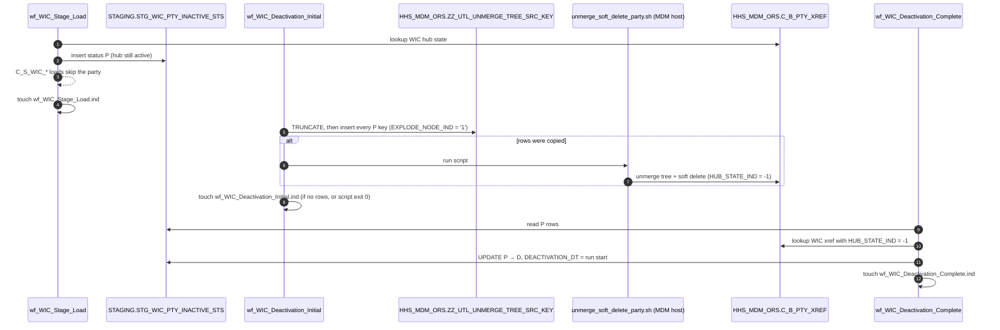

# 1. Purpose and lifecycle

Details below, but first here is the prompt given

```text
Prompt:   create a branch called 'docs-wic-activations-workflow' and the task is for Analysis and documentation only, I want you to look at two new files I added 'wf_WIC_Deactivation_Complete.xml' and 'wf_WIC_Deactivation_Initial.xml' and then based on your knowledge from previous sessions, tell me the purposes of these two workflows, how is that purposes implemented and what in your mind, do you think is the right and pragmatic and cleaner way to achieve the same purpose. do not change any code, do not run any tests. write your findings to a folder called 'docs-wic-activations-workflow'
```


## The business problem

WIC sends the party data, and the MDM hub (`HHS_MDM_ORS`) keeps the golden record. When WIC data says a party
should no longer be active, two things have to happen:

1. **Staging side:** stop sending the party. The `C_S_WIC_*` loads must skip it. `wf_WIC_Stage_Load` already does
   this: `m_Tgt_C_S_WIC_Pty_Validation` writes a status row, and `Flt_Remove_Inactive` / `Fil_Inactive_recs` in
   every later mapping drop any party that has one.
2. **Hub side:** remove the party's WIC contribution from the golden record. Its WIC cross-reference in
   `C_B_PTY_XREF` must be soft-deleted (`HUB_STATE_IND = -1`). If it was merged, it must also be unmerged, so that
   records matched *through* it no longer hang together. Stopping the feed does not do this, because the hub keeps
   the last version it received.

The two deactivation workflows do step 2, and record when it is confirmed.

## The status values in `STG_WIC_PTY_INACTIVE_STS`

Set by the validation mapping when it first deactivates a party (`InactiveStatus.newDeactivationStatus`). The value
depends on the party's WIC xref in the hub at that moment:

| Status | Hub state at decision time | Meaning | Who moves it on |
|---|---|---|---|
| `H` | no WIC xref | never reached the hub; nothing to delete | nobody (final) |
| `D` | xref `HUB_STATE_IND = -1` | already deleted in the hub | nobody (final) |
| `P` | xref active (`1`) or pending (`0`) | **hub still has it: deletion pending** | **Initial** requests, **Complete** confirms `P → D` |

Only the two deactivation workflows ever move a row from `P` to `D`. The validation mapping only inserts a status
when the party has none yet. In IDQ, a reactivation deletes the row, whatever its status (mapping 029, rule 3).

## End-to-end lifecycle



## Why two workflows and not one

The names and the shape point to an **asynchronous hub operation**:

- If `unmerge_soft_delete_party.sh` only *submits* an MDM batch job (for example, it registers the table with a
  batch-unmerge / batch-delete job and returns), the hub is not changed yet when the script returns. A separate
  later workflow has to confirm the result. That is Complete.
- Complete does not trust the script's exit code. It checks the hub itself (`C_B_PTY_XREF.HUB_STATE_IND = -1`).
  That is the right instinct: confirm against the system of record, not against the tool that asked for the change.
- A `P` row the hub did not delete stays `P`. Initial copies **all** `P` rows again on its next run, so failures
  are retried automatically. No retry counter, no age limit, no alert.

In effect, Initial is *request* and Complete is *acknowledge*: a hand-rolled outbox with a reconciliation sweep.

## How it relates to the rest of idq-cli

- Neither workflow is one of the 34 in-scope mappings. They are not in `SourceSystem`, `etl_process` or any
  engine's `run_<workflow>.sql`.
- Both read the table the WIC validation mapping (029) writes. The Java port of 029 writes the same `H` / `D` / `P`
  values, but it keeps the status row on reactivation (insert-only). This matters for porting; see 03, R6.
- TRS has a different relationship clean-up (`STG_TRS_DEACTIVED_UNMERGED_RELATIONSHIPS`). ECI, FSS and TTF have the
  same `*_PTY_INACTIVE_STS` tables with `P` rows. If they have Initial/Complete pairs too, those exports are not in
  the repo. Their `P` rows would sit there for ever without one.
