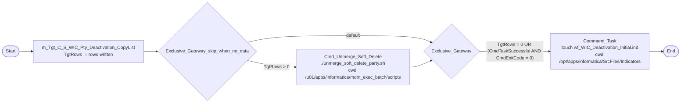
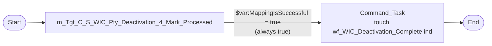

# 2. How it is implemented

The SQL in this page describes **what IDQ does**. It is not for idq-cli: the `TRUNCATE` and `UPDATE` break the
repo's insert-only rule (see 04 for the insert-only alternative).

## 2.1 `wf_WIC_Deactivation_Initial`

Workflow settings: recovery **off**, log level INFO. Variables:

| Variable | Type | Initial value | Bound to |
|---|---|---|---|
| `TgtRows` | integer | (unset, 0) | mapping task output *number of target rows* |
| `CmdTaskSuccessful` | boolean | (unset, false) | `Cmd_Unmerge_Soft_Delete` output *taskStatus* |
| `CmdExitCode` | integer | `-1` | `Cmd_Unmerge_Soft_Delete` output *exitCode* |
| `MappingIsSuccessful` | boolean | `true` | **nothing** (declared, never used) |



`Exclusive_Gateway` has only the one conditional outgoing flow and no default. When the script fails, there is no
path to `Command_Task`: the indicator file is not written and the downstream scheduler waits.

### Mapping `m_Tgt_C_S_WIC_Pty_Deactivation_CopyList`

| Step | Transformation | Detail |
|---|---|---|
| Read | `Read_STG_WIC_PTY_INACTIVE_STS` (STAGING) | source filter `DEACTIVATION_STS = 'P'`; reads `SRC_KEY`, `ROWID_SYSTEM` |
| Expression | `Exp_Default_System` | `PTY_PK` = `SRC_KEY`; `Source_Sytem_Padded` = `RPAD(ROWID_SYSTEM, 14, ' ')`; `EXPLODE_NODE_IND` = `'1'` |
| Write | `Write_ZZ_UTL_UNMERGE_TREE_SRC_KEY` (HHS_MDM_ORS) | **truncate target table = true**, load type Normal, reject file `Write_ZZ_UTL_UNMERGE_SRC_KEY.bad` |

Target columns: `PKEY_SRC_OBJECT` ← `SRC_KEY`, `ROWID_SYSTEM` (`CHAR(14)`) ← padded system,
`EXPLODE_NODE_IND` ← `'1'`. The table has no key.

What IDQ does, as SQL:

```sql
TRUNCATE TABLE hhs_mdm_ors.zz_utl_unmerge_tree_src_key;            -- truncate target table

INSERT INTO hhs_mdm_ors.zz_utl_unmerge_tree_src_key (pkey_src_object, rowid_system, explode_node_ind)
SELECT s.src_key, RPAD(s.rowid_system, 14, ' '), '1'
FROM   staging.stg_wic_pty_inactive_sts s
WHERE  s.deactivation_sts = 'P';
```

Notes:

- `RPAD(..., 14)` changes nothing: Oracle pads a `CHAR(14)` column anyway. It shows the hand-off table copies MDM's
  `C_B_PTY_XREF` key layout (`ROWID_SYSTEM CHAR(14)`), so the MDM-side script can join it to the xref table directly.
- `EXPLODE_NODE_IND = '1'` reads as "unmerge the whole tree / explode the node". The script's own logic is not in
  the export.
- Every run copies **all** `P` rows, including those the previous run already sent. The script must be idempotent
  for xrefs that are already unmerged or deleted.

## 2.2 `wf_WIC_Deactivation_Complete`

Workflow settings: recovery **on**, log level INFO. One variable: `MappingIsSuccessful`, boolean, initial `true`,
**not bound** to any task output.



### Mapping `m_Tgt_C_S_WIC_Pty_Deactivation_4_Mark_Processed`

| Step | Transformation | Detail |
|---|---|---|
| Read | `Read_STG_WIC_PTY_INACTIVE_STS` (STAGING) | source filter `DEACTIVATION_STS = 'P'`; `SRC_KEY`, `ROWID_SYSTEM` |
| Lookup | `Lookup_C_B_PTY_XREF` (HHS_MDM_ORS) | lookup source filter `ROWID_SYSTEM = 'WIC' AND HUB_STATE_IND = -1`; condition `PKEY_SRC_OBJECT = SRC_KEY`; multiple match: any row; **dynamic cache** (update condition `TRUE`, all ~70 xref columns cached); returns `PKEY_SRC_OBJECT` |
| Filter | `Keep_Deactivated` | `NOT ISNULL(PKEY_SRC_OBJECT)`: keep the `P` rows whose WIC xref is now soft-deleted |
| Expression | `Exp_Set_to_Processed` | `DEACTIVATION_STS_D = 'D'`; `Run_date = $sys.MappingRunStartTime` |
| Update strategy | `Upd_Processed_Deactivations` | `DD_UPDATE`, forward rejected rows |
| Write | `Write_STG_WIC_PTY_INACTIVE_STS` (STAGING) | update by primary key `SYS_C0030146 (SRC_KEY, ROWID_SYSTEM)`: `SRC_KEY` ← xref `PKEY_SRC_OBJECT`, `ROWID_SYSTEM` ← staging row, `DEACTIVATION_STS` ← `'D'`, `DEACTIVATION_DT` ← run start |

What IDQ does, as SQL:

```sql
UPDATE staging.stg_wic_pty_inactive_sts s
SET    s.deactivation_sts = 'D',
       s.deactivation_dt  = :mapping_run_start_time      -- one value for the whole run
WHERE  s.deactivation_sts = 'P'
AND    EXISTS (SELECT 1
               FROM   hhs_mdm_ors.c_b_pty_xref x
               WHERE  x.rowid_system    = 'WIC'          -- CHAR(14): blank-padded compare in Oracle
               AND    x.hub_state_ind   = -1
               AND    x.pkey_src_object = s.src_key);
```

Notes:

- The `ROWID_SYSTEM` used in the update key comes from the staging row (unpadded `VARCHAR2`), not from the xref
  (`CHAR(14)`). Good: the padded xref value would match no staging row.
- The lookup does not check the staging row's own `ROWID_SYSTEM`; it hard-codes `'WIC'`. That is fine for a
  WIC-only table.
- The dynamic cache does nothing useful. The mapping never inserts into or updates the cache, and the lookup only
  answers "does it exist". A static cache, or better a join, gives the same result with far less memory.
- A `P` row whose xref has been **hard**-deleted, or merged away so that no `-1` xref is left under that key, never
  becomes `D`. It is sent again by every Initial run.

## 2.3 Orchestration between workflows

There is no direct link. Each workflow ends with `touch ${sys.WorkflowName}.ind` in
`/opt/apps/informatica/SrcFiles/Indicators` (same pattern as every other workflow, common_insights 7). An external
scheduler must run them in this order:

```
wf_WIC_Stage_Load  →  wf_WIC_Deactivation_Initial  →  [MDM job finishes]  →  wf_WIC_Deactivation_Complete
```

If Complete runs before the MDM job finishes, nothing breaks: the rows stay `P` and are picked up on the next cycle.
The price is a day's delay and the `P` row being sent again.
