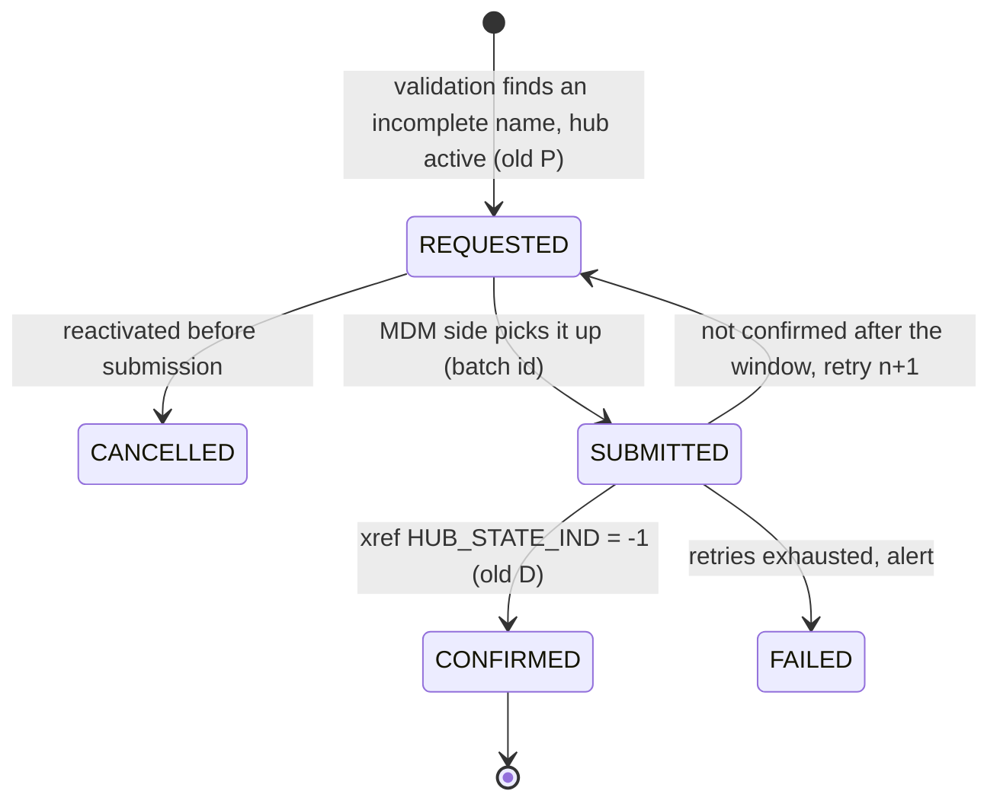

# 4. A cleaner way to do the same job

## What the job really is

Take one business decision (*this WIC party is inactive*) and make it true in a second system (*the hub*),
reliably, exactly once, with an audit trail, and **undoable** (a reactivation must win over a pending deletion).
That is a **transactional outbox with reconciliation**. The IDQ pair builds a version of it. The improvements below
keep its good ideas (confirm against the hub, retry for free) and remove the fragile parts.

## Design principles

1. **One source of truth for the request.** The validation run that decides the deactivation writes the request,
   in the same run. No copy step in a separate workflow.
2. **Append-only state, current state by query.** Each step adds an event row (`REQUESTED`, `SUBMITTED`,
   `CONFIRMED`, `FAILED`, `CANCELLED`). A view returns the latest event per party. This removes the `UPDATE`
   (R3, R7), keeps every date, and fits the repo's insert-only rule.
3. **The MDM side pulls from a view; no truncated copy.** The script, or better an MDM-side procedure, reads
   `V_WIC_DEACTIVATION_TO_SUBMIT` across a grant or db-link, and stamps a `SUBMITTED` event with its batch id. No
   shared truncated table (R4), and the request knows which run sent it.
4. **A reactivation cancels a pending request.** "Due for submission" means *latest event `REQUESTED` and the party
   has not been reactivated since*. This closes R6 and R11.
5. **Set-based reconciliation, not a cached lookup.** One `INSERT … SELECT` adds `CONFIRMED` events for requests
   whose xref is `-1` (R9).
6. **Gates check real success.** Bind *Is Successful* (or exit codes) and fail the run visibly. Never write the
   "done" signal on an unknown outcome (R1, R2).
7. **Bounded retries with an alert.** After N attempts or D days, write `FAILED` and report it (R8).

## Target data model (append-only)

```sql
-- STAGING (one table for all sources; WIC is just ROWID_SYSTEM = 'WIC')
CREATE TABLE stg_pty_deactivation_evt (
  evt_id           NUMBER GENERATED ALWAYS AS IDENTITY PRIMARY KEY,
  rowid_system     VARCHAR2(14)  NOT NULL,
  src_key          VARCHAR2(255) NOT NULL,
  evt_type         VARCHAR2(12)  NOT NULL,   -- REQUESTED | SUBMITTED | CONFIRMED | FAILED | CANCELLED
  evt_dt           TIMESTAMP     NOT NULL,
  run_id           VARCHAR2(64)  NOT NULL,   -- ETL run or MDM batch id that wrote the event
  detail           VARCHAR2(4000)
);

CREATE OR REPLACE VIEW v_pty_deactivation_current AS
SELECT *
FROM  (SELECT e.*, ROW_NUMBER() OVER (PARTITION BY rowid_system, src_key ORDER BY evt_dt DESC, evt_id DESC) rn
       FROM   stg_pty_deactivation_evt e)
WHERE rn = 1;
```

Event flow per party:



`H` and the immediate `D` of today's model stay as they are in `*_PTY_INACTIVE_STS`. Only `P` parties get events.
`STG_WIC_PTY_INACTIVE_STS` keeps its role as the load filter, so the 34 mappings do not change.

## The three steps

**1. Request.** Written by the validation step, in the same run:

```sql
INSERT INTO stg_pty_deactivation_evt (rowid_system, src_key, evt_type, evt_dt, run_id)
SELECT 'WIC', s.src_key, 'REQUESTED', :run_start, :run_id
FROM   <today's new P statuses> s;
```

A reactivation in the same validation run inserts `CANCELLED` for any open request of that party, instead of
relying on a `DD_DELETE`.

**2. Submit.** MDM side, replaces `CopyList` and the truncate. The script or procedure reads

```sql
CREATE OR REPLACE VIEW v_pty_deactivation_to_submit AS
SELECT rowid_system, src_key
FROM   v_pty_deactivation_current
WHERE  evt_type = 'REQUESTED';
```

It runs the tree unmerge and soft-delete for those keys, then appends one `SUBMITTED` event per key with its batch
id. If the MDM side may not write to STAGING, the ETL can append `SUBMITTED` right after the script returns exit
code 0, with the same rows it handed over.

**3. Reconcile.** Replaces `4_Mark_Processed`. One statement, insert-only:

```sql
INSERT INTO stg_pty_deactivation_evt (rowid_system, src_key, evt_type, evt_dt, run_id)
SELECT c.rowid_system, c.src_key, 'CONFIRMED', :run_start, :run_id
FROM   v_pty_deactivation_current c
WHERE  c.evt_type = 'SUBMITTED'
AND    EXISTS (SELECT 1 FROM hhs_mdm_ors.c_b_pty_xref x
               WHERE x.rowid_system = c.rowid_system        -- CHAR vs VARCHAR2: blank-padded in Oracle; TRIM in Snowflake
               AND   x.pkey_src_object = c.src_key
               AND   x.hub_state_ind = -1);
```

The same run sends `SUBMITTED` rows older than the confirmation window back to `REQUESTED` (counting attempts), or
on to `FAILED` once the limit is reached, and lists `FAILED` in the run report.

If the MDM call is synchronous, steps 2 and 3 run back to back in **one** workflow. The Initial/Complete split is
only needed when the hub job is asynchronous. Even then, the reconcile can simply run at the start of the next
cycle, so no separate scheduled workflow is needed.

## Simpler still: use the hub's own soft-delete path

The C_S_* loads already send `HUB_STATE_IND = 1` on every row, and ECI reactivation works by sending history again
with hub state 1 (common_insights 7). The MDM-native counterpart for a source-driven **soft delete** is to send the
party's records once more through the same landing → stage → load path with `HUB_STATE_IND = -1`. The hub then
soft-deletes the WIC xref itself, and match/merge and the best version are recalculated by the hub's own load job.
That needs no hand-off table, no custom script and no separate workflow, and it is the same mechanism as
reactivation.

Caveats to check with the MDM team before choosing it:

- A soft-deleted xref stops contributing to the best version, but the base object stays merged with the other
  sources. If the business needs the WIC record *unmerged* (which `EXPLODE_NODE_IND` suggests), a tree unmerge is
  still needed: keep steps 2 and 3 for those parties only.
- The landing/staging configuration must accept `HUB_STATE_IND` from the source (the "state management" setting on
  the base object). The `C_S_*` columns suggest it does.

## Fit with idq-cli

| Concern | How the recommended design fits |
|---|---|
| Insert-only rule | Every step is an `INSERT … SELECT` into an event table. No `TRUNCATE`, `UPDATE` or `DELETE`. IDQ's truncate and update would be marked `-- Not performed: …`, as elsewhere. |
| R6 (no delete on reactivation) | The `CANCELLED` event plus "latest event wins" replaces IDQ's `DD_DELETE`. The Java port's "status row stays" is then harmless. |
| Engines | JAVA: a `WicDeactivationService` that appends events. ORA_SP: `sp_ors_main_<mapping>` with two `INSERT … SELECT`s. SNOWFLAKE_SP: the same, with `TRIM` on the `CHAR` key (common_insights 12.8) and no reliance on keys. |
| Mapping numbering | If adopted, the pair becomes mappings 035/036 (or one mapping if the call is synchronous), each with a mapping doc, the TIMELINE note (none needed here), and tests. |
| Production safety | The event table is new (CREATE only). Nothing existing is changed. The MDM-side submit stays a separate, gated, auditable step. |

## If the IDQ pair has to stay as it is for now

The smallest fixes with the most effect, all inside the existing workflows:

1. Initial: bind the mapping's *Is Successful* to `MappingIsSuccessful` and make the gates
   `MappingIsSuccessful AND (TgtRows = 0 OR (CmdTaskSuccessful AND CmdExitCode = 0))`. Add a default flow from
   `Exclusive_Gateway` to a Fail/Terminate so that a failure is visible (R1).
2. Complete: bind *Is Successful* to `MappingIsSuccessful` (R2).
3. Complete: replace the dynamic cache with a static lookup that returns `PKEY_SRC_OBJECT` only, or a SQL override
   with `EXISTS` (R9).
4. Add a `CONFIRMED_DT` column instead of overwriting `DEACTIVATION_DT` (R3), or at least write the confirmation
   to `STG_WIC_PTY_INACTIVE_LOG`.
5. Add a weekly check: `P` rows older than 7 days → alert (R8).
6. Put `unmerge_soft_delete_party.sh` under version control next to these exports (R5).
