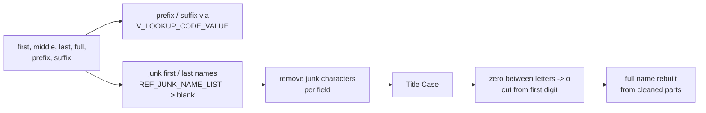
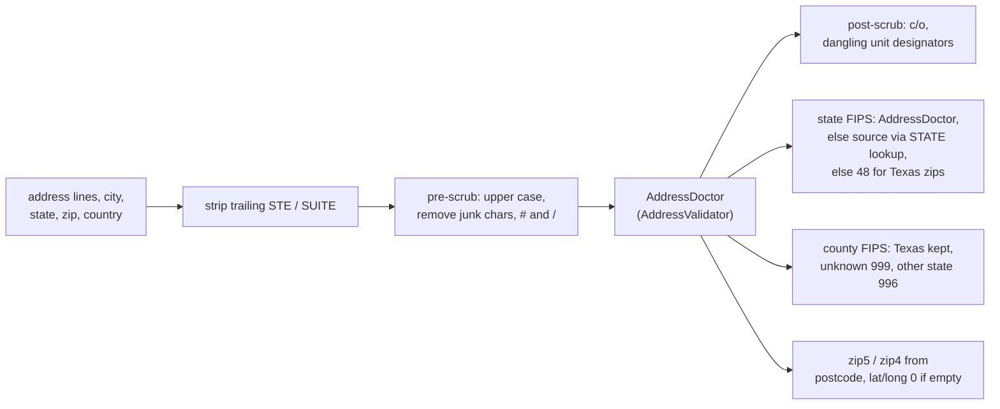

# 000 Shared mapplets and rules

The IDQ mappings call reusable mapplets (`mplt_*`) and rules (`rule_*`). They contain no source-system data flow,
so the Java versions live in the common package `com.idq.cli.core.rules` and are reused by every source.
This document is the business description of each one; the mapping documents link here.

| IDQ object | Java | Used by |
|---|---|---|
| `mplt_Name_Standardization_Indv_Member` | `NameStandardization.standardize` | every party / validation / alias mapping |
| `mplt_Name_Standardization_Trailing_Num_Removal` | `NameStandardization.removeTrailingNumbers` | inside the above, and TRS 003 |
| `mplt_BirthDate_Validation` | `PersonRules.birthDate` | party mappings |
| `mplt_Gender_Validation` | `PersonRules.gender` | party mappings |
| `mplt_Race_Validation`, `mplt_Ethnicity_Validation`, `mplt_Language_Validation` | `PersonRules.codeValue` | party mappings |
| `mplt_Race_Ind_Validation` | `PersonRules.raceIndicators` | ECI, FSS, WIC party |
| `rule_Suffix_Std` | `PersonRules.suffix` | FSS party |
| `mplt_Date_Greater_Than_Fifty_Years` | `PersonRules.notBeyondFiftyYears` | TRS 012 |
| `rule_email_validation_v01` (+ local part / domain rules) | `ContactRules.email` | phone and e-mail mappings |
| `rule_Phone_Std` | `ContactRules.phone` | phone mappings |
| `rule_Phone_Extension_Std` | `ContactRules.phoneExtension` | FSS, TTF phone |
| `rule_USA_SSN_Validation_post_June2011` | `IdentifierRules.ssn` | TRS 004, ECI 016 |
| `rule_MEDICAID_ID_Std` | `IdentifierRules.medicaidId` | TRS 004, ECI 016 |
| `rule_Member_Id_Std` | `IdentifierRules.memberId` | TRS 004 |
| `mplt_Global_Addr_Validation` (+ `rule_Addr_Line_Pre_Scrub1`, `rule_Addr_Line_Post_Scrub`) | `AddressValidator`, `AddressRules` | address mappings |
| `mplt_TRS_Pty_Rle_Alt_Id_Normalization` | `TrsAlternateIdService.normalize` (source specific) | TRS 004 |
| `mplt_Member_Pty_Rle_Phn_Normalization` | `TrsPhoneEmailService.phoneSlots` (source specific) | TRS 006 |
| `mplt_Member_Pty_Rle_Phn_Consolidation`, `mplt_Member_Pty_Rle_EAddr_Consolidation` | `Rows.latestPerKey` | TRS 006 |
| `mplt_Member_Pty_Rle_Rel_Consolidation` | `Rows.currentSegmentPerKey` | TRS 009, 010 |
| `mplt_Pty_Rle_Rel_Timeline_Validation`, `mplt_DST_Correction` | not ported (retired MDM timeline) | TRS 009, 010 |

Every rule that raises an exception looks the code up in `EXC_LOOKUP_CODE_VALUE` for its description and type
(`ExceptionInfo`). Several mappings only route a row to the exception queue when that lookup finds the code
(`ExceptionInfo.configured()`); the mapping documents say where.

## Name standardization



* Prefix and suffix are translated with `V_LOOKUP_CODE_VALUE` code types `PREFIX` / `SUFFIX` for the source system.
  A non-blank value that does not translate gives `Invalid_Prefix` / `Invalid_Suffix` (returned, not written by the
  member mappings).
* A first or last name that appears in `REF_JUNK_NAME_LIST` (edit limitation empty, `FIRST` or `LAST`) is blanked.
* Junk characters are removed per field, then repeated spaces collapsed and the value trimmed. First name removes
  ``~ ! ` @ # $ % ^ & * ( ) _ + = " : ; ? / . > , <`` and tab; middle and last name a similar set (middle also
  removes `-` and `'`).
* Names are converted to title case.
* Trailing-number removal (two IDQ labelers): a `0` between letters becomes the letter `o` (`J0hn` -> `John`);
  the value is then cut at the first digit (`Smith2` -> `Smith`), unless the name ends in `0` and the two characters
  before the last label are not both digits. The IDQ middle-name expression returns the *last* name in that keep
  branch; the Java code preserves this quirk.
* The full name output is rebuilt as `first [middle] last`; the original full name is returned as source full name.

The IDQ labelers use Informatica content sets that are not part of the export; the Java labels letters `X`, the
digit zero `0` and other digits `9`, which is what the expressions test.

## Person rules

* **Birth date**: for member sources and individual parties, a birth date after the run date is rejected: the
  mapplet returns `NULL` and the exception `Invalid_Birth_Date`.
* **Gender**: `M` -> `1`, `F` -> `2`, `B` / `U` -> `NULL` for individuals; organisations always `NULL`. A missing,
  numeric or other value raises `Invalid_Gender`.
* **Race / ethnicity / language**: the source code is translated with `V_LOOKUP_CODE_VALUE` (`RACE`, `ETHNICITY`,
  `LANGUAGE_CD`); a code that does not translate (including a missing code) raises `Invalid_Race`,
  `Invalid_Ethnicity` or `Invalid_Language`.
* **Race indicators** (`mplt_Race_Ind_Validation`): five 0/1 indicators. Exactly one gives `001` white, `002` black,
  `003` native american, `004` asian, `005` pacific islander; two give `006`; more give `007`; none (or a missing
  indicator) raises `Invalid_Race`. The source value written is `WH<w>AA<b>AS<a>PI<p>NA<n>`.
* **Suffix** (`rule_Suffix_Std`): translated with `V_LOOKUP_CODE_VALUE` *without* a code-type filter; a non-blank
  untranslatable suffix raises `Invalid_Suffix`.
* **Fifty years**: an end date more than fifty years after the run becomes `NULL` (open ended).

## Contact rules

* **E-mail**: the address is trimmed and lower-cased. It is `Invalid_Email` when it contains white space, has no
  `@`, has no dot at or after the `@`, when the domain part (before the last dot) is empty, starts with `.` or `-`,
  ends with `-`, contains `_` after the first character, contains `..` or characters outside `a-z 0-9 . -`, or when
  the top-level domain is not 2 to 11 letters / digits. (The local-part rule compares the address with the literal
  `Invalid`, so it never fires except for that word.)
* **Phone**: punctuation and white space are removed. In this order the number is `Invalid_Phone_Number` when it
  is not numeric, not 10 digits, all zeros or its 4th digit is 0/1; `Missing_AreaCode` for ECI numbers with area
  code `000`; `Invalid_Phone_Number` when the area code is not in `REF_PHN_AREA_CD` (in service, US or
  non-geographic) or the first digit is 0/1; finally TRS, CRE and ECI main / other numbers (`001`, `003`) may not
  use a toll-free area code. The Snowflake filter `current_date()` of the area-code lookup is `SYSDATE` in Oracle.
* **Phone extension**: special characters removed; when present it must be 2 to 6 digits, else
  `Invalid_Phone_Number_Ext`.

## Identifier rules

* **SSN** (`rule_USA_SSN_Validation_post_June2011`): valid when it is nine digits (dashes / spaces allowed) with
  area not `000`, `666` or `9xx`, group not `00`, serial not `0000`. An invalid SSN is blanked and raises
  `Invalid_SSN`. The IDQ rule uses the `USANATID1` token set of the Informatica content; the Java version applies the
  published post-June-2011 SSA rules that token set encodes.
* **Medicaid id**: special characters removed (`ref_special_char_list`, treated as every non letter / digit);
  anything other than 9 characters raises `Invalid_Medicaid_Id`.
* **Member id**: same cleaning; anything other than 9 or 10 characters raises `Invalid_Member_Id`.

## Address validation



`dq_Global_AddressValidation_Hybrid` is Informatica AddressDoctor, a licensed external service, so it is behind the
`AddressValidator` interface. `PassThroughAddressValidator` runs every expression of the mapplet and echoes the
prepared input in place of the service: AddressDoctor-only results (match code, mailability score, geocodes,
CASS / DPV codes) are `NULL`. Plug in a real validator as a Spring bean to replace it.

**Scoring** (`exp_Score_and_Exception_details`, in every address mapping): an address goes to the exception queue
(`Invalid_Address`) when its type is not physical mail (`002`) and the mailability score is 3 or less, when it is
physical mail with a score below 3 and a match code starting with `I` or `N`, or when the address type does not
translate. A missing score compares as `NULL`, so with the pass-through validator every address with a known type is
good.

**Holding lines** (`exp_Address_Hold`): an empty first line is replaced by the second line, which is then cleared when
it repeats the first.

<!-- lookups:begin -->
## Lookups inside mapplets and rules

Lookup transformations inside the shared mapplets and rules, per mapplet. When the same mapplet is exported
in several workflows with identical lookups it is listed once with every workflow named. In a lookup
condition the left side is the lookup table column and the right side is the lookup input port.

### `CopyOf_mplt_Name_Standardization_Indv_Member` (TTF)

#### Fed by `exp_Src_Inp_Name` (Expression), `input` (Mapplet input)

| Lookup | Table | Condition | Input ports | Output ports |
|---|---|---|---|---|
| `lkp_V_Lookup_Sfx_Code_Value` | `V_LOOKUP_CODE_VALUE` (STAGING)<br>filter: `"V_LOOKUP_CODE_VALUE"."CODE_TYPE"  = 'SUFFIX'`<br>multiple match: any row | `SRC_CODE_VALUE = in_Suffix AND SRC_SYS = in_Src_Sys` | `in_Suffix` &larr; `exp_Src_Inp_Name.Sfx_Name`<br>`in_Src_Sys` &larr; `input.Src_System` | `MSTR_CODE_VALUE` &rarr; `exp_std_Suffix.std_Suffix` (Expression) |

#### Fed by `input` (Mapplet input)

| Lookup | Table | Condition | Input ports | Output ports |
|---|---|---|---|---|
| `lkp_V_Lookup_Prfx_Code_Value` | `V_LOOKUP_CODE_VALUE` (STAGING)<br>filter: `"V_LOOKUP_CODE_VALUE"."CODE_TYPE"='PREFIX'`<br>multiple match: any row | `SRC_CODE_VALUE = in_Prefix AND SRC_SYS = in_Src_Sys` | `in_Prefix` &larr; `Prfx_Name`<br>`in_Src_Sys` &larr; `Src_System` | `MSTR_CODE_VALUE` &rarr; `exp_Std_Prefix.std_Prefix` (Expression) |

#### Fed by `exp_Src_Inp_Name` (Expression)

| Lookup | Table | Condition | Input ports | Output ports |
|---|---|---|---|---|
| `Lookup__JUNK_FNAME` | `REF_JUNK_NAME_LIST` (STAGING)<br>filter: `"REF_JUNK_NAME_LIST"."EDIT_LIMITATION" is null or "REF_JUNK_NAME_LIST"."EDIT_LIMITATION" = 'FIRST'`<br>multiple match: any row | `NAME = Up_First_Name` | `First_Name` &larr; `First_Name`<br>`Up_First_Name` &larr; `Up_First_Name` | `First_Name` (pass-through) &rarr; `Exp_Junk_names_to_null.First_Name` (Expression)<br>`NAME` &rarr; `Exp_Junk_names_to_null.FNAME_JUNK` (Expression) |
| `Lookup_JUNK_LNAME` | `REF_JUNK_NAME_LIST` (STAGING)<br>filter: `"REF_JUNK_NAME_LIST"."EDIT_LIMITATION" is null or "REF_JUNK_NAME_LIST"."EDIT_LIMITATION" = 'LAST'`<br>multiple match: any row | `NAME = Up_Lst_Name` | `Lst_Name` &larr; `Lst_Name`<br>`Up_Lst_Name` &larr; `Up_Lst_Name` | `Lst_Name` (pass-through) &rarr; `Exp_Junk_names_to_null.Lst_Name` (Expression)<br>`NAME` &rarr; `Exp_Junk_names_to_null.LNAME_JUNK` (Expression) |

### `mplt_BirthDate_Validation` (ECI, FSS, TRS, TTF, WIC)

#### Fed by `exp_BirthDate_Validation` (Expression)

| Lookup | Table | Condition | Input ports | Output ports |
|---|---|---|---|---|
| `Lookup_EXC_LOOKUP_CODE_VALUE` | `EXC_LOOKUP_CODE_VALUE` (STAGING)<br>multiple match: any row | `EXCEPTION_CODE = Exception_Code1` | `Exception_Code1` &larr; `Exception_Code` | `EXCEPTION_DESC` &rarr; `output.Exception_Description` (Mapplet output)<br>`EXCEPTION_TYPE` &rarr; `output.Exception_Type` (Mapplet output) |

### `mplt_DST_Correction` (TRS)

#### Fed by `Exp_Set_DST_Lookup_Hour` (Expression)

| Lookup | Table | Condition | Input ports | Output ports |
|---|---|---|---|---|
| `LKP_REF_DYLGHT_SVNGS_TM` | `REF_DYLGHT_SVNGS_TM` (STAGING)<br>multiple match: any row | `DST = DST_Lookup_Date` | `DST_Lookup_Date` &larr; `DST_Lookup_Date` | `DST` &rarr; `Exp_Change_Hour_for_DST.lkp_DST` (Expression) |

### `mplt_Ethnicity_Validation` (ECI, FSS, TRS, TTF, WIC)

#### Fed by `Exp_Ethnicity_Validation` (Expression)

| Lookup | Table | Condition | Input ports | Output ports |
|---|---|---|---|---|
| `Lookup_EXC_LOOKUP_CODE_VALUE` | `EXC_LOOKUP_CODE_VALUE` (STAGING)<br>multiple match: any row | `EXCEPTION_CODE = EXCEPTION_CODE1` | `EXCEPTION_CODE1` &larr; `out_Exception_Code` | `EXCEPTION_CODE` &rarr; `output.EXCEPTION_CODE` (Mapplet output)<br>`EXCEPTION_DESC` &rarr; `output.EXCEPTION_DESC` (Mapplet output)<br>`EXCEPTION_TYPE` &rarr; `output.EXCEPTION_TYPE` (Mapplet output) |

#### Fed by `input` (Mapplet input)

| Lookup | Table | Condition | Input ports | Output ports |
|---|---|---|---|---|
| `Lookup_V_LOOKUP_CODE_VALUE` | `V_LOOKUP_CODE_VALUE` (STAGING)<br>filter: `"V_LOOKUP_CODE_VALUE"."CODE_TYPE"='ETHNICITY'`<br>multiple match: any row | `SRC_SYS = Src_Sys1 AND SRC_CODE_VALUE = Ethnicity_Cd` | `Src_Sys1` &larr; `Src_Sys`<br>`Ethnicity_Cd` &larr; `Ethnicity_Cd` | `MSTR_CODE_VALUE` &rarr; `Exp_Ethnicity_Validation.MSTR_CODE_VALUE` (Expression) |

### `mplt_Gender_Validation` (ECI, FSS, TRS, TTF, WIC)

#### Fed by `exp_Gender_Code_Validation` (Expression)

| Lookup | Table | Condition | Input ports | Output ports |
|---|---|---|---|---|
| `Lookup_EXC_LOOKUP_CODE_VALUE` | `EXC_LOOKUP_CODE_VALUE` (STAGING)<br>multiple match: any row | `EXCEPTION_CODE = In_Exception_Code` | `In_Exception_Code` &larr; `Exception_Code` | `EXCEPTION_DESC` &rarr; `output.Gender_Exception_Description` (Mapplet output)<br>`EXCEPTION_TYPE` &rarr; `output.Gender_Exception_Type` (Mapplet output) |

### `mplt_Global_Addr_Validation` (ECI, FSS, TRS, WIC)

#### Fed by `exp_Prepare_For_Address_Validation` (Expression)

| Lookup | Table | Condition | Input ports | Output ports |
|---|---|---|---|---|
| `lkp_State_Cd` | `V_LOOKUP_CODE_VALUE` (STAGING)<br>filter: `"V_LOOKUP_CODE_VALUE"."CODE_TYPE"='STATE'`<br>multiple match: any row | `SRC_CODE_VALUE = in_ADDR_STATE_CD AND SRC_SYS = in_SRC_SYS` | `in_SRC_SYS` &larr; `Src_Sys_Out`<br>`in_ADDR_STATE_CD` &larr; `State_Out` | `MSTR_CODE_VALUE` &rarr; `Exp_State_Value.in_State_code` (Expression) |

#### Fed by `dq_Global_AddressValidation_Hybrid` (Address Validator)

| Lookup | Table | Condition | Input ports | Output ports |
|---|---|---|---|---|
| `lkp_ref_MatchCode_Desc` | `ref_MatchCode_Desc` (INFA_STAGE)<br>multiple match: any row | `Match_Code = StatusInfoMatchCode` | `StatusInfoMatchCode` &larr; `StatusInfoMatchCode` | `Description` &rarr; `output.MatchCode_Description` (Mapplet output) |

### `mplt_Language_Validation` (ECI, FSS, WIC)

#### Fed by `Exp_Language_Validation` (Expression)

| Lookup | Table | Condition | Input ports | Output ports |
|---|---|---|---|---|
| `Lookup_EXC_LOOKUP_CODE_VALUE` | `EXC_LOOKUP_CODE_VALUE` (STAGING)<br>multiple match: any row | `EXCEPTION_CODE = EXCEPTION_CODE1` | `EXCEPTION_CODE1` &larr; `out_Exception_Code` | `EXCEPTION_CODE` &rarr; `output.EXCEPTION_CODE` (Mapplet output)<br>`EXCEPTION_DESC` &rarr; `output.EXCEPTION_DESC` (Mapplet output)<br>`EXCEPTION_TYPE` &rarr; `output.EXCEPTION_TYPE` (Mapplet output) |

#### Fed by `input` (Mapplet input)

| Lookup | Table | Condition | Input ports | Output ports |
|---|---|---|---|---|
| `Lookup_V_LOOKUP_CODE_VALUE` | `V_LOOKUP_CODE_VALUE` (STAGING)<br>filter: `"V_LOOKUP_CODE_VALUE"."CODE_TYPE"='LANGUAGE_CD'`<br>multiple match: any row | `SRC_SYS = Src_Sys1 AND SRC_CODE_VALUE = Language_Cd` | `Src_Sys1` &larr; `Src_Sys`<br>`Language_Cd` &larr; `Language_Cd` | `MSTR_CODE_VALUE` &rarr; `Exp_Language_Validation.MSTR_CODE_VALUE` (Expression) |

### `mplt_Member_Pty_Rle_Phn_Normalization` (TRS)

#### Fed by `Filter_Null_Phone_Nums` (Filter)

| Lookup | Table | Condition | Input ports | Output ports |
|---|---|---|---|---|
| `Lookup_LOOKUP_CODE_VALUE` | `LOOKUP_CODE_VALUE` (STAGING)<br>filter: `"LOOKUP_CODE_VALUE"."CODE_TYPE" = 'PHN_USG_TP'`<br>multiple match: any row | `MSTR_REF_CODE = USG_TP AND SRC_SYS = SRC_SYS1` | `USG_TP` &larr; `USG_TP`<br>`SRC_SYS1` &larr; `SRC_SYS` | `MSTR_REF_LABEL` &rarr; `Exp_NEWOUTPUT.MSTR_REF_LABEL` (Expression)<br>`MSTR_REF_CODE` &rarr; `Exp_NEWOUTPUT.MSTR_REF_CODE` (Expression) |

### `mplt_Name_Standardization_Indv_Member` (ECI, FSS, TRS, TTF, WIC)

#### Fed by `exp_Src_Inp_Name` (Expression), `input` (Mapplet input)

| Lookup | Table | Condition | Input ports | Output ports |
|---|---|---|---|---|
| `lkp_V_Lookup_Sfx_Code_Value` | `V_LOOKUP_CODE_VALUE` (STAGING)<br>filter: `"V_LOOKUP_CODE_VALUE"."CODE_TYPE"  = 'SUFFIX'`<br>multiple match: any row | `SRC_CODE_VALUE = in_Suffix AND SRC_SYS = in_Src_Sys` | `in_Suffix` &larr; `exp_Src_Inp_Name.Sfx_Name`<br>`in_Src_Sys` &larr; `input.Src_System` | `MSTR_CODE_VALUE` &rarr; `exp_std_Suffix.std_Suffix` (Expression) |

#### Fed by `input` (Mapplet input)

| Lookup | Table | Condition | Input ports | Output ports |
|---|---|---|---|---|
| `lkp_V_Lookup_Prfx_Code_Value` | `V_LOOKUP_CODE_VALUE` (STAGING)<br>filter: `"V_LOOKUP_CODE_VALUE"."CODE_TYPE"='PREFIX'`<br>multiple match: any row | `SRC_CODE_VALUE = in_Prefix AND SRC_SYS = in_Src_Sys` | `in_Prefix` &larr; `Prfx_Name`<br>`in_Src_Sys` &larr; `Src_System` | `MSTR_CODE_VALUE` &rarr; `exp_Std_Prefix.std_Prefix` (Expression) |

#### Fed by `exp_Src_Inp_Name` (Expression)

| Lookup | Table | Condition | Input ports | Output ports |
|---|---|---|---|---|
| `Lookup__JUNK_FNAME` | `REF_JUNK_NAME_LIST` (STAGING)<br>filter: `"REF_JUNK_NAME_LIST"."EDIT_LIMITATION" is null or "REF_JUNK_NAME_LIST"."EDIT_LIMITATION" = 'FIRST'`<br>multiple match: any row | `NAME = Up_First_Name` | `First_Name` &larr; `First_Name`<br>`Up_First_Name` &larr; `Up_First_Name` | `First_Name` (pass-through) &rarr; `Exp_Junk_names_to_null.First_Name` (Expression)<br>`NAME` &rarr; `Exp_Junk_names_to_null.FNAME_JUNK` (Expression) |
| `Lookup_JUNK_LNAME` | `REF_JUNK_NAME_LIST` (STAGING)<br>filter: `"REF_JUNK_NAME_LIST"."EDIT_LIMITATION" is null or "REF_JUNK_NAME_LIST"."EDIT_LIMITATION" = 'LAST'`<br>multiple match: any row | `NAME = Up_Lst_Name` | `Lst_Name` &larr; `Lst_Name`<br>`Up_Lst_Name` &larr; `Up_Lst_Name` | `Lst_Name` (pass-through) &rarr; `Exp_Junk_names_to_null.Lst_Name` (Expression)<br>`NAME` &rarr; `Exp_Junk_names_to_null.LNAME_JUNK` (Expression) |

### `mplt_Race_Ind_Validation` (ECI, FSS, WIC)

#### Fed by `Exp_Map_Race_Ind_to_Cd` (Expression)

| Lookup | Table | Condition | Input ports | Output ports |
|---|---|---|---|---|
| `Lookup_EXC_LOOKUP_CODE_VALUE` | `EXC_LOOKUP_CODE_VALUE` (STAGING)<br>multiple match: any row | `EXCEPTION_CODE = in_Exception_Code` | `in_Exception_Code` &larr; `Exception_Cd` | `EXCEPTION_CODE` &rarr; `output.Exception_Cd` (Mapplet output)<br>`EXCEPTION_DESC` &rarr; `output.Exception_Desc` (Mapplet output)<br>`EXCEPTION_TYPE` &rarr; `output.Exception_Type` (Mapplet output) |

### `mplt_Race_Validation` (TRS, TTF)

#### Fed by `Exp_Race_Validation` (Expression)

| Lookup | Table | Condition | Input ports | Output ports |
|---|---|---|---|---|
| `Lookup_EXC_LOOKUP_CODE_VALUE` | `EXC_LOOKUP_CODE_VALUE` (STAGING)<br>multiple match: any row | `EXCEPTION_CODE = in_Exception_Code` | `in_Exception_Code` &larr; `out_Exception_Code` | `EXCEPTION_CODE` &rarr; `output.EXCEPTION_CODE` (Mapplet output)<br>`EXCEPTION_DESC` &rarr; `output.EXCEPTION_DESC` (Mapplet output)<br>`EXCEPTION_TYPE` &rarr; `output.EXCEPTION_TYPE` (Mapplet output) |

#### Fed by `input` (Mapplet input)

| Lookup | Table | Condition | Input ports | Output ports |
|---|---|---|---|---|
| `Lookup_V_LOOKUP_CODE_VALUE` | `V_LOOKUP_CODE_VALUE` (STAGING)<br>filter: `"V_LOOKUP_CODE_VALUE"."CODE_TYPE"='RACE'`<br>multiple match: any row | `SRC_SYS = Src_Sys1 AND SRC_CODE_VALUE = Race_Cd` | `Src_Sys1` &larr; `Src_Sys`<br>`Race_Cd` &larr; `Race_Cd` | `MSTR_CODE_VALUE` &rarr; `Exp_Race_Validation.MSTR_CODE_VALUE` (Expression) |

### `mplt_TRS_Pty_Rle_Alt_Id_Normalization` (TRS)

#### Fed by `NRM_ALT_ID` (Normalizer)

| Lookup | Table | Condition | Input ports | Output ports |
|---|---|---|---|---|
| `LKP_ALT_ID_LBL` | `LOOKUP_CODE_VALUE` (STAGING)<br>filter: `"LOOKUP_CODE_VALUE"."CODE_TYPE"='ALT_ID_TP'`<br>multiple match: any row | `MSTR_REF_CODE = ALT_ID_TYP AND SRC_SYS = SRC_SYS1` | `SRC_SYS1` &larr; `SRC_SYS`<br>`ALT_ID_TYP` &larr; `ALT_ID_TYP` | `MSTR_REF_CODE` &rarr; `FLTR_Remove_Null_Alt_IDs.MSTR_REF_CODE` (Filter)<br>`MSTR_REF_LABEL` &rarr; `FLTR_Remove_Null_Alt_IDs.MSTR_REF_LABEL` (Filter) |

#### Fed by `exp_validate_ssn` (Expression)

| Lookup | Table | Condition | Input ports | Output ports |
|---|---|---|---|---|
| `LU_SSN_Exc_Code` | `EXC_LOOKUP_CODE_VALUE` (STAGING)<br>multiple match: any row | `EXCEPTION_CODE = EXCEPTION_CODE1` | `EXCEPTION_CODE1` &larr; `EXCEPTION_CODE1` | `EXCEPTION_CODE` &rarr; `EXP_prepare_Normalizer.DQ_Exception_Code_SSN` (Expression)<br>`EXCEPTION_DESC` &rarr; `EXP_prepare_Normalizer.DQ_Exception_SSN` (Expression) |

### `rule_MEDICAID_ID_Std` (ECI, TRS)

#### Fed by `exp_validate_MEDICAID_ID` (Expression)

| Lookup | Table | Condition | Input ports | Output ports |
|---|---|---|---|---|
| `Lookup_EXC_LOOKUP_CODE_VALUE1` | `EXC_LOOKUP_CODE_VALUE` (STAGING)<br>multiple match: any row | `EXCEPTION_CODE = EXCEPTION_CODE1` | `EXCEPTION_CODE1` &larr; `EXCEPTION_CODE` | `EXCEPTION_CODE1` (pass-through) &rarr; `output.Medicaid_Id_Exception_Code` (Mapplet output)<br>`EXCEPTION_TYPE` &rarr; `output.Medicaid_Id_Exception_Type` (Mapplet output)<br>`EXCEPTION_DESC` &rarr; `output.Medicaid_Id_Exception_Desc` (Mapplet output) |

### `rule_Member_Id_Std` (TRS)

#### Fed by `exp_validate_MEMBER_ID` (Expression)

| Lookup | Table | Condition | Input ports | Output ports |
|---|---|---|---|---|
| `Lookup_EXC_LOOKUP_CODE_VALUE` | `EXC_LOOKUP_CODE_VALUE` (STAGING)<br>multiple match: any row | `EXCEPTION_CODE = EXCEPTION_CODE1` | `EXCEPTION_CODE1` &larr; `Exception_Code` | `EXCEPTION_CODE1` (pass-through) &rarr; `output.Member_Id_Exception_Code` (Mapplet output)<br>`EXCEPTION_TYPE` &rarr; `output.Member_Id_Exception_Type` (Mapplet output)<br>`EXCEPTION_DESC` &rarr; `output.Member_Id_Exception_Desc` (Mapplet output) |

### `rule_Phone_Extension_Std` (FSS, TTF)

#### Fed by `exp_validate_Phone` (Expression)

| Lookup | Table | Condition | Input ports | Output ports |
|---|---|---|---|---|
| `Lookup_EXC_LOOKUP_CODE_VALUE` | `EXC_LOOKUP_CODE_VALUE` (STAGING)<br>multiple match: any row | `EXCEPTION_CODE = EXCEPTION_CODE1` | `EXCEPTION_CODE1` &larr; `EXCEPTION_CODE1` | `EXCEPTION_CODE1` (pass-through) &rarr; `output.Phone_Nbr_Ext_Exception_Code` (Mapplet output)<br>`EXCEPTION_TYPE` &rarr; `output.Phone_Nbr_Ext_Exception_Type` (Mapplet output)<br>`EXCEPTION_DESC` &rarr; `output.Phone_Nbr_Ext_Exception_Desc` (Mapplet output) |

### `rule_Phone_Std` (ECI, FSS, TRS, TTF, WIC)

#### Fed by `exp_validate_Phone` (Expression)

| Lookup | Table | Condition | Input ports | Output ports |
|---|---|---|---|---|
| `Lookup_EXC_LOOKUP_CODE_VALUE` | `EXC_LOOKUP_CODE_VALUE` (STAGING)<br>multiple match: any row | `EXCEPTION_CODE = in_Exception_Code` | `in_Exception_Code` &larr; `EXCEPTION_CODE1` | `in_Exception_Code` (pass-through) &rarr; `output.Phone_Exception_Code` (Mapplet output)<br>`EXCEPTION_TYPE` &rarr; `output.Phone_Exception_Type` (Mapplet output)<br>`EXCEPTION_DESC` &rarr; `output.Phone_Exception_Desc` (Mapplet output) |

#### Fed by `exp_AREA_CODE` (Expression)

| Lookup | Table | Condition | Input ports | Output ports |
|---|---|---|---|---|
| `Lookup_REF_PHN_AREA_CD` | `REF_PHN_AREA_CD` (Snowflake_PEI)<br>filter (below)<br>multiple match: any row | `NPA_ID = AREA_CODE` | `AREA_CODE` &larr; `AREA_CODE` | `NPA_ID` &rarr; `exp_validate_Phone.NPA_ID` (Expression)<br>`SERVICE` &rarr; `exp_validate_Phone.AREA_CODE_SERVICE` (Expression) |

Filter of `Lookup_REF_PHN_AREA_CD`:

```sql
(
	in_service = 'Y'
	or
	current_date()>= in_service_dt
	)
and
	(
	service is null
	or
	service = 'Toll-Free'
    )
and (					-- Omit Canada and Caribbean countries
	country = 'US'
    or
    country is null -- toll free and non-geographic
    )
```

### `rule_Suffix_Std` (FSS)

#### Fed by `input` (Mapplet input)

| Lookup | Table | Condition | Input ports | Output ports |
|---|---|---|---|---|
| `lkp_V_LOOKUP_CODE_VALUE` | `V_LOOKUP_CODE_VALUE` (STAGING)<br>multiple match: any row | `SRC_CODE_VALUE = in_Suffix AND SRC_SYS = in_Src_Sys` | `in_Suffix` &larr; `Suffix`<br>`in_Src_Sys` &larr; `Src_Sys` | `MSTR_CODE_VALUE` &rarr; `exp_std_Suffix.std_Suffix` (Expression) |

#### Fed by `exp_std_Suffix` (Expression)

| Lookup | Table | Condition | Input ports | Output ports |
|---|---|---|---|---|
| `Lookup_EXC_LOOKUP_CODE_VALUE` | `EXC_LOOKUP_CODE_VALUE` (STAGING)<br>multiple match: any row | `EXCEPTION_CODE = Exception_Code1` | `Exception_Code1` &larr; `Exception_Code` | `Exception_Code1` (pass-through) &rarr; `output.Suffix_Exception_Code` (Mapplet output)<br>`EXCEPTION_TYPE` &rarr; `output.Suffix_Exception_Type` (Mapplet output)<br>`EXCEPTION_DESC` &rarr; `output.Suffix_Exception_Desc` (Mapplet output) |

### `rule_email_validation_v01` (ECI, FSS, TRS, WIC)

#### Fed by `Expression` (Expression)

| Lookup | Table | Condition | Input ports | Output ports |
|---|---|---|---|---|
| `lkp_EXC_LOOKUP_CODE_VALUE` | `EXC_LOOKUP_CODE_VALUE` (STAGING)<br>multiple match: any row | `EXCEPTION_CODE = in_ExceptionCode` | `in_ExceptionCode` &larr; `Email_Validation_Result` | `EXCEPTION_CODE` &rarr; `output.EXCEPTION_CODE` (Mapplet output)<br>`EXCEPTION_DESC` &rarr; `output.EXCEPTION_DESC` (Mapplet output)<br>`EXCEPTION_TYPE` &rarr; `output.EXCEPTION_TYPE` (Mapplet output) |

<!-- lookups:end -->

## Retired: MDM timeline

`mplt_Pty_Rle_Rel_Timeline_Validation` duplicated end-dated relationships into an open and a closed version,
re-ranked `VERSION_SEQ`, set `PERIOD_REFERENCE_TIME`, `TIMELINE_ACTION` and forced `HUB_STATE_IND` for open rows;
`mplt_DST_Correction` shifted end dates by one hour around daylight-saving changes for that timeline. The C_S_*
timeline is stale and not used, so neither is ported, and no `VERSION_SEQ` / version-rank logic of any mapping is
ported. Where a mapping relied on the rank to keep one row per key, the Java code keeps one row per
`PKEY_SRC_OBJECT` (documented per mapping).
