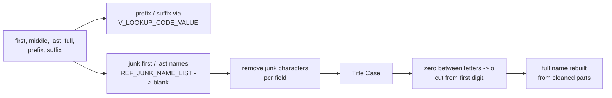
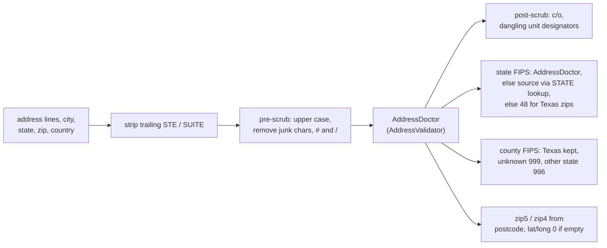

# 000 Shared mapplets and rules

The IDQ mappings call reusable mapplets (`mplt_*`) and rules (`rule_*`). They contain no source-system data flow,
so the Java versions live in the common package `com.idq.cli.core.rules` and are reused by every source.
This document is the business description of each one; the mapping documents link here.

| IDQ object | Java | Used by |
|---|---|---|
| `mplt_Name_Standardization_Indv_Member` | `NameStandardization.standardize` | every party / validation / alias mapping |
| `mplt_Name_Standardization_Trailing_Num_Removal` | `NameStandardization.removeTrailingNumbers` | inside the above, and TRS 003 |
| `mplt_BirthDate_Validation` | `PersonRules.birthDate` | party mappings |
| `mplt_Gender_Validation` | `PersonRules.gender` | party mappings |
| `mplt_Race_Validation`, `mplt_Ethnicity_Validation`, `mplt_Language_Validation` | `PersonRules.codeValue` | party mappings |
| `mplt_Race_Ind_Validation` | `PersonRules.raceIndicators` | ECI, FSS, WIC party |
| `rule_Suffix_Std` | `PersonRules.suffix` | FSS party |
| `mplt_Date_Greater_Than_Fifty_Years` | `PersonRules.notBeyondFiftyYears` | TRS 012 |
| `rule_email_validation_v01` (+ local part / domain rules) | `ContactRules.email` | phone and e-mail mappings |
| `rule_Phone_Std` | `ContactRules.phone` | phone mappings |
| `rule_Phone_Extension_Std` | `ContactRules.phoneExtension` | FSS, TTF phone |
| `rule_USA_SSN_Validation_post_June2011` | `IdentifierRules.ssn` | TRS 004, ECI 016 |
| `rule_MEDICAID_ID_Std` | `IdentifierRules.medicaidId` | TRS 004, ECI 016 |
| `rule_Member_Id_Std` | `IdentifierRules.memberId` | TRS 004 |
| `mplt_Global_Addr_Validation` (+ `rule_Addr_Line_Pre_Scrub1`, `rule_Addr_Line_Post_Scrub`) | `AddressValidator`, `AddressRules` | address mappings |
| `mplt_TRS_Pty_Rle_Alt_Id_Normalization` | `TrsAlternateIdService.normalize` (source specific) | TRS 004 |
| `mplt_Member_Pty_Rle_Phn_Normalization` | `TrsPhoneEmailService.phoneSlots` (source specific) | TRS 006 |
| `mplt_Member_Pty_Rle_Phn_Consolidation`, `mplt_Member_Pty_Rle_EAddr_Consolidation` | `Rows.latestPerKey` | TRS 006 |
| `mplt_Member_Pty_Rle_Rel_Consolidation` | `Rows.currentSegmentPerKey` | TRS 009, 010 |
| `mplt_Pty_Rle_Rel_Timeline_Validation`, `mplt_DST_Correction` | not ported (retired MDM timeline) | TRS 009, 010 |

Every rule that raises an exception looks the code up in `EXC_LOOKUP_CODE_VALUE` for its description and type
(`ExceptionInfo`). Several mappings only route a row to the exception queue when that lookup finds the code
(`ExceptionInfo.configured()`); the mapping documents say where.

## Name standardization

* Prefix and suffix are translated with `V_LOOKUP_CODE_VALUE` code types `PREFIX` / `SUFFIX` for the source system.
  A non-blank value that does not translate gives `Invalid_Prefix` / `Invalid_Suffix` (returned, not written by the
  member mappings).
* A first or last name that appears in `REF_JUNK_NAME_LIST` (edit limitation empty, `FIRST` or `LAST`) is blanked.
* Junk characters are removed per field, then repeated spaces collapsed and the value trimmed. First name removes
  ``~ ! ` @ # $ % ^ & * ( ) _ + = " : ; ? / . > , <`` and tab; middle and last name a similar set (middle also
  removes `-` and `'`).
* Names are converted to title case.
* Trailing-number removal (two IDQ labelers): a `0` between letters becomes the letter `o` (`J0hn` -> `John`);
  the value is then cut at the first digit (`Smith2` -> `Smith`), unless the name ends in `0` and the two characters
  before the last label are not both digits. The IDQ middle-name expression returns the *last* name in that keep
  branch; the Java code preserves this quirk.
* The full name output is rebuilt as `first [middle] last`; the original full name is returned as source full name.

The IDQ labelers use Informatica content sets that are not part of the export; the Java labels letters `X`, the
digit zero `0` and other digits `9`, which is what the expressions test.

## Person rules

* **Birth date**: for member sources and individual parties, a birth date after the run date is rejected: the
  mapplet returns `NULL` and the exception `Invalid_Birth_Date`.
* **Gender**: `M` -> `1`, `F` -> `2`, `B` / `U` -> `NULL` for individuals; organisations always `NULL`. A missing,
  numeric or other value raises `Invalid_Gender`.
* **Race / ethnicity / language**: the source code is translated with `V_LOOKUP_CODE_VALUE` (`RACE`, `ETHNICITY`,
  `LANGUAGE_CD`); a code that does not translate (including a missing code) raises `Invalid_Race`,
  `Invalid_Ethnicity` or `Invalid_Language`.
* **Race indicators** (`mplt_Race_Ind_Validation`): five 0/1 indicators. Exactly one gives `001` white, `002` black,
  `003` native american, `004` asian, `005` pacific islander; two give `006`; more give `007`; none (or a missing
  indicator) raises `Invalid_Race`. The source value written is `WH<w>AA<b>AS<a>PI
NA<n>`.
* **Suffix** (`rule_Suffix_Std`): translated with `V_LOOKUP_CODE_VALUE` *without* a code-type filter; a non-blank
  untranslatable suffix raises `Invalid_Suffix`.
* **Fifty years**: an end date more than fifty years after the run becomes `NULL` (open ended).

## Contact rules

* **E-mail**: the address is trimmed and lower-cased. It is `Invalid_Email` when it contains white space, has no
  `@`, has no dot at or after the `@`, when the domain part (before the last dot) is empty, starts with `.` or `-`,
  ends with `-`, contains `_` after the first character, contains `..` or characters outside `a-z 0-9 . -`, or when
  the top-level domain is not 2 to 11 letters / digits. (The local-part rule compares the address with the literal
  `Invalid`, so it never fires except for that word.)
* **Phone**: punctuation and white space are removed. In this order the number is `Invalid_Phone_Number` when it
  is not numeric, not 10 digits, all zeros or its 4th digit is 0/1; `Missing_AreaCode` for ECI numbers with area
  code `000`; `Invalid_Phone_Number` when the area code is not in `REF_PHN_AREA_CD` (in service, US or
  non-geographic) or the first digit is 0/1; finally TRS, CRE and ECI main / other numbers (`001`, `003`) may not
  use a toll-free area code. The Snowflake filter `current_date()` of the area-code lookup is `SYSDATE` in Oracle.
* **Phone extension**: special characters removed; when present it must be 2 to 6 digits, else
  `Invalid_Phone_Number_Ext`.

## Identifier rules

* **SSN** (`rule_USA_SSN_Validation_post_June2011`): valid when it is nine digits (dashes / spaces allowed) with
  area not `000`, `666` or `9xx`, group not `00`, serial not `0000`. An invalid SSN is blanked and raises
  `Invalid_SSN`. The IDQ rule uses the `USANATID1` token set of the Informatica content; the Java version applies the
  published post-June-2011 SSA rules that token set encodes.
* **Medicaid id**: special characters removed (`ref_special_char_list`, treated as every non letter / digit);
  anything other than 9 characters raises `Invalid_Medicaid_Id`.
* **Member id**: same cleaning; anything other than 9 or 10 characters raises `Invalid_Member_Id`.

## Address validation

`dq_Global_AddressValidation_Hybrid` is Informatica AddressDoctor, a licensed external service, so it is behind the
`AddressValidator` interface. `PassThroughAddressValidator` runs every expression of the mapplet and echoes the
prepared input in place of the service: AddressDoctor-only results (match code, mailability score, geocodes,
CASS / DPV codes) are `NULL`. Plug in a real validator as a Spring bean to replace it.

**Scoring** (`exp_Score_and_Exception_details`, in every address mapping): an address goes to the exception queue
(`Invalid_Address`) when its type is not physical mail (`002`) and the mailability score is 3 or less, when it is
physical mail with a score below 3 and a match code starting with `I` or `N`, or when the address type does not
translate. A missing score compares as `NULL`, so with the pass-through validator every address with a known type is
good.

**Holding lines** (`exp_Address_Hold`): an empty first line is replaced by the second line, which is then cleared when
it repeats the first.

## Retired: MDM timeline

`mplt_Pty_Rle_Rel_Timeline_Validation` duplicated end-dated relationships into an open and a closed version,
re-ranked `VERSION_SEQ`, set `PERIOD_REFERENCE_TIME`, `TIMELINE_ACTION` and forced `HUB_STATE_IND` for open rows;
`mplt_DST_Correction` shifted end dates by one hour around daylight-saving changes for that timeline. The C_S_*
timeline is stale and not used, so neither is ported, and no `VERSION_SEQ` / version-rank logic of any mapping is
ported. Where a mapping relied on the rank to keep one row per key, the Java code keeps one row per
`PKEY_SRC_OBJECT` (documented per mapping).
