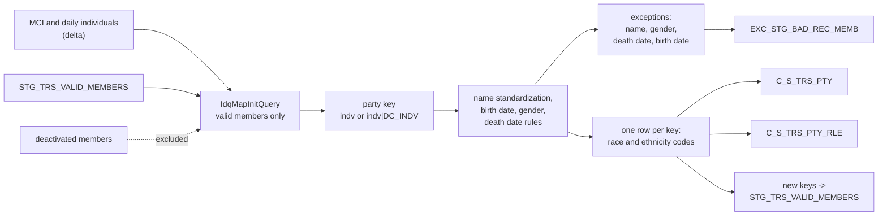

# 001 m_Tgt_C_S_TRS_Pty_OnGoing

| | |
|---|---|
| Source system | TRS (TIERS), workflow `wf_TRS_Stage_Load_1_Ongoing`, first mapping |
| Sub-domain | Demographics (plus Role) |
| Sources | `STG_TRS_D_DC_INDV`, `STG_TRS_D_CV_DC_MCI_INDV`, `STG_TRS_D_CV_MCI_EDG_INDV_TOA`, `STG_TRS_VALID_MEMBERS`, `STG_TRS_DEACTIVED_MEMBERS`
 |
| Targets | `C_S_TRS_PTY`, `C_S_TRS_PTY_RLE`, `STG_TRS_VALID_MEMBERS` (registry), `EXC_STG_BAD_REC_MEMB` |
| Java | `com.idq.cli.source.trs.etlmap.svc.TrsPartyOnGoingService` |

## Business purpose

Publishes the demographics of every TIERS individual that is currently a *valid member* and keeps the valid-member
registry `STG_TRS_VALID_MEMBERS` that every other TRS mapping joins to.

An individual is valid when, in today's delta, it is reported as a converted MCI individual, as a cleared, active,
non-deleted daily individual, as an active MCI individual, or it was already registered as valid - unless today's
delta inactivates or deletes it, or it is listed as deactivated. TIERS can report the same person twice: once as an
MCI conversion record and once as a daily (`DC_INDV`) record; both are kept as separate source keys.

## Process



## IdqMapInitQuery

### TRS-001 Valid member demographics

* `New_Valid_indvs`: union of converted MCI individuals (`CONVERSION_IND = 'C'`), daily individuals that are file
  cleared, active and not deleted, active MCI individuals and the existing registry; minus individuals inactivated
  or deleted today (daily or MCI) and minus `STG_TRS_DEACTIVED_MEMBERS`.
* `ALL_INDV`: every MCI and every daily individual row with its names, gender, race, ethnicity, birth date, create
  date; daily rows also SSA / file-clearance switches and death date. `SRC_TBL` tells them apart (`MCI`,
  `DC_INDV`).
* Result: the trimmed demographics of all rows whose individual is in the valid set, ordered by individual and
  source table.
* **Stale filter removed**: the source qualifier carried `INDV_ID=504937068`, a single-member test filter.
* IDQ parameters inlined: `$MCI_TBL_SRC = MCI`, `$DC_INDV_TBL_SRC = DC_INDV`. Optimizer hints and commented-out
  code removed.

Entity: `TrsQueryRows.MemberDemographics` - named query: `TrsDcIndvDeltaRepository#fetchMemberDemographics`.

```sql
WITH new_valid_indvs AS (
    SELECT DISTINCT indv_id FROM stg_trs_d_cv_mci_edg_indv_toa WHERE conversion_ind = 'C'
    UNION
    SELECT DISTINCT indv_id FROM stg_trs_d_dc_indv
    WHERE file_clearance_sw = 'Y' AND inactive_ind = 'N' AND delete_sw = 'N'
    UNION
    SELECT DISTINCT indv_id FROM stg_trs_d_cv_dc_mci_indv WHERE inactive_ind = 'N'
    UNION
    SELECT DISTINCT indv_id FROM stg_trs_valid_members
    MINUS
    SELECT DISTINCT indv_id FROM stg_trs_d_dc_indv WHERE inactive_ind = 'Y' OR delete_sw = 'Y'
    MINUS
    SELECT DISTINCT indv_id FROM stg_trs_d_cv_dc_mci_indv WHERE inactive_ind = 'Y'
    MINUS
    SELECT indv_id FROM stg_trs_deactived_members
),
all_indv AS (
    SELECT indv_id, first_name, mid_name, last_name, sufx_name, prefix_name, gender_cd, race_cd,
           ethnicity_cd, NULL AS ssa_val_sw, NULL AS file_cl_sw, dob_dt, NULL AS death_dt, create_dt,
           'MCI' AS src_tbl
    FROM stg_trs_d_cv_dc_mci_indv
    UNION ALL
    SELECT indv_id, first_name, mid_name, last_name, sufx_name, prefix_name, gender_cd, race_cd,
           ethnicity_cd, ssa_validation_sw, file_clearance_sw, dob_dt, death_dt, create_dt,
           'DC_INDV' AS src_tbl
    FROM stg_trs_d_dc_indv
)
SELECT DISTINCT a.indv_id, RTRIM(LTRIM(a.first_name)) AS first_name, RTRIM(LTRIM(a.mid_name)) AS mid_name,
       RTRIM(LTRIM(a.last_name)) AS last_name, RTRIM(a.sufx_name) AS sufx_name,
       RTRIM(a.prefix_name) AS prefix_name, a.gender_cd, a.race_cd, a.ethnicity_cd, a.ssa_val_sw,
       a.file_cl_sw, a.dob_dt, a.create_dt, a.src_tbl, a.death_dt
FROM all_indv a
JOIN new_valid_indvs f ON f.indv_id = a.indv_id
ORDER BY a.indv_id, a.src_tbl
```

### Lookup: existing valid members

`lkp_Stg_TRS_Valid_Members` - entity `String` - named query `TrsValidMemberRepository#fetchValidMemberKeys`.

```sql
SELECT PTY_PK FROM STG_TRS_VALID_MEMBERS
```

## Business rules

1. **Full name** = `first [middle] last`.
2. **Name standardization** (`mplt_Name_Standardization_Indv_Member`, see [000](000_mapplets.md#name-standardization)).
3. **Party is valid** when the standardized first or last name is present; a party missing one of them is still
   loaded but also reported as `Missing_First_Name` / `Missing_Last_Name`.
4. **Gender** and **death date** problems never reject the party: a death date after the run is reported as
   `Invalid_Death_Date`, an invalid gender as `Invalid_Gender` (only when the code exists in
   `EXC_LOOKUP_CODE_VALUE`).
5. **Birth date** in the future: reported as `Invalid_Birth_Date`, the party is loaded without a birth date.
6. **Race / ethnicity** translate through `V_LOOKUP_CODE_VALUE` (`RACE`, `ETHNICITY`, source `TRS`); untranslatable
   codes are reported (`Invalid_Race`, `Invalid_Ethnicity`) and loaded as `NULL`, the source code is kept in
   `SRC_RACE_CD` / `SRC_ETHNCTY`.
7. **One row per party key**: rows are made distinct and the latest (by create date) per key is written
   (`srtr_Dedup_Rec` + `Aggregator1`).
8. **Registry**: party keys not yet in `STG_TRS_VALID_MEMBERS` are appended with the run time.

## PKEY formulation

| Target | PKEY_SRC_OBJECT | Example |
|---|---|---|
| `C_S_TRS_PTY` | `INDV_ID` for MCI rows, `INDV_ID|DC_INDV` for daily rows | `123|DC_INDV` |
| `C_S_TRS_PTY_RLE` | `<party key>|Member`, `PTY_FK` = party key | `123|DC_INDV|Member` |
| `STG_TRS_VALID_MEMBERS` | `PTY_PK` = party key | `456` |

Unit test: `TrsPkeyTest#m_Tgt_C_S_TRS_Pty_OnGoing_pkey_test`.

## Retired / not ported

* `VERSION_SEQ`, MD5 change detection, `DUP_RANK` and the `VERSION_SEQ_NUM = 1` filter (`fltr_Dups`) belong to the
  stale MDM timeline (the version was hard-coded to 1, so the filter passed every row).
* `Utility.Table_Pre_Load_Maint` / `Table_Post_Load_Maint` pre/post SQL calls (MDM maintenance procedures, not part
  of the exports). `DBMS_STATS` on the registry.

## Java implementation

* `TrsPartyOnGoing extends SourceMapping implements MemberMapping.Demographics` - `transform` is pure: init rows +
  `Lookups(validMemberKeys)` + `EtlContext` -> `MappingOutput`.
* `validate` builds a `Validated` record per row (party key, standardized name, birth / gender / death checks);
  `exceptions` mirrors the router groups; `EtlPatterns.badData4*` build the exception rows.
* Load: `TargetBatch.replaceAll` for `C_S_TRS_PTY` / `C_S_TRS_PTY_RLE` (IDQ truncate target), `append` for the
  registry and exceptions.
* Entities `TrsTargets.Party` (`Columns.Party` + `DEATH_DT`), `TrsTargets.PartyRole`, `TrsTargets.ValidMember`.
* Source entities (raw source tables, captured in the `adhoc_runs_*` audit reports): `TrsSources.DcIndvDelta`
  (`STG_TRS_D_DC_INDV`), `TrsSources.CvDcMciIndvDelta` (`STG_TRS_D_CV_DC_MCI_INDV`), `TrsSources.CvMciEdgIndvToaDelta`
  (`STG_TRS_D_CV_MCI_EDG_INDV_TOA`), `TrsTargets.ValidMember` (`STG_TRS_VALID_MEMBERS`), `TrsSources.DeactivedMembers`
  (`STG_TRS_DEACTIVED_MEMBERS`).
